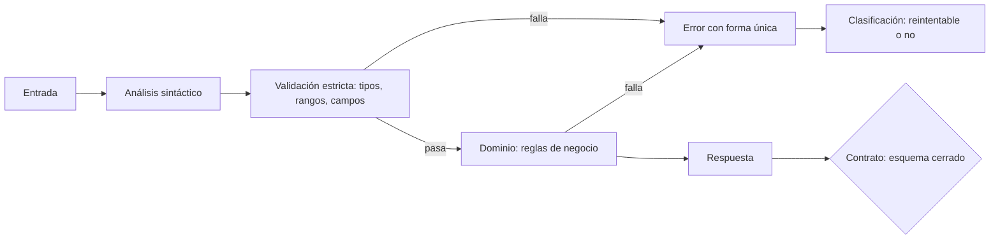
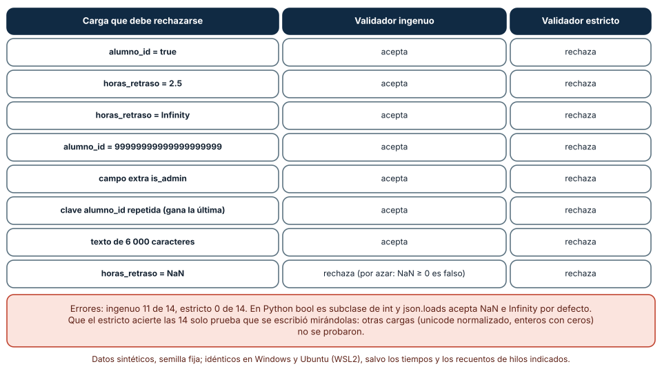
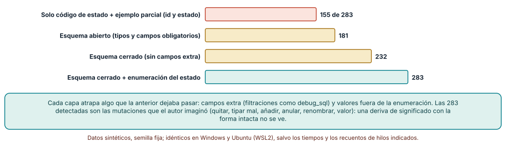
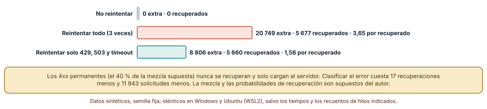

# SE-244 — Validación, errores y contratos consistentes

[← SE-243 — RPC, GraphQL y selección de interfaz](../../classes/part-20-backend-apis-y-procesamiento-asincrono/se-243-rpc-graphql-y-seleccion-de-interfaz/README.md) · [↑ Parte 20](../../classes/part-20-backend-apis-y-procesamiento-asincrono/README.md) · [📚 Índice completo](../../classes/README.md) · [🌐 Portal](../../site/classes/SE-244.html) · [SE-245 — Autenticación, autorización y contexto →](../../classes/part-20-backend-apis-y-procesamiento-asincrono/se-245-autenticacion-autorizacion-y-contexto/README.md)

## Punto profesional y fundamento pedagógico

**Punto profesional.** La clase existe para que decidas qué se valida en la frontera del servicio y qué en el dominio, que midas qué deja pasar un validador escrito con buena fe, que mantengas una forma de error única y que clasifiques los fallos para que el cliente sepa si reintentar. Un contrato consistente es el que dice lo mismo en cada ruta, no el que tiene un esquema en un archivo.

**Por qué aparece aquí.** Se sitúa después de **RPC, GraphQL y selección de interfaz** y antes de **Autenticación, autorización y contexto**: `SE-243` dejó tres superficies y la elección de estilo; esta clase pregunta qué ocurre cuando llega algo incorrecto por cualquiera de ellas. Su producto (carga validada, errores con forma única y clasificación para reintentos) es la base de la identidad de `SE-245` y de la idempotencia de `SE-246`, que dependen de saber si un fallo es permanente o transitorio.

**Error conceptual que debe corregir.** Creer que validar es comprobar que «parece JSON con los campos esperados». En lenguajes con tipos flexibles un booleano puede pasar por entero, un decimal por horas, `Infinity` por número y un campo adicional por inocuo; la validación que no cuenta los casos límite deja la puerta abierta de forma silenciosa.

**Secuencia de aprendizaje.** Antes de ejecutar, predices cuántas de 14 cargas límite aceptará un validador basado en el tipo de Python; después mides cuántas mutaciones de una respuesta detecta cada capa de comprobación del contrato, y por último calculas cuántas solicitudes adicionales genera un cliente que reintenta todos los errores frente a uno que clasifica. La secuencia usa predicción, explicación propia, contraste y recuperación. [ICAP](https://icap.education.asu.edu/research) distingue participación de construcción de conocimiento; [How People Learn II](https://nap.nationalacademies.org/catalog/24783/how-people-learn-ii-learners-contexts-and-cultures) exige conectar conocimiento previo, contexto y transferencia; la [práctica de recuperación](https://pubmed.ncbi.nlm.nih.gov/16507066/) respalda producir de nuevo la explicación tras una demora; y [Education for Life and Work](https://nap.nationalacademies.org/resource/13398/dbasse_084153.pdf) exige devolución que explique la causa del error.

**Evidencia de aprendizaje.** `contract-log.md` con la lista de 14 cargas, la predicción, el resultado del validador ingenuo y del estricto, la tabla de detección de mutaciones por capa, el cálculo de solicitudes adicionales por política de reintento y la forma única de error de la plataforma.

**Límite de la conclusión.** El validador estricto acierta las 14 cargas porque se escribió mirándolas; otras cargas (unicode normalizado, enteros con ceros, fechas) no se probaron. Las mutaciones son las que el autor imaginó, y la mezcla de errores (40 % permanentes) y las probabilidades de recuperación son supuestos. Ninguna API real fue auditada.

### Trazabilidad fuente → afirmación

| Fuente primaria u oficial | Afirmación que respalda | Lo que no prueba |
|---|---|---|
| [The JSON Data Interchange Format (RFC 8259)](https://www.rfc-editor.org/rfc/rfc8259) | Define la sintaxis JSON y deja abierto el comportamiento ante claves duplicadas y números fuera de rango. | No dice cómo debe validar una aplicación concreta. |
| [OWASP Input Validation Cheat Sheet](https://cheatsheetseries.owasp.org/cheatsheets/Input_Validation_Cheat_Sheet.html) | Recomienda validar sintaxis y semántica en el servidor con listas de permitidos, límites de longitud y rechazo de lo inesperado. | No cuantifica cuántos casos límite pasan por un validador real. |
| Problem Details for HTTP APIs (RFC 9457) | Propone un formato común para describir errores de una API (tipo, título, estado, detalle). | No decide qué errores debe tener la plataforma ni su clasificación para reintentos. |

## Antes de empezar

Recupera `SE-243`: la plataforma tiene recursos, una consulta con selección y llamadas internas. La pregunta activa es: **¿qué ocurre con lo que llega mal formado, fuera de rango o con campos que nadie pidió, y cómo se lo cuenta el servicio al cliente?**

## Prerrequisitos

- Haber completado `SE-243` o poder explicar qué evidencia entregó y qué quedó abierto.
- Python 3.11 o posterior; los experimentos usan `json`, `random` y `math`.
- Saber que en Python `bool` es subclase de `int` (se comprobará en la clase).
- Haber diseñado en `SE-242` los recursos y representaciones de la plataforma.

## Problema auténtico

El endpoint de alta recibe `{alumno_id, horas_retraso, texto}`. Un cliente móvil envía `"horas_retraso": true` por un error de serialización y el servicio lo trata como 1; otro envía `Infinity` y el cálculo de la penalización devuelve nota negativa; un tercero añade `"is_admin": true` y nadie se pregunta qué hace ese campo. Los errores que devuelve el servicio tienen tres formas distintas según el programador que escribió cada ruta, y el cliente reintenta incluso los errores 400.

## Objetivos observables

Al terminar podrás:

1. escribir un validador estricto y medir con 14 cargas límite qué acepta uno ingenuo y qué uno estricto;
2. explicar por qué un esquema cerrado y una enumeración detectan más deriva que un ejemplo parcial, y cuánto, con 283 mutaciones;
3. definir una forma única de error con tipo, estado y detalle sin filtrar datos internos;
4. clasificar fallos en permanentes y transitorios y calcular la carga adicional de reintentar todo frente a clasificar;
5. declarar qué se valida en la frontera, qué en el dominio y qué se rechaza sin explicar.

## Mapa conceptual



El mapa se lee de la entrada a la respuesta: primero la forma (sintaxis y esquema), después el significado (dominio). Ambos fallos desembocan en la misma forma de error, que lleva una clasificación para el cliente. El contrato de salida comprueba además lo que el servicio devuelve. No son dos validaciones iguales: la de frontera rechaza lo mal formado y la del dominio rechaza lo que es válido pero inadmisible.

## Temas y por qué importan

| Tema | Por qué cambia una decisión profesional | Evidencia mínima |
|---|---|---|
| Validación en la frontera | Lo que no se rechaza al entrar se convierte en un caso del dominio, donde es más caro entenderlo. | Resultado de 14 cargas límite en dos validadores |
| Reglas del dominio | Una carga bien formada puede ser inadmisible (horas negativas, entrega duplicada) y eso lo decide el negocio. | Lista de reglas separadas de las de forma |
| Forma única de error | Si cada ruta devuelve su propio formato, el cliente escribe un analizador por ruta y se equivoca. | Ejemplo de error con tipo, título y estado, sin SQL ni rutas |
| Clasificación de fallos | Reintentar un error permanente solo añade carga; no reintentar uno transitorio pierde trabajo. | Solicitudes adicionales por política |
| Contrato comprobable | Un contrato que no se ejecuta deriva: se mide con mutaciones qué capa detecta cada tipo de cambio. | Tabla de detección por capa de comprobación |

## Conceptos y decisiones

### 1. Validación en la frontera

Validar es decidir si una entrada pertenece al conjunto de lo aceptable *antes* de que active lógica. Un conjunto de permitidos (lista blanca) es más seguro que uno de prohibidos: se enumera qué es válido (`alumno_id` entero positivo de 31 bits, `horas_retraso` entero entre 0 y 8 760, `texto` de 1 a 5 000 caracteres) y todo lo demás se rechaza, incluidos los campos extra. En Python hay trampas concretas: `True` es un `int`, `json.loads` acepta `NaN` e `Infinity` por defecto, las claves duplicadas se resuelven en silencio con la última y `int('٣')` convierte un dígito arábigo en 3.

### 2. Reglas del dominio

La forma correcta no basta: `horas_retraso = 8 760` es un entero válido que quizá no tenga sentido en un plazo de una semana. Estas reglas viven en el dominio (`SE-241`), con sus propias pruebas, y deben producir errores de tipo distinto al de forma para que el cliente distinga «arregla tu solicitud» de «la regla de negocio lo impide». Mezclarlas lleva a validadores enormes que nadie se atreve a tocar.

### 3. Forma única de error

Todos los errores de la plataforma comparten una forma: un `type` (identificador estable), un `title` legible, un `status` y, si ayuda, un `detail` y campos que fallaron. El identificador estable permite al cliente decidir sin analizar texto. Lo que nunca debe entrar es el SQL, la traza, el nombre del archivo del servidor ni datos de otra persona. Un error amable y un registro interno detallado se enlazan con un identificador de correlación (`SE-250`).

### 4. Clasificación de fallos

Un 400 o un 422 significan «esta solicitud no se arregla repitiéndola»; un 429 o un 503 significan «inténtalo después»; un tiempo agotado no dice nada y exige idempotencia (`SE-246`). Declarar esa clasificación en el contrato evita el reintento ciego. Con 10 000 fallos de una mezcla supuesta (40 % permanentes, 25 % 429, 20 % 503, 15 % tiempo agotado), reintentar todo tres veces genera 20 749 solicitudes adicionales para recuperar 5 677 fallos; clasificar genera 8 806 para recuperar 5 660.

### 5. Contrato comprobable

El contrato de salida también se comprueba: la respuesta real debe cumplir el esquema. Un ejemplo parcial (comprobar el `id` y el `estado`) deja pasar un campo renombrado o uno nuevo; un esquema abierto no ve campos extra; uno cerrado no ve un valor fuera de la enumeración. Cada capa añade una clase de defecto detectable y todas pueden medirse con mutaciones de una respuesta de referencia.

### Catorce cargas límite contra dos validadores

El validador ingenuo comprueba tipos con `isinstance(x, int)` y `horas >= 0`. El estricto exige exactamente los tres campos, enteros reales (`type(x) is int`), rangos acotados, texto de 1 a 5 000 caracteres y detecta claves duplicadas con `object_pairs_hook`. Las 14 cargas incluyen la válida, un booleano como entero, decimales, `NaN`, `Infinity`, un entero de 20 dígitos, id cero, campo extra, clave repetida, texto vacío, texto de 6 000 caracteres y `1e308`.

```python
def ingenuo(d):
    return (isinstance(d.get("alumno_id"), int) and isinstance(d.get("horas_retraso"), (int, float))
            and isinstance(d.get("texto"), str) and d["horas_retraso"] >= 0)
```

Resultado, idéntico en Windows y Ubuntu: el ingenuo se equivoca en **11 de 14** cargas; el estricto, en **0 de 14**. El ingenuo acepta `true` como id y como horas, `2.5`, `Infinity`, `1e308`, el id enorme, el id cero, el campo `is_admin`, la clave duplicada, el texto vacío y el de 6 000 caracteres. Rechaza las horas negativas y `NaN`, este último por azar (la comparación `NaN >= 0` es falsa). Además `int('٣')` vale 3 y `'٣'.isdigit()` es verdadero mientras `'٣'.isascii()` es falso: validar con `isdigit` admite dígitos que otros componentes no esperan.



**Cómo leer la figura.** Cada fila es una carga que debía rechazarse; la columna del medio es el validador basado en tipos y la derecha el estricto. **Dónde deja de valer:** que el estricto acierte las 14 solo prueba que fue escrito mirándolas; otras cargas (normalización de unicode, enteros con ceros iniciales, fechas) no se probaron. Un buen validador no sustituye la decisión de qué rango tiene sentido para el negocio.

### Deriva entre contrato y respuesta: qué capa la detecta

A partir de una respuesta de referencia `{id, estado, nota, horas_retraso}` se generan 300 mutaciones con semilla 244: quitar un campo, cambiar su tipo, añadir un campo extra (`debug_sql`), anular un campo, renombrarlo o cambiar el valor del estado (`RECIBIDA`, `recibida` con un espacio final u `ok`). Diecisiete mutaciones no cambian la respuesta y se descartan; quedan 283 reales.

Una comprobación que mira solo el código de estado y un ejemplo parcial (`id` y `estado`) detecta **155**; un esquema abierto con tipos y campos obligatorios, **181**; uno cerrado (sin campos extra), **232**; y uno cerrado con enumeración del estado, **283**. Las 51 mutaciones de campo extra solo las ve el esquema cerrado, y las de valor, la enumeración.



**Cómo leer la figura.** Cada barra suma lo que detecta esa capa de comprobación; las siguientes añaden más defectos al mismo conjunto de 283 mutaciones. **Dónde deja de valer:** las mutaciones son las que el autor imaginó; un cambio de significado con la misma forma (la nota pasa de 0–100 a 0–10) pasa por todas las capas. La detección del 100 % solo vale para ese catálogo.

### Reintentar todo o clasificar el error

Se generan 10 000 fallos con la mezcla 40 % permanentes (400), 25 % de 429, 20 % de 503 y 15 % de tiempo agotado, y probabilidades de recuperarse en un reintento de 0, 0,8, 0,6 y 0,5. Un cliente puede no reintentar, reintentar todo hasta tres veces o reintentar solo 429, 503 y tiempo agotado.

Reintentar todo envía **20 749 solicitudes adicionales** y recupera **5 677** fallos (3,65 extra por recuperado); clasificar envía **8 806** y recupera **5 660** (1,56 por recuperado); no reintentar no envía ninguna. Clasificar cuesta 17 recuperaciones y ahorra 11 943 solicitudes: las que se dirigían a errores que nunca se arreglan.



**Cómo leer la figura.** Cada barra suma las solicitudes extra de una política; la etiqueta añade cuántos fallos recupera y el costo por recuperado. **Dónde deja de valer:** la mezcla y las probabilidades de recuperación son supuestos del autor, no una medición. Tampoco considera que un 503 reintentado por miles de clientes a la vez empeora el fallo (`SE-246`).

## Definiciones de trabajo

- **lista de permitidos:** regla de validación que enumera lo aceptable y rechaza todo lo demás.
- **esquema cerrado:** esquema que rechaza campos no declarados.
- **error permanente:** fallo que se repite igual si se reintenta la misma solicitud.
- **error transitorio:** fallo que puede desaparecer al reintentar más tarde.
- **deriva del contrato:** diferencia creciente entre lo que el contrato dice y lo que la implementación hace.

Las definiciones son operativas para la plataforma de entregas. No convierten términos con una historia técnica más amplia en sinónimos y deben contrastarse con la documentación primaria enlazada al final.

## Ejemplo mínimo

El fragmento muestra por qué `isinstance` no basta. Antes de ejecutarlo, predice cuál de los dos valores aceptará.

```python
print(isinstance(True, int), type(True) is int)
```

Resultado: `True False`. `isinstance` acepta el booleano porque `bool` hereda de `int`; la comparación de tipo exacto lo rechaza. Registra versión y salida; después prueba `float('inf')` con `isinstance(x, (int, float))` y decide qué regla de rango lo rechaza.

## Ejemplo profesional

La plataforma valida en dos capas: la frontera rechaza con 422 y `type` estable todo lo que no está en la lista de permitidos (tipos exactos, rangos, campos extra, claves repetidas); el dominio rechaza con 409 o 422 las reglas del negocio (entrega fuera de plazo sin prórroga). Todos los errores comparten una forma de cuatro campos y un identificador de correlación. El contrato publicado indica qué errores son reintentables (429, 503) y cuáles no (400, 422). Compara el diseño con el original en tres casos: un móvil con un booleano en lugar de un número, una integración que añade un campo y una avalancha de reintentos tras un 503.

## Práctica guiada

1. Escribe el validador ingenuo y predice cuántas de las 14 cargas aceptará.
2. Ejecuta las 14 cargas y compara con tu predicción; añade tres cargas propias.
3. Escribe el validador estricto y mide sus errores sobre las 14 cargas y las tuyas.
4. Define la forma única de error y escribe cinco errores de la plataforma con ella.
5. Genera mutaciones de una respuesta y mide qué capa detecta cuáles.
6. Calcula con tu mezcla de fallos las solicitudes adicionales de cada política de reintento.
7. Entrega `contract-log.md` y pide a otra persona que añada una carga límite que tu validador no cubra.

## Ejercicios

1. **Cargas:** añade cinco cargas límite (unicode normalizado, entero con ceros, cadena con byte nulo, objeto anidado, texto con saltos) y mide los dos validadores.
2. **Errores:** diseña el error para «entrega fuera de plazo» y decide estado, tipo y si es reintentable; justifica qué detalle puede mostrarse.
3. **Mutaciones:** añade la mutación «nota de 0–100 a 0–10» y razona qué capa podría detectarla.
4. **Reintentos:** cambia la mezcla a 10 % permanentes y recalcula; decide cuándo deja de compensar clasificar.

## Reto verificable

Entrega `contract-log.md` con las cargas, los dos validadores y sus errores, la forma de error, la tabla de mutaciones y el cálculo de reintentos. Se aprueba si otra persona obtiene las mismas cifras desde un checkout limpio y puede añadir una carga límite que cambie el resultado del validador estricto. No se aprueba por tener un esquema: debe verse qué defecto detecta.

## Caso conductor

La plataforma de entregas recibe ahora solo cargas que pasan por una frontera estricta y devuelve errores con una forma única. Recupera `SE-243`: la superficie de consulta aplica los mismos límites. La clase siguiente se pregunta quién hace la solicitud y qué le corresponde. Cambia después una sola decisión, el rango de `horas_retraso`, y revisa qué artefactos hay que tocar.

## Preguntas frecuentes

### ¿Basta con validar en la interfaz de usuario?

No. La interfaz es una comodidad; cualquier cliente puede llamar a la API sin ella. Lo que no valida el servidor no está validado.

### ¿Un esquema JSON sustituye al validador?

Lo expresa y lo hace revisable, pero conviene comprobar qué cubre: algunos esquemas aceptan enteros decimales con valor entero (`2.0`) o dejan abiertos los campos extra. Se mide con cargas límite, como en la clase.

### ¿Debo explicar siempre por qué se rechaza una solicitud?

Para errores de forma, sí: un campo y una causa ayudan al cliente. Para autenticación y autorización, explicar demasiado revela información (`SE-245`). La regla es explicar lo que el cliente puede corregir y no lo que ayuda a un atacante.

### ¿Por qué devolver 422 y no 400?

La convención varía: 400 para solicitudes mal formadas sintácticamente y 422 para las bien formadas pero semánticamente inválidas. Lo importante es elegir una distinción, documentarla y mantenerla en todas las rutas.

## Fallo controlado y diagnóstico

Reproduce el fallo de la clase: **aceptar `true` como número de horas**. Envía `{"alumno_id": 7, "horas_retraso": true, "texto": "x"}` al validador ingenuo. **Síntoma:** la entrega queda con 1 hora de retraso y una penalización que nadie esperaba. **Hipótesis rivales:** (a) el cliente calculó 1 hora; (b) un error de serialización envió un booleano. **Prueba:** registra el cuerpo crudo y comprueba que el valor era `true`, no `1`. **Causa:** `isinstance(True, int)` es verdadero. **Corrección:** comparar el tipo exacto y rechazar con 422. **Regresión:** una prueba parametrizada con las 14 cargas, incluida esta.

## Errores comunes y cómo corregirlos

| Síntoma | Causa probable | Corrección |
|---|---|---|
| Una nota negativa aparece en el panel | `Infinity` o un número enorme aceptados por el validador | Rangos acotados y rechazo de valores no finitos |
| Un cliente consigue campos que no debería tener | Esquema abierto: los campos extra pasan al dominio | Esquema cerrado y lista de permitidos |
| Cada ruta devuelve errores distintos | Errores construidos a mano en cada manejador | Forma única y una función central |
| El cliente reintenta un 400 diez veces | El contrato no clasifica los errores | Documentar reintentables y permanentes |
| El error muestra una consulta SQL | Excepción interna reenviada al cliente | Capturar, registrar con correlación y devolver un error genérico |

## Entorno y archivos clave

```text
work/SE-244/
├── README.md
├── contract/
│   ├── validadores.py
│   ├── mutaciones.py
│   └── reintentos.py
├── tests/test_cargas.py
└── evidence/contract-log.md
```

El `README` declara plataforma, versión de Python, semillas (244) y comandos. Los experimentos usan solo la biblioteca estándar; las salidas fueron idénticas en CPython 3.12.9 (Windows 11) y 3.12.3 (Ubuntu bajo WSL2). Los números de 20 dígitos y `1e308` se prueban con `json.loads` sin dependencias.

## Seguridad, ética y accesibilidad

- valida en el servidor aunque la interfaz ya lo haga: la API se llama sin la interfaz;
- un campo extra aceptado puede ser una asignación masiva (`SE-251`); rechaza lo que no declaras;
- un error no debe contener rutas, SQL, trazas ni datos de otras personas;
- limita el tamaño del cuerpo antes de analizarlo (`SE-248`);
- redacta los errores en lenguaje comprensible y con una vía de corrección.

## Puente hacia el trabajo con agentes

Un agente al que se le pide «valida la entrada» suele escribir `isinstance` y dejar abiertos los campos extra. Pídele la lista de permitidos con rangos, el resultado sobre una batería de cargas límite (booleano, `Infinity`, entero enorme, clave repetida) y una forma única de error. Revisa especialmente si aceptó `true` como entero: es el mismo defecto que el validador ingenuo.

## Transferencia

Traslada el experimento a otro de los dominios persistentes (por ejemplo, un formulario de pago ficticio): cambia los campos y conserva el procedimiento de mirar el validador con cargas límite y medir la deriva con mutaciones. La transferencia está lograda cuando explicas qué parte dependía de Python y cuál es el procedimiento general.

## Evaluación y evidencia

| Criterio | Evidencia para aprobar |
|---|---|
| comprensión | explicación de frontera frente a dominio con dos ejemplos |
| corrección | errores de los validadores y detección por capa reproducibles |
| diseño | forma única de error con clasificación de reintentos |
| diagnóstico | reproducción del booleano como entero con regresión |
| incertidumbre | declaración de las cargas no probadas y de los supuestos de la mezcla de fallos |
| reproducibilidad | versiones, comandos, salida y límites declarados |

## Fuentes

- [The JSON Data Interchange Format (RFC 8259)](https://www.rfc-editor.org/rfc/rfc8259) — sintaxis JSON y casos abiertos; autoridad: IETF.
- [OWASP Input Validation Cheat Sheet](https://cheatsheetseries.owasp.org/cheatsheets/Input_Validation_Cheat_Sheet.html) — validación en el servidor con listas de permitidos; autoridad: OWASP.
- Problem Details for HTTP APIs (RFC 9457) (enlace no verificado en esta ejecución; búscalo por título) — formato común de errores; autoridad: IETF.
- [HTTP Semantics (RFC 9110)](https://www.rfc-editor.org/rfc/rfc9110) — códigos de estado 4xx y 5xx; autoridad: IETF.
- [JSON Schema 2020-12: Validation](https://json-schema.org/draft/2020-12/json-schema-validation) — vocabulario de validación de datos; autoridad: proyecto JSON Schema.
- [Timeouts, retries and backoff with jitter](https://aws.amazon.com/builders-library/timeouts-retries-and-backoff-with-jitter/) — reintentos, tiempos máximos y retroceso; autoridad: Amazon Builders' Library.
- [Python: json](https://docs.python.org/3/library/json.html) — análisis de JSON y `object_pairs_hook`; autoridad: Python Software Foundation.
- [SWEBOK Guide v4.0a](https://www.computer.org/education/bodies-of-knowledge/software-engineering) — calidad y requisitos como áreas de conocimiento; autoridad: IEEE Computer Society.

Cada fuente respalda el mecanismo indicado; ninguna demuestra que las cifras sintéticas de esta clase describan un sistema real. Las fuentes marcadas como no verificadas se citan por título porque no se pudo comprobar su enlace en esta ejecución (sin acceso de red autorizado); se verificaron las demás por haberse comprobado en clases publicadas de otras partes.

## Límites y siguiente paso

Se ejecutaron tres experimentos con datos sintéticos en Windows y Ubuntu (WSL2) con resultados idénticos. No se auditó ninguna API real ni se midió a ninguna persona: las cargas, las mutaciones y la mezcla de fallos son construcciones del autor. La siguiente clase pregunta quién hace la solicitud y qué le está permitido.

## Glosario

- **frontera de validación:** punto del servicio donde la entrada cruda se convierte en datos admitidos o se rechaza.
- **asignación masiva:** vulnerabilidad por la que el servicio acepta campos que el cliente no debería poder fijar.
- **identificador de correlación:** valor que une la respuesta al cliente con el registro interno de la misma solicitud.
- **mutación:** cambio deliberado de una respuesta para comprobar si una comprobación lo detecta.
- **enumeración:** conjunto cerrado de valores válidos de un campo.

---

[← SE-243 — RPC, GraphQL y selección de interfaz](../../classes/part-20-backend-apis-y-procesamiento-asincrono/se-243-rpc-graphql-y-seleccion-de-interfaz/README.md) · [↑ Parte 20](../../classes/part-20-backend-apis-y-procesamiento-asincrono/README.md) · [📚 Índice completo](../../classes/README.md) · [🌐 Portal](../../site/classes/SE-244.html) · [SE-245 — Autenticación, autorización y contexto →](../../classes/part-20-backend-apis-y-procesamiento-asincrono/se-245-autenticacion-autorizacion-y-contexto/README.md)
