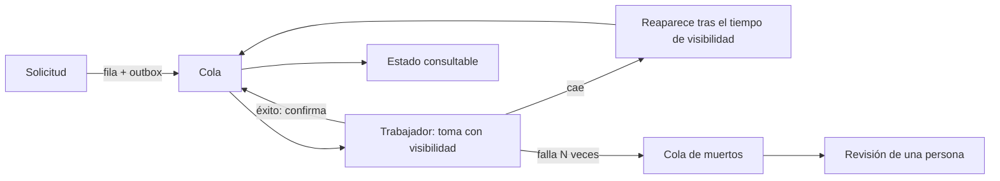
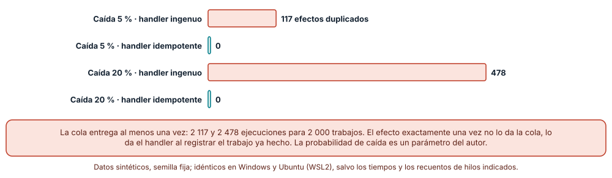
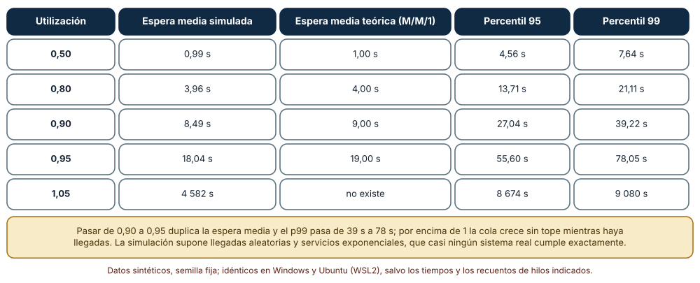
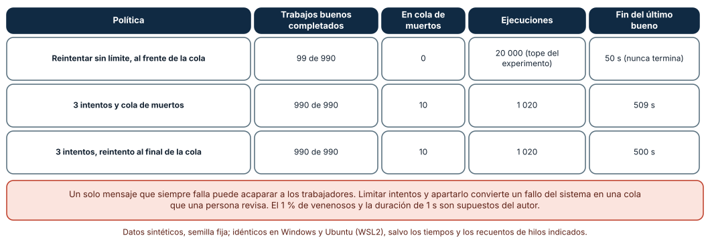

# SE-247 — Jobs, colas y procesamiento diferido

[← SE-246 — Idempotencia, reintentos y deduplicación](../../classes/part-20-backend-apis-y-procesamiento-asincrono/se-246-idempotencia-reintentos-y-deduplicacion/README.md) · [↑ Parte 20](../../classes/part-20-backend-apis-y-procesamiento-asincrono/README.md) · [📚 Índice completo](../../classes/README.md) · [🌐 Portal](../../site/classes/SE-247.html) · [SE-248 — Archivos, streaming y cargas extensas →](../../classes/part-20-backend-apis-y-procesamiento-asincrono/se-248-archivos-streaming-y-cargas-extensas/README.md)

## Punto profesional y fundamento pedagógico

**Punto profesional.** La clase existe para que diseñes el trabajo que ocurre fuera de la solicitud: una cola con visibilidad, trabajadores que pueden caer, reintentos acotados y un lugar para lo que nunca termina. Aprenderás a medir cuántos efectos duplica una cola al menos una vez, cómo crece la espera con la utilización y qué hace un mensaje venenoso con el resto.

**Por qué aparece aquí.** Se sitúa después de **Idempotencia, reintentos y deduplicación** y antes de **Archivos, streaming y cargas extensas**: `SE-246` hizo repetible una solicitud; esta clase hace repetible un trabajo. La entrega al menos una vez es la garantía habitual de una cola, y por eso el handler idempotente de `SE-246` deja de ser opcional. Sus resultados (visibilidad, espera y cola de muertos) alimentan el almacenamiento de archivos de `SE-248` y la operación de `SE-250`.

**Error conceptual que debe corregir.** Creer que una cola entrega «exactamente una vez». Ninguna cola puede garantizar a la vez que un trabajo no se pierda y que no se repita si el trabajador cae después de ejecutar el efecto y antes de confirmar: la garantía realista es al menos una vez, y el efecto único lo construye el handler.

**Secuencia de aprendizaje.** Antes de simular, predices cuántos efectos se duplican si el 5 % de los trabajadores cae tras ejecutar y antes de confirmar; después mides cuánto crece la espera media cuando la utilización pasa de 0,5 a 0,95 y qué ocurre con 990 trabajos buenos cuando uno de cada cien nunca termina. La secuencia usa predicción, explicación propia, contraste y recuperación. [ICAP](https://icap.education.asu.edu/research) distingue participación de construcción de conocimiento; [How People Learn II](https://nap.nationalacademies.org/catalog/24783/how-people-learn-ii-learners-contexts-and-cultures) exige conectar conocimiento previo, contexto y transferencia; la [práctica de recuperación](https://pubmed.ncbi.nlm.nih.gov/16507066/) respalda producir de nuevo la explicación tras una demora; y [Education for Life and Work](https://nap.nationalacademies.org/resource/13398/dbasse_084153.pdf) exige devolución que explique la causa del error.

**Evidencia de aprendizaje.** `queue-log.md` con la predicción, las cifras de efectos duplicados con handler ingenuo e idempotente, la tabla de espera simulada frente a la teoría, la comparación de tres políticas ante mensajes venenosos y una nota de qué medición movería el número de trabajadores.

**Límite de la conclusión.** Los tiempos de servicio exponenciales, las probabilidades de caída y el 1 % de mensajes venenosos son parámetros del autor; la cola es una tabla SQLite, no un corredor de mensajes. La simulación de espera supone un único trabajador y llegadas aleatorias, algo que casi ningún sistema cumple exactamente. No se usó RabbitMQ, SQS ni Kafka.

### Trazabilidad fuente → afirmación

| Fuente primaria u oficial | Afirmación que respalda | Lo que no prueba |
|---|---|---|
| Amazon SQS: visibility timeout y colas de mensajes muertos | Describe el tiempo de visibilidad (un mensaje recibido queda oculto y reaparece si no se borra) y las colas de mensajes muertos para los que superan el número de recepciones. | No fija los valores adecuados para los trabajos de la plataforma. |
| Little, «A proof for the queuing formula L = λW» (Operations Research, 1961) | Demuestra que, en régimen estable, el número medio de elementos en un sistema es la tasa de llegada por el tiempo medio de permanencia. | No dice cuánto espera un trabajo concreto ni cómo se comporta con llegadas en ráfagas. |
| [Google SRE Book: Handling Overload](https://sre.google/sre-book/handling-overload/) | Explica por qué un sistema sobrecargado debe rechazar o degradar trabajo y cómo los reintentos pueden amplificar la sobrecarga. | No cuantifica la capacidad de la cola de la plataforma. |

## Antes de empezar

Recupera `SE-246`: una operación puede repetirse sin duplicar su efecto. La pregunta activa es: **cuando el trabajo ocurre después de la respuesta, ¿qué ocurre si el trabajador cae, si hay más trabajo que trabajadores y si un trabajo nunca termina?**

## Prerrequisitos

- Haber completado `SE-246` o poder explicar qué evidencia entregó y qué quedó abierto.
- Python 3.11 o posterior; los experimentos usan `sqlite3` y `random`.
- Haber hecho idempotente un efecto en `SE-246` (restricción única o comprobación de «ya hecho»).
- Saber qué es una distribución exponencial a nivel de «los tiempos de servicio varían».

## Problema auténtico

Tras cada entrega, un trabajo califica el archivo con un corrector automático. Un día el trabajador se reinicia a mitad de la tarea y la nota se registra dos veces. Otra tarde, al cierre del plazo, llegan más entregas por minuto de las que los trabajadores califican y la espera pasa de segundos a una hora. Y un archivo corrupto hace fallar siempre al corrector: el trabajo vuelve a la cola una y otra vez y los demás esperan detrás.

## Objetivos observables

Al terminar podrás:

1. explicar por qué una cola con visibilidad entrega al menos una vez y qué le toca al handler;
2. medir los efectos duplicados con un handler ingenuo y con uno idempotente cuando los trabajadores caen;
3. relacionar la espera con la utilización y reconocer por qué una cola «casi llena» tarda mucho más;
4. aislar un mensaje venenoso con intentos limitados y cola de muertos y medir su efecto en el resto;
5. declarar el contrato del trabajo: estados, reintentos, plazo y cómo se consulta el resultado.

## Mapa conceptual



El mapa se lee desde la solicitud: lo que entra por el outbox se toma con un tiempo de visibilidad; si el trabajador confirma, el trabajo sale; si cae, reaparece y se repite; si falla demasiadas veces, pasa a la cola de muertos donde lo revisa una persona. El estado es consultable en todo momento. No es el diseño de un corredor concreto sino las garantías que hay que declarar.

## Temas y por qué importan

| Tema | Por qué cambia una decisión profesional | Evidencia mínima |
|---|---|---|
| Cola y visibilidad | El tiempo de visibilidad convierte la caída de un trabajador en una repetición controlada en vez de en una pérdida. | Ejecuciones y efectos con caídas del 5 % y del 20 % |
| Entrega al menos una vez | Duplicar es el precio de no perder; el handler debe tolerarlo. | Duplicados de un handler ingenuo frente a uno idempotente |
| Trabajadores y capacidad | La espera crece mucho antes de que la utilización llegue a 1. | Espera simulada frente a la teoría en cinco utilizaciones |
| Reintentos y cola de muertos | Un trabajo que no se arregla repitiendo debe apartarse tras un número de intentos. | Trabajos buenos completados con tres políticas |
| Estado y plazo del trabajo | Un trabajo diferido sin estado consultable ni plazo es invisible. | Máquina de estados del trabajo y su plazo máximo |

## Conceptos y decisiones

### 1. Cola y visibilidad

Una cola guarda trabajos pendientes. Cuando un trabajador toma uno no lo borra: lo oculta durante un **tiempo de visibilidad** y lo borra al confirmar. Si el trabajador cae, el tiempo vence y el trabajo reaparece para otro. Es la forma de no perder trabajo ante caídas. El tiempo de visibilidad debe superar la duración máxima razonable de un trabajo: si es menor, el trabajo reaparece mientras el primer trabajador aún lo ejecuta y se duplica sin que nadie caiga.

### 2. Entrega al menos una vez

La cola no puede saber si el trabajador cayó antes o después de ejecutar el efecto, solo que no confirmó. Para no perder, vuelve a entregar; el costo es que el efecto puede ocurrir más de una vez. Un handler **ingenuo** inserta la nota cada vez; uno **idempotente** comprueba si el trabajo ya tiene efecto (restricción única por identificador de trabajo, `SE-246`) y no repite. El resultado exactamente una vez es una propiedad del efecto, no de la cola.

### 3. Trabajadores y capacidad

Si llegan λ trabajos por segundo y cada trabajador procesa μ, la utilización es ρ = λ/μ. La espera media de un sistema M/M/1 es ρ/(1−ρ) veces el tiempo de servicio: con ρ = 0,5 espera 1 servicio; con 0,9, 9; con 0,95, 19. La relación no es lineal: pasar de 90 % a 95 % de utilización duplica la espera. La ley de Little relaciona el número medio de trabajos en el sistema con la tasa de llegada y el tiempo en el sistema, y sirve para dimensionar sin simular.

### 4. Reintentos y cola de muertos

Un trabajo puede fallar por razones transitorias (un servicio no disponible) o permanentes (un archivo corrupto). Si se reintenta sin límite, el permanente ocupa un trabajador para siempre. La práctica es limitar los intentos (tres, por ejemplo), esperar entre ellos con retroceso y, agotados, mover el trabajo a una **cola de muertos** que una persona revisa. Esa cola es una señal operativa: su crecimiento debe alertar.

### 5. Estado y plazo del trabajo

El trabajo diferido es un recurso (`SE-242`) con estados (`pendiente`, `en curso`, `hecho`, `fallido`, `cancelado`), un plazo máximo y un lugar donde consultarlo. El cliente que recibió un 202 debe poder preguntar por él y recibir un estado y, si falló, una causa legible. Sin plazo, un trabajo atascado parece lento en vez de roto.

### Efectos duplicados con trabajadores que caen

Una cola en SQLite guarda 2 000 trabajos con una columna `visible_en`. Un trabajador toma el primero visible, lo oculta 30 s (tiempo simulado), ejecuta el efecto y confirma; con probabilidad *q* cae tras ejecutar y antes de confirmar. El handler ingenuo inserta un efecto cada vez; el idempotente inserta solo si el trabajo no tiene efecto (semilla 247).

```python
db.execute("update cola set visible_en=?, intentos=intentos+1 where id=?", (t + 30, jid))
db.execute("insert or ignore into efecto select ?,0 where not exists (select 1 from efecto where job=?)", (jid, jid))
```

Con *q* = 5 %: 2 117 ejecuciones para 2 000 trabajos, **117 efectos duplicados** con el handler ingenuo y **0** con el idempotente. Con *q* = 20 %: 2 478 ejecuciones, **478** duplicados y **0**. Con *q* = 0 no hay duplicados en ningún caso. Las ejecuciones son las mismas en ambos handlers (la cola entrega igual); lo que cambia es qué hace el handler con la repetición.



**Cómo leer la figura.** Cada par de barras compara el mismo número de ejecuciones con un handler que repite el efecto (coral) y con uno que lo registra una sola vez (verde). **Dónde deja de valer:** la caída se modela justo después del efecto, el peor caso; una caída antes del efecto no duplica. Un efecto externo (un correo) no queda protegido por la restricción única de la base de datos.

### Espera en la cola según la utilización

Se simula un único trabajador con servicio exponencial de 1 s de media y llegadas aleatorias con tasa ρ (200 000 trabajos por utilización, semilla 247) y se compara la espera media con la teoría M/M/1.

La espera media simulada es **0,99 s** con ρ = 0,50 (teoría 1,00), **3,96 s** con 0,80 (4,00), **8,49 s** con 0,90 (9,00) y **18,04 s** con 0,95 (19,00). El percentil 99 de la espera pasa de **7,64 s** con 0,50 a **39,22 s** con 0,90 y **78,05 s** con 0,95. Con ρ = 1,05 no hay régimen estable: la espera media llegó a **4 582 s** y sigue creciendo mientras haya llegadas.

```python
ini = max(t_llegada, libre)
espera = ini - t_llegada
libre = ini + rng.expovariate(1.0)
```



**Cómo leer la figura.** Cada fila es una utilización; la espera media simulada se acerca a la teoría y los percentiles muestran la cola larga que ven los usuarios más desafortunados. **Dónde deja de valer:** supone servicios exponenciales y llegadas independientes; una ráfaga al cierre del plazo es un patrón no aleatorio que empeora los resultados. Con varios trabajadores la fórmula cambia, y esta simulación no la valida.

### El mensaje venenoso

Mil trabajos de 1 s con dos trabajadores; uno de cada cien (10 en total) falla siempre. Tres políticas: reintentar sin límite devolviendo el trabajo al frente de la cola, tres intentos y cola de muertos, y tres intentos con reintento al final de la cola. Se cuenta cuántos de los 990 trabajos buenos se completan (con un tope de 20 000 ejecuciones).

Con reintento sin límite al frente, tras 20 000 ejecuciones solo **99 de 990** trabajos buenos terminaron: los trabajos venenosos ocupan a los dos trabajadores. Con tres intentos y cola de muertos terminan **990 de 990**, usando **1 020** ejecuciones (990 + 30 intentos fallidos), con **10** trabajos en la cola de muertos y el último bueno al terminar a los **509 s**; con el reintento al final de la cola, **500 s**.



**Cómo leer la figura.** Cada fila es una política; la columna de ejecuciones muestra cuánto trabajo desperdicia y la de cola de muertos cuántos trabajos quedan para revisión humana. **Dónde deja de valer:** el 1 % de venenosos y la duración de 1 s son supuestos; un trabajo que falla por un fallo transitorio común (una dependencia caída) llenaría la cola de muertos con trabajos sanos. El número de intentos y su espera deben distinguir fallos transitorios de permanentes.

## Definiciones de trabajo

- **tiempo de visibilidad:** periodo durante el cual un trabajo tomado por un trabajador queda oculto para los demás.
- **cola de muertos:** cola donde se apartan los trabajos que agotaron sus intentos para que una persona los revise.
- **mensaje venenoso:** trabajo que falla siempre, por ejemplo por un dato corrupto.
- **utilización:** fracción del tiempo de un trabajador que está ocupado, tasa de llegada dividida entre la de servicio.
- **handler idempotente:** función de trabajo cuyo efecto no se repite si se ejecuta varias veces con el mismo trabajo.

Las definiciones son operativas para la plataforma de entregas. No convierten términos con una historia técnica más amplia en sinónimos y deben contrastarse con la documentación primaria enlazada al final.

## Ejemplo mínimo

El fragmento calcula la espera teórica de una cola M/M/1. Antes de ejecutarlo, predice el valor para ρ = 0,9.

```python
def espera(rho, servicio=1.0):
    return rho / (1 - rho) * servicio
print(espera(0.5), espera(0.9), espera(0.95))
```

Resultado: 1,0, 9,0 (aproximadamente) y 19,0. Registra versión y salida; calcula la utilización a la que la espera media supera 60 servicios.

## Ejemplo profesional

La plataforma encola un trabajo de calificación por entrega mediante outbox (`SE-241`). El trabajo tiene identificador, estados consultables en `/trabajos/{id}`, un plazo máximo de 10 minutos, tres intentos con retroceso y jitter, y una cola de muertos con alerta cuando crece. El handler registra la nota con restricción única por identificador de trabajo. Se dimensiona con λ, μ y un objetivo de utilización máxima de 0,7 en el cierre de plazo. Compara con el original en tres casos: un trabajador que se reinicia, la hora del cierre de plazo y un archivo corrupto.

## Práctica guiada

1. Identifica los trabajos diferidos de la plataforma y escribe el estado y el plazo de cada uno.
2. Predice los efectos duplicados con caídas del 5 % y escríbelos.
3. Implementa la cola con visibilidad y los dos handlers y compara con tu predicción.
4. Simula la cola con varias utilizaciones y compara con la teoría.
5. Añade un 1 % de mensajes venenosos y mide las tres políticas.
6. Define la cola de muertos y qué alerta genera.
7. Entrega `queue-log.md` y pide a otra persona que dimensione los trabajadores para una ráfaga distinta.

## Ejercicios

1. **Visibilidad:** calcula qué ocurre si el tiempo de visibilidad (30 s) es menor que la duración de un trabajo (45 s) y mide los duplicados sin que nadie caiga.
2. **Capacidad:** con λ = 8 y μ = 10 trabajos por segundo, calcula la utilización, la espera media y cuántos trabajadores harían falta para mantener la utilización bajo 0,7.
3. **Venenosos:** distingue un fallo transitorio de uno permanente por el número de intentos y propón cómo evitar llenar la cola de muertos con trabajos sanos.
4. **Estado:** dibuja la máquina de estados del trabajo y lista las transiciones prohibidas.

## Reto verificable

Entrega `queue-log.md` con la cola, los dos handlers, la simulación de espera frente a la teoría y la comparación de políticas ante venenosos. Se aprueba si otra persona obtiene las mismas cifras desde un checkout limpio y puede decir cuántos trabajadores necesitaría con otra tasa de llegada. No se aprueba por usar una cola: debe verse qué duplicado evita el handler.

## Caso conductor

La plataforma de entregas ya califica en segundo plano con garantías declaradas. Retoma `SE-241`: el 202 apunta a un recurso de estado, y `SE-246` hace que el handler tolere la repetición. La clase siguiente trata un trabajo muy particular, el manejo de archivos grandes. Cambia después una sola decisión, el número de intentos de 3 a 5, y revisa qué artefactos hay que tocar.

## Preguntas frecuentes

### ¿Exactamente una vez existe?

Como propiedad del efecto sí, como garantía de la cola no. Se consigue con entrega al menos una vez y un handler idempotente; algunos sistemas lo llaman procesamiento efectivamente único.

### ¿Cuántos trabajadores necesito?

Depende de la tasa de llegada, el tiempo de servicio y el objetivo de espera. Con la utilización por debajo de 0,7 la espera es de unos 2,3 servicios; por encima de 0,9 crece rápidamente. Se mide en el cierre de plazo, no en un día normal.

### ¿Para qué la cola de muertos si puedo reintentar?

Para que lo que no se arregla repitiendo deje de consumir capacidad y llegue a una persona. Sin ella, los venenosos bloquean a los demás o desaparecen sin rastro.

### ¿Puedo usar una tabla SQL como cola?

Para volúmenes pequeños sí, y simplifica la transacción con el outbox. Con mucho volumen la contención y el sondeo se vuelven un problema y conviene un corredor; el contrato (visibilidad, intentos) es el mismo.

## Fallo controlado y diagnóstico

Reproduce el fallo de la clase: **un mensaje venenoso que acapara a los trabajadores**. Con la política de reintento sin límite al frente de la cola, introduce 10 trabajos que siempre fallan entre 1 000. **Síntoma:** la espera de los trabajos buenos crece sin tope y la cola no baja. **Hipótesis rivales:** (a) faltan trabajadores; (b) los mismos trabajos fallan una y otra vez. **Prueba:** cuenta intentos por identificador y comprueba que diez identificadores acumulan miles. **Causa:** reintento sin límite. **Corrección:** tres intentos con retroceso y cola de muertos. **Regresión:** una prueba que inyecta un venenoso y exige que los demás terminen y que el venenoso aparezca en la cola de muertos.

## Errores comunes y cómo corregirlos

| Síntoma | Causa probable | Corrección |
|---|---|---|
| La nota se registra dos veces | Handler no idempotente con entrega al menos una vez | Restricción única por identificador de trabajo |
| Un trabajo se ejecuta dos veces sin caídas | Tiempo de visibilidad menor que la duración del trabajo | Ajustar la visibilidad al máximo razonable y renovarla |
| La cola crece sin parar en el cierre del plazo | Utilización cercana o superior a 1 | Dimensionar para el pico y rechazar o degradar el exceso |
| Los trabajos buenos esperan detrás de uno que falla | Reintento sin límite al frente | Intentos limitados y cola de muertos |
| Nadie sabe si el trabajo terminó | No hay estado consultable ni plazo | Recurso de estado y plazo máximo con alerta |

## Entorno y archivos clave

```text
work/SE-247/
├── README.md
├── cola/
│   ├── cola_sqlite.py
│   ├── espera.py
│   └── venenosos.py
├── tests/test_cola.py
└── evidence/queue-log.md
```

El `README` declara plataforma, versión de Python, semilla (247) y comandos. Los experimentos usan `sqlite3` en memoria y `random`; las salidas fueron idénticas en CPython 3.12.9 (Windows 11) y 3.12.3 (Ubuntu bajo WSL2). Los tiempos de la cola son simulados (un reloj lógico), no de pared.

## Seguridad, ética y accesibilidad

- los mensajes de la cola pueden contener datos personales: aplica la misma retención y el mismo control de acceso que a la base de datos;
- la cola de muertos acumula datos que nadie mira: define quién la revisa y cuándo se purga;
- limita el tamaño del mensaje: un trabajo con un archivo adjunto en el cuerpo es un vector de agotamiento;
- un trabajador debe usar credenciales con los permisos mínimos que su tarea exige;
- comunica los fallos de calificación a la persona en lenguaje comprensible y con una vía de apelación.

## Puente hacia el trabajo con agentes

Un agente al que se le pide «añade una cola» suele escribir un bucle que reintenta sin límite y no registra el estado. Pídele el tiempo de visibilidad, el número de intentos, la cola de muertos, el handler idempotente y la prueba con un trabajo venenoso. Revisa especialmente si el handler inserta sin comprobar si ya hizo el trabajo: es el defecto que duplicó 478 efectos.

## Transferencia

Traslada el experimento a otro de los dominios persistentes (por ejemplo, el envío de facturas de una tienda): cambia el trabajo y conserva el procedimiento de medir duplicados, comparar espera con la teoría y aislar venenosos. La transferencia está lograda cuando explicas qué dependía de la calificación y cuál es el contrato general de una cola.

## Evaluación y evidencia

| Criterio | Evidencia para aprobar |
|---|---|
| comprensión | explicación de visibilidad, entrega al menos una vez y cola de muertos |
| corrección | duplicados, esperas y trabajos completados reproducibles con las mismas semillas |
| diseño | contrato del trabajo con estados, intentos, plazo y alerta |
| diagnóstico | reproducción del mensaje venenoso con hipótesis, prueba y regresión |
| incertidumbre | declaración de los supuestos de llegada, servicio y venenosos |
| reproducibilidad | versiones, comandos, salida y límites declarados |

## Fuentes

- Amazon SQS: visibility timeout y colas de mensajes muertos (enlace no verificado en esta ejecución; búscalo por título) — tiempo de visibilidad y colas de mensajes muertos; autoridad: AWS.
- Little, «A proof for the queuing formula L = λW» (Operations Research, 1961) (enlace no verificado en esta ejecución; búscalo por título) — relación entre llegada, permanencia y número de elementos; autoridad: INFORMS.
- [Google SRE Book: Handling Overload](https://sre.google/sre-book/handling-overload/) — sobrecarga, rechazo y degradación; autoridad: Google.
- Kleppmann, Designing Data-Intensive Applications (O'Reilly, ISBN 978-1-4493-7332-0) (enlace no verificado en esta ejecución; búscalo por título) — entrega de mensajes y procesamiento de flujos; autoridad: O'Reilly.
- Microservices.io: Transactional outbox (enlace no verificado en esta ejecución; búscalo por título) — publicación de trabajos desde una transacción; autoridad: Chris Richardson.
- [Timeouts, retries and backoff with jitter](https://aws.amazon.com/builders-library/timeouts-retries-and-backoff-with-jitter/) — reintentos con retroceso; autoridad: Amazon Builders' Library.
- [Python: sqlite3](https://docs.python.org/3/library/sqlite3.html) — tablas y transacciones del experimento; autoridad: Python Software Foundation.
- [Python: queue](https://docs.python.org/3/library/queue.html) — colas de la biblioteca estándar; autoridad: Python Software Foundation.

Cada fuente respalda el mecanismo indicado; ninguna demuestra que las cifras sintéticas de esta clase describan un sistema real. Las fuentes marcadas como no verificadas se citan por título porque no se pudo comprobar su enlace en esta ejecución (sin acceso de red autorizado); se verificaron las demás por haberse comprobado en clases publicadas de otras partes.

## Límites y siguiente paso

Se ejecutaron tres experimentos con datos sintéticos en Windows y Ubuntu (WSL2) con resultados idénticos. No se usó ningún corredor de mensajes ni se midió a ninguna persona: los tiempos de servicio, las caídas y los venenosos son construcciones del autor. La siguiente clase aborda un caso exigente de trabajo: los archivos extensos.

## Glosario

- **trabajo:** unidad de procesamiento diferido con identificador, estado y plazo.
- **trabajador:** proceso que toma trabajos de una cola y los ejecuta.
- **ley de Little:** relación L = λW entre el número medio de elementos, la tasa de llegada y el tiempo medio en el sistema.
- **M/M/1:** modelo de una cola con llegadas aleatorias, servicio exponencial y un servidor.
- **backpressure:** mecanismo por el que un componente saturado señala a los anteriores que reduzcan la entrada.

---

[← SE-246 — Idempotencia, reintentos y deduplicación](../../classes/part-20-backend-apis-y-procesamiento-asincrono/se-246-idempotencia-reintentos-y-deduplicacion/README.md) · [↑ Parte 20](../../classes/part-20-backend-apis-y-procesamiento-asincrono/README.md) · [📚 Índice completo](../../classes/README.md) · [🌐 Portal](../../site/classes/SE-247.html) · [SE-248 — Archivos, streaming y cargas extensas →](../../classes/part-20-backend-apis-y-procesamiento-asincrono/se-248-archivos-streaming-y-cargas-extensas/README.md)
