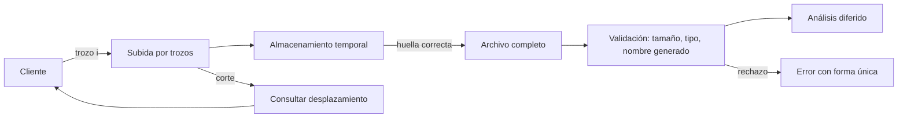
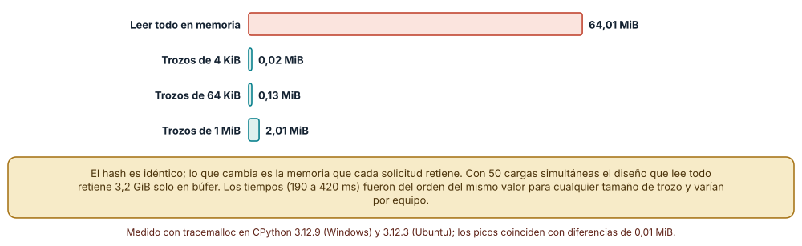
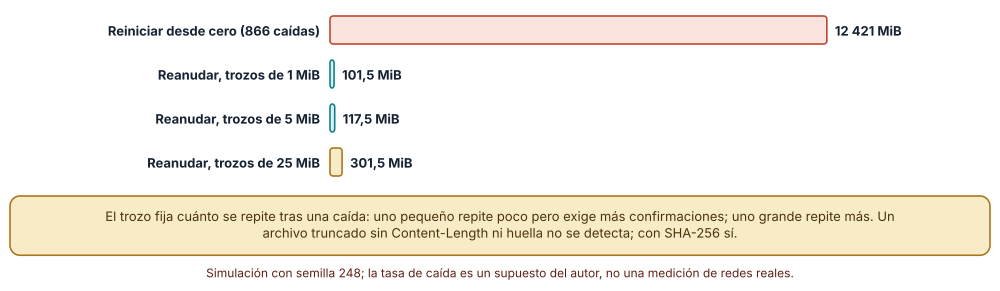
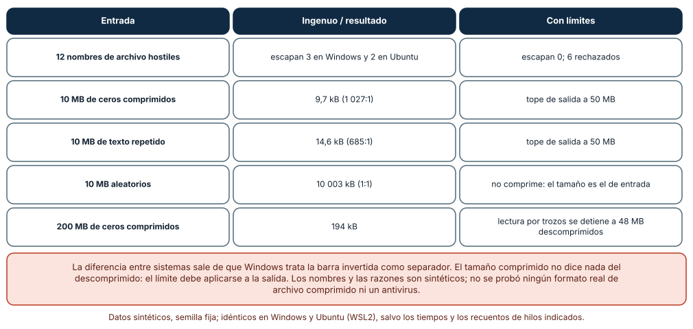

# SE-248 — Archivos, streaming y cargas extensas

[← SE-247 — Jobs, colas y procesamiento diferido](../../classes/part-20-backend-apis-y-procesamiento-asincrono/se-247-jobs-colas-y-procesamiento-diferido/README.md) · [↑ Parte 20](../../classes/part-20-backend-apis-y-procesamiento-asincrono/README.md) · [📚 Índice completo](../../classes/README.md) · [🌐 Portal](../../site/classes/SE-248.html) · [SE-249 — Caching, rate limiting y protección →](../../classes/part-20-backend-apis-y-procesamiento-asincrono/se-249-caching-rate-limiting-y-proteccion/README.md)

## Punto profesional y fundamento pedagógico

**Punto profesional.** La clase existe para que trates los archivos como flujos y no como bloques en memoria, midas cuánta memoria retiene cada diseño de lectura, reanudes una subida interrumpida repitiendo lo mínimo, detectes un archivo truncado y pongas límites a nombres, tamaños y descompresión. Un archivo es la entrada más grande y menos fiable que recibe un backend.

**Por qué aparece aquí.** Se sitúa después de **Jobs, colas y procesamiento diferido** y antes de **Caching, rate limiting y protección**: `SE-247` dejó el trabajo diferido con garantías; el archivo es el trabajo más pesado de la plataforma y el que mejor muestra por qué conviene no cargar todo a la vez. Los límites que se fijan aquí (tamaño, ritmo, descompresión) alimentan la protección de `SE-249` y el taller de `SE-251`, donde el límite de cuerpo es uno de los defectos.

**Error conceptual que debe corregir.** Creer que subir un archivo es «leer el cuerpo de la solicitud y guardarlo». Leerlo entero retiene tanta memoria como su tamaño por cada subida simultánea; confiar en el nombre que envía el cliente permite escribir fuera del directorio; y aceptar un archivo comprimido sin límite de salida permite que unos pocos kilobytes ocupen gigabytes.

**Secuencia de aprendizaje.** Antes de medir, predices cuánta memoria pico retiene el cálculo de una huella de un archivo de 64 MiB leído entero y por trozos; después simulas una subida de 100 MiB con caídas frecuentes con y sin reanudación, y por último pruebas doce nombres de archivo hostiles y una bomba de descompresión contra un tratamiento ingenuo y uno con límites. La secuencia usa predicción, explicación propia, contraste y recuperación. [ICAP](https://icap.education.asu.edu/research) distingue participación de construcción de conocimiento; [How People Learn II](https://nap.nationalacademies.org/catalog/24783/how-people-learn-ii-learners-contexts-and-cultures) exige conectar conocimiento previo, contexto y transferencia; la [práctica de recuperación](https://pubmed.ncbi.nlm.nih.gov/16507066/) respalda producir de nuevo la explicación tras una demora; y [Education for Life and Work](https://nap.nationalacademies.org/resource/13398/dbasse_084153.pdf) exige devolución que explique la causa del error.

**Evidencia de aprendizaje.** `files-log.md` con la predicción, el pico de memoria por tamaño de trozo, los megabytes enviados al reiniciar y al reanudar con tres tamaños de trozo, la detección de truncamiento con y sin huella, el resultado de los doce nombres en Windows y Ubuntu, y las razones de compresión con el tope de salida.

**Límite de la conclusión.** Se usó un archivo sintético de bytes aleatorios; archivos reales (PDF, ZIP) tienen otra estructura y no se probaron ni se ejecutó ningún antivirus. La tasa de caídas (una cada 15 MiB) es un supuesto del autor. Los tiempos son de un equipo y no se interpretan; el pico de memoria es de Python (tracemalloc), no del proceso.

### Trazabilidad fuente → afirmación

| Fuente primaria u oficial | Afirmación que respalda | Lo que no prueba |
|---|---|---|
| OWASP File Upload Cheat Sheet | Recoge las defensas de una subida: lista de extensiones permitidas, límite de tamaño, nombre generado por el servidor y almacenamiento fuera de la raíz web. | No garantiza que un archivo aceptado sea inocuo ni sustituye el análisis de contenido. |
| tus: protocolo de subida reanudable | Define un protocolo de subida reanudable en el que el cliente consulta el desplazamiento recibido y continúa desde ahí. | No dice qué tamaño de trozo conviene a la plataforma. |
| [Python: tracemalloc](https://docs.python.org/3/library/tracemalloc.html) | Documenta cómo medir el pico de memoria asignada por el intérprete durante un bloque de código. | No mide la memoria del proceso entero ni la de extensiones nativas. |

## Antes de empezar

Recupera `SE-247`: el análisis de una entrega es un trabajo diferido con estados y reintentos. La pregunta activa es: **¿qué pasa cuando lo que llega es un archivo de cientos de megabytes, la conexión se corta a la mitad y el nombre o el contenido son hostiles?**

## Prerrequisitos

- Haber completado `SE-247` o poder explicar qué evidencia entregó y qué quedó abierto.
- Python 3.11 o posterior; los experimentos usan `hashlib`, `tempfile`, `tracemalloc`, `zlib` y `random`.
- Saber que una huella (SHA-256) identifica el contenido de un archivo.
- Haber diseñado en `SE-247` el estado de un trabajo diferido.

## Problema auténtico

Un estudiante sube un vídeo de 800 MiB desde un móvil y la conexión cae a los 600. El servicio no tiene reanudación, así que reinicia desde cero; en la tercera caída, el estudiante se rinde. A la vez, una subida de 64 MiB retiene 64 MiB de memoria en el servidor, y con 50 subidas simultáneas el proceso se agota. Un día un archivo llamado `../../app/config` sobrescribe un archivo de configuración, y otro, de 200 kB comprimidos, ocupa 200 MB al descomprimirse.

## Objetivos observables

Al terminar podrás:

1. medir el pico de memoria al procesar un archivo entero y por trozos y elegir un tamaño de trozo;
2. comparar reiniciar con reanudar una subida interrumpida y calcular los datos repetidos para tres tamaños de trozo;
3. detectar el truncamiento de un archivo con longitud declarada y con huella, y decir cuándo no se detecta;
4. neutralizar nombres de archivo hostiles y aplicar un tope a la salida de una descompresión;
5. declarar el contrato de la subida: tamaño máximo, tipos, tiempo, estado y cómo se reanuda.

## Mapa conceptual



El mapa se lee del cliente al análisis: la subida se divide en trozos que se confirman; un corte se resuelve consultando el desplazamiento recibido, no recomenzando; el archivo completo se valida (huella, tamaño, tipo) y recibe un nombre que genera el servidor antes de pasar al análisis diferido. No describe un producto sino los puntos donde un archivo puede perderse o dañar.

## Temas y por qué importan

| Tema | Por qué cambia una decisión profesional | Evidencia mínima |
|---|---|---|
| Flujo frente a bloque | Procesar por trozos acota la memoria por subida; leer todo la hace proporcional al tamaño. | Pico de memoria por tamaño de trozo |
| Subida reanudable | Con caídas frecuentes, reiniciar multiplica los datos enviados; reanudar los repite solo hasta el último trozo confirmado. | MiB enviados al reiniciar y al reanudar con tres tamaños |
| Integridad de lo recibido | Un corte puede dejar un archivo incompleto que parece válido si nadie lo comprueba. | Detección de truncamiento con longitud y con huella |
| Nombres y rutas | El nombre que envía el cliente es un dato hostil: no es una ruta. | Nombres que escapan del directorio en cada sistema |
| Compresión y límites | El tamaño comprimido no limita el descomprimido. | Razones de compresión y detención por tope |

## Conceptos y decisiones

### 1. Flujo frente a bloque

Un **bloque** es un archivo leído entero en memoria; un **flujo** es una secuencia de trozos procesados y descartados. Para calcular una huella o guardar un archivo no hace falta tenerlo entero: se lee un trozo, se actualiza el hash o se escribe, y se continúa. La memoria pico pasa de ser proporcional al tamaño del archivo a ser proporcional al del trozo. El tamaño del trozo es un compromiso entre llamadas al sistema (trozos pequeños) y memoria por subida (trozos grandes); en la medición, trozos de 64 KiB y 1 MiB dieron el mismo tiempo.

### 2. Subida reanudable

Si la conexión cae al 80 %, reiniciar descarta 80 MiB ya enviados. En una subida **reanudable** el cliente divide el archivo en trozos y el servidor recuerda cuántos bytes recibió; tras un corte, el cliente pregunta el desplazamiento y continúa. Lo que se repite es, como máximo, el trozo en curso. Un trozo grande repite más; uno pequeño exige más confirmaciones. El protocolo tus es un ejemplo publicado de este diseño.

### 3. Integridad de lo recibido

Un archivo cortado puede tener un tamaño distinto del declarado (`Content-Length`) y se detecta; pero con transferencia por trozos o sin longitud declarada, el servidor ve un fin de flujo normal. La defensa es una **huella** (SHA-256) que el cliente envía al principio o al final y que el servidor compara con la del contenido recibido. La huella detecta corrupción accidental; para un atacante que controla el archivo y la huella no prueba autenticidad.

### 4. Nombres y rutas

El nombre que envía el cliente puede contener separadores, `..`, rutas absolutas, bytes nulos o nombres reservados. La regla es no usarlo para construir una ruta: el servidor genera el nombre (por ejemplo, una parte de la huella más una extensión permitida) y guarda el nombre original como metadato. Las reglas de separadores difieren entre sistemas: la barra invertida es separador en Windows y un carácter válido en Linux, por lo que un tratamiento que funciona en un sistema puede fallar en el otro.

### 5. Compresión y límites

Un archivo comprimido puede ser mucho menor que su contenido: 10 MB de ceros ocupan 9,7 kB (razón 1 027:1) y una «bomba» de 200 MB, 194 kB. Descomprimir sin límite permite agotar disco o memoria. La defensa es descomprimir por trozos con un **tope de salida** y abortar al superarlo; el límite de entrada no basta.

### Memoria al calcular la huella de un archivo: bloque frente a trozos

Se genera un archivo de 64 MiB de bytes aleatorios (semilla 248) y se calcula su SHA-256 leyéndolo entero o por trozos de 4 KiB, 64 KiB y 1 MiB, midiendo el pico de memoria asignada con `tracemalloc`.

```python
with open(ruta, "rb") as f:
    while True:
        b = f.read(tam)
        if not b: break
        h.update(b)
```

El pico es de **64,01 MiB** al leer entero y de **0,02 MiB** con trozos de 4 KiB, **0,13 MiB** con 64 KiB y **2,01 MiB** con 1 MiB; el SHA-256 es idéntico en los cuatro (`4fca9c72bd87…`). Los tiempos, entre 190 y 420 ms, no mostraron una ventaja clara de ningún trozo salvo que el de 4 KiB fue más lento en las dos máquinas. En Ubuntu los picos coincidieron con diferencias de 0,01 MiB.



**Cómo leer la figura.** Cada barra es el pico de memoria que asigna Python al procesar el mismo archivo; el resultado de la huella no cambia. **Dónde deja de valer:** mide la memoria asignada por el intérprete, no la del proceso (búferes del sistema, extensiones nativas); y un archivo sintético aleatorio no se parece a un PDF. Con 50 subidas simultáneas el diseño que lee todo retendría 3,2 GiB solo en este búfer.

### Reiniciar o reanudar una subida con caídas

Se simula una subida de 100 MiB en la que la conexión cae, en media, cada 15 MiB enviados (distribución exponencial, semilla 248). Con **reinicio**, cada caída lleva el avance a cero; con **reanudación** por trozos, vuelve al último múltiplo del tamaño del trozo.

Reiniciar envía **12 421 MiB** para entregar 100 MiB, tras 866 caídas. Reanudar envía **101,5 MiB** con trozos de 1 MiB (4 caídas), **117,5 MiB** con trozos de 5 MiB (5 caídas) y **301,5 MiB** con trozos de 25 MiB (16 caídas). Además, un archivo truncado a 73 000 de 100 000 bytes se detecta con `Content-Length` (la longitud recibida difiere) y con una huella SHA-256, pero **no** se detecta con transferencia sin longitud declarada y sin huella.



**Cómo leer la figura.** Cada barra es el total enviado para completar la subida; la diferencia entre reiniciar y reanudar es de dos órdenes de magnitud. **Dónde deja de valer:** la tasa de caída es un supuesto: con una red estable, reiniciar apenas costaría. Reanudar exige almacenamiento temporal del lado del servidor y su limpieza; una subida abandonada deja trozos huérfanos.

### Nombres hostiles y bombas de descompresión

Se prueban doce nombres de archivo: `../../etc/passwd`, `..\..\windows\win.ini`, `/etc/shadow`, `C:\Users\x\a.pdf`, un nombre con byte nulo, `tarea.PDF`, `a/b/../../../c.txt`, `....//....//x.txt`, `con.txt`, `informe.pdf.exe` y otros. El tratamiento ingenuo concatena `uploads/` y el nombre; el estricto toma el nombre base, exige una extensión permitida y sustituye el nombre por una parte de la huella.

Con el tratamiento ingenuo, **3 de 12** nombres terminan fuera del directorio en Windows y **2 de 12** en Ubuntu (la diferencia es la barra invertida); con el estricto, **0 de 12** escapan y **6** se rechazan por extensión no permitida. En compresión, 10 MB de ceros ocupan 9,7 kB (**1 027:1**), 10 MB de texto repetido 14,6 kB (**685:1**) y 10 MB aleatorios no comprimen (**1:1**). Una bomba de 200 MB comprimida a 194 kB, descomprimida por trozos de 4 KiB con un tope de 50 MB, se detiene tras **48 MB** descomprimidos.



**Cómo leer la figura.** Cada fila es una prueba; la columna del medio es el tratamiento ingenuo o la razón de compresión y la derecha el tratamiento con límites. **Dónde deja de valer:** los nombres son una muestra del autor, no un catálogo completo; no se probaron formatos reales de archivo comprimido (ZIP con rutas internas, TAR con enlaces) ni se ejecutó un antivirus. El límite de 50 MB es de laboratorio.

## Definiciones de trabajo

- **flujo:** secuencia de datos procesada por trozos sin retener el conjunto completo.
- **trozo:** porción de un archivo que se envía y confirma como unidad.
- **subida reanudable:** protocolo que permite continuar una subida interrumpida desde el último desplazamiento confirmado.
- **huella:** valor derivado del contenido que permite comprobar su integridad.
- **bomba de descompresión:** archivo comprimido cuyo contenido descomprimido es desproporcionadamente grande.

Las definiciones son operativas para la plataforma de entregas. No convierten términos con una historia técnica más amplia en sinónimos y deben contrastarse con la documentación primaria enlazada al final.

## Ejemplo mínimo

El fragmento calcula una huella por trozos y la compara con la de un bloque. Antes de ejecutarlo, predice si coinciden.

```python
import hashlib, io
datos = bytes(range(256)) * 1000
h1 = hashlib.sha256(datos).hexdigest()
h2 = hashlib.sha256()
flujo = io.BytesIO(datos)
while (b := flujo.read(4096)):
    h2.update(b)
print(h1 == h2.hexdigest())
```

Resultado: `True`. La huella no depende del tamaño del trozo. Registra versión y salida; cambia el trozo a 1 byte y predice si cambia el resultado y el tiempo.

## Ejemplo profesional

La plataforma recibe archivos de hasta 500 MiB por trozos de 5 MiB. Cada subida tiene un identificador, un desplazamiento consultable y un plazo de 24 horas; el cliente envía la huella al empezar. El servidor escribe en un directorio temporal, calcula la huella en flujo, rechaza la subida si el tamaño o la huella no coinciden, genera el nombre definitivo, comprueba el tipo por contenido y no por extensión, y encola el análisis. Los archivos comprimidos se descomprimen en el trabajo diferido con tope de salida. Compara con el original en tres casos: una conexión que cae, 50 subidas simultáneas y un nombre con `..`.

## Práctica guiada

1. Genera un archivo sintético de 64 MiB y predice el pico de memoria al leerlo entero y por trozos de 64 KiB.
2. Mide con `tracemalloc` y compara con tu predicción.
3. Simula la subida con caídas, con reinicio y con reanudación para tres tamaños de trozo.
4. Trunca un archivo y comprueba qué detectan la longitud y la huella.
5. Prueba doce nombres hostiles contra los dos tratamientos en tu sistema.
6. Comprime ceros, texto repetido y datos aleatorios y mide las razones; descomprime una bomba con tope.
7. Entrega `files-log.md` y pide a otra persona que añada tres nombres hostiles.

## Ejercicios

1. **Memoria:** con 50 subidas simultáneas de 64 MiB, calcula la memoria retenida al leer entero y por trozos de 1 MiB, y fija el número máximo de subidas para 2 GiB disponibles.
2. **Trozo:** calcula el tamaño de trozo que minimiza el total enviado más el número de confirmaciones si cada confirmación cuesta el equivalente a 50 KiB.
3. **Nombres:** añade tres nombres hostiles propios y comprueba el resultado en Windows y en Linux; explica la diferencia.
4. **Bomba:** diseña el tope de salida para un archivo de 20 MiB comprimido y justifica la razón máxima aceptada.

## Reto verificable

Entrega `files-log.md` con la medición de memoria, la simulación de subida, la detección de truncamiento, los nombres hostiles y las razones de compresión. Se aprueba si otra persona obtiene las mismas cifras desde un checkout limpio y puede decir qué límite protege contra cada riesgo. No se aprueba por limitar el tamaño de entrada: debe verse el tope de salida.

## Caso conductor

La plataforma de entregas acepta archivos grandes sin retener memoria ni confiar en el nombre. Recupera `SE-247`: el análisis se ejecuta como trabajo diferido con un tope de salida. La clase siguiente protege el servicio de la avalancha de solicitudes con cachés y limitadores. Cambia después una sola decisión, el trozo de 5 a 1 MiB, y revisa qué artefactos hay que tocar.

## Preguntas frecuentes

### ¿Basta con limitar el tamaño del cuerpo?

Es necesario, no suficiente. Limita la memoria de entrada, pero no la salida de una descompresión ni el tiempo de una subida lenta que mantiene conexiones abiertas.

### ¿Reanudar no complica el servidor?

Sí: hay que guardar trozos temporales, ofrecer un recurso de desplazamiento y limpiar subidas abandonadas. Compensa cuando las subidas son grandes y las redes inestables; para archivos de unos kilobytes, no.

### ¿La extensión del archivo dice su tipo?

No: es lo que el cliente quiere que parezca. Se comprueba el tipo por contenido y se guarda con una extensión que el servidor elige.

### ¿La huella protege contra un archivo malicioso?

No: detecta corrupción accidental. Un atacante envía el archivo y su huella. La defensa contra contenido malicioso es el análisis y el aislamiento.

## Fallo controlado y diagnóstico

Reproduce el fallo de la clase: **un nombre de archivo que escapa del directorio**. Sube `..\..\config.txt` al tratamiento ingenuo en Windows. **Síntoma:** un archivo aparece fuera de `uploads/`. **Hipótesis rivales:** (a) el cliente escribió una ruta válida; (b) el servidor usó el nombre del cliente como ruta. **Prueba:** normaliza la ruta resultante y comprueba que sale del prefijo. **Causa:** el nombre del cliente se usó para construir la ruta, y la barra invertida es separador en Windows. **Corrección:** nombre generado por el servidor y extensión de una lista. **Regresión:** una prueba parametrizada con los doce nombres en ambos sistemas.

## Errores comunes y cómo corregirlos

| Síntoma | Causa probable | Corrección |
|---|---|---|
| El servidor se queda sin memoria con pocas subidas | Se lee el cuerpo completo | Procesar por trozos y limitar subidas simultáneas |
| Una caída obliga a empezar de cero | Subida sin reanudación | Trozos confirmados y consulta del desplazamiento |
| Un archivo incompleto se acepta como válido | No se comprueba longitud ni huella | Comprobar ambas y rechazar si difieren |
| Un archivo aparece fuera del directorio | El nombre del cliente construye la ruta | Nombre generado y extensión de lista |
| Un archivo pequeño llena el disco al descomprimir | Sin tope de salida | Descomprimir por trozos con tope |

## Entorno y archivos clave

```text
work/SE-248/
├── README.md
├── archivos/
│   ├── memoria.py
│   ├── subida.py
│   └── nombres_y_bombas.py
├── tests/test_nombres.py
└── evidence/files-log.md
```

El `README` declara plataforma, versión de Python, semilla (248) y comandos. Los experimentos usan `hashlib`, `tempfile`, `tracemalloc`, `zlib`, `random` y `pathlib`; las salidas fueron idénticas en CPython 3.12.9 (Windows 11) y 3.12.3 (Ubuntu bajo WSL2) salvo los tiempos y el resultado de los nombres con barra invertida (3 de 12 frente a 2 de 12). Los archivos temporales se crean con `tempfile.TemporaryDirectory` y se borran al terminar.

## Seguridad, ética y accesibilidad

- los archivos de estudiantes son datos personales: aplica retención, control de acceso y borrado;
- nunca ejecutes ni interpretes un archivo subido; analízalo en un entorno aislado;
- no confíes en el tipo declarado ni en la extensión;
- limita tamaño, tiempo y simultaneidad de subidas por identidad (`SE-249`);
- ofrece una alternativa accesible cuando una subida falla: un mensaje comprensible y una vía de entrega.

## Puente hacia el trabajo con agentes

Un agente al que se le pide «permite subir archivos» suele leer el cuerpo entero y usar el nombre del cliente. Pídele el tamaño de trozo, el pico de memoria medido, el nombre generado por el servidor, el tope de descompresión y las pruebas de nombres hostiles en dos sistemas. Revisa especialmente si construyó la ruta con el nombre original: es el defecto que sacó archivos del directorio.

## Transferencia

Traslada el experimento a otro de los dominios persistentes (por ejemplo, fotos de un catálogo): cambia el tipo de archivo y conserva el procedimiento de medir memoria, simular caídas y probar nombres. La transferencia está lograda cuando explicas qué dependía de las entregas y cuáles son los límites generales de una subida.

## Evaluación y evidencia

| Criterio | Evidencia para aprobar |
|---|---|
| comprensión | explicación de flujo frente a bloque, reanudación e integridad |
| corrección | picos, MiB enviados y razones de compresión reproducibles |
| diseño | contrato de la subida con tamaño, trozo, plazo y límites |
| diagnóstico | reproducción del nombre hostil con hipótesis, prueba y regresión en dos sistemas |
| incertidumbre | declaración de lo no probado: formatos reales y antivirus |
| reproducibilidad | versiones, comandos, salida y límites declarados |

## Fuentes

- OWASP File Upload Cheat Sheet (enlace no verificado en esta ejecución; búscalo por título) — defensas para la subida de archivos; autoridad: OWASP.
- tus: protocolo de subida reanudable (enlace no verificado en esta ejecución; búscalo por título) — protocolo de subida reanudable; autoridad: tus.io.
- [Python: tracemalloc](https://docs.python.org/3/library/tracemalloc.html) — medición de memoria asignada; autoridad: Python Software Foundation.
- [Python: hashlib](https://docs.python.org/3/library/hashlib.html) — huellas calculadas por trozos; autoridad: Python Software Foundation.
- [Python: tempfile](https://docs.python.org/3/library/tempfile.html) — directorios temporales con limpieza; autoridad: Python Software Foundation.
- [HTTP Semantics (RFC 9110)](https://www.rfc-editor.org/rfc/rfc9110) — longitud del contenido y solicitudes parciales; autoridad: IETF.
- [OWASP Input Validation Cheat Sheet](https://cheatsheetseries.owasp.org/cheatsheets/Input_Validation_Cheat_Sheet.html) — validación y límites de entrada; autoridad: OWASP.
- [SWEBOK Guide v4.0a](https://www.computer.org/education/bodies-of-knowledge/software-engineering) — construcción y seguridad como áreas de conocimiento; autoridad: IEEE Computer Society.

Cada fuente respalda el mecanismo indicado; ninguna demuestra que las cifras sintéticas de esta clase describan un sistema real. Las fuentes marcadas como no verificadas se citan por título porque no se pudo comprobar su enlace en esta ejecución (sin acceso de red autorizado); se verificaron las demás por haberse comprobado en clases publicadas de otras partes.

## Límites y siguiente paso

Se ejecutaron tres experimentos con datos sintéticos en Windows y Ubuntu (WSL2): resultados idénticos salvo los tiempos y los nombres con barra invertida. No se usó ningún formato real de archivo ni se midió a ninguna persona: el archivo, la tasa de caídas y los nombres son construcciones del autor. La siguiente clase protege el servicio de la avalancha de solicitudes.

## Glosario

- **desplazamiento:** número de bytes de una subida que el servidor ya ha confirmado.
- **tope de salida:** límite de bytes que una descompresión puede producir antes de abortarse.
- **traversal de rutas:** uso de componentes como `..` para alcanzar archivos fuera del directorio previsto.
- **bloque en memoria:** archivo leído entero a la memoria del proceso.
- **almacenamiento temporal:** área donde se guardan los trozos hasta completar la subida.

---

[← SE-247 — Jobs, colas y procesamiento diferido](../../classes/part-20-backend-apis-y-procesamiento-asincrono/se-247-jobs-colas-y-procesamiento-diferido/README.md) · [↑ Parte 20](../../classes/part-20-backend-apis-y-procesamiento-asincrono/README.md) · [📚 Índice completo](../../classes/README.md) · [🌐 Portal](../../site/classes/SE-248.html) · [SE-249 — Caching, rate limiting y protección →](../../classes/part-20-backend-apis-y-procesamiento-asincrono/se-249-caching-rate-limiting-y-proteccion/README.md)
