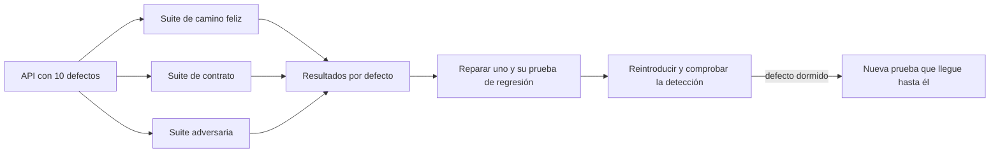
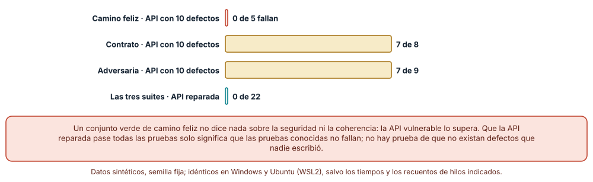
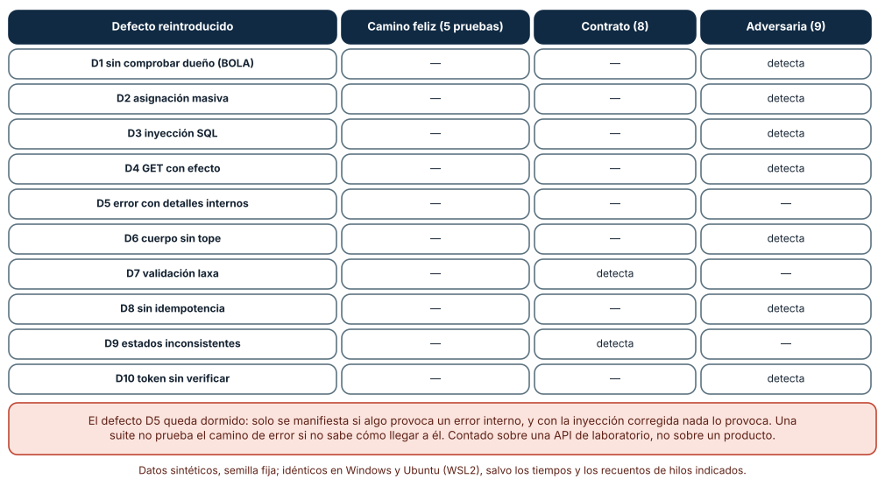
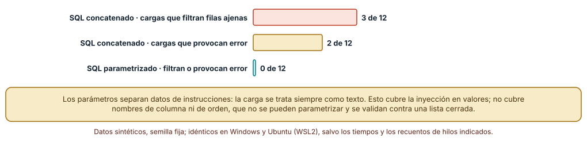

# SE-251 — Taller: reparar una API insegura e inconsistente

[← SE-250 — Health, readiness y shutdown ordenado](../../classes/part-20-backend-apis-y-procesamiento-asincrono/se-250-health-readiness-y-shutdown-ordenado/README.md) · [↑ Parte 20](../../classes/part-20-backend-apis-y-procesamiento-asincrono/README.md) · [📚 Índice completo](../../classes/README.md) · [🌐 Portal](../../site/classes/SE-251.html) · [SE-252 — Proyecto: servicio contractual operable →](../../classes/part-20-backend-apis-y-procesamiento-asincrono/se-252-proyecto-servicio-contractual-operable/README.md)

## Punto profesional y fundamento pedagógico

**Punto profesional.** El taller existe para que repares una API que funciona y está mal: diez defectos de seguridad y consistencia que ninguna prueba de camino feliz ve. Aprenderás a encontrarlos con tres clases de prueba, a repararlos de uno en uno, a comprobar que cada defecto reintroducido es detectado y a reconocer los que quedan dormidos porque nadie sabe cómo llegar hasta ellos.

**Por qué aparece aquí.** Se sitúa después de **Health, readiness y shutdown ordenado** y antes de **Proyecto: servicio contractual operable**: las clases `SE-241` a `SE-250` trataron un mecanismo cada una; el taller las vuelve a juntar en una API deliberadamente defectuosa antes del proyecto de `SE-252`. Es la clase donde se ve si los mecanismos se recuerdan cuando aparecen mezclados y sin etiqueta: el defecto no dice a qué clase pertenece.

**Error conceptual que debe corregir.** Creer que una API que supera sus pruebas de camino feliz es correcta. La API del taller supera las cinco pruebas de camino feliz con diez defectos presentes: sirve a quien la usa como se espera y a quien la ataca como no se espera.

**Secuencia de aprendizaje.** Antes de ejecutar, predices cuántas pruebas fallarán en cada una de tres suites (camino feliz, contrato y adversaria) contra la API con los diez defectos; después reparas todos y reintroduces uno cada vez para ver qué suite lo detecta, y por último atacas la búsqueda con doce cargas de inyección contra SQL concatenado y parametrizado. La secuencia usa predicción, explicación propia, contraste y recuperación. [ICAP](https://icap.education.asu.edu/research) distingue participación de construcción de conocimiento; [How People Learn II](https://nap.nationalacademies.org/catalog/24783/how-people-learn-ii-learners-contexts-and-cultures) exige conectar conocimiento previo, contexto y transferencia; la [práctica de recuperación](https://pubmed.ncbi.nlm.nih.gov/16507066/) respalda producir de nuevo la explicación tras una demora; y [Education for Life and Work](https://nap.nationalacademies.org/resource/13398/dbasse_084153.pdf) exige devolución que explique la causa del error.

**Evidencia de aprendizaje.** `workshop-log.md` con la predicción, el recuento de pruebas fallidas por suite, la matriz defecto × suite, la medición de la inyección, el registro de reparación (defecto, causa, corrección, prueba de regresión) y la lista de defectos que ninguna suite detecta y por qué.

**Límite de la conclusión.** La API es de laboratorio, en proceso y sin red: no hay servidor, TLS, CORS ni cabeceras. Los diez defectos y las tres suites son construcciones del autor; que la API reparada las supere no demuestra que no existan otros defectos. Un defecto dormido (D5) escapó a todas las suites. Nadie fue evaluado.

### Trazabilidad fuente → afirmación

| Fuente primaria u oficial | Afirmación que respalda | Lo que no prueba |
|---|---|---|
| OWASP API Security Top 10 (2023) | Cataloga los riesgos de seguridad más frecuentes de las API, entre ellos la autorización rota por objeto y por propiedad y el consumo irrestricto de recursos. | No mide cuántos de ellos hay en un producto concreto. |
| [OWASP: Injection Flaws](https://owasp.org/www-community/Injection_Flaws) | Explica la inyección como la mezcla de datos no confiables con instrucciones y recomienda separar ambos con consultas parametrizadas. | No cubre la inyección en nombres de columnas ni en otros intérpretes. |
| [OWASP Application Security Verification Standard](https://owasp.org/www-project-application-security-verification-standard/) | Ofrece una lista de requisitos verificables para aplicaciones y APIs, organizada por niveles. | No sustituye una revisión de seguridad ni garantiza que la API cumpla un nivel. |

## Antes de empezar

Recupera `SE-250`: la plataforma tiene sondeos y apagado ordenado. La pregunta activa es: **de los diez defectos que tiene esta API, ¿cuáles ve una prueba de camino feliz, cuáles una de contrato y cuáles solo un atacante?**

## Prerrequisitos

- Haber completado `SE-250` o poder explicar qué evidencia entregó y qué quedó abierto.
- Haber completado las clases `SE-241` a `SE-250` o poder explicar qué mecanismo aporta cada una.
- Python 3.11 o posterior; la API del taller usa `sqlite3`, `hashlib`, `json` y la biblioteca estándar.
- Poder leer un fragmento de SQL con `where` y `like`.

## Problema auténtico

El equipo hereda una API de entregas que funciona: los estudiantes suben, los docentes consultan, las notas se publican. Una revisión descubre que cualquiera puede leer entregas ajenas, que un `PATCH` permite cambiar la nota, que una búsqueda con una comilla devuelve el texto de una consulta SQL, que un enlace de borrado responde a GET, que reintentar un POST duplica la entrega y que un token con firma inventada es aceptado. Nadie sabe cuántos defectos hay en total ni cómo evitar que reaparezcan.

## Objetivos observables

Al terminar podrás:

1. clasificar los defectos de la API por la clase de este curso a la que corresponden y por el tipo de prueba que los detecta;
2. ejecutar tres suites contra la API defectuosa y medir qué ve cada una;
3. reparar los defectos de uno en uno, con una prueba de regresión para cada uno;
4. reintroducir cada defecto y comprobar qué suite lo detecta, identificando los que quedan dormidos;
5. medir con una batería de cargas la diferencia entre SQL concatenado y consulta parametrizada.

## Mapa conceptual



El mapa se lee del defecto al hallazgo: las tres suites producen resultados, cada reparación añade una prueba de regresión y la reintroducción verifica que esa prueba protege de verdad. La flecha final marca el caso del defecto dormido: si nada lo detecta, hace falta una prueba que llegue hasta él. No es un proceso lineal: el ciclo se repite hasta que no quedan defectos sin prueba.

## Temas y por qué importan

| Tema | Por qué cambia una decisión profesional | Evidencia mínima |
|---|---|---|
| Autorización y objeto | Un acceso sin comprobar dueño y una asignación masiva rompen lo que `SE-245` fija. | Pruebas que fallan por BOLA y por asignación masiva |
| Validación y contrato | Un cuerpo laxo y códigos de estado inconsistentes rompen `SE-242` y `SE-244`. | Pruebas de contrato que fallan |
| Inyección y errores | La concatenación de SQL y los errores con detalles internos rompen `SE-244` y `SE-249`. | Cargas de inyección y filtración de errores |
| Repetición y recursos | La falta de idempotencia, un cuerpo sin tope y un GET con efecto rompen `SE-242`, `SE-246` y `SE-248`. | Reintentos, cuerpo grande y recorrido de enlaces |
| Reparación verificable | Reparar sin una prueba que reintroduzca el defecto no demuestra nada. | Matriz defecto × suite y defectos dormidos |

## Conceptos y decisiones

### 1. Autorización y objeto

Dos defectos son de autorización. **D1** no comprueba el dueño de la entrega: cualquier usuario autenticado lee cualquier identificador (`SE-245`). **D2** acepta en el `PATCH` campos que el cliente no debe fijar (`nota`, `owner`): asignación masiva, que `SE-244` previene con un esquema cerrado. Un tercero, **D10**, acepta un token sin verificar su firma. Los tres comparten el síntoma de que nada falla con usuarios bien intencionados.

### 2. Validación y contrato

**D7** acepta valores fuera de rango, booleanos como enteros y textos vacíos o enormes; **D9** devuelve 200 con un error en el cuerpo para una entrega inexistente y 200 en lugar de 201 al crear. Son defectos de coherencia: la API funciona, pero un cliente que dependa de los códigos de estado se equivoca (`SE-242`, `SE-244`). Los detecta una suite de contrato, no una de camino feliz.

### 3. Inyección y errores

**D3** construye la búsqueda concatenando el texto del usuario en el SQL; con `%' or '1'='1` devuelve filas de todos. **D5** responde a un error de la base de datos con el mensaje del motor y un fragmento de la consulta. Los dos solo aparecen con entradas que nadie escribe en el camino feliz, y D5 solo se manifiesta si algo provoca un error interno, de modo que puede quedar dormido.

### 4. Repetición y recursos

**D4** borra con un GET; **D8** ignora `Idempotency-Key` y duplica al reintentar; **D6** acepta un cuerpo de cualquier tamaño. Corresponden a `SE-242` (métodos), `SE-246` (idempotencia) y `SE-248` (límites). Las detecta una prueba que repite, rastrea o envía un cuerpo grande: algo que un usuario normal no hace.

### 5. Reparación verificable

Reparar un defecto es cambiar el código y añadir una prueba que falle sin el cambio. La verificación es **reintroducir** el defecto en la versión reparada: si ninguna suite falla, o la prueba no protege o el defecto está dormido. Esa es la medida que da el taller: cuántos defectos detecta cada tipo de suite y cuáles ninguno.

### Tres suites contra la API con diez defectos

La API del taller se implementa en proceso con una clase `Api(bugs)` que activa cada defecto por su código (`D1`…`D10`) y usa SQLite en memoria. Hay tres suites: **camino feliz** (5 pruebas: crear, leer la propia, buscar, editar el texto y borrar con DELETE), **contrato** (8 pruebas: 201 al crear, 404 al buscar lo inexistente, rechazo de cuatro cuerpos inválidos, 401 sin credencial y forma `{type,title}` en los errores) y **adversaria** (9 pruebas: lectura ajena, asimetría de respuestas, asignación masiva, inyección, GET que borra, token falsificado, cuerpo de 200 kB, tres reintentos con clave y error sin detalles internos).

Contra la API con los diez defectos: el camino feliz tiene **0 pruebas fallidas de 5**, el contrato **7 de 8** y la adversaria **7 de 9**. La API reparada supera las 22 pruebas. Los resultados son deterministas y la salida es idéntica en Windows y Ubuntu.



**Cómo leer la figura.** Cada barra cuenta las pruebas que fallan en una suite contra la API con los diez defectos; la verde muestra la API reparada. **Dónde deja de valer:** que las 22 pruebas pasen en la API reparada solo prueba que las pruebas conocidas no fallan, no que no haya defectos desconocidos. Las suites se escribieron mirando los diez defectos, así que su acierto es optimista.

### Reintroducir cada defecto: qué suite lo detecta

Para cada uno de los diez defectos se toma la API reparada, se reintroduce solo ese defecto y se ejecutan las tres suites. Resultado: los **siete** defectos D1 (dueño), D2 (asignación masiva), D3 (inyección), D4 (GET con efecto), D6 (cuerpo sin tope), D8 (sin idempotencia) y D10 (token sin verificar) los detecta solo la suite adversaria; D7 (validación laxa) y D9 (códigos de estado) solo la de contrato; la de camino feliz no detecta ninguno. **D5** (error con detalles internos) **no lo detecta ninguna suite** cuando se reintroduce solo.

La razón de D5 es instructiva: el defecto está en el camino de error, y con la inyección corregida ya no hay ningún error de la base de datos que lo active. Es un defecto dormido: existe en el código, no tiene síntoma observable y se despertará cuando otro fallo lo ejercite. Para verlo hace falta una prueba que fuerce un error interno por otro medio.



**Cómo leer la figura.** Cada fila es un defecto reintroducido en la API reparada; la celda indica qué suite lo detecta. **Dónde deja de valer:** la detección depende de las pruebas que se escribieron: otra suite adversaria habría podido detectar D5 con un error forzado. La matriz es de una API de laboratorio, no de un producto.

### Inyección SQL: concatenar o parametrizar

La búsqueda `GET /entregas?q=` filtra por texto y dueño. Se prueban doce cargas contra la versión con SQL concatenado y contra la parametrizada (dos usuarios, una entrega cada uno): una palabra normal, `%' or '1'='1`, `' or 1=1 --`, un `union select`, `'; drop table e; --`, comodines, comillas y un patrón con `like`.

```python
# defecto D3: los datos se mezclan con la instrucción
filas = db.execute(f"select id,owner,texto from e where borrada=0 and texto like '%{qq}%' and owner='{u}'")
# reparación: los datos van aparte
filas = db.execute("select id,owner,texto from e where borrada=0 and texto like ? and owner=?", (f"%{qq}%", u))
```

Con SQL concatenado, **3 de 12** cargas devuelven filas de otro usuario y **2** provocan un error del motor; con consulta parametrizada, **0** y **0**. Los parámetros no sustituyen la autorización, y no protegen los nombres de columna u orden que vengan del cliente: esos se validan contra una lista cerrada.



**Cómo leer la figura.** Cada barra cuenta cargas de las doce probadas; las coral son la versión con SQL concatenado y la verde la parametrizada. **Dónde deja de valer:** doce cargas no son un catálogo: un atacante creativo prueba muchas más. La comprobación `owner = ?` sigue siendo necesaria; un comodín como `%` devuelve las filas propias, que es correcto.

## Definiciones de trabajo

- **asignación masiva:** vulnerabilidad por la que se aceptan campos que el cliente no debería fijar.
- **defecto dormido:** defecto que no tiene síntoma observable hasta que otro fallo lo activa.
- **prueba de regresión:** prueba que falla si se reintroduce un defecto ya reparado.
- **suite adversaria:** conjunto de pruebas que envía entradas hostiles o inesperadas.
- **consulta parametrizada:** consulta en la que los datos se pasan separados de la instrucción SQL.

Las definiciones son operativas para la plataforma de entregas. No convierten términos con una historia técnica más amplia en sinónimos y deben contrastarse con la documentación primaria enlazada al final.

## Ejemplo mínimo

El fragmento muestra la inyección en una línea. Antes de ejecutarlo, predice cuántas filas devuelve cada versión.

```python
import sqlite3
db = sqlite3.connect(":memory:")
db.execute("create table e(owner text, texto text)")
db.executemany("insert into e values (?,?)", [("ana", "a"), ("beto", "b")])
q = "x' or '1'='1"
print(len(db.execute(f"select * from e where owner='beto' and texto='{q}'").fetchall()),
      len(db.execute("select * from e where owner='beto' and texto=?", (q,)).fetchall()))
```

Resultado: `2 0`. En la versión concatenada, `and` se evalúa antes que `or`, de modo que la condición `... or '1'='1'` es verdadera para todas las filas y devuelve las dos, incluida la de ana; la parametrizada trata la carga como texto y no encuentra nada. Registra versión y salida; cambia la carga por `x` y predice ambos recuentos.

## Ejemplo profesional

El equipo recibe la API con los diez defectos y trabaja en seis pasos: escribe las tres suites; mide qué falla; repara por orden de riesgo (D3, D1, D10, D2, D4, D8, D6, D7, D9, D5); añade una prueba de regresión para cada reparación; reintroduce cada defecto y registra qué suite lo detecta; y publica la lista de defectos dormidos. Compara con el original en tres casos: un usuario normal, un integrador con un script y alguien que prueba la API sin permiso.

## Práctica guiada

1. Lee la API defectuosa sin ejecutarla y lista los defectos que ves; predice cuántas pruebas fallarán en cada suite.
2. Ejecuta las tres suites y compara con tu predicción.
3. Repara los defectos por orden de riesgo, uno por commit, con su prueba de regresión.
4. Reintroduce cada defecto y rellena la matriz defecto × suite.
5. Identifica el defecto dormido y escribe una prueba que lo active.
6. Mide las doce cargas de inyección contra las dos versiones.
7. Entrega `workshop-log.md` y pide a otra persona que añada un defecto nuevo y diga qué suite lo detectaría.

## Ejercicios

1. **Defecto nuevo:** añade un defecto (por ejemplo, un `DELETE` sin comprobar dueño) y decide qué suite lo detecta y qué prueba le falta.
2. **Dormido:** escribe una prueba que fuerce un error interno y active D5 sin depender de la inyección.
3. **Regresión:** elige tres reparaciones y escribe la prueba mínima de cada una; comprueba que falla sin la reparación.
4. **Orden:** ordena los diez defectos por riesgo con una justificación de impacto y facilidad de explotación.

## Reto verificable

Entrega `workshop-log.md` con el recuento por suite, la matriz defecto × suite, el registro de reparaciones con pruebas de regresión, la inyección medida y la lista de defectos dormidos. Se aprueba si otra persona ejecuta la API y las suites desde un checkout limpio, obtiene la misma matriz y puede introducir un defecto nuevo que tus pruebas detecten o declaren no detectar. No se aprueba por reparar sin pruebas.

## Caso conductor

El taller reúne el recorrido de la Parte 20 sobre la plataforma de entregas. Recupera `SE-245` para D1, D2 y D10, `SE-246` para D8, `SE-248` para D6 y `SE-250` para el error de D5. La clase siguiente integra los mecanismos en un servicio contractual y operable. Cambia después una sola decisión, la suite adversaria, y revisa cuántos defectos quedan sin detectar.

## Preguntas frecuentes

### ¿Por qué reintroducir los defectos si ya los reparé?

Porque una prueba de regresión solo vale si falla cuando el defecto vuelve. Reintroducirlo es la forma de comprobar que la prueba protege y no solo que pasa.

### ¿Y si un defecto no lo detecta ninguna suite?

Está dormido. Hace falta una prueba que llegue hasta él por otro camino (forzar el error interno), o aceptar el riesgo y documentarlo. No es una prueba que falló: es una prueba que falta.

### ¿Por qué reparar por orden de riesgo y no por orden de aparición?

Porque el tiempo es finito. Se repara primero lo que más daño hace y más fácil es de explotar (inyección, autorización) y se deja para después lo que solo molesta (códigos inconsistentes).

### ¿Las suites adversarias sustituyen una revisión de seguridad?

No. Detectan los defectos que alguien imaginó; una revisión busca los que nadie imaginó. Ambas son necesarias.

## Fallo controlado y diagnóstico

Reproduce el fallo de la clase: **creer que la API es correcta porque superó el camino feliz**. Ejecuta solo la suite de camino feliz contra la API con los diez defectos. **Síntoma:** 5 de 5 pruebas verdes. **Hipótesis rivales:** (a) la API es correcta; (b) las pruebas no ejercitan los defectos. **Prueba:** ejecuta la suite adversaria y observa 7 de 9 fallos; ejecuta la de contrato y observa 7 de 8. **Causa:** el camino feliz no envía entradas hostiles ni compara códigos de estado. **Corrección:** añadir las dos suites y reparar. **Regresión:** reintroducir cada defecto y exigir que alguna suite falle.

## Errores comunes y cómo corregirlos

| Síntoma | Causa probable | Corrección |
|---|---|---|
| Todas las pruebas pasan y la API es vulnerable | Solo existen pruebas de camino feliz | Añadir suites de contrato y adversaria |
| Un defecto reparado reaparece | No hay prueba de regresión que falle sin la reparación | Reintroducir el defecto y comprobar que falla |
| Se repara en orden alfabético | No se prioriza por riesgo | Ordenar por impacto y facilidad de explotación |
| Un defecto se declara reparado sin evidencia | No se ejercita el camino de error | Forzar el error interno y comprobar el mensaje |
| La reparación de un defecto rompe otro | Cambios agrupados sin pruebas intermedias | Un defecto por commit con su prueba |

## Entorno y archivos clave

```text
work/SE-251/
├── README.md
├── api/
│   ├── api_defectuosa.py
│   └── api_reparada.py
├── tests/
│   ├── test_feliz.py
│   ├── test_contrato.py
│   └── test_adversaria.py
└── evidence/workshop-log.md
```

El `README` declara plataforma, versión de Python y comandos. La API y las suites usan solo la biblioteca estándar (`sqlite3`, `hashlib`, `json`); no hay red ni puertos, así que no se expone nada. Las salidas fueron idénticas en CPython 3.12.9 (Windows 11) y 3.12.3 (Ubuntu bajo WSL2). La clave del token es una constante sintética de laboratorio.

## Seguridad, ética y accesibilidad

- prueba solo contra la API del taller o contra sistemas propios; probar una API ajena sin permiso puede ser ilegal;
- no uses datos reales ni claves reales en las pruebas;
- documenta cada defecto con su causa sin publicar un exploit contra sistemas en producción;
- al reparar, no ocultes los registros de los intentos: sirven para detectar abusos;
- escribe los mensajes de error pensando en la persona que los lee, sin revelar detalles internos.

## Puente hacia el trabajo con agentes

Un agente al que se le pide «revisa esta API» suele listar buenas prácticas sin ejecutar nada. Pídele que escriba las tres suites, que las ejecute contra la API, que repare un defecto por vez con su prueba de regresión y que reintroduzca cada defecto para comprobar la detección. Revisa especialmente si afirma «arreglado» sin una prueba que falle sin el cambio.

## Transferencia

Traslada el taller a otro de los dominios persistentes (por ejemplo, una API de reservas ficticia con sus propios diez defectos): cambia la API y conserva el procedimiento de tres suites, reparación con regresión y reintroducción. La transferencia está lograda cuando explicas qué defectos eran de la plataforma y cuáles son familias generales.

## Evaluación y evidencia

| Criterio | Evidencia para aprobar |
|---|---|
| comprensión | clasificación de cada defecto por clase del curso y por tipo de prueba |
| corrección | matriz defecto × suite reproducible |
| diseño | orden de reparación y pruebas de regresión justificados |
| diagnóstico | reproducción del falso verde del camino feliz con hipótesis y prueba |
| incertidumbre | declaración de los defectos dormidos y de lo no probado |
| reproducibilidad | versiones, comandos, salida y límites declarados |

## Fuentes

- OWASP API Security Top 10 (2023) (enlace no verificado en esta ejecución; búscalo por título) — riesgos frecuentes de las API; autoridad: OWASP.
- [OWASP: Injection Flaws](https://owasp.org/www-community/Injection_Flaws) — inyección y consultas parametrizadas; autoridad: OWASP.
- [OWASP Application Security Verification Standard](https://owasp.org/www-project-application-security-verification-standard/) — requisitos verificables de seguridad; autoridad: OWASP.
- [OWASP Input Validation Cheat Sheet](https://cheatsheetseries.owasp.org/cheatsheets/Input_Validation_Cheat_Sheet.html) — validación en el servidor; autoridad: OWASP.
- [OWASP Logging Cheat Sheet](https://cheatsheetseries.owasp.org/cheatsheets/Logging_Cheat_Sheet.html) — registro útil sin datos sensibles; autoridad: OWASP.
- [HTTP Semantics (RFC 9110)](https://www.rfc-editor.org/rfc/rfc9110) — métodos y códigos de estado; autoridad: IETF.
- [Python: sqlite3](https://docs.python.org/3/library/sqlite3.html) — consultas parametrizadas; autoridad: Python Software Foundation.
- [SWEBOK Guide v4.0a](https://www.computer.org/education/bodies-of-knowledge/software-engineering) — pruebas y seguridad como áreas de conocimiento; autoridad: IEEE Computer Society.

Cada fuente respalda el mecanismo indicado; ninguna demuestra que las cifras sintéticas de esta clase describan un sistema real. Las fuentes marcadas como no verificadas se citan por título porque no se pudo comprobar su enlace en esta ejecución (sin acceso de red autorizado); se verificaron las demás por haberse comprobado en clases publicadas de otras partes.

## Límites y siguiente paso

Se ejecutaron tres experimentos con una API de laboratorio en proceso en Windows y Ubuntu (WSL2), con resultados idénticos. No se probó ningún servidor con red ni una API real, y nadie fue evaluado: los diez defectos y las tres suites son construcciones del autor. La siguiente clase integra los mecanismos en un servicio contractual y operable.

## Glosario

- **camino feliz:** recorrido de uso en el que todo se hace como el diseñador espera.
- **superficie de ataque:** conjunto de puntos por los que una persona puede intentar interactuar con un sistema de forma no prevista.
- **mutación:** cambio deliberado del código para comprobar si una prueba lo detecta.
- **falso verde:** resultado satisfactorio de una prueba que no ejercita el defecto que debería detectar.
- **registro de reparación:** tabla de defecto, causa, corrección y prueba de regresión.

---

[← SE-250 — Health, readiness y shutdown ordenado](../../classes/part-20-backend-apis-y-procesamiento-asincrono/se-250-health-readiness-y-shutdown-ordenado/README.md) · [↑ Parte 20](../../classes/part-20-backend-apis-y-procesamiento-asincrono/README.md) · [📚 Índice completo](../../classes/README.md) · [🌐 Portal](../../site/classes/SE-251.html) · [SE-252 — Proyecto: servicio contractual operable →](../../classes/part-20-backend-apis-y-procesamiento-asincrono/se-252-proyecto-servicio-contractual-operable/README.md)
