# Parte 21 — Software móvil, escritorio y multiplataforma

La Parte 20 terminó con un servicio que otras personas operan. Esta parte cambia de lado: el cliente corre en un dispositivo que el equipo no controla, con un proceso que el sistema puede terminar, una pantalla que no elige, una batería finita y un dueño que puede quitarle permisos. Trabaja sobre el **cliente de la plataforma de entregas de tareas**, un caso sintético que recorre las doce clases: un borrador de entrega que debe sobrevivir a pausas, actualizaciones y desconexiones, y llegar intacto al otro dispositivo.

## Pregunta rectora

> ¿Qué estado debe sobrevivir a pausa, cierre, actualización o pérdida de conectividad, y quién lo decide cuando no es el equipo?

## Antes del recorrido clase por clase

Esta parte no enseña un marco. Enseña a listar los supuestos del modelo de aplicación, a decidir qué se guarda en cada transición, a elegir una forma de construir con una decisión cuya sensibilidad se conoce, a repartir el estado entre un almacenamiento y una política de fusión, a tratar un permiso como un estado, a diseñar para varias entradas, a planificar versiones que conviven, a hacer que reintentar sea seguro, a medir recursos con un presupuesto, a razonar sobre un cliente que el atacante posee, a medir las diferencias entre plataformas y a entregar un paquete revisable. Cada clase ejecuta experimentos con datos sintéticos que muestran un mecanismo y declara lo que no demuestran.

```mermaid
flowchart LR
    A[Modelo de aplicación] --> B[Ciclo de vida]
    B --> C[Construcción]
    C --> D[Almacenamiento y sincronización]
    D --> E[Permisos y capacidades]
    E --> F[Interacción y accesibilidad]
    F --> G[Distribución y versiones]
    G --> H[Offline y conflictos]
    H --> I[Recursos]
    I --> J[Seguridad del cliente]
    J --> K[Dos plataformas]
    K --> L[Cliente con sincronización]
    L -->|medición o fallo| A
```

El diagrama se lee de izquierda a derecha y no es un proceso obligatorio. El retorno indica que una medición en un dispositivo, un fallo en uso real o un cambio de plataforma reabre el modelo; un paquete aprobado no cierra el cliente, lo fecha.

## Resultados acumulativos

Podrás distinguir proceso, ventana e instancia y medir qué rompe cada supuesto; elegir cuándo guardar y cómo leer lo guardado por otra versión; decidir cómo construir con sensibilidad a los pesos y coste de frontera; dar a cada dato una ubicación, una garantía y una política de fusión; diseñar un camino para cada estado de un permiso y recortar lo que se pide; comprobar tamaño de objetivo, orden de foco y contraste; planificar el lanzamiento y la retirada por fracción de clientes restantes; usar operaciones idempotentes y relojes lógicos; fijar un presupuesto de recursos; separar corrupción de manipulación y no guardar secretos en el cliente; medir diferencias entre dos plataformas; y entregar un paquete con la sincronización probada bajo pérdidas, duplicados y desorden.

Al finalizar podrás defender las decisiones de un cliente con evidencia medida, límites declarados, un responsable por cada decisión abierta y una lista de lo que ninguna herramienta ve, e indicar qué parte de tu conclusión es observación, cuál es inferencia y cuál es suposición.

## Prerrequisitos enlazados

- [Parte 7 — Estructuras de datos y algoritmos](../../classes/part-07-estructuras-de-datos-y-algoritmos/): medir, comparar y no confundir un resultado con un modelo.
- [Parte 13 — Especificaciones, contratos y modelos](../../classes/part-13-especificaciones-contratos-y-modelos/): contratos de interfaz, compatibilidad y versionado.
- [Parte 14 — Experiencia, accesibilidad e internacionalización](../../classes/part-14-experiencia-accesibilidad-e-internacionalizacion/): la experiencia que el cliente debe sostener.
- [Parte 20 — Backend, APIs y procesamiento asíncrono](../../classes/part-20-backend-apis-y-procesamiento-asincrono/): el servicio con el que el cliente sincroniza.
- Python 3.11+ y terminal; los experimentos usan solo la biblioteca estándar y datos sintéticos, sin dispositivos ni cuentas de tienda.

## Bloques y progresión

1. **Entender el entorno del cliente:** las clases 253–255 fijan el modelo de aplicación, el ciclo de vida y la decisión de construcción.
2. **Datos, permisos y entrada:** las clases 256–258 deciden dónde vive el estado, qué capacidades se piden y cómo se maneja el cliente.
3. **Llegar y operar en condiciones reales:** las clases 259–261 tratan la distribución, el trabajo sin conexión y los recursos limitados.
4. **Proteger, adaptar e integrar:** las clases 262–264 examinan la seguridad del cliente, miden las diferencias entre dos plataformas y reúnen todo en un paquete.

## Evidencia medida y límites

Las figuras y los ejemplos de esta parte usan experimentos ejecutados con CPython 3.12.9 en Windows 11 y repetidos con CPython 3.12.3 en Ubuntu bajo WSL2. Los datos son **sintéticos** y las semillas están fijadas: las salidas deterministas fueron idénticas en ambos sistemas salvo los tiempos medidos (guardado atómico, serialización, construcción de listas, SQLite y servidor local), la versión de SQLite (3.45.3 en Windows y 3.45.1 en Ubuntu) y los siete comportamientos del sistema de archivos y de la codificación que `SE-263` mide precisamente porque difieren.

Los experimentos son: dos copias sobre un archivo compartido, doce controles según el ancho y arranques en frío según la recuperación de memoria (`SE-253`); ediciones perdidas por política de guardado, restauración de un estado con tres políticas de lectura y coste de guardar de forma atómica (`SE-254`); pesos sorteados de cuatro opciones, coste de cruzar una frontera y capacidades comunes (`SE-255`); 500 inserciones en SQLite, terminación a mitad de escritura y fusión por registro o por campo (`SE-256`); combinaciones de estados de permiso, usos tras revocar y unicidad de la ubicación (`SE-257`); acierto de toques simulados, recorrido del orden de foco y contraste (`SE-258`); adopción por canal, clientes rotos al retirar un campo y descarga por bloques (`SE-259`); estructuras replicadas, duplicados con identificador y relojes desfasados (`SE-260`); lista completa o ventana, sondeo, lote y empuje, y tamaño de caché (`SE-261`); integridad, confinamiento de rutas y secretos incrustados (`SE-262`); siete diferencias entre Windows y Ubuntu, coste con intervalo y contrato de adaptadores (`SE-263`); y sincronización con fallos, servidor local con clave de idempotencia y 240 mutaciones del paquete (`SE-264`).

Los parámetros (el 35 % de episodios terminados sin aviso, las puntuaciones de las cuatro opciones, el error de 2 a 4 mm del dedo, las probabilidades diarias de actualización, el 20 % de pérdida y 10 % de duplicado del canal, los costes de energía, la ciudad de 20 por 20 km y los rangos de coste de adaptación) son supuestos del autor, no datos de un producto, una tienda, una institución ni de personas reales. No se usó ningún teléfono, emulador, SDK, tienda ni biblioteca de producción; no se midió la batería, no se cortó la energía a un equipo, no se usó un lector de pantalla ni criptografía asimétrica, y los doce casos de ruta y los secretos son ficticios. Esta parte no tiene laboratorio propio en `labs/`; el proyecto integrador `SE-264` define el paquete y la evidencia. Cada clase termina con un puente hacia el trabajo con agentes.

## Guía razonada clase por clase

El cliente de la plataforma de entregas mantiene un borrador, un protocolo y un paquete estables mientras cambian las decisiones. Cada clase explica qué supuesto elimina, qué experimento lo muestra, qué no demuestra y qué evidencia permite abandonar la conclusión.

### Bloque 1 — Entender el entorno del cliente

#### SE-253 — Modelos de aplicación móvil y de escritorio

Un cliente no es una versión pequeña de otro: el sistema decide cuántas copias hay, cuánto vive el proceso y cuánta pantalla se recibe. La clase mide cuántas actualizaciones pierden dos copias sobre un archivo compartido, cuántos controles quedan alcanzables al estrechar la ventana y qué fracción de regresos parte de cero.

El estudiante entrega la tabla de supuestos por modelo. `SE-254` pregunta qué se guarda en cada transición.

#### SE-254 — Ciclo de vida, suspensión y reanudación

Cerrar, suspender y terminar no son el mismo evento. La clase mide las ediciones que pierde cada política de guardado, restaura el estado de una versión con tres políticas de lectura y mide cuánto cuesta guardar de forma atómica.

El estudiante entrega la máquina de estados y la política de guardado. `SE-255` pregunta con qué construir el cliente.

#### SE-255 — Nativo, híbrido, web wrapper y cross-platform

Una tabla de puntuaciones no decide sola. La clase sortea los pesos de cuatro opciones, mide el coste de cruzar una frontera entre capas con mensajes sueltos y calcula cuántas capacidades comunes quedan al añadir plataformas.

El estudiante entrega la decisión con su sensibilidad. `SE-256` pregunta dónde vive el estado.

### Bloque 2 — Datos, permisos y entrada

#### SE-256 — Almacenamiento local y sincronización

Cada garantía de escritura tiene un precio y cada política de fusión sacrifica una intención. La clase mide 500 inserciones en SQLite según el modo, termina un proceso a mitad de una escritura con tres formas de guardar y compara fusionar por registro o por campo.

El estudiante entrega el inventario de datos y la política de fusión. `SE-257` pregunta qué capacidades pide el cliente.

#### SE-257 — Permisos, sensores y capacidades del dispositivo

Un permiso es un estado que cambia fuera del control del cliente. La clase cuenta las combinaciones de estados, mide los usos de una capacidad tras su revocación y calcula cómo la precisión de ubicación cambia la identificabilidad de un par de lugares.

El estudiante entrega la tabla de capacidades y la matriz de estados. `SE-258` pasa a las formas de interactuar.

#### SE-258 — Interacción táctil, teclado, mouse y accesibilidad

Una interfaz que solo se maneja con una entrada excluye a quien usa otra. La clase calcula el acierto de toques simulados, recorre un orden de foco con cuatro defectos y calcula el contraste de una paleta con la fórmula de WCAG.

El estudiante entrega la tabla de entradas y las comprobaciones automáticas. `SE-259` pregunta cómo llegan las versiones.

### Bloque 3 — Llegar y operar en condiciones reales

#### SE-259 — Actualizaciones, tiendas y distribución empresarial

Publicar no es actualizar a todos. La clase simula la adopción en cuatro canales, calcula cuántos clientes rompe retirar un campo a distintos plazos y mide cuánto ahorra descargar solo los bloques que cambiaron.

El estudiante entrega el plan de lanzamiento y la regla de retirada. `SE-260` pregunta qué pasa cuando el cliente trabaja sin conexión.

#### SE-260 — Offline-first y resolución de conflictos

Convergir no es conservar la intención. La clase compara cuatro estructuras replicadas con la última operación real, mide el efecto de aplicar dos veces una operación duplicada y el de ordenar por un reloj desfasado.

El estudiante entrega la política de conflicto por dato. `SE-261` mide el coste en recursos.

#### SE-261 — Rendimiento, batería y recursos limitados

El rendimiento es un presupuesto, no un adjetivo. La clase mide el coste de construir una lista completa o una ventana, compara sondeo, lote y empuje en un modelo explícito de energía y calcula cuánta memoria compra una caché.

El estudiante entrega el presupuesto de recursos. `SE-262` revisa la seguridad del cliente.

### Bloque 4 — Proteger, adaptar e integrar

#### SE-262 — Firma, sandbox y seguridad del cliente

Lo que está en el cliente lo tiene quien posee el dispositivo. La clase compara CRC, hash y código con clave, evalúa tres comprobaciones de confinamiento de rutas contra doce casos y prueba cuatro formas de ocultar un secreto ficticio.

El estudiante entrega el modelo de amenazas. `SE-263` aplica todo a dos plataformas.

#### SE-263 — Taller: adaptar un producto a dos plataformas

Dos plataformas difieren de formas que nadie recordó. El taller mide siete comportamientos entre Windows y Ubuntu, estima el coste de adaptar con un intervalo y ejecuta un contrato de adaptadores contra cuatro mutaciones.

El estudiante entrega el inventario de diferencias y los contratos. `SE-264` integra todo.

#### SE-264 — Proyecto: cliente multiplataforma con sincronización

Un cliente que sincroniza sin fallos no está probado. El proyecto simula un canal con pérdidas, duplicados y desorden, reproduce la respuesta perdida con un servidor local y muta 240 veces el paquete para medir qué ve el validador.

El estudiante entrega el paquete y la lista de decisiones abiertas. La Parte 22 lleva el razonamiento a software embebido.

## Resumen operativo del recorrido

| Clase | Capacidad que construye | Pregunta que resuelve | Evidencia acumulativa |
|---|---|---|---|
| [SE-253](../../classes/part-21-software-movil-escritorio-y-multiplataforma/se-253-modelos-de-aplicacion-movil-y-de-escritorio/) | Modelos de aplicación móvil y de escritorio | ¿Qué supuestos del escritorio dejan de valer en un teléfono? | `platform-model-log.md` con supuestos y simulaciones |
| [SE-254](../../classes/part-21-software-movil-escritorio-y-multiplataforma/se-254-ciclo-de-vida-suspension-y-reanudacion/) | Ciclo de vida, suspensión y reanudación | ¿Qué se guarda en cada transición y cómo se lee después? | `lifecycle-log.md` con pérdidas y migraciones |
| [SE-255](../../classes/part-21-software-movil-escritorio-y-multiplataforma/se-255-nativo-hibrido-web-wrapper-y-cross-platform/) | Nativo, híbrido, web wrapper y cross-platform | ¿Qué decisión de construcción resiste un cambio de pesos? | `stack-decision-log.md` con sensibilidad y frontera |
| [SE-256](../../classes/part-21-software-movil-escritorio-y-multiplataforma/se-256-almacenamiento-local-y-sincronizacion/) | Almacenamiento local y sincronización | ¿Dónde vive cada dato y qué intención pierde la fusión? | `storage-log.md` con garantías y fusión |
| [SE-257](../../classes/part-21-software-movil-escritorio-y-multiplataforma/se-257-permisos-sensores-y-capacidades-del-dispositivo/) | Permisos, sensores y capacidades del dispositivo | ¿Qué capacidad mínima se pide y qué ocurre en cada estado? | `permissions-log.md` con estados y revocación |
| [SE-258](../../classes/part-21-software-movil-escritorio-y-multiplataforma/se-258-interaccion-tactil-teclado-mouse-y-accesibilidad/) | Interacción táctil, teclado, mouse y accesibilidad | ¿Puede manejarse con otra entrada y qué se comprueba solo? | `interaction-log.md` con toque, foco y contraste |
| [SE-259](../../classes/part-21-software-movil-escritorio-y-multiplataforma/se-259-actualizaciones-tiendas-y-distribucion-empresarial/) | Actualizaciones, tiendas y distribución empresarial | ¿Cuántas versiones conviven y cuándo se puede retirar algo? | `distribution-log.md` con adopción y retirada |
| [SE-260](../../classes/part-21-software-movil-escritorio-y-multiplataforma/se-260-offline-first-y-resolucion-de-conflictos/) | Offline-first y resolución de conflictos | ¿Qué intención sacrifica cada política de conflicto? | `offline-log.md` con réplicas y duplicados |
| [SE-261](../../classes/part-21-software-movil-escritorio-y-multiplataforma/se-261-rendimiento-bateria-y-recursos-limitados/) | Rendimiento, batería y recursos limitados | ¿Qué presupuesto se acepta y qué decisión lo gasta? | `resources-log.md` con lista, energía y caché |
| [SE-262](../../classes/part-21-software-movil-escritorio-y-multiplataforma/se-262-firma-sandbox-y-seguridad-del-cliente/) | Firma, sandbox y seguridad del cliente | ¿Quién puede recalcular la comprobación y qué no puede vivir en el cliente? | `client-security-log.md` con integridad, rutas y secretos |
| [SE-263](../../classes/part-21-software-movil-escritorio-y-multiplataforma/se-263-taller-adaptar-un-producto-a-dos-plataformas/) | Taller: adaptar un producto a dos plataformas | ¿Qué difiere de verdad entre dos plataformas y cuánto cuesta? | `adaptation-log.md` con diferencias y contrato |
| [SE-264](../../classes/part-21-software-movil-escritorio-y-multiplataforma/se-264-proyecto-cliente-multiplataforma-con-sincronizacion/) | Proyecto: cliente multiplataforma con sincronización | ¿Puede otra persona repetir las comprobaciones y ver lo no comprobado? | `client-package-log.md` con sincronización y paquete |

## Proyecto integrador

El proyecto **SE-264** entrega un paquete del cliente de la plataforma de entregas con la matriz de ciclo de vida, la decisión de construcción, el esquema local, el protocolo de sincronización con operaciones idempotentes, la política de conflicto, los permisos, el plan de distribución y el modelo de amenazas, una prueba de extremo a extremo con un canal con pérdidas, duplicados y desorden, un validador con sus 240 mutaciones medidas y las decisiones humanas abiertas con responsable y fecha.

## Criterios de salida

- las doce clases explican todos sus temas mediante mecanismos, ejemplos y límites;
- cada decisión del paquete aparece con la medición que la respalda y el supuesto que la condiciona;
- las probabilidades, los pesos y los costes son declarados como supuestos y nunca como mediciones de un producto;
- el cliente restaura su estado desde el disco como camino normal del arranque, y la restauración se prueba con un estado de cada versión anterior;
- toda operación que se reintenta lleva un identificador y la sincronización se prueba con pérdidas, duplicados y desorden;
- otra persona reproduce comandos y resultados deterministas desde un checkout limpio y entiende por qué los tiempos cambian entre sistemas;
- el informe declara lo observado, lo inferido y lo no ejecutado, incluidos los dispositivos que no se midieron.

## Preguntas de control por bloque

- ¿Qué supuesto del modelo de escritorio usa este código sin decirlo y qué pasa si el sistema termina el proceso?
- ¿Qué se guarda en cada transición y cómo lo lee la versión siguiente?
- ¿Qué intención sacrifica esta política de conflicto y se avisa a la persona?
- ¿Qué estado del permiso no tiene camino y cuándo se vuelve a comprobar?
- ¿Quién puede recalcular esta comprobación y qué secreto sigue dentro del cliente?

## Fuentes de la parte

- [Android Developers, «Application fundamentals»](https://developer.android.com/guide/components/fundamentals) — procesos y componentes de una aplicación Android; autoridad: Google.
- [Apple Developer, «Managing your app's life cycle»](https://developer.apple.com/documentation/uikit/app_and_environment/managing_your_app_s_life_cycle) — estados de una aplicación de iOS; autoridad: Apple.
- [Electron, «Process Model»](https://www.electronjs.org/docs/latest/tutorial/process-model) — procesos de una aplicación de escritorio; autoridad: OpenJS Foundation.
- [SQLite, «Atomic Commit In SQLite»](https://www.sqlite.org/atomiccommit.html) — transacciones atómicas; autoridad: SQLite.
- [Kleppmann et al., «Local-first software» (Onward! 2019)](https://doi.org/10.1145/3359591.3359737) — datos locales y sincronización; autoridad: ACM SIGPLAN Onward!.
- [Shapiro et al., «Conflict-Free Replicated Data Types»](https://doi.org/10.1007/978-3-642-24550-3_29) — tipos de datos replicados; autoridad: Lecture Notes in Computer Science.
- [W3C, «WCAG 2.2»](https://www.w3.org/TR/WCAG22/) — pautas de accesibilidad; autoridad: W3C.
- [OWASP, «MASVS»](https://mas.owasp.org/MASVS/) — requisitos de seguridad para aplicaciones móviles; autoridad: OWASP.
- [IETF, «RFC 9110: HTTP Semantics»](https://www.rfc-editor.org/rfc/rfc9110) — idempotencia de los métodos HTTP; autoridad: IETF.

Las fuentes se vinculan también dentro de cada clase. Definen vocabulario y mecanismos; la adecuación de las decisiones del cliente de la plataforma de entregas se demuestra con el caso, la evidencia medida y la revisión de otra persona, no con la autoridad de la fuente.
