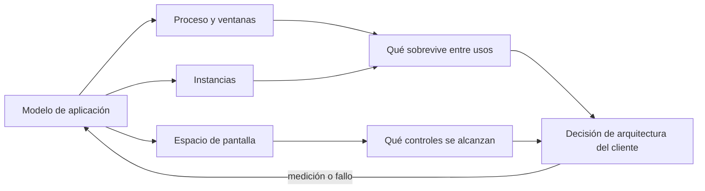
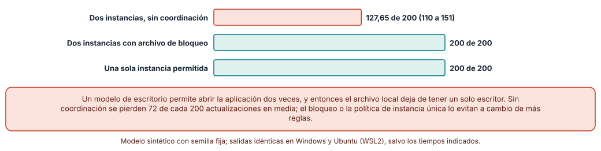
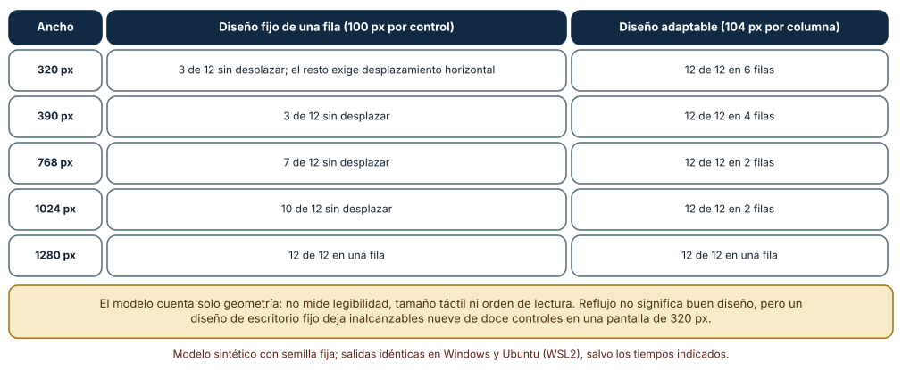
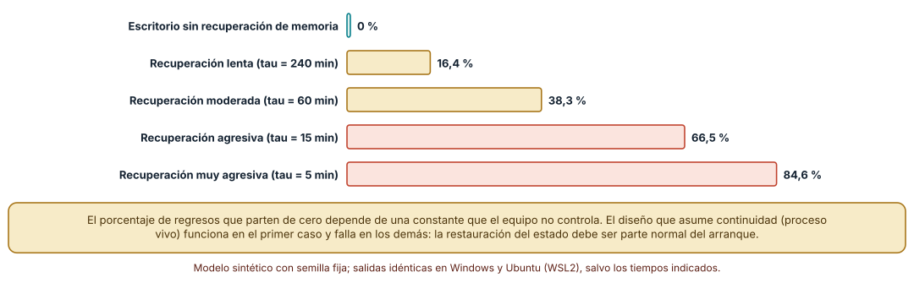

# SE-253 — Modelos de aplicación móvil y de escritorio

[← SE-252 — Proyecto: servicio contractual operable](../../classes/part-20-backend-apis-y-procesamiento-asincrono/se-252-proyecto-servicio-contractual-operable/README.md) · [↑ Parte 21](../../classes/part-21-software-movil-escritorio-y-multiplataforma/README.md) · [📚 Índice completo](../../classes/README.md) · [🌐 Portal](../../site/classes/SE-253.html) · [SE-254 — Ciclo de vida, suspensión y reanudación →](../../classes/part-21-software-movil-escritorio-y-multiplataforma/se-254-ciclo-de-vida-suspension-y-reanudacion/README.md)

## Punto profesional y fundamento pedagógico

**Punto profesional.** La clase existe para que elijas el modelo de aplicación (proceso, ventanas, instancias, arranque) antes de elegir herramienta, y para que sepas qué supuestos del escritorio dejan de valer en un teléfono: que el proceso sigue vivo, que hay una sola copia ejecutándose y que la pantalla tiene un ancho conocido.

**Por qué aparece aquí.** Abre la **Parte 21** después de **Proyecto: servicio contractual operable**: la Parte 20 terminó con un servicio que otras personas operan; esta parte pregunta qué ocurre en el otro extremo, el cliente que corre en un dispositivo ajeno, que el equipo no controla. Esta clase fija el vocabulario de modelos (móvil, escritorio, ventana, instancia, proceso) y el caso conductor de la parte: el **cliente de la plataforma de entregas**, que edita un borrador de entrega con o sin conexión.

**Error conceptual que debe corregir.** Creer que un cliente móvil es una versión pequeña de uno de escritorio, o que "la aplicación" es una cosa con un ciclo de vida único: el sistema decide cuántas copias hay, cuánto vive el proceso y qué espacio de pantalla recibe, y cada decisión rompe un supuesto distinto del código.

**Secuencia de aprendizaje.** Antes de leer la solución, predices cuántas ediciones perdería un archivo compartido por dos copias de la misma aplicación, cuántos controles quedan alcanzables al estrechar la ventana y qué fracción de los regresos parte de cero cuando el sistema recupera la memoria; después ejecutas tres modelos y contrastas la predicción con las cifras. La secuencia usa predicción, explicación propia, contraste y recuperación. [ICAP](https://icap.education.asu.edu/research) distingue participación de construcción de conocimiento; [How People Learn II](https://nap.nationalacademies.org/catalog/24783/how-people-learn-ii-learners-contexts-and-cultures) exige conectar conocimiento previo, contexto y transferencia; la [práctica de recuperación](https://pubmed.ncbi.nlm.nih.gov/16507066/) respalda producir de nuevo la explicación tras una demora; y [Education for Life and Work](https://nap.nationalacademies.org/resource/13398/dbasse_084153.pdf) exige devolución que explique la causa del error.

**Evidencia de aprendizaje.** `platform-model-log.md` con la tabla de supuestos que cada modelo rompe, la simulación de dos instancias con sus tres políticas, la tabla de anchos de ventana, la curva de arranques en frío y una nota de qué hallazgo cambiaría la elección de modelo. Debe contener predicción previa, observación, explicación causal, contraejemplo y qué hallazgo haría abandonar la decisión.

**Límite de la conclusión.** Los tres experimentos son modelos con parámetros del autor: ni el comportamiento de recuperación de memoria de un sistema concreto, ni la geometría de una pantalla real, ni la frecuencia con que alguien abre dos copias se midieron. Los modelos muestran la forma del problema; los números de una plataforma real salen de medirla.

### Trazabilidad fuente → afirmación

| Fuente primaria u oficial | Afirmación que respalda | Lo que no prueba |
|---|---|---|
| [Android Developers, «Application fundamentals»](https://developer.android.com/guide/components/fundamentals) | Describe que cada aplicación corre en su propio proceso, con su propio usuario de sistema, que el sistema lo inicia cuando un componente lo necesita y puede terminarlo para recuperar memoria. | No fija cuándo termina el proceso en un dispositivo concreto ni con qué probabilidad. |
| [Electron, «Process Model»](https://www.electronjs.org/docs/latest/tutorial/process-model) | Explica que una aplicación de escritorio construida con este marco tiene un proceso principal y uno o varios procesos de interfaz, y qué puede hacer cada uno. | No dice cuántas copias de la aplicación puede abrir una persona ni si conviene permitirlo. |
| [W3C, «Understanding SC 1.4.10: Reflow» (WCAG 2.2)](https://www.w3.org/WAI/WCAG22/Understanding/reflow.html) | Fija como criterio que el contenido se presente sin desplazamiento en dos dimensiones a un ancho equivalente a 320 píxeles CSS. | No garantiza que un diseño que reflujo sea usable ni legible. |

## Antes de empezar

Esta clase abre la **Parte 21 sobre el cliente de la plataforma de entregas**: una aplicación que muestra tareas y deja editar un borrador de entrega en un teléfono, en un portátil o en ambos. Recupera lo aprendido en la Parte 20: un servicio se opera porque se conoce su proceso. Aquí el proceso es de otra persona y de otro sistema operativo. La pregunta activa es: **¿qué supuestos de mi código dependen del modelo de aplicación y cuáles sobreviven si lo cambio?**

## Prerrequisitos

- Haber completado `SE-252` o poder explicar qué evidencia produjo.
- Haber escrito alguna vez un programa que lea y escriba un archivo local.
- Trabajar con el borrador de entrega y notas sintéticas: ningún experimento necesita datos reales ni dispositivos.
- Python 3.11 o posterior y un terminal; los experimentos usan solo la biblioteca estándar y datos sintéticos, sin cuentas de tienda, emuladores ni dispositivos.

## Problema auténtico

El cliente de entregas funciona en el portátil del equipo: el borrador vive en memoria y se guarda al pulsar «Guardar». En el teléfono de una estudiante, la aplicación pasa a segundo plano mientras escribe, el sistema recupera la memoria, y al volver el texto ha desaparecido. En otro equipo, alguien abre la aplicación dos veces y la segunda copia sobrescribe lo que escribió la primera. Nadie programó un error: tres supuestos del modelo de escritorio (proceso permanente, copia única, ventana ancha) dejaron de valer.

## Objetivos observables

Al terminar podrás:

1. distinguir proceso, ventana e instancia en un modelo móvil y en uno de escritorio, con un ejemplo y un contraejemplo de la plataforma de entregas;
2. medir cuántas actualizaciones pierden dos copias de la aplicación sobre un archivo compartido y comparar tres políticas de coordinación;
3. calcular cuántos controles quedan alcanzables al estrechar la ventana en un diseño fijo y en uno que reflujo, y declarar qué no mide ese cálculo;
4. estimar qué fracción de los regresos parte de cero según la rapidez con que el sistema recupera la memoria, con la sensibilidad a esa constante;
5. justificar con una tabla de supuestos qué modelo de aplicación elegirías para el cliente de entregas y qué evidencia te haría cambiarlo.

## Mapa conceptual



El mapa se lee de izquierda a derecha y no es un proceso obligatorio: el modelo de aplicación determina tres cosas que el sistema decide (cuánto vive el proceso, cuántas copias hay, cuánta pantalla se recibe) y de ellas salen las decisiones de arquitectura. La flecha de retorno indica que una medición o un fallo en un dispositivo reabre el modelo.

## Temas y por qué importan

| Tema | Por qué cambia una decisión profesional | Evidencia mínima |
|---|---|---|
| Modelo de aplicación | Fija qué entidades existen (proceso, ventana, instancia) y cuáles controla el sistema y cuáles el equipo. | Predicción, traza causal y contraejemplo de **Modelo de aplicación** en `platform-model-log.md` |
| Proceso y ventana | Una ventana no es un proceso: cerrar una no termina necesariamente al otro, y el sistema puede terminar el proceso sin cerrar ninguna. | Predicción, traza causal y contraejemplo de **Proceso y ventana** en `platform-model-log.md` |
| Instancia | Permitir varias copias convierte cada archivo local en un recurso compartido con varios escritores. | Predicción, traza causal y contraejemplo de **Instancia** en `platform-model-log.md` |
| Espacio de pantalla | El ancho disponible varía por un factor de seis o más entre dispositivos y una ventana de escritorio puede estrecharse. | Predicción, traza causal y contraejemplo de **Espacio de pantalla** en `platform-model-log.md` |
| Arranque en frío | Si el sistema recupera la memoria, parte de los regresos arrancan sin estado en memoria y el cliente debe reconstruirlo. | Predicción, traza causal y contraejemplo de **Arranque en frío** en `platform-model-log.md` |

## Conceptos y decisiones

### 1. Modelo de aplicación

Un modelo de aplicación es el conjunto de reglas con que una plataforma crea, mantiene y termina el código en ejecución. En Android, la documentación describe que cada aplicación corre en su propio proceso con su propio usuario de sistema, que el sistema arranca el proceso cuando un componente lo necesita y que puede terminarlo cuando necesita memoria. En un escritorio con un marco como Electron hay un proceso principal que gestiona ventanas y procesos de interfaz que las dibujan. Lo importante no es memorizar cada modelo sino distinguir qué decide el equipo y qué decide el sistema: lo segundo es una restricción de diseño, no un error de implementación.

### 2. Proceso y ventana

En escritorio, el usuario piensa en ventanas («cerré la aplicación») y el sistema piensa en procesos; en móvil el usuario piensa en pantallas y el sistema en procesos que recupera cuando falta memoria. Un cliente que guarda al cerrar la última ventana confía en un evento que el sistema móvil puede no entregar. La pregunta que ordena el diseño es qué estado vive en cada capa (ventana, proceso, disco, servidor) y cuál debe sobrevivir a la pérdida de la capa de arriba.

### 3. Instancia

Un escritorio permite abrir la misma aplicación varias veces salvo que se prohíba; un teléfono normalmente presenta una sola instancia. Cuando hay varias, el archivo del borrador tiene dos escritores que no se conocen. Las salidas son tres: aceptar la competencia y detectarla, coordinar con un bloqueo o impedir la segunda copia. Electron ofrece un mecanismo para obtener un bloqueo de instancia única, y cada solución añade una regla que hay que explicar a quien usa la aplicación.

### 4. Espacio de pantalla

Un teléfono recibe una pantalla estrecha y a veces girada; un escritorio entrega una ventana que la persona redimensiona o divide. WCAG pide que el contenido reflujo a 320 píxeles CSS sin desplazamiento en dos dimensiones. Un diseño de una sola fila de controles pensado para 1280 píxeles deja inalcanzables los controles que no caben. Medir el espacio disponible en cada arranque y reaccionar es parte del modelo, no un ajuste cosmético.

### 5. Arranque en frío

Se llama arranque en frío al que parte sin proceso ni estado en memoria, y arranque en caliente al que encuentra el proceso vivo. En escritorio casi todos los regresos son calientes porque el proceso permanece; en un teléfono, la fracción de arranques fríos depende de la presión de memoria y del tiempo que la persona estuvo fuera. Esa fracción no la controla el equipo, pero la restauración del estado desde el disco debe ser parte normal del arranque y no un camino excepcional.

### Dos copias sobre un mismo archivo

El archivo del borrador guarda un contador de revisiones. Cada copia ejecuta 100 incrementos, y cada incremento tiene dos pasos separados (leer, escribir) cuyo orden relativo decide un planificador con semilla. Se simulan tres políticas: sin coordinación, con un archivo de bloqueo que cubre cada incremento y con una sola instancia permitida. Cada política se repite con 1000 semillas.

```python
def run(policy, seed, n=100):
    rnd = random.Random(seed); disk = 0; lock = None
    st = [dict(pc=0, n=0, v=None) for _ in range(2)]
    while any(s['n'] < n for s in st):
        i = rnd.choice([k for k in (0, 1) if st[k]['n'] < n]); s = st[i]
        if policy == 'lock' and s['pc'] == 0:
            if lock not in (None, i): continue
            lock = i
        if s['pc'] == 0: s['v'] = disk; s['pc'] = 1      # leer
        else:
            disk = s['v'] + 1; s['pc'] = 0; s['n'] += 1  # escribir
            if policy == 'lock': lock = None
    return disk
```

Resultado, idéntico en Windows (CPython 3.12.9) y en Ubuntu bajo WSL2 (3.12.3): sin coordinación el valor final medio es **127,65 de 200** (mínimo 110, máximo 151) y **ninguna** de las 1000 semillas llega a 200; con el bloqueo y con una sola instancia las 1000 semillas dan exactamente 200. Se pierden 72 de cada 200 actualizaciones en media, y el número exacto cambia con cada semilla: el defecto no es determinista, por eso una prueba que lo ejecuta una vez puede pasar.



**Cómo leer la figura.** Cada barra es el valor final medio de 1000 semillas sobre 200 incrementos posibles; la coral es la política sin coordinación y las verdes son las políticas que serializan. **Dónde deja de valer:** el modelo trata cada incremento como dos pasos y supone que lo único compartido es el archivo; un sistema real añade cachés de lectura, escrituras atómicas del sistema de archivos y bloqueos del propio sistema. La medición muestra que existe la ventana de carrera, no su frecuencia en un equipo concreto.

### Doce controles y el ancho de la ventana

La barra de acciones del cliente tiene doce controles. El diseño fijo los coloca en una fila, cada uno con 100 píxeles de ancho; el adaptable los reparte en tantas filas como hagan falta con 104 píxeles por columna y un margen de 16. Se cuenta, para seis anchos entre 320 y 1920 píxeles, cuántos controles son visibles sin desplazarse horizontalmente y en cuántas filas caben.

```python
def fijo(w):      # una fila de 12 x 100 px
    return min(12, w // 100), 1
def adaptable(w): # reparto en filas
    cols = max(1, (w - 16) // 104)
    return 12, math.ceil(12 / cols)
```

A 320 px el diseño fijo deja visibles **3 de 12** y el adaptable muestra los doce en **6 filas**; a 390 px, 3 de 12 frente a doce en 4 filas; a 768 px, 7 de 12 frente a 2 filas; a 1024 px, 10 de 12 frente a 2 filas; a 1280 y 1920 px los dos muestran los doce en una fila. El cálculo es exacto porque la geometría es una suposición explícita: el diseño de escritorio quita acceso a nueve controles en el ancho mínimo que WCAG pide soportar.



**Cómo leer la figura.** Cada fila es un ancho de ventana; la columna central cuenta los controles visibles sin desplazamiento horizontal del diseño fijo y la derecha muestra cuántas filas ocupa el adaptable. **Dónde deja de valer:** el modelo cuenta solo anchura de cajas. No mide el tamaño táctil de cada control, el orden de lectura, la altura necesaria ni si seis filas de controles son una interfaz usable; reflujo es condición de acceso, no de calidad.

### Cuántos regresos parten de cero

Se generan 20 000 ausencias con una distribución lognormal de mediana 20 minutos (semilla fija). Con una constante de recuperación tau, la probabilidad de que el sistema haya terminado el proceso tras t minutos fuera es 1 − exp(−t / tau). Un escritorio que no recupera memoria equivale a tau infinito. Se cuenta el porcentaje de ausencias que terminan en arranque en frío.

```python
def cold(tau, N=20000, seed=253):
    rnd = random.Random(seed); c = 0
    for _ in range(N):
        t = rnd.lognormvariate(math.log(20), 1.5)    # minutos fuera
        if tau and rnd.random() < 1 - math.exp(-t / tau): c += 1
    return c / N
```

Resultado: **0 %** sin recuperación, **16,4 %** con tau de 240 minutos, **38,3 %** con 60, **66,5 %** con 15 y **84,6 %** con 5. La constante la fija el sistema y la presión de memoria del dispositivo, no el equipo; el equipo solo decide si el arranque en frío es un camino probado o una sorpresa. Con tau de 15 minutos dos de cada tres regresos parten de cero: tratarlos como excepción es tratar como excepción al caso más frecuente.



**Cómo leer la figura.** Cada barra es el porcentaje de 20 000 regresos sintéticos que parten sin estado en memoria; la verde es el escritorio que no recupera memoria y las coral son las constantes agresivas. **Dónde deja de valer:** tau y la distribución de ausencias son supuestos del autor, no medidas de ningún sistema. Un dispositivo real mezcla la presión de memoria, el uso de otras aplicaciones y políticas del fabricante; solo se leen la forma de la curva y su sensibilidad, no los porcentajes absolutos.

## Definiciones de trabajo

- **modelo de aplicación:** conjunto de reglas con que una plataforma crea, mantiene y termina el código en ejecución y reparte entre sistema y equipo las decisiones sobre proceso, ventanas e instancias.
- **proceso:** unidad de ejecución que el sistema operativo crea y puede terminar; contiene la memoria de la aplicación y no equivale a una ventana.
- **instancia:** copia de la aplicación en ejecución; un modelo puede permitir varias a la vez o una sola.
- **reflujo:** propiedad de un diseño que reorganiza su contenido para caber en un ancho menor sin desplazamiento en dos dimensiones.
- **arranque en frío:** arranque que parte sin proceso ni estado en memoria y debe reconstruir la aplicación desde el disco o el servidor.

Las definiciones son operativas para el cliente de la plataforma de entregas. No convierten términos con una historia técnica más amplia en sinónimos y deben contrastarse con la documentación primaria enlazada al final.

## Ejemplo mínimo

El fragmento simula una sola copia que incrementa un contador leyendo y escribiendo un archivo. Antes de ejecutarlo, predice qué valor da con dos copias alternadas paso a paso.

```python
import json, os, tempfile
ruta = os.path.join(tempfile.mkdtemp(), "borrador.json")
json.dump({"rev": 0}, open(ruta, "w"))

def incrementar():
    estado = json.load(open(ruta))      # paso 1: leer
    return lambda: json.dump({"rev": estado["rev"] + 1}, open(ruta, "w"))  # paso 2: escribir

a, b = incrementar(), incrementar()     # las dos copias leen antes de que ninguna escriba
a(); b()
assert json.load(open(ruta))["rev"] == 1   # dos incrementos, una revisión
```

Las dos copias leyeron el mismo valor, y la segunda escritura borró el efecto de la primera. Registra versión del intérprete y salida; si ejecutas `a()` antes de crear `b`, predice primero el resultado.

## Ejemplo profesional

El equipo del cliente de entregas escribe una tabla de supuestos con una fila por modelo (teléfono, escritorio, ventana dividida) y una columna por supuesto: proceso permanente, copia única, ancho mínimo, estado en memoria. Cada celda es «se cumple», «no se cumple» o «depende», con la fuente que lo respalda (la documentación de la plataforma o una medición propia). Las celdas «depende» se vuelven pruebas. La decisión de arquitectura nace de la tabla: guardar el borrador en el disco en cada pausa, impedir la segunda instancia en el escritorio y diseñar a 320 píxeles primero.

Compara el caso de una estudiante que alterna entre aplicaciones, el de un docente que abre dos ventanas con dos cursos y el de alguien que gira el teléfono a mitad de la edición. Una tabla es apropiada cuando esos tres casos tienen una respuesta escrita; es peligrosa cuando la respuesta existe solo en la cabeza de quien programó el modo de escritorio.

## Práctica guiada

1. Escribe tres supuestos del modelo de escritorio que tu código actual usa sin decirlo (proceso permanente, copia única, ancho conocido).
2. Predice cuántas actualizaciones pierden dos copias sobre un archivo compartido y anota el número antes de ejecutar.
3. Implementa la simulación de dos copias con las tres políticas y repite con 1000 semillas.
4. Calcula cuántos controles de tu pantalla de edición son alcanzables a 320, 390 y 768 píxeles con un diseño fijo y con uno adaptable.
5. Estima el porcentaje de arranques en frío para tres constantes de recuperación y registra qué supuesto ocultaba cada una.
6. Completa la tabla de supuestos por modelo con la fuente de cada celda y marca las que son solo suposición.
7. Entrega `platform-model-log.md` y pide a otra persona que decida qué modelo adoptaría usando únicamente ese archivo.

## Ejercicios

1. **Instancias:** añade una tercera copia a la simulación y calcula la pérdida esperada; explica por qué la política de bloqueo escala y la ausencia de coordinación no.
2. **Reflujo:** cambia el ancho de cada control a 56 píxeles y recalcula la tabla; indica en qué ancho el diseño fijo deja de ser alcanzable.
3. **Arranque en frío:** calcula la fracción de arranques fríos si la mitad de las ausencias dura menos de un minuto; explica qué parte de la conclusión cambia.
4. **Modelo:** elige entre una aplicación instalable, una web instalable y una aplicación de escritorio para el cliente de entregas y justifica con la tabla de supuestos qué evidencia te haría cambiar.

## Reto verificable

Entrega `platform-model-log.md` con la tabla de supuestos por modelo, la simulación de dos copias con sus tres políticas, la tabla de anchos de ventana y la curva de arranques en frío. Se aprueba si otra persona ejecuta el código desde un checkout limpio, obtiene las mismas cifras con las mismas semillas y puede indicar qué medición en un dispositivo real cambiaría la elección. No se aprueba por la cantidad de plataformas descritas.

## Caso conductor

El cliente de la plataforma de entregas de tareas es el caso conductor de la Parte 21. Esta clase deja el primer artefacto: la tabla de supuestos que cada modelo de aplicación rompe. `SE-254` mide qué hace falta guardar en cada transición del ciclo de vida, `SE-255` compara formas de construir el cliente, `SE-256` decide dónde vive el estado y `SE-260` qué ocurre cuando dos dispositivos editan sin conexión. Cambia después una sola decisión, permitir o prohibir la segunda instancia, y revisa qué artefactos hay que tocar.

## Preguntas frecuentes

### ¿Un cliente móvil es lo mismo que una versión pequeña del de escritorio?

No. Las diferencias no están en el tamaño sino en quién controla el proceso, cuántas copias hay y qué espacio llega. Un diseño que asume proceso permanente, copia única y ventana ancha falla de tres formas distintas, y cada una se corrige con un mecanismo diferente.

### ¿Cerrar la ventana termina el proceso?

Depende del modelo y de la plataforma. En muchos escritorios cerrar la última ventana puede terminar el proceso, pero algunos marcos lo mantienen vivo; en móvil, cerrar o salir de la pantalla casi nunca termina el proceso en ese momento y el sistema puede terminarlo después sin avisar. Se diseña para ambos.

### ¿Por qué no permitir siempre una sola instancia?

Porque hay usos legítimos de varias copias (dos cuentas, dos cursos) y porque la restricción hay que explicarla. Una instancia única es una decisión de producto con coste: si se elige, el cliente debe llevar la segunda ventana a la primera en lugar de ignorarla.

### ¿Los porcentajes de arranque en frío se pueden usar como estimación?

No como cifras absolutas. Dependen de supuestos del autor. Se usan para ver cómo cambia la proporción cuando cambia la presión de memoria y para justificar que la restauración sea el camino principal, no el excepcional.

## Fallo controlado y diagnóstico

Reproduce el fallo clásico de la clase: **creer que la aplicación es un proceso único y permanente**. Ejecuta la simulación de dos copias sin coordinación con una sola semilla y comprueba que a veces da 200.

Registra síntoma, hipótesis, observación que descarta cada una, causa, corrección y prueba de regresión. **Síntoma:** el contador del borrador queda en 143 de 200 y, al repetir, en otro valor. **Hipótesis rivales:** (a) una de las copias falla al escribir; (b) las escrituras se intercalan y una pisa a la otra. **Prueba:** registra el orden de lectura y escritura de cada copia; si hay una lectura antes de la escritura de la otra, la hipótesis (b) explica la pérdida. **Conclusión:** la causa es la ventana entre leer y escribir. **Regresión:** ejecuta 1000 semillas con la política elegida y exige 200 en todas; no cambies a la vez la política y el número de copias.

## Errores comunes y cómo corregirlos

| Síntoma | Causa probable | Corrección |
|---|---|---|
| El texto del borrador desaparece al volver a la aplicación en el teléfono | El estado vivía solo en memoria y el sistema terminó el proceso | Guardar en disco al pasar a segundo plano y restaurar en el arranque |
| Dos ventanas guardan el borrador y una de las ediciones se pierde | Dos escritores sin coordinación sobre el mismo archivo | Bloqueo, instancia única o fusión con detección de conflicto |
| Los botones de la derecha no se pueden pulsar en un teléfono | Diseño de una fila pensado para ventana ancha | Diseñar a 320 píxeles y reflujo; probar a varios anchos |
| La aplicación se comporta bien en el equipo de desarrollo y mal en uso real | El equipo de desarrollo casi nunca recupera memoria ni abre varias copias | Forzar el arranque en frío y la segunda instancia en las pruebas |
| Se afirma «funciona en móvil» tras ejecutar la versión web en un navegador estrecho | Se confunde ancho de ventana con modelo de aplicación | Declarar qué supuestos del modelo móvil se probaron y cuáles no |

## Entorno y archivos clave

```text
work/SE-253/
├── README.md
├── models/
│   ├── instancias.py
│   ├── anchos.py
│   └── arranques.py
├── tests/test_modelos.py
└── evidence/platform-model-log.md
```

El `README` declara plataforma, versión de Python, semillas y comandos. Los experimentos usan solo la biblioteca estándar (`random`, `math`, `json`, `tempfile`) y se ejecutaron con CPython 3.12.9 en Windows 11 y 3.12.3 en Ubuntu bajo WSL2: las salidas fueron idénticas. No se instaló ninguna SDK de plataforma ni se usó un emulador; si añades una, fija procedencia y versión.

## Seguridad, ética y accesibilidad

- los modelos usan datos sintéticos; no incluyas texto de entregas reales, identificadores ni nombres de estudiantes en la evidencia;
- si el borrador contiene datos de una persona, el archivo local es un dato personal: define dónde vive, cuánto dura y quién puede leerlo antes de elegir cómo se guarda;
- los diseños que dejan controles inalcanzables excluyen a quien usa un dispositivo pequeño, amplía la fuente o navega con una pantalla estrecha: es un problema de acceso, no de estilo;
- ofrece una alternativa textual a las tablas de anchos y no uses color como única señal;
- respeta las licencias de las SDK y los marcos que adoptes y atribuye lo que copies de su documentación.

## Puente hacia el trabajo con agentes

Un agente al que se le pide «haz que la aplicación funcione en móvil» elegirá un marco y una estructura sin avisar y escribirá código que asume lo que cualquier ejemplo en línea asume: proceso permanente, copia única y pantalla grande. Pídele en cambio que liste los supuestos del modelo de aplicación que su propuesta usa, que indique cuáles verificó en la documentación y cuáles dio por buenos, y que proponga pruebas que fuercen el arranque en frío y la segunda instancia. Revisa especialmente si decidió por su cuenta dónde se guarda el estado: es el mismo supuesto que perdió el borrador, ahora con apariencia de arquitectura completa.

## Transferencia

Traslada el análisis a otro dominio persistente (por ejemplo, una aplicación de reparto con un pedido en curso): cambia el estado que debe sobrevivir, conserva el procedimiento de listar supuestos, simularlos y medir qué rompen. La transferencia está lograda cuando puedes explicar qué parte del método dependía del borrador y cuál no, no cuando el código se parece.

## Evaluación y evidencia

| Criterio | Evidencia para aprobar |
|---|---|
| comprensión | explicación de la diferencia entre proceso, ventana e instancia con un ejemplo de la plataforma |
| corrección | cifras reproducibles de la simulación de instancias, de la tabla de anchos y de arranques en frío con las mismas semillas |
| diseño | tabla de supuestos por modelo con la fuente de cada celda y la decisión de arquitectura derivada |
| diagnóstico | reproducción del fallo «aplicación como proceso único y permanente» con regresión |
| incertidumbre | declaración de los parámetros supuestos y de lo que no se midió en dispositivos |
| reproducibilidad | versiones, comandos, salida y límites declarados |

## Fuentes

- [Android Developers, «Application fundamentals»](https://developer.android.com/guide/components/fundamentals) — procesos, sandbox y componentes de una aplicación Android; autoridad: Google.
- [Apple Developer, «Managing your app's life cycle»](https://developer.apple.com/documentation/uikit/app_and_environment/managing_your_app_s_life_cycle) — estados de una aplicación en iOS y qué hace el sistema entre ellos; autoridad: Apple.
- [Electron, «Process Model»](https://www.electronjs.org/docs/latest/tutorial/process-model) — proceso principal y procesos de interfaz de una aplicación de escritorio; autoridad: OpenJS Foundation.
- [Electron, «app» (instancia única)](https://www.electronjs.org/docs/latest/api/app) — bloqueo de instancia única de la aplicación; autoridad: OpenJS Foundation.
- [Microsoft, «Windows app lifecycle»](https://learn.microsoft.com/en-us/windows/apps/windows-app-sdk/applifecycle/applifecycle) — ciclo de vida de aplicaciones Windows con el SDK de aplicaciones; autoridad: Microsoft.
- [W3C, «Understanding SC 1.4.10: Reflow»](https://www.w3.org/WAI/WCAG22/Understanding/reflow.html) — criterio de reflujo a 320 píxeles CSS; autoridad: W3C.

Cada fuente respalda el mecanismo indicado; ninguna demuestra que las constantes de recuperación, la geometría de la barra de acciones o la frecuencia de dos copias de los experimentos coincidan con las de un dispositivo o de una población real. Esa afirmación depende de medir en el dispositivo.

- [Python: `random`](https://docs.python.org/3/library/random.html) — generador con semilla para las simulaciones.
- [Python: `math`](https://docs.python.org/3/library/math.html) — funciones exponencial, logarítmica y de techo usadas en los modelos.

## Límites y siguiente paso

Se ejecutaron tres experimentos con datos sintéticos en Windows y Ubuntu (WSL2) con resultados idénticos. No se midió ningún dispositivo, sistema operativo móvil ni persona: la recuperación de memoria, la geometría de la barra y la frecuencia de dos copias son construcciones del autor. La siguiente clase pregunta qué debe guardarse en cada transición del ciclo de vida.

## Glosario

- **modelo de aplicación:** conjunto de reglas con que una plataforma crea, mantiene y termina el código en ejecución y reparte entre sistema y equipo las decisiones sobre proceso, ventanas e instancias.
- **proceso:** unidad de ejecución que el sistema operativo crea y puede terminar; contiene la memoria de la aplicación y no equivale a una ventana.
- **instancia:** copia de la aplicación en ejecución; un modelo puede permitir varias a la vez o una sola.
- **reflujo:** propiedad de un diseño que reorganiza su contenido para caber en un ancho menor sin desplazamiento en dos dimensiones.
- **arranque en frío:** arranque que parte sin proceso ni estado en memoria y debe reconstruir la aplicación desde el disco o el servidor.

---

[← SE-252 — Proyecto: servicio contractual operable](../../classes/part-20-backend-apis-y-procesamiento-asincrono/se-252-proyecto-servicio-contractual-operable/README.md) · [↑ Parte 21](../../classes/part-21-software-movil-escritorio-y-multiplataforma/README.md) · [📚 Índice completo](../../classes/README.md) · [🌐 Portal](../../site/classes/SE-253.html) · [SE-254 — Ciclo de vida, suspensión y reanudación →](../../classes/part-21-software-movil-escritorio-y-multiplataforma/se-254-ciclo-de-vida-suspension-y-reanudacion/README.md)
