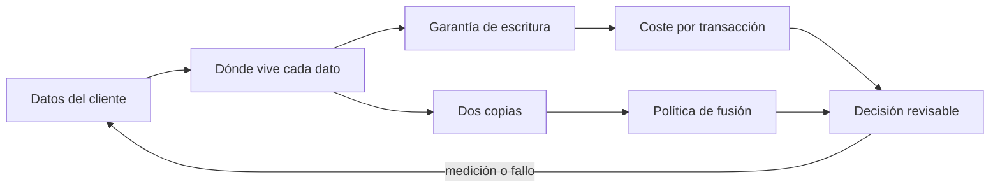
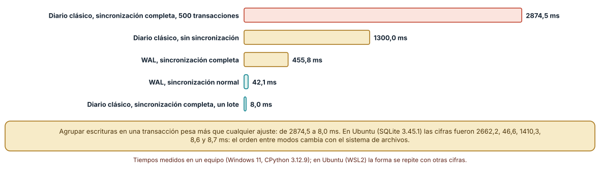
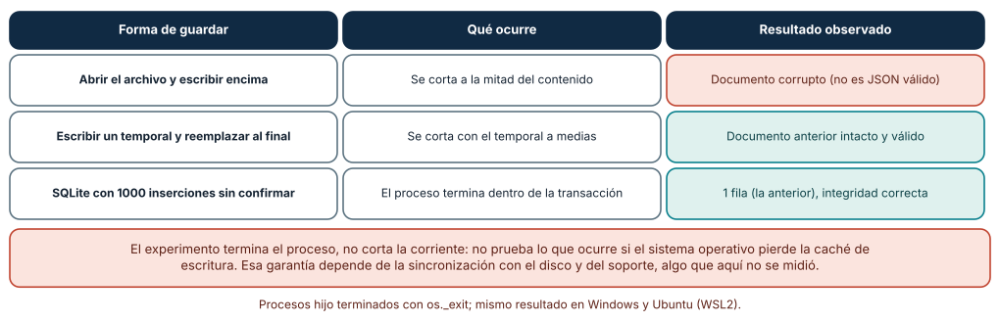
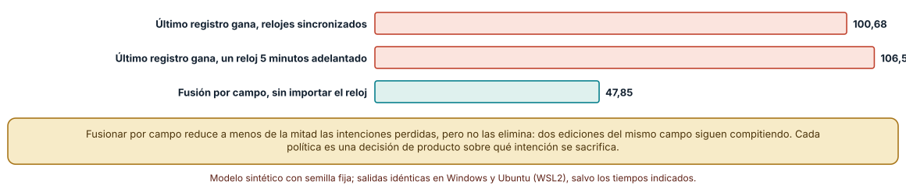

# SE-256 — Almacenamiento local y sincronización

[← SE-255 — Nativo, híbrido, web wrapper y cross-platform](../../classes/part-21-software-movil-escritorio-y-multiplataforma/se-255-nativo-hibrido-web-wrapper-y-cross-platform/README.md) · [↑ Parte 21](../../classes/part-21-software-movil-escritorio-y-multiplataforma/README.md) · [📚 Índice completo](../../classes/README.md) · [🌐 Portal](../../site/classes/SE-256.html) · [SE-257 — Permisos, sensores y capacidades del dispositivo →](../../classes/part-21-software-movil-escritorio-y-multiplataforma/se-257-permisos-sensores-y-capacidades-del-dispositivo/README.md)

## Punto profesional y fundamento pedagógico

**Punto profesional.** La clase existe para que decidas dónde vive cada dato del cliente, con qué garantías de escritura y con qué política de fusión cuando dos dispositivos lo cambian, midiendo el coste de cada garantía y lo que cada política sacrifica.

**Por qué aparece aquí.** Se sitúa después de **Nativo, híbrido, web wrapper y cross-platform** y antes de **Permisos, sensores y capacidades del dispositivo**: ya se eligió cómo construir el cliente y qué estado guardar; ahora se decide dónde vive el dato de dominio, cuánta durabilidad cuesta y cómo se reconcilian dos copias. Prepara el offline-first de `SE-260` y el proyecto de `SE-264`.

**Error conceptual que debe corregir.** Creer que «guardar en la base de datos local» es una operación con un solo coste y una sola garantía, y que sincronizar es copiar: la durabilidad se paga por transacción y cada política de fusión sacrifica una intención distinta.

**Secuencia de aprendizaje.** Antes de leer la solución, predices cuánto tarda un lote de 500 inserciones frente a 500 transacciones separadas, qué queda de un documento al terminar el proceso a mitad de la escritura con tres formas de guardar y cuántas intenciones de edición pierde una política que se queda con el último registro; después ejecutas los tres experimentos. La secuencia usa predicción, explicación propia, contraste y recuperación. [ICAP](https://icap.education.asu.edu/research) distingue participación de construcción de conocimiento; [How People Learn II](https://nap.nationalacademies.org/catalog/24783/how-people-learn-ii-learners-contexts-and-cultures) exige conectar conocimiento previo, contexto y transferencia; la [práctica de recuperación](https://pubmed.ncbi.nlm.nih.gov/16507066/) respalda producir de nuevo la explicación tras una demora; y [Education for Life and Work](https://nap.nationalacademies.org/resource/13398/dbasse_084153.pdf) exige devolución que explique la causa del error.

**Evidencia de aprendizaje.** `storage-log.md` con la tabla de datos del cliente con su ubicación y garantía, las mediciones de SQLite por modo, el resultado de la terminación a mitad de escritura y la comparación de dos políticas de fusión. Debe contener predicción previa, observación, explicación causal, contraejemplo y qué hallazgo haría abandonar la decisión.

**Límite de la conclusión.** El experimento de caída termina el proceso, no corta la corriente: no prueba la pérdida de la caché del sistema operativo. Las políticas de fusión se evalúan en una simulación con parámetros del autor y los tiempos son de un equipo con un sistema de archivos concreto.

### Trazabilidad fuente → afirmación

| Fuente primaria u oficial | Afirmación que respalda | Lo que no prueba |
|---|---|---|
| [SQLite, «Atomic Commit In SQLite»](https://www.sqlite.org/atomiccommit.html) | Explica cómo SQLite logra transacciones atómicas con un diario y qué supuestos hace del sistema de archivos y del disco. | No garantiza durabilidad en un dispositivo cuyo almacenamiento no cumple esos supuestos. |
| [SQLite, «Write-Ahead Logging»](https://www.sqlite.org/wal.html) | Describe el modo WAL, su efecto en la concurrencia y sus limitaciones. | No da cifras de rendimiento para ninguna carga concreta. |
| [Pillai et al., «All File Systems Are Not Created Equal» (OSDI 2014)](https://www.usenix.org/conference/osdi14/technical-sessions/presentation/pillai) | Muestra que las aplicaciones asumen propiedades de los sistemas de archivos que no todos cumplen y que esas suposiciones fallan tras una caída. | No analiza los sistemas de archivos de dispositivos móviles actuales. |

## Antes de empezar

Recupera `SE-255`: se decidió cómo construir el cliente. La pregunta activa es: **¿dónde vive cada dato, qué le pasa si el proceso termina a mitad de una escritura y qué intención se pierde cuando dos dispositivos lo cambian?**

## Prerrequisitos

- Haber completado `SE-255` o poder explicar qué evidencia produjo.
- Poder describir la política de guardado de `SE-254` y la decisión de `SE-255`.
- Saber ejecutar sentencias SQL sencillas desde Python con `sqlite3`.
- Python 3.11 o posterior y un terminal; los experimentos usan solo la biblioteca estándar y datos sintéticos, sin cuentas de tienda, emuladores ni dispositivos.

## Problema auténtico

La estudiante tiene el cliente en el teléfono y en el portátil. Escribe en el teléfono sin conexión y en el portátil con conexión, el mismo borrador. Al sincronizar, el sistema se queda con el último registro y su título nuevo del teléfono desaparece porque el portátil cambió el texto un minuto después. Además, la última vez que la aplicación se cerró a mitad de un guardado, el archivo de configuración quedó ilegible.

## Objetivos observables

Al terminar podrás:

1. decidir para cada dato del cliente (borrador, adjuntos, caché, configuración) dónde vive y qué garantía de escritura necesita;
2. medir el coste de la durabilidad en SQLite según el modo de diario, la sincronización y el agrupamiento en transacciones;
3. reproducir la terminación del proceso a mitad de una escritura con tres formas de guardar y explicar el resultado;
4. comparar fusionar por registro y por campo con relojes alineados y desfasados y calcular las intenciones perdidas;
5. justificar la política de almacenamiento y de fusión con evidencia propia y declarar qué no se probó.

## Mapa conceptual



El mapa se lee de izquierda a derecha: cada dato tiene una ubicación y una garantía, la garantía tiene un coste, y la existencia de dos copias exige una política de fusión que decide qué intención se sacrifica. La flecha de retorno indica que una medición o un fallo reabre el inventario de datos.

## Temas y por qué importan

| Tema | Por qué cambia una decisión profesional | Evidencia mínima |
|---|---|---|
| Inventario de datos | No todos los datos necesitan la misma garantía ni el mismo lugar. | Predicción, traza causal y contraejemplo de **Inventario de datos** en `storage-log.md` |
| Durabilidad y transacciones | Cada transacción confirmada paga una sincronización con el disco; agrupar escrituras es la palanca más fuerte. | Predicción, traza causal y contraejemplo de **Durabilidad y transacciones** en `storage-log.md` |
| Escritura interrumpida | Un archivo escrito encima y cortado a medias queda ilegible; uno escrito aparte y reemplazado conserva el anterior. | Predicción, traza causal y contraejemplo de **Escritura interrumpida** en `storage-log.md` |
| Dos copias del mismo dato | En cuanto hay dos dispositivos, hay dos escritores y toda política de fusión decide qué se pierde. | Predicción, traza causal y contraejemplo de **Dos copias del mismo dato** en `storage-log.md` |
| Relojes y orden | Ordenar por hora local depende de que los relojes coincidan. | Predicción, traza causal y contraejemplo de **Relojes y orden** en `storage-log.md` |

## Conceptos y decisiones

### 1. Inventario de datos

El cliente maneja datos de naturaleza distinta: el borrador (valioso y pequeño), los adjuntos (grandes y reemplazables), la caché de tareas (reconstruible desde el servidor) y la configuración (pequeña y crítica para arrancar). Cada uno pide una ubicación (base de datos, archivo, caché del sistema), una garantía de escritura y una política de borrado. Tratarlos igual produce una configuración corrupta o una caché que nunca se limpia.

### 2. Durabilidad y transacciones

SQLite logra atomicidad con un diario y, según la configuración, fuerza la sincronización con el almacenamiento en cada confirmación. El modo WAL cambia cuándo se paga ese coste y mejora la concurrencia de lectores. La opción de sincronización normal reduce el coste a cambio de tolerar la pérdida de las últimas transacciones tras un corte de energía, aunque no corrompe la base. Cada ajuste es un acuerdo explícito entre coste y durabilidad.

### 3. Escritura interrumpida

Interrumpir una escritura en el mismo archivo deja un contenido parcial. Escribir un archivo temporal y reemplazarlo al final deja siempre el anterior o el nuevo. Una base transaccional deja la última transacción confirmada. La elección no es dogma: los datos pequeños y críticos (configuración) se benefician del reemplazo atómico, los que cambian a menudo y tienen estructura, de una base.

### 4. Dos copias del mismo dato

Cuando el teléfono y el portátil modifican el mismo registro sin ver el cambio del otro, la sincronización debe elegir. Quedarse con el último registro es simple y pierde todo lo que el otro cambió en otros campos. Fusionar por campo conserva más, pero cuando ambos cambian el mismo campo sigue habiendo conflicto. Ninguna política elimina la pérdida: la reduce o la hace visible.

### 5. Relojes y orden

Las políticas que se quedan con el último escritor dependen de comparar marcas de tiempo de dispositivos distintos, y los relojes de dos dispositivos difieren. Un dispositivo adelantado gana siempre, aunque haya escrito antes. `SE-260` desarrolla los relojes lógicos; aquí basta con saber que la política «gana el último» tiene una dependencia que debe declararse.

### El precio de la durabilidad en SQLite

Se insertan 500 filas de 50 caracteres en una base nueva, con cuatro combinaciones de diario y sincronización con una transacción por fila, y con un lote de 500 en una sola transacción. Se toma la mediana de tres repeticiones.

```python
c = sqlite3.connect(p, isolation_level=None)
c.execute(f'PRAGMA journal_mode={journal}'); c.execute(f'PRAGMA synchronous={sync}')
if batch:
    c.execute('begin')
    for i in range(500): c.execute('insert into t(v) values(?)', ('x'*50,))
    c.execute('commit')
else:
    for i in range(500): c.execute('insert into t(v) values(?)', ('x'*50,))
```

Resultado en Windows (SQLite 3.45.3): diario clásico con sincronización completa y 500 transacciones, **2874,5 ms**; diario clásico sin sincronización, **1300,0 ms**; WAL con sincronización completa, **455,8 ms**; WAL con sincronización normal, **42,1 ms**; y un lote de 500 en una transacción, **8,0 ms**. En Ubuntu (SQLite 3.45.1) fueron 2662,2, 46,6, 1410,3, 8,6 y 8,7 ms. La conclusión estable es el orden de magnitud del lote; el orden entre modos intermedios cambia con el sistema.



**Cómo leer la figura.** Cada barra es la mediana de tres repeticiones en Windows; la coral es la combinación más lenta y las verdes las más rápidas. **Dónde deja de valer:** es una carga de inserciones de una fila en un equipo de escritorio; no mide lecturas, índices ni el almacenamiento de un teléfono. Un ajuste menos estricto tiene un coste de durabilidad que esta medición no muestra.

### Terminar el proceso a mitad de una escritura

Un proceso hijo escribe una mitad del contenido y termina con `os._exit` sin cerrar ni vaciar nada más. Se prueban tres formas: abrir el archivo y escribir encima, escribir un temporal y reemplazar, y una transacción de SQLite con 1000 inserciones sin confirmar.

```python
if mode == 'directa':
    f = open(path, 'w'); f.write(data[:len(data)//2]); f.flush(); os._exit(1)
if mode == 'temporal':
    f = open(path + '.tmp', 'w'); f.write(data[:len(data)//2]); f.flush(); os._exit(1)
if mode == 'sqlite':
    c = sqlite3.connect(path, isolation_level=None); c.execute('begin')
    for i in range(1000): c.execute('insert into t(v) values(?)', ('nuevo',))
    os._exit(1)
```

Resultado, idéntico en Windows y en Ubuntu: el archivo sobrescrito queda **corrupto** (no es JSON válido); el temporal con reemplazo deja el documento anterior **válido**; y la base SQLite queda con **1 fila** (la confirmada) y la comprobación de integridad devuelve `ok`. La causa es el momento en que cambia el contenido visible: encima del archivo, en cada byte; con reemplazo, en un instante; con transacción, al confirmar.



**Cómo leer la figura.** Cada fila es una forma de guardar; la tercera columna es lo que queda al reabrir: coral si el documento no se puede leer y verde si el estado anterior sigue intacto. **Dónde deja de valer:** terminar el proceso no es perder la energía. Los datos que el proceso entregó al sistema operativo sobreviven aunque no se sincronizaran; un corte de luz puede perderlos, y ese caso no se probó.

### Fusionar por registro o por campo

Se simulan 200 registros con tres campos (título, texto, etiqueta) y 400 ediciones repartidas al azar entre dos dispositivos. Con la política de registro, gana el registro con la marca de tiempo mayor y se pierden los cambios del otro; con la de campo, solo se pierde una edición si ambos editaron el mismo campo. Se repite con 300 semillas y con un reloj de uno de los dispositivos adelantado 0, 60 o 300 pasos.

```python
for i in range(recs):
    fa = local['A'].get(i, {}); fb = local['B'].get(i, {})
    if policy == 'registro' and fa and fb:
        ta = max(c for c, _ in fa.values()); tb = max(c for c, _ in fb.values())
        lost += len((fb if ta >= tb else fa))      # se pierde todo lo del perdedor
    elif policy == 'campo':
        lost += len(set(fa) & set(fb))             # solo si editaron el mismo campo
```

Resultado: quedarse con el último registro pierde **100,68** intenciones en media con relojes alineados, **101,11** con un reloj 60 pasos adelantado y **106,57** con 300; fusionar por campo pierde **47,85** en los tres casos. La fusión por campo es insensible al reloj y reduce las pérdidas a menos de la mitad, pero no las elimina: cuando dos dispositivos editan el mismo campo una intención se pierde.



**Cómo leer la figura.** Cada barra es la media de 300 semillas de ediciones cuya intención no sobrevive a la sincronización; las coral son la política por registro y la verde la política por campo. **Dónde deja de valer:** la definición de «intención perdida» es del autor, y las ediciones se reparten al azar, mientras que las reales se concentran en pocos registros. Los números indican la forma de la diferencia, no una tasa de pérdida de un producto.

## Definiciones de trabajo

- **durabilidad:** propiedad de que una escritura confirmada sobreviva a una caída; su coste crece con la frecuencia con que se fuerza la sincronización con el almacenamiento.
- **transacción:** grupo de escrituras que se confirman o se descartan juntas y que, en una base transaccional, deja siempre un estado completo.
- **escritura atómica:** guardado que deja el estado anterior o el nuevo completos, nunca uno parcial.
- **fusión:** regla que decide el estado final cuando dos copias de un dato han cambiado sin ver el cambio de la otra.
- **intención perdida:** edición que una persona hizo y que no aparece en el estado final tras sincronizar.

Las definiciones son operativas para el cliente de la plataforma de entregas. No convierten términos con una historia técnica más amplia en sinónimos y deben contrastarse con la documentación primaria enlazada al final.

## Ejemplo mínimo

El fragmento compara un archivo sobrescrito con uno reemplazado cuando la escritura se interrumpe. Antes de ejecutarlo, predice cuál queda legible.

```python
import json, os, tempfile
d = tempfile.mkdtemp(); ruta = os.path.join(d, "config.json")
json.dump({"modo": "claro"}, open(ruta, "w"))

# escritura interrumpida sobre un temporal: el original sigue intacto
with open(ruta + ".tmp", "w") as f:
    f.write('{"modo": "osc')            # contenido parcial, sin reemplazar
assert json.load(open(ruta)) == {"modo": "claro"}
```

El original sigue legible porque el reemplazo nunca llegó a ocurrir. Cambia el código para escribir encima de `ruta` y predice el resultado.

## Ejemplo profesional

El equipo del cliente escribe el inventario de datos con una fila por dato: ubicación (base local, archivo, caché), garantía (transacción confirmada, reemplazo atómico, sin garantía), política de borrado y política de fusión. El borrador va en la base con transacciones cortas; la configuración, en un archivo con reemplazo atómico; la caché de tareas, en un directorio que el sistema puede limpiar. La fusión del borrador es por campo, con detección explícita cuando ambos editan el mismo, y se avisa a la persona en lugar de elegir en silencio.

Compara el caso de editar solo en el teléfono, el de editar el título en el teléfono y el texto en el portátil, y el de editar el mismo párrafo en ambos. Una política es apropiada cuando los tres casos tienen un resultado escrito y una prueba.

## Práctica guiada

1. Lista los datos del cliente y asigna ubicación, garantía y política de borrado a cada uno.
2. Predice cuánto tarda un lote frente a transacciones separadas y anota el número antes de ejecutar.
3. Mide los cinco modos de SQLite y registra el sistema, la versión de SQLite y la mediana.
4. Termina un proceso hijo a mitad de una escritura con las tres formas y registra qué queda.
5. Simula dos dispositivos con las dos políticas de fusión y varios desfases de reloj.
6. Decide qué conflictos se resuelven solos y cuáles se muestran a la persona.
7. Entrega `storage-log.md` y pide a otra persona que reconstruya el inventario solo con él.

## Ejercicios

1. **Lote:** calcula a partir de la medición cuántas transacciones por segundo soporta cada modo y cuántas ediciones por segundo escribe una persona; decide si agrupar importa.
2. **Interrupción:** añade una cuarta forma de guardar (archivo nuevo con nombre con versión) y compara su resultado.
3. **Fusión:** cambia la proporción de ediciones del mismo campo y calcula cuándo la fusión por campo deja de ganar.
4. **Inventario:** añade el dato «adjuntos pendientes de subir» y decide su ubicación, garantía y política de borrado.

## Reto verificable

Entrega `storage-log.md` con el inventario de datos, las mediciones de SQLite, el resultado de la terminación a mitad de escritura y la comparación de políticas de fusión. Se aprueba si otra persona obtiene los mismos conteos con las mismas semillas, entiende por qué cambian los tiempos entre sistemas y puede indicar qué prueba de corte de energía faltaría. No se aprueba por afirmar que los datos «están seguros».

## Caso conductor

El cliente de entregas de la Parte 21 deja aquí su inventario de datos y su política de fusión. `SE-257` decide qué capacidades del dispositivo se piden, `SE-260` desarrolla el trabajo sin conexión y la resolución de conflictos con relojes lógicos, y `SE-264` integra todo en un cliente que sincroniza. Cambia después una sola decisión, la sincronización de SQLite de completa a normal, y revisa qué cifras y qué garantías cambian.

## Preguntas frecuentes

### ¿Siempre conviene una base de datos local?

No. Para datos pequeños, críticos y poco frecuentes, como la configuración, un archivo con reemplazo atómico es más simple. La base compensa cuando hay estructura, consultas o muchas escrituras.

### ¿Por qué cambian tanto los tiempos entre modos y sistemas?

Porque el coste dominante es la sincronización con el almacenamiento, que depende del sistema de archivos y del disco. Los valores se informan por sistema; lo estable es el orden de magnitud del lote.

### ¿Fusionar por campo evita perder datos?

No del todo. Evita perder los cambios en campos distintos, pero cuando ambos editan el mismo campo una de las intenciones se pierde. Lo que se decide es cuál y si se avisa.

### ¿Terminar el proceso es lo mismo que cortar la energía?

No. Terminar el proceso no descarta lo que ya entregó al sistema operativo; un corte de energía puede descartar lo que aún estaba en caché. Este experimento prueba lo primero.

## Fallo controlado y diagnóstico

Reproduce el fallo clásico de la clase: **guardar encima del archivo y confiar en que no se interrumpirá**. Escribe la configuración encima del archivo y termina el proceso a la mitad.

Registra síntoma, hipótesis, observación que descarta cada una, causa, corrección y regresión. **Síntoma:** la aplicación no arranca porque la configuración no es JSON válido. **Hipótesis rivales:** (a) otra versión escribió un formato nuevo; (b) la escritura quedó a medias. **Prueba:** compara el tamaño del archivo con el esperado y busca el final truncado; si termina a mitad de una cadena, la hipótesis (b) explica el fallo. **Conclusión:** la causa es escribir encima. **Regresión:** guarda con temporal y reemplazo, termina el proceso en cada punto y exige que el archivo sea válido; no cambies a la vez el formato.

## Errores comunes y cómo corregirlos

| Síntoma | Causa probable | Corrección |
|---|---|---|
| La configuración queda ilegible tras un cierre inesperado | Se escribió encima del archivo | Temporal sincronizado y reemplazo atómico |
| Guardar un borrador tarda segundos con muchas ediciones | Una transacción por edición con sincronización completa | Agrupar escrituras y elegir un modo de sincronización explícito |
| Un cambio del teléfono desaparece tras sincronizar | La fusión elige el último registro entero | Fusionar por campo y avisar de los conflictos reales |
| El dispositivo con el reloj adelantado siempre gana | Se compara la hora local de dos dispositivos | Relojes lógicos o versiones por réplica (`SE-260`) |
| Se afirma que los datos son seguros porque las pruebas de caída pasan | La prueba termina el proceso y no corta la energía | Declarar qué fallos se probaron y cuáles no |

## Entorno y archivos clave

```text
work/SE-256/
├── README.md
├── storage/
│   ├── sqlite_modos.py
│   ├── caida.py
│   └── fusion.py
├── tests/test_storage.py
└── evidence/storage-log.md
```

El `README` declara plataforma, versión de Python y de SQLite, semillas y comandos. Los experimentos usan solo la biblioteca estándar (`sqlite3`, `os`, `subprocess`, `random`, `tempfile`) y se ejecutaron con CPython 3.12.9 y SQLite 3.45.3 en Windows 11 y con CPython 3.12.3 y SQLite 3.45.1 en Ubuntu bajo WSL2. Los resultados no temporales fueron idénticos; los tiempos se informan por sistema.

## Seguridad, ética y accesibilidad

- un dato guardado en el dispositivo es un dato personal: decide cifrado, duración y borrado al cerrar sesión;
- no guardes tokens de acceso en archivos de configuración legibles por otras aplicaciones;
- las pruebas usan texto sintético, nunca borradores reales;
- una fusión silenciosa que descarta la edición de una persona es una decisión sobre su trabajo: avisa y deja recuperar;
- el borrado debe borrar también las copias en caché y los archivos temporales.

## Puente hacia el trabajo con agentes

Un agente al que se le pide «guarda los datos localmente» elegirá una biblioteca y escribirá `open(ruta, 'w')`. Pídele el inventario de datos con garantía y política de borrado, una prueba que termine el proceso a mitad de cada escritura y la política de fusión con su pérdida medida. Revisa especialmente si eligió la sincronización por defecto sin decirlo: es el mismo acuerdo entre coste y durabilidad que esta clase hace explícito.

## Transferencia

Traslada el análisis a otro dominio persistente (una aplicación de reparto con un pedido en curso): cambia los datos y las ediciones concurrentes, conserva el procedimiento de medir el coste de la durabilidad, interrumpir escrituras y comparar fusiones. La transferencia está lograda cuando puedes explicar qué parte del método dependía del borrador y cuál no.

## Evaluación y evidencia

| Criterio | Evidencia para aprobar |
|---|---|
| comprensión | explicación de la diferencia entre atomicidad, durabilidad y fusión con un ejemplo del cliente |
| corrección | mediciones por sistema y conteos reproducibles de la terminación y de la fusión |
| diseño | inventario de datos con ubicación, garantía, borrado y fusión |
| diagnóstico | reproducción del fallo «guardar encima del archivo» con regresión |
| incertidumbre | declaración de que no se probó un corte de energía ni un almacenamiento móvil |
| reproducibilidad | versiones de Python y de SQLite, comandos, salida y límites declarados |

## Fuentes

- [SQLite, «Atomic Commit In SQLite»](https://www.sqlite.org/atomiccommit.html) — mecanismo de transacciones atómicas y sus supuestos; autoridad: SQLite.
- [SQLite, «Write-Ahead Logging»](https://www.sqlite.org/wal.html) — modo WAL y sus efectos; autoridad: SQLite.
- [SQLite, «PRAGMA statements»](https://www.sqlite.org/pragma.html) — opciones de sincronización y de diario; autoridad: SQLite.
- [Android Developers, «Room»](https://developer.android.com/training/data-storage/room) — capa de acceso a SQLite en Android; autoridad: Google.
- [Pillai et al., «All File Systems Are Not Created Equal»](https://www.usenix.org/conference/osdi14/technical-sessions/presentation/pillai) — suposiciones de las aplicaciones sobre los sistemas de archivos; autoridad: USENIX OSDI.
- [Kleppmann et al., «Local-first software»](https://www.inkandswitch.com/local-first/) — datos locales primero y sincronización entre dispositivos; autoridad: Ink & Switch.

Cada fuente respalda el mecanismo indicado; ninguna demuestra que las cifras de tiempo o de pérdida de los experimentos sean las de un teléfono, un sistema de archivos móvil o un producto. Esa afirmación depende de medir en el dispositivo.

- [Python: `sqlite3`](https://docs.python.org/3/library/sqlite3.html) — interfaz de SQLite usada en las mediciones.
- [Python: `os`](https://docs.python.org/3/library/os.html) — reemplazo y terminación de procesos.

## Límites y siguiente paso

Se ejecutaron tres experimentos con datos sintéticos en Windows y Ubuntu (WSL2) con resultados idénticos salvo los tiempos y la versión de SQLite. No se cortó la energía ni se midió ningún almacenamiento móvil. La siguiente clase pregunta qué permisos y capacidades del dispositivo necesita el cliente.

## Glosario

- **durabilidad:** propiedad de que una escritura confirmada sobreviva a una caída; su coste crece con la frecuencia con que se fuerza la sincronización con el almacenamiento.
- **transacción:** grupo de escrituras que se confirman o se descartan juntas y que, en una base transaccional, deja siempre un estado completo.
- **escritura atómica:** guardado que deja el estado anterior o el nuevo completos, nunca uno parcial.
- **fusión:** regla que decide el estado final cuando dos copias de un dato han cambiado sin ver el cambio de la otra.
- **intención perdida:** edición que una persona hizo y que no aparece en el estado final tras sincronizar.

---

[← SE-255 — Nativo, híbrido, web wrapper y cross-platform](../../classes/part-21-software-movil-escritorio-y-multiplataforma/se-255-nativo-hibrido-web-wrapper-y-cross-platform/README.md) · [↑ Parte 21](../../classes/part-21-software-movil-escritorio-y-multiplataforma/README.md) · [📚 Índice completo](../../classes/README.md) · [🌐 Portal](../../site/classes/SE-256.html) · [SE-257 — Permisos, sensores y capacidades del dispositivo →](../../classes/part-21-software-movil-escritorio-y-multiplataforma/se-257-permisos-sensores-y-capacidades-del-dispositivo/README.md)
