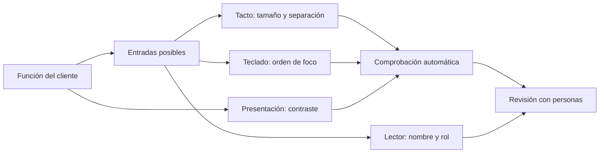
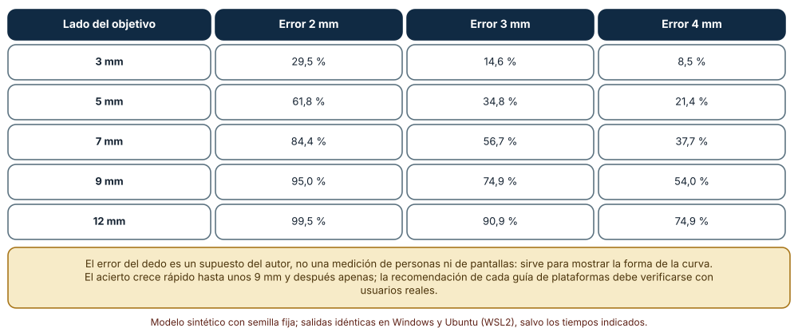
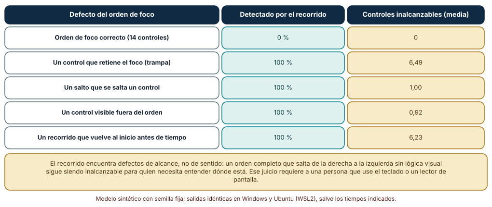
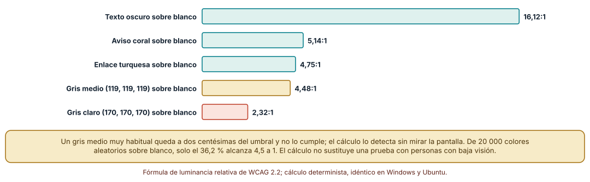

# SE-258 — Interacción táctil, teclado, mouse y accesibilidad

[← SE-257 — Permisos, sensores y capacidades del dispositivo](../../classes/part-21-software-movil-escritorio-y-multiplataforma/se-257-permisos-sensores-y-capacidades-del-dispositivo/README.md) · [↑ Parte 21](../../classes/part-21-software-movil-escritorio-y-multiplataforma/README.md) · [📚 Índice completo](../../classes/README.md) · [🌐 Portal](../../site/classes/SE-258.html) · [SE-259 — Actualizaciones, tiendas y distribución empresarial →](../../classes/part-21-software-movil-escritorio-y-multiplataforma/se-259-actualizaciones-tiendas-y-distribucion-empresarial/README.md)

## Punto profesional y fundamento pedagógico

**Punto profesional.** La clase existe para que diseñes el cliente para varias formas de entrada (dedo, teclado, mouse, lector de pantalla) a la vez, y para que verifiques con cálculos y recorridos automáticos lo que se puede verificar (tamaño de objetivo, orden de foco, contraste) y reserves a las personas lo que no.

**Por qué aparece aquí.** Se sitúa después de **Permisos, sensores y capacidades del dispositivo** y antes de **Actualizaciones, tiendas y distribución empresarial**: ya se decidió qué capacidades usa el cliente; ahora se decide cómo se maneja. Una aplicación que solo funciona con un dedo preciso o con un mouse excluye a quien usa otra entrada, y la Parte 14 profundiza en la experiencia; aquí se trata la base que depende de la plataforma.

**Error conceptual que debe corregir.** Creer que un diseño accesible es un conjunto de atributos que se añaden al final, o que un recorrido automático garantiza que la interfaz sea usable: los atributos no sustituyen el orden, el tamaño ni el sentido, y un recorrido solo ve alcance, no comprensión.

**Secuencia de aprendizaje.** Antes de leer la solución, predices cómo sube el acierto de un toque con el tamaño del objetivo, qué defectos del orden de foco encuentra un recorrido automático y qué colores habituales no alcanzan el contraste mínimo; después ejecutas los tres experimentos. La secuencia usa predicción, explicación propia, contraste y recuperación. [ICAP](https://icap.education.asu.edu/research) distingue participación de construcción de conocimiento; [How People Learn II](https://nap.nationalacademies.org/catalog/24783/how-people-learn-ii-learners-contexts-and-cultures) exige conectar conocimiento previo, contexto y transferencia; la [práctica de recuperación](https://pubmed.ncbi.nlm.nih.gov/16507066/) respalda producir de nuevo la explicación tras una demora; y [Education for Life and Work](https://nap.nationalacademies.org/resource/13398/dbasse_084153.pdf) exige devolución que explique la causa del error.

**Evidencia de aprendizaje.** `interaction-log.md` con la tabla de modos de entrada por función, la curva de acierto por tamaño con su error supuesto, el recorrido del orden de foco con sus defectos y la tabla de contrastes calculados. Debe contener predicción previa, observación, explicación causal, contraejemplo y qué hallazgo haría abandonar la decisión.

**Límite de la conclusión.** El error del dedo es un supuesto del autor, no una medición de personas ni de pantallas; el recorrido de foco opera sobre grafos sintéticos; el cálculo de contraste usa la fórmula de WCAG y no sustituye una prueba con personas con baja visión ni con un lector de pantalla.

### Trazabilidad fuente → afirmación

| Fuente primaria u oficial | Afirmación que respalda | Lo que no prueba |
|---|---|---|
| [W3C, «Understanding SC 2.5.8: Target Size (Minimum)» (WCAG 2.2)](https://www.w3.org/WAI/WCAG22/Understanding/target-size-minimum.html) | Fija un tamaño mínimo para los objetivos que se pueden activar con un puntero y explica excepciones. | No fija un tamaño ideal ni sustituye medir a la población usuaria. |
| [W3C, «Understanding SC 1.4.3: Contrast (Minimum)» (WCAG 2.2)](https://www.w3.org/WAI/WCAG22/Understanding/contrast-minimum.html) | Define la relación de contraste mínima de 4,5 a 1 para texto normal y la fórmula de luminancia relativa para calcularla. | No cubre todas las formas de baja visión ni garantiza legibilidad. |
| [W3C, «Understanding SC 2.4.3: Focus Order» (WCAG 2.2)](https://www.w3.org/WAI/WCAG22/Understanding/focus-order.html) | Exige que el orden de foco conserve el significado y la operabilidad. | No define un procedimiento automático para decidir si el orden conserva el significado. |

## Antes de empezar

Recupera `SE-257`: se decidió qué capacidades usa el cliente. La pregunta activa es: **¿puede manejarlo una persona con un dedo, con un teclado y con un lector de pantalla, y qué de eso se puede comprobar sin ella?**

## Prerrequisitos

- Haber completado `SE-257` o poder explicar qué evidencia produjo.
- Poder describir la tabla de capacidades de `SE-257`.
- Conocer de forma básica qué es el orden de tabulación y un lector de pantalla.
- Python 3.11 o posterior y un terminal; los experimentos usan solo la biblioteca estándar y datos sintéticos, sin cuentas de tienda, emuladores ni dispositivos.

## Problema auténtico

El cliente de entregas tiene un botón «Enviar» de 14 píxeles junto a «Cancelar». En el portátil, con teclado, el foco salta al enlace de ayuda y no vuelve; en el teléfono, un dedo acierta el botón a medias; el texto gris de las fechas es difícil de leer a pleno sol. Cada defecto es pequeño; juntos, cuatro de cada diez personas no pueden entregar sin ayuda.

## Objetivos observables

Al terminar podrás:

1. listar para cada función del cliente qué entradas la permiten (táctil, teclado, puntero, lector de pantalla) y cuál falta;
2. calcular cómo cambia el acierto de un toque simulado con el tamaño del objetivo y el error del dedo, y declarar que el error es un supuesto;
3. recorrer el orden de foco de una interfaz sintética y detectar trampas, saltos, controles fuera del orden y ciclos anticipados;
4. calcular la relación de contraste con la fórmula de WCAG y decidir qué pares de la paleta no cumplen;
5. justificar qué se verifica de forma automática y qué exige a una persona.

## Mapa conceptual



El mapa se lee de izquierda a derecha: cada función admite varias entradas, cada entrada tiene una condición que se puede comprobar en parte de forma automática, y todo pasa por una revisión con personas. El nombre y el rol para el lector solo se revisan bien con el lector.

## Temas y por qué importan

| Tema | Por qué cambia una decisión profesional | Evidencia mínima |
|---|---|---|
| Entradas y modos | Una función que solo existe para un tipo de entrada deja fuera a quien usa otro. | Predicción, traza causal y contraejemplo de **Entradas y modos** en `interaction-log.md` |
| Tamaño y separación de objetivos | Un objetivo pequeño o pegado a otro convierte un toque con error normal en un error de acción. | Predicción, traza causal y contraejemplo de **Tamaño y separación de objetivos** en `interaction-log.md` |
| Teclado y orden de foco | El teclado recorre los controles en un orden que el código define y que puede tener trampas. | Predicción, traza causal y contraejemplo de **Teclado y orden de foco** en `interaction-log.md` |
| Nombre, rol y estado para tecnologías de apoyo | Un lector de pantalla anuncia lo que el árbol de accesibilidad contiene, no lo que se ve. | Predicción, traza causal y contraejemplo de **Nombre, rol y estado para tecnologías de apoyo** en `interaction-log.md` |
| Contraste y presentación | El contraste se calcula y, a diferencia de la mayoría de los juicios de diseño, tiene fórmula. | Predicción, traza causal y contraejemplo de **Contraste y presentación** en `interaction-log.md` |

## Conceptos y decisiones

### 1. Entradas y modos

Un cliente recibe toques, teclas, clics y órdenes de tecnologías de apoyo. Muchas personas usan varios según el contexto, y otras dependen de uno. La regla de diseño es que toda función esté disponible por cualquier entrada razonable: lo que se hace arrastrando necesita un equivalente con teclado, lo que se hace con atajos necesita un botón visible, lo que se hace con un gesto necesita una alternativa de un solo toque.

### 2. Tamaño y separación de objetivos

WCAG 2.2 fija un tamaño mínimo para objetivos con puntero, y las guías de plataformas recomiendan tamaños mayores para el toque. Lo que importa para el diseño es la relación entre el tamaño del objetivo y la dispersión del dedo: la probabilidad de acertar crece rápido hasta un tamaño y después apenas. Se mide con usuarios; el cálculo muestra la forma de la curva.

### 3. Teclado y orden de foco

La persona que usa teclado o un conmutador se mueve por el orden de foco. Un control que retiene el foco, un salto que se salta controles, un control visible que no entra en el orden o un recorrido que vuelve al inicio antes de tiempo bloquean el uso. WCAG exige que el orden conserve significado y operabilidad. El recorrido automático encuentra los defectos de alcance; el sentido del orden lo juzga una persona.

### 4. Nombre, rol y estado para tecnologías de apoyo

Un botón de icono sin nombre es silencioso; un control personalizado sin rol no es un control. Las plataformas ofrecen un árbol de accesibilidad con nombre, rol y estado, y las pruebas más fiables consisten en recorrer la interfaz con la tecnología de apoyo. Eso no se simula aquí: se declara como lo que no se midió.

### 5. Contraste y presentación

WCAG define la relación de contraste a partir de la luminancia relativa de dos colores y fija 4,5 a 1 para texto normal y 3 a 1 para texto grande y elementos de interfaz. Un cálculo automático detecta los pares que no cumplen. No cubre el tamaño de fuente, el espaciado, los estados de foco ni las condiciones de luz.

### Cuántos toques aciertan un objetivo

Se simulan 20 000 toques por combinación con un error gaussiano en cada eje, de desviación 2, 3 o 4 mm (supuesto del autor), alrededor del centro de un objetivo cuadrado de 3 a 12 mm de lado. Se cuenta el porcentaje que cae dentro.

```python
def hit(size, sigma, N, seed):
    r = random.Random(seed); h = 0
    for _ in range(N):
        x, y = r.gauss(0, sigma), r.gauss(0, sigma)
        if abs(x) <= size/2 and abs(y) <= size/2: h += 1
    return h / N
```

Resultado, idéntico en Windows (CPython 3.12.9) y Ubuntu (3.12.3): con error de 2 mm, un objetivo de 3 mm acierta **29,5 %**, uno de 7 mm **84,4 %** y uno de 12 mm **99,5 %**; con error de 4 mm, los mismos tamaños aciertan **8,5 %**, **37,7 %** y **74,9 %**. La curva sube rápido y se aplana: pasar de 3 a 7 mm triplica el acierto con error de 2 mm, y pasar de 9 a 12 mm lo mejora cuatro puntos.



**Cómo leer la figura.** Cada fila es el lado del objetivo y cada columna el error supuesto del dedo; los porcentajes son el acierto de 20 000 toques simulados. **Dónde deja de valer:** el error es gaussiano, sin sesgo ni temblor, y se supuso; las personas reales tienen errores que dependen de la mano, de la postura y de la pantalla. No se midió a nadie: el valor está en ver que el tamaño y la dispersión, juntos, deciden el acierto.

### Recorrer el orden de foco

Se modela una interfaz de 14 controles con un orden circular de tabulación. Se introducen cuatro defectos con 1000 muestras cada uno: un control que retiene el foco, un salto que se salta un control, un control que sale del orden y un ciclo que vuelve al inicio antes de tiempo. El recorrido sigue el orden desde el primer control y anota cuántos alcanza y si vuelve al inicio.

```python
def analiza(nxt):
    seen = []; cur = 0
    while cur not in seen: seen.append(cur); cur = nxt[cur]
    trampa = any(nxt[i] == i for i in nxt)
    return len(seen), trampa, cur == 0     # alcanzados, trampa, ¿cierra el ciclo?
detectado = (alcanzados < 14) or trampa or not vuelve
```

Resultado: el recorrido no marca nada en el orden correcto (**0 %** de falsos positivos) y detecta el **100 %** de los cuatro defectos, con **6,49** controles inalcanzables en media para una trampa, **1,00** para un salto, **0,92** para un control fuera del orden y **6,23** para un ciclo anticipado. Las trampas y los ciclos son las más graves porque bloquean casi la mitad de la interfaz.



**Cómo leer la figura.** Cada fila es un tipo de defecto; la columna central es el porcentaje de 1000 interfaces en que el recorrido lo detecta y la derecha cuántos controles quedan fuera de alcance. **Dónde deja de valer:** el grafo es una cadena circular simplificada; una interfaz real tiene regiones, ventanas modales y orden dependiente del contexto. El recorrido ve alcance, no sentido: un orden completo pero caótico pasa la prueba y es inutilizable.

### Calcular el contraste

Se aplica la fórmula de luminancia relativa y de relación de contraste de WCAG a cinco pares de la paleta del cliente sobre fondo blanco, y a 20 000 colores aleatorios sobre blanco para ver qué fracción cumple el mínimo de 4,5 a 1.

```python
def lin(c): c /= 255; return c/12.92 if c <= 0.03928 else ((c+0.055)/1.055)**2.4
def lum(rgb): r, g, b = rgb; return 0.2126*lin(r) + 0.7152*lin(g) + 0.0722*lin(b)
def ratio(a, b):
    la, lb = sorted((lum(a), lum(b)), reverse=True); return (la + 0.05) / (lb + 0.05)
```

Resultado: el texto oscuro (20, 34, 49) sobre blanco da **16,12 a 1**; el aviso coral, **5,14**; el enlace turquesa, **4,75**; un gris medio (119, 119, 119), **4,48** y no llega a 4,5; y un gris claro (170, 170, 170), **2,32**, por debajo incluso de 3. De 20 000 colores aleatorios sobre blanco, cumple el **36,2 %**. El gris medio, muy habitual para texto secundario, queda a 0,02 del umbral y falla.



**Cómo leer la figura.** Cada barra es la relación de contraste del par sobre blanco; las verdes cumplen 4,5 a 1, la dorada queda cerca sin llegar y la coral está por debajo de 3. **Dónde deja de valer:** la fórmula mide luminancia, no tamaño de fuente, espaciado ni condiciones de luz, y los colores aleatorios no son una paleta. Que un par cumpla no garantiza legibilidad, y el cálculo no sustituye una prueba con baja visión.

## Definiciones de trabajo

- **objetivo táctil:** área que activa una acción cuando se toca o se hace clic; su tamaño y separación determinan la probabilidad de acierto.
- **orden de foco:** secuencia en que el teclado y las tecnologías de apoyo recorren los controles; debe conservar significado y no retener ni omitir controles.
- **árbol de accesibilidad:** representación que la plataforma ofrece a las tecnologías de apoyo con nombre, rol y estado de cada elemento.
- **relación de contraste:** cociente calculado con la luminancia relativa de dos colores que WCAG usa para fijar mínimos de legibilidad.
- **trampa de foco:** control que retiene el foco del teclado sin permitir salir con las teclas habituales.

Las definiciones son operativas para el cliente de la plataforma de entregas. No convierten términos con una historia técnica más amplia en sinónimos y deben contrastarse con la documentación primaria enlazada al final.

## Ejemplo mínimo

El fragmento calcula si un par de colores cumple el contraste mínimo de texto normal. Antes de ejecutarlo, predice si un gris medio sobre blanco lo cumple.

```python
def lin(c):
    c /= 255
    return c / 12.92 if c <= 0.03928 else ((c + 0.055) / 1.055) ** 2.4

def lum(rgb):
    r, g, b = rgb
    return 0.2126 * lin(r) + 0.7152 * lin(g) + 0.0722 * lin(b)

def ratio(a, b):
    claro, oscuro = sorted((lum(a), lum(b)), reverse=True)
    return (claro + 0.05) / (oscuro + 0.05)

assert round(ratio((119, 119, 119), (255, 255, 255)), 2) == 4.48   # no llega a 4,5
```

El gris que muchos usan para texto secundario no cumple por dos centésimas. Prueba (118, 118, 118) y predice antes si llega a 4,5.

## Ejemplo profesional

El equipo del cliente escribe una tabla de modos de entrada con una fila por función y una columna por entrada (tacto, teclado, puntero, lector). «Enviar entrega» se activa con un botón de 48 por 48, con la tecla Intro y con el rol de botón; «Reordenar adjuntos» deja de depender del arrastre y ofrece botones de subir y bajar. Las comprobaciones automáticas (tamaño de objetivo, recorrido del orden de foco, contraste) se ejecutan en cada cambio; las que no se pueden automatizar (sentido del orden, nombres para el lector) se revisan con una persona y un lector en cada versión.

Compara el caso de quien entrega con el pulgar en un teléfono grande, el de quien lo hace solo con el teclado y el de quien usa un lector de pantalla. Una tabla es apropiada cuando los tres casos terminan la tarea; es peligrosa cuando alguno depende de una acción que el diseño nunca previó.

## Práctica guiada

1. Lista las funciones del cliente y marca qué entradas las permiten hoy.
2. Predice cómo sube el acierto con el tamaño y anota los números antes de ejecutar.
3. Simula toques con tres errores supuestos y dibuja la curva de acierto.
4. Escribe el orden de foco de una pantalla y recórrelo con un script que detecte trampas y saltos.
5. Calcula el contraste de cada par de la paleta con la fórmula de WCAG.
6. Recorre una pantalla con un lector de pantalla real y anota nombres y roles que faltan.
7. Entrega `interaction-log.md` y pide a otra persona que complete una tarea con una sola entrada.

## Ejercicios

1. **Tamaño:** calcula el lado mínimo del objetivo para un 95 % de acierto con error de 3 mm y compáralo con el mínimo de WCAG.
2. **Foco:** añade un diálogo modal al grafo y decide cómo detectar que el foco escapa de él.
3. **Contraste:** corrige los dos pares que no cumplen con el mínimo cambio de color y recalcula.
4. **Entradas:** elimina el arrastre del cliente y diseña el equivalente con teclado y con un solo toque.

## Reto verificable

Entrega `interaction-log.md` con la tabla de modos de entrada, la curva de acierto, el recorrido del orden de foco y la tabla de contrastes. Se aprueba si otra persona obtiene las mismas cifras con las mismas semillas, entiende que el error del dedo es un supuesto y puede indicar qué prueba con personas faltaría. No se aprueba por declarar que la interfaz «cumple WCAG».

## Caso conductor

El cliente de entregas de la Parte 21 deja aquí su tabla de modos de entrada y sus comprobaciones automáticas. `SE-259` pasa a cómo llegan las versiones a las personas, `SE-262` revisa la superficie de seguridad y `SE-263` decide qué diferencias de entrada hay entre las dos plataformas del taller. Cambia después una sola decisión, el lado mínimo de los objetivos de 44 a 48, y revisa qué pantallas hay que rediseñar.

## Preguntas frecuentes

### ¿Cuál es el tamaño correcto de un objetivo táctil?

No hay un tamaño correcto único. WCAG 2.2 fija un mínimo y las guías de plataformas recomiendan tamaños mayores. El cálculo muestra que la curva se aplana; el tamaño adecuado se decide midiendo con la población que usará el cliente.

### ¿Un recorrido automático del foco basta?

No. Encuentra trampas, saltos y controles fuera del orden. No juzga si el orden tiene sentido ni si los controles tienen nombre; eso exige a una persona con teclado y con un lector de pantalla.

### ¿Por qué calcular el contraste si el diseño ya se ve bien?

Porque «se ve bien» depende de quien mira y de la luz. El cálculo es objetivo y barato y detecta casos como el gris medio que queda a dos centésimas del mínimo.

### ¿Basta con añadir atributos de accesibilidad al final?

No. Los atributos nombran y describen controles que existen; no arreglan un orden roto ni un objetivo inalcanzable. La accesibilidad se diseña desde la estructura.

## Fallo controlado y diagnóstico

Reproduce el fallo clásico de la clase: **confiar en que un diseño que se ve bien se puede manejar con cualquier entrada**. Elimina el ratón y recorre el cliente con el teclado.

Registra síntoma, hipótesis, observación que descarta cada una, causa, corrección y regresión. **Síntoma:** al tabular desde el campo de texto no se llega al botón «Enviar». **Hipótesis rivales:** (a) el botón no existe en esa pantalla; (b) el orden de foco lo omite. **Prueba:** recorre el orden y anota qué controles alcanza; si el botón no aparece pero se ve, la hipótesis (b) explica el fallo. **Conclusión:** la causa es el control fuera del orden. **Regresión:** añade el recorrido a las pruebas y exige que alcance los 14 controles; no cambies a la vez el diseño visual.

## Errores comunes y cómo corregirlos

| Síntoma | Causa probable | Corrección |
|---|---|---|
| Los botones se pulsan mal en el teléfono | Objetivos pequeños o juntos | Aumentar el tamaño y la separación; medir con usuarios |
| El teclado se queda atascado en un control | Trampa de foco | Permitir salir y añadir un recorrido a las pruebas |
| El lector de pantalla anuncia «botón» sin nombre | Control de icono sin etiqueta | Nombre accesible y prueba con lector |
| El texto secundario es ilegible a pleno sol | Contraste por debajo del mínimo | Calcular el contraste y ajustar el color |
| Una función solo existe arrastrando | Se diseñó para una sola entrada | Equivalente con teclado y con un toque |

## Entorno y archivos clave

```text
work/SE-258/
├── README.md
├── interaccion/
│   ├── toque.py
│   ├── foco.py
│   └── contraste.py
├── tests/test_interaccion.py
└── evidence/interaction-log.md
```

El `README` declara plataforma, versión de Python, semillas y comandos. Los experimentos usan solo la biblioteca estándar (`random`, `math`) y se ejecutaron con CPython 3.12.9 en Windows 11 y 3.12.3 en Ubuntu bajo WSL2: las salidas fueron idénticas. No se usó ningún lector de pantalla ni dispositivo; esa parte queda como práctica de revisión con una persona.

## Seguridad, ética y accesibilidad

- los errores de toque son suposiciones: no los presentes como mediciones de personas;
- la accesibilidad no es un extra: excluir una entrada excluye a las personas que dependen de ella;
- ofrece una alternativa textual a las tablas y a las figuras, y no uses color como única señal;
- no uses el miedo al incumplimiento como único argumento: explica el efecto en las personas;
- esta clase no es asesoría de cumplimiento: la conformidad con una norma de accesibilidad exige evaluación por una persona competente.

## Puente hacia el trabajo con agentes

Un agente al que se le pide «haz la interfaz accesible» añadirá atributos de etiqueta y dirá que cumple. Pídele la tabla de funciones y entradas, un recorrido del orden de foco que falle si un control no se alcanza, el cálculo de contraste de cada par y una lista explícita de lo que no pudo comprobar sin una persona. Revisa especialmente si usó un lector de pantalla real o declaró que lo supuso: la diferencia es la que separa una afirmación de una evidencia.

## Transferencia

Traslada el análisis a otro dominio persistente (una aplicación de reparto con un botón de confirmar en una mano ocupada): cambia el contexto y las funciones, conserva el procedimiento de enumerar entradas, calcular y recorrer. La transferencia está lograda cuando puedes explicar qué parte del método dependía de la pantalla y cuál no.

## Evaluación y evidencia

| Criterio | Evidencia para aprobar |
|---|---|
| comprensión | explicación de por qué el tamaño del objetivo y el error del dedo se deciden juntos |
| corrección | cifras reproducibles de acierto, recorrido de foco y contraste con las mismas semillas |
| diseño | tabla de funciones y entradas con la alternativa de cada una |
| diagnóstico | reproducción del fallo «solo funciona con una entrada» con regresión |
| incertidumbre | declaración de que el error del dedo es un supuesto y que no se probó con un lector |
| reproducibilidad | versiones, comandos, salida y límites declarados |

## Fuentes

- [W3C, «WCAG 2.2»](https://www.w3.org/TR/WCAG22/) — pautas de accesibilidad del contenido web; autoridad: W3C.
- [W3C, «Understanding SC 2.5.8: Target Size (Minimum)»](https://www.w3.org/WAI/WCAG22/Understanding/target-size-minimum.html) — tamaño mínimo de objetivos; autoridad: W3C.
- [W3C, «Understanding SC 1.4.3: Contrast (Minimum)»](https://www.w3.org/WAI/WCAG22/Understanding/contrast-minimum.html) — contraste mínimo y su fórmula; autoridad: W3C.
- [W3C, «Understanding SC 2.4.3: Focus Order»](https://www.w3.org/WAI/WCAG22/Understanding/focus-order.html) — orden de foco; autoridad: W3C.
- [Apple Developer, «Accessibility» (Human Interface Guidelines)](https://developer.apple.com/design/human-interface-guidelines/accessibility) — guía de accesibilidad de las plataformas de Apple; autoridad: Apple.
- [Android Developers, «Principles for improving app accessibility»](https://developer.android.com/guide/topics/ui/accessibility/principles) — principios de accesibilidad en Android; autoridad: Google.
- [Fitts, «The information capacity of the human motor system…» (J. Exp. Psychol., 1954)](https://doi.org/10.1037/h0055392) — relación entre tamaño, distancia y tiempo de un movimiento dirigido a un objetivo; autoridad: Journal of Experimental Psychology.

Cada fuente respalda el mecanismo indicado; ninguna demuestra que el error del dedo del experimento sea el de una población ni que cumplir un mínimo garantice que alguien pueda usar la interfaz. Esa afirmación depende de probar con personas.

- [Python: `random`](https://docs.python.org/3/library/random.html) — generador gaussiano con semilla de los toques.
- [Python: `math`](https://docs.python.org/3/library/math.html) — funciones usadas en el cálculo de luminancia.

## Límites y siguiente paso

Se ejecutaron tres experimentos con datos sintéticos en Windows y Ubuntu (WSL2) con resultados idénticos. No se midió a ninguna persona ni se usó un lector de pantalla: el error del dedo y los grafos de foco son construcciones del autor. La siguiente clase pregunta cómo llegan las versiones a los dispositivos.

## Glosario

- **objetivo táctil:** área que activa una acción cuando se toca o se hace clic; su tamaño y separación determinan la probabilidad de acierto.
- **orden de foco:** secuencia en que el teclado y las tecnologías de apoyo recorren los controles; debe conservar significado y no retener ni omitir controles.
- **árbol de accesibilidad:** representación que la plataforma ofrece a las tecnologías de apoyo con nombre, rol y estado de cada elemento.
- **relación de contraste:** cociente calculado con la luminancia relativa de dos colores que WCAG usa para fijar mínimos de legibilidad.
- **trampa de foco:** control que retiene el foco del teclado sin permitir salir con las teclas habituales.

---

[← SE-257 — Permisos, sensores y capacidades del dispositivo](../../classes/part-21-software-movil-escritorio-y-multiplataforma/se-257-permisos-sensores-y-capacidades-del-dispositivo/README.md) · [↑ Parte 21](../../classes/part-21-software-movil-escritorio-y-multiplataforma/README.md) · [📚 Índice completo](../../classes/README.md) · [🌐 Portal](../../site/classes/SE-258.html) · [SE-259 — Actualizaciones, tiendas y distribución empresarial →](../../classes/part-21-software-movil-escritorio-y-multiplataforma/se-259-actualizaciones-tiendas-y-distribucion-empresarial/README.md)
