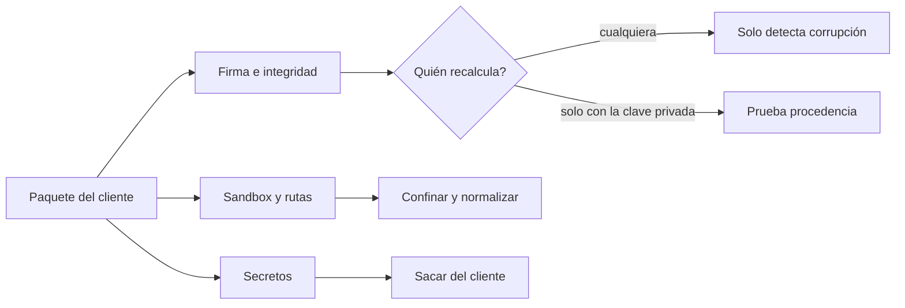
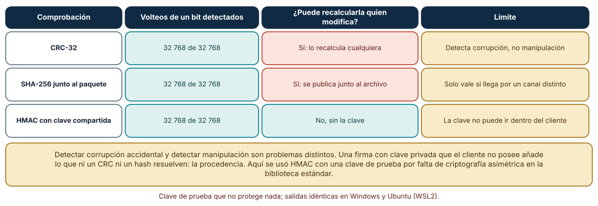
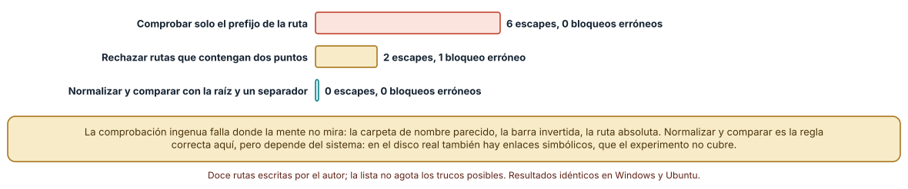
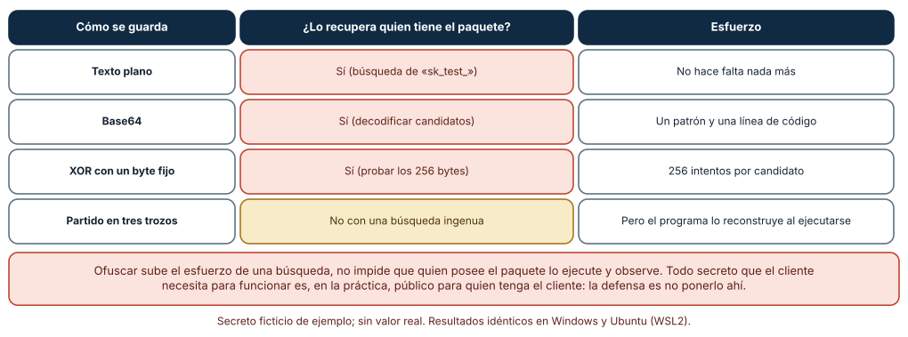

# SE-262 — Firma, sandbox y seguridad del cliente

[← SE-261 — Rendimiento, batería y recursos limitados](../../classes/part-21-software-movil-escritorio-y-multiplataforma/se-261-rendimiento-bateria-y-recursos-limitados/README.md) · [↑ Parte 21](../../classes/part-21-software-movil-escritorio-y-multiplataforma/README.md) · [📚 Índice completo](../../classes/README.md) · [🌐 Portal](../../site/classes/SE-262.html) · [SE-263 — Taller: adaptar un producto a dos plataformas →](../../classes/part-21-software-movil-escritorio-y-multiplataforma/se-263-taller-adaptar-un-producto-a-dos-plataformas/README.md)

## Punto profesional y fundamento pedagógico

**Punto profesional.** La clase existe para que razones sobre la seguridad de un cliente que corre en un dispositivo ajeno: quién puede recalcular una comprobación de integridad, qué confina realmente el sandbox, qué comprobación de rutas es correcta y qué secretos no pueden vivir en el cliente.

**Por qué aparece aquí.** Se sitúa después de **Rendimiento, batería y recursos limitados** y antes de **Taller: adaptar un producto a dos plataformas**: el cliente ya sincroniza, pide capacidades y se actualiza; esta clase examina qué puede hacer quien controla el dispositivo. Aplica el modelo de amenazas de la Parte 17 a un artefacto que el atacante tiene en las manos.

**Error conceptual que debe corregir.** Creer que lo que está dentro del cliente puede ocultarse (una clave ofuscada, una comprobación de integridad sin clave, una lista de rutas permitidas por prefijo) o que el sandbox de la plataforma protege contra una mala comprobación del propio código: quien posee el dispositivo puede leer y ejecutar el cliente.

**Secuencia de aprendizaje.** Antes de leer la solución, predices qué volteos de bits detecta un CRC, un hash y un código con clave, qué rutas deja pasar una comprobación por prefijo, y qué formas de ocultar un secreto resisten a una búsqueda simple; después ejecutas los tres experimentos con datos ficticios. La secuencia usa predicción, explicación propia, contraste y recuperación. [ICAP](https://icap.education.asu.edu/research) distingue participación de construcción de conocimiento; [How People Learn II](https://nap.nationalacademies.org/catalog/24783/how-people-learn-ii-learners-contexts-and-cultures) exige conectar conocimiento previo, contexto y transferencia; la [práctica de recuperación](https://pubmed.ncbi.nlm.nih.gov/16507066/) respalda producir de nuevo la explicación tras una demora; y [Education for Life and Work](https://nap.nationalacademies.org/resource/13398/dbasse_084153.pdf) exige devolución que explique la causa del error.

**Evidencia de aprendizaje.** `client-security-log.md` con el modelo de amenazas del cliente (qué controla el atacante), la tabla de comprobaciones de integridad con quién puede recalcularlas, la prueba de confinamiento de rutas con sus casos y el inventario de secretos con la decisión de sacarlos del cliente. Debe contener predicción previa, observación, explicación causal, contraejemplo y qué hallazgo haría abandonar la decisión.

**Límite de la conclusión.** Se usan una clave de prueba, un secreto ficticio y doce rutas escritas por el autor; la lista de rutas no agota los trucos posibles y no se probaron enlaces simbólicos. No se firmó ningún paquete con criptografía asimétrica, no se usó ninguna tienda y no se analizó ningún binario real.

### Trazabilidad fuente → afirmación

| Fuente primaria u oficial | Afirmación que respalda | Lo que no prueba |
|---|---|---|
| [Android Open Source Project, «Application Sandbox»](https://source.android.com/docs/security/app-sandbox) | Describe que cada aplicación recibe un usuario de sistema propio y que el sandbox aísla datos y procesos por el kernel. | No impide que la propia aplicación lea o exponga sus datos por un error propio. |
| [Electron, «Security»](https://www.electronjs.org/docs/latest/tutorial/security) | Lista prácticas de seguridad para aplicaciones de escritorio con contenido web y los riesgos de cargar contenido remoto con altos privilegios. | No garantiza que seguir la lista haga segura una aplicación. |
| [MITRE, «CWE-22: Improper Limitation of a Pathname to a Restricted Directory»](https://cwe.mitre.org/data/definitions/22.html) | Define la debilidad de construir rutas con entrada externa sin confinarla a la carpeta prevista. | No indica cómo confinar en cada sistema de archivos. |

## Antes de empezar

Recupera `SE-261`: el cliente tiene un presupuesto y sincroniza. La pregunta activa es: **¿qué puede hacer quien tiene el paquete y el dispositivo, y qué decisión de diseño depende de que no pueda?**

## Prerrequisitos

- Haber completado `SE-261` o poder explicar qué evidencia produjo.
- Poder describir las capacidades de `SE-257` y el protocolo de `SE-260`.
- Conocer la idea de modelo de amenazas y de huella criptográfica.
- Python 3.11 o posterior y un terminal; los experimentos usan solo la biblioteca estándar y datos sintéticos, sin cuentas de tienda, emuladores ni dispositivos.

## Problema auténtico

El cliente de entregas trae una clave de servicio dentro del paquete «ofuscada» y comprueba un CRC del archivo de actualización. Un estudiante curioso abre el paquete, encuentra la clave en un minuto y modifica el archivo recalculando el CRC. Otro envía como nombre de adjunto una ruta con dos puntos y la aplicación lee un archivo de configuración fuera de su carpeta. Ninguna de las tres cosas violó el sandbox del sistema: eran decisiones del propio código.

## Objetivos observables

Al terminar podrás:

1. enunciar qué controla un atacante que posee el dispositivo y el paquete del cliente y qué no controla;
2. comparar CRC, hash y código con clave por lo que detectan al voltear un bit y por quién puede recalcularlos tras manipular;
3. evaluar tres comprobaciones de confinamiento de rutas contra doce casos y escoger la correcta;
4. probar cuatro formas de ocultar un secreto contra búsquedas simples y concluir qué no debe vivir en el cliente;
5. escribir un modelo de amenazas del cliente con las decisiones que de él se derivan.

## Mapa conceptual



El mapa se lee de izquierda a derecha: cada parte del paquete tiene una amenaza distinta, y la pregunta decisiva en la integridad es quién puede recalcular la comprobación. Los secretos no se ocultan: se sacan del cliente.

## Temas y por qué importan

| Tema | Por qué cambia una decisión profesional | Evidencia mínima |
|---|---|---|
| Modelo de amenazas del cliente | En un cliente, el atacante posee el dispositivo, el paquete y el tiempo. | Predicción, traza causal y contraejemplo de **Modelo de amenazas del cliente** en `client-security-log.md` |
| Firma e integridad | Un hash detecta corrupción; solo una firma con clave privada prueba procedencia. | Predicción, traza causal y contraejemplo de **Firma e integridad** en `client-security-log.md` |
| Sandbox | El sandbox aísla aplicaciones entre sí, no protege contra los errores de la propia aplicación. | Predicción, traza causal y contraejemplo de **Sandbox** en `client-security-log.md` |
| Confinamiento de rutas | Una ruta recibida de fuera debe normalizarse y compararse con la raíz, no filtrarse por apariencia. | Predicción, traza causal y contraejemplo de **Confinamiento de rutas** en `client-security-log.md` |
| Secretos en el cliente | Un secreto que el cliente usa es un secreto que el cliente revela. | Predicción, traza causal y contraejemplo de **Secretos en el cliente** en `client-security-log.md` |

## Conceptos y decisiones

### 1. Modelo de amenazas del cliente

A diferencia de un servidor, un cliente corre en un entorno que otra persona controla. Puede leer el paquete, ejecutarlo con un depurador, modificar archivos y observar el tráfico. El modelo de amenazas debe partir de esa realidad: lo que el cliente necesita saber para funcionar lo sabe quien lo tiene. De ahí se derivan decisiones: validar todo en el servidor, no confiar en comprobaciones del cliente y no guardar secretos de servicio.

### 2. Firma e integridad

Un CRC o un hash publicado junto al archivo se recalculan tras una manipulación. Un código de autenticación con clave (HMAC, definido en RFC 2104) impide recalcular sin la clave, pero la clave debe estar en el cliente para verificar, y entonces la tiene el atacante. La firma con un par de claves resuelve esto: se firma con la clave privada, que el cliente no posee, y se verifica con la pública. Las plataformas firman los paquetes en su propio formato (Android, Microsoft con MSIX) y la verificación es parte de su instalación.

### 3. Sandbox

En Android, cada aplicación corre con un usuario de sistema propio y el kernel impone el aislamiento. Otras plataformas aíslan de otras formas. Ese límite impide que una aplicación lea los datos de otra sin permiso; no impide que la aplicación lea archivos suyos que no debía, ni que sirva un archivo cuya ruta eligió un tercero. Los errores de confinamiento ocurren dentro del sandbox.

### 4. Confinamiento de rutas

La debilidad CWE-22 consiste en construir una ruta con entrada externa sin limitarla a una carpeta. Las defensas ingenuas (comprobar el prefijo, rechazar los dos puntos) fallan ante carpetas con nombre parecido, separadores distintos y rutas absolutas. La defensa correcta normaliza la ruta resultante y comprueba que está dentro de la raíz con el separador, y se prueba con una lista de casos. En un disco real, los enlaces simbólicos exigen una comprobación adicional del destino.

### 5. Secretos en el cliente

Cualquier valor dentro del paquete puede extraerse leyendo el archivo o ejecutando el programa. Ofuscar sube el esfuerzo de una búsqueda ingenua, no impide que se observe el valor cuando se usa. CWE-798 describe el uso de credenciales incrustadas. La salida es que el cliente no tenga secretos de servicio: pide al servidor tokens de corta duración, con permisos mínimos, tras autenticar a la persona.

### Quién puede recalcular la comprobación

Un paquete sintético de 4096 bytes (semilla fija) se protege con tres comprobaciones: CRC-32, SHA-256 y HMAC-SHA-256 con una clave de prueba. Se voltea cada uno de sus 32 768 bits y se mira cuántos volteos detecta cada una. Después se simula una manipulación deliberada: se cambia un byte y se pregunta si el atacante puede recalcular cada comprobación sin la clave.

```python
for bit in range(4096 * 8):
    b = bytearray(pkg); b[bit // 8] ^= 1 << (bit % 8); b = bytes(b)
    det['crc'] += zlib.crc32(b) != crc0
    det['sha'] += hashlib.sha256(b).digest() != sha0
    det['mac'] += not hmac.compare_digest(hmac.new(clave, b, hashlib.sha256).digest(), mac0)
```

Resultado, idéntico en Windows (CPython 3.12.9) y Ubuntu (3.12.3): las tres comprobaciones detectan los **32 768 de 32 768** volteos de un bit. Ante una manipulación deliberada, el atacante recalcula el CRC y el SHA-256 que viajan junto al paquete y el cliente los acepta; con el HMAC y la clave errónea, no. La distinción entre corrupción accidental y manipulación no la hace la capacidad de detectar cambios sino la capacidad de recalcular.



**Cómo leer la figura.** Cada fila es una comprobación; la columna central cuenta los volteos detectados y la tercera dice si quien modifica puede recalcularla: coral si sí y verde si no. **Dónde deja de valer:** el HMAC del experimento usa una clave compartida de prueba, que en un cliente real estaría en el paquete; la solución es la firma asimétrica, que no se ejecutó porque la biblioteca estándar no la ofrece. Un volteo de un bit es el caso más fácil de detectar; no describe a un atacante.

### Confinar rutas dentro de una carpeta

El cliente guarda adjuntos bajo la raíz /app/datos. Se prueban doce rutas que llegan del servidor o de la persona, siete de ellas intentos de salir de la raíz (con dos puntos, con barra invertida, absoluta, con una carpeta de nombre parecido y con rutas que vuelven a entrar). Se evalúan tres comprobaciones: el prefijo de la ruta, rechazar rutas con dos puntos y normalizar y comparar con la raíz más un separador.

```python
def v_prefijo(p): return not (p if p.startswith('/') else RAIZ + '/' + p).startswith(RAIZ)
def v_dospuntos(p): return '..' in p
def v_norm(p):
    n = posixpath.normpath(p if p.startswith('/') else posixpath.join(RAIZ, p.replace('\\', '/')))
    return not (n == RAIZ or n.startswith(RAIZ + '/'))
```

Resultado: la comprobación por prefijo deja pasar **6 de 7** escapes y no bloquea ninguna ruta legítima; rechazar los dos puntos deja pasar **2** escapes (la ruta absoluta y la carpeta de nombre parecido) y bloquea **1** ruta legítima (`....//secreto`, que no sale de la raíz); normalizar y comparar con la raíz y un separador deja pasar **0** y bloquea **0**. El prefijo falla justo donde `/app/datos-privados` comparte los primeros caracteres con la raíz.



**Cómo leer la figura.** Cada barra es el número de escapes que la comprobación deja pasar; la etiqueta añade las rutas legítimas bloqueadas por error. **Dónde deja de valer:** son doce casos escritos por el autor, que no agotan las variantes posibles (codificaciones, nombres de dispositivo de Windows, enlaces simbólicos, mayúsculas). Una comprobación que pasa doce casos no es una demostración.

### Esconder un secreto en el paquete

Se incrusta un secreto ficticio (`sk_test_EJEMPLO_NO_REAL_...`) en un paquete de texto de cuatro formas: en claro, en base64, con XOR de un byte fijo y partido en tres trozos. Se prueban tres búsquedas simples: el texto en claro, cualquier cadena base64 decodificada y cualquier cadena hexadecimal probando los 256 valores de XOR.

```python
def buscador_xor(blob):
    for m in re.findall(r'[0-9a-f]{20,}', blob):
        raw = bytes.fromhex(m) if len(m) % 2 == 0 else b''
        for k in range(256):
            if b'sk_test_' in bytes(c ^ k for c in raw): return True
    return False
```

Resultado: el secreto en claro lo encuentra la búsqueda de texto; el de base64, la de decodificación; el de XOR, la que prueba los 256 bytes; el partido en tres trozos **no lo encuentra** ninguna búsqueda simple del texto, pero al ejecutarse el programa lo reconstruye (`''.join(trozos) == secreto`) y cualquiera que observe esa ejecución lo ve completo. Ocultar eleva el esfuerzo de un grep, no impide recuperarlo.



**Cómo leer la figura.** Cada fila es una forma de ocultar; la columna central dice si una búsqueda sencilla la recupera y la derecha el esfuerzo o la salvedad. **Dónde deja de valer:** las búsquedas son simples a propósito; un atacante dedicado tiene un depurador y no necesita buscar. El secreto es ficticio y no se probó ninguna herramienta de ingeniería inversa: el resultado muestra que el cliente no es un lugar para guardar secretos, no cuánto cuesta atacarlo.

## Definiciones de trabajo

- **modelo de amenazas:** descripción de qué activos hay, quién puede atacarlos, con qué capacidades y qué defensas se derivan.
- **firma digital:** valor que se calcula con una clave privada y se verifica con una pública y que prueba procedencia e integridad; quien no tiene la privada no puede producirlo.
- **sandbox:** aislamiento que el sistema impone entre aplicaciones y que no protege contra errores de la propia aplicación.
- **confinamiento de rutas:** comprobación de que una ruta resuelta queda dentro de una carpeta permitida, tras normalizarla.
- **secreto incrustado:** credencial o clave guardada dentro del paquete de un cliente; es recuperable por quien tenga el paquete.

Las definiciones son operativas para el cliente de la plataforma de entregas. No convierten términos con una historia técnica más amplia en sinónimos y deben contrastarse con la documentación primaria enlazada al final.

## Ejemplo mínimo

El fragmento compara una comprobación de prefijo con una de normalización. Antes de ejecutarlo, predice cuál acepta `/app/datos-privados/x`.

```python
import posixpath
RAIZ = "/app/datos"

def por_prefijo(ruta):
    return ruta.startswith(RAIZ)

def por_normalizacion(ruta):
    n = posixpath.normpath(ruta)
    return n == RAIZ or n.startswith(RAIZ + "/")

assert por_prefijo("/app/datos-privados/x") is True       # falla: acepta una carpeta ajena
assert por_normalizacion("/app/datos-privados/x") is False
```

La comprobación por prefijo acepta una carpeta cuyo nombre empieza igual. Añade el caso `/app/datos/../datos-privados/x` y predice qué comprobación lo acepta.

## Ejemplo profesional

El equipo del cliente escribe su modelo de amenazas con una fila por activo (borrador local, token de sesión, paquete de actualización, adjuntos) y una columna por capacidad del atacante (lee el paquete, modifica archivos, observa el tráfico, controla el dispositivo). De la tabla salen reglas: el servidor valida todo, el cliente solo guarda tokens de corta duración emitidos por el servidor, los adjuntos se confinan a una carpeta con normalización y la actualización se verifica con una firma asimétrica cuya clave privada solo existe en el sistema de compilación. Un recorrido por un depurador del paquete confirma que no hay secretos de servicio.

Compara el caso de quien abre el paquete con un editor, el de quien modifica un archivo de actualización y el de quien envía un nombre de adjunto con dos puntos. Un modelo es apropiado cuando esos tres casos terminan sin ganar acceso; es peligroso cuando la defensa depende de que nadie mire.

## Práctica guiada

1. Escribe el modelo de amenazas del cliente con activos y capacidades del atacante.
2. Predice qué detecta cada comprobación de integridad y qué puede recalcular el atacante.
3. Voltea cada bit del paquete y cuenta las detecciones de cada comprobación.
4. Escribe doce casos de rutas, incluidos los que no salen de la raíz, y evalúa tres comprobaciones.
5. Busca un secreto ficticio en tres formas de ocultarlo con búsquedas simples.
6. Decide qué secretos salen del cliente y cómo los sustituye el servidor.
7. Entrega `client-security-log.md` y pide a otra persona que encuentre el secreto sin tu ayuda.

## Ejercicios

1. **Integridad:** explica por qué distribuir el hash por el mismo canal que el paquete no añade seguridad y qué canal sí.
2. **Rutas:** añade cinco casos (nombre de dispositivo de Windows, mayúsculas, codificación porcentual, enlace simbólico, ruta muy larga) y decide cuáles detecta la normalización.
3. **Secretos:** diseña el intercambio de un token de corta duración con el servidor y lista qué sigue en el cliente.
4. **Modelo:** añade un atacante que controla la red y revisa qué filas cambian.

## Reto verificable

Entrega `client-security-log.md` con el modelo de amenazas, la tabla de integridad, la prueba de rutas y el inventario de secretos. Se aprueba si otra persona obtiene las mismas cifras, entiende por qué un hash junto al paquete no prueba procedencia y puede señalar un caso de ruta que la lista no cubre. No se aprueba por afirmar que el cliente «es seguro».

## Caso conductor

El cliente de entregas de la Parte 21 deja aquí su modelo de amenazas y sus reglas de integridad, confinamiento y secretos. `SE-263` decide cómo se aplican en dos plataformas con modelos de seguridad distintos y `SE-264` integra la firma y el modelo en el proyecto. Cambia después una sola decisión, mover una clave del cliente a un intercambio con el servidor, y revisa qué cambia.

## Preguntas frecuentes

### ¿Un hash publicado junto al paquete protege contra manipulación?

No. Quien modifica el paquete modifica también el hash. Solo ayuda si llega por un canal distinto y confiable, y aun así no prueba quién lo produjo. La firma con clave privada sí.

### ¿El sandbox del sistema me protege de leer un archivo ajeno por error?

No del todo. Impide que lea archivos de otras aplicaciones, pero un error propio puede exponer archivos de la propia aplicación fuera de la carpeta prevista.

### ¿Puedo guardar una clave de servicio si la ofusco?

No. La ofuscación sube el esfuerzo de una búsqueda, no impide recuperarla ejecutando el programa. La salida es no necesitarla en el cliente y emitir credenciales de corta duración desde el servidor.

### ¿Doce casos de ruta demuestran que el confinamiento es correcto?

No. Muestran que tres comprobaciones se comportan distinto en esos casos. La corrección se argumenta por el diseño (normalizar y comparar con la raíz) y se prueba con una lista ampliable.

## Fallo controlado y diagnóstico

Reproduce el fallo clásico de la clase: **creer que una comprobación que el atacante puede recalcular prueba procedencia**. Modifica un byte del paquete y recalcula su hash.

Registra síntoma, hipótesis, observación que descarta cada una, causa, corrección y regresión. **Síntoma:** el cliente acepta un paquete modificado con su hash «verificado». **Hipótesis rivales:** (a) el hash no se comprobó; (b) el hash se comprobó contra un valor que el atacante también produjo. **Prueba:** sustituye el hash por el del paquete original; si el cliente rechaza, la hipótesis (b) explica la aceptación. **Conclusión:** la causa es verificar contra algo que el atacante controla. **Regresión:** verifica una firma con una clave pública fija en el cliente y rechaza un paquete modificado; no cambies a la vez el formato del paquete.

## Errores comunes y cómo corregirlos

| Síntoma | Causa probable | Corrección |
|---|---|---|
| El cliente acepta un paquete modificado con su hash correcto | El hash viaja con el paquete y el atacante lo recalcula | Firma asimétrica con clave pública en el cliente |
| Una ruta con dos puntos lee un archivo de configuración | Se filtró por prefijo en lugar de normalizar | Normalizar y comparar con la raíz y un separador |
| Se extrae una clave del paquete en minutos | Un secreto de servicio vive en el cliente | Tokens de corta duración emitidos por el servidor |
| Se confía en el sandbox para todo | Se asume que aísla también errores propios | Confinar rutas y validar en el servidor |
| Se declara que el cliente es seguro tras pasar doce casos | Se confunde pasar pruebas con demostrar | Argumentar por diseño y ampliar la lista de casos |

## Entorno y archivos clave

```text
work/SE-262/
├── README.md
├── seguridad/
│   ├── integridad.py
│   ├── rutas.py
│   └── secretos.py
├── tests/test_seguridad.py
└── evidence/client-security-log.md
```

El `README` declara plataforma, versión de Python, semillas y comandos. Los experimentos usan solo la biblioteca estándar (`hashlib`, `hmac`, `zlib`, `posixpath`, `re`, `base64`) y se ejecutaron con CPython 3.12.9 en Windows 11 y 3.12.3 en Ubuntu bajo WSL2: las salidas fueron idénticas. La clave y el secreto son ficticios; no los sustituyas por valores reales ni ejecutes estas búsquedas sobre paquetes ajenos.

## Seguridad, ética y accesibilidad

- usa solo claves, secretos y paquetes ficticios; no analices software ajeno sin autorización;
- no publiques un secreto real en un repositorio, ni siquiera ofuscado: si se filtró, revócalo;
- la verificación de una firma debe fallar de forma cerrada: ante duda, rechaza;
- documenta el modelo de amenazas sin incluir técnicas de ataque contra sistemas reales;
- este material no es una auditoría de seguridad ni sustituye una revisión por una persona competente.

## Puente hacia el trabajo con agentes

Un agente al que se le pide «protege la actualización» añadirá un hash al archivo y dará por hecho que está protegido. Pídele el modelo de amenazas, quién puede recalcular cada comprobación, una prueba que modifique un byte y recalcule lo recalculable, y una lista de secretos que siguen en el cliente. Revisa especialmente si propone guardar una clave en el cliente «ofuscada»: es el mismo error que hizo recuperable el secreto en un minuto.

## Transferencia

Traslada el análisis a otro dominio persistente (una aplicación de reparto que descarga mapas): cambia el paquete y los activos, conserva el procedimiento de preguntar quién recalcula, confinar rutas e inventariar secretos. La transferencia está lograda cuando puedes explicar qué parte del método dependía del cliente de entregas y cuál no.

## Evaluación y evidencia

| Criterio | Evidencia para aprobar |
|---|---|
| comprensión | explicación de la diferencia entre detectar corrupción y probar procedencia |
| corrección | cifras reproducibles de integridad, rutas y secretos con las mismas semillas y casos |
| diseño | modelo de amenazas con las reglas derivadas de cada fila |
| diagnóstico | reproducción del fallo «una comprobación que el atacante recalcula» con regresión |
| incertidumbre | declaración de que los casos de ruta no agotan las variantes y de que no se probó firma asimétrica |
| reproducibilidad | versiones, comandos, salida y límites declarados |

## Fuentes

- [Android Open Source Project, «Application Sandbox»](https://source.android.com/docs/security/app-sandbox) — aislamiento de aplicaciones por usuario de sistema; autoridad: Google.
- [Android Developers, «Sign your app»](https://developer.android.com/studio/publish/app-signing) — firma de aplicaciones Android; autoridad: Google.
- [Microsoft, «Package signing overview»](https://learn.microsoft.com/en-us/windows/msix/package/signing-package-overview) — firma de paquetes MSIX; autoridad: Microsoft.
- [Electron, «Security»](https://www.electronjs.org/docs/latest/tutorial/security) — prácticas de seguridad en aplicaciones de escritorio; autoridad: OpenJS Foundation.
- [OWASP, «MASVS»](https://mas.owasp.org/MASVS/) — requisitos de seguridad para aplicaciones móviles; autoridad: OWASP.
- [IETF, «RFC 2104: HMAC»](https://www.rfc-editor.org/rfc/rfc2104) — código de autenticación de mensajes con clave; autoridad: IETF.
- [MITRE, «CWE-22»](https://cwe.mitre.org/data/definitions/22.html) — limitación incorrecta de una ruta a una carpeta; autoridad: MITRE.
- [MITRE, «CWE-798»](https://cwe.mitre.org/data/definitions/798.html) — uso de credenciales incrustadas; autoridad: MITRE.

Cada fuente respalda el mecanismo indicado; ninguna demuestra que las doce rutas o las búsquedas del experimento agoten lo que un atacante real intentaría. Esa afirmación depende de una revisión por una persona competente.

- [Python: `hmac`](https://docs.python.org/3/library/hmac.html) — código de autenticación con clave usado en el experimento.
- [Python: `hashlib`](https://docs.python.org/3/library/hashlib.html) — huellas SHA-256.

## Límites y siguiente paso

Se ejecutaron tres experimentos con datos ficticios en Windows y Ubuntu (WSL2) con resultados idénticos. No se firmó ningún paquete con criptografía asimétrica, no se analizó ningún binario real y las doce rutas no agotan las variantes. La siguiente clase aplica todo esto al adaptar el producto a dos plataformas.

## Glosario

- **modelo de amenazas:** descripción de qué activos hay, quién puede atacarlos, con qué capacidades y qué defensas se derivan.
- **firma digital:** valor que se calcula con una clave privada y se verifica con una pública y que prueba procedencia e integridad; quien no tiene la privada no puede producirlo.
- **sandbox:** aislamiento que el sistema impone entre aplicaciones y que no protege contra errores de la propia aplicación.
- **confinamiento de rutas:** comprobación de que una ruta resuelta queda dentro de una carpeta permitida, tras normalizarla.
- **secreto incrustado:** credencial o clave guardada dentro del paquete de un cliente; es recuperable por quien tenga el paquete.

---

[← SE-261 — Rendimiento, batería y recursos limitados](../../classes/part-21-software-movil-escritorio-y-multiplataforma/se-261-rendimiento-bateria-y-recursos-limitados/README.md) · [↑ Parte 21](../../classes/part-21-software-movil-escritorio-y-multiplataforma/README.md) · [📚 Índice completo](../../classes/README.md) · [🌐 Portal](../../site/classes/SE-262.html) · [SE-263 — Taller: adaptar un producto a dos plataformas →](../../classes/part-21-software-movil-escritorio-y-multiplataforma/se-263-taller-adaptar-un-producto-a-dos-plataformas/README.md)
