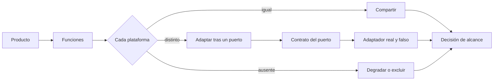
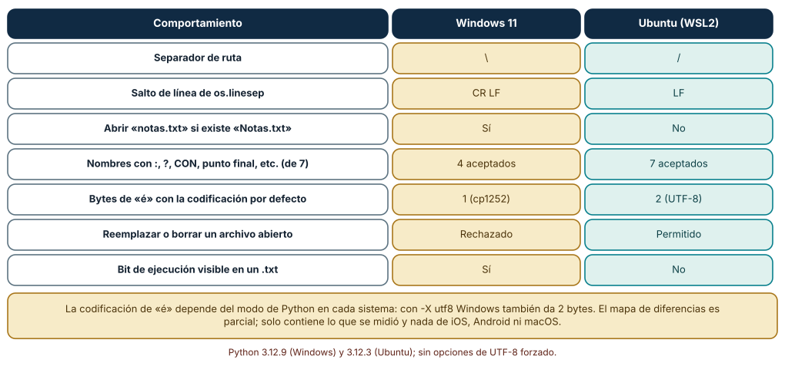
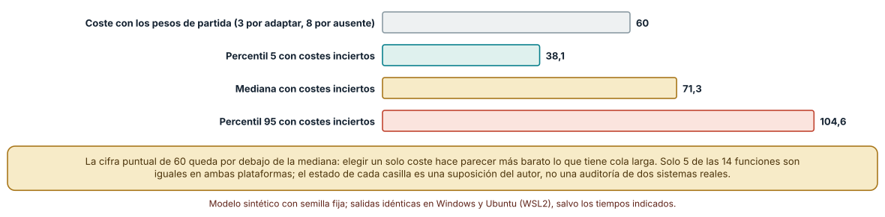
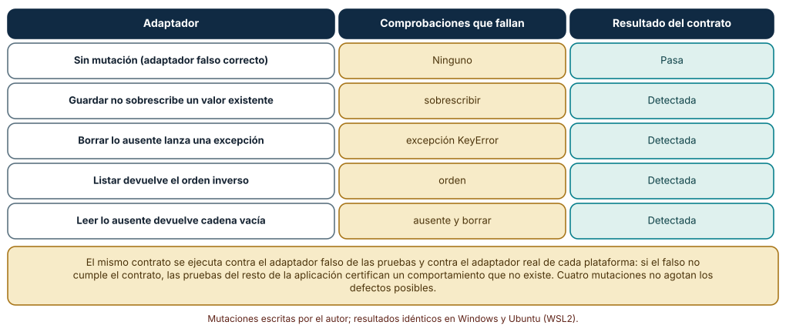

# SE-263 — Taller: adaptar un producto a dos plataformas

[← SE-262 — Firma, sandbox y seguridad del cliente](../../classes/part-21-software-movil-escritorio-y-multiplataforma/se-262-firma-sandbox-y-seguridad-del-cliente/README.md) · [↑ Parte 21](../../classes/part-21-software-movil-escritorio-y-multiplataforma/README.md) · [📚 Índice completo](../../classes/README.md) · [🌐 Portal](../../site/classes/SE-263.html) · [SE-264 — Proyecto: cliente multiplataforma con sincronización →](../../classes/part-21-software-movil-escritorio-y-multiplataforma/se-264-proyecto-cliente-multiplataforma-con-sincronizacion/README.md)

## Punto profesional y fundamento pedagógico

**Punto profesional.** El taller existe para que adaptes un producto a dos plataformas con un inventario de diferencias medidas, un coste con intervalo en lugar de una cifra y un contrato de adaptadores que impida que los dobles de prueba prometan lo que la plataforma real no cumple.

**Por qué aparece aquí.** Se sitúa después de **Firma, sandbox y seguridad del cliente** y antes de **Proyecto: cliente multiplataforma con sincronización**: las diez clases anteriores dejaron decisiones sobre ciclo de vida, construcción, datos, permisos, entrada, distribución, conflictos, recursos y seguridad; el taller las aplica a un caso con dos plataformas y mide dónde difieren de verdad antes de que el proyecto las integre.

**Error conceptual que debe corregir.** Creer que el código compartido se comporta igual en todas partes porque el lenguaje es el mismo: los sistemas difieren en rutas, saltos de línea, mayúsculas, codificación por defecto y reglas de archivos abiertos, y un doble de pruebas que no cumple el contrato de la plataforma real certifica lo que no existe.

**Secuencia de aprendizaje.** Antes de leer la solución, predices cuántos comportamientos del mismo programa difieren entre Windows y Ubuntu, qué intervalo de coste tiene una adaptación cuando el coste de cada diferencia es incierto y cuántos defectos de un adaptador falso detecta un contrato de cinco comprobaciones; después ejecutas el taller completo. La secuencia usa predicción, explicación propia, contraste y recuperación. [ICAP](https://icap.education.asu.edu/research) distingue participación de construcción de conocimiento; [How People Learn II](https://nap.nationalacademies.org/catalog/24783/how-people-learn-ii-learners-contexts-and-cultures) exige conectar conocimiento previo, contexto y transferencia; la [práctica de recuperación](https://pubmed.ncbi.nlm.nih.gov/16507066/) respalda producir de nuevo la explicación tras una demora; y [Education for Life and Work](https://nap.nationalacademies.org/resource/13398/dbasse_084153.pdf) exige devolución que explique la causa del error.

**Evidencia de aprendizaje.** `adaptation-log.md` con el inventario de diferencias medidas entre las dos plataformas, el intervalo de coste de adaptación, el contrato de adaptadores con sus mutantes y la decisión sobre qué se comparte y qué se adapta. Debe contener predicción previa, observación, explicación causal, contraejemplo y qué hallazgo haría abandonar la decisión.

**Límite de la conclusión.** Las dos plataformas medidas son Windows 11 y Ubuntu bajo WSL2, no un teléfono ni macOS; el estado de cada función («igual», «adaptar», «ausente») y sus costes son supuestos del autor; las cuatro mutaciones del adaptador no agotan los defectos posibles.

### Trazabilidad fuente → afirmación

| Fuente primaria u oficial | Afirmación que respalda | Lo que no prueba |
|---|---|---|
| [Microsoft, «Naming Files, Paths, and Namespaces»](https://learn.microsoft.com/en-us/windows/win32/fileio/naming-a-file) | Documenta las reglas de nombres de Windows: caracteres reservados, nombres de dispositivo, punto o espacio final y distinción de mayúsculas. | No describe otros sistemas ni todos los sistemas de archivos de Windows. |
| [Cockburn, «Hexagonal architecture»](https://alistair.cockburn.us/hexagonal-architecture/) | Propone aislar la lógica de la aplicación de sus entornos mediante puertos y adaptadores que se pueden sustituir. | No dice cómo comprobar que un adaptador cumple su puerto. |
| [PEP 686, «Make UTF-8 mode default»](https://peps.python.org/pep-0686/) | Documenta que la codificación por defecto de Python depende de la configuración regional y propone cambiarla a UTF-8. | No cambia el comportamiento de las versiones anteriores a su adopción. |

## Antes de empezar

Recupera `SE-262`: se decidió cómo proteger el cliente. La pregunta activa es: **¿qué difiere de verdad entre las dos plataformas, qué cuesta adaptarlo y cómo evito que las pruebas certifiquen un comportamiento que la plataforma real no tiene?**

## Prerrequisitos

- Haber completado `SE-262` o poder explicar qué evidencia produjo.
- Poder describir el presupuesto de `SE-261` y el modelo de amenazas de `SE-262`.
- Poder ejecutar un script en Windows y en Linux (nativo o WSL2).
- Python 3.11 o posterior y un terminal; los experimentos usan solo la biblioteca estándar y datos sintéticos, sin cuentas de tienda, emuladores ni dispositivos.

## Problema auténtico

El equipo tiene un cliente que funciona en el portátil con Windows del desarrollador. El mismo código, copiado a un equipo con Ubuntu, deja de encontrar un archivo porque cambia una mayúscula, escribe saltos de línea distintos en los borradores exportados y falla al reemplazar un archivo abierto. El mismo código, copiado al revés, fallaría al guardar un adjunto con dos puntos en el nombre. Nadie cambió el lenguaje: cambió la plataforma.

## Objetivos observables

Al terminar podrás:

1. ejecutar el mismo programa en dos sistemas y construir una tabla de diferencias medidas con la fuente de cada una;
2. estimar el coste de adaptar un conjunto de funciones con un intervalo, y no con una cifra, y explicar por qué la cifra puntual engaña;
3. escribir un contrato de adaptadores de almacenamiento y ejecutarlo contra un adaptador falso y cuatro mutaciones;
4. decidir qué parte del cliente se comparte y cuál se adapta y justificarlo con las diferencias medidas;
5. declarar qué plataformas no se midieron y cómo se completaría el inventario.

## Mapa conceptual



El mapa se lee de izquierda a derecha: cada función se clasifica por plataforma; lo igual se comparte, lo distinto se adapta detrás de un puerto con un contrato que cumplen tanto el adaptador real como el falso, y lo ausente se degrada o se excluye. La decisión de alcance reúne todo.

## Temas y por qué importan

| Tema | Por qué cambia una decisión profesional | Evidencia mínima |
|---|---|---|
| Inventario de diferencias | Las diferencias se miden, no se recuerdan. | Predicción, traza causal y contraejemplo de **Inventario de diferencias** en `adaptation-log.md` |
| Compartir, adaptar, excluir | Cada función cae en una de tres decisiones, y la tercera es de producto. | Predicción, traza causal y contraejemplo de **Compartir, adaptar, excluir** en `adaptation-log.md` |
| Puertos, adaptadores y dobles | Un puerto es la forma de la dependencia; un doble de pruebas es un adaptador, y debe cumplir el mismo contrato. | Predicción, traza causal y contraejemplo de **Puertos, adaptadores y dobles** en `adaptation-log.md` |
| Coste con incertidumbre | Un coste de adaptación es un intervalo cuyas colas importan. | Predicción, traza causal y contraejemplo de **Coste con incertidumbre** en `adaptation-log.md` |
| Alcance de lo medido | Dos plataformas medidas no son todas las plataformas. | Predicción, traza causal y contraejemplo de **Alcance de lo medido** en `adaptation-log.md` |

## Conceptos y decisiones

### 1. Inventario de diferencias

Un inventario enumera cada comportamiento del producto que puede variar entre plataformas, lo ejecuta en cada una y registra el resultado. Lo que se recuerda («Linux distingue mayúsculas») suele ser cierto pero incompleto; lo que se mide encuentra lo que nadie recordó. El inventario es una tabla viva: cada diferencia nueva descubierta en uso se añade con su prueba.

### 2. Compartir, adaptar, excluir

Compartir es posible cuando el comportamiento es igual; adaptar, cuando existe pero difiere y se puede ocultar tras un puerto; excluir, cuando la plataforma no lo ofrece. Excluir una función de una plataforma es una decisión sobre las personas que la usan y debe ser explícita. La clasificación no es estática: una función igual hoy puede dejar de serlo con una versión nueva del sistema.

### 3. Puertos, adaptadores y dobles

Aislar la lógica detrás de puertos permite sustituir el almacenamiento, la hora o la red por adaptadores de cada plataforma o por dobles en las pruebas. El riesgo es que el doble se comporte mejor que la realidad: guarda sin errores, lista en orden, borra lo que no existe sin quejarse. Un contrato ejecutable que se corre contra todos los adaptadores, el real y el falso, evita que las pruebas del resto de la aplicación se apoyen en una promesa vacía.

### 4. Coste con incertidumbre

Estimar el coste de una diferencia con un número fijo oculta que el coste de lo ausente tiene una cola larga. Al repetir el cálculo con costes sorteados dentro de un rango, la mediana queda por encima de la cifra puntual y el percentil 95 multiplica casi por dos. El intervalo no es precisión sino honestidad sobre lo que no se sabe, y permite planificar con un margen.

### 5. Alcance de lo medido

El inventario cubre las plataformas ejecutadas. Una tercera (un teléfono, otro sistema de escritorio) añade diferencias no vistas. Declarar el alcance evita que «funciona en dos plataformas» se lea como «es portable». La forma de completarlo es ejecutar el mismo inventario en cada plataforma nueva antes de comprometerse a soportarla.

### Siete diferencias medidas entre Windows y Ubuntu

El mismo script se ejecuta en Windows 11 (CPython 3.12.9) y en Ubuntu bajo WSL2 (3.12.3), sin opciones de UTF-8 forzado. Mide siete comportamientos: el separador de ruta, el salto de línea de `os.linesep`, si se abre `notas.txt` cuando existe `Notas.txt`, cuántos de siete nombres raros se aceptan al crear archivos, cuántos bytes ocupa «é» con la codificación por defecto, si se puede reemplazar o borrar un archivo abierto y si el bit de ejecución es visible en un archivo de texto.

```python
open(os.path.join(d, 'Notas.txt'), 'w').write('x')
res['abre notas.txt si existe Notas.txt'] = os.path.exists(os.path.join(d, 'notas.txt'))
for nombre in ('a:b', 'a?b', 'CON', 'aux.txt', 'a.', 'a b ', 'a\\b'):
    try: open(os.path.join(d, nombre), 'w').close(); n += 1
    except OSError: pass
f = open(p)
try: os.replace(p, p + '.bak'); res['os.replace sobre abierto'] = 'permitido'
except OSError: res['os.replace sobre abierto'] = 'rechazado'
```

Resultado: el separador es `\` en Windows y `/` en Ubuntu; el salto de línea, CR LF y LF; `notas.txt` **se abre** en Windows y **no** en Ubuntu; se aceptan **4 de 7** nombres raros en Windows y **7 de 7** en Ubuntu; «é» ocupa **1** byte en Windows (codificación cp1252) y **2** en Ubuntu (UTF-8); reemplazar o borrar un archivo abierto es **rechazado** en Windows y **permitido** en Ubuntu; y el bit de ejecución aparece en un `.txt` en Windows y no en Ubuntu. Siete de siete comportamientos difieren.



**Cómo leer la figura.** Cada fila es un comportamiento; la segunda columna es el resultado en Windows y la tercera en Ubuntu, en dorado y en verde respectivamente, con texto en cada celda para no depender del color. **Dónde deja de valer:** son dos sistemas de escritorio con una versión concreta de Python, no un teléfono ni macOS, y la codificación depende del modo de Python (con el modo UTF-8, Windows también da 2 bytes). El inventario es un punto de partida, no una lista completa.

### El coste de adaptar con incertidumbre

Se clasifican 14 funciones del cliente en cada plataforma como iguales, a adaptar o ausentes (supuesto del autor, con semilla fija). Con un coste de 3 por adaptar y 8 por ausente la suma es una cifra. Después se sortean 10 000 veces los costes dentro de rangos (adaptar entre 1 y 6, ausente entre 4 y 16) y se toman percentiles.

```python
costo = {'igual': 0, 'adaptar': 3, 'ausente': 8}
base = sum(costo[a] + costo[b] for a, b in est.values())
for s in range(10000):
    rr = random.Random(s); c = {'igual': 0, 'adaptar': rr.uniform(1, 6), 'ausente': rr.uniform(4, 16)}
    rs.append(sum(c[a] + c[b] for a, b in est.values()))
```

Resultado, idéntico en ambos sistemas: la cifra puntual es **60** puntos, con solo **5 de 14** funciones iguales en las dos plataformas. Con costes inciertos, el percentil 5 es **38,1**, la mediana **71,3** y el percentil 95 **104,6**. La cifra puntual queda por debajo de la mediana, y el percentil 95 es un 74 % mayor que ella. Planificar con 60 equivale a apostar a que los costes ausentes salen en la mitad baja de su rango.



**Cómo leer la figura.** Cada barra es un coste en puntos; la gris es la cifra puntual, la verde el percentil 5, la dorada la mediana y la coral el percentil 95. **Dónde deja de valer:** el estado de cada función y los rangos de coste son supuestos del autor; no se auditó ninguna plataforma. El ejercicio muestra por qué una cifra única engaña, no cuánto cuesta adaptar un producto real.

### Un contrato para los adaptadores de almacenamiento

El puerto de almacenamiento tiene cuatro operaciones (guardar, leer, borrar, listar). Un contrato de cinco comprobaciones (leer lo guardado, sobrescribir, leer lo ausente, borrar dos veces, listar en orden) se ejecuta contra un adaptador falso correcto y cuatro mutaciones: el que no sobrescribe, el que lanza al borrar lo ausente, el que lista en orden inverso y el que devuelve cadena vacía al leer lo ausente.

```python
def contrato(mk):
    fallos = []; a = mk()
    a.guardar('a', '1')
    if a.leer('a') != '1': fallos.append('leer')
    a.guardar('a', '2')
    if a.leer('a') != '2': fallos.append('sobrescribir')
    if a.leer('zz') is not None: fallos.append('ausente')
    a.borrar('a'); a.borrar('a')
    if a.leer('a') is not None: fallos.append('borrar')
    a.guardar('b', '1'); a.guardar('a', '1')
    if a.listar() != ['a', 'b']: fallos.append('orden')
    return fallos
```

Resultado: el adaptador correcto devuelve una lista vacía de fallos; el que no sobrescribe falla `sobrescribir`; el que lanza al borrar lo ausente termina con una excepción (`KeyError`); el que lista al revés falla `orden`; y el que devuelve cadena vacía falla `ausente` y `borrar`. Las **cuatro** mutaciones se detectan. Un contrato así, ejecutado también contra el adaptador real de cada plataforma, impide que el doble de pruebas prometa más que ella.



**Cómo leer la figura.** Cada fila es un adaptador; la columna central dice qué comprobaciones fallan y la derecha el resultado del contrato, siempre en texto además del color. **Dónde deja de valer:** las cuatro mutaciones las escribió el autor conociendo el contrato; defectos que nadie imaginó no están en la lista. El contrato prueba un puerto sencillo en memoria: contra un disco real, aparecen los errores de la clase anterior (nombres, rutas, bloqueos).

## Definiciones de trabajo

- **inventario de diferencias:** tabla de comportamientos del producto que pueden variar entre plataformas, ejecutados y registrados en cada una.
- **puerto:** interfaz que describe lo que la lógica de la aplicación necesita de su entorno, independiente de cómo lo ofrezca cada plataforma.
- **adaptador:** implementación de un puerto para un entorno concreto: una plataforma, un servicio o una prueba.
- **doble de pruebas:** adaptador sustituto que se usa en las pruebas y que debe cumplir el mismo contrato que el real.
- **contrato de puerto:** conjunto de comprobaciones ejecutables que todo adaptador de un puerto debe superar.

Las definiciones son operativas para el cliente de la plataforma de entregas. No convierten términos con una historia técnica más amplia en sinónimos y deben contrastarse con la documentación primaria enlazada al final.

## Ejemplo mínimo

El fragmento comprueba un puerto de almacenamiento con un contrato mínimo. Antes de ejecutarlo, predice qué falla si el adaptador devuelve una cadena vacía al leer una clave ausente.

```python
class Almacen:
    def __init__(self): self.d = {}
    def guardar(self, k, v): self.d[k] = v
    def leer(self, k): return self.d.get(k, "")      # mutación: cadena vacía en vez de None

def contrato(a):
    a.guardar("x", "1")
    assert a.leer("x") == "1"
    assert a.leer("nada") is None, "leer lo ausente debe devolver None"

try:
    contrato(Almacen())
except AssertionError as e:
    print("el contrato detecta:", e)
```

El contrato detecta que el adaptador promete menos de lo que el puerto exige. Corrige el adaptador y añade una comprobación para borrar lo ausente; predice si el mismo contrato serviría para un adaptador sobre archivos.

## Ejemplo profesional

El equipo del cliente de entregas hace el taller en cuatro pasos. Primero ejecuta el inventario de diferencias en los dos sistemas y lo guarda como tabla con la salida de cada uno. Segundo, clasifica cada función como igual, a adaptar o ausente y estima el coste con un intervalo. Tercero, define puertos para almacenamiento, hora, notificaciones y selección de archivos, y escribe un contrato ejecutable por puerto que se corre contra el adaptador real de cada plataforma y contra el falso. Cuarto, escribe qué se comparte (reglas del borrador, sincronización), qué se adapta (rutas, notificaciones) y qué se excluye en una plataforma, con el aviso a la persona.

Compara el caso de guardar un adjunto con dos puntos en el nombre, el de mostrar una notificación y el de reemplazar un archivo que otra aplicación mantiene abierto. Un taller es apropiado cuando esos tres casos tienen una respuesta por plataforma y una prueba; es peligroso cuando la respuesta es «funciona en mi máquina».

## Práctica guiada

1. Ejecuta el script de diferencias en los dos sistemas y guarda las salidas sin editarlas.
2. Predice cuántas de las siete diferencias aparecerán y anota el número antes de ejecutar.
3. Clasifica 14 funciones de tu cliente como iguales, a adaptar o ausentes en cada plataforma.
4. Estima el coste con costes inciertos y registra los percentiles 5, 50 y 95.
5. Define un puerto de almacenamiento y escribe su contrato de cinco comprobaciones.
6. Introduce cuatro mutaciones del adaptador falso y comprueba que el contrato las detecta.
7. Entrega `adaptation-log.md` y pide a otra persona que decida qué se comparte usando solo ese archivo.

## Ejercicios

1. **Diferencias:** añade tres comportamientos más (orden de listado, longitud máxima de ruta, hora local) y mídelos en ambos sistemas.
2. **Coste:** cambia la proporción de funciones ausentes y recalcula el percentil 95; explica qué función pesa más.
3. **Contrato:** añade una comprobación de concurrencia y decide si el adaptador en memoria puede cumplirla.
4. **Alcance:** lista qué mediría en una tercera plataforma antes de comprometerte a soportarla.

## Reto verificable

Entrega `adaptation-log.md` con el inventario de diferencias medidas en dos sistemas, el intervalo de coste, el contrato con sus mutantes y la decisión de qué se comparte. Se aprueba si otra persona ejecuta el inventario en un sistema, obtiene el mismo resultado que tu tabla para ese sistema y puede señalar una plataforma no medida cuya inclusión cambiaría el alcance. No se aprueba por afirmar que el producto «es portable».

## Caso conductor

El cliente de entregas de la Parte 21 llega al taller con diez decisiones y las aplica a dos plataformas con un inventario medido. El proyecto `SE-264` integra todo en un cliente que sincroniza y en un paquete revisable. Cambia después una sola decisión, excluir la función de arrastrar y soltar en una plataforma, y revisa qué contrato, qué prueba y qué texto de la interfaz cambian.

## Preguntas frecuentes

### ¿Por qué medir en lugar de leer la documentación de cada sistema?

Porque la documentación describe lo previsto y el inventario encuentra lo que se olvidó. Se hacen las dos cosas: la documentación explica la causa y la medición confirma el comportamiento en la versión que usas.

### ¿Un doble de pruebas puede ser distinto del adaptador real?

Puede ser más simple, pero no más generoso. Debe cumplir el mismo contrato; si no, las pruebas aprueban código que fallaría con el adaptador real.

### ¿Por qué un intervalo de coste y no una cifra?

Porque el coste de lo ausente tiene una cola larga. En el ejercicio, la cifra puntual de 60 quedó por debajo de la mediana de 71,3 y muy lejos del percentil 95 de 104,6.

### ¿Dos plataformas bastan para decir que el código es portable?

No. Bastan para decir que funciona en esas dos, con esas versiones. Una tercera suma diferencias nuevas y por eso se declara el alcance medido.

## Fallo controlado y diagnóstico

Reproduce el fallo clásico de la clase: **creer que el mismo código se comporta igual en todas partes**. Ejecuta el guardado de un adjunto con el nombre `informe:final.txt` en los dos sistemas.

Registra síntoma, hipótesis, observación que descarta cada una, causa, corrección y regresión. **Síntoma:** en Windows el adjunto no se guarda y en Ubuntu sí. **Hipótesis rivales:** (a) un error del código compartido; (b) una regla de nombres de la plataforma. **Prueba:** crea el archivo directamente con la API del sistema en ambos; si solo falla en Windows con el mismo nombre, la hipótesis (b) explica la diferencia. **Conclusión:** la causa es el carácter reservado. **Regresión:** sanea el nombre en el adaptador de cada plataforma y añade el caso al contrato; no cambies a la vez el nombre mostrado a la persona.

## Errores comunes y cómo corregirlos

| Síntoma | Causa probable | Corrección |
|---|---|---|
| Un adjunto no se guarda en una plataforma y sí en otra | Reglas de nombres distintas | Sanear el nombre en el adaptador y probar en ambas |
| Un archivo exportado cambia al abrirlo en otro sistema | Saltos de línea o codificación por defecto distintos | Fijar codificación y saltos de línea al escribir |
| Las pruebas pasan y la plataforma real falla | El doble no cumple el contrato del puerto | Ejecutar el mismo contrato contra el doble y el real |
| La estimación de adaptación se queda corta | Se usó una cifra única para costes con cola larga | Estimar con intervalo y planificar con el percentil alto |
| Se promete portabilidad tras probar dos sistemas | No se declaró el alcance medido | Declarar las plataformas medidas y completar el inventario |

## Entorno y archivos clave

```text
work/SE-263/
├── README.md
├── taller/
│   ├── diferencias.py
│   ├── costo.py
│   └── contrato.py
├── tests/test_taller.py
└── evidence/adaptation-log.md
```

El `README` declara plataforma, versión de Python, semillas y comandos. El inventario se ejecutó con CPython 3.12.9 en Windows 11 y 3.12.3 en Ubuntu bajo WSL2, sin forzar el modo UTF-8, y la tabla recoge las salidas tal cual. El coste y el contrato usan solo la biblioteca estándar y dieron salidas idénticas en ambos sistemas.

## Seguridad, ética y accesibilidad

- los nombres de archivo que llegan de fuera deben sanearse y confinarse (`SE-262`) en cada adaptador;
- una función excluida en una plataforma excluye a las personas que la usan: comunica la decisión y ofrece una alternativa;
- no incluyas rutas, usuarios ni nombres de equipo reales en el inventario;
- las salidas del inventario pueden contener rutas de tu máquina: sustitúyelas por marcadores antes de publicarlas;
- respeta las licencias de las herramientas de cada plataforma.

## Puente hacia el trabajo con agentes

Un agente al que se le pide «haz que funcione en Linux y en Windows» cambiará separadores y rutas hasta que el ejemplo funcione y dirá que es portable. Pídele el inventario ejecutado en cada sistema, el contrato de cada puerto y una lista de lo que no pudo probar. Revisa especialmente si el doble de pruebas es más generoso que el adaptador real: es el mismo problema de la tabla de mutantes.

## Transferencia

Traslada el taller a otro dominio persistente (una aplicación de reparto en dos plataformas): cambia las funciones y los puertos, conserva el procedimiento de medir diferencias, estimar con intervalo y escribir contratos. La transferencia está lograda cuando puedes explicar qué parte del método dependía del cliente de entregas y cuál no.

## Evaluación y evidencia

| Criterio | Evidencia para aprobar |
|---|---|
| comprensión | explicación de la diferencia entre compartir, adaptar y excluir con un ejemplo |
| corrección | inventario ejecutado en dos sistemas y contrato con mutantes detectados |
| diseño | puertos y contratos con la decisión de alcance |
| diagnóstico | reproducción del fallo «mismo código, mismo comportamiento» con regresión |
| incertidumbre | intervalo de coste y declaración de las plataformas no medidas |
| reproducibilidad | versiones, comandos, salidas por sistema y límites declarados |

## Fuentes

- [Microsoft, «Naming Files, Paths, and Namespaces»](https://learn.microsoft.com/en-us/windows/win32/fileio/naming-a-file) — reglas de nombres de archivo en Windows; autoridad: Microsoft.
- [Cockburn, «Hexagonal architecture»](https://alistair.cockburn.us/hexagonal-architecture/) — puertos y adaptadores; autoridad: Alistair Cockburn.
- [PEP 686, «Make UTF-8 mode default»](https://peps.python.org/pep-0686/) — codificación por defecto de Python según el sistema; autoridad: Python Software Foundation.
- [Python, `os`](https://docs.python.org/3/library/os.html) — comportamiento de rutas, separadores y reemplazo de archivos; autoridad: Python Software Foundation.
- [Electron, «Process Model»](https://www.electronjs.org/docs/latest/tutorial/process-model) — separación entre lógica compartida y procesos de plataforma; autoridad: OpenJS Foundation.

Cada fuente respalda el mecanismo indicado; ninguna demuestra que las siete diferencias medidas sean todas las que existen ni que se repitan en otras versiones de los sistemas. Esa afirmación depende de ejecutar el inventario en cada plataforma y versión.

- [Python: `tempfile`](https://docs.python.org/3/library/tempfile.html) — directorios temporales usados en el inventario.
- [Python: `random`](https://docs.python.org/3/library/random.html) — generador con semilla de los costes.

## Límites y siguiente paso

Se ejecutaron tres experimentos en Windows y Ubuntu (WSL2): el inventario mostró siete diferencias de siete medidas, y el coste y el contrato dieron salidas idénticas. No se midió ningún teléfono ni macOS, y los estados y costes de las funciones son del autor. La siguiente clase es el proyecto que integra todo.

## Glosario

- **inventario de diferencias:** tabla de comportamientos del producto que pueden variar entre plataformas, ejecutados y registrados en cada una.
- **puerto:** interfaz que describe lo que la lógica de la aplicación necesita de su entorno, independiente de cómo lo ofrezca cada plataforma.
- **adaptador:** implementación de un puerto para un entorno concreto: una plataforma, un servicio o una prueba.
- **doble de pruebas:** adaptador sustituto que se usa en las pruebas y que debe cumplir el mismo contrato que el real.
- **contrato de puerto:** conjunto de comprobaciones ejecutables que todo adaptador de un puerto debe superar.

---

[← SE-262 — Firma, sandbox y seguridad del cliente](../../classes/part-21-software-movil-escritorio-y-multiplataforma/se-262-firma-sandbox-y-seguridad-del-cliente/README.md) · [↑ Parte 21](../../classes/part-21-software-movil-escritorio-y-multiplataforma/README.md) · [📚 Índice completo](../../classes/README.md) · [🌐 Portal](../../site/classes/SE-263.html) · [SE-264 — Proyecto: cliente multiplataforma con sincronización →](../../classes/part-21-software-movil-escritorio-y-multiplataforma/se-264-proyecto-cliente-multiplataforma-con-sincronizacion/README.md)
