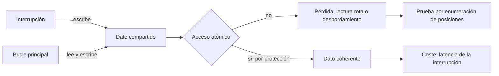
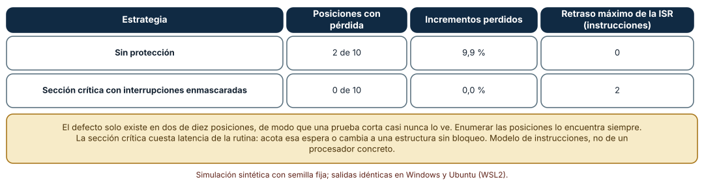
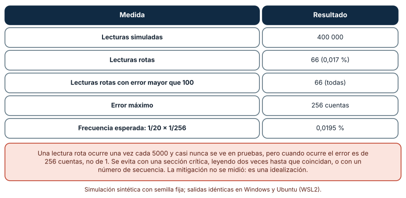
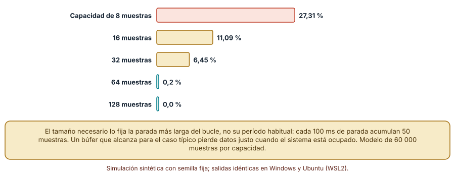

# SE-269 — Interrupciones, concurrencia y estado compartido

[← SE-268 — Sistemas de tiempo real y deadlines](../../classes/part-22-embedded-iot-y-tiempo-real/se-268-sistemas-de-tiempo-real-y-deadlines/README.md) · [↑ Parte 22](../../classes/part-22-embedded-iot-y-tiempo-real/README.md) · [📚 Índice completo](../../classes/README.md) · [🌐 Portal](../../site/classes/SE-269.html) · [SE-270 — Protocolos IoT y conectividad intermitente →](../../classes/part-22-embedded-iot-y-tiempo-real/se-270-protocolos-iot-y-conectividad-intermitente/README.md)

## Punto profesional y fundamento pedagógico

**Punto profesional.** La clase existe para que compartas datos entre una interrupción y el bucle principal sin perder incrementos, sin leer valores partidos y sin desbordar búferes, y para que sepas qué defectos de concurrencia encuentra una prueba corta y cuáles solo encuentra una enumeración de todos los intercalados.

**Por qué aparece aquí.** Se sitúa después de **Sistemas de tiempo real y deadlines** y antes de **Protocolos IoT y conectividad intermitente**: la clase anterior analizó cuándo una tarea termina; esta analiza qué ocurre con los datos cuando dos contextos los tocan a la vez. La interrupción es la forma más simple de concurrencia embebida y la fuente de los defectos más difíciles de reproducir.

**Error conceptual que debe corregir.** Creer que una operación escrita en una línea es atómica, que un defecto que ocurre una vez cada miles de lecturas es irrelevante o que un búfer dimensionado para el caso típico alcanza: `contador++` son tres instrucciones, una lectura rota rara vez ocurre y siempre es grande, y el búfer se dimensiona por la parada más larga.

**Secuencia de aprendizaje.** Antes de simular, predices en cuántas de las diez posiciones posibles de una interrupción se pierde un incremento; después enumeras las diez posiciones, mides la frecuencia de lecturas rotas de un valor de 16 bits en un procesador de 8 y simulas el desbordamiento de un búfer circular según su tamaño. La secuencia usa predicción, explicación propia, contraste y recuperación. [ICAP](https://icap.education.asu.edu/research) distingue participación de construcción de conocimiento; [How People Learn II](https://nap.nationalacademies.org/catalog/24783/how-people-learn-ii-learners-contexts-and-cultures) exige conectar conocimiento previo, contexto y transferencia; la [práctica de recuperación](https://pubmed.ncbi.nlm.nih.gov/16507066/) respalda producir de nuevo la explicación tras una demora; y [Education for Life and Work](https://nap.nationalacademies.org/resource/13398/dbasse_084153.pdf) exige devolución que explique la causa del error.

**Evidencia de aprendizaje.** `isr-log.md` con la predicción, la enumeración de posiciones con y sin sección crítica, la frecuencia de lecturas rotas, la curva de pérdidas del búfer y una regla de datos compartidos para el nodo (quién escribe, quién lee, con qué protección).

**Límite de la conclusión.** El modelo cuenta instrucciones como unidades indivisibles y supone una sola interrupción que se ejecuta completa; no emula un procesador, ni prioridades de interrupción anidadas, ni el reordenamiento de un compilador. La mitigación por lectura doble se describe pero no se midió.

### Trazabilidad fuente → afirmación

| Fuente primaria u oficial | Afirmación que respalda | Lo que no prueba |
|---|---|---|
| [Lee y Seshia, «Introduction to Embedded Systems»](https://ptolemy.berkeley.edu/books/leeseshia/) | Explica las interrupciones, los hilos y las condiciones de carrera como fuentes de comportamiento no determinista, y las secciones críticas y los semáforos como remedios. | No cuantifica la frecuencia de un defecto en un firmware dado. |
| [Barr Group, «Embedded C Coding Standard»](https://barrgroup.com/embedded-systems/books/embedded-c-coding-standard) | Incluye reglas sobre variables compartidas con rutinas de interrupción (por ejemplo, el uso de `volatile` y el cuidado con accesos no atómicos). | `volatile` no vuelve atómico un acceso: la regla de estilo no sustituye al análisis. |
| [Sha, Rajkumar y Lehoczky, «Priority inheritance protocols» (IEEE Transactions on Computers, 1990)](https://doi.org/10.1109/12.57058) | Muestra que proteger recursos compartidos con secciones críticas introduce bloqueos que hay que acotar. | No trata las secciones críticas con interrupciones enmascaradas en un solo procesador. |

## Antes de empezar

Recupera el bloqueo del mutex de `SE-268`: allí el recurso compartido era un registro en flash; aquí son un contador, un valor de 16 bits y un búfer. La pregunta activa es: **¿qué pasa con este dato si una interrupción cae justo entre dos instrucciones del bucle principal y cómo lo comprobaría exhaustivamente?**

## Prerrequisitos

- Haber completado `SE-268` o poder explicar qué es una sección crítica.
- Python 3.11 o posterior y un terminal; todo el código usa solo la biblioteca estándar.
- Manejar operaciones de lectura-modificación-escritura y colas circulares a nivel básico.

## Problema auténtico

El nodo de la sala cuenta pulsaciones del botón en una interrupción y el bucle principal las lee para mostrarlas; la temperatura, de 16 bits, la actualiza una interrupción del convertidor en un procesador de 8 bits; y las lecturas del sensor se guardan en un búfer que el bucle vacía para enviar por radio. Tres defectos intermitentes aparecen en la sala: de vez en cuando el contador de pulsaciones «retrocede», la temperatura muestra un salto de 25,6 °C que desaparece, y al enviar por radio faltan lecturas. Ninguno se reproduce en la mesa.

## Objetivos observables

Al terminar podrás:

1. enumerar todas las posiciones en que una interrupción puede interrumpir una secuencia de lectura-modificación-escritura y decir en cuáles se pierde una actualización;
2. calcular la frecuencia de lecturas partidas de un valor de más de un byte y su error máximo;
3. dimensionar un búfer circular por la parada más larga del consumidor y medir la pérdida según su tamaño;
4. elegir una protección (sección crítica, lectura doble, número de secuencia, estructura sin bloqueo) con su coste en latencia;
5. escribir una regla de datos compartidos del nodo: quién escribe, quién lee y cómo se protege cada dato.

## Mapa conceptual



El mapa muestra que un dato compartido es seguro solo si cada acceso es atómico o está protegido; la protección cuesta latencia de la interrupción, y los defectos se encuentran enumerando posiciones, no repitiendo ejecuciones.

## Temas y por qué importan

| Tema | Por qué cambia una decisión profesional | Evidencia mínima |
|---|---|---|
| Interrupciones y contexto | La rutina de interrupción corre entre dos instrucciones cualesquiera del programa principal. | Predicción, traza causal y contraejemplo de **Interrupciones y contexto** en `isr-log.md` |
| Lectura-modificación-escritura | Un incremento no es atómico; una interrupción en medio pierde una actualización. | Predicción, traza causal y contraejemplo de **Lectura-modificación-escritura** en `isr-log.md` |
| Lecturas partidas | Un valor de varios bytes puede leerse mitad antiguo y mitad nuevo. | Predicción, traza causal y contraejemplo de **Lecturas partidas** en `isr-log.md` |
| Búferes entre contextos | Su tamaño lo fija la parada más larga del consumidor. | Predicción, traza causal y contraejemplo de **Búferes entre contextos** en `isr-log.md` |
| Protecciones y su coste | Cada protección tiene un precio en latencia o en complejidad. | Predicción, traza causal y contraejemplo de **Protecciones y su coste** en `isr-log.md` |

## Conceptos y decisiones

### 1. Interrupciones y contexto

Una interrupción suspende el programa principal entre dos instrucciones, ejecuta su rutina y devuelve el control. El programa principal no sabe cuándo ocurrió: lo que sabe es que, entre dos instrucciones cualesquiera, el estado compartido pudo cambiar. Esa es la fuente de todos los defectos de esta clase. Una rutina de interrupción corta y sin bloqueos es la regla: guarda el dato, marca una bandera y vuelve; el trabajo se hace en el bucle principal. Lee y Seshia presentan esto como la raíz del no determinismo de los programas con interrupciones.

### 2. Lectura-modificación-escritura

`contador++` se traduce en leer el valor, sumar uno y escribirlo. Si una interrupción incrementa el mismo contador entre la lectura y la escritura, el programa principal escribe el valor viejo más uno y borra el incremento de la interrupción. De las diez posiciones posibles de una interrupción dentro de una vuelta de diez instrucciones, solo las dos situadas entre la lectura y la escritura pierden el incremento: por eso una prueba corta rara vez lo ve. Se corrige enmascarando las interrupciones durante esas instrucciones, con una operación atómica del procesador o con un diseño donde solo un contexto escribe cada contador.

### 3. Lecturas partidas

En un procesador de 8 bits, un valor de 16 bits se lee en dos instrucciones. Si la interrupción lo actualiza entre ambas, el programa obtiene un byte alto antiguo y uno bajo nuevo. El resultado es casi siempre inocuo: si el valor solo se incrementa en uno y el byte bajo no pasa de 255 a 0, el valor leído es el nuevo. Pero cuando el incremento cruza un límite de byte, el valor leído difiere en 255 o 256: un salto grande, rarísimo y casi irreproducible. Se evita con una sección crítica, con lectura doble hasta que dos lecturas coincidan o con un número de secuencia que la interrupción incrementa antes y después de escribir.

### 4. Búferes entre contextos

Un búfer circular desacopla a quien produce (una interrupción) de quien consume (el bucle). Su tamaño no se decide por la tasa media sino por la parada más larga del consumidor: durante una parada de 100 ms con 0,5 muestras por milisegundo se acumulan 50 muestras. Un búfer pequeño pierde datos justo cuando el sistema está ocupado, que es cuando más importan. Además hay que decidir qué ocurre al llenarse: descartar lo nuevo, descartar lo viejo o contar las pérdidas y avisar.

### 5. Protecciones y su coste

Enmascarar interrupciones es simple y retrasa la rutina durante la sección crítica, lo que afecta a los plazos de `SE-268`: debe ser corta y su duración máxima forma parte del análisis. Un diseño de un solo escritor evita la protección: la interrupción escribe y el bucle solo lee con las reglas adecuadas. Un número de secuencia (como un seqlock) permite lecturas sin bloquear a la interrupción. Las estructuras sin bloqueo son complejas y se reservan para casos medidos. Cada elección se documenta con su latencia.

### Enumerar las posiciones de la interrupción

Una vuelta del bucle tiene diez instrucciones: `load`, `add`, `store` y siete de otro trabajo. Una interrupción puede caer justo antes de cualquiera (diez posiciones). La rutina suma 1 al contador; el bucle suma 1 también. El resultado correcto es 2. Se ejecuta la vuelta para cada posición, sin y con una sección crítica que enmascara las interrupciones entre `load` y `store` (la rutina se atiende al salir).

```python
in_cs = protect and 1 <= i <= 2
if i == isr_boundary and not in_cs: counter += 1
elif i == isr_boundary and in_cs:   deferred = True
```

| Estrategia | Posiciones con pérdida | Incrementos perdidos | Retraso máximo de la ISR |
|---|---:|---:|---:|
| Sin protección | 2 de 10 | 9,9 % | 0 |
| Sección crítica con interrupciones enmascaradas | 0 de 10 | 0,0 % | 2 instrucciones |

Resultado, idéntico en Windows (CPython 3.12.9) y en Ubuntu bajo WSL2 (3.12.3). Sin protección se pierden incrementos en las posiciones 1 y 2 (antes de `add` y antes de `store`); al sortear 500 vueltas con una posición al azar, se pierde el 9,9 % de los incrementos totales (la mitad del 20 % de las posiciones, porque solo se pierde el de la rutina).



**Cómo leer la figura.** Cada fila es una estrategia; la segunda columna son las posiciones, de diez, que pierden la actualización. **Dónde deja de valer:** el modelo trata cada instrucción como indivisible y una sola interrupción; un procesador con interrupciones anidadas, escrituras fuera de orden o varios núcleos tiene más intercalados. Enumerar es posible porque el espacio es pequeño; con más contextos crece rápidamente y hace falta una herramienta de verificación.

### Una lectura partida es rara y grande

Un valor de 16 bits lo incrementa una interrupción escribiendo primero el byte alto y luego el bajo; el programa principal lo lee en dos instrucciones. Con probabilidad 1/20 por lectura la interrupción cae entre las dos lecturas. Se simulan 400 000 lecturas de valores aleatorios.

```python
lo = (new & 255) if isr_between else (v & 255)
got = (hi << 8) | lo          # el byte alto es el de antes de la interrupción
```

| Medida | Resultado |
|---|---:|
| Lecturas simuladas | 400 000 |
| Lecturas rotas | 66 (0,017 %) |
| Lecturas rotas con error mayor que 100 | 66 (todas) |
| Error máximo | 256 cuentas |
| Frecuencia esperada: 1/20 × 1/256 | 0,0195 % |

Solo se rompe la lectura cuando la interrupción cae entre las dos lecturas y el incremento cruza un límite de byte: una de cada 5000 lecturas. Cuando ocurre, el error es de 255 o 256 cuentas, no de 1. La frecuencia observada (0,017 %) coincide con la esperada (0,0195 %).



**Cómo leer la figura.** Cada fila es una medida; la última compara con el cálculo 1/20 × 1/256. **Dónde deja de valer:** la probabilidad 1/20 de que la interrupción caiga en medio es un supuesto; si la interrupción es más frecuente, la lectura rota es más común. La mitigación por lectura doble o secuencia no se midió: es una idealización. Una prueba de 1000 lecturas casi nunca ve este defecto.

### Cuánto búfer hace falta

Una interrupción produce muestras con ritmo de 0,5 por milisegundo (Poisson). El bucle principal vacía el búfer cada 15 ms (lognormal con σ = 0,3) y en el 2 % de las pasadas se detiene 100 ms más (por ejemplo, un envío de radio). Se mide la fracción de muestras que se pierden por falta de sitio, con 60 000 muestras por capacidad.

```python
if q < K: q += 1
else:     lost += 1
```

| Capacidad | Muestras perdidas |
|---:|---:|
| 8 | 27,31 % |
| 16 | 11,09 % |
| 32 | 6,45 % |
| 64 | 0,2 % |
| 128 | 0,0 % |

Un búfer que cubre el periodo típico (15 ms × 0,5 = 7,5 muestras) pierde casi un tercio de los datos con una capacidad de 8; hace falta superar las 50 muestras de la parada para que la pérdida sea casi nula.



**Cómo leer la figura.** Cada barra es el porcentaje de muestras perdidas para una capacidad; menos es mejor. **Dónde deja de valer:** la tasa de 0,5 por milisegundo, la parada de 100 ms con 2 % de frecuencia y los tiempos lognormales son supuestos. El tamaño correcto es el de la parada más larga que se quiere cubrir: se mide en el dispositivo y se vigila con un contador de pérdidas.

## Definiciones de trabajo

- **rutina de interrupción (ISR):** código que el procesador ejecuta al ocurrir un evento, suspendiendo el programa principal entre dos instrucciones.
- **atomicidad:** propiedad de una operación que ningún otro contexto observa a medias.
- **sección crítica:** tramo de código que accede a un dato compartido y se protege para que ningún otro contexto lo interrumpa.
- **lectura partida:** lectura de un valor de varios bytes que mezcla partes de dos escrituras distintas.
- **búfer circular:** cola de capacidad fija con índices de lectura y escritura que dan la vuelta.

Las definiciones son operativas para el nodo de la sala. No convierten términos con una historia más amplia en sinónimos y deben contrastarse con la documentación primaria enlazada al final.

## Ejemplo mínimo

El fragmento recorre las tres instrucciones de un incremento y una interrupción intercalada. Antes de ejecutarlo, predice cuánto vale el contador.

```python
contador = 0
reg = contador          # load
contador += 1           # la interrupción incrementa aquí
reg += 1                # add
contador = reg          # store
assert contador == 1    # se perdió un incremento (debería ser 2)
```

El contador vale 1 en lugar de 2. Registra versión, comando y salida; mueve la línea de la interrupción antes de `load` y predice el resultado.

## Ejemplo profesional

El equipo de la plataforma escribe una regla de datos compartidos del nodo. El contador de pulsaciones lo escribe solo la interrupción y el bucle lo lee con una sección crítica de dos instrucciones, de modo que el bucle nunca lo escribe. La temperatura de 16 bits la escribe la interrupción con un número de secuencia: se incrementa antes y después de escribir; el bucle repite la lectura hasta ver el mismo número par dos veces. Las lecturas del sensor van a un búfer de 128 muestras (el doble de lo necesario para una parada de 100 ms) con un contador de pérdidas que se envía con los datos. Además, la duración máxima de las secciones críticas (6 µs) forma parte del análisis de plazos de `SE-268`.

Compara con el prototipo: ningún dato se pierde en el banco ni se muestra un salto de 25,6 °C, y los defectos se buscan enumerando posiciones, no repitiendo ejecuciones. Una regla es adecuada cuando cada dato compartido tiene un escritor y una protección declarados; es frágil cuando se confía en que «casi nunca coinciden».

## Práctica guiada

1. Lista los datos que comparten la interrupción y el bucle del nodo y marca quién escribe y quién lee cada uno.
2. Para cada uno, traduce el acceso a instrucciones y cuenta las posiciones peligrosas; escribe la predicción antes de enumerar.
3. Enumera las posiciones con y sin sección crítica.
4. Estima la frecuencia de lecturas partidas de tu valor de varios bytes.
5. Simula el búfer con la parada más larga de tu bucle y elige su capacidad.
6. Escribe la regla de datos compartidos y la duración máxima de cada sección crítica.
7. Entrega `isr-log.md` y pide a otra persona que identifique el dato con la protección más débil.

## Ejercicios

1. **Posiciones:** construye una secuencia de seis instrucciones con dos accesos a la misma variable y enumera cuántas posiciones de una interrupción son peligrosas.
2. **Lectura:** calcula la frecuencia de lecturas partidas de un valor de 32 bits en un procesador de 8 bits con una interrupción cada 100 instrucciones.
3. **Búfer:** calcula la capacidad necesaria para una parada de 250 ms con 2 muestras por milisegundo y decide qué hacer al llenarse.
4. **Coste:** estima cuánto retrasa a la interrupción una sección crítica de 12 instrucciones a 16 MHz.

## Reto verificable

Entrega `isr-log.md` con la predicción, la enumeración de posiciones, la frecuencia de lecturas partidas, la curva del búfer y la regla de datos compartidos. Se aprueba si otra persona ejecuta el código desde un checkout limpio, obtiene los mismos números y puede decir qué dato queda sin proteger si se elimina una sección crítica. No se aprueba por afirmar que un acceso «es atómico» sin la traducción a instrucciones.

## Caso conductor

El nodo ambiental de una sala de estudio continúa como caso conductor de la Parte 22. Esta clase deja el quinto artefacto: la regla de datos compartidos del nodo, con quién escribe, quién lee, cómo se protege y cuánto retrasa cada protección. `SE-270` lleva esos datos a través de una red que se corta. Cambia después una sola protección, la sección crítica del contador, y observa qué plazo del análisis cambia.

## Preguntas frecuentes

### ¿`volatile` hace atómico un acceso?

No: solo impide que el compilador optimice la lectura o escritura. Un acceso de varios bytes o un incremento siguen siendo varias instrucciones y pueden interrumpirse.

### ¿Por qué no deshabilitar siempre las interrupciones?

Porque retrasa todas las demás rutinas y puede romper plazos. La sección crítica debe ser corta y su duración forma parte del análisis.

### ¿Cuándo vale la pena una estructura sin bloqueo?

Cuando una sección crítica corta ya no cabe en el presupuesto de latencia y se ha medido. Son complejas y fáciles de equivocar; se reservan para casos medidos.

### ¿Un defecto que ocurre una vez en 5000 lecturas merece atención?

Sí cuando su efecto es grande y el dispositivo hace millones de lecturas: a una lectura por segundo ocurre unas 17 veces al día. La frecuencia no excusa el error.

## Fallo controlado y diagnóstico

Reproduce el fallo clásico de la clase: **un contador compartido que «retrocede» de vez en cuando**. Enumera las diez posiciones de la interrupción en una vuelta de incremento.

Registra síntoma, entrada mínima, hipótesis, observación que descarta cada hipótesis, causa, corrección y prueba de regresión. **Síntoma:** el contador de pulsaciones pierde alguna de vez en cuando y nunca en la mesa. **Hipótesis rivales:** (a) el botón rebota y se pierden pulsaciones; (b) la pantalla muestra mal el valor; (c) una interrupción cae entre la lectura y la escritura del incremento. **Prueba:** enumera las posiciones; dos de diez pierden el incremento. **Conclusión:** la causa es la lectura-modificación-escritura no atómica. **Regresión:** deja que solo la interrupción escriba el contador o enmascara las interrupciones en el incremento, y repite la enumeración. No cambies a la vez la protección y el antirrebote.

## Errores comunes y cómo corregirlos

| Síntoma | Causa probable | Corrección |
|---|---|---|
| Un contador pierde incrementos de forma intermitente | Lectura-modificación-escritura sin protección | Un solo escritor o sección crítica |
| Un valor muestra saltos grandes rarísimos | Lectura partida de varios bytes | Sección crítica, lectura doble o número de secuencia |
| Faltan datos solo cuando el sistema está ocupado | Búfer dimensionado por el caso típico | Dimensionarlo por la parada más larga y contar las pérdidas |
| Las pruebas de miles de ejecuciones no encuentran el defecto | Posición poco frecuente | Enumerar las posiciones o usar verificación |
| Una sección crítica rompe plazos | Duración no acotada | Medirla y acotarla, o cambiar a un diseño sin bloqueo |

## Entorno y archivos clave

```text
work/SE-269/
├── README.md
├── isr/
│   ├── posiciones.py
│   ├── lectura_partida.py
│   └── buffer.py
├── tests/test_isr.py
└── evidence/isr-log.md
```

El `README` declara plataforma, versión de Python, semillas y comandos. Los experimentos usan solo la biblioteca estándar (`random`, `statistics`, `math`) y se ejecutaron con CPython 3.12.9 en Windows 11 y 3.12.3 en Ubuntu bajo WSL2: las salidas fueron idénticas. Si añades una dependencia, fija procedencia y versión.

## Seguridad, ética y accesibilidad

- un defecto de concurrencia en una alarma puede suprimirla en el peor momento: pruébalo con enumeración y no solo con repeticiones;
- una rutina de interrupción que procesa datos de un bus sin validar es una vía de entrada: valida los datos antes de usarlos;
- los contadores de pérdidas deben informarse para que una pérdida de datos no pase como un valor normal;
- documenta quién escribe y quién lee cada dato compartido;
- respeta las licencias de las bibliotecas de sincronización y atribuye lo adaptado.

## Puente hacia el trabajo con agentes

Un agente al que se le pide «cuenta las pulsaciones del botón» escribirá `contador++` en la interrupción y lo leerá en el bucle sin más. Pídele que traduzca cada acceso a instrucciones, que enumere las posiciones peligrosas, que declare quién escribe cada dato y que dimensione el búfer por la parada más larga. Revisa especialmente si usa `volatile` como solución o si no cuenta las pérdidas: es la apariencia de protección que esta clase desmonta.

## Transferencia

Traslada el análisis a otro dispositivo (por ejemplo, un controlador de riego con un sensor de flujo): cambia los datos compartidos y el ancho del procesador, y conserva el procedimiento de enumerar posiciones, calcular lecturas partidas y dimensionar búferes. La transferencia está lograda cuando puedes explicar qué parte del análisis dependía del procesador y cuál no, no cuando las tablas se parecen.

## Evaluación y evidencia

| Criterio | Evidencia para aprobar |
|---|---|
| comprensión | explicación de por qué `contador++` no es atómico y de por qué una lectura partida es rara y grande |
| corrección | enumeración, frecuencia y curva del búfer reproducibles con las mismas semillas |
| diseño | regla de datos compartidos con escritor, lector, protección y latencia |
| diagnóstico | reproducción del fallo «contador que retrocede» con regresión |
| incertidumbre | declaración de lo que el modelo no cubre (anidamiento, reordenamiento) |
| reproducibilidad | versiones, comandos, salida y límites declarados |

## Fuentes

- [Lee y Seshia, «Introduction to Embedded Systems»](https://ptolemy.berkeley.edu/books/leeseshia/) — interrupciones, hilos y condiciones de carrera en sistemas embebidos; autoridad: autores del libro (UC Berkeley).
- [Barr Group, «Embedded C Coding Standard»](https://barrgroup.com/embedded-systems/books/embedded-c-coding-standard) — reglas de codificación para datos compartidos; autoridad: Barr Group.
- [Sha, Rajkumar y Lehoczky, «Priority inheritance protocols» (IEEE Transactions on Computers, 1990)](https://doi.org/10.1109/12.57058) — bloqueo por recursos compartidos; autoridad: IEEE Transactions on Computers.
- [SWEBOK Guide v4.0a](https://www.computer.org/education/bodies-of-knowledge/software-engineering) — áreas de conocimiento de ingeniería de software; autoridad: IEEE Computer Society.
- [Python: `random`](https://docs.python.org/3/library/random.html) — generador con semilla para las simulaciones; autoridad: documentación de Python.

Cada fuente respalda el mecanismo indicado; ninguna demuestra que el 9,9 % de incrementos perdidos, las 66 lecturas rotas o el 27,31 % de pérdida del búfer se observen en el nodo real. Esa afirmación depende del procesador, de las interrupciones y de las paradas del bucle.

## Límites y siguiente paso

Se ejecutaron tres simulaciones con datos sintéticos en Windows y Ubuntu (WSL2) con resultados idénticos. No se usó ningún procesador, ensamblador ni analizador de interrupciones: las posiciones, la probabilidad de 1/20 y el proceso de llegadas del búfer son construcciones del autor. La siguiente clase saca esos datos del dispositivo por una red que se corta.

## Glosario

- **rutina de interrupción (ISR):** código que el procesador ejecuta al ocurrir un evento, suspendiendo el programa principal entre dos instrucciones.
- **atomicidad:** propiedad de una operación que ningún otro contexto observa a medias.
- **sección crítica:** tramo de código que accede a un dato compartido y se protege para que ningún otro contexto lo interrumpa.
- **lectura partida:** lectura de un valor de varios bytes que mezcla partes de dos escrituras distintas.
- **búfer circular:** cola de capacidad fija con índices de lectura y escritura que dan la vuelta.

---

[← SE-268 — Sistemas de tiempo real y deadlines](../../classes/part-22-embedded-iot-y-tiempo-real/se-268-sistemas-de-tiempo-real-y-deadlines/README.md) · [↑ Parte 22](../../classes/part-22-embedded-iot-y-tiempo-real/README.md) · [📚 Índice completo](../../classes/README.md) · [🌐 Portal](../../site/classes/SE-269.html) · [SE-270 — Protocolos IoT y conectividad intermitente →](../../classes/part-22-embedded-iot-y-tiempo-real/se-270-protocolos-iot-y-conectividad-intermitente/README.md)

