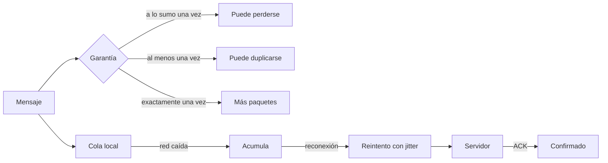
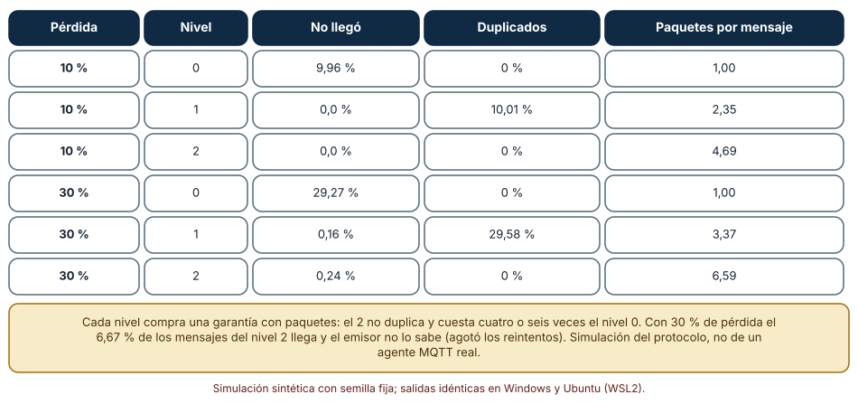
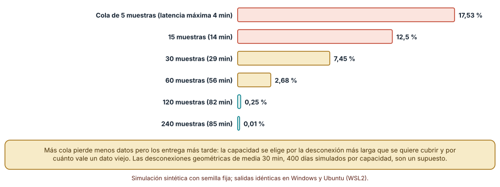
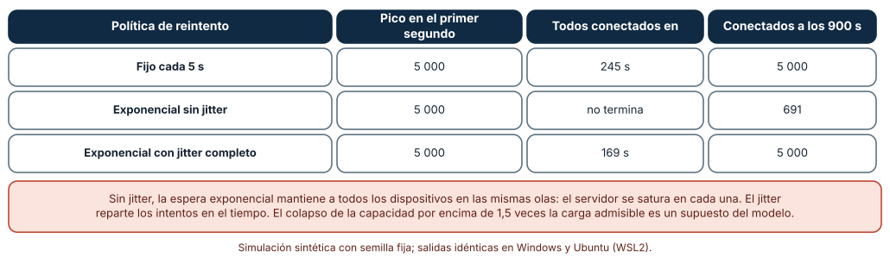

# SE-270 — Protocolos IoT y conectividad intermitente

[← SE-269 — Interrupciones, concurrencia y estado compartido](../../classes/part-22-embedded-iot-y-tiempo-real/se-269-interrupciones-concurrencia-y-estado-compartido/README.md) · [↑ Parte 22](../../classes/part-22-embedded-iot-y-tiempo-real/README.md) · [📚 Índice completo](../../classes/README.md) · [🌐 Portal](../../site/classes/SE-270.html) · [SE-271 — Actualizaciones OTA y recuperación →](../../classes/part-22-embedded-iot-y-tiempo-real/se-271-actualizaciones-ota-y-recuperacion/README.md)

## Punto profesional y fundamento pedagógico

**Punto profesional.** La clase existe para que elijas la garantía de entrega de un mensaje por lo que cuesta en paquetes y por lo que deja sin resolver, dimensiones una cola de almacenar y reenviar por la desconexión más larga que quieres cubrir y evites que miles de dispositivos tumben un servidor al reconectarse a la vez.

**Por qué aparece aquí.** Se sitúa después de **Interrupciones, concurrencia y estado compartido** y antes de **Actualizaciones OTA y recuperación**: la clase anterior protegió los datos dentro del dispositivo; esta los saca por una red que se corta, y la siguiente usa esa misma red para actualizar el firmware. El caso reutiliza lo aprendido en `SE-163` sobre eventos duplicados y reordenados.

**Error conceptual que debe corregir.** Creer que «entregado al menos una vez» o «exactamente una vez» eliminan los fallos de red: cada nivel compra una garantía con paquetes y deja un caso residual (el emisor no sabe si llegó), y los reintentos sin jitter sincronizan a toda la flota.

**Secuencia de aprendizaje.** Antes de simular, predices cuántos duplicados produce una entrega al menos una vez con un enlace que pierde el 30 %; después simulas los tres niveles de garantía, mides cuántos datos pierde una cola según su capacidad con desconexiones aleatorias y comparas tres políticas de reintento tras una caída de 5000 dispositivos. La secuencia usa predicción, explicación propia, contraste y recuperación. [ICAP](https://icap.education.asu.edu/research) distingue participación de construcción de conocimiento; [How People Learn II](https://nap.nationalacademies.org/catalog/24783/how-people-learn-ii-learners-contexts-and-cultures) exige conectar conocimiento previo, contexto y transferencia; la [práctica de recuperación](https://pubmed.ncbi.nlm.nih.gov/16507066/) respalda producir de nuevo la explicación tras una demora; y [Education for Life and Work](https://nap.nationalacademies.org/resource/13398/dbasse_084153.pdf) exige devolución que explique la causa del error.

**Evidencia de aprendizaje.** `net-log.md` con la predicción, la tabla de garantías, la curva de pérdidas de la cola, la comparación de políticas de reintento y una política de comunicación del nodo (garantía por tipo de mensaje, capacidad de cola, reintentos).

**Límite de la conclusión.** El enlace pierde paquetes de forma independiente, las desconexiones son geométricas de media 30 minutos, el servidor colapsa por encima de 1,5 veces su capacidad y los reintentos son los de un modelo simple. No se usó ningún agente MQTT, ningún servidor ni una red real: se simulan los mecanismos.

### Trazabilidad fuente → afirmación

| Fuente primaria u oficial | Afirmación que respalda | Lo que no prueba |
|---|---|---|
| [OASIS, MQTT versión 3.1.1](https://docs.oasis-open.org/mqtt/mqtt/v3.1.1/mqtt-v3.1.1.html) | Define tres niveles de calidad de servicio: a lo sumo una vez, al menos una vez y exactamente una vez, con sus intercambios de paquetes. | No mide su coste en una red concreta ni dice qué nivel conviene. |
| [OASIS, MQTT versión 5.0](https://docs.oasis-open.org/mqtt/mqtt/v5.0/mqtt-v5.0.html) | Añade, entre otras cosas, tiempos de expiración de mensajes y de sesión útiles para clientes con conectividad intermitente. | No prescribe la capacidad de la cola local del dispositivo. |
| [Bormann, Ersue y Keränen, RFC 7228: Terminology for Constrained-Node Networks](https://www.rfc-editor.org/rfc/rfc7228) | Caracteriza las redes de nodos limitados: baja potencia, pérdidas, conectividad intermitente y recursos escasos. | No da cifras de pérdida de ninguna red. |
| [AWS Architecture Blog, «Exponential backoff and jitter»](https://aws.amazon.com/blogs/architecture/exponential-backoff-and-jitter/) | Compara estrategias de reintento con y sin jitter y muestra que el jitter reduce la competencia entre clientes. | Son simulaciones de un autor sobre un modelo propio, no una medición de otro sistema. |

## Antes de empezar

Recupera lo aprendido sobre eventos duplicados en `SE-163`: un consumidor idempotente tolera un duplicado. Aquí la pregunta es del lado del dispositivo: **¿qué garantía necesita cada mensaje, cuánto cuesta y qué hace el dispositivo mientras no hay red?**

## Prerrequisitos

- Haber completado `SE-269` o poder explicar cómo un dato compartido se protege.
- Python 3.11 o posterior y un terminal; todo el código usa solo la biblioteca estándar.
- Manejar probabilidades de pérdida y colas de capacidad fija a nivel básico.

## Problema auténtico

El nodo de la sala publica una lectura por minuto y una alarma cuando el CO₂ supera un umbral. La red de la biblioteca se corta varias veces al día; a veces unos minutos y a veces una hora. Tras un corte general, 5000 nodos de toda la institución reintentan conectarse al mismo tiempo y el servidor deja de responder durante un cuarto de hora. Las lecturas del corte se pierden; algunas alarmas llegan dos veces. Cada síntoma proviene de una política distinta (garantía, cola, reintento) que nadie eligió explícitamente.

## Objetivos observables

Al terminar podrás:

1. describir los tres niveles de garantía de entrega y calcular sus pérdidas, duplicados y coste en paquetes sobre un enlace con pérdidas;
2. dimensionar una cola de almacenar y reenviar por la desconexión más larga que se quiere cubrir y estimar la latencia de los datos reenviados;
3. comparar políticas de reintento y explicar por qué el jitter evita que la flota se sincronice;
4. asignar una garantía y una política de cola a cada tipo de mensaje del nodo;
5. declarar qué no cubre una simulación del protocolo sin una red real.

## Mapa conceptual



El mapa separa la **garantía** (qué promete el protocolo cuando hay red) de la **cola** (qué hace el dispositivo cuando no la hay) y del **reintento** (cómo vuelve a entrar). Las tres decisiones son independientes y se eligen por tipo de mensaje.

## Temas y por qué importan

| Tema | Por qué cambia una decisión profesional | Evidencia mínima |
|---|---|---|
| Garantías de entrega | Cada nivel compra una garantía con paquetes y deja un caso residual. | Predicción, traza causal y contraejemplo de **Garantías de entrega** en `net-log.md` |
| Conectividad intermitente | La red se corta; el dispositivo debe seguir sin ella y recuperarse. | Predicción, traza causal y contraejemplo de **Conectividad intermitente** en `net-log.md` |
| Almacenar y reenviar | La capacidad de la cola decide cuántos datos se pierden y cuánto tardan. | Predicción, traza causal y contraejemplo de **Almacenar y reenviar** en `net-log.md` |
| Reintentos y tormentas | Los reintentos sincronizados convierten un corte en una caída del servidor. | Predicción, traza causal y contraejemplo de **Reintentos y tormentas** en `net-log.md` |
| Idempotencia | Un consumidor que tolera duplicados hace aceptable una garantía más barata. | Predicción, traza causal y contraejemplo de **Idempotencia** en `net-log.md` |

## Conceptos y decisiones

### 1. Garantías de entrega

MQTT define tres niveles. En el nivel 0 el emisor envía una vez y no espera confirmación: lo que se pierde, se pierde. En el nivel 1 el emisor reenvía hasta recibir confirmación: el mensaje llega al menos una vez, y puede llegar varias si se pierde la confirmación. En el nivel 2 un intercambio de cuatro paquetes con identificador evita que el receptor entregue dos veces: exactamente una vez, a costa de más paquetes y de estado en ambos lados. Ninguno elimina todos los casos: tras agotar los reintentos, el emisor puede no saber si el mensaje llegó.

### 2. Conectividad intermitente

Las redes de nodos limitados, como las describe el RFC 7228, tienen enlaces con pérdidas, bajo caudal y desconexiones. El diseño asume que la red no está; la pregunta no es si el dispositivo se desconecta, sino cuánto aguanta y cómo vuelve. Hay que decidir qué datos se conservan, qué se resume y qué se descarta, qué ocurre con el reloj sin sincronizar y cómo se evita que la reconexión sature al servidor.

### 3. Almacenar y reenviar

Mientras no hay red, el dispositivo guarda los datos en una cola local de capacidad fija; al reconectar, los envía a una velocidad limitada. La capacidad se elige por la desconexión más larga que se quiere cubrir (con una muestra por minuto, 60 muestras cubren una hora). Más capacidad pierde menos datos y los entrega más viejos. La política al llenarse (descartar lo más viejo, lo más nuevo o promediar) se decide por el valor de un dato antiguo: para una alarma de CO₂ un dato de hace una hora vale poco; para un historial de consumo vale lo mismo que uno reciente.

### 4. Reintentos y tormentas

Cuando falla una conexión, el dispositivo reintenta. Un intervalo fijo corto satura al servidor si muchos fallan a la vez. Un retroceso exponencial espacia los intentos, pero si todos empezaron en el mismo instante, los reintentos siguen sincronizados en olas. El jitter reparte los intentos de forma aleatoria en cada intervalo y rompe la sincronía. El blog de arquitectura de AWS lo comparó con simulaciones y concluyó que el jitter reduce el trabajo total y el tiempo en completar las conexiones.

### 5. Idempotencia

Si el consumidor trata igual un mensaje repetido, el nivel 1 basta y la clase se ahorra el coste del nivel 2. Para una lectura con marca de tiempo y un identificador, un duplicado se descarta por identificador. Para un comando («abre la puerta»), el duplicado puede ser peligroso, y el nivel o la idempotencia deben diseñarse. La garantía de entrega no sustituye al diseño del consumidor: lo complementa.

### Qué compra cada nivel de garantía

Se simulan 20 000 mensajes sobre un enlace que pierde cada paquete con probabilidad p en cada sentido. El emisor reintenta hasta cinco veces. En el nivel 1, el receptor entrega cada copia que llega; en el nivel 2 usa el intercambio de cuatro paquetes y entrega una sola vez.

```python
for _ in range(max_tries):
    packets += 1                       # PUBLISH
    if rng.random() > p:
        delivered += 1                 # el receptor la entrega
        packets += 1                   # PUBACK
        if rng.random() > p: return delivered, packets, True
```

| Pérdida | Nivel | No llegó | Duplicados | Paquetes por mensaje |
|---:|---:|---:|---:|---:|
| 10 % | 0 | 9,96 % | 0 % | 1,00 |
| 10 % | 1 | 0,0 % | 10,01 % | 2,35 |
| 10 % | 2 | 0,0 % | 0 % | 4,69 |
| 30 % | 0 | 29,27 % | 0 % | 1,00 |
| 30 % | 1 | 0,16 % | 29,58 % | 3,37 |
| 30 % | 2 | 0,24 % | 0 % | 6,59 |

Resultado, idéntico en Windows (CPython 3.12.9) y en Ubuntu bajo WSL2 (3.12.3). Con 30 % de pérdida, el nivel 1 duplica el 29,58 % de los mensajes y el nivel 2 no duplica ninguno pero usa 6,59 paquetes. Además, con 30 % de pérdida el 3,1 % de los mensajes del nivel 1 y el 6,67 % del nivel 2 llegan sin que el emisor lo sepa (agotó los reintentos antes de ver la confirmación).



**Cómo leer la figura.** Cada fila es una combinación de pérdida y nivel; las columnas muestran lo que se pierde, lo que se duplica y lo que cuesta. **Dónde deja de valer:** la pérdida independiente por paquete no describe una red real, donde las pérdidas vienen en ráfagas; y el modelo de reintentos es el de un protocolo simple, no el de un agente MQTT concreto, con sus temporizadores y su estado de sesión. La figura muestra las proporciones, no los valores.

### Qué capacidad de cola hace falta

El nodo genera una muestra por minuto durante 24 h. La red se alterna entre conectada (media 120 min) y caída (media 30 min, geométricas). Al reconectar se envían hasta 10 muestras por minuto. La cola tiene capacidad K y descarta la muestra más antigua al llenarse. Se simulan 400 días por capacidad.

```python
q.append(minute)
if len(q) > K: q.pop(0); lost += 1
```

| Capacidad (muestras) | Pérdida (% del día) | Latencia máxima media (min) |
|---:|---:|---:|
| 5 | 17,53 | 4 |
| 15 | 12,50 | 14 |
| 30 | 7,45 | 29 |
| 60 | 2,68 | 56 |
| 120 | 0,25 | 82 |
| 240 | 0,01 | 85 |

Cubrir una hora de desconexión (60 muestras) deja todavía una pérdida del 2,68 % porque las desconexiones son geométricas y a veces duran más. Con 120 muestras la pérdida baja a 0,25 % y la latencia máxima de un dato reenviado sube a 82 minutos.



**Cómo leer la figura.** Cada barra es el porcentaje del día perdido para una capacidad; entre paréntesis, la latencia máxima media. **Dónde deja de valer:** las desconexiones geométricas de media 30 minutos son un supuesto; en una red real hay cortes largos (una noche) que ninguna cola razonable cubre y que exigen resumir. La figura no recomienda una capacidad: muestra el intercambio entre pérdida y antigüedad.

### Cinco mil dispositivos que reintentan a la vez

Tras una caída que termina para todos en el mismo instante, 5000 dispositivos intentan reconectarse. El servidor acepta hasta 200 intentos por segundo; si la carga supera 1,5 veces la capacidad, su rendimiento cae a la mitad. Se comparan tres políticas: reintento fijo cada 5 s, espera exponencial (5, 10, 20… hasta 320 s) sin jitter y espera exponencial con jitter completo (intervalo aleatorio entre 0 y la espera).

```python
delay[i] = min(delay[i] * 2, 320)
next_try[i] = t + rng.uniform(0, delay[i])      # jitter completo
```

| Política de reintento | Pico en el primer segundo | Todos conectados en | Conectados a los 900 s |
|---|---:|---:|---:|
| Fijo cada 5 s | 5 000 | 245 s | 5 000 |
| Exponencial sin jitter | 5 000 | no termina | 691 |
| Exponencial con jitter completo | 5 000 | 169 s | 5 000 |

Con espera exponencial sin jitter, los dispositivos que fallan en el mismo instante vuelven a intentar juntos en cada ola; el servidor, saturado, apenas conecta a unos pocos: a los 900 segundos solo 691 de 5000 están conectados. Con jitter se conectan todos en 169 segundos, antes que con el reintento fijo.



**Cómo leer la figura.** Cada fila es una política; el pico en el primer segundo es igual en las tres porque todas empiezan a la vez. **Dónde deja de valer:** el colapso de rendimiento por encima de 1,5 veces la capacidad y la reconexión simultánea son supuestos; un servidor real con límites de tasa o colas absorbe de otra forma, y una flota real no se desconecta toda a la vez. Lo que enseña es que sin jitter la espera exponencial puede ser peor que el reintento fijo.

## Definiciones de trabajo

- **calidad de servicio (QoS):** garantía de entrega de un mensaje: a lo sumo una vez, al menos una vez o exactamente una vez.
- **almacenar y reenviar:** política por la que un dispositivo guarda datos localmente mientras no hay red y los envía al reconectar.
- **retroceso exponencial:** política que duplica el intervalo entre reintentos tras cada fallo hasta un máximo.
- **jitter:** variación aleatoria añadida al intervalo de reintento para evitar que varios clientes coincidan.
- **idempotencia:** propiedad de una operación que produce el mismo efecto si se aplica una o varias veces.

Las definiciones son operativas para el nodo de la sala. No convierten términos con una historia más amplia en sinónimos y deben contrastarse con la documentación primaria enlazada al final.

## Ejemplo mínimo

El fragmento calcula la probabilidad de que un mensaje llegue con tres envíos y un enlace que pierde el 30 %. Antes de ejecutarlo, predice si supera el 95 %.

```python
p = 0.3
llega = 1 - p ** 3          # falla solo si se pierden los tres
assert round(llega, 3) == 0.973
```

Con tres envíos llega el 97,3 % (pero un mensaje puede llegar y no su confirmación, y entonces se duplica). Registra versión, comando y salida; calcula con cinco envíos y compara con el 99,76 % de la fórmula.

## Ejemplo profesional

El equipo de la plataforma define una política por tipo de mensaje. Las lecturas por minuto usan nivel 1 con identificador y marca de tiempo (el servidor descarta duplicados), una cola de 120 muestras que descarta lo más viejo y se vacía a 10 por minuto al reconectar. La alarma de CO₂ usa nivel 1 con un envío inmediato y un resumen en el siguiente, y se marca «reenviada» si se retrasa más de cinco minutos. Los comandos hacia el nodo usan nivel 2 o son idempotentes. Los reintentos usan espera exponencial con jitter completo, con un tope de 320 s, y un identificador de dispositivo que desplaza el primer intento aleatoriamente hasta 60 s tras el corte.

Compara con el prototipo: tras un corte general, el servidor se recupera en menos de tres minutos sin tormenta; las alarmas duplicadas se filtran y las lecturas del corte llegan, retrasadas pero marcadas. Una política es adecuada cuando cada mensaje tiene su garantía y su cola; es débil cuando todo usa el valor por defecto.

## Práctica guiada

1. Lista los mensajes del nodo y, para cada uno, qué pasa si se pierde, si se duplica o si llega tarde.
2. Predice los duplicados del nivel 1 con 30 % de pérdida y escribe el número antes de simular.
3. Simula los tres niveles con 10 % y 30 % de pérdida.
4. Simula la cola con desconexiones de tu red y elige su capacidad.
5. Simula la reconexión de una flota con tres políticas de reintento.
6. Asigna garantía, cola y reintento a cada mensaje del nodo.
7. Entrega `net-log.md` y pide a otra persona que identifique el mensaje cuya duplicación sería más dañina.

## Ejercicios

1. **Garantía:** calcula los paquetes por mensaje de un nivel 2 con pérdida del 5 % y compáralos con el del nivel 1.
2. **Cola:** halla la capacidad que deja la pérdida por debajo del 1 % con desconexiones de media 60 minutos.
3. **Reintento:** modifica la política con jitter parcial (mitad fija, mitad aleatoria) y compara el tiempo de conexión.
4. **Idempotencia:** diseña el identificador de un comando «abre la puerta» para que un duplicado no lo ejecute dos veces.

## Reto verificable

Entrega `net-log.md` con la predicción, las tres tablas y la política de comunicación del nodo por tipo de mensaje. Se aprueba si otra persona ejecuta el código desde un checkout limpio, obtiene los mismos números y puede decir qué mensaje se perdería con una desconexión de dos horas. No se aprueba por describir MQTT ni por una política igual para todos los mensajes.

## Caso conductor

El nodo ambiental de una sala de estudio continúa como caso conductor de la Parte 22. Esta clase deja el sexto artefacto: la política de comunicación del nodo (garantía, cola y reintento por tipo de mensaje). `SE-271` usará ese canal para actualizar el firmware. Cambia después una sola cosa, la capacidad de la cola, y observa cuánto cambia la pérdida y la antigüedad de los datos.

## Preguntas frecuentes

### ¿Siempre uso el nivel 2 para estar seguro?

No: cuesta más paquetes, más estado y más energía. Si el consumidor es idempotente, el nivel 1 suele bastar; el 2 se reserva para comandos o mensajes cuyo duplicado cause daño.

### ¿Cuánta cola debe tener un dispositivo?

La que cubra la desconexión más larga razonable y quepa en la memoria del dispositivo, con una política clara al llenarse. Se mide con los cortes reales de la red.

### ¿El jitter retrasa las conexiones?

Distribuye los intentos: algunos dispositivos esperan más y la flota completa se conecta antes. En la simulación el jitter conectó a todos en 169 s frente a 245 s con reintento fijo.

### ¿Qué hago con las marcas de tiempo si el reloj no estaba sincronizado?

Registra la marca con el contador local y su estado de sincronización y deja que el servidor la corrija o la marque como aproximada. No presentes una marca inventada como exacta.

## Fallo controlado y diagnóstico

Reproduce el fallo clásico de la clase: **reintentos con retroceso exponencial sin jitter tras un corte general**. Simula 5000 dispositivos con servidor de 200 intentos por segundo y cuenta los conectados a los 900 s.

Registra síntoma, entrada mínima, hipótesis, observación que descarta cada hipótesis, causa, corrección y prueba de regresión. **Síntoma:** tras un corte de red, el servidor tarda un cuarto de hora en recuperarse. **Hipótesis rivales:** (a) el servidor está subdimensionado; (b) hay un defecto en la autenticación; (c) los dispositivos reintentan de forma sincronizada. **Prueba:** registra los instantes de los intentos; picos periódicos a 5, 10, 20 s indican (c). **Conclusión:** la espera exponencial sin jitter mantiene a la flota en olas. **Regresión:** añade jitter completo y un retardo aleatorio inicial, y repite la simulación: todos conectados en 169 s en lugar de 691 de 5000 a los 900. No cambies a la vez el jitter y la capacidad del servidor.

## Errores comunes y cómo corregirlos

| Síntoma | Causa probable | Corrección |
|---|---|---|
| Faltan lecturas tras un corte | Sin cola local o cola pequeña | Dimensionar la cola por la desconexión más larga y avisar de pérdidas |
| Alarmas duplicadas | Nivel 1 con consumidor no idempotente | Identificador de mensaje y descarte de duplicados |
| El servidor cae al volver la red | Reintentos sincronizados | Espera exponencial con jitter completo y retardo inicial aleatorio |
| El emisor reenvía un mensaje que ya llegó | Confirmación perdida | Diseñar para idempotencia y usar identificadores |
| Datos con horas incorrectas tras reconectar | Reloj sin sincronizar | Marcar el estado del reloj y corregir en el servidor |

## Entorno y archivos clave

```text
work/SE-270/
├── README.md
├── red/
│   ├── garantias.py
│   ├── cola.py
│   └── tormenta.py
├── tests/test_red.py
└── evidence/net-log.md
```

El `README` declara plataforma, versión de Python, semillas y comandos. Los experimentos usan solo la biblioteca estándar (`random`, `statistics`, `math`) y se ejecutaron con CPython 3.12.9 en Windows 11 y 3.12.3 en Ubuntu bajo WSL2: las salidas fueron idénticas. Si añades una dependencia, fija procedencia y versión.

## Seguridad, ética y accesibilidad

- un canal que reenvía mensajes sin autenticar permite reproducir alarmas o comandos: la garantía de entrega no es seguridad (`SE-272`);
- los datos de una sala no deben incluir identificadores de personas, ni siquiera en las colas locales;
- una alarma retrasada debe marcarse como tal para que quien la recibe no actúe como si fuera actual;
- documenta la política de pérdida de datos: cuánto se pierde y cuánto se acepta;
- respeta las licencias de los agentes y las bibliotecas de protocolo y atribuye lo adaptado.

## Puente hacia el trabajo con agentes

Un agente al que se le pide «conecta el nodo por MQTT» usará el nivel por defecto de una biblioteca y un reintento fijo. Pídele que asigne una garantía por tipo de mensaje con su coste en paquetes, que dimensione la cola por la desconexión más larga y que use espera exponencial con jitter completo. Revisa especialmente si deja los reintentos infinitos o sincronizados: es la receta de una tormenta de reconexión.

## Transferencia

Traslada el análisis a otro dispositivo (por ejemplo, un medidor de agua con red de largo alcance): cambia la pérdida, el caudal y el tamaño del mensaje, y conserva el procedimiento de elegir garantía por mensaje, dimensionar la cola y repartir los reintentos. La transferencia está lograda cuando puedes explicar qué parte de la política dependía de la red y cuál no, no cuando las tablas se parecen.

## Evaluación y evidencia

| Criterio | Evidencia para aprobar |
|---|---|
| comprensión | explicación de qué compra cada nivel de garantía y qué caso residual deja |
| corrección | tablas reproducibles con las mismas semillas |
| diseño | política por tipo de mensaje con garantía, cola y reintento |
| diagnóstico | reproducción del fallo «reintentos sin jitter» con regresión |
| incertidumbre | declaración de lo que la simulación no cubre (ráfagas, protocolos reales) |
| reproducibilidad | versiones, comandos, salida y límites declarados |

## Fuentes

- [OASIS, MQTT versión 3.1.1](https://docs.oasis-open.org/mqtt/mqtt/v3.1.1/mqtt-v3.1.1.html) — niveles de calidad de servicio; autoridad: OASIS.
- [OASIS, MQTT versión 5.0](https://docs.oasis-open.org/mqtt/mqtt/v5.0/mqtt-v5.0.html) — expiración de mensajes y sesiones; autoridad: OASIS.
- [Shelby, Hartke y Bormann, RFC 7252: The Constrained Application Protocol (CoAP)](https://www.rfc-editor.org/rfc/rfc7252) — protocolo para nodos limitados con mensajes confirmables; autoridad: IETF.
- [Bormann, Ersue y Keränen, RFC 7228: Terminology for Constrained-Node Networks](https://www.rfc-editor.org/rfc/rfc7228) — características de las redes de nodos limitados; autoridad: IETF.
- [AWS Architecture Blog, «Exponential backoff and jitter»](https://aws.amazon.com/blogs/architecture/exponential-backoff-and-jitter/) — comparación de estrategias de reintento; autoridad: Amazon Web Services.

Cada fuente respalda el mecanismo indicado; ninguna demuestra que el 29,58 % de duplicados, el 2,68 % de pérdida de la cola o los 169 s de reconexión se observen en la red del nodo. Esa afirmación depende del enlace, del agente y del servidor.

## Límites y siguiente paso

Se ejecutaron tres simulaciones con datos sintéticos en Windows y Ubuntu (WSL2) con resultados idénticos. No se usó ningún agente MQTT, ningún servidor ni una red real: la pérdida independiente, las desconexiones geométricas y el colapso del servidor por encima de 1,5 veces su capacidad son construcciones del autor. La siguiente clase usa este canal para actualizar el firmware sin dejar el dispositivo inservible.

## Glosario

- **calidad de servicio (QoS):** garantía de entrega de un mensaje: a lo sumo una vez, al menos una vez o exactamente una vez.
- **almacenar y reenviar:** política por la que un dispositivo guarda datos localmente mientras no hay red y los envía al reconectar.
- **retroceso exponencial:** política que duplica el intervalo entre reintentos tras cada fallo hasta un máximo.
- **jitter:** variación aleatoria añadida al intervalo de reintento para evitar que varios clientes coincidan.
- **idempotencia:** propiedad de una operación que produce el mismo efecto si se aplica una o varias veces.

---

[← SE-269 — Interrupciones, concurrencia y estado compartido](../../classes/part-22-embedded-iot-y-tiempo-real/se-269-interrupciones-concurrencia-y-estado-compartido/README.md) · [↑ Parte 22](../../classes/part-22-embedded-iot-y-tiempo-real/README.md) · [📚 Índice completo](../../classes/README.md) · [🌐 Portal](../../site/classes/SE-270.html) · [SE-271 — Actualizaciones OTA y recuperación →](../../classes/part-22-embedded-iot-y-tiempo-real/se-271-actualizaciones-ota-y-recuperacion/README.md)
