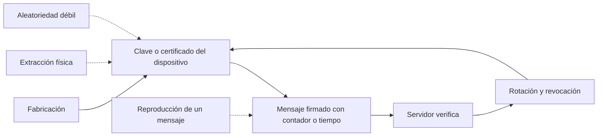
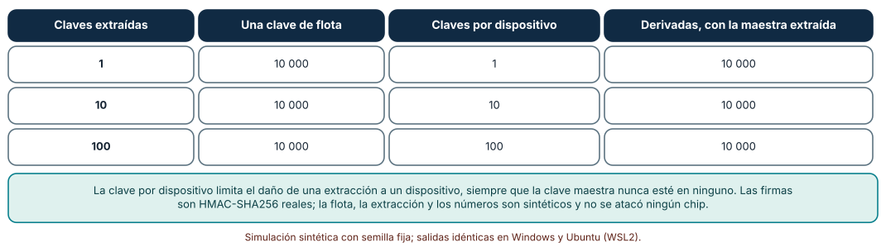
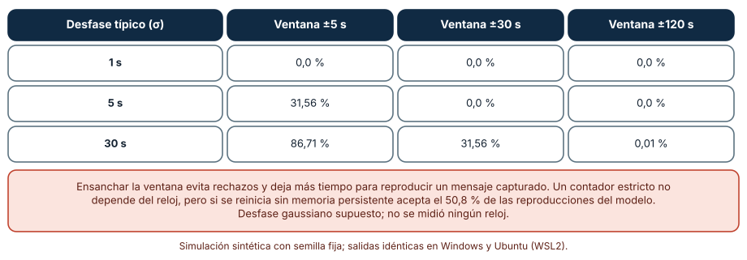
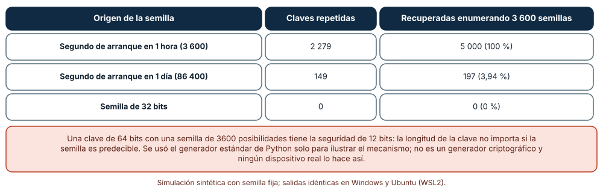

# SE-272 — Identidad de dispositivo y gestión de claves

[← SE-271 — Actualizaciones OTA y recuperación](../../classes/part-22-embedded-iot-y-tiempo-real/se-271-actualizaciones-ota-y-recuperacion/README.md) · [↑ Parte 22](../../classes/part-22-embedded-iot-y-tiempo-real/README.md) · [📚 Índice completo](../../classes/README.md) · [🌐 Portal](../../site/classes/SE-272.html) · [SE-273 — Edge, gateways y procesamiento local →](../../classes/part-22-embedded-iot-y-tiempo-real/se-273-edge-gateways-y-procesamiento-local/README.md)

## Punto profesional y fundamento pedagógico

**Punto profesional.** La clase existe para que decidas cómo un dispositivo prueba quién es y cómo un servidor decide a quién cree, midiendo cuánto daño causa extraer una clave de un dispositivo, qué ventana de tiempo tolera un mensaje firmado y qué seguridad queda cuando la clave se genera con una semilla predecible.

**Por qué aparece aquí.** Se sitúa después de **Actualizaciones OTA y recuperación** y antes de **Edge, gateways y procesamiento local**: la clase anterior hizo llegar código a un dispositivo; esta pregunta cómo el dispositivo sabe que ese código es legítimo y cómo el servidor sabe que un mensaje viene del dispositivo que dice ser. Una actualización sin autenticidad es una puerta de entrada.

**Error conceptual que debe corregir.** Creer que una clave larga es una clave fuerte o que firmar un mensaje basta: la seguridad de una clave depende de cómo se generó, de cuántos dispositivos la comparten y de qué impide reproducir un mensaje legítimo.

**Secuencia de aprendizaje.** Antes de medir, predices cuántos dispositivos se pueden suplantar al extraer una clave de uno de una flota con clave compartida; después calculas el alcance de una extracción con tres esquemas con HMAC real, mides cuántos mensajes legítimos rechaza una ventana de tiempo según el desfase del reloj y cuántas claves de 64 bits, generadas con una semilla débil, se repiten o se recuperan por enumeración. La secuencia usa predicción, explicación propia, contraste y recuperación. [ICAP](https://icap.education.asu.edu/research) distingue participación de construcción de conocimiento; [How People Learn II](https://nap.nationalacademies.org/catalog/24783/how-people-learn-ii-learners-contexts-and-cultures) exige conectar conocimiento previo, contexto y transferencia; la [práctica de recuperación](https://pubmed.ncbi.nlm.nih.gov/16507066/) respalda producir de nuevo la explicación tras una demora; y [Education for Life and Work](https://nap.nationalacademies.org/resource/13398/dbasse_084153.pdf) exige devolución que explique la causa del error.

**Evidencia de aprendizaje.** `identity-log.md` con la predicción, el alcance de una extracción por esquema, la tabla de rechazos por ventana, la comparación de semillas y una política de identidad del nodo (esquema de claves, rotación, anti-reproducción, origen de la aleatoriedad).

**Límite de la conclusión.** Las firmas HMAC-SHA256 son reales; la flota, la extracción de claves, el desfase gaussiano del reloj y la semilla por el segundo de arranque son construcciones del autor. Se usó el generador de `random` de Python solo para ilustrar un mecanismo: no es criptográfico. No se atacó ningún chip ni se auditó un dispositivo real.

### Trazabilidad fuente → afirmación

| Fuente primaria u oficial | Afirmación que respalda | Lo que no prueba |
|---|---|---|
| [Krawczyk, Bellare y Canetti, RFC 2104: HMAC](https://www.rfc-editor.org/rfc/rfc2104) | Define el código de autenticación de mensajes basado en una función hash y una clave secreta, usado para verificar integridad y origen. | No dice cómo distribuir ni proteger la clave en un dispositivo. |
| [Krawczyk y Eronen, RFC 5869: HKDF](https://www.rfc-editor.org/rfc/rfc5869) | Define una función de derivación de claves para obtener claves independientes a partir de un secreto maestro. | No evalúa un esquema de derivación por dispositivo en una flota concreta. |
| [NIST SP 800-57 Parte 1 rev. 5: Recomendación para la gestión de claves](https://csrc.nist.gov/pubs/sp/800/57/pt1/r5/final) | Recoge prácticas de gestión del ciclo de vida de claves: generación, distribución, uso, rotación, revocación y destrucción. | No es una guía de implementación para dispositivos de recursos limitados. |
| [Heninger et al., «Mining your Ps and Qs» (USENIX Security, 2012)](https://www.usenix.org/conference/usenixsecurity12/technical-sessions/presentation/heninger) | Mostró que una fracción significativa de claves de dispositivos de red en Internet era débil o repetida por entropía insuficiente al generarlas. | No mide el problema en dispositivos actuales ni en el nodo de la clase. |
| [ETSI EN 303 645: ciberseguridad para IoT de consumo](https://www.etsi.org/deliver/etsi_en/303600_303699/303645/) | Fija requisitos básicos como contraseñas únicas por dispositivo, actualización segura y comunicación protegida. | Un estándar de requisitos no certifica una implementación. |

## Antes de empezar

Recupera el plan de actualización de `SE-271`: el manifiesto y la firma son el primer uso de la identidad. La pregunta activa es: **¿qué pasa si alguien extrae la clave de un dispositivo, cuánto tiempo vale un mensaje capturado y de dónde sale la aleatoriedad de mi clave?**

## Prerrequisitos

- Haber completado `SE-271` o poder explicar el papel del manifiesto en una actualización.
- Python 3.11 o posterior y un terminal; todo el código usa solo la biblioteca estándar.
- Manejar la idea de función hash y de clave secreta a nivel básico.

## Problema auténtico

Los 200 nodos de la plataforma firman cada mensaje con HMAC usando una clave que el fabricante grabó una sola vez para toda la flota, porque «es más simple». En una auditoría, una persona abre un nodo de una sala, extrae la clave de la memoria y puede enviar lecturas falsas como si fuera cualquiera de los 200. El servidor acepta mensajes con marca de tiempo dentro de ±5 s; los relojes de algunos nodos se desvían más y sus mensajes se rechazan. Y los nodos generan una clave de sesión al arrancar con la hora de arranque como semilla.

## Objetivos observables

Al terminar podrás:

1. comparar el alcance de la extracción de una clave en un esquema de clave de flota, de claves por dispositivo y de claves derivadas de un secreto maestro;
2. calcular qué fracción de mensajes legítimos rechaza una ventana de tiempo según el desfase del reloj y por qué un contador necesita memoria persistente;
3. medir cuántas claves se repiten y cuántas se recuperan por enumeración cuando la semilla es predecible;
4. escribir una política de identidad del nodo: esquema de claves, rotación, anti-reproducción y origen de la aleatoriedad;
5. declarar qué no cubre un modelo sin un dispositivo ni un atacante reales.

## Mapa conceptual



El mapa muestra el camino de una identidad (la clave se graba o se genera, se usa para firmar y el servidor la verifica) y tres ataques (extracción, reproducción, aleatoriedad débil). La rotación y la revocación cierran el ciclo.

## Temas y por qué importan

| Tema | Por qué cambia una decisión profesional | Evidencia mínima |
|---|---|---|
| Identidad de dispositivo | Una identidad única por dispositivo acota el daño de un compromiso. | Predicción, traza causal y contraejemplo de **Identidad de dispositivo** en `identity-log.md` |
| Esquemas de claves | Clave de flota, claves por dispositivo y derivación tienen alcances distintos. | Predicción, traza causal y contraejemplo de **Esquemas de claves** en `identity-log.md` |
| Anti-reproducción | Un mensaje firmado vale mientras no pueda reutilizarse. | Predicción, traza causal y contraejemplo de **Anti-reproducción** en `identity-log.md` |
| Aleatoriedad | Una clave es tan fuerte como la entropía de su origen. | Predicción, traza causal y contraejemplo de **Aleatoriedad** en `identity-log.md` |
| Rotación y revocación | Sin forma de retirar una clave, un compromiso es permanente. | Predicción, traza causal y contraejemplo de **Rotación y revocación** en `identity-log.md` |

## Conceptos y decisiones

### 1. Identidad de dispositivo

Un dispositivo se identifica ante un servidor con un secreto que solo él conoce o con un par de claves cuya parte privada nunca sale. La identidad debe ser única por dispositivo, estar protegida frente a lectura (memoria segura, si el hardware lo ofrece) y poder retirarse. El estándar ETSI EN 303 645 exige, entre otras cosas, que no haya contraseñas por defecto compartidas: la razón es la misma que la de esta clase, que una credencial compartida convierte el compromiso de uno en el compromiso de todos.

### 2. Esquemas de claves

Con una **clave de flota**, quien extrae la clave de un dispositivo puede firmar como cualquiera de los 10 000. Con **claves por dispositivo** almacenadas en el servidor, la extracción compromete un dispositivo, a costa de custodiar una base de claves. Con **derivación**, cada clave se calcula como HMAC o HKDF de un secreto maestro y del identificador del dispositivo; el servidor no necesita almacenar las claves, y la extracción de una compromete un dispositivo, siempre que el secreto maestro nunca esté en un dispositivo. Si el maestro se filtra, el alcance es toda la flota.

### 3. Anti-reproducción

Un mensaje firmado puede capturarse y enviarse de nuevo. Dos mecanismos lo evitan. Una **ventana de tiempo** acepta mensajes con marca reciente; exige relojes razonablemente sincronizados y deja una ventana en que la reproducción es posible. Un **contador monótono** exige que cada mensaje tenga un número mayor que el anterior; no depende del reloj, pero necesita memoria persistente: si el contador se reinicia con el dispositivo, un mensaje capturado vuelve a ser válido. La elección se documenta con el desfase que tolera y la memoria que exige.

### 4. Aleatoriedad

Una clave generada con una semilla de pocos valores posibles tiene la seguridad de esa cantidad de valores, no la de su longitud. Un dispositivo recién arrancado tiene poca entropía: no hay teclado, ni disco, ni red variable. Si usa el segundo de arranque como semilla, el espacio de búsqueda es el de segundos posibles. Heninger y colaboradores encontraron que muchos dispositivos de red generaban claves repetidas o factorizables por esa razón. La solución es una fuente de entropía de hardware (un generador verdadero de números aleatorios) o claves inyectadas en fábrica, y mezclar la entropía antes de generar.

### 5. Rotación y revocación

Las claves se rotan por calendario y tras un compromiso. En un dispositivo, rotar exige un canal seguro y un procedimiento que tolere cortes (`SE-271`). Revocar exige que el servidor rechace una clave comprometida: con claves por dispositivo, es una entrada en una lista; con una clave de flota, es una rotación de toda la flota. NIST SP 800-57 describe las fases del ciclo de vida: generación, distribución, uso, almacenamiento, rotación, revocación y destrucción. Cada una tiene un responsable.

### Cuántos dispositivos se suplantan al extraer k claves

Una flota de 10 000 dispositivos. Se compara una clave única de flota, claves por dispositivo y claves derivadas con HMAC-SHA256 de un secreto maestro y el identificador. Se comprueba con firmas reales que la firma de un dispositivo no verifica como otro cuando las claves son distintas, y se calcula cuántos dispositivos puede suplantar un atacante que extrae k claves.

```python
def per_device(i): return hmac.new(master, f"id-{i:05d}".encode(), hashlib.sha256).digest()
assert sign(per_device(42), msg) != sign(per_device(43), msg)
```

| Claves extraídas | Una clave de flota | Claves por dispositivo | Derivadas, con la maestra extraída |
|---:|---:|---:|---:|
| 1 | 10 000 | 1 | 10 000 |
| 10 | 10 000 | 10 | 10 000 |
| 100 | 10 000 | 100 | 10 000 |

Resultado, idéntico en Windows (CPython 3.12.9) y en Ubuntu bajo WSL2 (3.12.3). Con una clave de flota, extraer una sola permite suplantar a todos. Con claves por dispositivo, el alcance es lineal (k dispositivos). Con claves derivadas el alcance es igual, siempre que la clave maestra no esté en ningún dispositivo.



**Cómo leer la figura.** Cada fila es el número de claves extraídas; las columnas son los dispositivos suplantables en cada esquema. **Dónde deja de valer:** el modelo supone que la extracción de una clave no revela otras y que el servidor identifica al dispositivo por su identificador; un ataque sobre el servidor o sobre la fábrica tiene otro alcance. Las firmas son HMAC reales, pero la flota y la extracción son sintéticas: no se atacó ningún chip.

### Cuántos mensajes buenos rechaza una ventana de tiempo

Los relojes de los dispositivos tienen un desfase gaussiano respecto del servidor, con desviación σ de 1, 5 o 30 s. El servidor acepta mensajes con marca dentro de ±W segundos (W = 5, 30, 120). Se calcula el porcentaje de mensajes legítimos rechazados sobre 100 000 mensajes por celda. Aparte, un contador monótono que se reinicia al arrancar sin memoria persistente se enfrenta a un mensaje capturado con un contador aleatorio.

```python
fr = sum(abs(rng.gauss(0, sd)) > W for _ in range(100000)) / 100000
```

| Desfase típico (σ) | Ventana ±5 s | Ventana ±30 s | Ventana ±120 s |
|---:|---:|---:|---:|
| 1 s | 0,0 % | 0,0 % | 0,0 % |
| 5 s | 31,56 % | 0,0 % | 0,0 % |
| 30 s | 86,71 % | 31,56 % | 0,01 % |

Con un desfase típico de 5 s, una ventana de ±5 s rechaza el 31,56 % de los mensajes legítimos. Ensancharla evita los rechazos y deja más tiempo para reproducir un mensaje capturado. Un contador monótono que se reinicia sin memoria persistente acepta una reproducción en el **50,8 %** de los casos del modelo.



**Cómo leer la figura.** Cada fila es un desfase típico del reloj; las columnas son el ancho de la ventana; el valor es el porcentaje de rechazos de mensajes legítimos. **Dónde deja de valer:** el desfase gaussiano es un supuesto; relojes reales derivan de forma sistemática y saltan al sincronizarse. La cifra del 50,8 % depende del modelo de contadores aleatorios y solo ilustra que sin persistencia el contador no protege. Un diseño real combina contador persistente y una comprobación de reloj.

### Una semilla débil convierte 64 bits en 12

Cada uno de 5000 dispositivos genera una clave de 64 bits con el generador de Python usando como semilla el segundo de arranque dentro de una ventana de 1 hora (3600 valores), de 1 día (86 400) o una semilla de 32 bits. Un atacante enumera las 3600 semillas de la primera hora y calcula todas las claves posibles.

```python
ks.append(random.Random(seed).getrandbits(64))
cand = {random.Random(s).getrandbits(64) for s in range(3600)}
```

| Origen de la semilla | Claves repetidas | Recuperadas enumerando 3 600 semillas |
|---|---:|---:|
| Segundo de arranque en 1 hora (3 600) | 2 279 | 5 000 (100 %) |
| Segundo de arranque en 1 día (86 400) | 149 | 197 (3,94 %) |
| Semilla de 32 bits | 0 | 0 (0 %) |

Con 3600 semillas posibles, 2279 de 5000 claves se repiten (la paradoja del cumpleaños) y quien enumera la primera hora recupera las 5000. Una clave de 64 bits con una semilla de 3600 posibilidades tiene la seguridad de unos 12 bits.



**Cómo leer la figura.** Cada fila es el espacio de semillas; las columnas son las claves repetidas entre 5000 y las recuperadas por enumeración de las 3600 semillas de la primera hora. **Dónde deja de valer:** el generador de Python es un Mersenne Twister y su salida es predecible a partir de su estado: se usó solo para mostrar el mecanismo. Un dispositivo real usaría un generador criptográfico y una fuente de entropía de hardware; la semilla de 32 bits tampoco es suficiente para una clave de larga vida.

## Definiciones de trabajo

- **clave de flota:** secreto compartido por todos los dispositivos de una flota; su extracción compromete a todos.
- **derivación de claves:** cálculo de una clave a partir de un secreto maestro y un identificador mediante una función como HKDF o HMAC.
- **reproducción (replay):** reenvío de un mensaje legítimo capturado para que el receptor lo acepte de nuevo.
- **entropía:** medida de la imprevisibilidad de una fuente de datos; determina la seguridad de una clave generada a partir de ella.
- **revocación:** retirada de una clave o certificado para que el servidor deje de aceptarlo.

Las definiciones son operativas para el nodo de la sala. No convierten términos con una historia más amplia en sinónimos y deben contrastarse con la documentación primaria enlazada al final.

## Ejemplo mínimo

El fragmento firma un mensaje con HMAC y comprueba que otra clave no lo valida. Antes de ejecutarlo, predice si las dos firmas coinciden.

```python
import hmac, hashlib
msg = b"id-00042|temp=21.5|ctr=7"
f1 = hmac.new(b"clave-A", msg, hashlib.sha256).hexdigest()
f2 = hmac.new(b"clave-B", msg, hashlib.sha256).hexdigest()
assert f1 != f2 and hmac.compare_digest(f1, f1)
```

Las firmas difieren: solo quien conoce la clave puede producir la correcta. Registra versión, comando y salida; cambia un byte del mensaje y predice qué ocurre con la firma.

## Ejemplo profesional

El equipo de la plataforma cambia la política de identidad del nodo. Cada nodo recibe en fábrica una clave única derivada con HKDF de un secreto maestro que vive en un módulo de seguridad del fabricante y nunca en los nodos; el servidor deriva la misma clave al recibir un mensaje. Los mensajes llevan un contador persistente (guardado con la política de `SE-267` en un sector aparte) y la marca de tiempo solo como señal auxiliar, con una ventana de ±120 s. Las claves de sesión se generan con el generador de hardware del microcontrolador y no con la hora. La rotación es anual y la revocación es una lista de identificadores consultada por el servidor.

Compara con el esquema de flota: la extracción de una clave en la auditoría compromete a un nodo, no a 200, y el servidor puede revocarlo; los mensajes legítimos ya no se rechazan por el desfase del reloj y una reproducción falla por el contador. Una política es adecuada cuando cada ataque de la lista tiene una respuesta; es frágil cuando depende de un secreto que nadie debería poder extraer.

## Práctica guiada

1. Lista los secretos del nodo, dónde viven y quién podría extraerlos.
2. Predice cuántos dispositivos se suplantan con la clave de flota al extraer una y escribe el número.
3. Implementa los tres esquemas con HMAC y mide el alcance de k extracciones.
4. Mide los rechazos de una ventana con el desfase de tus relojes.
5. Simula la generación de claves con una semilla débil y calcula las repetidas.
6. Escribe la política de identidad con esquema, rotación, anti-reproducción y origen de la aleatoriedad.
7. Entrega `identity-log.md` y pide a otra persona que identifique el secreto cuya extracción sería más dañina.

## Ejercicios

1. **Alcance:** calcula cuántos dispositivos se suplantan si la clave derivada de cada nodo depende además de su ubicación y se extraen las claves de una sala de diez nodos.
2. **Ventana:** calcula la ventana mínima para rechazar menos del 1 % de mensajes con un desfase típico de 10 s.
3. **Semilla:** calcula cuántos bits de seguridad tiene una clave de 128 bits generada con un segundo de arranque en una semana.
4. **Rotación:** diseña un procedimiento de rotación de claves que tolere un corte de energía a mitad.

## Reto verificable

Entrega `identity-log.md` con la predicción, las tres tablas y la política de identidad. Se aprueba si otra persona ejecuta el código desde un checkout limpio, obtiene los mismos números y puede decir qué ocurre si el secreto maestro se filtra. No se aprueba por proponer «cifrar todo» sin decir de dónde sale cada clave.

## Caso conductor

El nodo ambiental de una sala de estudio continúa como caso conductor de la Parte 22. Esta clase deja el octavo artefacto: la política de identidad del nodo con claves por dispositivo, anti-reproducción por contador, aleatoriedad de hardware y rotación. `SE-273` lleva el procesamiento al borde de la red. Cambia después una sola cosa, el esquema de claves, y observa qué extracción deja de comprometer a toda la flota.

## Preguntas frecuentes

### ¿Es suficiente firmar los mensajes?

No: la firma prueba que el mensaje lo produjo quien tiene la clave, pero no que sea nuevo ni que la clave esté a salvo. Hacen falta anti-reproducción, rotación y revocación.

### ¿Por qué no usar la hora de arranque como semilla?

Porque es predecible: un atacante que sabe cuándo se instaló la flota puede enumerar los segundos posibles. Se necesita una fuente de entropía real.

### ¿Cuándo prefiero un contador a una marca de tiempo?

Cuando el reloj no es fiable y hay memoria persistente. La marca de tiempo es útil cuando el contador no puede persistir. Muchos diseños usan ambos.

### ¿Qué ocurre con la clave si el dispositivo se pierde o se vende?

Debe poder revocarse y reemplazarse; por eso la identidad única por dispositivo es una condición: una clave de flota no se puede revocar sin tocar a todos.

## Fallo controlado y diagnóstico

Reproduce el fallo clásico de la clase: **una clave de flota extraída de un dispositivo en una auditoría**. Verifica que la firma de un atacante con esa clave se acepta como la de cualquier dispositivo.

Registra síntoma, entrada mínima, hipótesis, observación que descarta cada hipótesis, causa, corrección y prueba de regresión. **Síntoma:** el servidor recibe lecturas «de» una sala en que no hay ningún nodo encendido. **Hipótesis rivales:** (a) hay un nodo con error de identificador; (b) alguien captura y reenvía mensajes; (c) alguien firma con una clave extraída. **Prueba:** comprueba si los mensajes llevan contadores nuevos y firmas válidas; si sí, y ningún nodo los envía, es (c). **Conclusión:** la clave de flota comprometió a toda la flota. **Regresión:** pasa a claves derivadas por dispositivo, revoca la antigua, verifica que la firma del atacante ya no se acepta y rota. No cambies a la vez el esquema y el formato del mensaje.

## Errores comunes y cómo corregirlos

| Síntoma | Causa probable | Corrección |
|---|---|---|
| Un dispositivo comprometido permite suplantar a toda la flota | Clave compartida | Claves únicas por dispositivo o derivadas de un secreto maestro externo |
| Mensajes legítimos rechazados | Ventana de tiempo estrecha frente al desfase | Ensanchar la ventana, sincronizar el reloj o usar un contador persistente |
| Un mensaje capturado se acepta días después | Sin anti-reproducción o contador reiniciado | Contador persistente y ventana acotada |
| Varias unidades tienen la misma clave | Semilla predecible al generar claves | Fuente de entropía de hardware o claves inyectadas en fábrica |
| No se puede retirar una clave comprometida | Sin revocación | Lista de revocación consultada por el servidor y rotación planificada |

## Entorno y archivos clave

```text
work/SE-272/
├── README.md
├── identidad/
│   ├── esquemas.py
│   ├── ventana.py
│   └── semillas.py
├── tests/test_identidad.py
└── evidence/identity-log.md
```

El `README` declara plataforma, versión de Python, semillas y comandos. Los experimentos usan solo la biblioteca estándar (`hmac`, `hashlib`, `random`, `statistics`) y se ejecutaron con CPython 3.12.9 en Windows 11 y 3.12.3 en Ubuntu bajo WSL2: las salidas fueron idénticas. Si añades una dependencia, fija procedencia y versión.

## Seguridad, ética y accesibilidad

- los experimentos usan claves sintéticas: no uses material de claves reales en los registros ni en las pruebas;
- el generador de `random` de Python no es criptográfico: en producción se usa un generador criptográfico del sistema o del hardware;
- un nodo de una sala no debe permitir identificar a las personas presentes con su identidad o su tráfico;
- documenta quién custodia el secreto maestro y cómo se audita su uso;
- respeta las licencias de las bibliotecas criptográficas y atribuye lo adaptado.

## Puente hacia el trabajo con agentes

Un agente al que se le pide «asegura la comunicación del nodo» propondrá cifrar con una clave incluida en el firmware y firmar con ella. Pídele que indique dónde vive cada secreto, qué ocurre si se extrae uno, cómo evita la reproducción y de dónde sale la aleatoriedad de cada clave. Revisa especialmente si deja claves o semillas en el código, o si usa la hora como semilla: es el hallazgo clásico de las auditorías de dispositivos.

## Transferencia

Traslada el análisis a otro dispositivo (por ejemplo, un lector de tarjetas de acceso): cambia el secreto, la flota y el modelo de atacante, y conserva el procedimiento de medir el alcance de una extracción, la ventana de reproducción y la entropía. La transferencia está lograda cuando puedes explicar qué parte de la política dependía del dispositivo y cuál no, no cuando las tablas se parecen.

## Evaluación y evidencia

| Criterio | Evidencia para aprobar |
|---|---|
| comprensión | explicación del alcance de una extracción en cada esquema y de por qué una semilla débil debilita una clave larga |
| corrección | tablas reproducibles con las mismas semillas |
| diseño | política de identidad con esquema, rotación, anti-reproducción y entropía |
| diagnóstico | reproducción del fallo «clave de flota» con regresión |
| incertidumbre | declaración de que no se atacó ningún chip y de que `random` no es criptográfico |
| reproducibilidad | versiones, comandos, salida y límites declarados |

## Fuentes

- [Krawczyk, Bellare y Canetti, RFC 2104: HMAC](https://www.rfc-editor.org/rfc/rfc2104) — autenticación de mensajes con hash y clave; autoridad: IETF.
- [Krawczyk y Eronen, RFC 5869: HKDF](https://www.rfc-editor.org/rfc/rfc5869) — derivación de claves; autoridad: IETF.
- [NIST SP 800-57 Parte 1 rev. 5](https://csrc.nist.gov/pubs/sp/800/57/pt1/r5/final) — gestión de claves; autoridad: NIST.
- [Heninger et al., «Mining your Ps and Qs» (USENIX Security, 2012)](https://www.usenix.org/conference/usenixsecurity12/technical-sessions/presentation/heninger) — claves débiles por entropía insuficiente; autoridad: USENIX Security.
- [ETSI EN 303 645](https://www.etsi.org/deliver/etsi_en/303600_303699/303645/) — requisitos básicos de ciberseguridad para IoT de consumo; autoridad: ETSI.
- [NISTIR 8259A: IoT Device Cybersecurity Capability Core Baseline](https://csrc.nist.gov/pubs/ir/8259/a/final) — capacidades básicas de ciberseguridad de dispositivos IoT; autoridad: NIST.
- [Python: `hmac`](https://docs.python.org/3/library/hmac.html) — HMAC y comparación en tiempo constante; autoridad: documentación de Python.

Cada fuente respalda el mecanismo indicado; ninguna demuestra que el 100 % de suplantación, el 31,56 % de rechazos o el 3,94 % de claves recuperadas se observen en el nodo real. Esa afirmación depende de la fabricación, del hardware de seguridad y del modelo de atacante.

## Límites y siguiente paso

Se ejecutaron tres experimentos con datos sintéticos en Windows y Ubuntu (WSL2) con resultados idénticos. No se atacó ningún chip ni se auditó un dispositivo: la flota, la extracción, el desfase gaussiano y la semilla por segundo de arranque son construcciones del autor, y el generador de Python no es criptográfico. La siguiente clase mueve parte del procesamiento al borde de la red.

## Glosario

- **clave de flota:** secreto compartido por todos los dispositivos de una flota; su extracción compromete a todos.
- **derivación de claves:** cálculo de una clave a partir de un secreto maestro y un identificador mediante una función como HKDF o HMAC.
- **reproducción (replay):** reenvío de un mensaje legítimo capturado para que el receptor lo acepte de nuevo.
- **entropía:** medida de la imprevisibilidad de una fuente de datos; determina la seguridad de una clave generada a partir de ella.
- **revocación:** retirada de una clave o certificado para que el servidor deje de aceptarlo.

---

[← SE-271 — Actualizaciones OTA y recuperación](../../classes/part-22-embedded-iot-y-tiempo-real/se-271-actualizaciones-ota-y-recuperacion/README.md) · [↑ Parte 22](../../classes/part-22-embedded-iot-y-tiempo-real/README.md) · [📚 Índice completo](../../classes/README.md) · [🌐 Portal](../../site/classes/SE-272.html) · [SE-273 — Edge, gateways y procesamiento local →](../../classes/part-22-embedded-iot-y-tiempo-real/se-273-edge-gateways-y-procesamiento-local/README.md)

