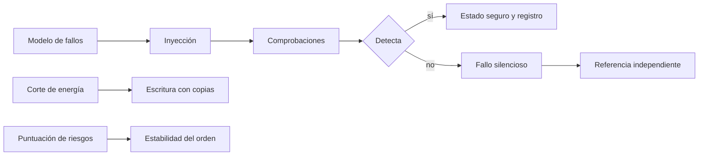
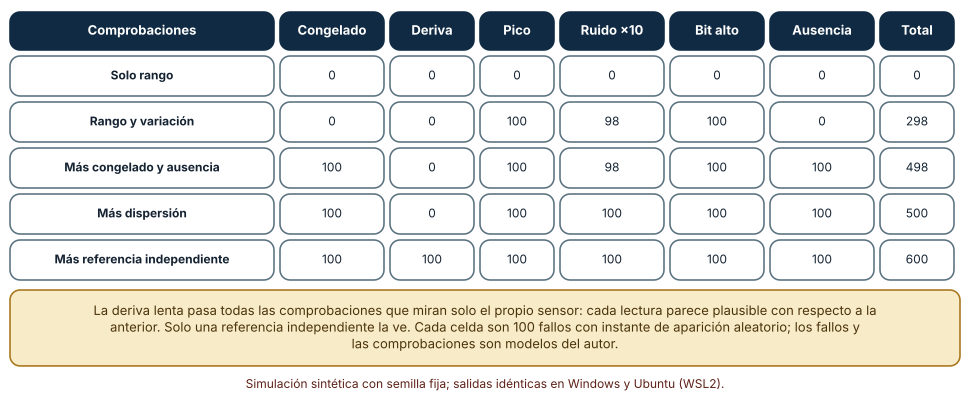
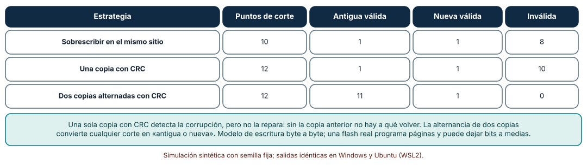
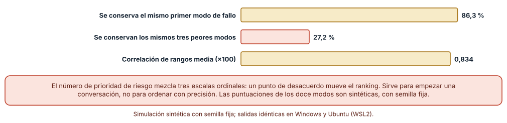

# SE-275 — Taller: modelar fallos físicos y digitales

[← SE-274 — Safety, seguridad y vida útil prolongada](../../classes/part-22-embedded-iot-y-tiempo-real/se-274-safety-seguridad-y-vida-util-prolongada/README.md) · [↑ Parte 22](../../classes/part-22-embedded-iot-y-tiempo-real/README.md) · [📚 Índice completo](../../classes/README.md) · [🌐 Portal](../../site/classes/SE-275.html) · [SE-276 — Proyecto: dispositivo simulado operable y actualizable →](../../classes/part-22-embedded-iot-y-tiempo-real/se-276-proyecto-dispositivo-simulado-operable-y-actualizable/README.md)

## Punto profesional y fundamento pedagógico

**Punto profesional.** El taller entrena a modelar fallos antes de que ocurran: inyectar fallos físicos y digitales en un modelo del nodo, medir qué comprobaciones los ven, enumerar los cortes de energía de una escritura y comprobar cuán estable es una priorización de riesgos cuando dos personas puntúan distinto.

**Por qué aparece aquí.** Se sitúa después de **Safety, seguridad y vida útil prolongada** y antes del **Proyecto: dispositivo simulado operable y actualizable**: la clase anterior fijó defensas con supuestos; el taller las pone a prueba con fallos deliberados y deja el método que el proyecto final aplicará a un dispositivo completo.

**Error conceptual que debe corregir.** Creer que un conjunto de comprobaciones de plausibilidad cubre todos los fallos de un sensor, que una suma de verificación en una sola copia protege una configuración o que una tabla de riesgos prioriza con precisión: la deriva lenta pasa cada comprobación local, un corte deja una copia sin copia anterior y un punto de desacuerdo reordena los peligros.

**Secuencia de aprendizaje.** El taller tiene tres pasos con predicción previa: inyectar 600 fallos de seis tipos con cinco conjuntos de comprobaciones y ver cuáles detecta cada uno, enumerar los cortes de energía de la escritura de una configuración con tres estrategias y perturbar las puntuaciones de un AMFE de doce modos de fallo para medir su estabilidad. La secuencia usa predicción, explicación propia, contraste y recuperación. [ICAP](https://icap.education.asu.edu/research) distingue participación de construcción de conocimiento; [How People Learn II](https://nap.nationalacademies.org/catalog/24783/how-people-learn-ii-learners-contexts-and-cultures) exige conectar conocimiento previo, contexto y transferencia; la [práctica de recuperación](https://pubmed.ncbi.nlm.nih.gov/16507066/) respalda producir de nuevo la explicación tras una demora; y [Education for Life and Work](https://nap.nationalacademies.org/resource/13398/dbasse_084153.pdf) exige devolución que explique la causa del error.

**Evidencia de aprendizaje.** `fault-model-log.md` con la predicción, la tabla de detección por conjunto de comprobaciones, la enumeración de cortes, la estabilidad del AMFE y un modelo de fallos del nodo con cada fallo, su efecto, la defensa que lo ve y lo que quedó sin cubrir.

**Límite de la conclusión.** Los seis tipos de fallo, las comprobaciones, la escritura byte a byte y las puntuaciones del AMFE son construcciones del autor con semilla fija. El taller no demuestra que un conjunto de comprobaciones cubra los fallos de un sensor real ni que un AMFE bien puntuado esté completo.

### Trazabilidad fuente → afirmación

| Fuente primaria u oficial | Afirmación que respalda | Lo que no prueba |
|---|---|---|
| [Hsueh, Tsai e Iyer, «Fault injection techniques and tools» (IEEE Computer, 1997)](https://doi.org/10.1109/2.585157) | Describe técnicas de inyección de fallos (por hardware, software y simulación) para evaluar la tolerancia a fallos de un sistema. | No da la cobertura de ninguna técnica en un dispositivo concreto. |
| [IEC 60812:2018, Failure modes and effects analysis (FMEA and FMECA)](https://webstore.iec.ch/en/publication/26359) | Es la norma que describe el análisis de modos de fallo y sus efectos, incluidos los esquemas de puntuación de gravedad, ocurrencia y detección. | El resumen público de la norma no prescribe los valores de una escala ni valida un análisis concreto. |
| [Gal y Toledo, «Algorithms and data structures for flash memories» (ACM Computing Surveys, 2005)](https://doi.org/10.1145/1089733.1089735) | Explica que las escrituras en flash no son atómicas y que las estructuras con copias y números de secuencia permiten recuperar tras un corte. | No describe el orden de programación de una memoria concreta. |
| [NASA Systems Engineering Handbook](https://www.nasa.gov/reference/systems-engineering-handbook/) | Recoge el uso de análisis de modos de fallo, árboles de fallos y verificación para sistemas con requisitos de fiabilidad. | No es una guía para dispositivos de consumo. |

## Antes de empezar

Recupera el análisis de peligros de `SE-274`: cada defensa tiene un supuesto. El taller convierte esos supuestos en pruebas. La pregunta activa es: **¿qué fallo concreto inyectaría para saber si esta defensa funciona y qué pasaría con lo que ninguna comprobación ve?**

## Prerrequisitos

- Haber completado `SE-274` o poder explicar la diferencia entre safety y seguridad.
- Python 3.11 o posterior y un terminal; todo el código usa solo la biblioteca estándar.
- Manejar sumas de verificación y la idea de enumerar casos a nivel básico.

## Problema auténtico

El nodo de la sala acumula defensas: comprobaciones de plausibilidad de un sensor, una configuración con suma de verificación y una tabla de riesgos de doce filas. Nadie ha inyectado un fallo: el equipo supone que las comprobaciones «ven» los fallos, que la suma protege la configuración y que la tabla ordena bien. En la primera visita de mantenimiento, el sensor de CO₂ muestra valores plausibles pero 400 ppm por debajo de la realidad desde hace semanas, la configuración se corrompe tras un corte de energía y dos revisoras ordenan los riesgos de manera distinta.

## Objetivos observables

Al terminar podrás:

1. diseñar una campaña de inyección de fallos y medir qué comprobaciones detectan cada tipo de fallo;
2. identificar los fallos que ninguna comprobación local ve y qué referencia independiente los descubre;
3. enumerar los puntos de corte de la escritura de una configuración y clasificar el estado final;
4. medir la estabilidad de un análisis de modos de fallo ante desacuerdos de puntuación;
5. entregar un modelo de fallos del nodo con cada fallo, su efecto, la defensa que lo ve y lo que queda sin cubrir.

## Mapa conceptual



El mapa muestra el método del taller: se parte de un modelo de fallos, se inyectan, se mira cuáles detectan las comprobaciones y se investiga lo silencioso. Los cortes de energía y las puntuaciones de riesgo se estudian con el mismo espíritu: enumerar y perturbar.

## Temas y por qué importan

| Tema | Por qué cambia una decisión profesional | Evidencia mínima |
|---|---|---|
| Inyección de fallos | Mide si una defensa funciona en lugar de suponerlo. | Predicción, traza causal y contraejemplo de **Inyección de fallos** en `fault-model-log.md` |
| Plausibilidad y referencia | Las comprobaciones locales dejan pasar lo lento; una referencia independiente lo ve. | Predicción, traza causal y contraejemplo de **Plausibilidad y referencia** en `fault-model-log.md` |
| Cortes de energía | Una escritura sin copia anterior no tiene dónde volver. | Predicción, traza causal y contraejemplo de **Cortes de energía** en `fault-model-log.md` |
| AMFE y estabilidad | La puntuación ordinal es frágil; sirve para conversar. | Predicción, traza causal y contraejemplo de **AMFE y estabilidad** en `fault-model-log.md` |
| Lo que queda sin cubrir | Declararlo es parte del modelo. | Predicción, traza causal y contraejemplo de **Lo que queda sin cubrir** en `fault-model-log.md` |

## Conceptos y decisiones

### 1. Inyección de fallos

Inyectar un fallo es provocarlo a propósito: congelar la lectura de un sensor, añadir una deriva, invertir un bit, cortar la energía a mitad de una escritura. Hsueh y colaboradores clasifican las técnicas según el nivel en que se inyecta (hardware, software, simulación). Aquí se inyecta en simulación porque es reproducible y barato. El valor es que convierte «creemos que lo detecta» en «lo detecta en N de 100 casos»; y el resultado informa qué defensa añadir.

### 2. Plausibilidad y referencia

Las comprobaciones de plausibilidad miran el propio dato: rango, variación máxima entre lecturas, valor congelado, ausencia, dispersión. Detectan fallos bruscos. Un fallo lento (una deriva de offset creciente) pasa todas, porque cada lectura se parece a la anterior. Para verlo hace falta una **referencia independiente**: un segundo sensor de otro principio, un modelo del entorno o una comparación con un valor esperado. Cada comprobación añadida cubre una clase de fallo y deja otras: lo importante es saber cuáles.

### 3. Cortes de energía

Escribir una configuración de 8 bytes en una flash no es una operación indivisible: son un borrado y varias escrituras. Un corte entre ellas deja una mezcla. Una suma de verificación detecta que la mezcla es inválida, pero con una sola copia no hay a qué volver. Con dos copias alternadas y suma de verificación, el corte afecta a la copia que se escribe y la otra sigue válida: queda la antigua o la nueva, nunca nada. Es el mismo principio de dos ranuras de `SE-271`, aplicado a datos.

### 4. AMFE y estabilidad

El análisis de modos de fallo y efectos (AMFE, IEC 60812) lista cada modo de fallo con su efecto y le asigna gravedad, ocurrencia y capacidad de detección en escalas ordinales de 1 a 10; el producto es el número de prioridad de riesgo (NPR). Es un método para ordenar la conversación, no para medir. Las escalas son ordinales y su producto mezcla magnitudes distintas: un punto de desacuerdo entre dos evaluadoras reordena la lista. La prioridad debe revisarse mirando la gravedad por separado: un fallo de gravedad 10 merece atención aunque su NPR sea bajo.

### 5. Lo que queda sin cubrir

Un modelo de fallos que no dice lo que no cubre es optimista. Cada fallo se acompaña de «lo ve» o «no lo ve» y, si no, de por qué se acepta. La lista de lo no cubierto se revisa cuando cambian el diseño o el entorno. Es la parte más valiosa para quien hereda el sistema, porque indica dónde mirar si algo falla en el campo.

### Qué detecta cada conjunto de comprobaciones

Un nodo mide una temperatura con una componente lenta (21 °C ± 1,5 °C). Se inyectan 100 fallos de cada uno de seis tipos con aparición en un instante aleatorio: valor congelado, deriva de offset creciente (0,02 por muestra), pico aislado de +8, ruido diez veces mayor, un bit alto invertido cada siete lecturas (+32) y ausencia de lectura. Se comparan cinco conjuntos acumulativos de comprobaciones.

```python
if "rango" in which and not (-40 < v < 60): return i
if "variacion" in which and abs(v - last) > 3.0: return i
if "congelado" in which and same >= 5: return i
if "vecino" in which and abs(v - truth(i)) > 1.5: return i
```

| Comprobaciones | Congelado | Deriva | Pico | Ruido ×10 | Bit alto | Ausencia | Total |
|---|---:|---:|---:|---:|---:|---:|---:|
| Solo rango | 0 | 0 | 0 | 0 | 0 | 0 | 0 |
| Rango y variación | 0 | 0 | 100 | 98 | 100 | 0 | 298 |
| Más congelado y ausencia | 100 | 0 | 100 | 98 | 100 | 100 | 498 |
| Más dispersión | 100 | 0 | 100 | 100 | 100 | 100 | 500 |
| Más referencia independiente | 100 | 100 | 100 | 100 | 100 | 100 | 600 |

Resultado, idéntico en Windows (CPython 3.12.9) y en Ubuntu bajo WSL2 (3.12.3). Una comprobación de rango no detecta ninguno de los 600; con todas las comprobaciones locales se detectan 500 y la deriva sigue sin verse; solo la referencia independiente la detecta.



**Cómo leer la figura.** Cada fila es un conjunto de comprobaciones; cada columna, un tipo de fallo; el valor es cuántos de 100 se detectaron. **Dónde deja de valer:** los fallos y las comprobaciones son modelos del autor; un sensor real tiene fallos con otra forma (una deriva dependiente de la temperatura, un ruido intermitente). La referencia es un modelo del entorno perfecto aquí; en un sistema real también tiene error y sus propios fallos.

### Cortar la energía en cada punto de una escritura

Una configuración de 8 bytes más una suma de verificación de 2 bytes. Se enumeran todos los puntos de corte de la escritura (borrado y byte a byte) para tres estrategias: sobrescribir en el mismo sitio, una sola copia con suma de verificación y dos copias alternadas con suma de verificación (se escribe la copia no vigente y solo cuenta si su suma es válida). Se clasifica el estado: configuración antigua válida, nueva válida o inválida.

```python
def valid(m): return crc(m[:8]) == (m[8] << 8) | m[9]
if valid(B) and B[:8] == NEW: return "nueva"
if valid(A): return "antigua"
return "invalida"
```

| Estrategia | Puntos de corte | Antigua válida | Nueva válida | Inválida |
|---|---:|---:|---:|---:|
| Sobrescribir en el mismo sitio | 10 | 1 | 1 | 8 |
| Una copia con suma de verificación | 12 | 1 | 1 | 10 |
| Dos copias alternadas con suma de verificación | 12 | 11 | 1 | 0 |

Sobrescribir deja una configuración inválida en 8 de 10 puntos; una copia con suma, en 10 de 12 (la suma detecta el problema pero no lo repara); dos copias alternadas, en ninguno.



**Cómo leer la figura.** Cada fila es una estrategia; las columnas suman los puntos de corte y clasifican el resultado. **Dónde deja de valer:** el modelo escribe byte a byte; una flash real programa páginas y un corte puede dejar bits a medias dentro de un byte (valores intermedios). La enumeración de pasos no cubre ese nivel. Tampoco cubre un fallo de la memoria misma.

### Cuán estable es una tabla de riesgos

Un AMFE de doce modos de fallo con puntuaciones sintéticas (gravedad de 3 a 10, ocurrencia de 2 a 8, detección de 2 a 9) y NPR igual al producto. Se perturba cada puntuación en −1, 0 o +1 con igual probabilidad (dos evaluadoras que discrepan en un punto) y se repite 2000 veces. Se mide con qué frecuencia se conservan el primer modo, el conjunto de los tres peores y la correlación de rangos de Spearman con el orden base.

```python
noisy = [tuple(min(10, max(1, x + rng.choice([-1, 0, 1]))) for x in m) for m in modes]
order = sorted(range(12), key=lambda i: -rpn(noisy[i]))
```

| Medida | Resultado |
|---|---:|
| Se conserva el mismo primer modo de fallo | 86,3 % |
| Se conservan los mismos tres peores modos | 27,2 % |
| Correlación de rangos media | 0,834 (mínima 0,427) |

Un punto de desacuerdo en cada puntuación conserva el primer lugar en el 86 % de las repeticiones, pero el conjunto de los tres peores solo en el 27 %.



**Cómo leer la figura.** Cada barra es un porcentaje de 2000 repeticiones; la tercera es la correlación de rangos multiplicada por 100. **Dónde deja de valer:** las puntuaciones son sintéticas con semilla fija y la perturbación uniforme de ±1 es un modelo de desacuerdo; evaluadoras reales discrepan de forma sistemática (una puntúa todo más alto). La figura no desautoriza el AMFE: dice que su orden fino es poco fiable y que sirve para elegir de qué hablar.

## Definiciones de trabajo

- **inyección de fallos:** introducción deliberada de un fallo en un sistema o su modelo para observar si es detectado y cómo responde.
- **fallo silencioso:** fallo que ninguna comprobación detecta y que produce resultados plausibles pero erróneos.
- **referencia independiente:** fuente de comparación que no comparte el mecanismo de fallo del dato que se verifica.
- **AMFE:** análisis de modos de fallo y efectos; tabla de modos de fallo con su efecto, causa y valoración de gravedad, ocurrencia y detección.
- **número de prioridad de riesgo (NPR):** producto de las puntuaciones de gravedad, ocurrencia y detección de un modo de fallo.

Las definiciones son operativas para el nodo de la sala. No convierten términos con una historia más amplia en sinónimos y deben contrastarse con la documentación primaria enlazada al final.

## Ejemplo mínimo

El fragmento muestra que una deriva lenta pasa una comprobación de variación máxima. Antes de ejecutarlo, predice si se detecta.

```python
lecturas = [21 + 0.02 * i for i in range(100)]          # deriva de 0,02 por muestra
variacion_max = max(abs(b - a) for a, b in zip(lecturas, lecturas[1:]))
assert variacion_max < 3.0                               # nunca supera el umbral
```

La variación entre lecturas es de 0,02: la comprobación no salta aunque la lectura se haya desviado casi 2 °C tras 100 muestras. Registra versión, comando y salida; añade una comprobación contra una referencia y predice cuándo salta.

## Ejemplo profesional

El equipo de la plataforma entrega el modelo de fallos del nodo con doce filas. Cada una dice: el fallo (deriva del sensor de CO₂, corte durante la escritura de la configuración, bit invertido en el bus), su efecto (ventilación que no arranca, nodo con configuración inválida), la defensa que lo ve (referencia con un segundo sensor, dos copias alternadas con suma, CRC de la trama de `SE-266`), el resultado de la inyección (100 de 100) y lo que queda sin cubrir (fallo simultáneo de ambos sensores por contaminación, fallo de la propia memoria). La prioridad se discute con el AMFE, y la gravedad se mira aparte: los modos con gravedad 9 o 10 se revisan aunque su NPR sea bajo.

Compara con el prototipo: el sensor de CO₂ que desvió 400 ppm durante semanas se habría visto en la primera comprobación contra la referencia, la configuración sobrevive a cualquier corte y dos revisoras discuten la gravedad en lugar de pelear por el NPR. Un modelo es adecuado cuando dice lo que ve y lo que no; es un adorno cuando solo lista fallos.

## Práctica guiada

1. Lista los fallos físicos y digitales del nodo (sensor, bus, memoria, energía, red, firmware).
2. Predice cuántos de los seis tipos de fallo detecta tu conjunto de comprobaciones y escribe la respuesta.
3. Inyecta 100 fallos de cada tipo y mide la detección.
4. Añade una referencia independiente y mide cuánto sube.
5. Enumera los puntos de corte de la escritura de tu configuración con tres estrategias.
6. Puntúa tu AMFE con otra persona y mide cuánto cambia el orden.
7. Entrega `fault-model-log.md` y pide a otra persona que identifique el fallo silencioso más peligroso.

## Ejercicios

1. **Inyección:** añade el fallo «offset constante de 2 °C» y mide qué conjunto de comprobaciones lo detecta.
2. **Corte:** diseña un esquema de tres copias con número de secuencia y enumera sus puntos de corte.
3. **AMFE:** reordena los doce modos por gravedad y compáralo con el NPR; indica qué modo sube más.
4. **Cobertura:** escribe cinco fallos de tu nodo que ninguna defensa cubre y cómo lo aceptarías.

## Reto verificable

Entrega `fault-model-log.md` con la predicción, las tres tablas y el modelo de fallos del nodo con lo que queda sin cubrir. Se aprueba si otra persona ejecuta el código desde un checkout limpio, obtiene los mismos números y puede decir qué fallo silencioso sigue sin detección. No se aprueba por una lista de fallos sin inyección ni por afirmar que una comprobación «lo detecta» sin una medición.

## Caso conductor

El nodo ambiental de una sala de estudio continúa como caso conductor de la Parte 22. El taller deja el undécimo artefacto: el modelo de fallos del nodo con inyección, enumeración de cortes, AMFE y lo que queda sin cubrir. `SE-276` los reúne en un dispositivo simulado completo. Cambia después una sola defensa, la referencia independiente, y observa qué fallos dejan de verse.

## Preguntas frecuentes

### ¿Cuántos fallos debo inyectar?

Los suficientes para ver la proporción de detección con una incertidumbre aceptable: 100 por tipo da una resolución del 1 %. Para fallos raros hacen falta más o una enumeración sistemática.

### ¿La inyección en simulación sustituye a la del hardware?

No: encuentra defectos de lógica baratos y reproducibles; el hardware revela fallos de integración. Se usan ambas.

### ¿Un AMFE es obligatorio?

Depende de la norma del sector; en cualquier caso, hacerlo con la conversación entre personas con distintas perspectivas es útil. Los números sirven menos que el diálogo.

### ¿Cómo sé que una referencia independiente lo es de verdad?

Si no comparte alimentación, cableado, algoritmo ni calibración con el dato que verifica; una verificación con un segundo sensor del mismo lote y de la misma placa puede fallar igual.

## Fallo controlado y diagnóstico

Reproduce el fallo clásico de la clase: **un sensor con deriva lenta que pasa todas las comprobaciones**. Inyecta 100 derivas con el conjunto de comprobaciones locales y cuenta las detectadas.

Registra síntoma, entrada mínima, hipótesis, observación que descarta cada hipótesis, causa, corrección y prueba de regresión. **Síntoma:** semanas después de una instalación, el CO₂ medido está 400 ppm por debajo del real y nadie lo vio. **Hipótesis rivales:** (a) el sensor falló de golpe y una comprobación lo perdió; (b) el algoritmo de calibración tiene un error; (c) una deriva lenta pasa todas las comprobaciones locales. **Prueba:** inyecta una deriva de 0,02 por muestra; con todas las comprobaciones locales se detectan 0 de 100. **Conclusión:** la causa es la ausencia de referencia independiente. **Regresión:** añade una comparación con un segundo sensor de otro principio, inyecta 100 derivas y comprueba que se detectan. No cambies a la vez la referencia y los umbrales.

## Errores comunes y cómo corregirlos

| Síntoma | Causa probable | Corrección |
|---|---|---|
| Lecturas plausibles y erróneas durante semanas | Deriva lenta sin referencia independiente | Comparar con otro sensor o con un modelo del entorno |
| Configuración inválida tras un corte | Sobrescritura o una sola copia | Dos copias alternadas con suma y número de secuencia |
| La prioridad de riesgos cambia con quien puntúa | Escalas ordinales multiplicadas | Revisar la gravedad por separado y usar la tabla para conversar |
| Se cree que la defensa funciona sin haberla probado | Sin inyección de fallos | Inyectar y medir la detección por tipo |
| El modelo no dice lo que no cubre | Optimismo | Añadir una columna «no cubierto» con su aceptación |

## Entorno y archivos clave

```text
work/SE-275/
├── README.md
├── fallos/
│   ├── inyeccion.py
│   ├── escritura.py
│   └── amfe.py
├── tests/test_fallos.py
└── evidence/fault-model-log.md
```

El `README` declara plataforma, versión de Python, semillas y comandos. Los experimentos usan solo la biblioteca estándar (`random`, `statistics`, `math`, `zlib`) y se ejecutaron con CPython 3.12.9 en Windows 11 y 3.12.3 en Ubuntu bajo WSL2: las salidas fueron idénticas. Si añades una dependencia, fija procedencia y versión.

## Seguridad, ética y accesibilidad

- inyectar fallos en un dispositivo real que protege a personas exige un entorno controlado y un estado seguro garantizado durante la prueba;
- los resultados de una campaña no deben usarse para culpar a quien diseñó una defensa: describen el sistema;
- la tabla de riesgos debe ser legible por quien no es ingeniero y no ocultar los modos de gravedad alta tras un NPR bajo;
- documenta quién decidió aceptar un fallo no cubierto y hasta cuándo;
- respeta las licencias de las herramientas de inyección y atribuye lo adaptado.

## Puente hacia el trabajo con agentes

Un agente al que se le pide «haz un análisis de riesgos del nodo» producirá una tabla ordenada y convincente, con puntuaciones inventadas. Pídele que inyecte fallos y reporte la detección por tipo, que enumere los cortes de energía de las escrituras y que muestre la gravedad por separado. Revisa especialmente si afirma que una comprobación «detecta» un fallo sin una medición y si omite los fallos silenciosos: es lo que el taller enseña a buscar.

## Transferencia

Traslada el taller a otro dispositivo (por ejemplo, un termostato inteligente): cambia los fallos y las defensas, y conserva el procedimiento de inyectar, enumerar cortes y medir la estabilidad. La transferencia está lograda cuando puedes explicar qué parte del modelo dependía del dispositivo y cuál no, no cuando las tablas se parecen.

## Evaluación y evidencia

| Criterio | Evidencia para aprobar |
|---|---|
| comprensión | explicación de por qué una deriva lenta pasa las comprobaciones locales |
| corrección | tablas reproducibles con las mismas semillas |
| diseño | modelo de fallos con defensa, medición y lo no cubierto |
| diagnóstico | reproducción del fallo «deriva sin referencia» con regresión |
| incertidumbre | declaración de los fallos modelados y de la estabilidad del AMFE |
| reproducibilidad | versiones, comandos, salida y límites declarados |

## Fuentes

- [Hsueh, Tsai e Iyer, «Fault injection techniques and tools» (IEEE Computer, 1997)](https://doi.org/10.1109/2.585157) — técnicas de inyección de fallos; autoridad: IEEE Computer.
- [IEC 60812:2018, FMEA y FMECA](https://webstore.iec.ch/en/publication/26359) — análisis de modos de fallo y efectos; autoridad: IEC.
- [Gal y Toledo, «Algorithms and data structures for flash memories» (ACM Computing Surveys, 2005)](https://doi.org/10.1145/1089733.1089735) — escrituras en flash y recuperación tras cortes; autoridad: ACM Computing Surveys.
- [NASA Systems Engineering Handbook](https://www.nasa.gov/reference/systems-engineering-handbook/) — análisis de fallos y verificación en ingeniería de sistemas; autoridad: NASA.
- [Python: `zlib`](https://docs.python.org/3/library/zlib.html) — `crc32` usado como suma de verificación; autoridad: documentación de Python.

Cada fuente respalda el mecanismo indicado; ninguna demuestra que los 500 de 600 fallos detectados, los 8 de 10 cortes inválidos o el 27,2 % de estabilidad se observen en el nodo real. Esa afirmación depende de los fallos reales del sensor y de la memoria.

## Límites y siguiente paso

Se ejecutaron tres simulaciones con datos sintéticos en Windows y Ubuntu (WSL2) con resultados idénticos. No se inyectó ningún fallo en hardware ni se hizo un AMFE real: los seis tipos de fallo, la escritura byte a byte y las puntuaciones son construcciones del autor. La siguiente clase reúne todo en un dispositivo simulado operable y actualizable.

## Glosario

- **inyección de fallos:** introducción deliberada de un fallo en un sistema o su modelo para observar si es detectado y cómo responde.
- **fallo silencioso:** fallo que ninguna comprobación detecta y que produce resultados plausibles pero erróneos.
- **referencia independiente:** fuente de comparación que no comparte el mecanismo de fallo del dato que se verifica.
- **AMFE:** análisis de modos de fallo y efectos; tabla de modos de fallo con su efecto, causa y valoración de gravedad, ocurrencia y detección.
- **número de prioridad de riesgo (NPR):** producto de las puntuaciones de gravedad, ocurrencia y detección de un modo de fallo.

---

[← SE-274 — Safety, seguridad y vida útil prolongada](../../classes/part-22-embedded-iot-y-tiempo-real/se-274-safety-seguridad-y-vida-util-prolongada/README.md) · [↑ Parte 22](../../classes/part-22-embedded-iot-y-tiempo-real/README.md) · [📚 Índice completo](../../classes/README.md) · [🌐 Portal](../../site/classes/SE-275.html) · [SE-276 — Proyecto: dispositivo simulado operable y actualizable →](../../classes/part-22-embedded-iot-y-tiempo-real/se-276-proyecto-dispositivo-simulado-operable-y-actualizable/README.md)

