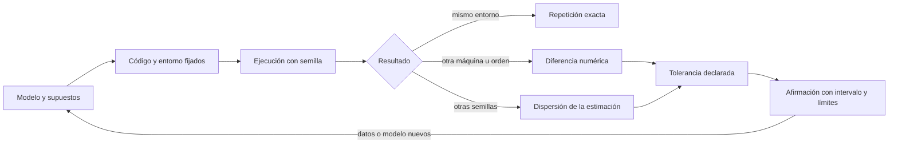
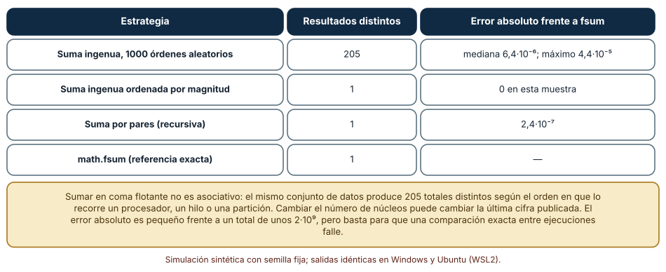
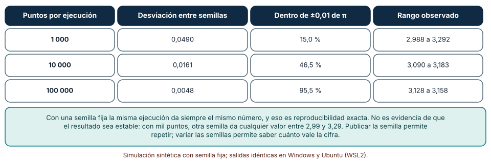
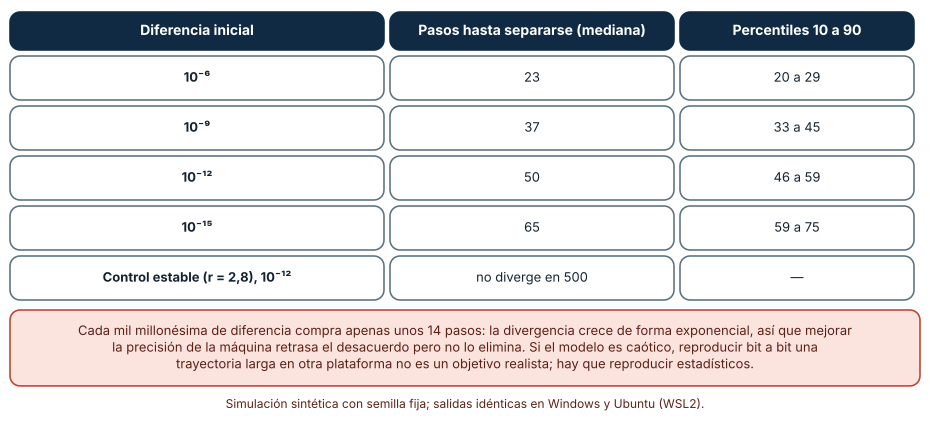

# SE-277 — Software científico y reproducibilidad

[← SE-276 — Proyecto: dispositivo simulado operable y actualizable](../../classes/part-22-embedded-iot-y-tiempo-real/se-276-proyecto-dispositivo-simulado-operable-y-actualizable/README.md) · [↑ Parte 23](../../classes/part-23-software-especializado-y-dominios/README.md) · [📚 Índice completo](../../classes/README.md) · [🌐 Portal](../../site/classes/SE-277.html) · [SE-278 — Ingeniería de datos y procesamiento analítico →](../../classes/part-23-software-especializado-y-dominios/se-278-ingenieria-de-datos-y-procesamiento-analitico/README.md)

## Punto profesional y fundamento pedagógico

**Punto profesional.** La clase existe para que distingas tres cosas que el lenguaje cotidiano confunde: repetir una ejecución, obtener un resultado estable y poder defender que ese resultado describe el fenómeno. Quien escribe software científico responde por las tres, y cada una exige evidencia distinta.

**Por qué aparece aquí.** Abre la **Parte 23** después de **Proyecto: dispositivo simulado operable y actualizable**: la Parte 22 terminó con un dispositivo cuyas simulaciones ya dependían de semillas y de supuestos declarados; ahora el centro es el programa cuyo producto es un número que otras personas usarán para decidir. La Parte 23 recorre dominios con reglas propias, y este es el primero porque sus preguntas (qué se repite, qué se mide y qué se supone) reaparecen en todos los demás. El caso conductor de la parte es una **plataforma educativa ficticia que incorpora, clase a clase, una pieza de un dominio especializado**; aquí, un modelo que estima cuántas entregas llegarán a tiempo.

**Error conceptual que debe corregir.** Creer que «reproducible» significa «da el mismo número». Un número idéntico demuestra que el programa es determinista; no demuestra que sea estable frente a otra semilla, otro orden de suma u otra máquina, ni que el modelo represente el fenómeno.

**Secuencia de aprendizaje.** Antes de leer los resultados, predices si sumar los mismos números en otro orden da el mismo total; después mides cuántos totales distintos aparecen, cuánto varía una estimación con la semilla y cuántos pasos tarda un sistema caótico en separarse de una copia casi idéntica. La secuencia usa predicción, explicación propia, contraste y recuperación. [ICAP](https://icap.education.asu.edu/research) distingue participación de construcción de conocimiento; [How People Learn II](https://nap.nationalacademies.org/catalog/24783/how-people-learn-ii-learners-contexts-and-cultures) exige conectar conocimiento previo, contexto y transferencia; la [práctica de recuperación](https://pubmed.ncbi.nlm.nih.gov/16507066/) respalda producir de nuevo la explicación tras una demora; y [Education for Life and Work](https://nap.nationalacademies.org/resource/13398/dbasse_084153.pdf) exige devolución que explique la causa del error.

**Evidencia de aprendizaje.** `science-log.md` con la predicción, el número de totales distintos por orden de suma, la tabla de desviación entre semillas, la tabla de divergencia del mapa logístico y una nota que separe lo que garantiza la repetición exacta de lo que exige variar semillas y plataformas.

**Límite de la conclusión.** Los datos, la distribución de magnitudes y el mapa logístico son construcciones del autor, y no se midió ningún código científico real, ningún compilador ni ningún procesador distinto de los dos usados. Los experimentos muestran mecanismos de coma flotante, de azar y de caos en CPython, no la reproducibilidad de un campo concreto.

### Trazabilidad fuente → afirmación

| Fuente primaria u oficial | Afirmación que respalda | Lo que no prueba |
|---|---|---|
| [Peng, «Reproducible Research in Computational Science» (Science, 2011)](https://doi.org/10.1126/science.1213847) | Propone un espectro de reproducibilidad que va de la publicación sola a la publicación con código y datos enlazados y ejecutables. | No cuantifica cuánta ciencia es reproducible en ningún campo. |
| [Goldberg, «What every computer scientist should know about floating-point arithmetic» (ACM Computing Surveys, 1991)](https://doi.org/10.1145/103162.103163) | Explica que la aritmética de coma flotante redondea y que la suma no es asociativa en general. | No predice el error de un programa concreto ni de un compilador moderno. |
| [National Academies, «Reproducibility and Replicability in Science» (2019)](https://nap.nationalacademies.org/catalog/25303/reproducibility-and-replicability-in-science) | Distingue reproducir (mismos datos y código, mismo resultado) de replicar (nuevos datos, resultado consistente). | No fija una cifra de «aceptable» ni sustituye la revisión del dominio. |

## Antes de empezar

Recupera lo aprendido en la Parte 22 sobre simulaciones con semilla fija: una semilla hace repetible una ejecución, pero una sola ejecución es una muestra de tamaño uno. La pregunta activa es: **¿qué debo conservar para que otra persona repita mi cálculo y qué debo variar para saber si mi cifra significa algo?**

## Prerrequisitos

- Haber completado `SE-276` o poder explicar qué evidencia entregó un paquete simulado.
- Python 3.11 o posterior y un terminal; todo el código usa solo la biblioteca estándar (`random`, `math`, `statistics`).
- Saber qué es un número en coma flotante a nivel básico (mantisa, exponente, redondeo).

## Problema auténtico

La plataforma educativa ficticia quiere estimar cuántas entregas de un curso llegarán antes del plazo para dimensionar el equipo de corrección. Una persona del equipo escribe un modelo que suma probabilidades de 20 000 estudiantes simulados, lo ejecuta en su portátil y publica «el total es 2 008 411 184,83». Otra persona lo ejecuta en un servidor con más núcleos y obtiene una cifra que difiere en la décima cifra decimal; una tercera cambia la semilla y obtiene otra estimación de un parámetro. Nadie sabe si el modelo falla, si la máquina falla o si las tres cifras son equivalentes. El problema no es la discrepancia: es que el trabajo no dice qué debía coincidir y qué podía variar.

## Objetivos observables

Al terminar podrás:

1. distinguir repetición, reproducción y replicación con un ejemplo y un contraejemplo del modelo de entregas;
2. medir cuántos resultados distintos produce la suma del mismo conjunto de datos según el orden y elegir una estrategia de suma justificada;
3. cuantificar con varias semillas la dispersión de una estimación aleatoria y decidir cuántas repeticiones hacen falta para un número de cifras declarado;
4. calcular el horizonte en que un sistema sensible a las condiciones iniciales deja de ser reproducible bit a bit y qué reproducir en su lugar;
5. escribir una declaración de reproducibilidad con versión, semilla, comando, salida y límites.

## Mapa conceptual



El mapa separa lo que se **fija** (entorno, semilla), lo que se **varía** a propósito (semillas, orden) y lo que se **declara** (tolerancia, intervalo). Una cifra sin esa tercera columna es un número, no un resultado.

## Temas y por qué importan

| Tema | Por qué cambia una decisión profesional | Evidencia mínima |
|---|---|---|
| Repetición, reproducción y replicación | Decide qué se promete y qué se verifica en una publicación o un informe. | Predicción, traza causal y contraejemplo de **Repetición, reproducción y replicación** en `science-log.md` |
| Aritmética de coma flotante | Explica por qué el mismo cálculo difiere entre máquinas y órdenes. | Predicción, traza causal y contraejemplo de **Aritmética de coma flotante** en `science-log.md` |
| Azar y semillas | Separa repetir una ejecución de saber cuánto vale una estimación. | Predicción, traza causal y contraejemplo de **Azar y semillas** en `science-log.md` |
| Sensibilidad y caos | Marca el horizonte más allá del cual reproducir bit a bit es inviable. | Predicción, traza causal y contraejemplo de **Sensibilidad y caos** en `science-log.md` |
| Entorno, datos y declaración | Hace que otra persona pueda ejecutar y juzgar el trabajo. | Predicción, traza causal y contraejemplo de **Entorno, datos y declaración** en `science-log.md` |

## Conceptos y decisiones

### 1. Repetición, reproducción y replicación

**Repetir** es ejecutar de nuevo el mismo programa con los mismos datos y obtener el mismo resultado; lo hace quien lo escribió, para comprobar que no depende de algo olvidado. **Reproducir**, en el sentido que fija el informe de las Academias Nacionales, es que otra persona, con los mismos datos y el mismo código, obtenga el mismo resultado dentro de una tolerancia declarada. **Replicar** es llegar a una conclusión consistente con datos nuevos. Son promesas distintas y cada una falla por razones distintas: la repetición falla por estado oculto (una variable de entorno, un archivo sin versionar), la reproducción por diferencias numéricas o de dependencias, la replicación porque el efecto no existía o dependía de la muestra. Peng propone verlo como un espectro: cuanto más enlazados y ejecutables estén código y datos, más cerca se está de poder reproducir. La pregunta práctica es siempre cuál de las tres se está prometiendo.

### 2. Aritmética de coma flotante

Un número `float` de 64 bits tiene unos 15-16 dígitos decimales de precisión. Sumar un valor muy pequeño a uno muy grande pierde los dígitos bajos del pequeño; por eso `(a + b) + c` puede diferir de `a + (b + c)`. Goldberg lo formaliza: el redondeo ocurre en cada operación y la suma deja de ser asociativa. La consecuencia operativa es que cualquier cosa que cambie el orden de las sumas (paralelizar en más núcleos, repartir los datos en más particiones, ordenar distinto, usar una biblioteca vectorizada) puede cambiar la última cifra. Hay estrategias con garantías distintas: ordenar por magnitud, sumar por pares (el error crece como log n y no como n) o usar un acumulador exacto como `math.fsum`. Ninguna es gratis: la exacta cuesta más tiempo y memoria.

### 3. Azar y semillas

Un generador pseudoaleatorio con semilla es una función determinista: la misma semilla produce la misma secuencia. Eso es lo que permite repetir. Pero una estimación por simulación es una variable aleatoria: su valor depende de la semilla, y su dispersión baja solo con la raíz del número de puntos. Publicar «π ≈ 3,14» tras una ejecución con la semilla 1 es publicar una muestra de tamaño uno. La práctica profesional es fijar y registrar la semilla para poder repetir, y además repetir con muchas semillas para estimar la dispersión y declararla. La versión del generador también importa: el algoritmo puede cambiar entre versiones de un lenguaje o biblioteca.

### 4. Sensibilidad y caos

En un sistema caótico la diferencia entre dos trayectorias crece de forma exponencial. Una diferencia inicial de una milmillonésima, creada por un redondeo distinto, se amplifica hasta ser del tamaño de la señal tras un número de pasos que depende del exponente de Lyapunov del sistema. Después de ese horizonte, dos máquinas «correctas» discrepan por completo, y reproducir bit a bit es imposible aunque el código sea idéntico. Lo que sí es reproducible son los **estadísticos del atractor** (medias, distribuciones, histogramas) y las trayectorias antes del horizonte. Reconocer esa frontera evita dos errores opuestos: perseguir una igualdad inalcanzable o, al revés, abandonar toda comprobación.

### 5. Entorno, datos y declaración

El resultado de un programa depende de su código, su entorno (versión del lenguaje, bibliotecas, sistema operativo, instrucciones del procesador), sus datos y su configuración (semillas, parámetros, número de hilos). Una declaración de reproducibilidad lista esos cuatro elementos y fija una tolerancia: qué diferencia se considera equivalente y por qué. Wilson y colaboradores recopilan prácticas básicas (versionar, nombrar, automatizar, documentar) que reducen el trabajo de otra persona para repetir el cálculo. Los principios FAIR añaden que los datos sean localizables, accesibles, interoperables y reutilizables. Nada de eso garantiza que el modelo sea correcto: solo hace posible comprobarlo.

### Un total, doscientos cinco resultados: el orden de la suma

Se generan 20 000 números `x = uniforme(−1, 1) · 10^k` con `k` entero entre −6 y 8 (semilla 277) y se suman en 1 000 órdenes aleatorios con la suma ingenua. Se comparan con `math.fsum`, que devuelve la suma exactamente redondeada, y con otras dos estrategias.

```python
rnd = random.Random(277)
vals = [rnd.uniform(-1, 1) * 10 ** rnd.randint(-6, 8) for _ in range(20000)]
exacto = math.fsum(vals)
resultados = set()
for i in range(1000):
    v = vals[:]; random.Random(i).shuffle(v)
    s = 0.0
    for x in v: s += x
    resultados.add(s)
```

| Estrategia | Resultados distintos | Error absoluto frente a `fsum` |
|---|---:|---|
| Suma ingenua, 1 000 órdenes aleatorios | 205 | mediana 6,4·10⁻⁶; máximo 4,4·10⁻⁵ |
| Ordenada por magnitud | 1 | 0 en esta muestra |
| Por pares (recursiva) | 1 | 2,4·10⁻⁷ |
| `math.fsum` | 1 | referencia |

Resultado, idéntico en Windows (CPython 3.12.9) y en Ubuntu bajo WSL2 (3.12.3). El total vale unos 2,0·10⁹; las 205 variantes difieren en la parte decimal.



**Cómo leer la figura.** Cada fila es una estrategia; la segunda columna cuenta cuántos totales distintos produjo en mil órdenes. **Dónde deja de valer:** las magnitudes (de 10⁻⁶ a 10⁸) se eligieron para exagerar el efecto; con datos de magnitud homogénea los totales distintos serán menos. Que la suma ordenada dé error cero es un hecho de esta muestra, no una garantía. La figura no mide ningún código paralelo real: el orden aleatorio imita lo que haría una partición distinta.

### Una semilla, una muestra: cuánto vale una estimación

Se estima π con puntos uniformes en el cuadrado unidad, con 1 000, 10 000 y 100 000 puntos, para 200 semillas por tamaño. Primero se comprueba que la misma semilla da exactamente el mismo valor.

```python
def pi_est(seed, n):
    r = random.Random(seed)
    dentro = 0
    for _ in range(n):
        x, y = r.random(), r.random()
        dentro += x * x + y * y <= 1
    return 4 * dentro / n
assert pi_est(1, 10000) == pi_est(1, 10000)      # repetición exacta
estimaciones = [pi_est(s, n) for s in range(200)]  # dispersión entre semillas
```

La misma semilla repite exactamente. Entre semillas:

| Puntos | Desviación entre semillas | Dentro de ±0,01 de π | Rango observado |
|---:|---:|---:|---|
| 1 000 | 0,0490 | 15,0 % | 2,988 a 3,292 |
| 10 000 | 0,0161 | 46,5 % | 3,090 a 3,183 |
| 100 000 | 0,0048 | 95,5 % | 3,128 a 3,158 |

La desviación baja como 1/√n: cien veces más puntos, diez veces menos dispersión. Para que el 95 % de las ejecuciones queden dentro de ±0,01 hacen falta unos 100 000 puntos.



**Cómo leer la figura.** Cada fila es un tamaño de muestra; las columnas centrales miden cuánto se parecen entre sí las estimaciones de semillas distintas. **Dónde deja de valer:** el cálculo supone puntos independientes con un generador de buena calidad; un generador defectuoso o una semilla compartida entre hilos rompe la independencia. Tampoco aplica a estimadores sesgados: más puntos reducen la dispersión pero no un sesgo del modelo.

### El horizonte del caos: cuándo dos máquinas «correctas» discrepan

Se itera el mapa logístico `x ← 3,9·x·(1−x)` desde 1 000 valores iniciales y una copia desplazada en `ε`. Se cuenta cuántos pasos pasan hasta que ambas trayectorias difieren más de 0,1. Como control, el régimen estable `r = 2,8`.

```python
def pasos_hasta_separarse(x0, eps, r=3.9, tol=0.1, tope=500):
    a, b = x0, x0 + eps
    for t in range(tope):
        a = r * a * (1 - a); b = r * b * (1 - b)
        if abs(a - b) > tol: return t + 1
    return tope
```

| Diferencia inicial | Pasos hasta separarse (mediana) | Percentiles 10 a 90 |
|---|---:|---|
| 10⁻⁶ | 23 | 20 a 29 |
| 10⁻⁹ | 37 | 33 a 45 |
| 10⁻¹² | 50 | 46 a 59 |
| 10⁻¹⁵ | 65 | 59 a 75 |
| Control estable (r = 2,8), 10⁻¹² | no diverge en 500 | — |

Cada tres órdenes de magnitud de precisión compran unos 14 pasos: crecimiento exponencial, con un exponente de Lyapunov cercano a 0,5 por paso en este régimen.



**Cómo leer la figura.** La primera columna es la diferencia entre las dos condiciones iniciales (del orden de un redondeo); la segunda es cuántas iteraciones tarda la discrepancia en alcanzar 0,1. **Dónde deja de valer:** el mapa logístico es un sistema de una variable; los modelos reales (clima, dinámica molecular) tienen horizontes que dependen de su propia dinámica y de la escala del error, y que hay que medir caso a caso. El percentil 90 con diferencia de 10⁻¹⁵ ya roza el límite de la doble precisión. El control estable muestra que el efecto no es del programa sino del régimen.

## Definiciones de trabajo

- **repetición:** ejecutar de nuevo el mismo código con los mismos datos y el mismo entorno y obtener el mismo resultado.
- **reproducción:** que otra persona, con el mismo código y los mismos datos, obtenga un resultado equivalente dentro de una tolerancia declarada.
- **replicación:** llegar a una conclusión consistente con datos nuevos obtenidos de forma independiente.
- **no asociatividad:** propiedad de la suma en coma flotante por la cual agrupar los sumandos de otro modo puede cambiar el resultado.
- **horizonte de predictibilidad:** número de pasos tras el cual una diferencia inicial pequeña se amplifica hasta igualar la señal.

Las definiciones son operativas para el modelo de entregas. No convierten términos con una historia más amplia en sinónimos y deben contrastarse con la documentación primaria enlazada al final.

## Ejemplo mínimo

El fragmento comprueba que sumar en otro orden cambia el total. Antes de ejecutarlo, predice si las dos sumas son iguales.

```python
a, b, c = 1e16, 1.0, -1e16
print((a + b) + c, (a + c) + b)      # 0.0 y 1.0 con coma flotante de 64 bits
assert math.fsum([a, b, c]) == 1.0
```

La primera agrupación pierde el 1,0 contra 10¹⁶ (la separación entre dos números consecutivos ya es 2) y da 0,0; la segunda cancela primero los grandes y conserva el 1,0. Registra versión de Python, comando y salida; cambia `1e16` por `1e15` y predice qué ocurre.

## Ejemplo profesional

El equipo de la plataforma crea `model/` con un `requirements.txt` fijado, una función `simular(semilla, n)` pura, un script `repetir.py` que ejecuta 200 semillas y escribe la media, la desviación y los percentiles 5 y 95, y una prueba que compara dos ejecuciones con la misma semilla con igualdad exacta y dos plataformas con tolerancia relativa de 10⁻⁹. El informe publica una frase con la forma «entregas a tiempo: media (intervalo p5 a p95, 200 semillas, versión de Python)» y no la cifra de una ejecución. El README declara qué se verificó (igualdad exacta en el mismo entorno, tolerancia entre dos sistemas) y qué no (otros procesadores, otras versiones de las bibliotecas).

Compara con el primer intento: una cifra, una semilla implícita, sin versión. Un diseño es adecuado cuando otra persona puede repetir, reproducir y juzgar cuánto vale la cifra; es frágil cuando solo su autor puede obtenerla.

## Práctica guiada

1. Crea `work/SE-277/` con `README.md`, `requirements.txt` (aunque esté vacío, declara «solo biblioteca estándar») y `science-log.md`.
2. Predice si sumar 20 000 números de magnitudes mezcladas en otro orden cambia el total y escribe cuántos totales distintos esperas.
3. Mide los totales distintos en 1 000 órdenes y compáralos con `math.fsum`.
4. Estima π con 1 000, 10 000 y 100 000 puntos y 200 semillas; calcula la desviación y decide cuántos puntos necesitas para dos decimales fiables.
5. Itera el mapa logístico con una diferencia inicial de 10⁻¹² y calcula el paso en que se separa.
6. Escribe la declaración de reproducibilidad: versión de Python, sistema operativo, comando, semilla, tolerancia y límites.
7. Pide a otra persona que ejecute tu comando desde un checkout limpio y compara los números con una tolerancia que justifiques.

## Ejercicios

1. **Suma:** cambia la distribución de magnitudes a una homogénea (todas entre 1 y 10) y repite los 1 000 órdenes; explica por qué los totales distintos bajan.
2. **Semillas:** calcula cuántos puntos hacen falta para que la desviación entre semillas sea menor que 0,001 y comprueba tu cálculo con 20 semillas.
3. **Caos:** elige `r = 3,57` (cerca del umbral del caos) y mide el horizonte para ε = 10⁻¹²; compara con `r = 3,9`.
4. **Declaración:** escribe cinco líneas que digan qué promete tu informe (repetición, reproducción o replicación) y qué evidencia lo sostiene.

## Reto verificable

Entrega `science-log.md` con la predicción, la tabla de totales distintos, la tabla de dispersión entre semillas, la tabla de divergencia y la declaración de reproducibilidad. Se aprueba si otra persona ejecuta tu código desde un checkout limpio, obtiene la misma salida exacta con las mismas semillas y puede decir cuál de los tres resultados (suma, estimación, trayectoria) sigue siendo comparable en otra máquina y con qué tolerancia. No se aprueba por afirmar «es reproducible» sin ejecutarlo en un segundo entorno.

## Caso conductor

La plataforma educativa ficticia es el caso conductor de la Parte 23. Esta clase deja el primer artefacto: el modelo de entregas con semilla declarada, 200 repeticiones y una tolerancia escrita. `SE-278` moverá los datos de ese modelo por una cadena de procesamiento. Cambia después una sola decisión, el número de semillas, y observa cuánto se mueve el intervalo publicado.

## Preguntas frecuentes

### ¿Fijar la semilla basta para que mi resultado sea reproducible?

Basta para repetirlo en el mismo entorno. Para reproducirlo en otro hay que fijar también la versión del generador, el orden de las operaciones y las bibliotecas; y para saber qué vale la cifra hay que variar la semilla y reportar la dispersión.

### ¿Por qué `sum(vals)` dio dos resultados en dos máquinas con el mismo Python?

Porque la suma en coma flotante no es asociativa y un cambio del orden (otra versión de una biblioteca vectorizada, otro número de hilos) cambia el redondeo. Con `math.fsum` o una suma por pares la diferencia desaparece o se acota.

### ¿Hay que usar siempre `fsum`?

No: cuesta más y la diferencia puede ser irrelevante para la decisión. Se elige comparando el error con la tolerancia que la decisión admite, y se documenta la elección.

### Mi modelo es caótico, ¿es inútil comprobarlo?

No. Se comprueban las trayectorias hasta el horizonte medido y los estadísticos (medias, distribuciones) más allá. Lo que no se puede es exigir igualdad bit a bit en tiempos largos.

## Fallo controlado y diagnóstico

Reproduce el fallo clásico de la clase: **publicar una cifra de una sola ejecución y descubrir que otra persona obtiene otra**. Ejecuta el cálculo de π con 1 000 puntos y semilla 1; luego otra persona usa la semilla 2.

Registra síntoma, entrada mínima, hipótesis, observación que descarta cada hipótesis, causa, corrección y prueba de regresión. **Síntoma:** el informe dice «π ≈ 3,14» y la revisora obtiene 3,08. **Hipótesis rivales:** (a) el código tiene un error; (b) las máquinas calculan distinto; (c) la estimación tiene una dispersión que no se reportó. **Prueba:** ejecuta 200 semillas en una sola máquina; si la desviación es de 0,049, la causa es (c). **Conclusión:** con mil puntos la dispersión entre semillas es mayor que la diferencia observada. **Regresión:** publica la media, la desviación y el número de semillas, y añade una prueba que falle si la desviación supera la tolerancia declarada. No cambies a la vez el número de puntos y el generador.

## Errores comunes y cómo corregirlos

| Síntoma | Causa probable | Corrección |
|---|---|---|
| El total difiere en la última cifra entre dos ejecuciones | Orden de suma distinto (hilos, particiones) | Fijar el orden o usar una suma con error acotado y comparar con tolerancia |
| Una estimación cambia de decimales con otra semilla | Se publicó una muestra de tamaño uno | Repetir con muchas semillas y publicar la dispersión |
| «En mi máquina funciona» | Entorno sin declarar | Fijar versiones y registrar sistema operativo, comando y semilla |
| Se exige igualdad exacta tras miles de pasos de un sistema caótico | Se ignora el horizonte de predictibilidad | Comparar estadísticos y trayectorias hasta el horizonte medido |
| La tolerancia se elige después de ver la diferencia | Se ajusta el criterio al resultado | Declarar la tolerancia antes de ejecutar y justificarla con la decisión |

## Entorno y archivos clave

```text
work/SE-277/
├── README.md
├── requirements.txt
├── model/
│   ├── suma.py
│   ├── semillas.py
│   └── caos.py
├── tests/test_reproducibilidad.py
└── evidence/science-log.md
```

El `README` declara plataforma, versión de Python, semillas y comandos. Los experimentos usan solo la biblioteca estándar (`random`, `math`, `statistics`) y se ejecutaron con CPython 3.12.9 en Windows 11 y 3.12.3 en Ubuntu bajo WSL2: las salidas fueron idénticas. Si añades una dependencia, fija procedencia y versión.

## Seguridad, ética y accesibilidad

- una cifra publicada sin su dispersión puede llevar a otras personas a decisiones que no se sostienen: declara el intervalo y las condiciones;
- no publiques datos personales para «hacer reproducible» un estudio: usa datos sintéticos o anonimizados con minimización;
- describe las figuras con texto y no uses color como única señal;
- documenta qué se verificó en cada entorno para que el límite sea visible;
- respeta las licencias de los datos y del código y atribuye lo reutilizado.

## Puente hacia el trabajo con agentes

Un agente al que se le pide «haz reproducible este análisis» tenderá a fijar una semilla, imprimir un número y declarar el trabajo terminado. Pídele en cambio que registre la versión del lenguaje y de cada biblioteca, que repita con al menos 100 semillas y reporte la dispersión, que declare la tolerancia antes de ejecutar y que distinga repetición exacta de reproducción en otra máquina. Revisa especialmente si compara números de coma flotante con `==` entre entornos y si presenta una cifra sin intervalo: son los dos defectos que esta clase mostró.

## Transferencia

Traslada el análisis a otro cálculo (por ejemplo, un promedio móvil de notas o una simulación de colas): cambia la operación y conserva el procedimiento de variar el orden, variar las semillas y medir el horizonte. La transferencia está lograda cuando puedes explicar qué parte del resultado dependía del entorno y cuál no, no cuando el código se parece.

## Evaluación y evidencia

| Criterio | Evidencia para aprobar |
|---|---|
| comprensión | explicación de la diferencia entre repetición, reproducción y replicación con ejemplos del modelo |
| corrección | totales, dispersión y horizonte reproducibles con las mismas semillas |
| diseño | declaración de reproducibilidad con versiones, semilla, tolerancia y límites |
| diagnóstico | reproducción del fallo «una semilla, una cifra» con regresión |
| incertidumbre | declaración de que ningún experimento usó código científico real ni otras arquitecturas |
| reproducibilidad | versiones, comandos, salida y límites declarados |

## Fuentes

- [Peng, «Reproducible Research in Computational Science» (Science, 2011)](https://doi.org/10.1126/science.1213847) — espectro de reproducibilidad en ciencia computacional; autoridad: Science.
- [National Academies, «Reproducibility and Replicability in Science» (2019)](https://nap.nationalacademies.org/catalog/25303/reproducibility-and-replicability-in-science) — definiciones de reproducir y replicar; autoridad: National Academies of Sciences, Engineering, and Medicine.
- [Goldberg, «What every computer scientist should know about floating-point arithmetic» (ACM Computing Surveys, 1991)](https://doi.org/10.1145/103162.103163) — redondeo y no asociatividad; autoridad: ACM Computing Surveys.
- [Wilson et al., «Good enough practices in scientific computing» (PLOS Computational Biology, 2017)](https://doi.org/10.1371/journal.pcbi.1005510) — prácticas básicas para software científico; autoridad: PLOS Computational Biology.
- [Wilkinson et al., «The FAIR Guiding Principles for scientific data management and stewardship» (Scientific Data, 2016)](https://doi.org/10.1038/sdata.2016.18) — datos localizables, accesibles, interoperables y reutilizables; autoridad: Scientific Data.
- [Python: `math.fsum`](https://docs.python.org/3/library/math.html) — suma con redondeo exacto; autoridad: documentación de Python.
- [Python: `random`](https://docs.python.org/3/library/random.html) — generador con semilla; autoridad: documentación de Python.

Cada fuente respalda el mecanismo indicado; ninguna demuestra que las 205 sumas distintas, la desviación de 0,0490 o los 50 pasos del mapa logístico se observen en un código científico real. Esa afirmación depende de los datos, del compilador y del modelo.

## Límites y siguiente paso

Se ejecutaron tres simulaciones con datos sintéticos en Windows y Ubuntu (WSL2) con resultados idénticos. No se usó ningún código científico real, ningún compilador distinto de CPython ni otras arquitecturas de procesador: las magnitudes de los números, la estimación de π y el mapa logístico son construcciones del autor. La siguiente clase mueve los datos del modelo por una cadena de procesamiento analítico.

## Glosario

- **repetición:** ejecutar de nuevo el mismo código con los mismos datos y el mismo entorno y obtener el mismo resultado.
- **reproducción:** que otra persona, con el mismo código y los mismos datos, obtenga un resultado equivalente dentro de una tolerancia declarada.
- **replicación:** llegar a una conclusión consistente con datos nuevos obtenidos de forma independiente.
- **no asociatividad:** propiedad de la suma en coma flotante por la cual agrupar los sumandos de otro modo puede cambiar el resultado.
- **horizonte de predictibilidad:** número de pasos tras el cual una diferencia inicial pequeña se amplifica hasta igualar la señal.

---

[← SE-276 — Proyecto: dispositivo simulado operable y actualizable](../../classes/part-22-embedded-iot-y-tiempo-real/se-276-proyecto-dispositivo-simulado-operable-y-actualizable/README.md) · [↑ Parte 23](../../classes/part-23-software-especializado-y-dominios/README.md) · [📚 Índice completo](../../classes/README.md) · [🌐 Portal](../../site/classes/SE-277.html) · [SE-278 — Ingeniería de datos y procesamiento analítico →](../../classes/part-23-software-especializado-y-dominios/se-278-ingenieria-de-datos-y-procesamiento-analitico/README.md)
