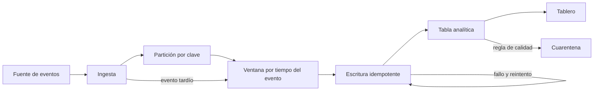
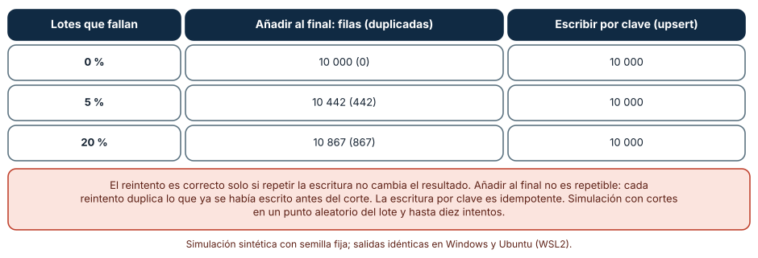
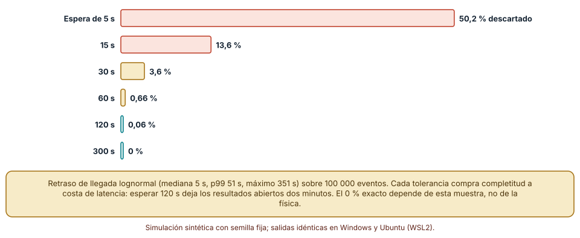
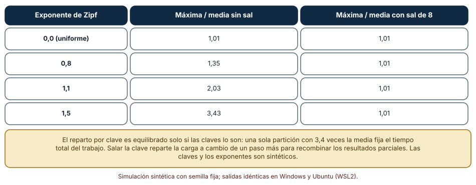

# SE-278 — Ingeniería de datos y procesamiento analítico

[← SE-277 — Software científico y reproducibilidad](../../classes/part-23-software-especializado-y-dominios/se-277-software-cientifico-y-reproducibilidad/README.md) · [↑ Parte 23](../../classes/part-23-software-especializado-y-dominios/README.md) · [📚 Índice completo](../../classes/README.md) · [🌐 Portal](../../site/classes/SE-278.html) · [SE-279 — Machine learning como componente de producto →](../../classes/part-23-software-especializado-y-dominios/se-279-machine-learning-como-componente-de-producto/README.md)

## Punto profesional y fundamento pedagógico

**Punto profesional.** La clase existe para que construyas una cadena de datos cuyo resultado no cambie porque algo falló a la mitad, porque un evento llegó tarde o porque una clave es mucho más popular que las demás, y para que sepas decir cuándo el número de un tablero es completo y cuándo es provisional.

**Por qué aparece aquí.** Es la segunda clase de la **Parte 23**, después de **Software científico y reproducibilidad**: allí el problema era que un cálculo pudiera repetirse; aquí el cálculo es continuo, recibe datos de otros sistemas y corre sobre varias máquinas, de modo que fallos parciales, retrasos y desequilibrios sustituyen al orden de las sumas como fuente de resultados distintos. El caso conductor sigue siendo la plataforma educativa ficticia: ahora, el flujo de eventos de entrega que alimenta un tablero para docentes.

**Error conceptual que debe corregir.** Creer que una cadena de datos «procesa cada evento una vez» porque el planificador lo promete. Lo que existe es entrega al menos una vez más una escritura que debe ser segura de repetir; el efecto de «exactamente una vez» se construye con idempotencia, no se recibe.

**Secuencia de aprendizaje.** Antes de leer los resultados, predices cuántas filas duplicadas deja un reintento tras un fallo a mitad de lote; después mides la diferencia entre añadir y escribir por clave, qué fracción de eventos tardíos pierde cada tolerancia y cuánto desequilibra una clave popular a las particiones. La secuencia usa predicción, explicación propia, contraste y recuperación. [ICAP](https://icap.education.asu.edu/research) distingue participación de construcción de conocimiento; [How People Learn II](https://nap.nationalacademies.org/catalog/24783/how-people-learn-ii-learners-contexts-and-cultures) exige conectar conocimiento previo, contexto y transferencia; la [práctica de recuperación](https://pubmed.ncbi.nlm.nih.gov/16507066/) respalda producir de nuevo la explicación tras una demora; y [Education for Life and Work](https://nap.nationalacademies.org/resource/13398/dbasse_084153.pdf) exige devolución que explique la causa del error.

**Evidencia de aprendizaje.** `data-log.md` con la predicción, la tabla de duplicados por política de carga, la curva de eventos descartados por tolerancia, la tabla de desequilibrio con y sin sal, y una nota que diga qué garantía de la cadena es del planificador y cuál del diseño de la escritura.

**Límite de la conclusión.** Los fallos, los retrasos y las distribuciones de claves son construcciones del autor. No se usó ningún motor de procesamiento, ningún broker ni ninguna base de datos analítica: los experimentos son modelos en CPython de mecanismos que esos sistemas implementan.

### Trazabilidad fuente → afirmación

| Fuente primaria u oficial | Afirmación que respalda | Lo que no prueba |
|---|---|---|
| [Akidau et al., «The Dataflow Model» (VLDB, 2015)](https://doi.org/10.14778/2824032.2824076) | Separa el tiempo del evento del tiempo de procesamiento y presenta ventanas, marcas de agua y disparadores para razonar sobre datos que llegan desordenados. | No fija una tolerancia de retraso adecuada para ningún negocio. |
| [Apache Beam, guía de programación](https://beam.apache.org/documentation/programming-guide/) | Documenta las marcas de agua y el tratamiento de datos tardíos en un modelo de procesamiento unificado. | Describe una implementación; otras herramientas se comportan distinto. |
| [Dean y Ghemawat, «MapReduce» (Communications of the ACM, 2008)](https://doi.org/10.1145/1327452.1327492) | Presenta el reparto de claves entre tareas y la reejecución de tareas fallidas, y con ello la idea de que el trabajo se parte por clave. | No analiza la asimetría de claves ni su coste en cada sistema moderno. |

## Antes de empezar

Recupera lo aprendido en `SE-277`: un resultado se declara con su tolerancia y su dispersión. En una cadena de datos aparecen dos fuentes nuevas de discrepancia, los fallos parciales y el tiempo. La pregunta activa es: **¿qué garantiza esta cadena cuando una etapa falla a mitad, cuando un evento llega tarde y cuando los datos no se reparten por igual?**

## Prerrequisitos

- Haber completado `SE-277` o poder explicar la diferencia entre repetir y reproducir un cálculo.
- Python 3.11 o posterior y un terminal; todo el código usa solo la biblioteca estándar.
- Distinguir una tabla con clave primaria de una tabla sin ella a nivel básico.

## Problema auténtico

La plataforma educativa ficticia recibe un evento por cada entrega de tarea y carga lotes de 100 filas cada minuto en una tabla que alimenta un tablero para docentes. Tres semanas después de ponerlo en marcha, los docentes ven entregas duplicadas «a veces», un recuento de las 23:59 que cambia al día siguiente y un informe semanal que tarda el doble en las semanas de cierre de curso. Cada síntoma tiene una causa distinta (reintentos que repiten escrituras, eventos que llegan después de cerrar la ventana, un curso con mucho más tráfico que los demás) y ninguna se ve revisando una fila.

## Objetivos observables

Al terminar podrás:

1. distinguir procesamiento por lotes y por flujo con un ejemplo y un contraejemplo de la plataforma;
2. medir cuántas filas duplicadas deja un reintento según la carga sea de añadir o de escribir por clave, y escribir la condición de idempotencia;
3. medir qué fracción de eventos tardíos pierde cada tolerancia de una ventana y elegir una con su coste de latencia;
4. medir el desequilibrio que una clave popular causa entre particiones y comprobar el efecto de añadir una sal;
5. declarar qué comprobaciones de calidad se hicieron y cuáles dependen del conocimiento del dominio.

## Mapa conceptual



El mapa muestra tres bucles: el reintento de la escritura, la llegada tardía a una ventana ya cerrada y la desviación hacia cuarentena. Cada uno es un punto donde dos ejecuciones del mismo trabajo pueden producir tablas distintas si el diseño no lo impide.

## Temas y por qué importan

| Tema | Por qué cambia una decisión profesional | Evidencia mínima |
|---|---|---|
| Lotes y flujo | Decide la latencia, la complejidad y el coste de corregir errores. | Predicción, traza causal y contraejemplo de **Lotes y flujo** en `data-log.md` |
| Idempotencia y reintentos | Hace seguro repetir una etapa que falló a mitad. | Predicción, traza causal y contraejemplo de **Idempotencia y reintentos** en `data-log.md` |
| Tiempo del evento y ventanas | Define cuándo un recuento es completo y qué pasa con lo que llega tarde. | Predicción, traza causal y contraejemplo de **Tiempo del evento y ventanas** en `data-log.md` |
| Partición y asimetría | Explica por qué un trabajo paralelo tarda lo que su partición más lenta. | Predicción, traza causal y contraejemplo de **Partición y asimetría** en `data-log.md` |
| Calidad, contratos y linaje | Permite detectar y rastrear un dato malo antes de que llegue al tablero. | Predicción, traza causal y contraejemplo de **Calidad, contratos y linaje** en `data-log.md` |

## Conceptos y decisiones

### 1. Lotes y flujo

El procesamiento por lotes lee un conjunto acotado de datos, lo transforma y escribe un resultado; es simple de razonar porque la entrada es finita y puede rehacerse entera. El procesamiento por flujo trata los datos como una secuencia sin fin y emite resultados mientras llegan; reduce la latencia a cambio de tener que decidir cuándo un resultado parcial es suficiente. El modelo de flujo de datos de Akidau et al. sostiene que ambos son casos del mismo modelo, con la ventana y el disparador como controles. La elección práctica no es «lote o flujo» sino cuánta latencia necesita la decisión y cuánto cuesta equivocarse con un resultado provisional. Muchos sistemas combinan un flujo para lo reciente con un lote que corrige.

### 2. Idempotencia y reintentos

Una etapa es **idempotente** si ejecutarla dos veces con la misma entrada deja el mismo estado que ejecutarla una. Las plataformas de ejecución reintentan lo que falla: la entrega es «al menos una vez». Si la escritura añade filas, cada reintento tras un fallo a mitad de lote duplica lo ya escrito; si escribe por clave (insertar o reemplazar), repetirla no cambia nada. Otras técnicas: escribir el lote en un área temporal y publicarlo con una operación atómica, o registrar el identificador del lote procesado. El patrón del receptor idempotente de los patrones de integración de aplicaciones recoge la misma idea. El «exactamente una vez» de un producto describe el efecto sobre su estado interno; una escritura hacia un sistema externo vuelve a ser responsabilidad del diseño.

### 3. Tiempo del evento y ventanas

Cada evento tiene dos tiempos: cuándo ocurrió y cuándo llegó. Contar «entregas por minuto» con el tiempo de llegada mezcla minutos; contarlas con el tiempo del evento exige decidir cuándo una ventana está completa. La **marca de agua** es la estimación de hasta qué tiempo del evento se espera que hayan llegado todos los datos; los que llegan después son **tardíos** y se descartan, se aplican como corrección o se envían a un canal aparte. La tolerancia de retraso fija ese compromiso: esperar más da resultados más completos y más tardíos. No existe una tolerancia correcta general: depende de la distribución de retrasos y de lo que cueste mostrar un número que luego cambia.

### 4. Partición y asimetría

Para procesar en paralelo se reparten los datos por clave: todos los eventos de una misma clave van a la misma tarea. El trabajo termina cuando termina la tarea más cargada. Si las claves tienen frecuencias muy desiguales (un curso con miles de entregas y cientos con pocas), una partición recibe varias veces la media y el paralelismo se desperdicia. Las salidas son varias: elegir una clave más fina, **salar** la clave (añadir un sufijo aleatorio para repartir una clave caliente y recombinar después) o tratar las claves calientes aparte. Cada una añade complejidad; la decisión se toma midiendo el reparto, no suponiéndolo.

### 5. Calidad, contratos y linaje

Un dato puede ser válido en forma y falso en sentido. Las comprobaciones de calidad se organizan por niveles: forma (tipos, nulos, claves únicas), rango (valores plausibles), consistencia entre tablas (cada entrega tiene un curso) y frescura (la tabla se actualizó a tiempo). Un **contrato de datos** declara esas expectativas entre quien produce y quien consume. El **linaje** registra de qué fuentes y transformaciones viene cada columna, para poder responder a «¿por qué este número cambió?». Ninguna regla sustituye el conocimiento del dominio: una nota de 0 puede ser un cero o un dato faltante, y solo quien conoce el proceso lo sabe.

### Añadir frente a escribir por clave: qué deja un reintento

Se cargan 10 000 filas en lotes de 100. Con probabilidad `p` un lote falla después de haber escrito una parte aleatoria; entonces se reintenta el lote completo (hasta diez intentos). Se compara una escritura que añade al final con otra que escribe por clave.

```python
for b in range(0, 10000, 100):
    claves = list(range(b, b + 100))
    for intento in range(10):
        corte = 100 if r.random() >= p else r.randint(1, 99)   # fallo a mitad
        for k in claves[:corte]:
            if modo == "añadir": filas.append(k)
            else:               tabla[k] = 1                   # idempotente
        if corte == 100: break
```

| Lotes que fallan | Añadir al final: filas (duplicadas) | Escribir por clave |
|---:|---|---:|
| 0 % | 10 000 (0) | 10 000 |
| 5 % | 10 442 (442) | 10 000 |
| 20 % | 10 867 (867) | 10 000 |

Resultado, idéntico en Windows (CPython 3.12.9) y en Ubuntu bajo WSL2 (3.12.3). Un 5 % de lotes fallidos produce 442 duplicados, un 4,4 % de la tabla.



**Cómo leer la figura.** Cada fila es una tasa de lotes fallidos; la segunda columna cuenta las filas que quedan al añadir y cuántas sobran; la tercera, las que quedan al escribir por clave. **Dónde deja de valer:** el modelo supone una clave estable y única por fila; si la clave se genera en la carga (un identificador nuevo en cada intento), la escritura por clave tampoco es idempotente. Y supone que un fallo corta la escritura y no la corrompe. No se probó ninguna base de datos.

### Cuánto pierde una ventana según lo que espera

Se generan 100 000 retrasos lognormales (mediana 5 s, σ = 1,0; percentil 99: 51 s; máximo 351 s) y se mide, para cada tolerancia, la fracción de eventos que llegan después de cerrada su ventana.

```python
retrasos = [r.lognormvariate(math.log(5), 1.0) for _ in range(100000)]
for tolerancia in (5, 15, 30, 60, 120, 300):
    perdidos = sum(d > tolerancia for d in retrasos) / len(retrasos)
```

| Tolerancia de retraso | Eventos tardíos (descartados) |
|---:|---:|
| 5 s | 50,17 % |
| 15 s | 13,57 % |
| 30 s | 3,55 % |
| 60 s | 0,66 % |
| 120 s | 0,06 % |
| 300 s | 0,00 % |

Esperar solo la mediana (5 s) descarta la mitad de los eventos; hace falta esperar 24 veces la mediana (120 s) para bajar del 0,1 %.



**Cómo leer la figura.** Cada barra es una tolerancia; su longitud es la fracción de eventos que llegan después de que la ventana se cierra. **Dónde deja de valer:** la distribución es lognormal por supuesto; los retrasos reales tienen colas distintas (un dispositivo desconectado horas) y un 0 % de la muestra no es un 0 % en la realidad. El coste de esperar, que es latencia hasta el resultado final, no está en la gráfica y es lo que realmente se compra con cada barra.

### Una clave popular: lo que cuesta el desequilibrio

Se reparten 200 000 eventos con 1 000 claves en 8 particiones. La frecuencia de cada clave sigue una distribución de Zipf de exponente `s`; con `s = 0` todas son iguales. Se mide la carga de la partición más cargada dividida por la media, con y sin una sal aleatoria de 8 valores.

```python
pesos = [1 / (i ** s) for i in range(1, 1001)]
claves = r.choices(range(1000), weights=pesos, k=200000)
carga[(k * 2654435761) % 2**32 % 8] += 1                              # sin sal
carga[(k * 2654435761 + r.randrange(8) * 40503) % 2**32 % 8] += 1     # con sal
```

| Exponente de Zipf | Máxima / media sin sal | Máxima / media con sal de 8 |
|---|---:|---:|
| 0,0 (uniforme) | 1,01 | 1,01 |
| 0,8 | 1,35 | 1,01 |
| 1,1 | 2,03 | 1,01 |
| 1,5 | 3,43 | 1,01 |

Con `s = 1,5`, la partición más cargada recibe 3,4 veces la media: el trabajo tarda lo que tardaría en una máquina que hiciera el 43 % del total.



**Cómo leer la figura.** Cada fila es el grado de asimetría de las claves; las dos últimas columnas dan la razón entre la partición más cargada y la media. **Dónde deja de valer:** salar reparte una clave entre varias particiones, pero el resultado por clave queda partido y hay que recombinarlo: una agregación asociativa (sumas, recuentos) lo permite y una que no lo es (una mediana exacta) exige otra estrategia. La figura no mide el coste de esa segunda etapa ni la red.

## Definiciones de trabajo

- **idempotencia:** propiedad de una operación que, repetida con la misma entrada, deja el mismo estado que ejecutada una vez.
- **tiempo del evento:** instante en que ocurrió el hecho, distinto del instante en que llegó al sistema.
- **marca de agua:** estimación del tiempo del evento hasta el cual se espera que hayan llegado todos los datos.
- **evento tardío:** evento que llega después de que su ventana se cerró según la marca de agua.
- **sal de una clave:** sufijo aleatorio que reparte una clave frecuente entre varias particiones a costa de recombinar después.

Las definiciones son operativas para la cadena de entregas. No convierten términos con una historia más amplia en sinónimos y deben contrastarse con la documentación primaria enlazada al final.

## Ejemplo mínimo

El fragmento comprueba que escribir por clave es idempotente. Antes de ejecutarlo, predice cuántas filas quedan.

```python
tabla = {}
def cargar(lote):
    for k in lote: tabla[k] = "x"
cargar([1, 2, 3]); cargar([1, 2, 3])          # el lote se reintenta entero
assert len(tabla) == 3
filas = []
for _ in range(2): filas.extend([1, 2, 3])    # añadir no lo es
assert len(filas) == 6
```

La tabla indexada por clave queda con 3 filas; la lista con 6. Registra versión, comando y salida; cambia a que el reintento use una clave nueva y predice cuántas filas quedan.

## Ejemplo profesional

El equipo de la plataforma separa la cadena en tres tablas: `eventos_crudos` (se añade, se conserva, tiene un identificador de evento), `entregas_por_curso_hora` (escritura por clave `curso+hora`) y `cuarentena` (eventos que fallan una regla). La carga usa el identificador del lote para no repetirlo y las ventanas esperan 120 s; lo que llega después se aplica como corrección a la fila de la hora y se anota en un contador de «correcciones tardías». El tablero muestra la hora actual como «provisional» y la anterior como «cerrada». Un curso con mucho tráfico se sala con 8 valores.

Compara con la primera versión: una tabla única que se añadía, ventanas por tiempo de llegada y sin cuarentena. Un diseño es adecuado cuando repetir cualquier etapa deja el mismo estado y el tablero dice qué es provisional; es frágil cuando el número de la mañana y el de la tarde difieren sin explicación.

## Práctica guiada

1. Dibuja la cadena en etapas y marca cuáles pueden reintentarse y qué deja un reintento en cada una.
2. Predice cuántas filas duplicadas deja un 5 % de lotes fallidos con una carga que añade y escribe el número.
3. Simula la carga con las dos políticas y compara con tu predicción.
4. Genera retrasos lognormales y calcula la fracción de eventos tardíos para cinco tolerancias.
5. Genera claves con una distribución asimétrica y mide la razón máxima/media con y sin sal.
6. Escribe tres reglas de calidad (una de forma, una de rango, una de consistencia) y qué hace la cadena al violarlas.
7. Entrega `data-log.md` y pide a otra persona que repita una etapa y compruebe que el estado no cambia.

## Ejercicios

1. **Reintento:** cambia la carga para que el identificador de fila se genere en el momento de escribir y comprueba por qué la escritura por clave deja de ser idempotente.
2. **Ventana:** con la distribución del experimento, calcula la tolerancia que deja menos de 1 % de eventos tardíos y estima la latencia que añade al tablero.
3. **Sal:** calcula cuántas particiones adicionales de recombinación necesita una clave salada con 8 valores y qué agregaciones no admiten ese truco.
4. **Calidad:** propone una regla de consistencia entre `entregas` y `cursos` y una forma de medir cuántos eventos violan la regla sin detener la cadena.

## Reto verificable

Entrega `data-log.md` con la predicción, la tabla de duplicados, la curva de eventos tardíos, la tabla de desequilibrio y las tres reglas de calidad. Se aprueba si otra persona ejecuta el código desde un checkout limpio, obtiene los mismos números y puede decir qué etapa de la cadena es idempotente y por qué. No se aprueba por afirmar «procesa cada evento una vez» sin una prueba que repita una etapa.

## Caso conductor

La plataforma educativa ficticia es el caso conductor de la Parte 23. Esta clase deja el segundo artefacto: la cadena de entregas con carga idempotente, ventana de 120 s y reparto salado para un curso caliente. `SE-279` usará esas tablas como entrada de un modelo de aprendizaje automático. Cambia después una sola decisión, la tolerancia de la ventana, y observa qué se compra y qué se paga.

## Preguntas frecuentes

### ¿Mi motor garantiza «exactamente una vez»?

Garantiza un efecto sobre su estado interno bajo ciertas condiciones. Si la salida es una tabla externa o un correo, el efecto lo decide tu escritura: hazla idempotente o registra qué ya se hizo.

### ¿Qué tolerancia de retraso debo usar?

La que resulte de medir la distribución de retrasos de tus datos y decidir cuánto vale un recuento completo frente a uno rápido. Una regla útil es elegir un percentil objetivo (por ejemplo, 99,9 %) y declararlo.

### ¿Hay que salar siempre las claves?

No: salar complica la recombinación. Primero mide el reparto; si la razón máxima/media es cercana a 1, no hace falta.

### ¿Los controles de calidad detienen la cadena?

Depende del coste. Lo habitual es enviar a cuarentena los registros que violan una regla y detener solo cuando la tasa de violaciones supera un umbral, para no perder ni propagar todo.

## Fallo controlado y diagnóstico

Reproduce el fallo clásico de la clase: **un reintento duplica filas y nadie lo nota hasta que los totales no cuadran**. Simula 100 lotes con un 5 % de fallos y compara el recuento con el de una carga por clave.

Registra síntoma, entrada mínima, hipótesis, observación que descarta cada hipótesis, causa, corrección y prueba de regresión. **Síntoma:** el tablero muestra 10 442 entregas cuando la fuente tiene 10 000. **Hipótesis rivales:** (a) la fuente envía duplicados; (b) la consulta del tablero cuenta de más; (c) la carga repite filas al reintentar. **Prueba:** cuenta identificadores distintos en la tabla; si hay 10 000 distintos y 442 repetidos, y los repetidos están agrupados en lotes, la causa es (c). **Conclusión:** la carga añade, no escribe por clave. **Regresión:** cambia a escribir por clave, añade una prueba que ejecute cada lote dos veces y compruebe que el recuento no cambia. No cambies a la vez la carga y la consulta.

## Errores comunes y cómo corregirlos

| Síntoma | Causa probable | Corrección |
|---|---|---|
| Aparecen filas duplicadas «a veces» | Carga que añade y reintentos a mitad de lote | Escritura por clave, tabla temporal con publicación atómica o registro de lotes |
| Un recuento cambia después de publicarlo | Eventos tardíos sin política | Marcar provisional/cerrado y aplicar correcciones con contador |
| Un trabajo tarda lo que su partición más lenta | Claves con frecuencias muy desiguales | Medir el reparto; salar o tratar aparte las claves calientes |
| Los informes mezclan minutos | Se agrupa por tiempo de llegada | Usar el tiempo del evento y declarar la marca de agua |
| Se pierde un dato malo sin avisar | Reglas de calidad que descartan sin registrar | Enviar a cuarentena con el motivo y contar las violaciones |

## Entorno y archivos clave

```text
work/SE-278/
├── README.md
├── cadena/
│   ├── carga.py
│   ├── ventanas.py
│   └── particiones.py
├── tests/test_cadena.py
└── evidence/data-log.md
```

El `README` declara plataforma, versión de Python, semillas y comandos. Los experimentos usan solo la biblioteca estándar (`random`, `math`) y se ejecutaron con CPython 3.12.9 en Windows 11 y 3.12.3 en Ubuntu bajo WSL2: las salidas fueron idénticas. Si añades una dependencia, fija procedencia y versión.

## Seguridad, ética y accesibilidad

- los eventos de entrega identifican a estudiantes: minimiza los campos, pseudonimiza en la ingesta y define cuánto se conserva;
- una cuarentena es un almacén de datos personales: aplica el mismo control de acceso y la misma retención que la tabla principal;
- un tablero que muestra cifras provisionales como definitivas puede llevar a decisiones injustas sobre estudiantes: etiqueta el estado de cada número;
- describe los gráficos con texto y no uses color como única señal;
- respeta las licencias de los datos y atribuye lo reutilizado.

## Puente hacia el trabajo con agentes

Un agente al que se le pide «escribe el pipeline de entregas» producirá una carga que añade filas, ventanas por tiempo de llegada y reintentos automáticos que él mismo ha configurado. Pídele en cambio que declare la clave de cada tabla, que ejecute cada etapa dos veces en una prueba y compruebe que el estado no cambia, que mida el reparto de claves y que justifique la tolerancia de retraso con una distribución. Revisa especialmente si añade en lugar de escribir por clave y si confunde el tiempo de llegada con el del evento: son los dos defectos que esta clase mostró.

## Transferencia

Traslada el análisis a otra cadena (por ejemplo, el recuento de visitas de un sitio): cambia el evento y la clave, y conserva el procedimiento de repetir cada etapa, medir los tardíos y medir el reparto. La transferencia está lograda cuando puedes explicar qué parte del diseño dependía del motor y cuál no, no cuando el código se parece.

## Evaluación y evidencia

| Criterio | Evidencia para aprobar |
|---|---|
| comprensión | explicación de la diferencia entre lotes y flujo y entre tiempo de evento y de llegada con ejemplos de la cadena |
| corrección | duplicados, tardíos y desequilibrio reproducibles con las mismas semillas |
| diseño | cadena con escritura idempotente, política de tardíos y reparto medido |
| diagnóstico | reproducción del fallo «reintento que duplica» con regresión |
| incertidumbre | declaración de que ningún experimento usó un motor de procesamiento real |
| reproducibilidad | versiones, comandos, salida y límites declarados |

## Fuentes

- [Kleppmann, «Designing Data-Intensive Applications»](https://dataintensive.net/) — fundamentos de sistemas de datos, reintentos y procesamiento por flujo; autoridad: autor del libro.
- [Akidau et al., «The Dataflow Model» (VLDB, 2015)](https://doi.org/10.14778/2824032.2824076) — tiempo del evento, ventanas y marcas de agua; autoridad: Proceedings of the VLDB Endowment.
- [Apache Beam, guía de programación](https://beam.apache.org/documentation/programming-guide/) — marcas de agua y datos tardíos en un modelo unificado; autoridad: Apache Software Foundation.
- [Dean y Ghemawat, «MapReduce» (Communications of the ACM, 2008)](https://doi.org/10.1145/1327452.1327492) — reparto por clave y reejecución de tareas; autoridad: Communications of the ACM.
- [Hohpe y Woolf, «Idempotent Receiver»](https://www.enterpriseintegrationpatterns.com/patterns/messaging/IdempotentReceiver.html) — receptor que tolera mensajes repetidos; autoridad: Enterprise Integration Patterns.
- [Python: `random`](https://docs.python.org/3/library/random.html) — generador con semilla para las simulaciones; autoridad: documentación de Python.

Cada fuente respalda el mecanismo indicado; ninguna demuestra que los 442 duplicados, el 50,17 % de eventos tardíos o la razón de 3,43 se observen en una cadena real. Esa afirmación depende del motor, de la distribución de retrasos y de las claves.

## Límites y siguiente paso

Se ejecutaron tres simulaciones con datos sintéticos en Windows y Ubuntu (WSL2) con resultados idénticos. No se usó ningún motor de procesamiento, broker ni base de datos analítica: los fallos, los retrasos lognormales y la distribución de Zipf son construcciones del autor. La siguiente clase usa esas tablas como entrada de un componente de aprendizaje automático.

## Glosario

- **idempotencia:** propiedad de una operación que, repetida con la misma entrada, deja el mismo estado que ejecutada una vez.
- **tiempo del evento:** instante en que ocurrió el hecho, distinto del instante en que llegó al sistema.
- **marca de agua:** estimación del tiempo del evento hasta el cual se espera que hayan llegado todos los datos.
- **evento tardío:** evento que llega después de que su ventana se cerró según la marca de agua.
- **sal de una clave:** sufijo aleatorio que reparte una clave frecuente entre varias particiones a costa de recombinar después.

---

[← SE-277 — Software científico y reproducibilidad](../../classes/part-23-software-especializado-y-dominios/se-277-software-cientifico-y-reproducibilidad/README.md) · [↑ Parte 23](../../classes/part-23-software-especializado-y-dominios/README.md) · [📚 Índice completo](../../classes/README.md) · [🌐 Portal](../../site/classes/SE-278.html) · [SE-279 — Machine learning como componente de producto →](../../classes/part-23-software-especializado-y-dominios/se-279-machine-learning-como-componente-de-producto/README.md)
