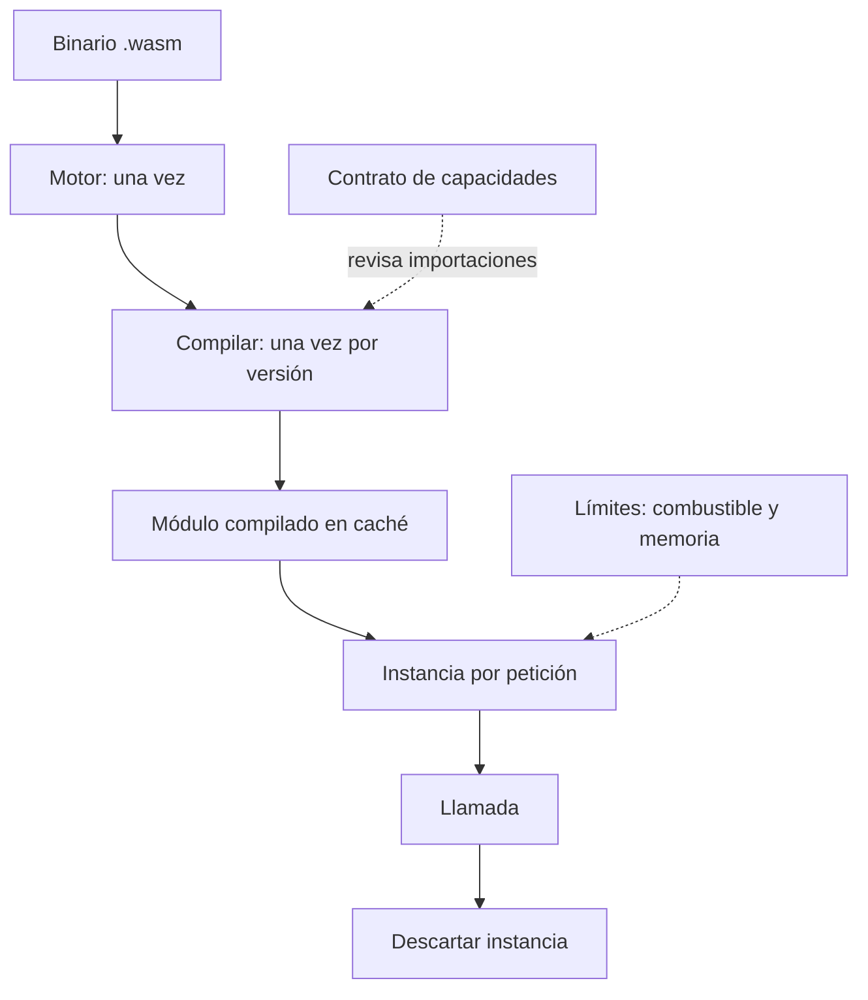
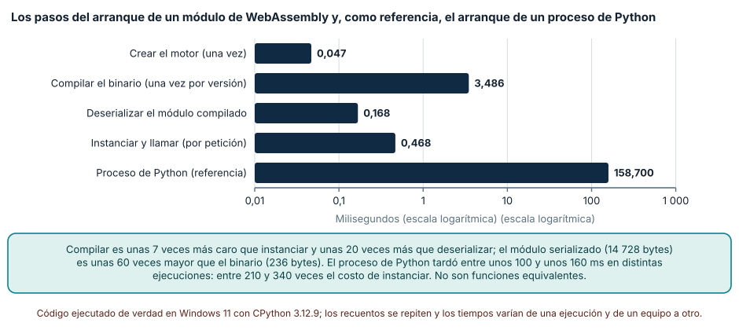
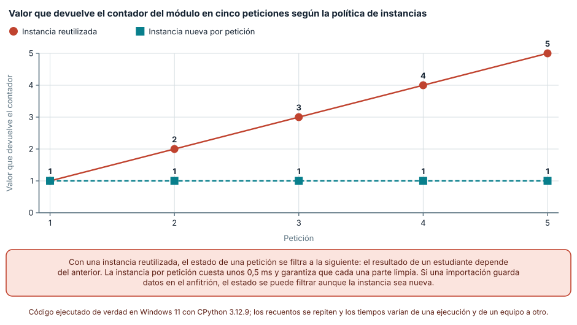

# SE-278 — WebAssembly en servidor y borde: component model

## Punto profesional y fundamento pedagógico

**Punto profesional.** La clase existe para que puedas decidir con números cuándo tiene sentido ejecutar módulos de WebAssembly en un servicio o en el borde, y qué decisiones de diseño evitan que esa promesa se rompa: separar la compilación del arranque, crear una instancia por petición (o saber por qué no), no dejar que el estado de una petición llegue a la siguiente y declarar las capacidades del módulo como un contrato que se revisa antes de desplegar. El modelo de componentes añade lo que faltaba para que módulos de lenguajes distintos se compongan sin pasar cadenas por la memoria a mano: interfaces con tipos ricos descritas en un lenguaje común (WIT).

**Por qué aparece aquí.** Sigue a `SE-277`, que mostró un módulo aislado en una llamada. Aquí el módulo vive en un servicio con miles de llamadas por minuto y la pregunta cambia de «¿qué puede hacer?» a «¿cuánto cuesta crearlo, destruirlo, reutilizarlo y componerlo?». Se apoya en `SE-400` (serverless y ejecución gestionada) y `SE-436` (latencia, throughput y saturación) y prepara `SE-282` (sandboxes).

**Error conceptual que debe corregir.** Creer que «arranque en frío» es un número de la plataforma. Es la suma de varios pasos con costos muy distintos: crear el motor, compilar el módulo, instanciarlo y llamar. En la medición de la clase compilar tarda unos 3,5 ms, deserializar un módulo ya compilado unos 0,17 ms e instanciar y llamar unos 0,47 ms. Quien conoce los pasos sabe qué precompilar, qué cachear y qué dejar por petición.

**Secuencia de aprendizaje.** Antes de ejecutar, predices cuál de los cuatro pasos domina el arranque y cuántas veces más barato es instanciar un módulo que lanzar un proceso. Después mides los pasos, repites cinco peticiones con una instancia reutilizada y con una instancia nueva, enlazas un módulo que pide una importación que el anfitrión no ofrece y lees el error.

**Evidencia de aprendizaje.** `plan-de-ejecucion-wasm.md` con la tabla de costos por paso, la política de instancias (por petición, por inquilino o compartida) con su justificación, el contrato de capacidades del módulo y la lista de lo que no se ejecutó.

**Límite de la conclusión.** Todo se midió con `wasmtime` 50.0.1 desde Python 3.12.9 en una máquina con Windows 11, un módulo de 236 bytes y una llamada trivial: los valores absolutos no se trasladan a un módulo de varios megabytes ni a un anfitrión escrito en Rust. **No se ejecutó el modelo de componentes**: el paquete de Python de `wasmtime` 50.0.1 no expone componentes, de modo que esa parte se apoya en la especificación y en el ejemplo de importaciones. No se midió ninguna plataforma de borde ni de funciones como servicio. No se invocó ningún modelo de lenguaje.

### Trazabilidad fuente → afirmación

| Fuente primaria u oficial | Afirmación que respalda | Lo que no prueba |
|---|---|---|
| [Component Model: documentación](https://component-model.bytecodealliance.org/) y [repositorio](https://github.com/WebAssembly/component-model) | Define componentes, interfaces y mundos descritos en WIT y la composición de componentes de lenguajes distintos. | No mide el costo de las conversiones de tipos en tu carga. |
| [Documentación de Wasmtime](https://docs.wasmtime.dev/) | Documenta la separación entre `Engine`, `Module`, `Store` e `Instance` y la serialización de módulos compilados. | No fija números para tu máquina. |
| [Wasmtime: Security](https://docs.wasmtime.dev/security.html) | Describe el modelo de amenazas y el aislamiento entre instancias. | No elimina los errores del anfitrión. |
| [WASI](https://wasi.dev/) | Define las interfaces de sistema que un componente puede importar. | No dice qué conceder en tu producto. |
| [Python: `subprocess`](https://docs.python.org/3/library/subprocess.html) | Documenta el lanzamiento de un proceso que se usa como referencia de arranque. | No equivale funcionalmente a una instancia de Wasm. |

## Antes de empezar

Recupera lo aprendido en `SE-277`: un módulo sin importaciones no puede hacer nada fuera de su memoria. La pregunta activa es: **si tu servicio tuviera que crear una instancia aislada por cada petición, ¿qué parte del costo de crearla pagarías una sola vez al arrancar el servicio y qué parte en cada petición?**

## Prerrequisitos

- Haber completado `SE-277` y tener `wasmtime==50.0.1` instalado (sin él el experimento imprime `NO EJECUTADO`).
- Conocer de `SE-400` la diferencia entre ejecución gestionada y un servidor propio, y de `SE-436` los conceptos de latencia y saturación.
- Saber de `SE-019` qué cuesta crear un proceso y por qué.
- Python 3.11 o posterior y NumPy (NumPy no se usa en esta clase, pero el archivo de experimentos lo importa).

## Problema auténtico

*Avisos* acepta ya reglas como módulos de Wasm. Cuando una universidad pide calcular los avisos de 40 000 estudiantes, el servicio hace 40 000 llamadas a su regla. Si cada llamada compila el módulo, el servicio gasta más en compilar que en decidir. Si todas comparten una instancia, una regla que acumula un contador, una lista o una variable global filtra información entre estudiantes: el aviso de uno depende de lo que procesó el anterior. Si cada llamada lanza un proceso, el servicio pierde el orden de magnitud que ganó con Wasm. Y cuando una segunda universidad quiere escribir la regla en otro lenguaje y reutilizar una función de validación de fechas de una tercera, aparece el problema de componer módulos escritos por equipos distintos sin acordar a mano cómo se pasan las cadenas.

La clase mide los pasos del arranque, compara una instancia reutilizada con una nueva por petición, enlaza un módulo que pide una capacidad que no se concede y describe, con apoyo en la especificación, cómo el modelo de componentes resuelve la composición.

## Objetivos observables

Al terminar podrás:

1. separar los pasos de arranque de un módulo (motor, compilación, deserialización, instancia, llamada) y decir cuál se paga una vez y cuál por petición;
2. justificar con una medición una política de instancias: por petición, por inquilino o compartida, y qué filtra cada una;
3. usar la serialización de un módulo compilado para evitar recompilar, y decir qué riesgo trae confiar en un módulo ya compilado;
4. explicar cómo un anfitrión declara y verifica las capacidades de un módulo antes de aceptarlo;
5. describir qué problema resuelve el modelo de componentes (interfaces tipadas con WIT, mundos, composición) y qué no resuelve.

## Mapa conceptual



La línea continua es el camino de una petición: lo caro (compilar) ocurre una vez por versión del módulo y lo barato (instanciar) por petición. Las líneas punteadas son los dos controles que hacen aceptable ese camino: revisar las importaciones al compilar y fijar límites al instanciar.

## Temas y por qué importan

| Tema | Por qué cambia una decisión profesional | Evidencia mínima |
|---|---|---|
| Pasos del arranque | Se optimiza el paso que domina, no «el arranque». | Costo por paso |
| Módulo compilado en caché | Evita recompilar en cada proceso o reinicio. | Deserializar frente a compilar |
| Instancia por petición | Es la frontera de aislamiento entre peticiones. | Contador con y sin reutilizar |
| Referencia de proceso | Pone en escala el costo de lo que Wasm sustituye. | Costo de arrancar un intérprete |
| Capacidades declaradas | La importación ausente se descubre al enlazar. | Error de enlace |
| Modelo de componentes | Compone módulos de lenguajes distintos con interfaces tipadas. | Documento WIT y mundo |
| Qué no se ejecutó | Declarar el alcance evita conclusiones falsas. | Lista de no ejecutado |

## Conceptos y decisiones

### 1. El arranque tiene cuatro pasos y uno domina

En `wasmtime`, `Engine` es la configuración y el compilador, `Module` es el binario ya compilado a código nativo, `Store` es el estado de una ejecución (memoria, combustible, límites) e `Instance` es el módulo con su memoria enlazada. Los valores medidos (medianas de varias repeticiones) fueron: crear un `Engine`, unos 0,05 ms; compilar el módulo desde el binario, unos 3,5 ms; deserializar el módulo ya compilado (14 728 bytes serializados para un binario de 236 bytes), unos 0,17 ms; y crear un `Store`, instanciar y hacer una llamada, unos 0,47 ms. Dos lecturas. Primera: compilar es unas 7 veces más caro que instanciar y unas 20 veces más caro que deserializar, así que compilar en cada petición convierte una ventaja en un problema; se compila una vez por versión del módulo. Segunda: el módulo serializado es unas 60 veces mayor que el binario original, porque contiene código nativo; el ahorro de tiempo se paga con espacio y con una dependencia más fuerte del runtime y de la arquitectura.

### 2. Una instancia por petición es la frontera

La política más segura es una instancia nueva por petición: la memoria parte limpia y lo que la petición escriba desaparece con ella. En el experimento, un módulo con un contador en memoria devolvió `[1, 2, 3, 4, 5]` en cinco peticiones con una instancia reutilizada, y `[1, 1, 1, 1, 1]` con una instancia nueva por petición. En un servicio real eso no es una curiosidad: es la diferencia entre que el aviso de un estudiante dependa de otro o no. La alternativa de reutilizar tiene sentido solo con módulos sin estado o con un estado que se reinicia a propósito, y debe estar declarada. Una política intermedia es una instancia por inquilino: se reutiliza dentro de una universidad (que aceptó compartir estado entre sus peticiones) y nunca entre universidades.

### 3. La referencia que da la escala

Arrancar un intérprete de Python vacío como proceso tardó unos 100 a 160 ms en la misma máquina, entre unas 210 y unas 340 veces el costo de instanciar el módulo de la clase (según la ejecución). La comparación es orientativa y no de funciones equivalentes: un proceso de Python carga un intérprete completo; una instancia de Wasm carga una memoria y un módulo ya compilado. Sirve para una conclusión limitada: con instancias de menos de un milisegundo, aislar cada petición es viable donde con procesos no lo sería. Esa es la razón por la que las plataformas de borde con muchos inquilinos eligen este modelo, y la razón por la que no se concluye nada de aquí sobre sus precios ni sobre su rendimiento real, que no se midió.

### 4. Precompilar y confiar

Serializar un módulo compilado permite arrancar sin recompilar, pero cambia lo que se confía. Un binario Wasm se valida al compilarse; un módulo serializado ya validado se carga sin repetir esa comprobación, así que cualquier caché de módulos compilados debe tratarse como código nativo: se firma o se calcula su huella, se guarda en un almacén con permisos de escritura mínimos y se vincula a la versión exacta del runtime. Una caché de módulos compilados que cualquiera puede modificar es un ejecutor de código arbitrario con un paso intermedio. La clase `SE-473` trata la firma y verificación de artefactos; aquí se aplica a un artefacto concreto.

### 5. Las capacidades se verifican al enlazar

Un módulo que pide una importación que el anfitrión no define no se instancia: en el laboratorio, un módulo con `host.enviar_red` produjo `unknown import: host::enviar_red has not been defined`. Cuando el anfitrión definió esa función, la llamada del módulo llegó a ella y el anfitrión registró el valor recibido. De ahí sale un procedimiento: al aceptar un módulo (no al ejecutarlo) se leen sus importaciones, se comparan con una lista permitida por tipo de regla y se rechaza el que pida algo fuera de la lista. El rechazo ocurre en el momento de la subida, con un mensaje que nombra la importación, y no en medio de una petición de un estudiante.

### 6. Qué añade el modelo de componentes

Un módulo de Wasm solo conoce enteros y flotantes y una memoria; pasar una cadena o un registro exige un acuerdo manual sobre dónde está en memoria, cuánto mide y quién la libera. Cada pareja de lenguajes lo resuelve a su manera y cada acuerdo es un lugar donde aparecen errores de memoria. El modelo de componentes define: interfaces escritas en WIT con tipos ricos (cadenas, listas, registros, variantes, opciones, resultados), *mundos* que declaran lo que un componente importa y exporta, una ABI canónica que fija cómo esos tipos se convierten en memoria lineal, y la composición de componentes (el que exporta una interfaz se enlaza con el que la importa). El efecto es que una función de validación de fechas escrita en un lenguaje y una regla escrita en otro se componen sin que los autores acuerden cómo representar la cadena. Lo que el modelo no resuelve: el costo de convertir tipos (que existe y depende de la carga), los permisos (siguen siendo importaciones concedidas) y la confianza en cada componente.

### 7. Qué no se ejecutó

En esta máquina no se ejecutó ningún componente: la librería de Python de `wasmtime` 50.0.1 no expone el modelo de componentes. Por eso la sección anterior se apoya en la especificación y en la documentación oficial y no en una medición. Las tres afirmaciones medibles que quedan abiertas (costo de la conversión de tipos, tamaño de un componente frente a un módulo, costo de enlazar dos componentes) no se afirman. Una persona que quiera medirlas puede usar el CLI de `wasmtime` o un anfitrión escrito en Rust.

## Costo de cada paso del arranque

La primera figura pone en escala los pasos, con el proceso como referencia.



**Cómo leer la figura.** Cada barra es un paso del arranque en milisegundos y la escala es logarítmica. Mira primero la barra de compilar y la de deserializar: la diferencia es lo que se ahorra con una caché; después la barra del proceso, que es la referencia y no un paso de Wasm. **Dónde deja de valer:** módulo de 236 bytes, una máquina, medianas de pocas repeticiones; un módulo real de varios megabytes compila en segundos y su instancia reserva más memoria. Los tiempos de compilación crecen con el tamaño; los de instanciar, con la memoria declarada.

## Estado entre peticiones

La segunda figura muestra qué devuelve el contador del módulo según la política de instancias.



**Cómo leer la figura.** El eje horizontal son las cinco peticiones y el vertical el valor que devuelve el contador. Una línea que sube indica estado filtrado entre peticiones; una línea plana indica que cada petición parte limpia. **Dónde deja de valer:** el contador es el estado más simple posible, en memoria lineal y sin importaciones; un módulo con una importación que guarda datos en el anfitrión puede filtrar estado aunque se cree una instancia nueva, porque el estado vive fuera de ella.

## Del módulo al componente

La tercera figura es un diagrama del camino de composición en el modelo de componentes.


**Cómo leer la figura.** De izquierda a derecha se pasa de un contrato de interfaz a un componente compilado, a una composición y a un mundo con las capacidades finales. Mira la última caja: lo que el anfitrión debe conceder sigue siendo una lista de importaciones. **Dónde deja de valer:** es un diagrama del modelo según la especificación; no refleja una medición, y como el paquete de Python utilizado no expone componentes, el recorrido no se ejecutó en esta clase.

## Definiciones de trabajo

- **Motor (`Engine`):** configuración y compilador compartidos por los módulos de un anfitrión.
- **Almacén (`Store`):** estado de una ejecución: memoria, combustible, límites y datos del anfitrión.
- **Módulo serializado:** módulo ya compilado a código nativo guardado para cargarlo sin recompilar.
- **Instancia por petición:** política que crea y destruye una instancia en cada llamada.
- **Enlace (`Linker`):** objeto que resuelve las importaciones de un módulo con funciones del anfitrión.
- **WIT:** lenguaje de descripción de interfaces del modelo de componentes.
- **Mundo (*world*):** declaración de lo que un componente importa y exporta.
- **Borde:** ubicación de cómputo cercana al usuario con recursos acotados por inquilino.

## Ejemplo mínimo

Medir el arranque por pasos con la mediana de varias repeticiones:

```python
import time, statistics
from wasmtime import Engine, Store, Module, Instance, wat2wasm

wat = '(module (func (export "id") (param i32) (result i32) local.get 0))'
binario = wat2wasm(wat)
engine = Engine()

def mediana_ms(fn, n=15):
    muestras = []
    for _ in range(n):
        t = time.perf_counter(); fn(); muestras.append((time.perf_counter() - t) * 1000)
    return statistics.median(muestras)

modulo = Module(engine, binario)
print("compilar", mediana_ms(lambda: Module(engine, binario)))
print("instanciar", mediana_ms(lambda: Instance(Store(engine), modulo, [])))
```

Con dos líneas se separa lo que se paga una vez de lo que se paga por petición. Es el mismo procedimiento del laboratorio con una función en lugar de cinco.

## Ejemplo profesional

*Escenario ilustrativo: las cifras y los resultados que aparecen en este ejemplo son supuestos de la narración, no mediciones.*

El servicio de reglas de *Avisos* arranca con una lista de módulos aprobados. Al arrancar compila cada uno y deja el módulo en memoria; un trabajo aparte lo serializa a una caché con la huella del binario y la versión del runtime, de modo que un reinicio tarda segundos y no minutos. Cada petición crea una instancia nueva con combustible y memoria acotados y la descarta al terminar. El panel muestra, por universidad, cuántas llamadas agotan combustible y cuántas devuelven un error del contrato. Un día, una universidad sube una versión nueva de su regla que añade una importación `host.leer_calendario`. El validador de subida la rechaza con un mensaje que nombra la importación y propone dos opciones: quitarla o pedir una revisión de seguridad. La universidad elige la revisión; el equipo implementa `leer_calendario` como una función que solo devuelve fechas del calendario académico de esa universidad y la concede únicamente a las reglas de ese inquilino. La decisión queda registrada con una prueba que verifica que otra universidad no puede enlazar esa función.

## Práctica guiada

1. Ejecuta `python scripts/experiments_part23_a.py wasmserver` y completa una tabla con los cuatro costos y la referencia de proceso.
2. Predice qué devuelve el contador con una instancia por inquilino y con una por petición; compruébalo en una copia del script.
3. Define en el anfitrión la función `host.enviar_red` de modo que solo registre el valor, y escribe una prueba que verifique que un módulo sin la importación no puede llamarla.
4. Serializa el módulo, cámbiale un byte al archivo y observa qué ocurre al deserializarlo; anota por qué la caché necesita una huella.
5. Dibuja la política de instancias de tu servicio y marca qué se comparte y entre quién.

## Ejercicios

1. **Básico.** Explica por qué compilar el módulo en cada petición convierte la ventaja de Wasm en una desventaja y calcula, con los números de la clase, cuántas peticiones por segundo caben por hilo en cada caso.
2. **Intermedio.** Diseña el validador de subida de reglas: qué lee del binario, qué compara y qué mensaje devuelve; escribe tres pruebas (regla sin importaciones, con una permitida, con una prohibida).
3. **Avanzado.** Propón un experimento para medir el costo de pasar una cadena de 1 KiB entre dos módulos con un acuerdo manual de memoria y con un componente, qué herramienta usarías y qué variables controlarías; indica por qué no se ejecutó aquí.

## Reto verificable

Entrega `plan-de-ejecucion-wasm.md` y un script que mida los cuatro pasos y las dos políticas de instancia con un módulo propio. Es válido si otra persona reproduce el orden de magnitud de cada paso, el contador de ambas políticas y el error de enlace, y si el documento declara qué no se ejecutó.

## Caso conductor

*Avisos* ejecuta reglas de terceros a gran escala. Esta clase muestra el patrón de ejecución que lo permite (compilar una vez, instanciar por petición, verificar capacidades al subir) y prepara la pregunta de `SE-279`: cómo observar y filtrar lo que ocurre en el servidor sin cambiar el servicio ni reiniciarlo.

## Preguntas frecuentes

### ¿El borde siempre es mejor que el servidor?

No. El borde reduce la distancia al usuario y suele ofrecer arranques muy cortos, pero impone límites de CPU, memoria y tiempo y no siempre ofrece las mismas capacidades. Es una elección por carga de trabajo, y los números de esta clase no miden ninguna plataforma de borde.

### ¿Por qué no reutilizar siempre la instancia para ganar velocidad?

Porque el ahorro (unos 0,5 ms por petición en este experimento) puede costar una filtración de estado entre peticiones. Se reutiliza solo cuando se demuestra que el módulo no tiene estado o cuando se reinicia a propósito.

### ¿Un módulo compilado es más seguro que el binario?

No: es más rápido de cargar. Se pierde la comprobación de validación en el momento de cargarlo y se gana dependencia de la versión del runtime. Debe protegerse como código nativo.

### ¿El modelo de componentes sustituye a WASI?

No. WASI define interfaces de sistema; el modelo de componentes define cómo se describen y componen interfaces. De hecho, las versiones recientes de WASI se expresan con WIT.

## Fallo controlado y diagnóstico

**Fallo.** Tras un despliegue, la latencia de las primeras peticiones de cada instancia del servicio sube a cientos de milisegundos y después baja; en regla estable todo va bien.

**Diagnóstico paso a paso.** (1) Se mide el tiempo por paso en una instancia recién arrancada: compilar domina. (2) La caché de módulos compilados se había invalidado porque la versión del runtime cambió con el despliegue y la huella ya no coincide. (3) Cada instancia del servicio recompila sus módulos al recibir la primera petición. (4) El resto de las peticiones usa el módulo en memoria y por eso la latencia baja. (5) La corrección es recompilar al arrancar, antes de aceptar tráfico (calentamiento), y tratar la invalidación de la caché como parte del despliegue.

**Lección.** El arranque en frío no es un fenómeno de la plataforma: es el costo del primer paso caro que se difirió hasta la primera petición. Se mide por paso y se mueve a un momento en que nadie espera.

## Errores comunes y cómo corregirlos

- **Compilar el módulo en cada petición.** Convierte lo barato en caro. Corrige compilando una vez por versión.
- **Reutilizar la instancia sin declararlo.** Filtra estado entre peticiones. Corrige con una instancia por petición o por inquilino.
- **Una caché de módulos compilados sin huella ni permisos.** Es una vía para ejecutar código arbitrario. Corrige con huella, versión del runtime y permisos mínimos.
- **Descubrir las capacidades en producción.** Corrige leyendo las importaciones al subir el módulo.
- **Comparar con un proceso como si fuera equivalente.** Corrige explicando qué carga cada uno.
- **Afirmar medidas de componentes sin haberlas ejecutado.** Corrige declarando que no se ejecutaron.

## Entorno y archivos clave

- `scripts/experiments_part23_a.py`: función `wasmserver`; se ejecuta con `python scripts/experiments_part23_a.py wasmserver`.
- `scripts/experiments_part23_lab.py`: versiones y utilidades de medición.
- `scripts/figures_part23_a.py`: las tres figuras de la clase.
- Requiere `wasmtime==50.0.1`; sin él se imprime `NO EJECUTADO`.

## Seguridad, ética y accesibilidad

Una caché de módulos compilados es código ejecutable con la autoridad del servicio: aplica a ella los mismos controles que a un binario de producción. Los registros por regla (consumo, errores) pueden identificar a una universidad y deben tener retención y acceso definidos. Cuando una regla falla, la política por defecto es una decisión sobre personas: avisar de más cuesta menos que dejar a un estudiante sin aviso, y debe quedar escrito. Las figuras tienen texto alternativo completo y valores escritos en cada elemento.

## Puente hacia el trabajo con agentes

Un agente que instala o ejecuta herramientas de terceros vive el mismo problema de arranque y de estado: si todas las herramientas comparten un proceso y un directorio de trabajo, el estado de una tarea contamina la siguiente. Pide al agente que declare qué herramientas reutiliza entre tareas y qué limpia. Y cuando propone cachear algo «para ir más rápido» (dependencias, resultados, módulos), pregunta qué se verifica antes de reutilizarlo: la caché es un punto de confianza, no una optimización neutra.

## Transferencia

Elige un servicio tuyo que cree algo costoso por petición (una conexión, un intérprete, un proceso, una plantilla compilada). Descompón el costo en pasos, mide cada uno, decide cuáles se pueden hacer una vez y qué estado puede filtrarse si se reutiliza. Escribe la política de reutilización y la prueba que la verifica.

## Evaluación y evidencia

| Criterio | Evidencia aceptable | Rechazo |
|---|---|---|
| Costo por paso | Mediana de varias repeticiones por paso | «El arranque tarda X» sin desglose |
| Política de instancias | Contador o prueba que demuestra qué filtra | Reutilizar sin declararlo |
| Caché compilada | Huella, versión del runtime y permisos | Caché sin controles |
| Capacidades | Importaciones leídas al subir y prueba de rechazo | Descubrirlas en producción |
| Alcance | Lista de lo no ejecutado | Afirmar lo no medido |

## Fuentes

- Bytecode Alliance. [«Component Model»](https://component-model.bytecodealliance.org/) y [repositorio](https://github.com/WebAssembly/component-model).
- Bytecode Alliance. [Documentación de Wasmtime](https://docs.wasmtime.dev/) y [«Security»](https://docs.wasmtime.dev/security.html).
- WebAssembly. [WASI](https://wasi.dev/).
- Python Software Foundation. [`subprocess`](https://docs.python.org/3/library/subprocess.html).

## Límites y siguiente paso

Se midió un módulo trivial con `wasmtime` desde Python; no se midió una plataforma de borde, ningún módulo de tamaño real ni el modelo de componentes. El siguiente paso, `SE-279`, cambia de runtime: eBPF permite ejecutar programas pequeños dentro del núcleo de Linux, con un verificador que decide si se pueden cargar, y se ejecuta de verdad en esta parte.

## Glosario

| Término | Definición breve |
|---|---|
| Motor | Compilador y configuración compartidos |
| Almacén | Estado de una ejecución |
| Módulo serializado | Módulo compilado guardado para cargarlo sin recompilar |
| Instancia por petición | Una instancia nueva en cada llamada |
| Enlace | Resolución de las importaciones de un módulo |
| WIT | Lenguaje de interfaces del modelo de componentes |
| Mundo | Declaración de importaciones y exportaciones de un componente |
| Borde | Cómputo cercano al usuario con recursos acotados |
