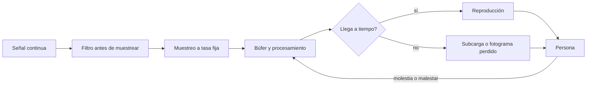
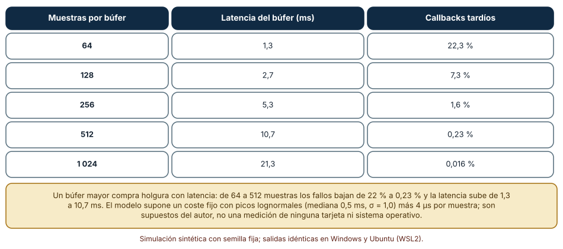
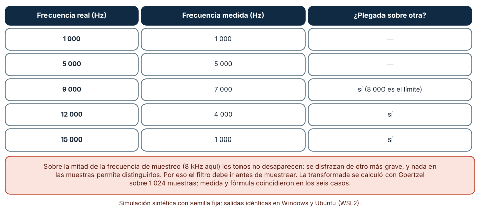
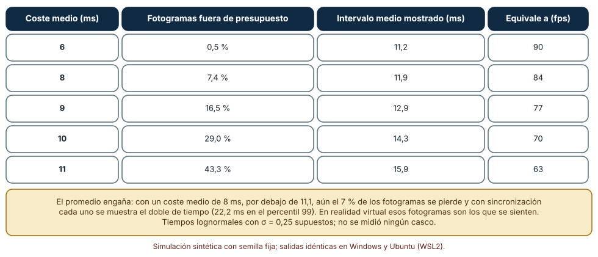

# SE-281 — Gráficos, audio, XR y experiencias inmersivas

[← SE-280 — Videojuegos, loops, entidades y simulación](../../classes/part-23-software-especializado-y-dominios/se-280-videojuegos-loops-entidades-y-simulacion/README.md) · [↑ Parte 23](../../classes/part-23-software-especializado-y-dominios/README.md) · [📚 Índice completo](../../classes/README.md) · [🌐 Portal](../../site/classes/SE-281.html) · [SE-282 — Fintech, contabilidad e invariantes monetarias →](../../classes/part-23-software-especializado-y-dominios/se-282-fintech-contabilidad-e-invariantes-monetarias/README.md)

## Punto profesional y fundamento pedagógico

**Punto profesional.** La clase existe para que razones sobre lo que una persona ve y oye como una señal muestreada con un presupuesto de tiempo, y no como «gráficos» o «sonido» en abstracto: cada muestra, búfer y fotograma tiene un plazo, un límite de información y un coste de perderlo que la persona nota.

**Por qué aparece aquí.** Es la quinta clase de la **Parte 23**, después de **Videojuegos, loops, entidades y simulación**: allí el presupuesto era el fotograma de la simulación; aquí el presupuesto baja a milisegundos de audio y a la latencia entre un movimiento de cabeza y la imagen. Un fallo de plazo ya no se ve como un error: se oye como un chasquido o se siente como un mareo. El caso conductor sigue siendo la plataforma educativa ficticia: una sala virtual de clase con voz espacial y una pantalla compartida.

**Error conceptual que debe corregir.** Creer que más resolución y más tasa de muestreo mejoran siempre la experiencia. Más muestras cuestan más tiempo y más ancho de banda; por debajo de ciertos límites se pierde información que no vuelve (aliasing), y por encima de otros, se añade latencia o se pierden fotogramas que la persona sí nota.

**Secuencia de aprendizaje.** Antes de leer los resultados, predices cuánto latencia añade un búfer de audio más grande y qué ocurre con un tono por encima de la mitad de la tasa de muestreo; después mides la compensación entre latencia y subcargas, la frecuencia que se mide al muestrear un tono demasiado agudo y cuántos fotogramas se pierden con un coste medio que cabe en el presupuesto. La secuencia usa predicción, explicación propia, contraste y recuperación. [ICAP](https://icap.education.asu.edu/research) distingue participación de construcción de conocimiento; [How People Learn II](https://nap.nationalacademies.org/catalog/24783/how-people-learn-ii-learners-contexts-and-cultures) exige conectar conocimiento previo, contexto y transferencia; la [práctica de recuperación](https://pubmed.ncbi.nlm.nih.gov/16507066/) respalda producir de nuevo la explicación tras una demora; y [Education for Life and Work](https://nap.nationalacademies.org/resource/13398/dbasse_084153.pdf) exige devolución que explique la causa del error.

**Evidencia de aprendizaje.** `media-log.md` con la predicción, la tabla de latencia y subcargas por tamaño de búfer, la tabla de frecuencia medida frente a la real, la tabla de fotogramas fuera de presupuesto y una nota que diga qué se comprobó sin dispositivo y qué exige un casco o unos altavoces.

**Límite de la conclusión.** Los costes de procesamiento, la distribución lognormal y la pantalla de 90 Hz son construcciones del autor. No se usó ningún motor de audio, ninguna tarjeta gráfica, ningún casco ni ninguna persona: los experimentos muestran mecanismos de muestreo y de plazo en CPython, no la experiencia de nadie.

### Trazabilidad fuente → afirmación

| Fuente primaria u oficial | Afirmación que respalda | Lo que no prueba |
|---|---|---|
| [Shannon, «Communication in the Presence of Noise» (Proceedings of the IRE, 1949)](https://doi.org/10.1109/JRPROC.1949.232969) | Establece que una señal limitada en banda queda determinada por muestras tomadas a más del doble de su frecuencia máxima. | No dice cómo diseñar el filtro de un dispositivo ni qué frecuencia es audible. |
| [W3C, Web Audio API](https://www.w3.org/TR/webaudio/) | Define un grafo de nodos de audio que se procesa en bloques y distingue la latencia de salida de la de procesamiento. | Describe una interfaz de navegador; otros sistemas fijan otros tamaños de bloque. |
| [Khronos, especificación de OpenXR](https://registry.khronos.org/OpenXR/) | Define una interfaz para aplicaciones de realidad extendida con predicción de la pose y tiempo de presentación del fotograma. | No fija una latencia aceptable ni prueba el confort de nadie. |

## Antes de empezar

Recupera lo aprendido en `SE-280`: un fotograma tiene un presupuesto y exceder el paso tiene consecuencias. En audio y en realidad extendida el presupuesto es más corto y la consecuencia es perceptible de inmediato. La pregunta activa es: **¿qué límite de información y qué plazo impone el dispositivo, y qué se pierde cuando se superan?**

## Prerrequisitos

- Haber completado `SE-280` o poder explicar qué es un paso fijo y un tope de pasos.
- Python 3.11 o posterior y un terminal; todo el código usa solo la biblioteca estándar.
- Conocer la idea de frecuencia de una onda a nivel básico.

## Problema auténtico

La plataforma educativa ficticia añade a su sala virtual voz en tiempo real y una vista en un casco de realidad virtual. En las pruebas, algunas personas oyen chasquidos cuando un compañero habla; otras notan que al girar la cabeza «la imagen llega tarde» y se marean a los diez minutos; y el audio de una grabación de 8 kHz tiene un silbido que no estaba en el original. Cada síntoma tiene una causa distinta (un búfer que no se llena a tiempo, una latencia entre el movimiento y la imagen, un tono plegado por muestreo insuficiente) y ninguna se descubre mirando el código como software de oficina.

## Objetivos observables

Al terminar podrás:

1. relacionar muestreo, resolución y presupuesto de tiempo con lo que una persona percibe, con un ejemplo y un contraejemplo de la sala virtual;
2. medir la compensación entre la latencia que añade un búfer de audio y la fracción de bloques que no llegan a tiempo, y elegir un tamaño con su justificación;
3. predecir y comprobar a qué frecuencia aparente se pliega un tono por encima de la mitad de la tasa de muestreo;
4. calcular qué fracción de fotogramas excede el presupuesto de una pantalla de 90 Hz según el coste medio y qué efecto tiene la sincronización vertical;
5. declarar qué parte de la experiencia se comprobó sin dispositivo y cuál exige personas y equipos reales.

## Mapa conceptual



El mapa tiene dos lugares donde se pierde información de forma irreversible: antes del muestreo, si no hay filtro, y en el plazo, si el procesamiento llega tarde. En ambos casos la persona lo percibe, y lo único que reduce el daño es un diseño que lo prevea.

## Temas y por qué importan

| Tema | Por qué cambia una decisión profesional | Evidencia mínima |
|---|---|---|
| Muestreo y aliasing | Marca qué información se puede conservar y cuál se pierde para siempre. | Predicción, traza causal y contraejemplo de **Muestreo y aliasing** en `media-log.md` |
| Audio en tiempo real | Equilibra la latencia con la fiabilidad del plazo. | Predicción, traza causal y contraejemplo de **Audio en tiempo real** en `media-log.md` |
| Presupuesto de fotograma | Convierte la tasa de refresco en un plazo para el cálculo y el dibujo. | Predicción, traza causal y contraejemplo de **Presupuesto de fotograma** en `media-log.md` |
| Latencia en realidad extendida | Decide el confort de quien usa un casco. | Predicción, traza causal y contraejemplo de **Latencia en realidad extendida** en `media-log.md` |
| Confort y accesibilidad sensorial | Evita excluir o dañar a personas con distintas capacidades. | Predicción, traza causal y contraejemplo de **Confort y accesibilidad sensorial** en `media-log.md` |

## Conceptos y decisiones

### 1. Muestreo y aliasing

Muestrear es medir una señal continua a intervalos regulares. Shannon demostró que, si la señal no contiene frecuencias por encima de `B`, queda determinada por muestras tomadas a una tasa mayor que `2B`. Si contiene frecuencias más altas, estas no desaparecen: se **pliegan** sobre frecuencias más bajas y no se distinguen de ellas. Un tono de 9 kHz muestreado a 16 kHz se mide como uno de 7 kHz. El remedio es un filtro **antes** de muestrear que elimine lo que supera la mitad de la tasa; después ya no se puede deshacer. Lo mismo vale para imágenes: un patrón fino muestreado por una rejilla de píxeles gruesa produce moiré, y se atenúa filtrando o muestreando varias veces por píxel.

### 2. Audio en tiempo real

El audio se procesa en **bloques** (búferes) de un número fijo de muestras; el dispositivo reclama un bloque cada `N / tasa` segundos y, si la aplicación no lo tiene listo, se reproduce silencio o se repite lo anterior: un chasquido. A 48 kHz, un bloque de 128 muestras dura 2,7 ms. Un búfer mayor da más margen para que el procesamiento llegue a tiempo, pero añade esa misma duración de latencia; uno menor reduce la latencia a costa de más fallos. La latencia aceptable depende del uso: tocar un instrumento exige pocos milisegundos; escuchar una clase tolera decenas. El procesamiento no puede asignar memoria ni bloquear dentro del bloque, porque eso añade picos de tiempo imprevisibles.

### 3. Presupuesto de fotograma

Una pantalla de 90 Hz muestra un fotograma cada 11,1 ms. La aplicación dispone de ese intervalo para entradas, actualización, dibujo y envío. Con **sincronización vertical**, un fotograma que llega tarde espera al siguiente refresco: se muestra el doble de tiempo (22,2 ms), y la tasa efectiva baja a la mitad en esos fotogramas. Sin ella, aparecen cortes en la imagen. Por eso lo que importa no es el coste medio sino el percentil alto: un coste medio por debajo del presupuesto puede perder una parte considerable de los fotogramas si la variabilidad es grande.

### 4. Latencia en realidad extendida

En un casco, la latencia entre el movimiento de la cabeza y la imagen que lo refleja es un factor de confort. Una imagen que llega tarde se percibe como desfasada respecto de lo que el oído interno siente. Las interfaces como OpenXR proporcionan la hora prevista de presentación del fotograma para que la aplicación **prediga** la pose de la cabeza en ese instante, y los sistemas pueden **reproyectar** el último fotograma con la pose más reciente para compensar. Nada de eso sustituye un presupuesto cumplido: un fotograma perdido en realidad virtual se siente más que en una pantalla plana. La clase no fija un número de milisegundos aceptable; sostiene que debe medirse en el dispositivo con personas y declararse.

### 5. Confort y accesibilidad sensorial

Los gráficos, el audio y la realidad extendida llegan a las personas a través de sentidos y capacidades distintos. Hay quien no oye, quien no ve color, quien se marea con el movimiento artificial o quien tiene epilepsia fotosensible. El diseño debe ofrecer alternativas: subtítulos y transcripciones, indicadores que no dependan solo del color, desplazamiento por saltos en lugar de continuo, reducción de destellos y control de la intensidad. No es un añadido final: condiciona el contenido (qué se comunica solo por sonido) y la prueba (con quién se prueba).

### Cuánta latencia se paga por no oír chasquidos

Un callback de audio a 48 kHz procesa un bloque de `N` muestras. El tiempo que tarda es un pico lognormal (mediana 0,5 ms, σ = 1,0) más 4 µs por muestra; falla si supera la duración del bloque. Se simulan 200 000 bloques por tamaño.

```python
def subcarga(bloque, sr=48000, por_muestra=0.004, mediana=0.5, sigma=1.0, n=200000):
    periodo = bloque / sr * 1000.0
    r = random.Random(1)
    mal = sum(r.lognormvariate(math.log(mediana), sigma) + bloque * por_muestra > periodo
              for _ in range(n))
    return periodo, mal / n
```

| Muestras por búfer | Latencia del búfer (ms) | Callbacks tardíos |
|---:|---:|---:|
| 64 | 1,3 | 22,3 % |
| 128 | 2,7 | 7,3 % |
| 256 | 5,3 | 1,6 % |
| 512 | 10,7 | 0,23 % |
| 1 024 | 21,3 | 0,016 % |

Resultado, idéntico en Windows (CPython 3.12.9) y en Ubuntu bajo WSL2 (3.12.3). Cada vez que se duplica el búfer, los fallos bajan entre 3 y 14 veces y la latencia se duplica.



**Cómo leer la figura.** Cada fila es un tamaño de búfer; la segunda columna es la latencia que ese búfer añade y la tercera la fracción de bloques que no llega a tiempo. **Dónde deja de valer:** el modelo supone un coste fijo con picos lognormales independientes; en un sistema real los picos están correlacionados (un proceso que acapara la unidad de proceso causa ráfagas de fallos) y la mediana depende de la carga. Ninguna cifra describe una tarjeta de sonido, un controlador ni un sistema operativo.

### Un tono demasiado agudo se disfraza

Se generan 1 024 muestras de tonos puros de 1, 3, 5, 9, 12 y 15 kHz a 8 kHz y a 16 kHz de tasa de muestreo, y se busca la frecuencia de mayor energía con el algoritmo de Goertzel sobre una rejilla de 1 024 puntos. La fórmula del pliegue predice `|f − k·fs|` con `k` entero más cercano a `f/fs`.

```python
xs = [math.sin(2 * math.pi * f * i / sr) for i in range(1024)]
mejor = max(range(1, 512), key=lambda k: goertzel(xs, k, 1024))
medida = mejor * sr / 1024
prevista = abs(f - round(f / sr) * sr)
```

| Frecuencia real (Hz) | Frecuencia medida a 16 kHz (Hz) | ¿Plegada sobre otra? |
|---:|---:|---|
| 1 000 | 1 000 | no |
| 5 000 | 5 000 | no |
| 9 000 | 7 000 | sí (el límite es 8 000) |
| 12 000 | 4 000 | sí |
| 15 000 | 1 000 | sí |

En los doce casos probados (seis frecuencias con dos tasas de muestreo) la frecuencia medida coincidió con la fórmula en once; en el duodécimo (12 kHz a 8 kHz de tasa, justo en el límite de Nyquist) difirió en 7,8 Hz, una celda de la rejilla. A 8 kHz, un tono de 5 kHz se mide como 3 kHz y uno de 9 kHz como 1 kHz.



**Cómo leer la figura.** Cada fila es un tono; si supera la mitad de la tasa de muestreo, la columna central muestra la frecuencia a la que se disfraza. **Dónde deja de valer:** son tonos puros; las señales reales tienen espectros anchos, y el filtro de un dispositivo no es ideal, de modo que el pliegue es parcial y depende de su pendiente. La figura no mide ningún convertidor ni filtro analógico: calcula la identidad matemática y la comprueba sobre muestras sintéticas.

### Un coste medio que cabe y fotogramas que no

Para una pantalla de 90 Hz (presupuesto de 11,1 ms) se generan 100 000 costes de dibujo lognormales (σ = 0,25) con distintas medias. Se cuenta la fracción que supera el presupuesto y, con sincronización vertical, el intervalo medio con que se muestra cada fotograma (múltiplo del periodo).

```python
periodo = 1000 / 90
t = r.lognormvariate(math.log(media) - sigma ** 2 / 2, sigma)
fuera += t > periodo
mostrado = math.ceil(t / periodo) * periodo        # con sincronización vertical
```

| Coste medio (ms) | Fotogramas fuera de presupuesto | Intervalo medio mostrado (ms) | Equivale a (fps) |
|---:|---:|---:|---:|
| 6 | 0,5 % | 11,2 | 90 |
| 8 | 7,4 % | 11,9 | 84 |
| 9 | 16,5 % | 12,9 | 77 |
| 10 | 29,0 % | 14,3 | 70 |
| 11 | 43,3 % | 15,9 | 63 |

Con un coste medio de 8 ms, ya el 7,4 % de los fotogramas excede el presupuesto, y el percentil 99 del intervalo mostrado es de 22,2 ms.



**Cómo leer la figura.** Cada fila es un coste medio; la tercera columna es la fracción de fotogramas más lentos que el refresco y la cuarta el intervalo medio que verá la persona con sincronización vertical. **Dónde deja de valer:** la distribución lognormal con σ = 0,25 es un supuesto; los costes reales dependen de la escena y tienen picos mayores. No se midió ningún casco, y la figura no dice a partir de qué fracción de fotogramas perdidos una persona se marea: eso exige personas.

## Definiciones de trabajo

- **aliasing:** efecto por el cual una frecuencia por encima de la mitad de la tasa de muestreo se mide como otra más baja.
- **búfer de audio:** bloque de muestras que se entrega al dispositivo de una vez, cuya duración fija la latencia mínima.
- **subcarga (underrun):** situación en que el dispositivo reclama un bloque y la aplicación no lo tiene listo a tiempo.
- **presupuesto de fotograma:** tiempo disponible para preparar un fotograma, igual al periodo de refresco de la pantalla.
- **reproyección:** ajuste del último fotograma con la pose más reciente de la cabeza para compensar la latencia.

Las definiciones son operativas para la sala virtual. No convierten términos con una historia más amplia en sinónimos y deben contrastarse con la documentación primaria enlazada al final.

## Ejemplo mínimo

El fragmento calcula a qué frecuencia se pliega un tono. Antes de ejecutarlo, predice qué frecuencia se mide para 5 kHz a 8 kHz de tasa.

```python
def aparente(f, sr):
    return abs(f - round(f / sr) * sr)
assert aparente(5000, 8000) == 3000
assert aparente(7000, 8000) == 1000
assert aparente(3000, 8000) == 3000     # por debajo de la mitad no cambia
```

Un tono de 5 kHz con tasa de 8 kHz se mide a 3 kHz, porque 8 000 − 5 000 = 3 000. Registra versión, comando y salida; cambia la tasa a 11 025 y predice cuál es la nueva frecuencia aparente de 9 kHz.

## Ejemplo profesional

El equipo de la plataforma fija el audio de la sala virtual en 48 kHz con búfer de 256 muestras (5,3 ms) como valor por defecto y 512 para equipos con más fallos, medidos por el propio cliente con un contador de subcargas; si la tasa de bloques tardíos supera el 1 % durante un minuto, el cliente sube el búfer un nivel y lo avisa. Antes de muestrear las grabaciones de baja calidad aplica un filtro de paso bajo. En el casco, el presupuesto de fotograma de 11,1 ms se vigila con el percentil 99, no con la media; si se supera durante tres segundos, la aplicación baja la resolución del render antes de perder fotogramas. Los subtítulos y el modo de desplazamiento por saltos están activos desde el principio, no escondidos en un menú.

Compara con el primer intento: búfer de 64 para «menos latencia», sin filtro y con la media como medida. Un diseño es adecuado cuando la degradación es medida y gradual; es frágil cuando el plazo se pierde sin que nadie lo vea hasta que alguien se marea.

## Práctica guiada

1. Dibuja la ruta de una voz desde el micrófono hasta el altavoz del otro participante y marca cada búfer y su duración.
2. Predice cuánta latencia añade pasar de 128 a 512 muestras y cuántas subcargas evitas; escribe los números.
3. Simula el callback con los cinco tamaños de búfer y compara con tu predicción.
4. Genera tonos por encima y por debajo de la mitad de la tasa y comprueba la fórmula del pliegue con una transformada de Goertzel.
5. Simula costes de dibujo con tres medias y calcula la fracción de fotogramas fuera de presupuesto con y sin sincronización vertical.
6. Escribe la lista de alternativas de accesibilidad sensorial de la sala y quién la revisó.
7. Entrega `media-log.md` y pide a otra persona que diga qué tamaño de búfer elegiría y con qué criterio.

## Ejercicios

1. **Búfer:** calcula el tamaño mínimo de búfer para tener menos de un 0,5 % de subcargas con el modelo y la latencia que implica.
2. **Pliegue:** para una tasa de 11 025 Hz, calcula la frecuencia aparente de tonos de 3, 6, 8 y 12 kHz y comprueba dos con la transformada.
3. **Fotograma:** con un coste medio de 7 ms, estima la fracción fuera de presupuesto a 72 Hz y a 120 Hz y explica por qué cambian.
4. **Accesibilidad:** elige una información que la sala transmite solo por sonido y propón dos alternativas para quien no oye.

## Reto verificable

Entrega `media-log.md` con la predicción, las tres tablas, el tamaño de búfer elegido con su justificación y la lista de alternativas de accesibilidad. Se aprueba si otra persona ejecuta el código desde un checkout limpio, obtiene los mismos números y puede decir qué frecuencia mediría un tono dado y cuántas subcargas esperaría con un búfer dado. No se aprueba por afirmar que la experiencia es «fluida» sin una medición.

## Caso conductor

La plataforma educativa ficticia es el caso conductor de la Parte 23. Esta clase deja el quinto artefacto: la sala virtual con búfer adaptable, filtro antes de muestrear, vigilancia del percentil 99 del fotograma y alternativas sensoriales. `SE-282` entra en un dominio donde el error no se oye ni se ve, sino que se cobra: el dinero. Cambia después una sola decisión, el tamaño del búfer, y observa qué fallos aparecen y cuáles desaparecen.

## Preguntas frecuentes

### ¿Por qué no usar siempre el búfer más pequeño?

Porque cada reducción de latencia aumenta la fracción de bloques que no llegan a tiempo. El tamaño correcto depende de qué tolera el uso: un instrumento musical necesita latencia mínima; una clase, no.

### ¿Subir la tasa de muestreo evita el aliasing?

Lo aleja, porque sube el límite de lo que se muestrea bien, pero no lo elimina: sigue haciendo falta el filtro antes de muestrear. Y cuesta más ancho de banda y proceso.

### ¿Por qué la media del tiempo de dibujo no basta?

Porque lo que se percibe son los fotogramas que fallan. Con una media por debajo del presupuesto puede haber una fracción importante por encima; hay que mirar percentiles.

### ¿Qué latencia es aceptable en realidad virtual?

Esta clase no fija un número: la tolerancia depende de la persona, del contenido y del dispositivo, y debe medirse con personas. Lo que sí exige es declararla y vigilarla.

## Fallo controlado y diagnóstico

Reproduce el fallo clásico de la clase: **un silbido que no estaba en la señal original**. Muestrea a 8 kHz un tono de 5 kHz y mide la frecuencia dominante.

Registra síntoma, entrada mínima, hipótesis, observación que descarta cada hipótesis, causa, corrección y prueba de regresión. **Síntoma:** al reproducir se oye un tono de 3 kHz que no está en la fuente. **Hipótesis rivales:** (a) el altavoz introduce distorsión; (b) hay un error de reproducción de la aplicación; (c) la fuente contenía un tono sobre la mitad de la tasa de muestreo. **Prueba:** calcula `|5000 − 8000| = 3000` y comprueba que la transformada de las muestras da 3 000 Hz; con un filtro de paso bajo en 3,5 kHz antes de muestrear, el tono desaparece. **Conclusión:** aliasing. **Regresión:** añade el filtro y una prueba que muestree tonos por encima de la mitad de la tasa y verifique que su energía se atenúa. No cambies a la vez la tasa y el filtro.

## Errores comunes y cómo corregirlos

| Síntoma | Causa probable | Corrección |
|---|---|---|
| Chasquidos en el audio | Búfer demasiado pequeño o procesamiento que bloquea | Medir subcargas, subir el búfer o quitar asignaciones y bloqueos del callback |
| Silbidos o tonos que no estaban | Muestreo sin filtro previo | Filtro de paso bajo antes de muestrear o tasa mayor con filtro |
| Imagen que «va a trompicones» con un coste medio aceptable | Se mide la media y no el percentil alto | Vigilar el percentil 99 y degradar de forma gradual |
| Malestar tras unos minutos en un casco | Latencia o fotogramas perdidos | Medir con personas, mantener el presupuesto y ofrecer modos de confort |
| Información solo por sonido o color | Diseño sin alternativas | Subtítulos, indicadores redundantes y opciones de intensidad |

## Entorno y archivos clave

```text
work/SE-281/
├── README.md
├── sala/
│   ├── buffer.py
│   ├── aliasing.py
│   └── fotogramas.py
├── tests/test_sala.py
└── evidence/media-log.md
```

El `README` declara plataforma, versión de Python, semillas y comandos. Los experimentos usan solo la biblioteca estándar (`random`, `math`, `statistics`) y se ejecutaron con CPython 3.12.9 en Windows 11 y 3.12.3 en Ubuntu bajo WSL2: las salidas fueron idénticas. Si añades una dependencia, fija procedencia y versión.

## Seguridad, ética y accesibilidad

- la voz de una persona es un dato personal biométrico en muchos marcos: declara cuándo se graba, cuánto se conserva y quién puede escucharla;
- los destellos, los cambios bruscos de brillo y el movimiento artificial pueden causar convulsiones o malestar: ofrece opciones de reducción y avisos previos;
- ofrece subtítulos y transcripciones, controles reasignables y alternativas que no dependan de un solo sentido;
- no exijas un dispositivo caro para participar: define una experiencia mínima equivalente;
- documenta qué se comprobó sin dispositivos y con personas reales, para que el límite sea visible.

## Puente hacia el trabajo con agentes

Un agente al que se le pide «optimiza el audio de la sala» bajará el tamaño del búfer para reducir latencia y reportará la media del tiempo de procesamiento. Pídele en cambio que mida la fracción de bloques tardíos para varios tamaños, que justifique el tamaño con la latencia que tolera el uso, que compruebe que el filtro precede al muestreo y que vigile el percentil 99 del fotograma. Revisa especialmente si propone asignar memoria o bloquear dentro del callback y si presenta una media como si fuera un plazo: son los dos defectos que esta clase mostró.

## Transferencia

Traslada el análisis a otra señal (por ejemplo, un sensor de movimiento que se muestrea a 50 Hz): cambia la señal y la tasa, y conserva el procedimiento de calcular el pliegue, medir el plazo del procesamiento y vigilar el percentil alto. La transferencia está lograda cuando puedes explicar qué parte del diseño dependía del dispositivo y cuál no, no cuando el código se parece.

## Evaluación y evidencia

| Criterio | Evidencia para aprobar |
|---|---|
| comprensión | explicación del muestreo, el aliasing y el presupuesto de fotograma con ejemplos de la sala virtual |
| corrección | latencias, frecuencias aparentes y fotogramas reproducibles con las mismas semillas |
| diseño | búfer adaptable, filtro previo, vigilancia de percentiles y alternativas sensoriales |
| diagnóstico | reproducción del fallo «silbido que no estaba» con regresión |
| incertidumbre | declaración de que ningún experimento usó audio, pantallas ni cascos reales ni personas |
| reproducibilidad | versiones, comandos, salida y límites declarados |

## Fuentes

- [Shannon, «Communication in the Presence of Noise» (Proceedings of the IRE, 1949)](https://doi.org/10.1109/JRPROC.1949.232969) — teorema del muestreo; autoridad: Proceedings of the IRE.
- [W3C, Web Audio API](https://www.w3.org/TR/webaudio/) — procesamiento de audio por bloques y latencia; autoridad: W3C.
- [Khronos, especificación de OpenXR](https://registry.khronos.org/OpenXR/) — interfaz de realidad extendida con predicción de pose; autoridad: Khronos Group.
- [W3C, WebXR Device API](https://www.w3.org/TR/webxr/) — acceso a dispositivos de realidad extendida desde la web; autoridad: W3C.
- [Python: `random`](https://docs.python.org/3/library/random.html) — generador con semilla para las simulaciones; autoridad: documentación de Python.

Cada fuente respalda el mecanismo indicado; ninguna demuestra que el 22,3 % de callbacks tardíos, el pliegue de 9 kHz a 7 kHz o el 7,4 % de fotogramas fuera de presupuesto se observen con un dispositivo real. Esa afirmación depende del sistema operativo, del hardware y de la escena.

## Límites y siguiente paso

Se ejecutaron tres simulaciones con datos sintéticos en Windows y Ubuntu (WSL2) con resultados idénticos. No se usó ningún motor de audio, tarjeta gráfica, casco ni persona: los costes de procesamiento, las distribuciones lognormales y la pantalla de 90 Hz son construcciones del autor, y no se midió confort ni percepción. La siguiente clase pasa al dominio del dinero, donde el error es una cifra.

## Glosario

- **aliasing:** efecto por el cual una frecuencia por encima de la mitad de la tasa de muestreo se mide como otra más baja.
- **búfer de audio:** bloque de muestras que se entrega al dispositivo de una vez, cuya duración fija la latencia mínima.
- **subcarga (underrun):** situación en que el dispositivo reclama un bloque y la aplicación no lo tiene listo a tiempo.
- **presupuesto de fotograma:** tiempo disponible para preparar un fotograma, igual al periodo de refresco de la pantalla.
- **reproyección:** ajuste del último fotograma con la pose más reciente de la cabeza para compensar la latencia.

---

[← SE-280 — Videojuegos, loops, entidades y simulación](../../classes/part-23-software-especializado-y-dominios/se-280-videojuegos-loops-entidades-y-simulacion/README.md) · [↑ Parte 23](../../classes/part-23-software-especializado-y-dominios/README.md) · [📚 Índice completo](../../classes/README.md) · [🌐 Portal](../../site/classes/SE-281.html) · [SE-282 — Fintech, contabilidad e invariantes monetarias →](../../classes/part-23-software-especializado-y-dominios/se-282-fintech-contabilidad-e-invariantes-monetarias/README.md)
