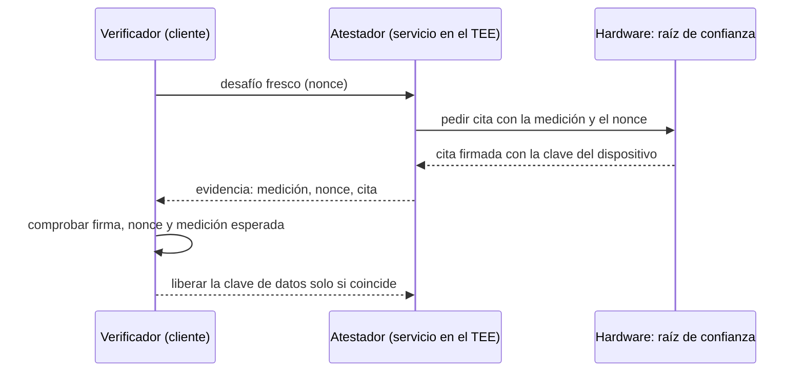
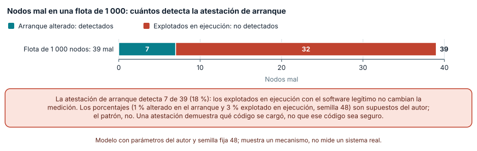

# SE-283 — Hardware seguro: TEE y atestación

## Punto profesional y fundamento pedagógico

**Punto profesional.** La clase existe para que puedas decir con precisión qué promete un entorno de ejecución confiable (TEE), qué demuestra una atestación remota y qué no, antes de que alguien convierta la expresión «computación confidencial» en un requisito contractual. El hardware seguro responde a una pregunta concreta: *¿cómo confío en un programa que corre en una máquina que opera otra persona, y cómo lo compruebo desde fuera?* La respuesta tiene dos mitades: aislamiento de lo que corre (la memoria y la ejecución quedan fuera del alcance del sistema operativo y del operador) y evidencia firmada por el hardware de qué código es el que corre. Quien adopta solo la primera mitad protege datos de un anfitrión que no puede ver, pero no sabe qué ejecuta; quien adopta solo la segunda sabe qué se midió, pero no que lo medido sea seguro.

**Por qué aparece aquí.** Sigue a `SE-282`, que dejó una pregunta abierta: todas las fronteras de aislamiento confían en el anfitrión que las construye. Esta clase estudia qué ocurre cuando el anfitrión (un proveedor, un operador de centro de datos, un administrador) no es de confianza para los datos en uso. Se apoya en `SE-461` (criptografía aplicada y gestión de claves), `SE-472` y `SE-473` (procedencia, atestaciones y firmas) y prepara `SE-285` (criptografía poscuántica) y `SE-286` (confianza cero), porque la atestación es una pieza de la verificación continua.

**Error conceptual que debe corregir.** Creer que «atestado» significa «seguro». Una atestación demuestra que cierto código, con cierta configuración, corre en cierto hardware genuino en el momento de la medición. No demuestra que el código no tenga vulnerabilidades, que no sea explotado después de medirse, ni que el hardware esté libre de ataques de canal lateral. En el modelo de la clase, una flota de 1 000 nodos con un 1 % alterado en el arranque y un 3 % explotado en ejecución tuvo 39 nodos mal; la atestación de arranque detectó 7 (18 %): lo explotado en ejecución con el software legítimo no cambia la medición.

**Secuencia de aprendizaje.** Antes de ejecutar, predices si el orden de los componentes cambia la medición de una cadena de arranque, si una cita vieja de un estado bueno puede reproducirse y si un servicio medido con una modificación puede abrir los datos sellados del original. Después construyes un registro de medición con SHA-256, firmas citas con un HMAC que simula la raíz de confianza, las verificas con y sin desafío fresco y calculas la clave de sellado de dos estados.

**Evidencia de aprendizaje.** `atestacion-de-un-servicio.md` con la cadena de medición, el protocolo de desafío y cita, lo que el verificador compara, lo que decide hacer ante un resultado negativo y la lista de amenazas que la atestación no cubre.

**Límite de la conclusión.** **No se ejecutó ningún TEE ni se consultó ningún TPM**: este script no usa hardware de confianza (no se usó ni SGX, ni TDX, ni SEV-SNP, ni Arm CCA, ni un TPM, ni AWS Nitro) y la consulta de un TPM en Windows exige permisos de administrador que no se emplearon. Lo ejecutado es la *lógica* de medición, cita, desafío y sellado con SHA-256 y HMAC de la biblioteca estándar de Python 3.12.9, y un modelo de flota con semilla 48. La clave del dispositivo es una clave aleatoria generada en el script, no una clave en silicio. No se invocó ningún modelo de lenguaje.

### Trazabilidad fuente → afirmación

| Fuente primaria u oficial | Afirmación que respalda | Lo que no prueba |
|---|---|---|
| [RFC 9334, «Remote ATtestation procedureS (RATS) Architecture»](https://www.rfc-editor.org/info/rfc9334/) | Define los roles (atestador, verificador, parte que confía), la evidencia, los resultados de atestación y la necesidad de frescura. | No dice qué hardware concreto usar. |
| [Confidential Computing Consortium](https://confidentialcomputing.io/) | Define la computación confidencial como protección de datos en uso mediante un entorno de ejecución confiable respaldado por hardware. | No evalúa a ningún fabricante. |
| [AMD: SEV](https://www.amd.com/en/developer/sev.html) y [Arm: Confidential Compute Architecture](https://www.arm.com/architecture/security-features/arm-confidential-compute-architecture) | Describen implementaciones de aislamiento de máquinas virtuales con hardware. | No describen las vulnerabilidades descubiertas después. |
| [AWS Nitro Enclaves](https://docs.aws.amazon.com/enclaves/latest/user/nitro-enclave.html) | Describe un entorno aislado derivado de una instancia, con atestación criptográfica. | No generaliza a otros proveedores. |
| [TCG: TPM 2.0 Library Specification](https://www.trustedcomputinggroup.org/resources/documents/tpm-library-specification) | Define los registros de configuración de plataforma y la operación de extensión que acumula mediciones. | No fija la política de qué medir. |
| [RFC 2104: HMAC](https://www.rfc-editor.org/rfc/rfc2104) | Define el código de autenticación de mensajes con clave que se usa en el modelo. | No es la firma asimétrica que usa el hardware real. |

## Antes de empezar

Recupera lo aprendido en `SE-473`: una firma o una suma de comprobación sirve solo si quien verifica sabe qué valor esperar. La pregunta activa es: **si una máquina remota te dice «estoy ejecutando el programa correcto», ¿qué tendría que haber ocurrido para que le creyeras, y qué podría estar mintiendo aun así?**

## Prerrequisitos

- Haber completado `SE-277` a `SE-282` y conocer de `SE-461` la diferencia entre cifrado, resumen criptográfico y firma.
- Conocer de `SE-472` y `SE-473` la procedencia de un artefacto y su verificación.
- Python 3.11 o posterior (solo biblioteca estándar: `hashlib`, `hmac`, `secrets`).
- Ningún hardware de confianza es necesario: el laboratorio simula la lógica y declara que no ejecuta un TEE.

## Problema auténtico

*Avisos* tiene un cliente (una universidad con datos sensibles de estudiantes con necesidades especiales) que exige una garantía que el cifrado en reposo y en tránsito no da: que el proveedor de nube, que opera las máquinas, no pueda leer esos datos mientras el servicio los procesa. Las claves de descifrado tienen que estar en algún lugar de la máquina cuando el servicio trabaja, y un administrador con acceso a la máquina podría volcar la memoria. El cliente pide «computación confidencial». El equipo debe responder cuatro preguntas: qué protege exactamente, cómo sabrá el cliente qué programa corre, qué pasa si alguien cambia el programa y qué no cubre.

La clase construye en miniatura el mecanismo de la respuesta: una cadena de medición que no se puede reescribir, una cita firmada con un desafío para evitar repeticiones, una clave sellada al estado medido y un modelo de flota que muestra qué detecta la atestación y qué no.

## Objetivos observables

Al terminar podrás:

1. explicar qué protege un TEE (datos en uso frente al sistema operativo y el operador) y qué amenazas quedan fuera;
2. describir una cadena de medición con extensión, por qué depende del orden y del contenido y qué la hace infalsificable hacia atrás;
3. explicar el protocolo de atestación remota con sus roles, el papel del desafío fresco y qué ocurre sin él;
4. explicar el sellado de datos al estado medido y su consecuencia al actualizar el software;
5. enumerar lo que una atestación no demuestra y diseñar la respuesta del verificador ante un resultado negativo.

## Mapa conceptual



El verificador nunca confía en lo que el servicio *dice* de sí mismo: confía en una firma del hardware sobre una medición y sobre su propio desafío, y compara la medición con un valor de referencia que obtuvo por otro canal. Solo entonces libera el secreto.

## Temas y por qué importan

| Tema | Por qué cambia una decisión profesional | Evidencia mínima |
|---|---|---|
| Qué protege un TEE | Define la amenaza que se cubre: operador y sistema operativo. | Modelo de amenaza escrito |
| Cadena de medición | Hace la integridad del arranque verificable. | Cambio de orden y de contenido |
| Cita y desafío | La frescura evita reproducir una cita vieja. | Aceptada con desafío, rechazada sin él |
| Valores de referencia | Sin ellos, la medición no significa nada. | Quién los publica y cómo se firman |
| Sellado | Ata los datos al estado medido. | Clave distinta con cadena alterada |
| Lo que no cubre | Evita comprar una garantía que no existe. | Lista de amenazas fuera |
| Alcance de lo ejecutado | Distingue lógica simulada de hardware real. | Declaración de no ejecutado |

## Conceptos y decisiones

### 1. Qué problema resuelve y cuál no

La criptografía clásica protege datos en reposo (cifrado de discos) y en tránsito (TLS). Los datos *en uso* deben estar descifrados en memoria, donde un operador con control del sistema operativo, del hipervisor o de la máquina física podría leerlos. Un entorno de ejecución confiable aísla la ejecución y cifra o protege la memoria con soporte del hardware, de modo que ni el sistema operativo ni el hipervisor del anfitrión pueden leerla. El Confidential Computing Consortium lo define como protección de datos en uso mediante un TEE respaldado por hardware. Lo que *no* resuelve: errores del propio programa dentro del TEE, ataques de canal lateral (temporización, patrones de acceso a memoria) que se han demostrado contra varias implementaciones, denegación de servicio por el anfitrión (el operador sigue pudiendo apagar la máquina) y confianza en el fabricante del hardware, que pasa a ser parte de la base de confianza.

### 2. La cadena de medición

Una medición en el estilo de los registros de un TPM no guarda el valor del último componente sino un acumulador: `registro' = SHA-256(registro ‖ SHA-256(componente))`. En el laboratorio se midió una cadena de cuatro componentes (firmware, cargador, núcleo, servicio): la medición final empezó por `4c217fa2…`. Con los mismos contenidos en otro orden salió otra (`35c105db…`), y con un byte distinto en el último componente, otra (`15036424…`). Dos propiedades hacen útil el mecanismo. Primera: depende de *todo* lo que se midió y de su orden, de modo que un componente anterior alterado cambia la medición final. Segunda: no se puede «deshacer»: para llegar a un valor dado hay que haber ejecutado la misma secuencia, porque el acumulador solo se extiende; un componente que se carga después puede cambiar el valor hacia adelante, pero no devolverlo a uno anterior. Medir esa cadena de cuatro componentes con SHA-256 tardó unos 32 µs en el laboratorio (solo el cálculo, sin hardware).

### 3. Cita, desafío y frescura

Una *cita* es la medición firmada por el hardware. En el modelo, la firma es un HMAC con una clave del dispositivo generada al azar; en el hardware real es una firma asimétrica cuya clave privada no sale del silicio. El protocolo tiene tres partes: el verificador envía un desafío aleatorio; el atestador obtiene una cita que incluye medición y desafío; el verificador comprueba la firma, que el desafío es el suyo y que la medición coincide con la esperada. Resultados del laboratorio: la cita legítima con un desafío fresco se aceptó; la de la cadena alterada se rechazó; una cita vieja de un estado bueno, producida sin desafío, se aceptó al reproducirse aunque el nodo ya estuviera alterado; y con desafío fresco, esa misma cita vieja reproducida contra un desafío nuevo se rechazó. La frescura es lo que convierte «alguna vez estuve bien» en «estoy bien ahora». El RFC 9334 la trata como un requisito de la arquitectura de atestación, con variantes por desafío, por marca de tiempo o por contador.

### 4. Los valores de referencia: quién dice qué es lo correcto

Una medición es un número. Para que signifique algo, el verificador necesita saber *qué número esperar*, y ese valor debe venir de un canal independiente del atestador: el proceso de construcción que produce el binario (de ahí `SE-469` y `SE-472`, build reproducible y atestaciones de procedencia), firmado por quien publica. Si el servicio cambia en cada versión, cada versión tiene su medición, y el verificador debe tener una lista de valores aceptados con fechas y con un plan para retirar los de versiones vulnerables. Esa lista es una pieza de política: aceptar una versión antigua con una vulnerabilidad conocida es una decisión, no un descuido, y debe tener dueño. El RFC 9334 distingue la *evidencia* que produce el atestador de los *valores de referencia* y *endosos* que aportan otros actores; la clase no los implementa, solo señala el lugar.

### 5. Sellado: los datos atados al estado

La misma medición permite derivar una clave solo disponible cuando el estado coincide: en el modelo, `clave = HMAC(clave_del_dispositivo, "sellado" ‖ medición)`. La clave derivada de la cadena esperada coincidió con la derivada al arrancar la misma cadena y no coincidió con la de la cadena alterada: los datos sellados no se pueden abrir con software modificado. La consecuencia operativa es tan importante como la ventaja: *actualizar el software cambia la medición y por tanto la clave*. Un servicio sellado necesita un plan de actualización (volver a sellar con una clave autorizada por la versión anterior, o liberar la clave de datos desde un servicio de gestión de claves tras una atestación de la versión nueva) o pierde el acceso a sus datos. Este plan se diseña antes de desplegar, no después del primer incidente.

### 6. Qué detecta la atestación de arranque y qué no

El modelo de flota es deliberadamente simple (semilla 48): 1 000 nodos, un 1 % con software alterado en el arranque y un 3 % explotado en ejecución con el software legítimo. Resultado: 39 nodos mal, 7 detectables por atestación de arranque (el 18 %). Los 32 restantes están comprometidos por explotación de una vulnerabilidad en un programa cuya medición es correcta; la medición no cambia porque el programa que se midió es el legítimo. Lo que resulta de ahí no es «la atestación sirve poco» sino que cubre una clase específica de amenaza (integridad de lo que se carga) y debe complementarse con lo demás: actualizaciones, pruebas, límites de privilegios, monitorización. Los porcentajes son supuestos del autor; el patrón (lo explotado en ejecución no aparece en la medición de arranque) es estructural.

### 7. Amenazas fuera de alcance

Una lista honesta de lo que un TEE con atestación no cubre incluye: vulnerabilidades del código medido; ataques de canal lateral y de ejecución especulativa, que han afectado a TEE de varios fabricantes y se mitigan con correcciones y con diseño; ataques físicos sofisticados contra el procesador; compromiso de la cadena de suministro del fabricante o de la clave de fabricación del dispositivo; denegación de servicio por el operador; y la gestión de la clave que se libera al TEE. Cada una es una línea del modelo de amenazas del cliente: algunas se aceptan, otras se mitigan con otra capa. Esa lista, y no el logotipo de «computación confidencial», es lo que se firma en el contrato.

### 8. Cuándo sí y cuándo no

Un TEE es adecuado cuando la amenaza incluye a un operador o a un proveedor con acceso privilegiado a la máquina y los datos en uso son muy sensibles (datos médicos, claves, modelos propietarios, análisis entre organizaciones que no confían entre sí). No lo es cuando la amenaza principal es una aplicación con vulnerabilidades (no ayuda), cuando la carga necesita un rendimiento que la protección de memoria penaliza, cuando no se puede mantener el ciclo de valores de referencia y actualizaciones, o cuando un control más simple (separar los datos, minimizarlos, cifrarlos del lado del cliente) cubre la amenaza con menos complejidad.

## La cita y el desafío

La primera figura resume qué aceptó el verificador según el escenario.


**Cómo leer la figura.** Cada fila es un escenario y cada columna si el verificador usa un desafío fresco; la celda dice si la cita se aceptó. Mira la fila de la cita vieja: es la única que cambia con la columna, y es la razón del desafío. **Dónde deja de valer:** es una simulación con HMAC de la biblioteca estándar y una clave generada al azar; no usa hardware y no incluye variantes de protocolo (marcas de tiempo, contadores) ni ataques al propio canal.

## Lo que detecta la atestación de arranque

La segunda figura muestra el resultado del modelo de flota.



**Cómo leer la figura.** La barra reúne todos los nodos mal de la flota y se divide en los que la atestación de arranque detecta y los que no. Mira la parte grande: son nodos cuyo software medido es el correcto. **Dónde deja de valer:** los porcentajes (1 % alterado en el arranque, 3 % explotado en ejecución) son supuestos del autor con semilla 48 y no medidas de ninguna flota real; la proporción cambia con ellos, el patrón no.

## El protocolo de atestación

La tercera figura es un diagrama de las cuatro decisiones del verificador.


**Cómo leer la figura.** De izquierda a derecha están las cuatro decisiones del verificador y cada una descarta una clase de engaño: firma falsa, repetición, software distinto y liberación prematura. Mira la tercera: es la que depende de una política y de un canal aparte. **Dónde deja de valer:** el diagrama omite la verificación de la cadena de certificados del fabricante, la revocación y la política de versiones aceptables; son parte de cualquier despliegue real.

## Definiciones de trabajo

- **TEE (entorno de ejecución confiable):** entorno cuya memoria y ejecución quedan protegidas del sistema operativo y del operador mediante hardware.
- **Medición:** resumen criptográfico del código y la configuración cargados.
- **Extensión:** operación que acumula una medición nueva en un registro sin poder reescribir las anteriores.
- **Cita (*quote*):** medición firmada por el hardware.
- **Desafío (*nonce*):** valor aleatorio del verificador que garantiza frescura.
- **Valor de referencia:** medición que el verificador acepta como correcta, obtenida por un canal independiente.
- **Sellado:** derivación de una clave atada a una medición concreta.
- **Raíz de confianza:** componente (normalmente de hardware) del que se parte sin verificación adicional.

## Ejemplo mínimo

La operación de extensión y la cita con desafío en pocas líneas:

```python
import hashlib, hmac, secrets

def extender(registro: bytes, componente: bytes) -> bytes:
    return hashlib.sha256(registro + hashlib.sha256(componente).digest()).digest()

clave_del_dispositivo = secrets.token_bytes(32)      # en hardware real no sale del silicio
medicion = extender(extender(bytes(32), b"cargador"), b"servicio-v7")
desafio = secrets.token_bytes(16)
cita = hmac.new(clave_del_dispositivo, medicion + desafio, hashlib.sha256).digest()
ok = hmac.compare_digest(cita, hmac.new(clave_del_dispositivo, medicion + desafio, hashlib.sha256).digest())
print(ok)  # True solo si medición y desafío coinciden con los que se firmaron
```

Es el protocolo reducido a su esencia. En un sistema real, la firma es asimétrica, el verificador valida una cadena de certificados del fabricante y la medición se compara con una lista de valores aceptados.

## Ejemplo profesional

*Escenario ilustrativo: las cifras y los resultados que aparecen en este ejemplo son supuestos de la narración, no mediciones.*

La universidad exige computación confidencial para el servicio que procesa los datos de estudiantes con necesidades especiales. El equipo de *Avisos* separa ese servicio del resto, lo empaqueta como un componente pequeño con un build reproducible y publica su medición firmada en el repositorio de la universidad. El servicio de claves de la universidad solo libera la clave de datos a un nodo cuya cita (con un desafío fresco) coincida con una medición publicada y con una fecha de validez. En la primera actualización, la medición cambia y el servicio no puede abrir sus datos: el equipo no había diseñado el paso de re-sellado. Se resuelve con una ventana de dos versiones aceptadas y un procedimiento firmado por dos personas de la universidad para retirar la anterior. Meses después, el fabricante publica una corrección por un canal lateral: la universidad retira la medición de la versión que corría sobre el firmware afectado y el servicio queda sin clave hasta actualizar el firmware, que es exactamente lo que el mecanismo debía hacer. El contrato declara qué cubre (el operador no ve los datos en memoria) y qué no (vulnerabilidades del servicio, denegación de servicio).

## Práctica guiada

1. Ejecuta `python scripts/experiments_part23_b.py tee` y anota tu predicción y el resultado en cada una de las comprobaciones.
2. Añade un quinto componente a la cadena e indica qué medición cambia y cuál no.
3. Cambia el modelo de flota a 5 % alterado y 1 % explotado y anota cuánto detecta ahora la atestación.
4. Escribe el procedimiento de actualización de un servicio sellado: qué valor de referencia se publica, quién lo firma y cuánto tiempo se aceptan dos versiones.
5. Redacta la lista de amenazas que tu cliente debería aceptar de forma explícita con un TEE.

## Ejercicios

1. **Básico.** Explica por qué la cita sin desafío puede reproducirse y por qué con desafío fresco ya no.
2. **Intermedio.** Diseña el servicio de liberación de claves: entradas, comprobaciones, qué registra, qué pasa si la medición no está en la lista y cómo se retira una versión vulnerable.
3. **Avanzado.** Compara un TEE de proceso con uno de máquina virtual completa para el mismo servicio: qué base de confianza (código dentro del TEE) tiene cada uno, qué cambios exige en el programa y qué amenazas cubren de manera distinta.

## Reto verificable

Entrega `atestacion-de-un-servicio.md` y un script que implemente la cadena de medición, la cita con desafío y el sellado con tu propio componente. Es válido si otra persona reproduce las tres propiedades (el orden cambia la medición, la cita vieja se rechaza con desafío fresco, la clave de sellado cambia con la cadena) y el documento declara que no se ejecutó hardware de confianza si no lo hubo.

## Caso conductor

*Avisos* puede decir a la universidad qué parte de su servicio queda fuera del alcance del operador y cómo comprobarlo. `SE-284` deja la protección de datos en uso y entra a otro tema que cambia las suposiciones de la criptografía: la computación cuántica, sus límites reales y lo que un ingeniero de software debe saber hoy.

## Preguntas frecuentes

### ¿Computación confidencial es lo mismo que cifrado homomórfico?

No. El cifrado homomórfico calcula sobre datos cifrados sin descifrarlos, con un costo de cómputo muy alto; un TEE descifra dentro de una región protegida por hardware. Los compromisos de rendimiento y de confianza son distintos.

### ¿Quién verifica la clave del dispositivo?

El fabricante certifica las claves de sus dispositivos y el verificador valida esa cadena. Por eso la confianza en el fabricante es parte del modelo.

### ¿Puede un TPM hacer lo mismo?

Un TPM mide el arranque y puede atestarlo; no aísla la ejecución del programa de aplicación como lo hace un TEE de máquina virtual o de proceso. Se complementan.

### ¿Esto protege contra un administrador de mi propia empresa?

Contra el que tiene control del sistema operativo o del hipervisor, en lo que afecta a la memoria del TEE. No contra quien controla el código que se mide y se libera, ni contra quien controla los valores de referencia.

## Fallo controlado y diagnóstico

**Fallo.** Tras una actualización rutinaria, el servicio en el TEE arranca pero no puede abrir su base de datos sellada y devuelve errores de descifrado.

**Diagnóstico paso a paso.** (1) Se compara la medición actual con la anterior: cambió, como se esperaba por la nueva versión. (2) La clave de sellado depende de la medición, de modo que la nueva versión deriva otra clave. (3) El procedimiento de actualización no incluía re-sellar los datos con una clave autorizada por la versión previa. (4) La versión anterior sigue disponible y su medición sigue en la lista de aceptadas. (5) Se vuelve temporalmente a la versión anterior, se re-sellan los datos con una clave liberada por el servicio de claves tras atestar la versión nueva y se documenta el procedimiento.

**Lección.** El sellado convierte la integridad en dependencia: cada actualización es una migración de claves. Se ensaya antes de producción con una versión de prueba.

## Errores comunes y cómo corregirlos

- **Confundir atestación con seguridad del programa.** Corrige con pruebas, actualizaciones y límites de privilegio.
- **Aceptar citas sin desafío fresco.** Corrige con un desafío por solicitud.
- **No publicar valores de referencia por un canal independiente.** Corrige con una lista firmada y versionada.
- **Sellar sin plan de actualización.** Corrige con ventana de dos versiones y re-sellado.
- **Dejar la gestión de la clave liberada fuera del modelo.** Corrige incluyéndola como activo.
- **Afirmar protección frente a canales laterales sin evidencia.** Corrige declarando el límite y siguiendo los avisos del fabricante.

## Entorno y archivos clave

- `scripts/experiments_part23_b.py`: función `tee`; se ejecuta con `python scripts/experiments_part23_b.py tee`.
- `scripts/experiments_part23_lab.py`: utilidades de medición.
- `scripts/figures_part23_b.py`: las tres figuras de la clase.
- Python 3.11 o posterior, solo biblioteca estándar; no se necesita hardware especial.

## Seguridad, ética y accesibilidad

Un TEE no sustituye la minimización de datos ni el consentimiento: proteger datos sensibles en uso no justifica recogerlos de más. La clave que se libera al TEE, la lista de valores de referencia y los registros de atestación son activos críticos con control de acceso y auditoría. Una garantía de confidencialidad debe comunicarse con sus límites: afirmar «nadie puede ver sus datos» frente a las amenazas que quedan fuera es una promesa falsa. Las figuras llevan texto alternativo y valores escritos.

## Puente hacia el trabajo con agentes

Un agente que actúa por ti en una máquina remota plantea el mismo problema de verificación a distancia: ¿qué ejecuta, con qué versión, con qué herramientas? Una atestación de las herramientas que un agente puede usar (versión, huella, permisos concedidos) es el equivalente de la cita. Y cuando un agente te dice «verificado», conviene preguntar *qué valor se comparó con cuál, obtenido por qué canal, y cuándo*: la misma estructura de desafío, evidencia y valor de referencia.

## Transferencia

Elige un servicio tuyo que procese datos muy sensibles. Escribe quién tiene hoy acceso privilegiado a las máquinas, qué podrían ver de los datos en uso, qué cubriría un TEE y qué no, quién publicaría los valores de referencia, cómo se actualizaría el servicio sin perder el acceso a sus datos y qué control más simple podría cubrir la amenaza sin hardware especial.

## Evaluación y evidencia

| Criterio | Evidencia aceptable | Rechazo |
|---|---|---|
| Modelo de amenaza | Qué cubre y qué no, por escrito | «Computación confidencial» sin más |
| Cadena de medición | Orden y contenido cambian el resultado | Un solo resumen del binario |
| Frescura | Desafío por solicitud y cita vieja rechazada | Citas reutilizables |
| Referencia y actualización | Canal, firma y plan de re-sellado | Medición sin quién la publica |
| Alcance | Declaración de que no se ejecutó hardware de confianza | Presentar el modelo como TEE |

## Fuentes

- IETF. [RFC 9334, «Remote ATtestation procedureS (RATS) Architecture»](https://www.rfc-editor.org/info/rfc9334/).
- Confidential Computing Consortium. [Sitio oficial](https://confidentialcomputing.io/).
- Trusted Computing Group. [«TPM 2.0 Library Specification»](https://www.trustedcomputinggroup.org/resources/documents/tpm-library-specification).
- AMD. [«SEV»](https://www.amd.com/en/developer/sev.html). Arm. [«Confidential Compute Architecture»](https://www.arm.com/architecture/security-features/arm-confidential-compute-architecture). AWS. [«Nitro Enclaves»](https://docs.aws.amazon.com/enclaves/latest/user/nitro-enclave.html).
- IETF. [RFC 2104, «HMAC»](https://www.rfc-editor.org/rfc/rfc2104).

## Límites y siguiente paso

Se ejecutó la lógica de medición, cita, desafío y sellado con SHA-256 y HMAC y un modelo de flota con semilla 48; no se ejecutó ningún TEE ni TPM y la clave del dispositivo es simulada. El siguiente paso, `SE-284`, cambia de tema: la computación cuántica para ingenieros de software, simulada con NumPy porque no hay acceso a un ordenador cuántico, con sus algoritmos, su ruido y lo que sí y no cambia.

## Glosario

| Término | Definición breve |
|---|---|
| TEE | Entorno de ejecución protegido por hardware |
| Medición | Resumen criptográfico de lo cargado |
| Extensión | Acumulación de una medición sin reescribir las previas |
| Cita | Medición firmada por el hardware |
| Desafío | Valor aleatorio que garantiza frescura |
| Valor de referencia | Medición aceptada, obtenida por canal independiente |
| Sellado | Clave derivada atada a una medición |
| Raíz de confianza | Componente del que se parte sin verificación adicional |
