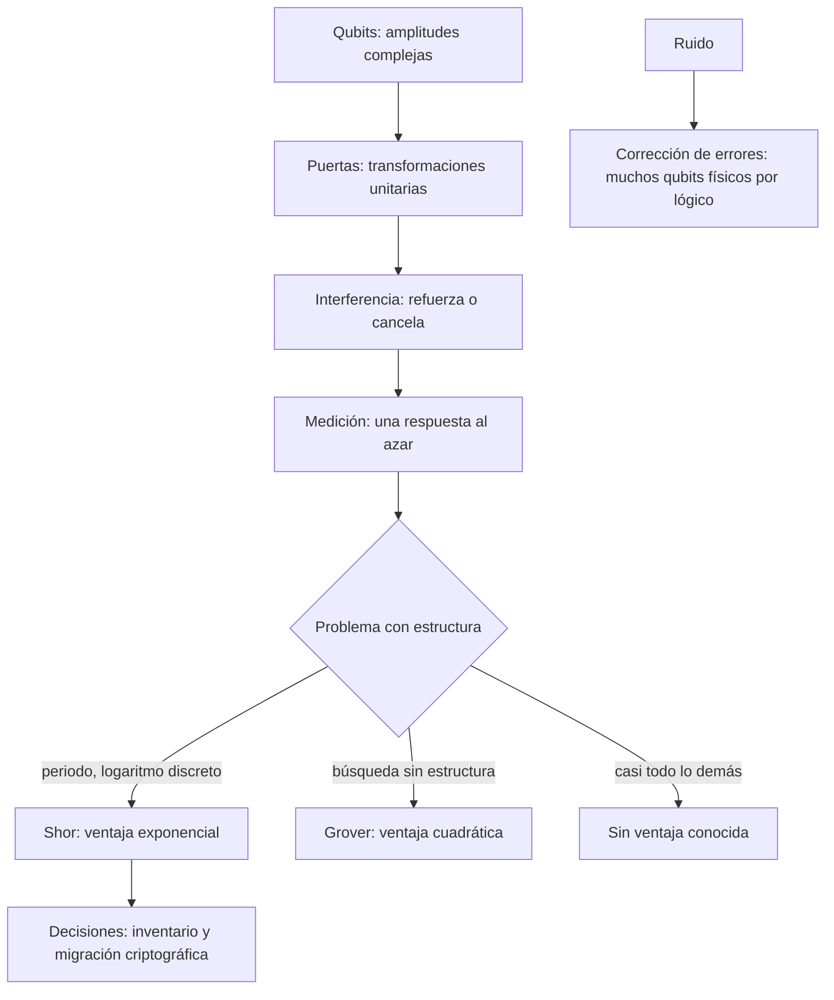
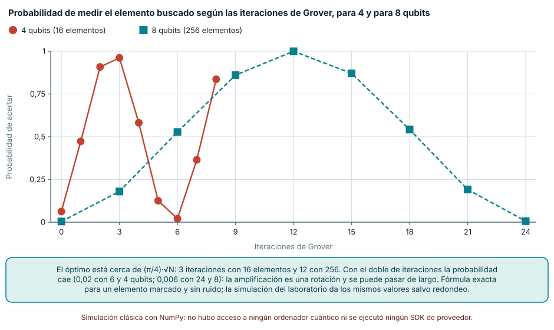

# SE-284 — Computación cuántica para ingenieros de software

## Punto profesional y fundamento pedagógico

**Punto profesional.** La clase existe para que un ingeniero de software pueda leer una afirmación sobre computación cuántica (un titular, una propuesta de un proveedor, una exigencia de cumplimiento) y decidir qué parte es verificable, qué parte es especulación y qué decisión concreta le cambia. Un ordenador cuántico no es un ordenador clásico más rápido: es un dispositivo que, para ciertos problemas con estructura, puede ofrecer un algoritmo asintóticamente mejor, y que para casi todo lo demás no ofrece nada. Entender el modelo (amplitudes, interferencia, medición), el costo de simularlo (crece como 2^n), los dos algoritmos que importan a un ingeniero (Shor y Grover), el efecto del ruido y la distancia entre un circuito de 15 y uno de 2048 bits es lo que permite decidir con calma, sin pánico ni desdén.

**Por qué aparece aquí.** Sigue a `SE-283` con otro cambio de supuestos sobre la seguridad: el hardware seguro cambia en quién se confía y la computación cuántica cambia lo que se puede calcular. Retoma `SE-016` (precisión y errores numéricos), `SE-461` (criptografía aplicada) y `SE-094` (complejidad empírica) como idea, y prepara `SE-285` (criptografía poscuántica), que es la respuesta práctica. En esta clase no se usa ningún ordenador cuántico: todo se simula de forma clásica con NumPy.

**Error conceptual que debe corregir.** Creer que «cuántico» significa «prueba todas las respuestas a la vez». La superposición no devuelve todas las respuestas: la medición devuelve *una*, al azar, con las probabilidades que dicen las amplitudes. Un algoritmo cuántico útil organiza la interferencia para que las amplitudes de las respuestas correctas se refuercen y las de las incorrectas se cancelen. En el laboratorio se ve con un caso mínimo: una puerta H aplicada una vez da 50 % y 50 %, y aplicada dos veces da 100 % y 0 %: las amplitudes negativas cancelan. Y se ve con Grover: pasarse del número óptimo de iteraciones *empeora* la respuesta (con 16 elementos y 3 iteraciones, 96,1 % de acertar; con 6, 2,0 %).

**Secuencia de aprendizaje.** Antes de ejecutar, predices qué mediciones puede dar un par de qubits entrelazado, cuánta memoria necesita simular 24 qubits y qué ocurre con la probabilidad de acierto de Grover si se doblan las iteraciones. Después simulas el estado de Bell y un estado GHZ, mides el costo de la simulación, ejecutas Grover para cuatro tamaños, reproduces la búsqueda de periodo de Shor para N = 15 y mides el efecto del ruido sobre un estado GHZ.

**Evidencia de aprendizaje.** `panorama-cuantico.md` con las mediciones de simulación, la tabla de Grover, la búsqueda de periodo para N = 15, la tabla de ruido y una lista de seis afirmaciones sobre computación cuántica clasificadas como verificable, dependiente de un supuesto o no respaldada.

**Límite de la conclusión.** **No hubo acceso a ningún ordenador cuántico** y no se ejecutó ningún SDK de proveedor (Qiskit, Cirq u otro): los circuitos se simularon con vectores de estado y la transformada rápida de Fourier de NumPy 2.5.5 en Windows 11. La búsqueda de periodo de N = 15 calcula clásicamente el estado antes de la transformada, que es exactamente lo que un simulador hace y no ofrece ninguna ventaja. El modelo de ruido solo cuenta la medición inmediata y subestima el daño en algoritmos que interfieren. Las cifras de recursos para factorizar RSA-2048 vienen de una fuente citada, no de este laboratorio. No se invocó ningún modelo de lenguaje.

### Trazabilidad fuente → afirmación

| Fuente primaria u oficial | Afirmación que respalda | Lo que no prueba |
|---|---|---|
| [P. Shor, «Polynomial-Time Algorithms for Prime Factorization and Discrete Logarithms on a Quantum Computer»](https://arxiv.org/abs/quant-ph/9508027) | Presenta un algoritmo cuántico que factoriza y calcula logaritmos discretos en tiempo polinomial en el tamaño de la entrada. | No dice cuándo existirá hardware capaz de ejecutarlo. |
| [L. Grover, «A fast quantum mechanical algorithm for database search»](https://arxiv.org/abs/quant-ph/9605043) | Presenta una búsqueda en no estructurado con aproximadamente √N consultas. | No elimina el costo de cada consulta ni de cargar los datos. |
| [J. Preskill, «Quantum Computing in the NISQ era and beyond»](https://arxiv.org/abs/1801.00862) | Describe los dispositivos con ruido y de escala intermedia y por qué el ruido limita el tamaño de los circuitos fiables. | No fecha ninguna capacidad. |
| [C. Gidney, «How to factor 2048 bit RSA integers with less than a million noisy qubits»](https://arxiv.org/abs/2505.15917) | Estima que un entero RSA de 2048 bits podría factorizarse en menos de una semana con menos de un millón de qubits ruidosos, bajo supuestos que declara (rejilla, error de puerta del 0,1 %, ciclo de 1 µs). | Es una estimación, no una demostración ni un pronóstico de fechas. |
| [IBM Quantum: documentación](https://quantum.cloud.ibm.com/docs/en/guides) | Documenta un SDK y la ejecución de circuitos en dispositivos reales y simuladores. | No se ejecutó en esta clase. |
| [NumPy: documentación](https://numpy.org/doc/stable/) | Documenta el álgebra lineal y la transformada de Fourier usadas en la simulación. | No es un ordenador cuántico. |

## Antes de empezar

Recupera lo aprendido en `SE-016` sobre cómo un error pequeño se acumula en una cadena de operaciones. La pregunta activa es: **si cada operación de un dispositivo tuviera una probabilidad pequeña pero no nula de fallar y tu algoritmo necesitara miles de millones de operaciones, ¿qué le exigirías al dispositivo para que el resultado final fuera fiable?**

## Prerrequisitos

- Haber completado `SE-283` y tener nociones de números complejos y de producto matriz-vector (`SE-016`, álgebra del bachillerato).
- Conocer de `SE-461` qué protegen RSA y las curvas elípticas y por qué se apoyan en problemas que se creen difíciles.
- Python 3.11 o posterior con NumPy. No hace falta saber física.
- Tiempo de ejecución: la simulación de 24 qubits tarda unos 14 s y usa unos 256 MiB; se puede cortar en 22.

## Problema auténtico

Un cliente corporativo de *Avisos* envía un cuestionario de seguridad con una pregunta que el equipo no sabe contestar: «¿Qué plan tiene para la amenaza de la computación cuántica a sus claves criptográficas?». Alguien del equipo comercial propone «decir que ya somos cuántico-seguros». Alguien del equipo técnico propone «decir que es ciencia ficción». Las dos respuestas son incorrectas. La primera afirma algo que el equipo no puede probar; la segunda ignora que los datos que se cifran hoy pueden almacenarse por un adversario y descifrarse más tarde. Para responder, el equipo necesita entender qué puede y qué no puede hacer un ordenador cuántico, cuántos recursos necesita para romper lo que le preocupa y qué decisiones debe tomar ya.

La clase da ese fundamento en su versión ejecutable: simula circuitos pequeños para fijar el modelo, mide por qué simularlos crece tan deprisa, reproduce la búsqueda de periodo de Shor para el número 15, mide la aceleración de Grover y su límite y modela el efecto del ruido.

## Objetivos observables

Al terminar podrás:

1. describir un qubit, una puerta, la medición y el entrelazamiento con un circuito pequeño que has simulado;
2. explicar por qué la simulación clásica crece como 2^n y cuánta memoria y tiempo necesita la tuya;
3. explicar qué calcula la parte cuántica de Shor (el periodo) y qué la clásica (todo lo demás), con N = 15;
4. explicar la ventaja de Grover (raíz cuadrada de las consultas), su condición de parada y por qué no ayuda a la mayoría de los problemas de software;
5. clasificar afirmaciones sobre computación cuántica en verificables, dependientes de supuestos o no respaldadas, y traducir el resultado a decisiones de ingeniería (inventario criptográfico, migración) sin necesitar un ordenador cuántico.

## Mapa conceptual



El camino hacia la aplicación pasa siempre por una estructura del problema que la interferencia pueda explotar. Fuera de esa estructura no hay ventaja conocida. El ruido es el factor que separa lo demostrado en papel de lo ejecutable, y la decisión práctica (inventario y migración criptográfica) se toma sin esperar a que exista el hardware.

## Temas y por qué importan

| Tema | Por qué cambia una decisión profesional | Evidencia mínima |
|---|---|---|
| Amplitudes e interferencia | Es la diferencia entre «probar todo» y un algoritmo cuántico. | H dos veces da 100 % y 0 % |
| Entrelazamiento | Correlaciones que no tienen análogo clásico simple. | Bell y GHZ solo dan todo 0 o todo 1 |
| Costo de simular | Explica por qué un simulador no sustituye al hardware. | Memoria y tiempo hasta 24 qubits |
| Shor | Rompe RSA y curvas elípticas con hardware suficiente. | Periodo y factores de 15 |
| Grover | Ventaja cuadrática solo para búsqueda y con costo por consulta. | Probabilidad frente a iteraciones |
| Ruido | Limita la profundidad de los circuitos fiables. | Tabla de GHZ con ruido |
| Escala necesaria | Distingue el hoy del escenario que preocupa. | Estimación citada para RSA-2048 |
| Qué decidir ya | La migración criptográfica no espera al hardware. | Inventario y plan (`SE-285`) |

## Conceptos y decisiones

### 1. Qubits, amplitudes y medición

Un qubit no es un bit con valores intermedios: es un par de amplitudes complejas, una para el estado 0 y otra para el 1, cuyos cuadrados de módulo suman 1. Un registro de n qubits tiene 2^n amplitudes. Las puertas son transformaciones lineales que conservan esa suma (matrices unitarias). La medición toma una de las 2^n respuestas con probabilidad igual al cuadrado del módulo de su amplitud, y destruye el resto. En el laboratorio, la puerta H aplicada al estado 0 da probabilidades 0,5 y 0,5; aplicada una segunda vez, devuelve 1,0 y 0,0, porque la amplitud del estado 1 recibe dos contribuciones de signo opuesto que se cancelan. Esa cancelación, no el paralelismo, es lo que un algoritmo cuántico explota: se diseña el circuito para que las amplitudes de las respuestas incorrectas se cancelen y la correcta se refuerce.

### 2. Entrelazamiento

Aplicar H al primer qubit y después una puerta CNOT (que invierte el segundo si el primero es 1) produce el estado de Bell: amplitud 0,7071 en `00` y en `11`, y cero en `01` y `10`. En 1 000 mediciones con semilla 48 salió `00` 514 veces y `11` 486; nunca `01` ni `10`. Un estado GHZ de 5 qubits dio `00000` 492 veces y `11111` 508. Cada resultado individual es aleatorio, pero el conjunto está correlacionado de una forma que no se reproduce con valores predefinidos independientes. Para un ingeniero de software la consecuencia es de modelo, no de uso: el estado de un registro no se puede describir qubit por qubit, y por eso simularlo cuesta una cantidad exponencial de memoria.

### 3. Por qué simularlo crece como 2^n

Un vector de estado de n qubits tiene 2^n amplitudes complejas de 16 bytes. Aplicar una puerta a un qubit recorre todo el vector. Medido en el laboratorio, aplicar H a todos los qubits tardó: 1,1 ms con 10 qubits (0,02 MiB), 11 ms con 14 (0,25 MiB), 294 ms con 18 (4 MiB), 862 ms con 20 (16 MiB), 4,7 s con 22 (64 MiB) y 14,3 s con 24 (256 MiB). Cada dos qubits más, la memoria se multiplica por 4 y el tiempo por entre 4 y 16, según los efectos de caché. Extrapolado aritméticamente (no medido): 50 qubits necesitarían 16 PiB solo para el vector, y 100 qubits unos 2^54 PiB. De ahí viene la afirmación correcta de que un ordenador cuántico podría hacer algo que un simulador clásico no puede; y de ahí la afirmación incorrecta de que hace *cualquier cosa* más rápido: lo que hace es explotar esa estructura para problemas concretos.

### 4. Shor: qué es cuántico y qué no

Factorizar N reduce a hallar el periodo `r` de `a^x mod N` para un `a` elegido al azar. Con N = 15 y a = 7, la secuencia 1, 7, 4, 13, 1… tiene periodo 4. La parte cuántica prepara una superposición de todos los x, calcula `a^x mod N` en otro registro, mide ese registro (lo que deja una superposición de los x con el mismo valor, separados por el periodo) y aplica la transformada cuántica de Fourier, cuyo resultado se concentra en múltiplos de `Q/r`, con `Q` el tamaño del registro. En la simulación (registro de 8 qubits, `Q = 256`), los cuatro picos más altos del espectro quedaron en 0, 64, 128 y 192 tanto para a = 7 como para a = 2, ambos con periodo 4 (`Q/r = 64`). De ahí se lee `r = 4`, y la parte clásica termina: `mcd(7² − 1, 15) = 3` y `mcd(7² + 1, 15) = 5`, de modo que 15 = 3 × 5. Dos precisiones. Primera: el laboratorio *calcula* la superposición antes de la transformada con aritmética clásica, que es lo que cualquier simulador hace y no tiene ventaja: ejecutar Shor para un número grande en un simulador exigiría un vector de estado imposible. Segunda: lo valioso del algoritmo, y el motivo por el que la criptografía de clave pública actual está en riesgo, es que sobre hardware suficiente escala de forma polinómica en el tamaño de N.

### 5. Grover: ventaja cuadrática y condición de parada

Buscar un elemento marcado entre N = 2^n posibilidades requiere en promedio N/2 consultas clásicas. Grover lo hace con unas (π/4)·√N iteraciones, cada una con una consulta al oráculo y un paso de amplificación. En la simulación, la probabilidad de acierto al número óptimo de iteraciones fue 0,9613 para n = 4 (3 iteraciones), 0,9999 para n = 8 (12), 0,9999 para n = 12 (50) y 1,0000 para n = 16 (201), frente a 8, 128, 2 048 y 32 768 consultas clásicas esperadas. Pero con el doble de iteraciones la probabilidad *cae*: 0,0204, 0,0059, 0,0000 y 0,0000. El algoritmo rota el estado hacia la respuesta y, si se pasa de largo, se aleja. Para N = 2^40, el cociente de consultas es unas 667 000 veces menos; pero cada consulta es la evaluación completa de un circuito, no una lectura de memoria, y el algoritmo no ayuda cuando los datos tienen estructura que un índice clásico ya explota (una base de datos con índice busca en logaritmo de N). Para criptografía simétrica, la ventaja cuadrática se compensa duplicando la longitud de la clave: de ahí que la recomendación frente a Grover sea claves simétricas de 256 bits y no un cambio de algoritmo.

### 6. El ruido manda

Un ordenador cuántico real comete errores en cada puerta. Con probabilidad `p` de un error de bit o de fase tras cada puerta, el laboratorio midió el porcentaje de repeticiones en que un estado GHZ de n qubits (con n puertas) se mide correctamente: con `p = 0,001`, entre 99,6 % y 100 % para n entre 2 y 10; con `p = 0,01`, de 99,8 % a 95,7 %; con `p = 0,05`, de 97,2 % a 79,5 %. Con diez puertas, el efecto es moderado. Un algoritmo útil necesita, según la estimación citada para factorizar RSA-2048, del orden de miles de millones de puertas lógicas: con una probabilidad de error de `10⁻³` por puerta física, es imposible sin corrección de errores, que usa muchos qubits físicos por cada qubit lógico. Esa es la razón de que la estimación publicada hable de «menos de un millón de qubits ruidosos» (con un error de puerta de 0,1 %, un ciclo de 1 µs y menos de una semana de cálculo) y no de los pocos cientos de qubits que tienen los dispositivos actuales. La advertencia sobre el modelo: solo cuenta la medición inmediata de un GHZ; en un algoritmo con interferencia, los errores de fase destruyen justamente la cancelación que se necesita, de modo que el daño real es mayor.

### 7. Qué sí, qué no y qué hacer

Qué sí: un ordenador cuántico suficientemente grande y con corrección de errores rompería RSA, Diffie-Hellman y las curvas elípticas con el algoritmo de Shor; debilitaría la criptografía simétrica y las funciones de resumen con Grover (se compensa con más bits); y podría simular sistemas cuánticos (química, materiales), que es el uso para el que fue propuesto. Qué no: no acelera la mayoría de las cargas de software (bases de datos, web, procesamiento de texto, entrenamiento de modelos de lenguaje), no «prueba todas las posibilidades a la vez» y no existe hoy un dispositivo que ejecute Shor contra claves reales. Qué hacer ya: porque un adversario puede guardar hoy datos cifrados con claves que se romperían después (la amenaza llamada «cosechar ahora, descifrar después»), la decisión es de inventario y de migración criptográfica, no de comprar hardware cuántico. Es el tema de `SE-285`. Qué no hacer: afirmar «somos cuántico-seguros» sin haber migrado, ni descartar el riesgo por la fecha incierta.

### 8. Leer las afirmaciones

Un procedimiento para clasificar una afirmación sobre computación cuántica: (1) ¿nombra un problema concreto y un algoritmo? Si no, es publicidad. (2) ¿dice cuántos qubits *lógicos* y cuántas puertas necesita, y bajo qué tasa de error? (3) ¿distingue qubits físicos de lógicos? (4) ¿compara con el mejor algoritmo clásico y no con uno ingenuo? (5) ¿es una demostración en hardware, una simulación o una estimación? (6) ¿declara la fecha como pronóstico o como hecho? La estimación de Gidney es un buen ejemplo de lo que es una afirmación bien formada: da un número (menos de un millón de qubits ruidosos), un tiempo (menos de una semana) y los supuestos (error de 0,1 %, ciclo de 1 µs, rejilla con vecinos), y no da una fecha.

## Costo de simular

La primera figura muestra cuánto tardó la simulación según el número de qubits.


**Cómo leer la figura.** El eje horizontal es el número de qubits y el vertical el tiempo en escala logarítmica; una recta en esa escala indica crecimiento exponencial. Mira que cada paso de dos qubits multiplica el tiempo. **Dónde deja de valer:** es una implementación concreta (NumPy con `tensordot`, sin optimizar), en una máquina; un simulador especializado llega a más qubits, pero con la misma pendiente exponencial.

## Grover: cuándo parar

La segunda figura dibuja la probabilidad de acierto de Grover según las iteraciones para dos tamaños.



**Cómo leer la figura.** El eje horizontal son las iteraciones y el vertical la probabilidad de acertar. Mira cómo cada curva sube, alcanza un máximo cerca de (π/4)·√N y baja: la amplificación es una rotación y se puede pasar de largo. **Dónde deja de valer:** es la simulación del algoritmo con un solo elemento marcado y sin ruido; con varios elementos marcados cambia el número óptimo, y con ruido la curva ni siquiera llega al máximo.

## Ruido en un estado entrelazado

La tercera figura es el mapa de calor del porcentaje de aciertos de un estado GHZ con ruido.


**Cómo leer la figura.** Cada fila es el tamaño del estado y cada columna la probabilidad de error por puerta; la celda es el porcentaje de mediciones que dan todo ceros o todo unos. Mira cómo la esquina inferior derecha pierde más: más puertas y más error se acumulan. **Dónde deja de valer:** el modelo sólo cuenta errores de bit o de fase tras cada puerta con una probabilidad fija, y solo mide el resultado inmediato; no modela errores correlacionados ni la pérdida de interferencia en algoritmos como Shor, donde el daño es mayor.

## Definiciones de trabajo

- **Qubit:** unidad de información cuántica descrita por dos amplitudes complejas.
- **Amplitud:** número complejo cuyo módulo al cuadrado es la probabilidad de un resultado.
- **Puerta:** transformación unitaria aplicada a uno o varios qubits.
- **Interferencia:** suma de amplitudes que se refuerzan o se cancelan.
- **Entrelazamiento:** correlación entre qubits que impide describirlos por separado.
- **Qubit lógico y físico:** el lógico es el protegido con corrección de errores; se construye con muchos físicos.
- **NISQ:** dispositivos ruidosos de escala intermedia, sin corrección de errores completa.
- **Cosechar ahora, descifrar después:** almacenar hoy datos cifrados para descifrarlos cuando exista hardware capaz.

## Ejemplo mínimo

Un estado de Bell y sus mediciones, con NumPy:

```python
import numpy as np

H = np.array([[1, 1], [1, -1]]) / np.sqrt(2)
estado = np.zeros(4); estado[0] = 1                      # |00>
estado = np.kron(H, np.eye(2)) @ estado                  # H en el primer qubit
cnot = np.array([[1,0,0,0],[0,1,0,0],[0,0,0,1],[0,0,1,0]])
estado = cnot @ estado                                   # entrelazar
probabilidades = np.abs(estado) ** 2
print(probabilidades)                                    # [0.5 0.  0.  0.5]
print(np.random.default_rng(48).choice(4, size=10, p=probabilidades))   # solo 0 y 3: 00 y 11
```

Cuatro operaciones bastan para el estado entrelazado más simple. Las probabilidades dicen que solo aparecen `00` y `11`.

## Ejemplo profesional

*Escenario ilustrativo: las cifras y los resultados que aparecen en este ejemplo son supuestos de la narración, no mediciones.*

El equipo de *Avisos* responde al cuestionario con tres frases. Primera: «Nuestro cifrado actual de claves públicas (RSA y curvas elípticas) sería vulnerable a un ordenador cuántico de escala suficiente; no existe hoy un dispositivo así, y las estimaciones publicadas requieren del orden de un millón de qubits ruidosos». Segunda: «Los datos con vida de más de diez años (historiales de estudiantes) se consideran expuestos a la estrategia de almacenar hoy y descifrar después; por eso hemos iniciado un inventario criptográfico y un plan de migración con hitos». Tercera: «No afirmamos ser resistentes a ataques cuánticos hasta completar la migración; el plan, con fechas y responsables, está adjunto». Un responsable del cliente pregunta si pueden dar una fecha para el ordenador cuántico; el equipo responde que no hay un pronóstico fiable y que el plan no depende de él: depende de cuánto tarda en migrarse el sistema, que sí pueden estimar. La respuesta se archiva con las fuentes. Nadie compró un ordenador cuántico; alguien abrió una tabla con todos los lugares donde se usa criptografía asimétrica.

## Práctica guiada

1. Ejecuta `python scripts/experiments_part23_b.py quantum` y anota tu predicción de memoria y tiempo para 24 qubits y lo medido.
2. Añade una puerta Z entre las dos H del experimento de interferencia y predice el resultado antes de ejecutar.
3. Ejecuta `python scripts/experiments_part23_b.py limits`, cambia `a` por 11 en la búsqueda de periodo (su periodo módulo 15 es 2) y lee los picos: deben quedar en múltiplos de 128.
4. Clasifica seis afirmaciones reales (de prensa, de un proveedor, de un artículo) con el procedimiento de la sección 8.
5. Haz una lista de los lugares de tu sistema donde se usa criptografía de clave pública, con la vida útil de los datos que protege cada uno.

## Ejercicios

1. **Básico.** Explica por qué H aplicada dos veces devuelve el estado inicial y qué dice eso sobre la superposición y la interferencia.
2. **Intermedio.** Calcula la memoria necesaria para simular 30 y 40 qubits y decide si tu máquina puede hacerlo; explica qué técnicas permiten simular más con circuitos de estructura limitada.
3. **Avanzado.** Para un oráculo que cuesta 1 ms por consulta, calcula el tiempo de Grover y el de una búsqueda clásica para N = 2^30, y decide a partir de qué costo del oráculo y de qué tamaño de N la ventaja desaparece si el hardware cuántico es 10 000 veces más lento por operación.

## Reto verificable

Entrega `panorama-cuantico.md` con el código de una simulación propia (un circuito de tu elección con sus mediciones con semilla fija), la medición de su costo y la clasificación de seis afirmaciones. Es válido si otra persona reproduce tus probabilidades y tiempos del mismo orden, la clasificación cita el criterio usado y se declara que no se usó hardware cuántico.

## Caso conductor

*Avisos* contesta con evidencia a una pregunta de un cliente y convierte la respuesta en un plan de inventario y migración. `SE-285` es ese plan: qué algoritmos ha estandarizado NIST, cuánto cuestan en bytes y en tiempo y cómo se migra sin romper nada.

## Preguntas frecuentes

### ¿Un ordenador cuántico reemplazará a los ordenadores clásicos?

No hay base técnica para esa afirmación. Ofrece ventajas para problemas específicos; para el resto no hay ventaja conocida y el hardware es mucho más frágil y caro.

### ¿Cuándo existirá uno que rompa RSA?

No hay un pronóstico fiable. Las estimaciones de recursos bajan con el tiempo, el hardware sube, y la brecha sigue siendo grande. Esa incertidumbre es la razón para planificar con la desigualdad de Mosca (`SE-285`) y no con una fecha.

### ¿Hay que aprender a programar ordenadores cuánticos?

Para trabajar en la plataforma, algunos sí. Para la mayoría, lo importante es entender el modelo, leer afirmaciones críticamente y gestionar la migración criptográfica. Los SDK (Qiskit, Cirq, otros) existen y no se ejecutaron en esta clase.

### ¿Por qué simular y no usar un servicio en la nube?

Porque simular fija el modelo con código que se ve entero y se reproduce; un servicio cuántico real añade ruido, colas, costos y dependencia de un proveedor que esta clase no necesita.

## Fallo controlado y diagnóstico

**Fallo.** Un proveedor presenta una demostración «cuántica» que resuelve un problema de optimización de rutas 100 veces más rápido que el software actual del cliente.

**Diagnóstico paso a paso.** (1) Se pregunta contra qué se comparó: contra la implementación existente del cliente (un algoritmo ingenuo en un lenguaje interpretado), no contra el mejor algoritmo clásico del problema. (2) Se pregunta el tamaño: 40 variables, que un solucionador clásico resuelve en milisegundos. (3) Se pregunta si el dispositivo es un recocido cuántico o un procesador de puertas, y qué garantía de optimalidad da. (4) Se ejecuta un solucionador clásico especializado sobre el mismo caso y resuelve igual o mejor. (5) La afirmación queda clasificada como «no respaldada»: la comparación no es con el mejor clásico y el tamaño no discrimina.

**Lección.** Antes de creer una aceleración, hay que identificar la línea base. La mayoría de las aceleraciones «cuánticas» publicitadas desaparecen cuando se compara con el mejor algoritmo clásico y con un problema de un tamaño que importe.

## Errores comunes y cómo corregirlos

- **Pensar que superposición es probar todo a la vez.** Corrige con interferencia y medición.
- **Pensar que más iteraciones de Grover es mejor.** Corrige parando en el óptimo.
- **Ignorar el costo del oráculo y de cargar los datos.** Corrige contando todo el circuito.
- **Confundir qubits físicos con lógicos.** Corrige pidiendo siempre ambos números.
- **Decir «somos cuántico-seguros» sin migrar.** Corrige con un plan con hitos.
- **Esperar una fecha para decidir.** Corrige decidiendo con la vida útil de los datos y el tiempo de migración.

## Entorno y archivos clave

- `scripts/experiments_part23_b.py`: funciones `quantum` y `limits`; se ejecutan con `python scripts/experiments_part23_b.py quantum limits`.
- `scripts/experiments_part23_lab.py`: utilidades de medición.
- `scripts/figures_part23_b.py`: las tres figuras de la clase.
- Python 3.11 o posterior y NumPy; la simulación de 24 qubits necesita unos 256 MiB y tarda unos 14 s.

## Seguridad, ética y accesibilidad

La amenaza práctica de esta clase es de seguridad: datos cifrados hoy y descifrados mañana. Decidir qué datos de personas conservar y por cuánto tiempo (minimización, retención) es la defensa más barata, antes de cualquier algoritmo nuevo. Evitar el alarmismo y el negacionismo: ambos llevan a decisiones malas y a comunicar mal el riesgo a los clientes. Las figuras tienen texto alternativo completo y valores escritos.

## Puente hacia el trabajo con agentes

Un agente que resume un artículo o una nota de prensa sobre computación cuántica tiende a repetir la afirmación del titular. Pídele que aplique el procedimiento de la sección 8: problema, algoritmo, qubits lógicos y físicos, línea base clásica, tipo de evidencia y si la fecha es pronóstico. Y si te propone un código en un SDK cuántico, pídele que indique qué parte se ejecuta en un simulador y cuál en hardware, y cuánto cuesta cada ejecución.

## Transferencia

Haz el inventario de lugares de tu sistema donde se usa criptografía de clave pública (TLS, firmas de artefactos, tokens, correo, VPN, certificados de dispositivos) y, para cada uno, la vida útil de los datos que protege y quién controla el algoritmo (tu equipo, un proveedor, una biblioteca). Ordena por vida útil: es la base del plan de `SE-285`.

## Evaluación y evidencia

| Criterio | Evidencia aceptable | Rechazo |
|---|---|---|
| Modelo | Simulación propia con semilla y resultados | Descripción sin ejecución |
| Costo de simular | Tiempos y memoria para varios n | «Es exponencial» sin medida |
| Algoritmos | Periodo de N = 15 y tabla de Grover | Citar el nombre sin el mecanismo |
| Ruido | Efecto medido y límite del modelo | Ignorarlo |
| Afirmaciones | Clasificación con criterio | «Es ciencia ficción» o «ya está aquí» |

## Fuentes

- P. Shor. [«Polynomial-Time Algorithms for Prime Factorization and Discrete Logarithms on a Quantum Computer»](https://arxiv.org/abs/quant-ph/9508027).
- L. Grover. [«A fast quantum mechanical algorithm for database search»](https://arxiv.org/abs/quant-ph/9605043).
- J. Preskill. [«Quantum Computing in the NISQ era and beyond»](https://arxiv.org/abs/1801.00862).
- C. Gidney. [«How to factor 2048 bit RSA integers with less than a million noisy qubits»](https://arxiv.org/abs/2505.15917).
- IBM Quantum. [Documentación](https://quantum.cloud.ibm.com/docs/en/guides). NumPy. [Documentación](https://numpy.org/doc/stable/).

## Límites y siguiente paso

Todo se simuló de forma clásica con NumPy; no hubo acceso a hardware cuántico ni se ejecutó ningún SDK; la búsqueda de periodo es la de un número de dos cifras y el modelo de ruido es básico. El siguiente paso, `SE-285`, convierte la amenaza en un plan: los algoritmos poscuánticos que NIST ha estandarizado, lo que cuestan en bytes y tiempo (se ejecutaron implementaciones reales de ML-KEM y ML-DSA) y cómo se migra con un enfoque híbrido.

## Glosario

| Término | Definición breve |
|---|---|
| Qubit | Unidad de información cuántica con dos amplitudes |
| Amplitud | Número complejo cuyo módulo al cuadrado es una probabilidad |
| Puerta | Transformación unitaria sobre qubits |
| Interferencia | Refuerzo o cancelación de amplitudes |
| Entrelazamiento | Correlación que impide describir qubits por separado |
| Qubit lógico | Qubit protegido por corrección de errores |
| NISQ | Dispositivos ruidosos de escala intermedia |
| Cosechar ahora, descifrar después | Guardar datos cifrados para descifrarlos más tarde |
