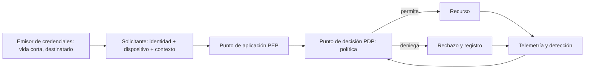
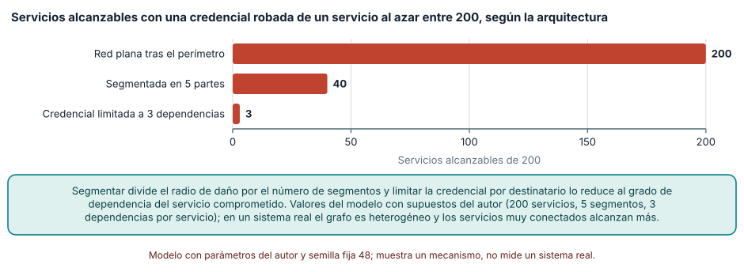
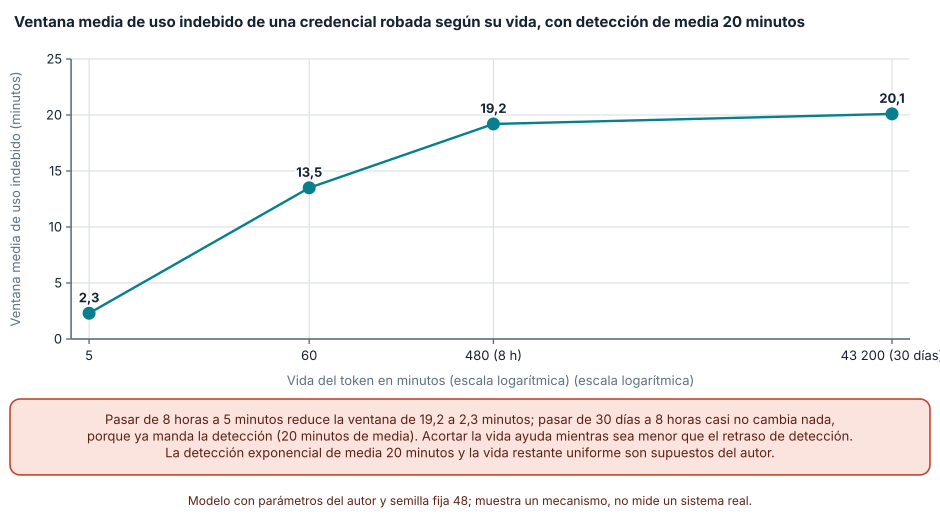

# SE-286 — Confianza cero en la práctica

## Punto profesional y fundamento pedagógico

**Punto profesional.** La clase existe para que «confianza cero» deje de ser una etiqueta de producto y se convierta en un conjunto de decisiones comprobables sobre un sistema: cada petición se autentica y se autoriza con identidad y contexto, ninguna ubicación de red concede acceso por sí sola, las credenciales duran poco y valen para un destinatario, y el daño de una credencial robada se mide en servicios alcanzables y en minutos de uso, no se supone pequeño. La arquitectura de referencia de NIST describe confianza cero como un cambio de enfoque: de defender un perímetro de red a proteger recursos, y de conceder acceso por estar «dentro» a evaluarlo en cada solicitud. Quien lo adopta como compra de un producto obtiene una consola; quien lo adopta como un conjunto de propiedades que se miden obtiene menos radio de daño.

**Por qué aparece aquí.** Cierra el bloque técnico de la Parte 23 uniendo lo anterior: las fronteras de `SE-282` contienen código, la atestación de `SE-283` da evidencia de qué corre, y esta clase decide quién puede pedir qué a quién. Se apoya en `SE-458` (identidad, autenticación y sesiones), `SE-459` (autorización y mínimo privilegio), `SE-401` (redes, identidad y secretos en cloud) y `SE-462` (secretos y separación de ambientes), y alimenta la plataforma de `SE-288`.

**Error conceptual que debe corregir.** Creer que la confianza cero es «poner autenticación en todo». La autenticación responde *quién eres*; la confianza cero exige además responder *qué puedes pedir, a quién, desde dónde, con qué estado del dispositivo y por cuánto tiempo*, en cada petición. En el modelo de la clase (semilla 48, 200 servicios en 5 segmentos), una credencial robada de un servicio alcanza 200 servicios en una red plana de confianza, 40 con segmentación en cinco y 3 con una credencial limitada por destinatario a las dependencias autorizadas: la propiedad que más reduce el daño no es autenticar, es limitar lo que cada credencial puede alcanzar.

**Secuencia de aprendizaje.** Antes de ejecutar, predices si un token legítimo sirve para otro destinatario, si sigue sirviendo seis minutos después de vencer y cuánto cambia el tiempo de uso indebido de una credencial robada al acortar su vida de 8 horas a 5 minutos. Después emites tokens firmados con audiencia y expiración, los verificas con tres alteraciones, mides el costo de verificar, calculas el radio de daño en tres arquitecturas y modelas la ventana de uso indebido según la vida del token.

**Evidencia de aprendizaje.** `confianza-cero-del-servicio.md` con el mapa de flujos entre servicios, la política por flujo (quién, a qué, con qué audiencia y vida), el cálculo de radio de daño de tu sistema, la decisión sobre la vida de las credenciales y la política de fallo del punto de decisión.

**Límite de la conclusión.** Los tokens del laboratorio se firman con HMAC-SHA-256 de la biblioteca estándar y una clave compartida generada al azar; no es OAuth, ni OpenID Connect, ni SPIFFE, y no hay proveedor de identidad ni red. El radio de daño y la ventana de uso indebido son modelos con semilla 48 y supuestos del autor (200 servicios en 5 segmentos, 3 dependencias por servicio, detección exponencial de media 20 minutos). El costo de verificar (unas decenas de microsegundos) es de Python puro sin caché ni red. **No se ejecutó** ningún punto de decisión de política, ninguna malla de servicios ni ningún proveedor de identidad. No se invocó ningún modelo de lenguaje.

### Trazabilidad fuente → afirmación

| Fuente primaria u oficial | Afirmación que respalda | Lo que no prueba |
|---|---|---|
| [NIST SP 800-207, «Zero Trust Architecture»](https://csrc.nist.gov/pubs/sp/800/207/final) | Define la confianza cero como principios centrados en recursos y no en el perímetro de red, con puntos de decisión y de aplicación de políticas. | No prescribe un producto ni un orden de implantación. |
| [CISA, «Zero Trust Maturity Model»](https://www.cisa.gov/zero-trust-maturity-model) | Describe pilares y niveles de madurez para planificar la adopción. | No mide el estado de tu sistema. |
| [SPIFFE: visión general](https://spiffe.io/docs/latest/spiffe-about/overview/) y [sitio](https://spiffe.io/) | Describe identidades de cargas de trabajo verificables y de vida corta. | No cubre la política de autorización. |
| [Google: BeyondCorp](https://cloud.google.com/beyondcorp) | Describe un modelo de acceso que no depende de la red corporativa. | No es una evaluación independiente. |
| [RFC 2104: HMAC](https://www.rfc-editor.org/rfc/rfc2104) | Define el código de autenticación con clave usado para firmar los tokens del modelo. | No es el esquema de firma de un sistema real de producción. |
| [OWASP ASVS](https://owasp.org/www-project-application-security-verification-standard/) | Ofrece requisitos verificables de autenticación, sesiones y control de acceso. | No sustituye un análisis de amenazas propio. |

## Antes de empezar

Recupera lo aprendido en `SE-459`: el mínimo privilegio limita lo que una identidad puede hacer. La pregunta activa es: **si el token de un servicio interno se filtrara hoy en un registro de errores, ¿a cuántos servicios podría llamar el que lo encuentre, durante cuánto tiempo y con qué rastro quedaría su uso?**

## Prerrequisitos

- Haber completado `SE-282` y `SE-283` y conocer de `SE-458` y `SE-459` identidad, sesiones y autorización.
- Conocer de `SE-401` cómo se emiten y rotan credenciales en un entorno cloud.
- Python 3.11 o posterior; solo biblioteca estándar (`hmac`, `hashlib`, `json`, `base64`).
- Opcional: haber leído el resumen de NIST SP 800-207 para el vocabulario de puntos de decisión y de aplicación.

## Problema auténtico

*Avisos* tiene 40 servicios internos. Todos confían en la red: si una petición llega desde dentro, se atiende. Un servicio auxiliar de informes tiene una vulnerabilidad de inyección de comandos. Un atacante la explota, obtiene un intérprete dentro del servicio y descubre que puede llamar a la base de calificaciones, al servicio de correo y al de claves, porque están en la misma red y ninguno exige nada más. La brecha no empezó por un servicio importante; se propagó porque cada servicio asumía que lo que llega de dentro es de confianza. El equipo decide cambiar el modelo.

La clase construye las piezas mínimas y mide su efecto: tokens con destinatario y expiración, verificación en el servicio receptor, un cálculo de radio de daño para tres arquitecturas y un modelo de cuánto cambia el riesgo al acortar la vida de las credenciales. Después deja la lista de lo que un diseño de confianza cero exige y que no se resuelve con tokens.

## Objetivos observables

Al terminar podrás:

1. enunciar las propiedades de confianza cero como comprobaciones sobre un sistema (autenticación por petición, autorización por recurso, credenciales con destinatario y vida corta, registro y evaluación continua);
2. emitir y verificar tokens con audiencia y expiración, y probar tres alteraciones (otra audiencia, vencido, firma alterada);
3. calcular el radio de daño de una credencial robada en una red plana, una segmentada y una con credenciales limitadas por destinatario;
4. razonar sobre la vida de una credencial frente al retraso de detección y decir cuándo acortarla deja de ayudar;
5. diseñar la política de fallo del punto de decisión (qué pasa si no responde) y la telemetría que prueba que funciona.

## Mapa conceptual



La decisión está separada de la aplicación: el punto de aplicación (un servicio, una puerta, un proxy) pregunta al de decisión y ejecuta su respuesta. Las credenciales llegan de un emisor, duran poco y nombran a su destinatario; la telemetría realimenta las decisiones y es la prueba de que funcionan.

## Temas y por qué importan

| Tema | Por qué cambia una decisión profesional | Evidencia mínima |
|---|---|---|
| Sin confianza implícita en la red | La posición de red no concede acceso. | Servicio rechaza una llamada interna sin credencial |
| Credencial con destinatario | Un token robado no sirve en otro servicio. | Rechazo por audiencia |
| Vida corta | Limita la ventana de uso indebido. | Rechazo por vencimiento |
| Verificación local | Evita una consulta de red por cada petición. | Costo medido por token |
| Radio de daño | Es la métrica que importa. | Servicios alcanzables por escenario |
| Detección | Una vida más corta que la detección ya no mejora. | Curva de la ventana |
| Fallo del punto de decisión | Define si el sistema se cierra o se abre al fallar. | Política escrita |
| Lo que no resuelve | Evita comprar una promesa. | Lista de límites |

## Conceptos y decisiones

### 1. Qué es y qué no es

NIST SP 800-207 lo describe como un conjunto de principios y no como un producto: los recursos y los datos son el centro de la protección, ninguna ubicación de red implica confianza, el acceso se concede por solicitud, con una política que considera la identidad del solicitante, el estado del dispositivo y el contexto, y se evalúa de nuevo cuando cambia algo. No elimina el perímetro (cortafuegos y segmentación siguen existiendo); elimina la *suposición* de que estar dentro basta. En términos de ingeniería, es la combinación de cuatro propiedades verificables: identidad fuerte de personas y de cargas de trabajo; autorización fina por recurso; credenciales de vida corta y alcance limitado; y registro y detección continuos.

### 2. Tokens con destinatario y expiración

En el laboratorio, un token es un objeto JSON con el sujeto, la audiencia, la expiración y un indicador de postura del dispositivo, codificado y firmado con HMAC-SHA-256. Se emitió uno para el sujeto `servicio-avisos` con audiencia `calificaciones` y vida de 300 segundos. Resultados: presentado a `calificaciones`, aceptado; presentado a `pagos`, rechazado por audiencia incorrecta; seis minutos después, rechazado por vencido; con la firma alterada, rechazado por firma inválida. Cada rechazo corresponde a una propiedad. La audiencia impide que un token robado de un servicio sirva en otro; la expiración acota cuánto tiempo sirve; la firma impide fabricar o modificar. En un sistema real, la firma suele ser asimétrica (para que el servicio receptor verifique sin poder emitir), el emisor es un servicio de identidad y los formatos son estándar (JWT, certificados X.509 de corta vida). El modelo sirve para ver las propiedades, no como diseño de producción.

### 3. El costo de verificar

Verificar un token en Python puro, sin caché y sin red, tardó unos 40 µs por petición en la máquina del laboratorio. Es un orden de magnitud, no un dato de producción, pero sirve para una conclusión de diseño: la verificación local es barata comparada con una consulta de red a un servicio de autorización, que cuesta del orden de un milisegundo en la misma máquina (`SE-340`). Por eso los sistemas prefieren credenciales autocontenidas con verificación local y reservan las consultas al punto de decisión para políticas que dependen de contexto cambiante. El compromiso: una credencial autocontenida no se puede revocar antes de vencer sin una lista de revocación o una vida muy corta.

### 4. Radio de daño

Con el modelo de 200 servicios en 5 segmentos y una credencial robada de un servicio elegido al azar (5 000 repeticiones, semilla 48): en una red plana de confianza interna, el atacante alcanza 200 servicios; con segmentación de red en cinco partes, 40; con credenciales limitadas por destinatario a las 3 dependencias autorizadas del servicio, 3. Son valores del modelo, no medidas, pero la estructura es la importante: segmentar divide por el número de segmentos, y limitar por destinatario reduce al grado de dependencia del servicio comprometido. Ambas se combinan: la segmentación contiene lo que la política no previó. La métrica del trabajo no es «cuántos controles hay» sino *cuántos servicios alcanza una credencial robada y durante cuánto tiempo*, y ese número se calcula para tu sistema.

### 5. Vida de las credenciales y retraso de detección

Una credencial robada sirve hasta que vence o hasta que alguien la detecta y la revoca, lo que ocurra primero. Con una detección de retraso exponencial de media 20 minutos y una credencial con vida restante uniforme en su vida total, la ventana media de uso indebido fue: con vida de 5 minutos, 2,3 minutos; con 60, 13,5; con 480 (8 horas), 19,2; con 43 200 (30 días), 20,1. Dos lecturas. Primera: pasar de 8 horas a 5 minutos reduce la ventana media de 19 a 2 minutos, casi diez veces. Segunda: pasar de 30 días a 8 horas casi no cambia el resultado, porque ya manda la detección (20 minutos de media). Acortar la vida ayuda mientras la vida sea menor que el retraso de detección; pasado cierto punto, el recurso es detectar más rápido, no renovar más a menudo. La cuenta tiene un costo: más renovaciones, más carga en el emisor y más fallos si el emisor se cae; por eso se elige la vida con ambos números.

### 6. Punto de decisión: qué pasa cuando falla

El punto de decisión es una dependencia más, y su política de fallo es una decisión de seguridad y de disponibilidad. Si al no responder se deniega (se cierra), un fallo del servicio de política detiene todo el sistema; si se permite (se abre), un atacante que logre degradar ese servicio desactiva la política. Tres prácticas intermedias: decisiones en caché con vida corta para las solicitudes repetidas, política embebida en el servicio receptor para los casos críticos (verificación local de tokens) y distinción por recurso (cerrar para datos de estudiantes, abrir con registro para recursos públicos). La política de fallo se escribe, se prueba apagando el punto de decisión y se revisa tras cada incidente.

### 7. Postura del dispositivo y contexto

Las políticas más ricas incorporan el estado del dispositivo (versión, cifrado de disco, presencia de agente), la ubicación, la hora y el patrón de uso. La atestación de `SE-283` aporta una forma verificable de la postura de una carga de trabajo: el emisor solo da credenciales si la medición coincide con una referencia aceptada. El costo es la complejidad de mantener esas señales y la tentación de convertir cada señal en un bloqueo: una política con demasiadas condiciones produce denegaciones que nadie entiende y excepciones permanentes que la vacían. Se empieza con pocas señales, se mide la tasa de denegaciones legítimas y se añade una a la vez.

### 8. Lo que no resuelve

La confianza cero no corrige vulnerabilidades de la aplicación (la inyección del servicio de informes sigue existiendo), no protege de un emisor de credenciales comprometido (que se convierte en el activo más crítico), no sustituye a la gestión de secretos ni al cifrado, y no es una adopción de una vez: el modelo de madurez de CISA la describe por pilares y etapas. Tampoco elimina el factor humano: una política tan estricta que impida trabajar será eludida. Sí cambia lo que importa tras una brecha: el atacante que consigue un servicio no obtiene la red, y quien responde sabe qué solicitudes se hicieron con esa credencial.

## Una aceptación y tres rechazos

La primera figura resume los cuatro casos que se probaron con el token.


**Cómo leer la figura.** Cada fila es un caso presentado a un servicio y cada columna una comprobación; la celda marcada es la que falló. Mira que cada rechazo tiene un motivo distinto y que el legítimo no marca ninguna: cada propiedad del token tiene un caso que la ejercita. **Dónde deja de valer:** es el modelo con HMAC y una clave compartida; en un sistema real faltan la revocación, la rotación de claves, la verificación asimétrica y el formato estándar, que son parte del diseño.

## Radio de daño de una credencial robada

La segunda figura compara los servicios alcanzables en las tres arquitecturas.



**Cómo leer la figura.** Cada barra es una arquitectura y su longitud los servicios que alcanza el atacante con una credencial de un servicio al azar. Mira la distancia entre segmentar y limitar por destinatario: dos órdenes de magnitud respecto a la red plana. **Dónde deja de valer:** son valores del modelo con supuestos del autor (200 servicios, 5 segmentos, 3 dependencias por servicio); en un sistema real el grafo de dependencias es heterogéneo y hay servicios muy conectados cuyo compromiso alcanza más.

## Vida de la credencial y detección

La tercera figura muestra la ventana media de uso indebido según la vida del token.



**Cómo leer la figura.** El eje horizontal es la vida del token (escala logarítmica) y el vertical la ventana media en minutos. Mira cómo la curva se aplana al llegar a la media de detección: más vida o menos vida deja de importar. **Dónde deja de valer:** la detección exponencial de media 20 minutos y la vida restante uniforme son supuestos del autor; una detección más lenta mueve el codo a la derecha, una más rápida a la izquierda.

## Definiciones de trabajo

- **Confianza cero:** conjunto de principios que niegan confianza implícita por ubicación de red y evalúan cada solicitud.
- **Punto de decisión (PDP) y de aplicación (PEP):** quien decide la política y quien la ejecuta.
- **Audiencia:** destinatario para el que una credencial es válida.
- **Credencial de vida corta:** credencial con expiración de minutos u horas.
- **Radio de daño:** conjunto de recursos alcanzables con una credencial comprometida.
- **Segmentación:** división de la red o de los servicios en partes con política entre ellas.
- **Postura del dispositivo:** estado verificable de una máquina o carga de trabajo.
- **Identidad de carga de trabajo:** identidad verificable de un servicio, distinta de la de una persona.

## Ejemplo mínimo

Un token con audiencia y expiración verificado en pocas líneas:

```python
import base64, hashlib, hmac, json, time

CLAVE = b"<CLAVE_DE_EJEMPLO>"   # en un sistema real, una clave gestionada y rotada

def firmar(claims: dict) -> str:
    cuerpo = base64.urlsafe_b64encode(json.dumps(claims, sort_keys=True).encode()).decode().rstrip("=")
    mac = base64.urlsafe_b64encode(hmac.new(CLAVE, cuerpo.encode(), hashlib.sha256).digest()).decode().rstrip("=")
    return f"{cuerpo}.{mac}"

def verificar(token: str, audiencia: str, ahora: float):
    cuerpo, _, mac = token.partition(".")
    esperado = base64.urlsafe_b64encode(hmac.new(CLAVE, cuerpo.encode(), hashlib.sha256).digest()).decode().rstrip("=")
    if not hmac.compare_digest(mac, esperado):
        return "firma inválida"
    claims = json.loads(base64.urlsafe_b64decode(cuerpo + "=" * (-len(cuerpo) % 4)))
    if claims["exp"] <= ahora:
        return "vencido"
    return "ok" if claims["aud"] == audiencia else "audiencia incorrecta"

t = firmar({"sub": "avisos", "aud": "calificaciones", "exp": time.time() + 300})
print(verificar(t, "calificaciones", time.time()), verificar(t, "pagos", time.time()))
```

Son tres comprobaciones en el orden firma, vigencia, audiencia. En producción se usa una biblioteca revisada y una clave asimétrica; este código existe para ver las propiedades.

## Ejemplo profesional

*Escenario ilustrativo: las cifras y los resultados que aparecen en este ejemplo son supuestos de la narración, no mediciones.*

Tras el incidente, el equipo de *Avisos* hace tres cambios por orden de rendimiento. Primero, mapea los flujos entre servicios y descubre que el servicio de informes llamaba a doce servicios cuando solo necesitaba dos: reduce permisos por destinatario y el radio de daño de una credencial de ese servicio pasa de doce a dos. Segundo, sustituye las credenciales de larga vida (tokens de 30 días en variables de entorno) por credenciales emitidas por un servicio de identidad con vida de 15 minutos y destinatario; para ello debe resolver la renovación automática y descubre dos servicios que guardaban el token en un archivo de configuración. Tercero, añade registro de cada decisión de autorización con el sujeto, el destinatario y el resultado, y una alerta si un servicio solicita un destinatario que nunca había usado. Al mes, la alerta se dispara por una credencial del servicio de informes que pide el servicio de claves: era una prueba del equipo de seguridad, y el tiempo hasta detectarla fue de cuatro minutos. Queda abierto el tema del emisor de credenciales, ahora el activo más crítico: se decide protegerlo con atestación de su propio servicio y revisión por dos personas de cada cambio en su política.

## Práctica guiada

1. Ejecuta `python scripts/experiments_part23_b.py zerotrust` y compara tus predicciones con los cuatro casos y los números del modelo.
2. Cambia en el modelo el retraso de detección de 20 a 5 y a 60 minutos y observa dónde se mueve el codo de la curva.
3. Dibuja los flujos entre servicios de tu sistema (quién llama a quién) y marca los que no deberían existir.
4. Para tres flujos, escribe la política: sujeto, destinatario, acciones permitidas y vida de la credencial.
5. Escribe la política de fallo del punto de decisión para tres recursos y la prueba que la verifica apagándolo.

## Ejercicios

1. **Básico.** Explica por qué un token con audiencia limita el daño de un token filtrado y qué no limita.
2. **Intermedio.** Calcula el radio de daño de tu sistema con el grafo real de dependencias: elige el servicio más conectado, cuenta los alcanzables con credenciales amplias y con credenciales por destinatario.
3. **Avanzado.** Diseña la revocación para tokens autocontenidos de 15 minutos: qué se revoca (token, sujeto, clave), cómo se propaga, cuánto tarda y qué ventana residual queda; compárala con acortar la vida a 2 minutos.

## Reto verificable

Entrega `confianza-cero-del-servicio.md` con el mapa de flujos de un sistema real o ficticio, la política por flujo, el cálculo del radio de daño en dos escenarios y la política de fallo, más un script que reproduzca las tres alteraciones de un token y la curva de la ventana con tus supuestos. Es válido si otra persona reproduce los cálculos y el documento declara qué no se implementó (emisor, revocación, firma asimétrica).

## Caso conductor

*Avisos* sustituye «lo que llega de dentro es de confianza» por credenciales con destinatario, vida corta y registro. `SE-287` pone a prueba lo aprendido en la parte: un taller para elegir y aislar un runtime ante código no confiable con una batería de comportamientos hostiles que se ejecuta de verdad.

## Preguntas frecuentes

### ¿Confianza cero significa no usar VPN ni cortafuegos?

No. Significa no depender solo de ellos. La segmentación y los cortafuegos reducen el radio de daño; la autenticación y la autorización por petición cubren lo que entra.

### ¿Cuánto debe durar un token?

Lo que permita la detección y la operación: más que el tiempo de una petición larga, mucho menos que el retraso de detección si es posible. Se elige con el modelo de la clase y se ajusta con datos.

### ¿Hace falta una malla de servicios?

No necesariamente. Una malla facilita la identidad de carga de trabajo y la autenticación mutua entre servicios; los mismos resultados se consiguen con bibliotecas y un emisor de identidad. Lo importante son las propiedades, no el producto.

### ¿Y los usuarios humanos?

Misma lógica: autenticación fuerte, sesiones cortas, autorización por recurso y estado del dispositivo. Esta clase se concentra en servicios.

## Fallo controlado y diagnóstico

**Fallo.** Tras activar la validación de audiencia en producción, un servicio de reportes empieza a recibir rechazos intermitentes de otro servicio, aunque los tokens son válidos.

**Diagnóstico paso a paso.** (1) Los rechazos dicen «audiencia incorrecta». (2) El servicio de reportes llama al servicio de calificaciones con un token cuyo destinatario es el servicio de reportes y no el de calificaciones, porque reutiliza el token con el que se autenticó ante el cliente. (3) Funcionaba antes porque la validación de audiencia estaba desactivada. (4) El token de entrada y el de salida son credenciales distintas: no se debe reenviar la credencial del cliente a otros servicios. (5) Se corrige pidiendo al emisor un token propio para cada destinatario, con la identidad del servicio y, si hace falta, el sujeto original como dato de contexto, y se añade una prueba que falla si un servicio reenvía el token que recibió.

**Lección.** La mayoría de los fallos al activar la confianza cero revelan flujos que ya eran incorrectos. La validación estricta los saca a la luz; conviene activarla primero en modo de observación (registrar sin bloquear) y medir los casos antes de aplicar.

## Errores comunes y cómo corregirlos

- **Confiar en la red interna.** Corrige exigiendo credencial por petición.
- **Reenviar el token del cliente a otros servicios.** Corrige con tokens por destinatario.
- **Credenciales de larga vida en configuración.** Corrige con emisión automática de vida corta.
- **No medir el radio de daño.** Corrige calculándolo con el grafo real.
- **Activar bloqueo sin modo de observación.** Corrige observando primero y bloqueando después.
- **Olvidar la política de fallo del punto de decisión.** Corrige escribiéndola y probándola.

## Entorno y archivos clave

- `scripts/experiments_part23_b.py`: función `zerotrust`; se ejecuta con `python scripts/experiments_part23_b.py zerotrust`.
- `scripts/experiments_part23_lab.py`: utilidades de medición.
- `scripts/figures_part23_b.py`: figuras de la parte.
- Python 3.11 o posterior; solo biblioteca estándar. Las claves del ejemplo son marcadores y no deben usarse.

## Seguridad, ética y accesibilidad

El registro de decisiones de autorización contiene datos de comportamiento de personas y de servicios: define retención, acceso y finalidad, y no lo uses para vigilar más allá de la seguridad. Las señales de postura del dispositivo pueden excluir a quien usa equipos antiguos o personales: mide cuántas denegaciones afectan a quién y ofrece una vía de excepción documentada. No pongas credenciales reales en ejemplos ni en repositorios. Las figuras tienen texto alternativo completo y valores escritos.

## Puente hacia el trabajo con agentes

Un agente que actúa con credenciales tuyas es un servicio con tu identidad: aplica la misma política. Dale credenciales de vida corta, con destinatario y acciones mínimas, no tu sesión completa; registra lo que hace y revisa el radio de daño si esa credencial se filtra en una conversación o en un registro. Cuando un agente propone «usa este token para todo», la respuesta es la propiedad que esta clase mide: ¿a cuántos recursos llega y durante cuánto tiempo?

## Transferencia

Mapea los flujos de un sistema tuyo, elige el servicio más conectado y calcula cuántos recursos alcanzaría con una credencial robada hoy. Define un cambio que lo reduzca a la mitad (destinatario, vida, segmentación), estima su costo y escribe la prueba que mostraría que funcionó. Decide la política de fallo del punto de decisión para el recurso más sensible.

## Evaluación y evidencia

| Criterio | Evidencia aceptable | Rechazo |
|---|---|---|
| Propiedades | Tres rechazos probados con su causa | «Hay autenticación» |
| Radio de daño | Cálculo con el grafo real | «Estamos segmentados» |
| Vida y detección | Elección con ambos números | Vida elegida por costumbre |
| Política de fallo | Escrita y probada apagando el punto de decisión | No definida |
| Alcance | Qué no se implementó | Confundir el modelo con un sistema |

## Fuentes

- NIST. [SP 800-207, «Zero Trust Architecture»](https://csrc.nist.gov/pubs/sp/800/207/final).
- CISA. [«Zero Trust Maturity Model»](https://www.cisa.gov/zero-trust-maturity-model).
- SPIFFE. [Visión general](https://spiffe.io/docs/latest/spiffe-about/overview/) y [sitio](https://spiffe.io/).
- Google. [BeyondCorp](https://cloud.google.com/beyondcorp). OWASP. [ASVS](https://owasp.org/www-project-application-security-verification-standard/).
- IETF. [RFC 2104, «HMAC»](https://www.rfc-editor.org/rfc/rfc2104).

## Límites y siguiente paso

Se verificaron tokens firmados con HMAC y se modelaron el radio de daño y la ventana de uso indebido con supuestos del autor; no se ejecutó ningún emisor de identidad, punto de decisión, malla de servicios ni revocación. El siguiente paso, `SE-287`, es el taller: una batería de comportamientos hostiles contra tres formas de ejecutar código ajeno, con el resultado a la vista.

## Glosario

| Término | Definición breve |
|---|---|
| Confianza cero | Principios que niegan confianza implícita por ubicación |
| PDP y PEP | Punto de decisión y punto de aplicación de la política |
| Audiencia | Destinatario para el que una credencial vale |
| Credencial de vida corta | Credencial con expiración de minutos u horas |
| Radio de daño | Recursos alcanzables con una credencial comprometida |
| Segmentación | División con política entre las partes |
| Postura del dispositivo | Estado verificable de una máquina o carga |
| Identidad de carga de trabajo | Identidad verificable de un servicio |
