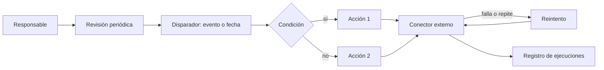
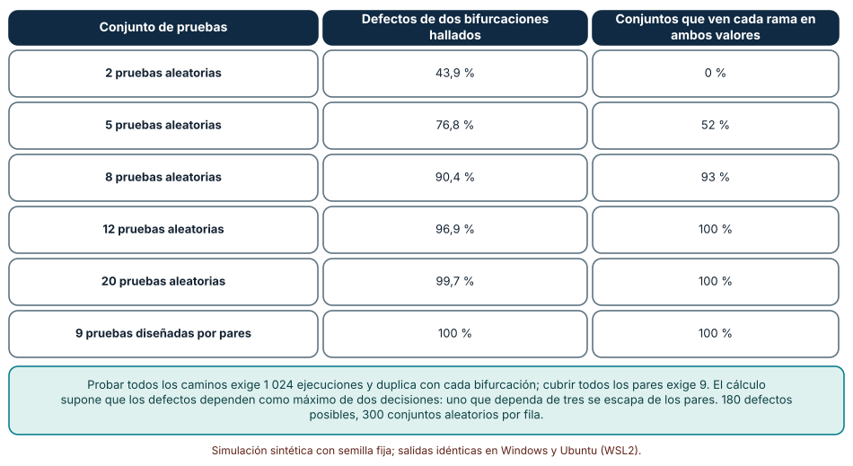
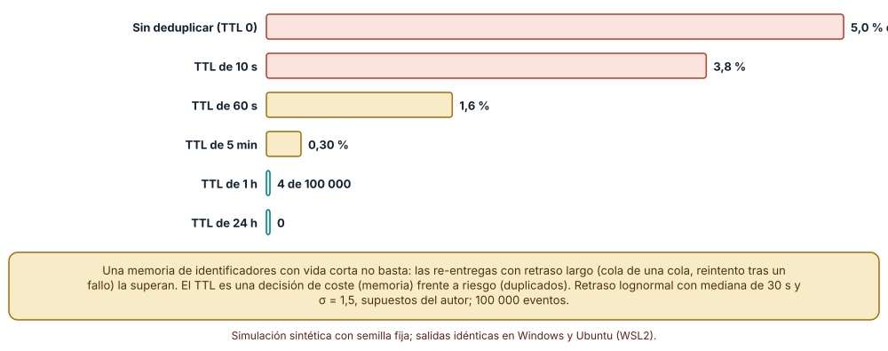
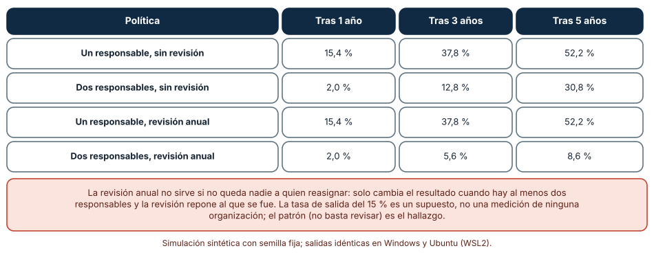

# SE-286 — Low-code, no-code y automatización visual

[← SE-285 — Sistemas geoespaciales y temporales](../../classes/part-23-software-especializado-y-dominios/se-285-sistemas-geoespaciales-y-temporales/README.md) · [↑ Parte 23](../../classes/part-23-software-especializado-y-dominios/README.md) · [📚 Índice completo](../../classes/README.md) · [🌐 Portal](../../site/classes/SE-286.html) · [SE-287 — Taller: comparar riesgos entre dominios →](../../classes/part-23-software-especializado-y-dominios/se-287-taller-comparar-riesgos-entre-dominios/README.md)

## Punto profesional y fundamento pedagógico

**Punto profesional.** La clase existe para que trates una automatización construida con bloques visuales como software de producción: tiene ramas que probar, eventos que llegan repetidos, un responsable que puede irse y límites de plataforma que no se ven en el lienzo. Quien la revisa o la hereda responde por lo que hace aunque nadie haya escrito una línea de código.

**Por qué aparece aquí.** Es la décima clase de la **Parte 23**, después de **Sistemas geoespaciales y temporales**: allí las convenciones ocultas eran el sistema de referencia y la zona horaria; aquí son las del motor que ejecuta el flujo. Cierra la serie de dominios individuales: es el dominio donde más personas crean software sin formación de ingeniería, de modo que concentra los riesgos de las clases anteriores (duplicados de `SE-278`, cobros repetidos de `SE-282`, datos sensibles de `SE-283`) en manos que no los esperan. El caso conductor sigue siendo la plataforma educativa ficticia: una automatización de avisos que lee una hoja de cálculo y envía mensajes a estudiantes.

**Error conceptual que debe corregir.** Creer que «no-code» significa «sin ingeniería». Quitar el código quita la sintaxis, no las decisiones: quedan las condiciones, los reintentos, los permisos, los datos y la responsabilidad, solo que escondidas en un diagrama que parece sencillo.

**Secuencia de aprendizaje.** Antes de leer los resultados, predices cuántas pruebas hacen falta para ver todas las ramas de un flujo y cuántas para ver todas las parejas de decisiones, y qué fracción de eventos repetidos pasa una deduplicación de memoria corta; después mides ambos y cuántas automatizaciones quedan sin responsable según cuántas personas las poseen. La secuencia usa predicción, explicación propia, contraste y recuperación. [ICAP](https://icap.education.asu.edu/research) distingue participación de construcción de conocimiento; [How People Learn II](https://nap.nationalacademies.org/catalog/24783/how-people-learn-ii-learners-contexts-and-cultures) exige conectar conocimiento previo, contexto y transferencia; la [práctica de recuperación](https://pubmed.ncbi.nlm.nih.gov/16507066/) respalda producir de nuevo la explicación tras una demora; y [Education for Life and Work](https://nap.nationalacademies.org/resource/13398/dbasse_084153.pdf) exige devolución que explique la causa del error.

**Evidencia de aprendizaje.** `flow-log.md` con la predicción, la tabla de defectos de dos ramas por conjunto de pruebas, la tabla de duplicados por tiempo de memoria, la tabla de automatizaciones sin responsable y una nota que diga qué debe estar fuera del lienzo (pruebas, responsable, registro de cambios).

**Límite de la conclusión.** Los flujos, los defectos, los retrasos de re-entrega y las tasas de salida de responsables son construcciones del autor. No se usó ninguna plataforma de automatización, ningún conector ni ninguna organización: los experimentos modelan mecanismos de combinatoria, de entrega repetida y de propiedad en CPython, no el comportamiento de un producto.

### Trazabilidad fuente → afirmación

| Fuente primaria u oficial | Afirmación que respalda | Lo que no prueba |
|---|---|---|
| [Kuhn, Kacker y Lei, NIST SP 800-142, «Practical Combinatorial Testing»](https://csrc.nist.gov/pubs/sp/800/142/final) | Expone que muchos defectos dependen de la interacción de pocos parámetros y que un conjunto de pruebas diseñado para cubrir todas las combinaciones de pocos factores los detecta con muchas menos pruebas que el producto completo. | No garantiza que ningún defecto de tres o más factores se escape. |
| [Stripe, documentación de webhooks](https://docs.stripe.com/webhooks) | Describe que un proveedor puede entregar el mismo evento más de una vez y que el receptor debe tratarlo de forma idempotente. | Describe a un proveedor; otros ofrecen otras garantías. |
| [Hohpe y Woolf, «Idempotent Receiver»](https://www.enterpriseintegrationpatterns.com/patterns/messaging/IdempotentReceiver.html) | Presenta el receptor que tolera mensajes repetidos, por ejemplo guardando identificadores ya procesados. | No fija cuánto tiempo guardar los identificadores. |

## Antes de empezar

Recupera lo aprendido en `SE-278` y `SE-282`: la entrega es al menos una vez y la escritura debe ser segura de repetir. Un flujo visual hereda ambas exigencias aunque el diagrama no las muestre. La pregunta activa es: **¿qué decide este flujo, qué ocurre cuando un evento llega dos veces y quién responde cuando la persona que lo creó se va?**

## Prerrequisitos

- Haber completado `SE-285` o poder explicar por qué una convención oculta produce un error lejos de donde se probó.
- Python 3.11 o posterior y un terminal; todo el código usa solo la biblioteca estándar.
- Saber qué es una condición booleana y una bifurcación a nivel básico.

## Problema auténtico

Una persona de secretaría de la plataforma educativa ficticia crea, con una herramienta visual, un flujo que lee una hoja de cálculo de inscripciones y envía un mensaje de bienvenida y otro de recordatorio con el enlace de pago. Funciona en las pruebas. En el primer mes, algunos estudiantes reciben el aviso dos veces, uno de cada diez con una combinación de datos inusual no recibe ninguno, el flujo deja de funcionar cuando se agota la cuota gratuita del proveedor de correo y, al marcharse la persona que lo creó, nadie sabe qué conexiones usa ni a quién avisar. Nada de eso aparece en el lienzo.

## Objetivos observables

Al terminar podrás:

1. explicar qué cambia y qué no cambia al construir con bloques visuales, con un ejemplo y un contraejemplo de la plataforma;
2. calcular cuántos caminos tiene un flujo con bifurcaciones, medir qué fracción de los defectos de interacción detectan pruebas aleatorias y comparar con un conjunto que cubre todos los pares;
3. medir cuántos eventos repetidos se ejecutan dos veces según el tiempo que se recuerdan los identificadores;
4. medir cuántas automatizaciones quedan sin responsable según el número de responsables y la política de revisión;
5. escribir las condiciones mínimas (pruebas, responsable, registro, salida) para aceptar una automatización en producción.

## Mapa conceptual



El mapa conserva la estructura de un programa (disparador, condiciones, acciones) y añade tres elementos que el lienzo suele esconder: el **reintento** de los conectores, el **registro** de ejecuciones y el **responsable**. Los tres son los que fallan en un flujo heredado.

## Temas y por qué importan

| Tema | Por qué cambia una decisión profesional | Evidencia mínima |
|---|---|---|
| Qué es low-code y no-code | Delimita qué se gana, qué se pierde y qué sigue siendo ingeniería. | Predicción, traza causal y contraejemplo de **Qué es low-code y no-code** en `flow-log.md` |
| Flujos y combinaciones | Explica por qué probar «todos los caminos» no es viable y qué sí. | Predicción, traza causal y contraejemplo de **Flujos y combinaciones** en `flow-log.md` |
| Entrega repetida y deduplicación | Evita que el mismo evento actúe dos veces. | Predicción, traza causal y contraejemplo de **Entrega repetida y deduplicación** en `flow-log.md` |
| Propiedad y gobernanza | Evita flujos huérfanos y accesos olvidados. | Predicción, traza causal y contraejemplo de **Propiedad y gobernanza** en `flow-log.md` |
| Límites de la plataforma | Declara cuotas, versionado y salida. | Predicción, traza causal y contraejemplo de **Límites de la plataforma** en `flow-log.md` |

## Conceptos y decisiones

### 1. Qué es low-code y no-code

Las plataformas **low-code** reducen la cantidad de código que se escribe, ofreciendo bloques y plantillas con código en los huecos; las **no-code** buscan que no se escriba ninguno. Ambas trasladan la complejidad: el lenguaje deja de ser texto y pasa a ser un diagrama con una semántica propia, y la plataforma decide cómo se ejecuta, se reintenta y se factura. Lo que no desaparece: requisitos, datos, condiciones, pruebas, seguridad, mantenimiento. Ganan velocidad cuando el problema encaja en la plataforma y pierden cuando hay que salirse de ella; su coste oculto aparece en el cambio, la depuración y la salida.

### 2. Flujos y combinaciones

Un flujo con `k` bifurcaciones independientes tiene `2^k` caminos. Probar todos es inviable pronto: con 10 bifurcaciones, 1 024. La observación práctica de las pruebas combinatorias es que la mayoría de los defectos dependen de la interacción de **uno o dos** factores y no de todos a la vez. Un conjunto de pruebas diseñado para que cada pareja de decisiones aparezca en todas sus cuatro combinaciones (**cobertura de pares**) es mucho más pequeño que el producto completo y detecta todos los defectos de dos factores. No detecta los de tres o más, y no sustituye pensar en qué combinaciones importan. Cubrir cada rama una vez no basta: un defecto que solo ocurre con «A en sí y B en no» exige que esa pareja se ejecute.

### 3. Entrega repetida y deduplicación

Los disparadores por evento (un *webhook*, un cambio en una hoja) se entregan **al menos una vez**: si el receptor no confirma a tiempo, el emisor reintenta. Un flujo que envía un correo por evento enviará dos si recibe dos. La defensa es el **receptor idempotente**: guardar el identificador de cada evento procesado y descartar los repetidos. Dos decisiones lo gobiernan: *dónde* se guarda la memoria (en el flujo, que muchas plataformas no ofrecen, o en un almacén aparte) y *cuánto tiempo* se recuerda. Si el tiempo es menor que el retraso máximo de la re-entrega, algunos duplicados pasan; si es mayor, cuesta memoria. El tiempo debe salir de una medición del retraso, no de una suposición.

### 4. Propiedad y gobernanza

Un flujo vive más que la atención de quien lo creó. Cada automatización necesita un **responsable** y, mejor, un suplente; una descripción de qué hace y con qué datos; y una **revisión periódica** que compruebe que sigue siendo necesaria, que sus credenciales son las mínimas y que su dueño sigue en la organización. Las conexiones suelen ejecutarse con la identidad de la persona que las creó: al irse, el flujo se rompe o, peor, sigue funcionando con permisos que nadie revisa. Una política de gobernanza no es burocracia: es la respuesta a la pregunta «¿a quién llamo a las tres de la mañana?».

### 5. Límites de la plataforma

Cada plataforma impone **cuotas** (ejecuciones, tamaño de los datos, tiempo por paso), **versionado** limitado (a veces solo un historial de ediciones), pruebas manuales y una **dependencia** del proveedor: los flujos no suelen exportarse a un formato abierto. Antes de adoptarla conviene preguntar qué pasa cuando se agota la cuota, cómo se prueba un cambio sin tocar producción, cómo se obtiene el historial de ejecuciones y cómo se migra. Los riesgos de seguridad habituales son credenciales compartidas, datos personales que viajan por conectores de terceros y permisos más amplios de los necesarios.

### Cuántas pruebas hacen falta para ver una interacción

Un flujo tiene 10 bifurcaciones (1 024 caminos). Se definen 180 defectos posibles, cada uno activado por una pareja de bifurcaciones en valores concretos (45 parejas × 4 combinaciones). Se compara un conjunto de pruebas aleatorias (300 conjuntos por tamaño) con un conjunto de 9 pruebas construido de forma voraz para cubrir todas las parejas.

```python
def cubre(pruebas, d):                      # d = (i, j, vi, vj)
    return any(t[d[0]] == d[2] and t[d[1]] == d[3] for t in pruebas)
detectados = sum(cubre(pruebas, d) for d in defectos) / len(defectos)
```

| Conjunto de pruebas | Defectos de dos bifurcaciones hallados | Conjuntos que ven cada rama en ambos valores |
|---|---:|---:|
| 2 pruebas aleatorias | 43,9 % | 0 % |
| 5 pruebas aleatorias | 76,8 % | 52 % |
| 8 pruebas aleatorias | 90,4 % | 93 % |
| 12 pruebas aleatorias | 96,9 % | 100 % |
| 20 pruebas aleatorias | 99,7 % | 100 % |
| 9 pruebas diseñadas por pares | 100 % | 100 % |

Resultado, idéntico en Windows (CPython 3.12.9) y en Ubuntu bajo WSL2 (3.12.3). Con 8 pruebas aleatorias, todas las ramas se ven casi siempre (93 %), pero aún se escapa el 10 % de los defectos de interacción.



**Cómo leer la figura.** Cada fila es un conjunto de pruebas; la segunda columna mide cuántos defectos de interacción descubre y la tercera si llegó a ver cada rama en ambos sentidos. **Dónde deja de valer:** los defectos se suponen activados por exactamente dos bifurcaciones y se reparten de forma uniforme; uno que dependa de tres, o de una combinación rara de datos, se escapa a los pares. Que 9 pruebas bastan es un resultado de 10 bifurcaciones binarias; con más valores por factor o con restricciones entre factores, el conjunto cambia.

### Duplicados que pasan una memoria corta

El 5 % de 100 000 eventos se entrega de nuevo con un retraso lognormal (mediana 30 s, σ = 1,5). El receptor recuerda los identificadores durante un tiempo; un evento repetido pasa (se ejecuta dos veces) si su retraso supera ese tiempo.

```python
if r.random() < 0.05:                                    # re-entrega
    retraso = r.lognormvariate(math.log(30), 1.5)
    if retraso > ttl:                                    # ya se olvidó
        ejecutados_dos_veces += 1
```

| Memoria de identificadores | Re-entregas | Ejecutados dos veces | % de los eventos |
|---:|---:|---:|---:|
| Ninguna (0 s) | 5 005 | 5 005 | 5,00 % |
| 10 s | 5 005 | 3 812 | 3,81 % |
| 60 s | 5 005 | 1 613 | 1,61 % |
| 5 min | 5 005 | 300 | 0,30 % |
| 1 h | 5 005 | 4 | 0,004 % |
| 24 h | 5 005 | 0 | 0 % |

Una memoria de un minuto, que muchos diseños consideran «suficiente», deja pasar casi un tercio de las re-entregas (1 613 de 5 005).



**Cómo leer la figura.** Cada barra es un tiempo de memoria; su longitud es la fracción de eventos que acaba ejecutándose dos veces. **Dónde deja de valer:** la distribución del retraso (mediana de 30 s con cola larga) es un supuesto; la de un proveedor real puede tener colas mucho más largas o más cortas, y por eso el tiempo se mide, no se copia. Recordar identificadores cuesta memoria y un almacén compartido, que no todas las plataformas permiten. La figura no mide ningún proveedor ni plataforma.

### Flujos sin responsable

Se parte de 500 automatizaciones; cada responsable se va con probabilidad del 15 % al año. Se comparan cuatro políticas: uno o dos responsables por flujo, con o sin una revisión anual que repone a quien se fue si queda al menos otro.

```python
for año in range(1, 6):
    for flujo in flujos:
        for k in range(n_resp):
            if flujo[k] and r.random() < 0.15: flujo[k] = False
        if revision and any(flujo): flujo[:] = [True] * n_resp     # repone
```

| Política | Tras 1 año | Tras 3 años | Tras 5 años |
|---|---:|---:|---:|
| Un responsable, sin revisión | 15,4 % | 37,8 % | 52,2 % |
| Dos responsables, sin revisión | 2,0 % | 12,8 % | 30,8 % |
| Un responsable, revisión anual | 15,4 % | 37,8 % | 52,2 % |
| Dos responsables, revisión anual | 2,0 % | 5,6 % | 8,6 % |

Con un solo responsable la revisión no cambia nada: cuando se va, no queda a quién reasignar. Con dos y reposición, la fracción sin dueño a cinco años baja de 30,8 % a 8,6 %.



**Cómo leer la figura.** Cada fila es una política de propiedad; las columnas muestran la fracción de flujos que ya no tiene ninguna persona responsable. **Dónde deja de valer:** la tasa de salida del 15 % anual es un supuesto del autor, no una medición de ninguna organización, y se supone que cada salida es independiente. El patrón (la revisión solo ayuda si queda a quién reasignar) no depende de esa tasa; las cifras sí.

## Definiciones de trabajo

- **low-code:** enfoque de construcción que reduce la cantidad de código escrito mediante bloques y plantillas, con código en los huecos.
- **no-code:** enfoque que busca que quien construye no escriba código, sustituido por configuración visual.
- **cobertura de pares:** propiedad de un conjunto de pruebas en que cada pareja de factores aparece en todas sus combinaciones de valores.
- **receptor idempotente:** receptor que, ante un mensaje repetido, no repite el efecto.
- **flujo huérfano:** automatización que sigue ejecutándose sin ninguna persona responsable activa.

Las definiciones son operativas para la automatización de avisos. No convierten términos con una historia más amplia en sinónimos y deben contrastarse con la documentación primaria enlazada al final.

## Ejemplo mínimo

El fragmento cuenta los caminos de un flujo y comprueba que dos pruebas no ven una interacción. Antes de ejecutarlo, predice cuántos caminos tiene con 4 bifurcaciones.

```python
import itertools
caminos = list(itertools.product((0, 1), repeat=4))
assert len(caminos) == 16
pruebas = [(0, 0, 0, 0), (1, 1, 1, 1)]
# defecto: rama 0 en 1 y rama 2 en 0
assert not any(t[0] == 1 and t[2] == 0 for t in pruebas)
assert any(t[0] == 1 and t[2] == 0 for t in caminos)
```

Con 4 bifurcaciones hay 16 caminos y dos pruebas que recorren cada rama no ven la combinación «rama 0 en 1 y rama 2 en 0». Registra versión, comando y salida; añade una prueba que la cubra y cuenta qué otras parejas siguen sin cubrir.

## Ejemplo profesional

El equipo de la plataforma establece cuatro condiciones para aceptar una automatización en producción. Primera: un documento de una página con qué hace, qué datos toca y qué cuota consume. Segunda: un conjunto de pruebas de pares sobre un entorno de prueba con datos sintéticos, con el resultado archivado. Tercera: un receptor idempotente que guarda el identificador del evento durante 24 horas, medido a partir de la cola de re-entregas del proveedor. Cuarta: dos responsables, una revisión trimestral que comprueba que la persona sigue en la organización y las credenciales son las mínimas, y un registro de ejecuciones que se conserva 90 días. Los flujos que no cumplen siguen funcionando en un entorno de pruebas sin datos reales. La automatización de avisos se reescribe con estas condiciones y su conector de correo recibe una cuenta propia, no la de una persona.

Compara con el primer flujo: sin documento, probado con un caso, sin memoria de eventos y con una sola dueña. Un diseño es adecuado cuando cualquiera puede explicar qué hace el flujo, cómo se probó y a quién llamar; es frágil cuando todo depende de la memoria de quien lo hizo.

## Práctica guiada

1. Dibuja la automatización de avisos con sus bifurcaciones y cuenta los caminos.
2. Predice cuántas pruebas aleatorias hacen falta para ver todas las ramas y cuántas para ver todos los pares; escribe los números.
3. Simula conjuntos de pruebas aleatorios y el conjunto por pares y mide los defectos de interacción que detectan.
4. Simula la re-entrega con retraso lognormal y mide los duplicados para seis tiempos de memoria.
5. Simula cinco años de propiedad con uno y dos responsables, con y sin revisión.
6. Escribe las cuatro condiciones de aceptación para tu automatización y quién las comprueba.
7. Entrega `flow-log.md` y pide a otra persona que diga qué combinación de decisiones no probaste.

## Ejercicios

1. **Pares:** para un flujo con 6 bifurcaciones, construye a mano un conjunto de pruebas que cubra todos los pares y cuenta cuántas pruebas necesitas.
2. **Memoria:** calcula con la distribución del experimento el tiempo de memoria mínimo para que se ejecute dos veces menos del 0,01 % de los eventos.
3. **Propiedad:** modifica la simulación para que la revisión reponga a quien se fue solo con probabilidad 0,5 y mide el efecto a cinco años.
4. **Salida:** lista tres preguntas que harías a una plataforma sobre cuotas, historial y exportación antes de adoptarla.

## Reto verificable

Entrega `flow-log.md` con la predicción, la tabla de pares, la de duplicados, la de propiedad y las cuatro condiciones de aceptación. Se aprueba si otra persona ejecuta el código desde un checkout limpio, obtiene los mismos números y puede decir qué combinación de dos decisiones queda sin probar y cuánto debería recordar el receptor los identificadores. No se aprueba por describir el flujo ni por afirmar que «las pruebas pasan» sin decir cuáles.

## Caso conductor

La plataforma educativa ficticia es el caso conductor de la Parte 23. Esta clase deja el décimo artefacto: la automatización de avisos con pruebas de pares, receptor idempotente de 24 horas, dos responsables y un registro de ejecuciones. `SE-287` es el taller que compara los riesgos de todos los dominios vistos. Cambia después una sola decisión, el número de responsables, y observa qué fracción de flujos queda sin dueño a los cinco años.

## Preguntas frecuentes

### ¿Es mala idea usar low-code?

No: es una buena herramienta cuando el problema encaja y el riesgo es bajo. Lo que no es buena idea es tratar el resultado como algo sin ingeniería: necesita pruebas, responsable, registro y plan de salida.

### ¿Cuántas pruebas necesito para un flujo?

Para cubrir cada rama bastan pocas; para cubrir los pares de decisiones, en torno a diez pruebas para diez bifurcaciones binarias. Lo que importa es decidir qué interacciones son relevantes.

### ¿Qué tiempo de memoria debo usar para deduplicar?

Más largo que el retraso máximo de re-entrega que el proveedor documenta o que mides en tus registros. Si no lo sabes, empieza por 24 horas y ajusta con datos.

### ¿Quién es el responsable de una automatización creada por una persona de negocio?

El área que la usa, con un nombre y un suplente declarados. La plataforma o el equipo técnico pueden dar herramientas y revisión, pero la propiedad debe ser explícita.

## Fallo controlado y diagnóstico

Reproduce el fallo clásico de la clase: **un flujo que envía dos veces el mismo aviso**. Entrega el mismo evento dos veces con 90 segundos de diferencia a un receptor que recuerda identificadores 60 segundos.

Registra síntoma, entrada mínima, hipótesis, observación que descarta cada hipótesis, causa, corrección y prueba de regresión. **Síntoma:** algunos estudiantes reciben el aviso de bienvenida dos veces, con minutos de diferencia. **Hipótesis rivales:** (a) la hoja de cálculo tiene filas duplicadas; (b) el flujo está programado dos veces; (c) el disparador entrega el evento de nuevo y la memoria de identificadores ya lo olvidó. **Prueba:** compara los identificadores de evento de las dos ejecuciones; si son iguales y el intervalo es mayor que la memoria, la causa es (c). **Conclusión:** la memoria es más corta que el retraso de re-entrega. **Regresión:** amplía la memoria al máximo retraso observado y añade una prueba que entregue el mismo evento con retraso superior a la memoria anterior. No cambies a la vez la memoria y el disparador.

## Errores comunes y cómo corregirlos

| Síntoma | Causa probable | Corrección |
|---|---|---|
| Un caso inusual no recibe aviso | Combinación de decisiones sin probar | Conjunto de pruebas de pares con los factores relevantes |
| Los avisos se envían dos veces | Disparador al menos una vez sin receptor idempotente | Guardar identificadores de evento con un tiempo medido |
| El flujo se rompe al irse su creador | Una sola persona responsable y credenciales personales | Dos responsables, cuenta de servicio y revisión periódica |
| El flujo deja de funcionar a mitad de mes | Cuota agotada no vigilada | Alerta de consumo y plan para cuando se agote |
| No se puede reproducir un error | Sin registro de ejecuciones ni entorno de pruebas | Registro con retención declarada y entorno con datos sintéticos |

## Entorno y archivos clave

```text
work/SE-286/
├── README.md
├── avisos/
│   ├── pares.py
│   ├── deduplicar.py
│   └── propiedad.py
├── tests/test_avisos.py
└── evidence/flow-log.md
```

El `README` declara plataforma, versión de Python, semillas y comandos. Los experimentos usan solo la biblioteca estándar (`random`, `math`, `itertools`) y se ejecutaron con CPython 3.12.9 en Windows 11 y 3.12.3 en Ubuntu bajo WSL2: las salidas fueron idénticas. Si añades una dependencia, fija procedencia y versión.

## Seguridad, ética y accesibilidad

- una automatización que envía mensajes a personas trata datos personales: define qué datos usa, con qué base y cuánto tiempo guarda el registro;
- las credenciales de los conectores deben ser de servicio y de mínimo privilegio, nunca las de una persona, y rotarse al cambiar el responsable;
- los mensajes automáticos deben ser comprensibles, indicar que son automáticos y ofrecer un canal humano para reclamar;
- usa datos sintéticos en las pruebas y no conectes un flujo de prueba a destinatarios reales;
- documenta con texto el flujo visual, para que una persona que usa lector de pantalla pueda revisarlo.

## Puente hacia el trabajo con agentes

Un agente al que se le pide «crea una automatización que avise a los estudiantes» encadenará los bloques más directos y la dará por terminada si una ejecución de prueba funciona. Pídele en cambio que liste las bifurcaciones y proponga un conjunto de pruebas que cubra los pares, que añada un receptor idempotente con un tiempo de memoria justificado, que use una cuenta de servicio y que escriba el documento de una página con responsable y suplente. Revisa especialmente si el flujo puede ejecutar el mismo efecto dos veces y si depende de una credencial personal: son los dos defectos que esta clase mostró.

## Transferencia

Traslada el análisis a otra automatización (por ejemplo, la sincronización de notas con otra herramienta): cambia el disparador y las acciones, y conserva el procedimiento de contar las interacciones, probar los pares, medir el retraso de re-entrega y asignar responsables. La transferencia está lograda cuando puedes explicar qué parte del riesgo dependía de la plataforma y cuál no, no cuando el diagrama se parece.

## Evaluación y evidencia

| Criterio | Evidencia para aprobar |
|---|---|
| comprensión | explicación de qué cambia y qué no al construir con bloques, con ejemplos de la automatización |
| corrección | pares, duplicados y propiedad reproducibles con las mismas semillas |
| diseño | automatización con pruebas de pares, receptor idempotente, responsables y registro |
| diagnóstico | reproducción del fallo «aviso doble» con regresión |
| incertidumbre | declaración de que ningún experimento usó una plataforma real ni una organización real |
| reproducibilidad | versiones, comandos, salida y límites declarados |

## Fuentes

- [Kuhn, Kacker y Lei, NIST SP 800-142, «Practical Combinatorial Testing»](https://csrc.nist.gov/pubs/sp/800/142/final) — pruebas combinatorias y cobertura de pares; autoridad: NIST.
- [Stripe, documentación de webhooks](https://docs.stripe.com/webhooks) — entrega repetida de eventos y receptores idempotentes; autoridad: documentación del proveedor.
- [Hohpe y Woolf, «Idempotent Receiver»](https://www.enterpriseintegrationpatterns.com/patterns/messaging/IdempotentReceiver.html) — receptor que tolera mensajes repetidos; autoridad: Enterprise Integration Patterns.
- [SWEBOK Guide v4.0a](https://www.computer.org/education/bodies-of-knowledge/software-engineering) — áreas de conocimiento de ingeniería de software; autoridad: IEEE Computer Society.
- [Python: `random`](https://docs.python.org/3/library/random.html) — generador con semilla para las simulaciones; autoridad: documentación de Python.

Cada fuente respalda el mecanismo indicado; ninguna demuestra que el 43,9 % de defectos con dos pruebas, el 1,61 % de duplicados con un minuto de memoria o el 52,2 % de flujos huérfanos se observen en una organización real. Esa afirmación depende de la plataforma, del proveedor y de la política de la organización.

## Límites y siguiente paso

Se ejecutaron tres simulaciones con datos sintéticos en Windows y Ubuntu (WSL2) con resultados idénticos. No se usó ninguna plataforma de automatización, conector, proveedor ni organización: los flujos, los defectos, los retrasos y las tasas de salida son construcciones del autor. La siguiente clase es un taller que compara los riesgos de todos los dominios de la parte.

## Glosario

- **low-code:** enfoque de construcción que reduce la cantidad de código escrito mediante bloques y plantillas, con código en los huecos.
- **no-code:** enfoque que busca que quien construye no escriba código, sustituido por configuración visual.
- **cobertura de pares:** propiedad de un conjunto de pruebas en que cada pareja de factores aparece en todas sus combinaciones de valores.
- **receptor idempotente:** receptor que, ante un mensaje repetido, no repite el efecto.
- **flujo huérfano:** automatización que sigue ejecutándose sin ninguna persona responsable activa.

---

[← SE-285 — Sistemas geoespaciales y temporales](../../classes/part-23-software-especializado-y-dominios/se-285-sistemas-geoespaciales-y-temporales/README.md) · [↑ Parte 23](../../classes/part-23-software-especializado-y-dominios/README.md) · [📚 Índice completo](../../classes/README.md) · [🌐 Portal](../../site/classes/SE-286.html) · [SE-287 — Taller: comparar riesgos entre dominios →](../../classes/part-23-software-especializado-y-dominios/se-287-taller-comparar-riesgos-entre-dominios/README.md)
