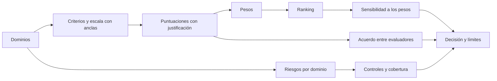
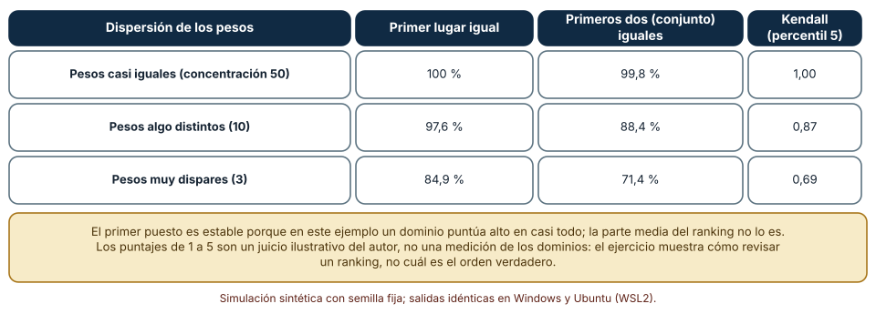
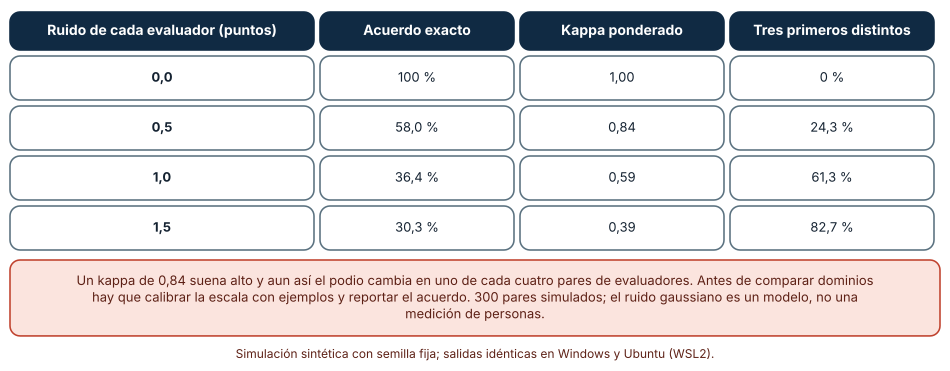
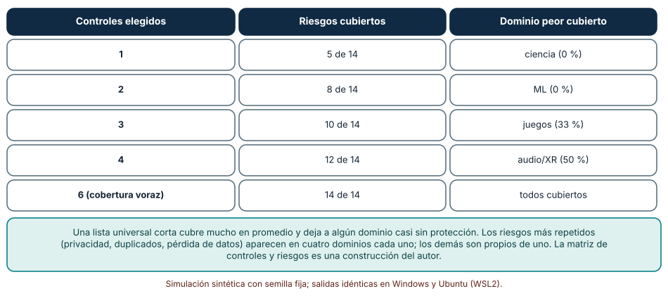

# SE-287 — Taller: comparar riesgos entre dominios

[← SE-286 — Low-code, no-code y automatización visual](../../classes/part-23-software-especializado-y-dominios/se-286-low-code-no-code-y-automatizacion-visual/README.md) · [↑ Parte 23](../../classes/part-23-software-especializado-y-dominios/README.md) · [📚 Índice completo](../../classes/README.md) · [🌐 Portal](../../site/classes/SE-287.html) · [SE-288 — Proyecto: diseño profundo de un dominio elegido →](../../classes/part-23-software-especializado-y-dominios/se-288-proyecto-diseno-profundo-de-un-dominio-elegido/README.md)

## Punto profesional y fundamento pedagógico

**Punto profesional.** El taller entrena a comparar los riesgos de dominios distintos sin fingir una precisión que no existe: construir una matriz con criterios explícitos, comprobar cuánto cambia el orden cuando cambian los pesos, medir cuánto discrepan dos personas que puntúan lo mismo y ver qué cubre una lista corta de controles comunes y qué queda sin cubrir en cada dominio.

**Por qué aparece aquí.** Se sitúa después de **Low-code, no-code y automatización visual** y antes del **Proyecto: diseño profundo de un dominio elegido**: las diez clases anteriores trataron un dominio cada una, con su mecanismo de fallo; el taller las pone una al lado de otra y deja el método de comparación que el proyecto aplicará a un dominio elegido.

**Error conceptual que debe corregir.** Creer que una tabla de riesgos con números ordena los dominios de forma objetiva. El orden depende de los pesos que se dan a los criterios y de quién puntúa; una lista universal de controles cubre mucho en promedio y deja a algún dominio casi sin protección.

**Secuencia de aprendizaje.** El taller tiene tres pasos con predicción previa: perturbar los pesos de una matriz de diez dominios y seis criterios para medir la estabilidad del primer lugar y del orden completo, simular a dos evaluadores con ruido para medir el acuerdo y cuánto cambia el podio, y calcular qué riesgos cubre una lista corta de controles. La secuencia usa predicción, explicación propia, contraste y recuperación. [ICAP](https://icap.education.asu.edu/research) distingue participación de construcción de conocimiento; [How People Learn II](https://nap.nationalacademies.org/catalog/24783/how-people-learn-ii-learners-contexts-and-cultures) exige conectar conocimiento previo, contexto y transferencia; la [práctica de recuperación](https://pubmed.ncbi.nlm.nih.gov/16507066/) respalda producir de nuevo la explicación tras una demora; y [Education for Life and Work](https://nap.nationalacademies.org/resource/13398/dbasse_084153.pdf) exige devolución que explique la causa del error.

**Evidencia de aprendizaje.** `risk-compare-log.md` con la predicción, la matriz con sus puntuaciones y su justificación, la tabla de estabilidad del ranking, la de acuerdo entre evaluadores, la de cobertura de controles y una nota que diga qué comparación no se puede hacer con estos datos.

**Límite de la conclusión.** Las puntuaciones de 1 a 5 son un juicio ilustrativo del autor, no una medición de los dominios; los controles y los riesgos de cada dominio también son una construcción suya. El taller no dice qué dominio es más peligroso: muestra cómo auditar una comparación. Los acuerdos entre evaluadores son simulaciones con ruido gaussiano, no mediciones de personas.

### Trazabilidad fuente → afirmación

| Fuente primaria u oficial | Afirmación que respalda | Lo que no prueba |
|---|---|---|
| [NIST SP 800-30 Rev. 1, «Guide for Conducting Risk Assessments»](https://nvlpubs.nist.gov/nistpubs/Legacy/SP/nistspecialpublication800-30r1.pdf) | Describe la evaluación de riesgos como la identificación de amenazas, vulnerabilidades, probabilidad e impacto y recomienda documentar los supuestos y la incertidumbre. | No proporciona puntuaciones para ningún dominio. |
| [Landis y Koch, «The Measurement of Observer Agreement for Categorical Data» (Biometrics, 1977)](https://doi.org/10.2307/2529310) | Presenta el estadístico kappa como medida de acuerdo entre observadores corregida por azar y propone una guía de lectura. | Las bandas de interpretación son convenciones, no leyes. |
| [Saltelli et al., «Global Sensitivity Analysis: The Primer» (2008)](https://doi.org/10.1002/9780470725184) | Expone cómo estudiar el efecto de variar a la vez los parámetros inciertos de un modelo en lugar de uno por uno. | No decide qué parámetros son inciertos en un caso concreto. |

## Antes de empezar

Recupera lo aprendido en `SE-277` a `SE-286`: cada dominio tiene un mecanismo de fallo característico (no asociatividad, reintento que duplica, fuga, espiral, pliegue, comisión mal redondeada, clase homogénea, reentrada, cambio de hora, flujo huérfano). La pregunta activa es: **¿qué se puede comparar entre esos dominios, con qué criterio y con cuánta confianza en el orden?**

## Prerrequisitos

- Haber completado `SE-286` o poder nombrar el mecanismo de fallo principal de dos dominios anteriores.
- Python 3.11 o posterior y un terminal; todo el código usa solo la biblioteca estándar.
- Saber qué es un promedio ponderado a nivel básico.

## Problema auténtico

La dirección de la plataforma educativa ficticia pide un ranking de «qué dominio es más arriesgado» para decidir dónde poner a la revisión externa. Dos personas del equipo puntúan los diez dominios de las clases anteriores con seis criterios; sus tablas difieren en muchos números y los dos rankings tienen el mismo primer lugar pero distinto resto. Alguien propone promediar las tablas y publicar «el orden». Nadie sabe cuánto cambia el resultado si se pondera distinto un criterio, ni si la lista corta de controles recomendada protege a todos los dominios por igual.

## Objetivos observables

Al terminar podrás:

1. construir una matriz de riesgos con criterios definidos, una escala con ejemplos ancla y la justificación de cada puntuación;
2. medir cuánto cambian el primer lugar y el orden completo cuando se perturban los pesos, y declarar qué parte del ranking es estable;
3. medir cuánto discrepan dos evaluadores con ruido y cuánto cambia el podio, y calcular un acuerdo corregido por azar;
4. calcular qué riesgos cubre una lista corta de controles y qué dominio queda peor cubierto;
5. escribir qué comparaciones el taller no permite y qué evidencia haría falta para hacerlas.

## Mapa conceptual



El mapa tiene tres comprobaciones que cuelgan de la misma matriz: la **sensibilidad** a los pesos, el **acuerdo** entre quienes puntúan y la **cobertura** de los controles. Solo cuando las tres se declaran, el ranking pasa de ser una opinión con números a una opinión con límites.

## Temas y por qué importan

| Tema | Por qué cambia una decisión profesional | Evidencia mínima |
|---|---|---|
| Criterios y escalas | Fijan qué se compara y qué significa cada nivel. | Predicción, traza causal y contraejemplo de **Criterios y escalas** en `risk-compare-log.md` |
| Pesos y sensibilidad | Muestran qué parte del orden resiste otros pesos razonables. | Predicción, traza causal y contraejemplo de **Pesos y sensibilidad** en `risk-compare-log.md` |
| Acuerdo entre evaluadores | Mide cuánto del orden depende de quién puntúa. | Predicción, traza causal y contraejemplo de **Acuerdo entre evaluadores** en `risk-compare-log.md` |
| Controles comunes y propios | Separa lo que se puede reutilizar entre dominios de lo específico. | Predicción, traza causal y contraejemplo de **Controles comunes y propios** en `risk-compare-log.md` |
| Lo que no se compara | Evita conclusiones que los datos no sostienen. | Predicción, traza causal y contraejemplo de **Lo que no se compara** en `risk-compare-log.md` |

## Conceptos y decisiones

### 1. Criterios y escalas

Comparar exige criterios que se puedan puntuar con el mismo significado en todos los dominios. Los seis del taller son: *daño del error* (cuánto cuesta equivocarse), *irreversibilidad* (si se puede deshacer), *regulación* (cuánto la ley condiciona el diseño), *dificultad de verificar* (cuánto cuesta saber si el resultado es correcto), *datos sensibles* y *dependencia de terceros*. Cada criterio necesita una **escala con ejemplos ancla** (qué es un 1, un 3 y un 5, con un caso concreto), porque «3» no significa lo mismo para dos personas. NIST recomienda además documentar los supuestos y la incertidumbre de cada valoración; una puntuación sin justificación no se puede revisar.

### 2. Pesos y sensibilidad

El ranking resulta de promediar las puntuaciones con unos pesos. Pesos iguales son una elección, no una neutralidad. La pregunta correcta no es cuál es el orden, sino **cuánto del orden sobrevive a otros pesos razonables**. Se estudia variando los pesos a la vez (no uno por uno) con un muestreo y midiendo cuántas veces se mantiene el primer lugar, el conjunto de los primeros y la concordancia de todo el orden (por ejemplo, con el coeficiente tau de Kendall). Saltelli et al. desarrollan este enfoque global frente al de mover un parámetro cada vez. Un resultado estable se declara; uno inestable se declara también.

### 3. Acuerdo entre evaluadores

Dos personas no puntúan igual aunque usen la misma escala. El porcentaje de coincidencias exactas es engañoso porque parte del acuerdo es azar. El **kappa ponderado** corrige el azar y, al ser ponderado, penaliza menos una diferencia de un punto que una de cuatro. Landis y Koch propusieron bandas de lectura, que son convenciones útiles y no leyes. Lo decisivo para el taller es otra medida: **cuánto cambia la conclusión** (el podio) cuando se cambia de evaluador, porque un kappa alto puede convivir con un orden distinto. La respuesta práctica es calibrar con ejemplos ancla, puntuar a ciegas y reconciliar las diferencias grandes.

### 4. Controles comunes y propios

Un **control** es una medida que reduce un riesgo: una prueba de propiedades, un entorno fijo, una clave de idempotencia, una minimización de datos, un registro de auditoría, un presupuesto de tiempo, un contrato con el proveedor, una copia con recuperación. Algunos protegen contra riesgos que aparecen en varios dominios (privacidad, duplicados, pérdida de datos); otros, contra uno solo (consenso, sesgo por fuga). Una lista corta de controles comunes cubre bien lo compartido y deja huecos en lo propio. El criterio es la **cobertura**: qué fracción de los riesgos de cada dominio queda cubierta, y cuál es el peor cubierto.

### 5. Lo que no se compara

Un ranking de riesgo mezcla magnitudes distintas: pérdida económica, daño físico, daño reputacional. Esos números no se suman sin una decisión de valor. Tampoco se pueden comparar probabilidades sin datos de frecuencia, ni extrapolar de una plataforma ficticia a un sector. Un buen taller termina con la lista de comparaciones que **no** se permite: no se afirma que un dominio sea «más seguro», solo que, con estos criterios y pesos, su perfil de riesgo es distinto y con qué estabilidad.

### La matriz que se compara

Las puntuaciones son un juicio del autor, de 1 (bajo) a 5 (alto), para los criterios *daño*, *irreversibilidad*, *regulación*, *dificultad de verificar*, *datos sensibles* y *terceros*:

| Dominio | Daño | Irrev. | Reg. | Verif. | Datos | Terc. | Promedio |
|---|---:|---:|---:|---:|---:|---:|---:|
| salud | 5 | 5 | 5 | 4 | 5 | 3 | 4,50 |
| fintech | 5 | 5 | 5 | 3 | 4 | 3 | 4,17 |
| blockchain | 4 | 5 | 3 | 4 | 2 | 4 | 3,67 |
| low-code | 3 | 3 | 2 | 4 | 3 | 5 | 3,33 |
| ML | 3 | 2 | 2 | 5 | 3 | 3 | 3,00 |
| datos | 3 | 2 | 2 | 3 | 3 | 3 | 2,67 |
| geo/tiempo | 3 | 2 | 2 | 3 | 3 | 3 | 2,67 |
| ciencia | 3 | 2 | 1 | 4 | 1 | 2 | 2,17 |
| audio/XR | 2 | 1 | 1 | 3 | 2 | 2 | 1,83 |
| juegos | 1 | 1 | 1 | 2 | 1 | 2 | 1,33 |

Con pesos iguales el orden es el de la tabla; «datos» y «geo/tiempo» empatan en 2,67.

### Cuánto resiste el ranking a otros pesos

Se generan 5 000 vectores de pesos con una distribución de Dirichlet de concentración 50 (casi iguales), 10 (algo distintos) y 3 (muy dispares). Para cada uno se calcula el ranking y se compara con el de pesos iguales.

```python
g = [r.gammavariate(conc / 6, 1) for _ in range(6)]
pesos = [x / sum(g) for x in g]
orden = sorted(DOMINIOS, key=lambda d: (-sum(w * s for w, s in zip(pesos, S[d])), d))
```

| Dispersión de los pesos | Primer lugar igual | Primeros dos (conjunto) iguales | Kendall (percentil 5) |
|---|---:|---:|---:|
| Casi iguales (concentración 50) | 100 % | 99,8 % | 1,00 |
| Algo distintos (10) | 97,6 % | 88,4 % | 0,87 |
| Muy dispares (3) | 84,9 % | 71,4 % | 0,69 |

Con pesos muy dispares el primer lugar de «salud» se mantiene en 4 244 de 5 000 sorteos; «low-code» lo ocupa 463 veces, «blockchain» 169 y «ML» 124. Resultado, idéntico en Windows (CPython 3.12.9) y en Ubuntu bajo WSL2 (3.12.3).



**Cómo leer la figura.** Cada fila es una dispersión de los pesos; las columnas miden cuánto del ranking original sobrevive. **Dónde deja de valer:** el primer lugar es estable porque en esta matriz un dominio puntúa alto en casi todo; con otra matriz sería distinto. La distribución de Dirichlet es una forma de definir «pesos razonables» y no la única. Y las puntuaciones son ilustrativas: la estabilidad calculada es la de esta matriz, no la de los dominios reales.

### Dos evaluadores y un podio que cambia

Se parte de las 60 puntuaciones de la matriz como «verdad» y se genera, para cada evaluador, una puntuación con ruido gaussiano de desviación `σ` (redondeada y acotada a 1–5). Se comparan 300 pares de evaluadores por nivel de ruido.

```python
a = [min(5, max(1, round(x + r.gauss(0, sigma)))) for x in verdad]
b = [min(5, max(1, round(x + r.gauss(0, sigma)))) for x in verdad]
```

| Ruido de cada evaluador (puntos) | Acuerdo exacto | Kappa ponderado | Tres primeros distintos |
|---:|---:|---:|---:|
| 0,0 | 100 % | 1,00 | 0 % |
| 0,5 | 58,0 % | 0,84 | 24,3 % |
| 1,0 | 36,4 % | 0,59 | 61,3 % |
| 1,5 | 30,3 % | 0,39 | 82,7 % |

Con un kappa de 0,84, que muchas guías leerían como acuerdo «casi perfecto», el trío de dominios más riesgosos difiere en uno de cada cuatro pares de evaluadores.



**Cómo leer la figura.** Cada fila es un nivel de ruido; la última columna es la fracción de pares de evaluadores que no llegan al mismo podio. **Dónde deja de valer:** el ruido gaussiano independiente es un modelo; las personas reales comparten sesgos (puntúan alto lo que les resulta familiar) y esos sesgos no se promedian. La figura no mide a ninguna persona ni dice cuál es el ruido típico: dice cómo se propaga el que haya.

### Qué cubre una lista corta de controles

Se definen 14 riesgos distintos repartidos entre los diez dominios (de 2 a 5 riesgos cada uno) y ocho controles, cada uno con los riesgos que cubre. Se calcula, para listas de 1 a 4 controles, la que cubre más riesgos distintos y el dominio peor cubierto; y con un algoritmo voraz, cuántos controles cubren los 14.

| Control | Riesgos que cubre (de la matriz del autor) |
|---|---|
| prueba de propiedades | error numérico, duplicados, dinero, tiempo/zona |
| entorno y semilla fijos | no reproducible, error numérico, sesgo/fuga |
| idempotencia y claves | duplicados, dinero, automatización huérfana, fraude |
| minimizar y anonimizar | privacidad, regulación, sesgo/fuga |
| auditoría e historial | regulación, fraude, dinero, automatización huérfana, consenso |
| presupuesto de tiempo | latencia, consenso |
| contrato con terceros | dependencia, automatización huérfana, regulación |
| copias y recuperación | pérdida de datos, dependencia |

```python
mejor = max(itertools.combinations(CONTROLES, k),
            key=lambda cs: len(set().union(*(CONTROLES[c] for c in cs)) & riesgos))
```

| Controles elegidos | Riesgos cubiertos | Dominio peor cubierto |
|---|---:|---|
| 1 (auditoría e historial) | 5 de 14 | ciencia (0 %) |
| 2 (+ prueba de propiedades) | 8 de 14 | ML (0 %) |
| 3 (+ entorno y semilla fijos) | 10 de 14 | juegos (33 %) |
| 4 (+ copias y recuperación) | 12 de 14 | audio/XR (50 %) |
| 6 (cobertura voraz) | 14 de 14 | todos cubiertos |

Los riesgos más repetidos son privacidad, duplicados y pérdida de datos, con cuatro dominios cada uno; sesgo por fuga, consenso y automatización huérfana son propios de uno. Resultado, idéntico en ambos sistemas salvo el orden de listado de empates.



**Cómo leer la figura.** Cada fila es el tamaño de la lista de controles; la tercera columna nombra el dominio que menos se beneficia. **Dónde deja de valer:** qué control cubre qué riesgo y qué riesgos tiene cada dominio son juicios del autor; con otra asignación, las cifras cambian. Que un control «cubra» un riesgo no mide cuánto lo reduce, solo que es pertinente. Una cobertura del 100 % es una cobertura de lista, no una garantía.

## Definiciones de trabajo

- **ejemplo ancla:** caso concreto que fija el significado de un nivel de una escala de puntuación.
- **sensibilidad global:** análisis del efecto de variar a la vez varios parámetros inciertos sobre el resultado de un modelo.
- **kappa ponderado:** medida de acuerdo entre evaluadores corregida por azar que penaliza más las diferencias grandes.
- **control:** medida que reduce la probabilidad o el impacto de un riesgo.
- **cobertura de controles:** fracción de los riesgos de un dominio a los que un conjunto de controles es pertinente.

Las definiciones son operativas para el taller. No convierten términos con una historia más amplia en sinónimos y deben contrastarse con la documentación primaria enlazada al final.

## Ejemplo mínimo

El fragmento calcula un promedio ponderado y comprueba que un cambio de pesos invierte un orden. Antes de ejecutarlo, predice cuál de los dos dominios queda primero con los pesos del segundo caso.

```python
S = {"A": (5, 1), "B": (3, 3)}                  # dos criterios
def puntaje(d, w): return sum(wi * si for wi, si in zip(w, S[d]))
assert puntaje("A", (0.5, 0.5)) == puntaje("B", (0.5, 0.5)) == 3.0
assert puntaje("A", (0.8, 0.2)) > puntaje("B", (0.8, 0.2))     # A primero
assert puntaje("A", (0.2, 0.8)) < puntaje("B", (0.2, 0.8))     # B primero
```

Con pesos iguales empatan; con peso 0,8 al primer criterio gana A, con 0,8 al segundo gana B. Registra versión, comando y salida; busca el peso en que se cruzan.

## Ejemplo profesional

El equipo de la plataforma redacta la matriz con una escala de cinco niveles y un ejemplo ancla por criterio (por ejemplo, para *irreversibilidad*: 1 = se deshace con un clic; 3 = se deshace con una operación manual; 5 = no se puede deshacer). Dos personas puntúan por separado y sin ver la otra tabla; las diferencias de dos o más puntos se discuten y se registran con su motivo. Se calcula el kappa ponderado y la estabilidad del ranking con 5 000 sorteos de pesos, y el informe publica tres líneas: el primer lugar (con su estabilidad), las parejas empatadas y la lista de comparaciones que no se hacen. La recomendación de controles no es «los seis para todos» sino los dos comunes más uno propio por dominio. La revisión externa se pide al dominio de mayor impacto y se registra que se eligió por impacto y no por posición en el ranking.

Compara con la primera propuesta: promediar las dos tablas y publicar el orden. Un diseño es adecuado cuando el informe dice cuánto confiar en cada afirmación; es frágil cuando el orden se presenta como un hecho.

## Práctica guiada

1. Escribe los seis criterios con una escala de cinco niveles y un ejemplo ancla por nivel extremo.
2. Puntúa los diez dominios con una justificación de una línea por celda.
3. Predice si el primer lugar resiste pesos muy dispares y escribe el porcentaje.
4. Genera 5 000 vectores de pesos y mide la estabilidad del primer lugar, de los dos primeros y del orden completo.
5. Simula a dos evaluadores con tres niveles de ruido y mide el acuerdo exacto, el kappa ponderado y el cambio del podio.
6. Asigna riesgos a los dominios y controles a los riesgos, y calcula la mejor lista de uno a cuatro controles y el dominio peor cubierto.
7. Entrega `risk-compare-log.md` y pide a otra persona que diga qué afirmación del informe quitaría por estar poco sostenida.

## Ejercicios

1. **Pesos:** con la matriz del taller, encuentra el peso de *dependencia de terceros* (repartiendo el resto por igual entre los otros cinco criterios) a partir del cual «low-code» pasa a ocupar el primer lugar; la respuesta ronda 0,47.
2. **Acuerdo:** calcula cuánto debe bajar el ruido de los evaluadores para que el podio difiera en menos del 5 % de los pares.
3. **Cobertura:** añade un noveno control que cubra los riesgos peor atendidos y recalcula la lista de tres.
4. **Límites:** redacta tres comparaciones que el informe no debe hacer y la evidencia que se necesitaría para hacerlas.

## Reto verificable

Entrega `risk-compare-log.md` con la predicción, la matriz con justificaciones, las tres tablas y la lista de comparaciones no permitidas. Se aprueba si otra persona ejecuta el código desde un checkout limpio, obtiene los mismos números y puede decir qué parte del ranking resiste otros pesos y qué dominio queda peor cubierto por la lista corta. No se aprueba por entregar un orden sin decir su estabilidad ni su acuerdo.

## Caso conductor

La plataforma educativa ficticia es el caso conductor de la Parte 23. Este taller deja el undécimo artefacto: una matriz de diez dominios con su estabilidad, su acuerdo entre evaluadores y su cobertura de controles. `SE-288` pide aplicar el método a un dominio elegido, con un diseño profundo y su propia evidencia. Cambia después una sola decisión, el peso de un criterio, y observa qué parte del orden se mueve.

## Preguntas frecuentes

### ¿Hay una forma correcta de dar los pesos?

No hay una forma correcta; hay formas defendibles. Lo que se exige es declararla y mostrar cuánto cambia el resultado con otras razonables.

### ¿Un kappa alto garantiza que el ranking es fiable?

No: puede convivir con un podio distinto, como muestra la simulación. Hay que medir también cuánto cambia la conclusión de un evaluador a otro.

### ¿Una lista de controles que cubre todos los riesgos protege el sistema?

Cubre la lista, no el sistema: dice que cada riesgo tiene un control pertinente, no que el control sea eficaz ni que la lista de riesgos esté completa.

### ¿Se pueden usar estos números para decidir un presupuesto?

No directamente: son ilustrativos. Para decidir se necesitan datos del dominio real (frecuencias, costes) y personas con experiencia en él.

## Fallo controlado y diagnóstico

Reproduce el fallo clásico del taller: **un ranking que cambia de primer lugar con un cambio razonable de pesos**. Sortea pesos muy dispares y mira cuántas veces el primer lugar no es «salud».

Registra síntoma, entrada mínima, hipótesis, observación que descarta cada hipótesis, causa, corrección y prueba de regresión. **Síntoma:** al dar más peso a «dependencia de terceros», «low-code» pasa al primer lugar. **Hipótesis rivales:** (a) hay un error en el cálculo del promedio; (b) la matriz tiene una puntuación mal copiada; (c) el orden es sensible a ese peso. **Prueba:** recalcula a mano los dos promedios con los pesos modificados; si coinciden con el programa y las celdas son las de la matriz, la causa es (c). **Conclusión:** el primer lugar no es estable frente a ese peso. **Regresión:** añade al informe la estabilidad medida y una prueba que falle si el primer lugar cambia con pesos dentro del rango declarado sin que el informe lo diga. No cambies a la vez los pesos y las puntuaciones.

## Errores comunes y cómo corregirlos

| Síntoma | Causa probable | Corrección |
|---|---|---|
| Los dos evaluadores discrepan en muchas celdas | Escala sin ejemplos ancla | Calibrar con casos ancla y puntuar a ciegas |
| Se publica un orden como si fuera un hecho | No se mide la sensibilidad a los pesos | Muestrear pesos y declarar la estabilidad |
| Un kappa alto tranquiliza y el podio cambia | Se mide el acuerdo pero no su efecto | Medir también el cambio en la conclusión |
| La lista de controles «cubre todo» y un dominio queda desprotegido | Se mira la cobertura en promedio | Calcular el dominio peor cubierto |
| Se suman daños de naturaleza distinta | Mezcla de magnitudes sin decisión de valor | Declarar qué no se compara y por qué |

## Entorno y archivos clave

```text
work/SE-287/
├── README.md
├── taller/
│   ├── matriz.py
│   ├── sensibilidad.py
│   └── cobertura.py
├── tests/test_taller.py
└── evidence/risk-compare-log.md
```

El `README` declara plataforma, versión de Python, semillas y comandos. Los experimentos usan solo la biblioteca estándar (`random`, `itertools`, `statistics`) y se ejecutaron con CPython 3.12.9 en Windows 11 y 3.12.3 en Ubuntu bajo WSL2: las salidas fueron idénticas salvo el orden de listado de elementos empatados. Si añades una dependencia, fija procedencia y versión.

## Seguridad, ética y accesibilidad

- una matriz de riesgos puede usarse para justificar decisiones sobre personas: documenta quién puntúa, con qué información y con qué conflicto de intereses;
- no presentes puntuaciones de juicio como mediciones ni uses el orden para excluir a una comunidad o a un dominio sin evidencia;
- las decisiones que afectan a personas deben poder cuestionarse con un procedimiento conocido;
- describe las tablas con texto y no uses color como única señal;
- usa datos sintéticos y no incluyas información real de organizaciones o personas.

## Puente hacia el trabajo con agentes

Un agente al que se le pide «compara los riesgos de estos dominios» devolverá una tabla con números que parecen medidos y un orden definitivo. Pídele en cambio que defina cada criterio con ejemplos ancla, que declare los pesos y muestre la estabilidad del ranking con otros pesos, que puntúe dos veces por separado y reporte el acuerdo, y que liste lo que no se puede comparar. Revisa especialmente si presenta puntuaciones de juicio como datos y si da un orden sin su incertidumbre: son los dos defectos que este taller mostró.

## Transferencia

Traslada el taller a otra comparación (por ejemplo, tres proveedores de una herramienta): cambia los objetos y los criterios, y conserva el procedimiento de anclar la escala, muestrear los pesos, medir el acuerdo y calcular la cobertura. La transferencia está lograda cuando puedes explicar qué parte de la conclusión resistía y cuál no, no cuando la tabla se parece.

## Evaluación y evidencia

| Criterio | Evidencia para aprobar |
|---|---|
| comprensión | explicación de criterios, pesos, acuerdo y cobertura con ejemplos de la matriz |
| corrección | estabilidad, acuerdo y cobertura reproducibles con las mismas semillas |
| diseño | matriz con anclas, justificaciones y lista de comparaciones no permitidas |
| diagnóstico | reproducción del fallo «primer lugar inestable» con regresión |
| incertidumbre | declaración de que las puntuaciones son un juicio ilustrativo y no mediciones |
| reproducibilidad | versiones, comandos, salida y límites declarados |

## Fuentes

- [NIST SP 800-30 Rev. 1, «Guide for Conducting Risk Assessments»](https://nvlpubs.nist.gov/nistpubs/Legacy/SP/nistspecialpublication800-30r1.pdf) — evaluación de riesgos con documentación de supuestos e incertidumbre; autoridad: NIST.
- [Landis y Koch, «The Measurement of Observer Agreement for Categorical Data» (Biometrics, 1977)](https://doi.org/10.2307/2529310) — kappa y su interpretación; autoridad: Biometrics.
- [Saltelli et al., «Global Sensitivity Analysis: The Primer» (2008)](https://doi.org/10.1002/9780470725184) — análisis de sensibilidad global; autoridad: Wiley.
- [SWEBOK Guide v4.0a](https://www.computer.org/education/bodies-of-knowledge/software-engineering) — áreas de conocimiento de ingeniería de software; autoridad: IEEE Computer Society.
- [Python: `random`](https://docs.python.org/3/library/random.html) — generador con semilla para las simulaciones; autoridad: documentación de Python.

Cada fuente respalda el mecanismo indicado; ninguna demuestra que el 84,9 % de estabilidad, el 24,3 % de podios distintos o los 10 de 14 riesgos cubiertos se observen con dominios reales. Esa afirmación depende de las puntuaciones, de los evaluadores y de los controles.

## Límites y siguiente paso

Se ejecutaron tres simulaciones con datos sintéticos en Windows y Ubuntu (WSL2) con resultados idénticos salvo el orden de listado de empates. Las puntuaciones, los riesgos y los controles son un juicio ilustrativo del autor, no una medición de ningún dominio, evaluador ni organización. El proyecto final aplica este método a un dominio elegido.

## Glosario

- **ejemplo ancla:** caso concreto que fija el significado de un nivel de una escala de puntuación.
- **sensibilidad global:** análisis del efecto de variar a la vez varios parámetros inciertos sobre el resultado de un modelo.
- **kappa ponderado:** medida de acuerdo entre evaluadores corregida por azar que penaliza más las diferencias grandes.
- **control:** medida que reduce la probabilidad o el impacto de un riesgo.
- **cobertura de controles:** fracción de los riesgos de un dominio a los que un conjunto de controles es pertinente.

---

[← SE-286 — Low-code, no-code y automatización visual](../../classes/part-23-software-especializado-y-dominios/se-286-low-code-no-code-y-automatizacion-visual/README.md) · [↑ Parte 23](../../classes/part-23-software-especializado-y-dominios/README.md) · [📚 Índice completo](../../classes/README.md) · [🌐 Portal](../../site/classes/SE-287.html) · [SE-288 — Proyecto: diseño profundo de un dominio elegido →](../../classes/part-23-software-especializado-y-dominios/se-288-proyecto-diseno-profundo-de-un-dominio-elegido/README.md)
