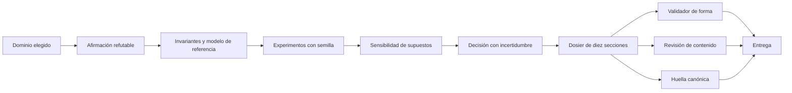
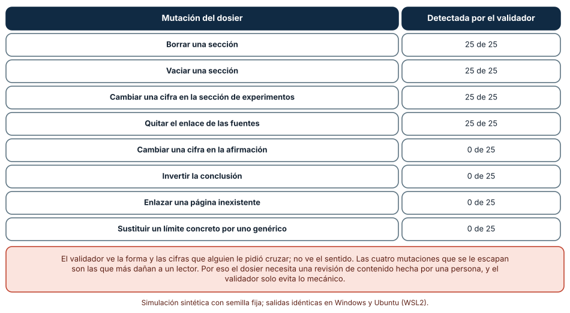
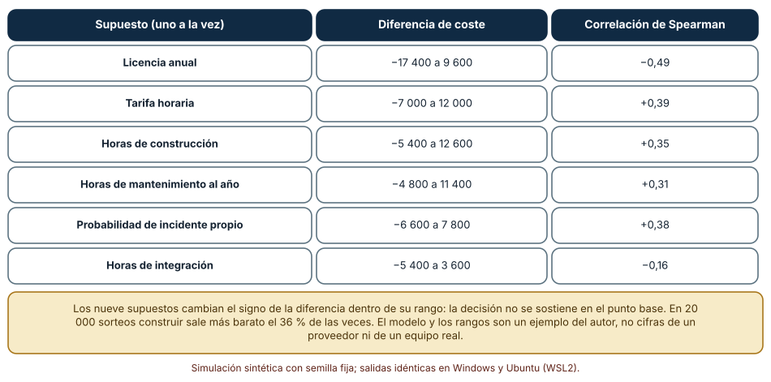
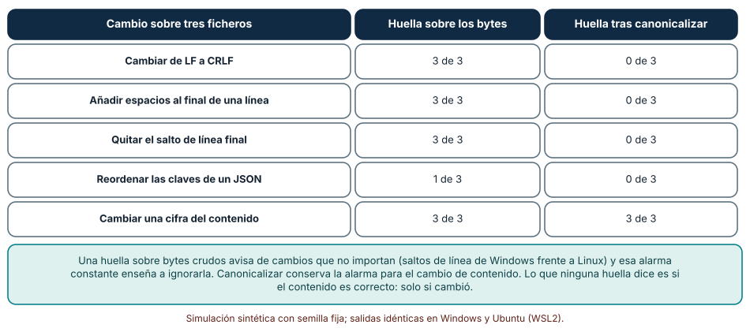

# SE-288 — Proyecto: diseño profundo de un dominio elegido

[← SE-287 — Taller: comparar riesgos entre dominios](../../classes/part-23-software-especializado-y-dominios/se-287-taller-comparar-riesgos-entre-dominios/README.md) · [↑ Parte 23](../../classes/part-23-software-especializado-y-dominios/README.md) · [📚 Índice completo](../../classes/README.md) · [🌐 Portal](../../site/classes/SE-288.html) · [SE-289 — Cohesión, acoplamiento y encapsulación →](../../classes/part-24-diseno-patrones-y-refactorizacion/se-289-cohesion-acoplamiento-y-encapsulacion/README.md)

## Punto profesional y fundamento pedagógico

**Punto profesional.** El proyecto integra la parte: elegir un dominio, formular una afirmación que se pueda refutar, escribir las invariantes y un modelo de referencia, medir con experimentos reproducibles, probar cuánto depende la decisión de los supuestos y entregar un dosier que otra persona pueda verificar. Quien lo entrega responde por lo que el dosier dice y por lo que ningún validador ve.

**Por qué aparece aquí.** Cierra la **Parte 23** después de **Taller: comparar riesgos entre dominios**: el taller dio un método para comparar y mostró sus límites; el proyecto aplica ese método a un dominio, con la profundidad que una comparación no alcanza. Reúne las prácticas de las diez clases anteriores (variar semillas, escribir idempotencia, comparar con un oráculo, declarar la precisión) en un solo entregable. El caso conductor es la plataforma educativa ficticia, y el ejemplo desarrollado es una conciliación de pagos; tú eliges el tuyo.

**Error conceptual que debe corregir.** Creer que un dosier completo es un dosier correcto. Un validador de estructura comprueba que existan las secciones y que algunas cifras coincidan; no sabe si la conclusión sigue de la evidencia, si un enlace dice lo que se le atribuye ni si un límite es real o de adorno.

**Secuencia de aprendizaje.** El proyecto tiene tres pasos con predicción previa: validar un dosier con 200 mutaciones de ocho tipos para ver qué detecta un validador de forma y qué no, medir cuánto mueve cada supuesto la diferencia entre construir y comprar, y comprobar qué cambios del paquete altera una huella calculada sobre los bytes y cuáles una canonicalizada. La secuencia usa predicción, explicación propia, contraste y recuperación. [ICAP](https://icap.education.asu.edu/research) distingue participación de construcción de conocimiento; [How People Learn II](https://nap.nationalacademies.org/catalog/24783/how-people-learn-ii-learners-contexts-and-cultures) exige conectar conocimiento previo, contexto y transferencia; la [práctica de recuperación](https://pubmed.ncbi.nlm.nih.gov/16507066/) respalda producir de nuevo la explicación tras una demora; y [Education for Life and Work](https://nap.nationalacademies.org/resource/13398/dbasse_084153.pdf) exige devolución que explique la causa del error.

**Evidencia de aprendizaje.** `domain-package-log.md` con la predicción, el dosier de diez secciones, el validador con sus mutaciones, el análisis de sensibilidad, el manifiesto de huellas y la lista de lo que el validador no ve, firmada por quien revisó el contenido.

**Límite de la conclusión.** El dosier de ejemplo, el modelo de coste, los rangos de los supuestos y las mutaciones son construcciones del autor. No se auditó ningún sistema real, no se evaluó ninguna norma ni ningún proveedor y no hubo revisión de una persona experta en ningún dominio: el proyecto muestra un método de entrega, no la corrección de un diseño concreto.

### Trazabilidad fuente → afirmación

| Fuente primaria u oficial | Afirmación que respalda | Lo que no prueba |
|---|---|---|
| [NIST SP 800-218, «Secure Software Development Framework (SSDF)»](https://csrc.nist.gov/pubs/sp/800/218/final) | Reúne prácticas de desarrollo seguro que incluyen conservar evidencia de verificación y proteger la integridad del código y de los artefactos. | No prescribe el formato de un dosier ni garantiza la ausencia de vulnerabilidades. |
| [Architectural Decision Records](https://adr.github.io/) | Propone registrar cada decisión de arquitectura con su contexto, alternativas y consecuencias, de modo que pueda revisarse. | No dice qué decisión es correcta. |
| [Saltelli et al., «Global Sensitivity Analysis: The Primer» (2008)](https://doi.org/10.1002/9780470725184) | Expone cómo estudiar el efecto de variar a la vez varios parámetros inciertos del modelo sobre una decisión. | No fija los rangos de ningún parámetro real. |

## Antes de empezar

Recupera lo aprendido en `SE-287`: un ranking sin su estabilidad es una opinión con números. Un dosier sin su verificación es lo mismo con prosa. La pregunta activa es: **¿qué puede comprobar otra persona de lo que afirmo sin preguntarme nada, y qué parte de mi conclusión depende de que me crea?**

## Prerrequisitos

- Haber completado `SE-287` o poder explicar qué mide la estabilidad de un ranking.
- Python 3.11 o posterior y un terminal; todo el código usa solo la biblioteca estándar (`hashlib`, `json`, `random`).
- Haber estudiado al menos tres de las clases `SE-277` a `SE-286` con sus experimentos.

## Problema auténtico

Tres personas de la plataforma educativa ficticia entregan «el diseño de su dominio»: un documento largo con secciones bien rotuladas, tablas, cifras y enlaces. Al revisarlos, uno afirma «100 % de corridas» sin que la cifra aparezca en ningún experimento; otro cita una página que no dice lo que se le atribuye; el tercero tiene un límite escrito como «hay limitaciones generales». Una herramienta de revisión de estructura aprobó los tres documentos. Además, el paquete del primero cambia de huella cada vez que se abre en otro sistema operativo, aunque nadie ha tocado su contenido.

## Objetivos observables

Al terminar podrás:

1. elegir un dominio y formular una afirmación refutable con su criterio de aceptación, con un ejemplo y un contraejemplo;
2. escribir invariantes y un modelo de referencia independiente para ese dominio y reproducir un experimento con semillas fijas en dos sistemas;
3. medir qué mutaciones de un dosier detecta un validador de forma y listar las que exigen una persona;
4. medir con un análisis de sensibilidad qué supuestos cambian la decisión y declarar la decisión con su incertidumbre;
5. calcular una huella canónica del paquete y declarar qué cambios alerta y cuáles no.

## Mapa conceptual



El mapa termina en tres comprobaciones con naturalezas distintas: el **validador** (forma), la **revisión** (sentido) y la **huella** (integridad). Cada una ve lo que las otras no ven; la entrega las exige las tres.

## Temas y por qué importan

| Tema | Por qué cambia una decisión profesional | Evidencia mínima |
|---|---|---|
| Afirmación refutable | Convierte un tema en algo que puede ser falso. | Predicción, traza causal y contraejemplo de **Afirmación refutable** en `domain-package-log.md` |
| Invariantes y oráculo | Fija lo que nunca debe pasar y con qué se compara lo que debe pasar. | Predicción, traza causal y contraejemplo de **Invariantes y oráculo** en `domain-package-log.md` |
| Experimentos reproducibles | Permite que otra persona obtenga los mismos números. | Predicción, traza causal y contraejemplo de **Experimentos reproducibles** en `domain-package-log.md` |
| Sensibilidad de supuestos | Muestra si la decisión sobrevive a otros valores razonables. | Predicción, traza causal y contraejemplo de **Sensibilidad de supuestos** en `domain-package-log.md` |
| Dosier verificable | Separa lo que se valida con una herramienta de lo que exige una persona. | Predicción, traza causal y contraejemplo de **Dosier verificable** en `domain-package-log.md` |

## Conceptos y decisiones

### 1. Afirmación refutable

Un tema («pagos») no se puede refutar; una afirmación («el libro mayor conserva el dinero en 10 000 corridas aleatorias y detecta 5 de 5 fallos inyectados») sí: basta una corrida que la contradiga. Una buena afirmación nombra el objeto, la medida, el umbral y la población sobre la que se hace, y va acompañada de lo que la haría falsa. Evita las afirmaciones que ningún resultado podría desmentir («el diseño es robusto») y las que dependen de datos que no tienes. Cada afirmación del dosier debe enlazar con el experimento que la sostiene.

### 2. Invariantes y oráculo

Las **invariantes** dicen lo que nunca debe suceder; el **oráculo** es un modelo de referencia independiente que dice qué debe suceder. `SE-282` mostró que las primeras no bastan: un importe equivocado puede conservar el total. En cada dominio el oráculo toma una forma distinta: una suma exacta en ciencia, una tabla ya idempotente en datos, un umbral con línea base en aprendizaje automático, una simulación de paso fino en juegos, una implementación lenta y simple en dinero. Lo que importa es que sea más simple que lo probado y que no comparta su defecto.

### 3. Experimentos reproducibles

Cada experimento del dosier lleva su comando, su semilla, su versión de Python y su salida, y se ejecuta en al menos dos entornos. Si los números difieren, la diferencia se explica (coma flotante, orden, codificación) en lugar de ocultarse. Los experimentos con azar se repiten con varias semillas y se reporta la dispersión, como en `SE-277`. Los que usan datos sintéticos declaran cómo se generaron y qué no representan. Un experimento que solo su autor puede ejecutar es una anécdota.

### 4. Sensibilidad de supuestos

Toda decisión descansa en supuestos inciertos: costes, probabilidades, tiempos. En lugar de probar un valor, se define un rango por supuesto y se estudia el efecto de variarlos. El análisis uno a uno (mover un parámetro cada vez) da la amplitud de cada uno; el global (muestrear todos a la vez) da la probabilidad de que la decisión cambie y la correlación de cada parámetro con el resultado. Si el signo de la diferencia cambia dentro de los rangos, la decisión **no está sostenida** por los supuestos y el dosier debe decirlo y decir qué dato la resolvería.

### 5. Dosier verificable

El dosier tiene diez secciones: dominio, afirmación, invariantes, datos, experimentos, riesgos, límites, fuentes, decisiones y revisión. Un **validador de forma** comprueba lo mecánico: que existan, que no estén vacías, que haya enlaces, que algunas cifras coincidan entre secciones. No comprueba el sentido. La **revisión de contenido** la hace una persona que no participó: contrasta cada afirmación con su evidencia, abre las fuentes y juzga si los límites son concretos. La **huella** del paquete (SHA-256 de cada fichero en un manifiesto) alerta de cambios, y para no alertar por saltos de línea o espacios al final se calcula tras **canonicalizar**.

### Un validador de forma frente a ocho mutaciones

Se parte de un dosier de ejemplo (conciliación de pagos de una tienda ficticia) que pasa el validador. El validador exige las diez secciones no vacías, un enlace en las fuentes, un límite de al menos 15 caracteres y que el número de corridas y de fallos detectados de la sección de experimentos coincida con los campos numéricos. Se aplican 25 veces cada una de ocho mutaciones y se cuenta cuántas detecta.

```python
def validar(d):
    errores = []
    for s in SECCIONES:
        if s not in d: errores.append("falta " + s)
        elif not str(d[s]).strip(): errores.append("vacía " + s)
    if not re.search(r"https?://\S+", str(d.get("fuentes", ""))): errores.append("sin enlace")
    if f"corridas={d.get('n_corridas')}" not in str(d.get("experimentos", "")): errores.append("corridas")
    return errores
```

| Mutación del dosier | Detectada por el validador |
|---|---:|
| Borrar una sección | 25 de 25 |
| Vaciar una sección | 25 de 25 |
| Cambiar una cifra en la sección de experimentos | 25 de 25 |
| Quitar el enlace de las fuentes | 25 de 25 |
| Cambiar una cifra en la afirmación | 0 de 25 |
| Invertir la conclusión | 0 de 25 |
| Enlazar una página inexistente | 0 de 25 |
| Sustituir un límite concreto por uno genérico | 0 de 25 |

Resultado, idéntico en Windows (CPython 3.12.9) y en Ubuntu bajo WSL2 (3.12.3). El validador detecta el 100 % de las cuatro mutaciones de forma y el 0 % de las cuatro de sentido.



**Cómo leer la figura.** Cada fila es un tipo de alteración del dosier; la columna dice cuántas de 25 la detecta el validador. **Dónde deja de valer:** el validador es el del autor, hecho con las reglas que se le ocurrieron; uno con más reglas (por ejemplo, que la afirmación repita cifras de los experimentos) detectaría la cuarta mutación, pero cada regla nueva cubre un caso y deja otros fuera. La figura no dice que validar sea inútil: dice dónde termina su alcance y empieza la revisión de una persona.

### Construir o comprar: qué supuestos mueven la decisión

Un modelo de coste compara construir y comprar una función durante tres años. Construir: `horas_construir·tarifa + horas_mantener·tarifa·3 + incidentes·coste·3·prob_propia`. Comprar: `licencia·3 + horas_integrar·tarifa + incidentes·coste·3·prob_comprado`. Con los valores base, construir cuesta 40 800 y comprar 40 200 (diferencia de 600). Se varía cada supuesto en su rango y se hacen 20 000 sorteos triangulares de todos a la vez.

```python
def coste(p):
    construir = p["horas_construir"]*p["tarifa"] + p["horas_mantener_anio"]*p["tarifa"]*3 \
              + p["incidentes"]*p["coste_incidente"]*3*p["prob_propio"]
    comprar = p["licencia_anio"]*3 + p["horas_integrar"]*p["tarifa"] \
            + p["incidentes"]*p["coste_incidente"]*3*p["prob_comprado"]
    return construir, comprar
```

| Supuesto (uno a uno) | Diferencia construir − comprar | Correlación de Spearman (20 000 sorteos) |
|---|---|---:|
| Licencia anual (6 000–15 000) | −17 400 a 9 600 | −0,49 |
| Tarifa horaria (20–45) | −7 000 a 12 000 | +0,39 |
| Horas de construcción (400–1 000) | −5 400 a 12 600 | +0,35 |
| Horas de mantenimiento al año (60–240) | −4 800 a 11 400 | +0,31 |
| Probabilidad de incidente propio (0,2–0,8) | −6 600 a 7 800 | +0,38 |
| Horas de integración (100–400) | −5 400 a 3 600 | −0,16 |

Los nueve supuestos cambian el signo de la diferencia dentro de su rango. En los 20 000 sorteos, construir sale más barato el 36,0 % de las veces; la diferencia tiene percentil 5 de −13 132, mediana de 3 839 y percentil 95 de 23 644.



**Cómo leer la figura.** Cada fila es un supuesto; la segunda columna muestra entre qué valores se mueve la diferencia cuando solo cambia ese supuesto, y la tercera su correlación con el resultado cuando todos varían a la vez. **Dónde deja de valer:** el modelo y los rangos son un ejemplo del autor, no cifras de un proveedor ni de un equipo; las distribuciones triangulares son una elección y los supuestos se tomaron independientes. Con todos los signos cambiando, la conclusión honesta es que la decisión no está sostenida por los datos y que la licencia y la tarifa son los supuestos que más valdría medir.

### Una huella que alerta por lo que no importa

Tres ficheros de ejemplo (dos de texto y un JSON) se alteran de cinco maneras. Se compara la huella SHA-256 sobre los bytes con la calculada tras canonicalizar (saltos de línea a `\n`, espacios finales fuera, salto final único, JSON con claves ordenadas y separadores mínimos).

```python
def canon_texto(s):
    return "\n".join(l.rstrip() for l in s.replace("\r\n", "\n").split("\n")).rstrip("\n") + "\n"
def canon_json(s):
    return json.dumps(json.loads(s), sort_keys=True, separators=(",", ":"))
huella = lambda s: hashlib.sha256(s.encode()).hexdigest()
```

| Cambio sobre tres ficheros | Huella sobre los bytes | Huella tras canonicalizar |
|---|---:|---:|
| Cambiar de LF a CRLF | 3 de 3 | 0 de 3 |
| Añadir espacios al final de una línea | 3 de 3 | 0 de 3 |
| Quitar el salto de línea final | 3 de 3 | 0 de 3 |
| Reordenar las claves de un JSON | 1 de 3 | 0 de 3 |
| Cambiar una cifra del contenido | 3 de 3 | 3 de 3 |

Los cuatro primeros cambios no alteran el contenido y sí alteran la huella sobre bytes; solo el último es un cambio real, y lo detectan ambas.



**Cómo leer la figura.** Cada fila es un tipo de cambio; las columnas cuentan cuántos de tres ficheros cambian de huella con cada método. **Dónde deja de valer:** la canonicalización elimina diferencias que el autor eligió ignorar (espacios finales, orden de claves); en un lenguaje donde esos espacios importan (un fichero de configuración sensible al sangrado) esa elección sería un error. Y ninguna huella dice si el contenido es correcto: solo si cambió.

## Definiciones de trabajo

- **afirmación refutable:** enunciado con objeto, medida, umbral y población que un resultado concreto podría contradecir.
- **oráculo:** modelo de referencia independiente y más simple que lo probado, con el que se compara el resultado.
- **análisis de sensibilidad global:** estudio del efecto de variar a la vez los supuestos inciertos sobre una decisión.
- **canonicalización:** transformación que lleva distintas representaciones equivalentes de un contenido a una única forma antes de calcular su huella.
- **manifiesto:** lista de los ficheros de un paquete con la huella de cada uno.

Las definiciones son operativas para el proyecto. No convierten términos con una historia más amplia en sinónimos y deben contrastarse con la documentación primaria enlazada al final.

## Ejemplo mínimo

El fragmento calcula una huella canónica y comprueba que un salto de línea de Windows no la altera. Antes de ejecutarlo, predice si las dos huellas coinciden.

```python
import hashlib
def canon(s): return "\n".join(l.rstrip() for l in s.replace("\r\n", "\n").split("\n")).rstrip("\n") + "\n"
huella = lambda s: hashlib.sha256(s.encode()).hexdigest()
a, b = "uno\ndos\n", "uno\r\ndos\r\n"
assert huella(a) != huella(b)                 # bytes distintos
assert huella(canon(a)) == huella(canon(b))   # contenido equivalente
```

Los bytes difieren, el contenido no. Registra versión, comando y salida; cambia una letra de `dos` y predice qué huellas cambian.

## Ejemplo profesional

La persona que elige conciliación de pagos escribe su dosier con una afirmación («el libro conserva el dinero y detecta 5 de 5 fallos inyectados en 10 000 corridas de 200 operaciones, comparado con un modelo de referencia»), tres invariantes (conservación, saldo no negativo, asientos que cuadran), un oráculo en 40 líneas y los experimentos de `SE-282` ejecutados en dos sistemas. El análisis de sensibilidad de construir o comprar el conciliador muestra que el signo cambia: el dosier declara «sin datos de licencia y de tarifa no se decide» y lo marca como pendiente en lugar de elegir. El validador pasa, pero la revisión de una compañera encuentra que una fuente enlazada no menciona la clave de idempotencia; se corrige y se registra. El manifiesto con huellas canónicas se guarda con el dosier. La sección de revisión lleva el nombre de quien revisó y la fecha.

Compara con las entregas iniciales: tres documentos que parecían completos. Un diseño es adecuado cuando otra persona puede refutar cada afirmación con un comando; es frágil cuando su credibilidad depende del tono.

## Práctica guiada

1. Elige un dominio de `SE-277` a `SE-286` y escribe una afirmación refutable con su umbral y lo que la falsearía.
2. Escribe las invariantes y un oráculo más simple que el sistema, y justifica por qué no comparte su defecto.
3. Reproduce un experimento con semillas fijas en dos sistemas y compara las salidas.
4. Define rangos para los supuestos de tu decisión y haz el análisis uno a uno y el global; decide si la decisión está sostenida.
5. Redacta las diez secciones y escribe un validador de forma con al menos cinco reglas.
6. Aplica ocho mutaciones (cuatro de forma y cuatro de sentido) y anota cuáles detecta el validador.
7. Calcula el manifiesto con huellas canónicas y entrega el paquete a una persona que no participó para su revisión de contenido.

## Ejercicios

1. **Regla nueva:** añade al validador una regla que detecte la mutación «cambiar una cifra en la afirmación» y explica qué otra mutación de sentido sigue sin detectar.
2. **Rangos:** reduce a la mitad el rango de la licencia y de la tarifa y mide cuántos supuestos siguen cambiando el signo.
3. **Canon:** escribe un caso en que la canonicalización oculte un cambio que sí importa y propón cómo evitarlo.
4. **Refutación:** diseña la corrida concreta que haría falsa tu afirmación y compruébala con un oráculo mutado.

## Reto verificable

Entrega `domain-package-log.md` con la predicción, el dosier de diez secciones, el validador con sus mutaciones, el análisis de sensibilidad, el manifiesto canónico y la lista de lo que el validador no ve. Se aprueba si otra persona ejecuta el código desde un checkout limpio en un sistema distinto del tuyo, obtiene los mismos números y huellas, y puede decir qué afirmación del dosier refutaría con qué comando. No se aprueba por entregar el dosier completo sin la revisión de contenido ni por afirmar una decisión que el análisis de sensibilidad no sostiene.

## Caso conductor

La plataforma educativa ficticia es el caso conductor de la Parte 23. Este proyecto deja el último artefacto de la parte: un dosier de dominio con su validador, su sensibilidad y su manifiesto. La **Parte 24** abandona los dominios y vuelve al diseño del propio código: cohesión, acoplamiento y encapsulación. Cambia después una sola decisión, el rango de un supuesto, y observa si la decisión sigue sostenida.

## Preguntas frecuentes

### ¿Cuánto debe medir el dosier?

Lo que haga falta para que otra persona refute cada afirmación sin preguntar. Un dosier corto con experimentos ejecutables vale más que uno largo que solo se puede creer.

### ¿Un validador que pasa significa que el dosier es correcto?

No: significa que cumple la forma que el validador conoce. La mayoría de los defectos graves son de sentido, y exigen una persona que revise.

### ¿Qué hago si el análisis de sensibilidad no sostiene la decisión?

Declararlo: «con estos supuestos no se decide», identificar los supuestos que más la mueven y qué medición los resolvería. Elegir igual y no decirlo es el error.

### ¿Por qué canonicalizar y no usar siempre la huella de los bytes?

Porque la huella cruda alerta por saltos de línea y espacios que no cambian el contenido, y esa alarma constante enseña a ignorarla. La canónica conserva la alarma para lo que sí importa, con la salvedad de declarar qué se ignora.

## Fallo controlado y diagnóstico

Reproduce el fallo clásico del proyecto: **un dosier que el validador aprueba y cuya conclusión está invertida**. Aplica la mutación «invertir la conclusión» a un dosier correcto.

Registra síntoma, entrada mínima, hipótesis, observación que descarta cada hipótesis, causa, corrección y prueba de regresión. **Síntoma:** el validador aprueba un dosier cuya afirmación dice «NO conserva el dinero» mientras la sección de experimentos reporta 10 000 corridas conformes. **Hipótesis rivales:** (a) el validador está roto; (b) la afirmación se editó a mano sin querer; (c) el validador no comprueba la coherencia entre la afirmación y los experimentos. **Prueba:** ejecuta el validador sobre el dosier original y el mutado; si ambos pasan, la causa es (c). **Conclusión:** el validador solo mira la forma. **Regresión:** añade una regla que compare las cifras y el sentido de la afirmación con los campos del experimento, y deja constancia de que sigue sin detectar las inversiones sutiles, para que la revisión de contenido las busque. No cambies a la vez el dosier y el validador.

## Errores comunes y cómo corregirlos

| Síntoma | Causa probable | Corrección |
|---|---|---|
| Un dosier completo con afirmaciones sin evidencia | Se valida la forma y no el sentido | Revisión de contenido por una persona ajena, con enlace de cada afirmación a su experimento |
| «Es robusto» como conclusión | Afirmación no refutable | Reformular con objeto, medida, umbral y población |
| La decisión cambia con un supuesto razonable | Sin análisis de sensibilidad | Rangos, análisis uno a uno y global, y declarar si la decisión no está sostenida |
| La huella del paquete cambia entre sistemas | Huella sobre bytes con saltos de línea distintos | Canonicalizar y declarar qué se ignora |
| Un enlace no dice lo que se le atribuye | Fuente no leída | Abrir cada fuente y escribir qué respalda y qué no |

## Entorno y archivos clave

```text
work/SE-288/
├── README.md
├── dosier/
│   ├── dosier.json
│   ├── validar.py
│   └── manifiesto.py
├── experimentos/
│   ├── sensibilidad.py
│   └── mutaciones.py
├── tests/test_dosier.py
└── evidence/domain-package-log.md
```

El `README` declara plataforma, versión de Python, semillas y comandos. Los experimentos usan solo la biblioteca estándar (`hashlib`, `json`, `random`, `re`, `statistics`) y se ejecutaron con CPython 3.12.9 en Windows 11 y 3.12.3 en Ubuntu bajo WSL2: las salidas fueron idénticas. Si añades una dependencia, fija procedencia y versión.

## Seguridad, ética y accesibilidad

- el dosier no debe contener datos personales, secretos ni rutas privadas: usa datos sintéticos y revisa el manifiesto antes de compartirlo;
- no presentes una decisión como sostenida cuando el análisis de sensibilidad no la sostiene: declararlo es parte de la integridad profesional;
- nombra a quien revisó el contenido y declara los conflictos de interés;
- describe las tablas y las figuras con texto y no uses color como única señal;
- respeta las licencias de las fuentes y atribuye lo reutilizado.

## Puente hacia el trabajo con agentes

Un agente al que se le pide «escribe el dosier del dominio» producirá diez secciones bien formadas, cifras que coinciden entre ellas y enlaces plausibles, y las dará por revisadas. Pídele en cambio que enlace cada afirmación con el comando que la reproduce, que ejecute el análisis de sensibilidad y declare si la decisión está sostenida, que abra cada fuente y escriba qué respalda, y que entregue la lista de lo que el validador no ve para que lo lea una persona. Revisa especialmente las fuentes enlazadas y las conclusiones: son las mutaciones que ningún validador de esta clase detectó.

## Transferencia

Traslada el proyecto a otro dominio fuera de los diez vistos (por ejemplo, logística o energía): cambia la afirmación y el oráculo, y conserva el procedimiento de refutar, reproducir en dos sistemas, medir la sensibilidad, validar la forma y revisar el sentido. La transferencia está lograda cuando puedes explicar qué parte del método dependía del dominio y cuál no, no cuando el dosier se parece.

## Evaluación y evidencia

| Criterio | Evidencia para aprobar |
|---|---|
| comprensión | afirmación refutable, invariantes y oráculo explicados con el dominio elegido |
| corrección | experimentos, sensibilidad y huellas reproducibles con las mismas semillas en dos sistemas |
| diseño | dosier de diez secciones con validador, mutaciones y manifiesto canónico |
| diagnóstico | reproducción del fallo «dosier aprobado con conclusión invertida» con regresión |
| incertidumbre | decisión declarada como sostenida o no sostenida según la sensibilidad, y lista de lo que el validador no ve |
| reproducibilidad | versiones, comandos, salida y límites declarados, con revisión de contenido nombrada |

## Fuentes

- [NIST SP 800-218, «Secure Software Development Framework (SSDF)»](https://csrc.nist.gov/pubs/sp/800/218/final) — prácticas de desarrollo seguro y conservación de evidencia; autoridad: NIST.
- [Architectural Decision Records](https://adr.github.io/) — registro de decisiones con contexto y consecuencias; autoridad: comunidad ADR.
- [Saltelli et al., «Global Sensitivity Analysis: The Primer» (2008)](https://doi.org/10.1002/9780470725184) — análisis de sensibilidad global; autoridad: Wiley.
- [Peng, «Reproducible Research in Computational Science» (Science, 2011)](https://doi.org/10.1126/science.1213847) — espectro de reproducibilidad; autoridad: Science.
- [SWEBOK Guide v4.0a](https://www.computer.org/education/bodies-of-knowledge/software-engineering) — áreas de conocimiento de ingeniería de software; autoridad: IEEE Computer Society.
- [Python: `hashlib`](https://docs.python.org/3/library/hashlib.html) — funciones hash usadas para las huellas; autoridad: documentación de Python.

Cada fuente respalda el mecanismo indicado; ninguna demuestra que las 25 detecciones de cada mutación de forma, el 36,0 % de sorteos favorables a construir o los 3 de 3 cambios de huella se observen en un proyecto real. Esa afirmación depende del validador, del modelo de coste y de los ficheros.

## Límites y siguiente paso

Se ejecutaron tres simulaciones con datos sintéticos en Windows y Ubuntu (WSL2) con resultados idénticos. No se auditó ningún sistema real, norma ni proveedor y no hubo revisión de una persona experta en ningún dominio: el dosier de ejemplo, el modelo de coste, los rangos y las mutaciones son construcciones del autor. La siguiente parte, la 24, vuelve al diseño del código con cohesión, acoplamiento y encapsulación.

## Glosario

- **afirmación refutable:** enunciado con objeto, medida, umbral y población que un resultado concreto podría contradecir.
- **oráculo:** modelo de referencia independiente y más simple que lo probado, con el que se compara el resultado.
- **análisis de sensibilidad global:** estudio del efecto de variar a la vez los supuestos inciertos sobre una decisión.
- **canonicalización:** transformación que lleva distintas representaciones equivalentes de un contenido a una única forma antes de calcular su huella.
- **manifiesto:** lista de los ficheros de un paquete con la huella de cada uno.

---

[← SE-287 — Taller: comparar riesgos entre dominios](../../classes/part-23-software-especializado-y-dominios/se-287-taller-comparar-riesgos-entre-dominios/README.md) · [↑ Parte 23](../../classes/part-23-software-especializado-y-dominios/README.md) · [📚 Índice completo](../../classes/README.md) · [🌐 Portal](../../site/classes/SE-288.html) · [SE-289 — Cohesión, acoplamiento y encapsulación →](../../classes/part-24-diseno-patrones-y-refactorizacion/se-289-cohesion-acoplamiento-y-encapsulacion/README.md)
