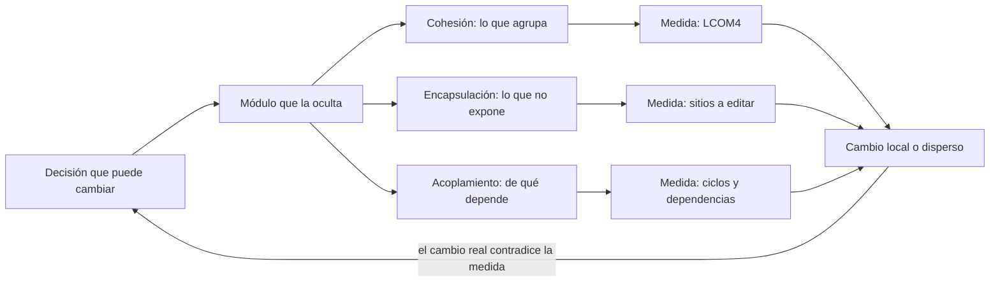
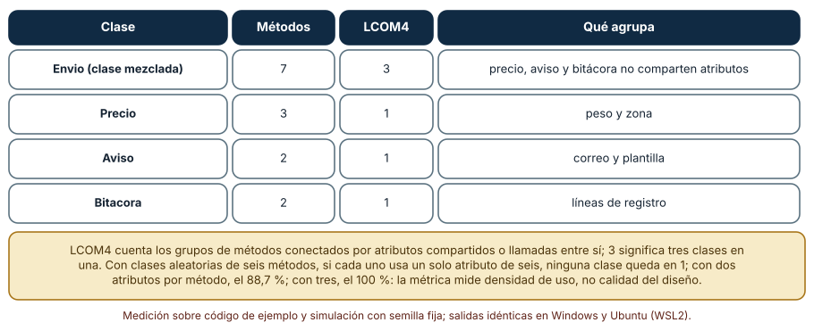
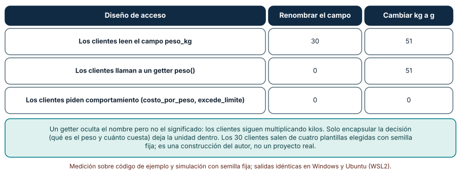
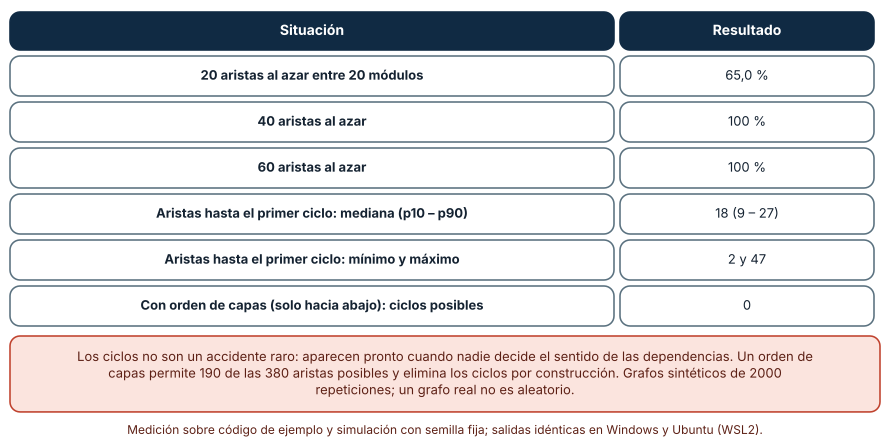

# SE-289 — Cohesión, acoplamiento y encapsulación

[← SE-288 — Proyecto: diseño profundo de un dominio elegido](../../classes/part-23-software-especializado-y-dominios/se-288-proyecto-diseno-profundo-de-un-dominio-elegido/README.md) · [↑ Parte 24](../../classes/part-24-diseno-patrones-y-refactorizacion/README.md) · [📚 Índice completo](../../classes/README.md) · [🌐 Portal](../../site/classes/SE-289.html) · [SE-290 — SOLID y sus límites →](../../classes/part-24-diseno-patrones-y-refactorizacion/se-290-solid-y-sus-limites/README.md)

## Punto profesional y fundamento pedagógico

**Punto profesional.** La clase existe para que puedas decir qué agrupa un módulo, de qué depende y qué esconde, y para que conviertas esas tres preguntas en números que se pueden contrastar con un cambio real, no en adjetivos como «limpio» o «desacoplado».

**Por qué aparece aquí.** Abre la **Parte 24** después de **Proyecto: diseño profundo de un dominio elegido**: la Parte 23 profundizó en un dominio; ahora el foco pasa de «qué debe hacer el sistema» a «cómo se reparte para que pueda cambiar». La clase fija el vocabulario y el caso conductor de la parte: el componente `tarifas` de una plataforma de entregas, que calcula el costo de un envío.

**Error conceptual que debe corregir.** Creer que cohesión, acoplamiento y encapsulación son opiniones de estilo: son propiedades que se observan en cuántos lugares hay que tocar cuando una decisión cambia, y cada una se puede medir de forma parcial, con límites conocidos.

**Secuencia de aprendizaje.** Antes de ver los resultados, predices cuántos grupos independientes hay dentro de una clase que mezcla precio, aviso y bitácora, cuántos sitios hay que editar si el peso cambia de kilos a gramos y cuántas dependencias al azar hacen falta antes del primer ciclo. Después mides esas tres cosas con código real analizado con `ast`. La secuencia usa predicción, explicación propia, contraste y recuperación. [ICAP](https://icap.education.asu.edu/research) distingue participación de construcción de conocimiento; [How People Learn II](https://nap.nationalacademies.org/catalog/24783/how-people-learn-ii-learners-contexts-and-cultures) exige conectar conocimiento previo, contexto y transferencia; la [práctica de recuperación](https://pubmed.ncbi.nlm.nih.gov/16507066/) respalda producir de nuevo la explicación tras una demora; y [Education for Life and Work](https://nap.nationalacademies.org/resource/13398/dbasse_084153.pdf) exige devolución que explique la causa del error.

**Evidencia de aprendizaje.** `design-log.md` con la predicción, la tabla de LCOM4, el conteo de sitios de edición de los tres diseños de acceso, la mediana de aristas hasta el primer ciclo y una nota que diga qué decisión de `tarifas` queda escondida en qué módulo.

**Límite de la conclusión.** Las clases, los treinta clientes y los grafos son construcciones del autor. Ninguna métrica se aplicó a un proyecto real: LCOM4 y el conteo de sitios muestran un mecanismo, y un número bajo no demuestra un buen diseño.

### Trazabilidad fuente → afirmación

| Fuente primaria u oficial | Afirmación que respalda | Lo que no prueba |
|---|---|---|
| [Parnas, «On the criteria to be used in decomposing systems into modules» (CACM, 1972)](https://doi.org/10.1145/361598.361623) | Descomponer un sistema por las decisiones que cada módulo oculta, y no por los pasos del flujo, hace los cambios más locales. | No da una cifra para ningún sistema actual ni dice cuántos módulos conviene. |
| [Stevens, Myers y Constantine, «Structured design» (IBM Systems Journal, 1974)](https://doi.org/10.1147/sj.132.0115) | Introduce la cohesión y el acoplamiento como criterios para juzgar una descomposición. | Sus categorías son cualitativas; no equivalen a LCOM4 ni a ninguna métrica concreta. |
| [Chidamber y Kemerer, «A metrics suite for object oriented design» (IEEE TSE, 1994)](https://doi.org/10.1109/32.295895) | Propone métricas de falta de cohesión y de acoplamiento entre clases como indicadores medibles. | No demuestra que una métrica prediga los defectos de un proyecto concreto. |

## Antes de empezar

Recupera lo aprendido en la Parte 23 sobre dominios: un dominio delimita qué reglas importan. La pregunta activa es: **¿qué decisión de `tarifas` quedaría escondida en cada módulo, y cuántos lugares tocaría yo si esa decisión cambiara?**

## Prerrequisitos

- Haber completado `SE-288` o poder describir el vocabulario de un dominio y sus reglas más cambiantes.
- Python 3.11 o posterior y un terminal; todo el código usa solo la biblioteca estándar (`ast`, `random`, `statistics`).
- Leer clases y funciones de Python y saber qué es un atributo de instancia.

## Problema auténtico

El equipo de la plataforma de entregas mantiene `tarifas`, un módulo que empezó con una función y hoy es una clase `Envio` de siete métodos: calcula el costo, decide un recargo, redacta el aviso al cliente y guarda una bitácora. Cuando marketing pide cambiar la plantilla del aviso, hay que releer el cálculo del costo «por si acaso»; cuando logística pasa el peso de kilos a gramos, aparecen cambios en treinta archivos; y un día un módulo nuevo de descuentos importa a `tarifas`, que ya importaba a descuentos, y el arranque falla con una importación circular. Cada síntoma señala una propiedad distinta del diseño.

## Objetivos observables

Al terminar podrás:

1. calcular la falta de cohesión (LCOM4) de una clase a partir de su código y explicar qué dice y qué no dice el número;
2. contar los sitios que hay que editar cuando cambia la representación de un dato, según los clientes lean el campo, usen un getter o pidan comportamiento;
3. estimar cuándo aparece el primer ciclo de dependencias si nadie decide su sentido y cómo un orden de capas lo evita por construcción;
4. proponer una separación de `Envio` y justificarla con una medida y con un cambio concreto, no con una impresión;
5. declarar qué mide cada indicador, qué ignora y qué evidencia haría abandonar la conclusión.

## Mapa conceptual



El mapa parte de la decisión, no del módulo: un módulo es bueno si una decisión que cambia queda dentro de uno solo. Las tres medidas son sondas, y el cambio real es el juez que puede contradecirlas.

## Temas y por qué importan

| Tema | Por qué cambia una decisión profesional | Evidencia mínima |
|---|---|---|
| Cohesión | Una clase con varios grupos de métodos independientes cambia por varias razones. | Predicción, traza causal y contraejemplo de **Cohesión** en `design-log.md` |
| Acoplamiento | Cada dependencia es un lugar más donde un cambio propaga. | Predicción, traza causal y contraejemplo de **Acoplamiento** en `design-log.md` |
| Encapsulación | Lo que un módulo no expone no puede romperse desde fuera. | Predicción, traza causal y contraejemplo de **Encapsulación** en `design-log.md` |
| Dependencias y ciclos | Sin una regla de sentido, los ciclos aparecen pronto. | Predicción, traza causal y contraejemplo de **Dependencias y ciclos** en `design-log.md` |
| Límites de las métricas | Un número bajo puede coexistir con un mal diseño. | Predicción, traza causal y contraejemplo de **Límites de las métricas** en `design-log.md` |

## Conceptos y decisiones

### 1. Cohesión

Un módulo es cohesivo cuando sus partes cambian juntas y se entienden juntas. En una clase, una forma operativa de mirarlo es ver qué métodos comparten atributos o se llaman entre sí: si forman un solo grupo conectado, la clase cuenta una sola historia; si forman varios, son varias clases con un nombre común. LCOM4 cuenta esos grupos conectados. La cohesión no pide clases pequeñas: pide que lo que se agrupa tenga un motivo común de cambio.

### 2. Acoplamiento

El acoplamiento es el grado en que un módulo necesita saber de otro. No todo acoplamiento es malo: un módulo de precio que usa una zona geográfica depende de ella por una razón del dominio. Importa la **dirección** (quién conoce a quién), la **cantidad** (cuántos módulos) y la **naturaleza** (conoce un nombre, un tipo, un orden de llamadas o una representación interna). Cuanto más se conoce de la implementación del otro, más cambios se propagan.

### 3. Encapsulación

Encapsular es esconder una decisión detrás de una interfaz, de modo que cambiar la decisión no obligue a cambiar a los clientes. Un campo público esconde nada; un getter esconde el nombre, pero no el significado (el cliente sigue multiplicando kilos); un método que responde la pregunta que el cliente realmente tiene (`costo_por_peso`) esconde la representación y la unidad. Parnas lo formuló como ocultar la decisión que probablemente cambie.

### 4. Dependencias y ciclos

Un ciclo entre módulos los hace inseparables: no se pueden entender, probar ni desplegar uno sin el otro. Los ciclos no necesitan malas intenciones: si cada persona añade la dependencia que le conviene, aparecen pronto. Una regla de sentido (las capas altas pueden depender de las bajas, nunca al revés) elimina los ciclos por construcción, a cambio de decidir qué es alto y qué es bajo. La inversión de dependencias, que se trata en `SE-290`, es la herramienta cuando una capa baja necesita avisar a una alta.

### 5. Límites de las métricas

LCOM4 no distingue una clase con tres responsabilidades de una clase con tres métodos sencillos que simplemente no comparten atributos, y sube o baja con la densidad de uso de los atributos. El conteo de sitios depende de qué cambio se imagine. Una medida orienta la conversación: la decisión se toma mirando un cambio probable y su costo. Y un número bueno nunca sustituye a releer el código.

### Cuántos grupos hay dentro de una clase: LCOM4

La clase `Envio` tiene siete métodos: `costo_base`, `recargo` y `total` (usan peso y zona), `avisar` y `texto_aviso` (usan correo y plantilla) y `registrar` y `ultima` (usan la bitácora). Se parsea con `ast`, se extraen los atributos de `self` que usa cada método y las llamadas entre métodos, y se cuentan los componentes conectados.

```python
for i, m in enumerate(names):
    for c in calls[m]:
        parent[find(m)] = find(c)          # un método llama a otro
    for o in names[i + 1:]:
        if uses[m] & uses[o]:
            parent[find(m)] = find(o)      # comparten algún atributo
componentes = len({find(m) for m in names})
```

| Clase | Métodos | LCOM4 | Qué agrupa |
|---|---:|---:|---|
| `Envio` (mezclada) | 7 | 3 | precio, aviso y bitácora |
| `Precio` | 3 | 1 | peso y zona |
| `Aviso` | 2 | 1 | correo y plantilla |
| `Bitacora` | 2 | 1 | líneas de registro |

Resultado, idéntico en Windows (CPython 3.12.9) y en Ubuntu bajo WSL2 (3.12.3). Como contraste se generaron 4000 clases aleatorias de seis métodos y seis atributos: si cada método usa un solo atributo, ninguna queda en LCOM4 = 1 (media 3,98); con dos atributos por método el 88,7 % queda en 1; con tres, el 100 %.



**Cómo leer la figura.** Cada fila es una clase; LCOM4 es el número de grupos de métodos que no se tocan entre sí. **Dónde deja de valer:** el 3 de `Envio` solo es una pista de que hay tres responsabilidades; la métrica no sabe si son tres razones de cambio. Con clases dispersas por naturaleza (utilidades que no comparten estado) da valores altos sin ser un defecto, y un `self.datos` que usan todos los métodos produce un 1 que oculta un desorden. Las clases son del autor.

### Dónde se rompe el cliente al cambiar el peso

Hay treinta clientes sintéticos, cada uno de una de cuatro plantillas (costo, límite, etiqueta, mixto). Se generan tres versiones del mismo código según cómo acceden al peso: leen `p.peso_kg`, llaman a `p.peso()` o piden comportamiento (`costo_por_peso()`, `excede_limite()`, `etiqueta_peso()`). Con `ast` se cuentan los sitios que habría que editar en dos cambios: renombrar el campo y pasar de kilos a gramos (toda expresión aritmética, comparación o texto que use el valor).

```python
if isinstance(n, (ast.BinOp, ast.Compare)):
    usa = any(isinstance(x, ast.Attribute) and x.attr == "peso_kg" for x in ast.walk(n)) or (names & derivados)
    if usa:
        total += 1
```

| Diseño de acceso | Renombrar el campo | Cambiar kg a g |
|---|---:|---:|
| Los clientes leen `peso_kg` | 30 | 51 |
| Los clientes llaman a un getter | 0 | 51 |
| Los clientes piden comportamiento | 0 | 0 |

El getter evita el renombrado y no evita el cambio de unidad: el valor sigue saliendo con una unidad implícita y cada cliente la usa en una cuenta. Solo la tercera forma cierra ambos cambios.



**Cómo leer la figura.** Las filas son diseños de acceso; las columnas, el cambio; el número, los lugares de código que se editan. **Dónde deja de valer:** los clientes salen de cuatro plantillas y el contador de sitios es una regla simple del autor; en un proyecto real habría clientes que no calculan nada con el peso y cambios que no se imaginaron. La figura muestra por qué esconder una decisión es distinto de esconder un nombre, no cuántos archivos tocaría su proyecto.

### El primer ciclo llega pronto

Veinte módulos y todas las dependencias dirigidas posibles (380). Se barajan con semilla fija, se añaden de una en una y se detiene la cuenta en cuanto el grafo contiene un ciclo; se repite 2000 veces. Como contraste, se permiten solo las aristas que van de un módulo con número alto a uno con número bajo (un orden de capas): 190 aristas, sin ciclo posible.

```python
adj[u].append(v)
if hay_ciclo(adj, n):
    primeros.append(k)     # numero de aristas en el primer ciclo
    break
```

La mediana es de 18 aristas (p10 = 9, p90 = 27, mínimo 2, máximo 47). Con 20 aristas al azar hay ciclo en el 65,0 % de los grafos y con 40 en el 100 %.



**Cómo leer la figura.** Cada fila es una situación; el valor es la fracción de grafos con ciclo o el número de aristas. **Dónde deja de valer:** un proyecto real no añade dependencias al azar, sino por necesidades concretas; el modelo solo muestra que, sin una regla, la presión por el atajo crea ciclos con facilidad. Un orden de capas elimina los ciclos entre capas, no los que ocurren dentro de una.

## Definiciones de trabajo

- **cohesión:** grado en que los elementos de un módulo cambian juntos y se entienden juntos.
- **acoplamiento:** grado en que un módulo necesita conocer a otro para funcionar o para cambiar.
- **encapsulación:** ocultar una decisión detrás de una interfaz, de modo que cambiarla no obligue a cambiar a los clientes.
- **LCOM4:** número de componentes conectados que forman los métodos de una clase según los atributos que comparten o las llamadas entre sí.
- **ciclo de dependencias:** conjunto de módulos que dependen unos de otros, directa o indirectamente.

Las definiciones son operativas para `tarifas`. No convierten términos con una historia más amplia en sinónimos y deben contrastarse con la bibliografía enlazada al final.

## Ejemplo mínimo

El fragmento calcula los componentes de una clase de tres métodos. Antes de ejecutarlo, predice cuántos son.

```python
import ast

src = '''
class P:
    def a(self): return self.x
    def b(self): return self.x + 1
    def c(self): return self.y
'''
usos = {n.name: {a.attr for a in ast.walk(n) if isinstance(a, ast.Attribute)} for n in ast.parse(src).body[0].body}
assert usos == {"a": {"x"}, "b": {"x"}, "c": {"y"}}
```

`a` y `b` comparten `x`; `c` usa `y` solo: son dos componentes, LCOM4 = 2. Registra versión, comando y salida; añade a `c` una llamada a `a` y predice el nuevo valor.

## Ejemplo profesional

El equipo separa `Envio` en `Precio`, `Aviso` y `Bitacora` y deja a `Envio` como una fachada fina que los compone. Antes de moverlos, escribe el cambio que quiere hacer más barato: «cambiar la plantilla del aviso sin releer el cálculo». Después de mover, comprueba tres cosas: LCOM4 de cada clase, los sitios que hay que editar para el cambio de unidad del peso (con `Precio.costo_por_peso()` expuesto como comportamiento) y que el grafo de importaciones no creó un ciclo. Documenta qué decisión esconde cada módulo en una tabla de tres columnas.

Compara con el estado anterior: la separación es adecuada si el cambio previsto toca un solo módulo y el grafo de importaciones sigue sin ciclos; es frágil si, para que el aviso funcione, `Aviso` necesita importar `Precio` o conocer su representación interna: se habría movido el código sin mover la decisión.

## Práctica guiada

1. Escribe la clase `Envio` de siete métodos y predice su LCOM4 antes de medirlo.
2. Mide LCOM4 con `ast` y verifica que coincide con tu predicción; explica el método que más pesó.
3. Genera treinta clientes con semilla fija y cuenta los sitios de edición del renombrado y del cambio de unidad.
4. Cambia el diseño de acceso a comportamiento y repite el conteo.
5. Simula las aristas al azar con tu propio grafo de veinte módulos y anota la mediana.
6. Define un orden de capas para los módulos de `tarifas` y comprueba que ninguna dependencia lo viola.
7. Entrega `design-log.md` y pide a otra persona que reconozca, en tu separación, la decisión que esconde cada módulo.

## Ejercicios

1. **Cohesión:** añade a `Envio` un método `exportar_csv` que usa peso, zona y correo; recalcula LCOM4 y explica por qué la métrica baja y el diseño empeora.
2. **Encapsulación:** reescribe un cliente de `p.peso_kg * 3 + 2` para que pida `costo_por_peso()` y lista qué conocimiento dejó de tener.
3. **Acoplamiento:** dibuja las importaciones de tres módulos de `tarifas` y marca la dirección que violaría una regla de capas.
4. **Límites:** construye una clase con LCOM4 = 1 que tenga dos responsabilidades y explica cómo la detectarías sin la métrica.

## Reto verificable

Entrega `design-log.md` con la predicción, la tabla de LCOM4, el conteo de sitios de los tres diseños, la mediana de aristas y la tabla de decisiones ocultas por módulo. Se aprueba si otra persona ejecuta el código desde un checkout limpio, obtiene los mismos números y puede decir qué cambio de `tarifas` quedó local y cuál no. No se aprueba por afirmar que el diseño «es más limpio» ni por reportar un LCOM4 bajo sin el cambio que lo justifica.

## Caso conductor

El componente `tarifas` de la plataforma de entregas es el caso conductor de la Parte 24. Esta clase deja el primer artefacto: `Envio` separado en tres módulos con las decisiones que esconde cada uno y un orden de capas. `SE-290` examinará qué principios de diseño guían esas separaciones y dónde dejan de valer. Cambia después una sola decisión, la unidad del peso, y observa qué módulos se mueven.

## Preguntas frecuentes

### ¿Una clase pequeña es una clase cohesiva?

No necesariamente: una clase de dos métodos que no se tocan es pequeña y tiene LCOM4 = 2. Y una clase grande puede ser cohesiva si todo gira en torno a una decisión. La cohesión se juzga por el motivo de cambio, no por el tamaño.

### ¿Un getter no es encapsulación?

Esconde el nombre del campo, no su significado: los treinta clientes seguían multiplicando kilos. Es mejor que un campo público, y la encapsulación completa llega cuando el módulo responde la pregunta del cliente.

### ¿Hay que eliminar todo el acoplamiento?

No: un sistema sin acoplamiento no hace nada. Se trata de elegir la dirección, mantener pocas dependencias y que sean hacia cosas estables y de baja velocidad de cambio.

### ¿LCOM4 sirve para decidir una refactorización?

Sirve para encontrar candidatos. La decisión pide un cambio concreto que se vuelva más barato y la comprobación de que la separación no creó un ciclo ni duplicó una regla.

## Fallo controlado y diagnóstico

Reproduce el fallo clásico de la clase: **separar el código sin separar la decisión**. Parte `Envio` en tres clases, pero haz que `Aviso` lea `precio.peso_kg` para redactar el mensaje, y cambia después el peso a gramos.

Registra síntoma, entrada mínima, hipótesis, observación que descarta cada hipótesis, causa, corrección y prueba de regresión. **Síntoma:** tras la separación, el aviso muestra «3000 kg» en vez de «3 kg» después del cambio de unidad. **Hipótesis rivales:** (a) la plantilla del aviso tiene un error; (b) el cálculo del precio devuelve un valor incorrecto; (c) `Aviso` conoce la representación interna de `Precio`. **Prueba:** cuenta los sitios que leen `peso_kg` fuera de `Precio`; si hay alguno en `Aviso`, la causa es (c). **Conclusión:** el módulo se separó pero la decisión sigue repartida. **Regresión:** añade `Precio.etiqueta_peso()`, haz que `Aviso` la use y agrega una prueba que cambie la unidad y verifique el texto. No cambies a la vez la unidad y la plantilla.

## Errores comunes y cómo corregirlos

| Síntoma | Causa probable | Corrección |
|---|---|---|
| Cambiar una plantilla obliga a releer el cálculo del costo | Una clase mezcla responsabilidades con distinto motivo de cambio | Separar por decisión y comprobar con LCOM4 y con el cambio previsto |
| Un cambio de unidad toca decenas de archivos | Los clientes leen el dato y calculan por su cuenta | Exponer comportamiento en vez de datos |
| El arranque falla con una importación circular | Las dependencias se añadieron sin una regla de sentido | Definir capas y mover lo compartido a la capa baja |
| LCOM4 = 1 y la clase sigue siendo un cajón de sastre | Un atributo común (`self.datos`) conecta todo | Revisar los motivos de cambio y no confiar solo en la métrica |
| Se mueve el código a otro archivo y no mejora nada | Se separó la ubicación, no la decisión | Preguntar qué cambio se volvió local |

## Entorno y archivos clave

```text
work/SE-289/
├── README.md
├── analisis/
│   ├── lcom4.py
│   ├── sitios.py
│   └── ciclos.py
├── tarifas/
│   ├── precio.py
│   ├── aviso.py
│   └── bitacora.py
└── evidence/design-log.md
```

El `README` declara plataforma, versión de Python, semillas y comandos. Los experimentos usan solo la biblioteca estándar (`ast`, `random`, `statistics`, `textwrap`) y se ejecutaron con CPython 3.12.9 en Windows 11 y 3.12.3 en Ubuntu bajo WSL2: las salidas fueron idénticas. Si añades una dependencia, fija procedencia y versión.

## Seguridad, ética y accesibilidad

- un componente de tarifas decide cuánto paga una persona: el cálculo debe poder explicarse, y una separación que oculte una regla de cobro detrás de varios módulos no debe impedir auditarla;
- una métrica de diseño no debe usarse para evaluar el desempeño individual de quien programa: cambia el código, no la calidad de la persona;
- los mensajes de aviso deben ser legibles con lector de pantalla y no depender solo del color o del formato;
- no pongas datos reales de clientes en los clientes sintéticos ni en la bitácora de ejemplo;
- respeta las licencias de los artículos y atribuye lo adaptado.

## Puente hacia el trabajo con agentes

Un agente al que se le pide «ordena el módulo de tarifas» moverá funciones entre archivos y declarará que mejoró la cohesión. Pídele en cambio un cambio concreto («cambiar la unidad del peso»), el conteo de sitios antes y después, LCOM4 de cada clase y el grafo de importaciones. Revisa especialmente si dejó un `from precio import *`, si añadió una importación en sentido contrario al orden de capas o si movió una regla de cobro a un módulo de presentación: son los movimientos que mejoran la apariencia sin mover la decisión.

## Transferencia

Traslada el análisis a otro componente (por ejemplo, el de notificaciones de la misma plataforma): cambia las clases y los datos, y conserva el procedimiento de medir los grupos, contar los sitios de un cambio y buscar ciclos. La transferencia está lograda cuando puedes explicar qué decisión quedó escondida en cada módulo, no cuando los números se parecen.

## Evaluación y evidencia

| Criterio | Evidencia para aprobar |
|---|---|
| comprensión | explicación de la diferencia entre cohesión, acoplamiento y encapsulación con ejemplos de `tarifas` |
| corrección | LCOM4, sitios de edición y ciclos reproducibles con las mismas semillas |
| diseño | `Envio` separado con las decisiones ocultas por módulo y un orden de capas |
| diagnóstico | reproducción del fallo «separar el código sin separar la decisión» con regresión |
| incertidumbre | declaración de que las métricas se midieron sobre código construido por el autor |
| reproducibilidad | versiones, comandos, salida y límites declarados |

## Fuentes

- [Parnas, «On the criteria to be used in decomposing systems into modules» (CACM, 1972)](https://doi.org/10.1145/361598.361623) — descomposición por decisiones ocultas; autoridad: Communications of the ACM.
- [Stevens, Myers y Constantine, «Structured design» (IBM Systems Journal, 1974)](https://doi.org/10.1147/sj.132.0115) — cohesión y acoplamiento; autoridad: IBM Systems Journal.
- [Chidamber y Kemerer, «A metrics suite for object oriented design» (IEEE TSE, 1994)](https://doi.org/10.1109/32.295895) — métricas de cohesión y acoplamiento; autoridad: IEEE Transactions on Software Engineering.
- [Python: `ast`](https://docs.python.org/3/library/ast.html) — análisis del árbol sintáctico usado para medir; autoridad: documentación de Python.
- [Python: `random`](https://docs.python.org/3/library/random.html) — generador con semilla para las simulaciones; autoridad: documentación de Python.
- [SWEBOK Guide v4.0a](https://www.computer.org/education/bodies-of-knowledge/software-engineering) — áreas de conocimiento de ingeniería de software; autoridad: IEEE Computer Society.

Cada fuente respalda el mecanismo indicado; ninguna demuestra que LCOM4 = 3, los 51 sitios de edición o la mediana de 18 aristas se observen en `tarifas`. Esa afirmación depende de su código, sus clientes y su historia de cambios.

## Límites y siguiente paso

Se ejecutaron tres análisis con código de ejemplo y datos sintéticos en Windows y Ubuntu (WSL2) con resultados idénticos. No se midió ningún proyecto real ni se evaluó si las métricas predicen defectos; las clases, los treinta clientes y los grafos son construcciones del autor. La siguiente clase examina los principios que guían estas separaciones y dónde dejan de valer.

## Glosario

- **cohesión:** grado en que los elementos de un módulo cambian juntos y se entienden juntos.
- **acoplamiento:** grado en que un módulo necesita conocer a otro para funcionar o para cambiar.
- **encapsulación:** ocultar una decisión detrás de una interfaz, de modo que cambiarla no obligue a cambiar a los clientes.
- **LCOM4:** número de componentes conectados que forman los métodos de una clase según los atributos que comparten o las llamadas entre sí.
- **ciclo de dependencias:** conjunto de módulos que dependen unos de otros, directa o indirectamente.

---

[← SE-288 — Proyecto: diseño profundo de un dominio elegido](../../classes/part-23-software-especializado-y-dominios/se-288-proyecto-diseno-profundo-de-un-dominio-elegido/README.md) · [↑ Parte 24](../../classes/part-24-diseno-patrones-y-refactorizacion/README.md) · [📚 Índice completo](../../classes/README.md) · [🌐 Portal](../../site/classes/SE-289.html) · [SE-290 — SOLID y sus límites →](../../classes/part-24-diseno-patrones-y-refactorizacion/se-290-solid-y-sus-limites/README.md)
