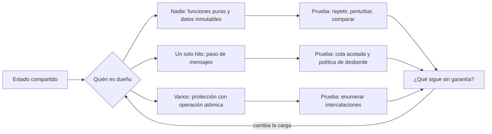
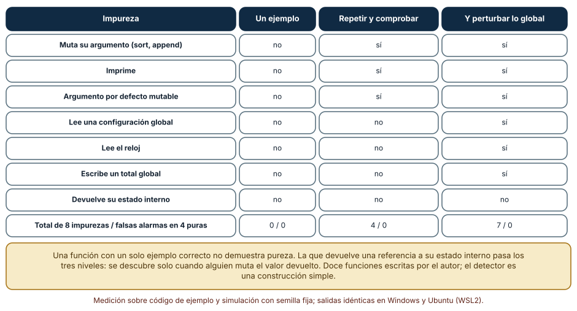
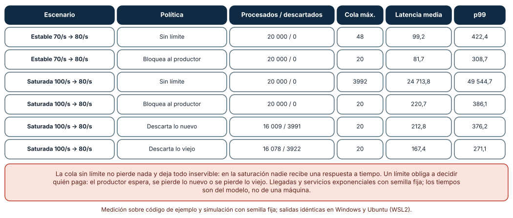
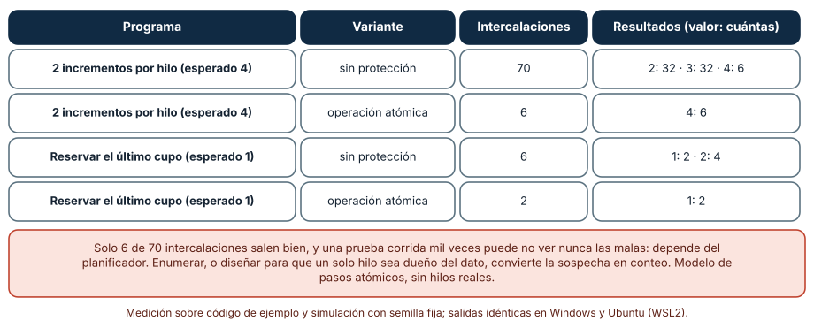

# SE-293 — Patrones funcionales, reactivos y concurrentes

[← SE-292 — Patrones creacionales, estructurales y conductuales](../../classes/part-24-diseno-patrones-y-refactorizacion/se-292-patrones-creacionales-estructurales-y-conductuales/README.md) · [↑ Parte 24](../../classes/part-24-diseno-patrones-y-refactorizacion/README.md) · [📚 Índice completo](../../classes/README.md) · [🌐 Portal](../../site/classes/SE-293.html) · [SE-294 — Code smells y diagnóstico contextual →](../../classes/part-24-diseno-patrones-y-refactorizacion/se-294-code-smells-y-diagnostico-contextual/README.md)

## Punto profesional y fundamento pedagógico

**Punto profesional.** La clase existe para que decidas dónde vive el estado y quién puede cambiarlo, y para que elijas entre funciones puras, flujos con contrapresión y datos con un solo dueño por lo que cada opción garantiza cuando hay varias cosas ocurriendo, no por la moda del estilo.

**Por qué aparece aquí.** Sigue a **Patrones creacionales, estructurales y conductuales** (`SE-292`): esos patrones suponían objetos con estado que cooperan; aquí el estado se vuelve el problema central. Se aplica al cálculo de tarifas por lotes (miles de envíos por minuto en hora punta) y al flujo de eventos que lo alimenta.

**Error conceptual que debe corregir.** Creer que «funcional», «reactivo» o «concurrente» son estilos de código: son decisiones sobre qué puede cambiar, qué ocurre cuando el productor es más rápido que el consumidor y qué intercalaciones son posibles; cada una tiene una prueba que la vuelve observable.

**Secuencia de aprendizaje.** Antes de mirar los resultados, predices cuántas de ocho funciones impuras detecta una prueba que llama una vez, cuántas una que llama dos veces y perturba el estado, qué hace una cola sin límite cuando llegan 100 eventos por segundo y se atienden 80, y cuántas de las 70 intercalaciones de dos hilos que incrementan un contador dan el valor esperado. Después lo ejecutas. La secuencia usa predicción, explicación propia, contraste y recuperación. [ICAP](https://icap.education.asu.edu/research) distingue participación de construcción de conocimiento; [How People Learn II](https://nap.nationalacademies.org/catalog/24783/how-people-learn-ii-learners-contexts-and-cultures) exige conectar conocimiento previo, contexto y transferencia; la [práctica de recuperación](https://pubmed.ncbi.nlm.nih.gov/16507066/) respalda producir de nuevo la explicación tras una demora; y [Education for Life and Work](https://nap.nationalacademies.org/resource/13398/dbasse_084153.pdf) exige devolución que explique la causa del error.

**Evidencia de aprendizaje.** `state-log.md` con la predicción, la tabla de impurezas detectadas por nivel, la tabla de políticas de cola, la tabla de intercalaciones y una nota que diga quién es dueño de cada dato de `tarifas` y cómo se protege.

**Límite de la conclusión.** Las funciones, la cola y los programas de dos hilos son construcciones del autor. La simulación de la cola usa llegadas y servicios exponenciales y la enumeración de intercalaciones es un modelo de pasos atómicos: no se ejecutó ningún hilo ni se midió ningún tiempo de máquina.

### Trazabilidad fuente → afirmación

| Fuente primaria u oficial | Afirmación que respalda | Lo que no prueba |
|---|---|---|
| [Hughes, «Why Functional Programming Matters» (The Computer Journal, 1989)](https://doi.org/10.1093/comjnl/32.2.98) | Defiende que la modularidad se gana componiendo funciones sin efectos laterales y funciones de orden superior. | No mide el efecto sobre los defectos ni sobre el rendimiento. |
| [Lee, «The Problem with Threads» (IEEE Computer, 2006)](https://doi.org/10.1109/MC.2006.180) | Argumenta que los hilos con memoria compartida hacen el comportamiento no determinista y difícil de razonar. | No dice que no deban usarse ni cuánto cuestan en un caso concreto. |
| [Reactive Streams: especificación](https://www.reactive-streams.org/) | Define el flujo asincrónico con contrapresión no bloqueante entre productor y consumidor. | No elige una política de descarte ni dimensiona una cola. |

## Antes de empezar

Recupera lo aprendido en `SE-292`: el orden en que se avisa a los observadores es una decisión. La pregunta activa es: **¿quién es dueño de este dato, quién puede cambiarlo y qué pasa con lo que llega más rápido de lo que puedo atender?**

## Prerrequisitos

- Haber completado `SE-292` o poder explicar por qué un estado global vuelve dependiente del orden a una suite.
- Python 3.11 o posterior y un terminal; todo el código usa solo la biblioteca estándar.
- Conocer funciones de orden superior, colas y la idea de proceso e hilo.

## Problema auténtico

En hora punta, `tarifas` recibe cien eventos de pedido por segundo y su cálculo puede atender ochenta. La primera versión encola todo en una lista en memoria; a los diez minutos las respuestas llegan con un retraso de horas y el proceso pesa varios gigabytes. Un colega «paralelizó» el cálculo con dos hilos que acumulan el total del día en una variable compartida, y el total empezó a diferir del de la base de datos en unos pocos pesos por día. Y una función de redondeo «pura» que recibía una lista de pedidos la ordenaba en sitio: el módulo que llamaba empezó a ver sus pedidos reordenados. Tres problemas distintos con una causa común: no estaba decidido quién es dueño del estado.

## Objetivos observables

Al terminar podrás:

1. detectar funciones que no son puras con pruebas escalonadas y explicar por qué un ejemplo no basta;
2. simular una cola con un productor más rápido que el consumidor y comparar cuatro políticas por latencia, pérdida y bloqueo;
3. enumerar las intercalaciones de dos hilos sobre un dato compartido y contar cuántas dan un resultado erróneo con y sin protección;
4. asignar a cada dato de `tarifas` un dueño y una forma de protección (inmutabilidad, un solo hilo, operación atómica);
5. declarar qué simula cada modelo, qué ignora y qué evidencia haría abandonar la conclusión.

## Mapa conceptual



El mapa parte de la pregunta de propiedad y termina en lo que no queda garantizado. El retorno marca que un cambio de carga reabre la decisión.

## Temas y por qué importan

| Tema | Por qué cambia una decisión profesional | Evidencia mínima |
|---|---|---|
| Funciones puras y datos inmutables | Sin estado oculto, la función se prueba y se compone sin sorpresas. | Predicción, traza causal y contraejemplo de **Funciones puras y datos inmutables** en `state-log.md` |
| Flujos y contrapresión | Un productor más rápido que el consumidor exige una política. | Predicción, traza causal y contraejemplo de **Flujos y contrapresión** en `state-log.md` |
| Concurrencia y carreras | Los resultados dependen de intercalaciones que la prueba no controla. | Predicción, traza causal y contraejemplo de **Concurrencia y carreras** en `state-log.md` |
| Un solo dueño | Mover mensajes en lugar de compartir memoria reduce las intercalaciones posibles. | Predicción, traza causal y contraejemplo de **Un solo dueño** en `state-log.md` |
| Límites de cada estilo | Ninguno elimina el costo: lo traslada. | Predicción, traza causal y contraejemplo de **Límites de cada estilo** en `state-log.md` |

## Conceptos y decisiones

### 1. Funciones puras y datos inmutables

Una función es pura si su resultado depende solo de sus argumentos y no deja efectos: no cambia sus entradas, no lee reloj, aleatoriedad ni configuración global y no escribe fuera. De ahí salen propiedades útiles: se puede repetir, memorizar, ejecutar en cualquier orden y en paralelo. Los datos inmutables extienden la idea: si nadie puede cambiarlos, compartirlos es seguro. El costo es copiar o construir estructuras nuevas, y que en un lenguaje sin imposición la pureza es una convención que una prueba debe vigilar.

### 2. Flujos reactivos y contrapresión

Un flujo conecta un productor con un consumidor mediante una cola. Si el productor es más rápido que el consumidor, la cola crece sin límite o algo debe ceder. La **contrapresión** es la señal del consumidor hacia el productor para frenar; si no se puede frenar al productor (un sensor, un usuario), debe descartarse algo. Las políticas son cuatro: dejar crecer la cola, bloquear al productor, descartar lo nuevo o descartar lo viejo. Cada una compra algo y cuesta algo; elegir es decidir qué se pierde.

### 3. Concurrencia y carreras

Dos hilos que leen, calculan y escriben un dato compartido pueden intercalarse de muchas maneras. En un incremento de dos pasos (leer y guardar), el segundo hilo puede leer antes de que el primero guarde, y una actualización se pierde. No hay excepción ni aviso: el total sale plausible y equivocado. La prueba que corre mil veces puede no ver nunca la intercalación mala; solo enumerar o proteger la sección crítica la vuelve explícita.

### 4. Un solo dueño

Una alternativa a proteger un dato compartido es que lo posea un solo hilo (o actor) y los demás le envíen mensajes. Las operaciones llegan por una cola y se aplican en orden, de modo que las intercalaciones dañinas no existen. El costo: el dueño es un cuello de botella, el orden de llegada decide el resultado cuando hay conflicto, y los mensajes pueden perderse o duplicarse si hay una red en medio.

### 5. Límites de cada estilo

La pureza no elimina los efectos: los empuja a los bordes (leer del disco, escribir en la base), donde hay que gestionarlos igual. Los flujos con política de desborde convierten la saturación en una pérdida explícita, que alguien debe aceptar. La concurrencia con un dueño no evita los fallos de orden entre varios dueños. Ningún estilo es gratuito: la pregunta es si su costo es el que el negocio prefiere pagar.

### Cuántas impurezas encuentra cada prueba

Se escriben doce funciones: cuatro puras y ocho impuras (dos que modifican su argumento, una que imprime, una con un argumento por defecto mutable, una que lee una configuración global, una que lee un reloj simulado, una que escribe un total global y una que devuelve una referencia a su estado interno). Tres niveles de prueba: un ejemplo, repetir la llamada con copias iguales y comprobar resultado, entrada intacta y salida vacía, y además perturbar el estado global entre llamadas y comprobar que no cambió.

```python
r1 = f(a); r2 = f(b)
impura = not (r1 == r2 and a == [3, 1, 2] and b == [3, 1, 2] and salida == "")
```

| Impureza | Un ejemplo | Repetir y comprobar | Y perturbar lo global |
|---|---|---|---|
| Muta su argumento (2 funciones) | no | sí | sí |
| Imprime | no | sí | sí |
| Argumento por defecto mutable | no | sí | sí |
| Lee una configuración global | no | no | sí |
| Lee el reloj | no | no | sí |
| Escribe un total global | no | no | sí |
| Devuelve su estado interno | no | no | no |
| Total (de 8) / falsas alarmas en las 4 puras | 0 / 0 | 4 / 0 | 7 / 0 |

Resultado, idéntico en Windows (CPython 3.12.9) y en Ubuntu bajo WSL2 (3.12.3). Ningún nivel dio una falsa alarma sobre las cuatro puras.



**Cómo leer la figura.** Cada fila es un tipo de impureza; las columnas son niveles acumulativos de prueba. **Dónde deja de valer:** el detector es una construcción sencilla del autor y la función que devuelve su estado interno pasa los tres niveles: se descubre cuando alguien modifica el valor devuelto. Una función «pura» según estas pruebas puede no serlo si depende de algo que no se perturbó. La figura muestra que un ejemplo no demuestra pureza, no que siete de ocho sea una cifra general.

### Una cola entre un productor rápido y un consumidor lento

Veinte mil eventos con llegadas exponenciales y servicio exponencial; semilla fija. Dos escenarios: estable (llegan 70 por segundo, se atienden 80) y saturado (llegan 100, se atienden 80). Cuatro políticas con capacidad 20: sin límite, bloquear al productor, descartar lo nuevo y descartar lo viejo. Se mide latencia media y p99 de lo procesado, descartados, cola máxima y tiempo que el productor queda bloqueado.

```python
if politica != "sin limite" and len(cola) >= cap:
    if politica == "bloquea":
        a2 = max(a, libre); bloqueo += a2 - a; retraso += a2 - a; a = a2
    elif politica == "descarta lo nuevo":
        desc += 1; continue
    else:
        cola.popleft(); desc += 1
```

| Escenario | Política | Procesados / descartados | Cola máxima | Latencia media (ms) | p99 (ms) |
|---|---|---:|---:|---:|---:|
| Estable | Sin límite | 20 000 / 0 | 48 | 99,2 | 422,4 |
| Estable | Bloquea | 20 000 / 0 | 20 | 81,7 | 308,7 |
| Saturado | Sin límite | 20 000 / 0 | 3992 | 24 713,8 | 49 544,7 |
| Saturado | Bloquea | 20 000 / 0 | 20 | 220,7 | 386,1 |
| Saturado | Descarta lo nuevo | 16 009 / 3991 | 20 | 212,8 | 376,2 |
| Saturado | Descarta lo viejo | 16 078 / 3922 | 20 | 167,4 | 271,1 |



**Cómo leer la figura.** Las filas comparan la política en el escenario; las columnas, lo que se paga. **Dónde deja de valer:** la política que bloquea al productor mantiene la latencia de lo procesado pero retiene al productor 50,2 segundos, que en un sistema real sería otra cola aguas arriba; y no mide el efecto de reintentos. Las llegadas y los servicios exponenciales son un supuesto: con ráfagas, las colas se comportan peor. Los milisegundos son del modelo, no de una máquina.

### Todas las intercalaciones de dos hilos

Cada hilo tiene un programa de pasos atómicos. Primer caso: cada hilo incrementa un contador dos veces, y cada incremento son dos pasos (leer a un registro, guardar el registro más uno); se enumeran las 70 intercalaciones posibles. Segundo caso: dos hilos reservan el último cupo, con dos pasos (verificar y tomar). En ambos se compara con una operación indivisible.

```python
for pos in itertools.combinations(range(n1 + n2), n1):
    orden = [1 if i in pos else 2 for i in range(n1 + n2)]      # una intercalación
```

| Programa | Variante | Intercalaciones | Resultados (valor: cuántas) |
|---|---|---:|---|
| 2 incrementos por hilo (esperado 4) | sin protección | 70 | 2: 32 · 3: 32 · 4: 6 |
| 2 incrementos por hilo (esperado 4) | operación atómica | 6 | 4: 6 |
| Reservar el último cupo (esperado 1) | sin protección | 6 | 1: 2 · 2: 4 |
| Reservar el último cupo (esperado 1) | operación atómica | 2 | 1: 2 |



**Cómo leer la figura.** Cada fila es un programa y una variante; el último dato cuenta cuántas intercalaciones dan cada resultado. **Dónde deja de valer:** el modelo supone pasos atómicos y orden de memoria secuencial; un procesador real con cachés y reordenamientos tiene más comportamientos, y los hilos reales no eligen intercalaciones con la misma probabilidad. Solo 6 de 70 salen bien: una prueba corrida mil veces puede no ver nunca una mala. Si un solo hilo es dueño del dato y recibe operaciones por una cola, hay un resultado por cada orden de llegada y ninguna pérdida.

## Definiciones de trabajo

- **función pura:** función cuyo resultado depende solo de sus argumentos y que no produce efectos observables fuera de él.
- **inmutabilidad:** propiedad de un dato que no puede modificarse después de crearse.
- **contrapresión:** mecanismo por el que el consumidor limita el ritmo del productor.
- **condición de carrera:** situación en que el resultado depende del orden en que se intercalan operaciones concurrentes.
- **sección crítica:** fragmento que accede a un dato compartido y debe ejecutarse sin interferencia.

Las definiciones son operativas para `tarifas`. No convierten términos con una historia más amplia en sinónimos y deben contrastarse con la bibliografía enlazada al final.

## Ejemplo mínimo

El fragmento muestra que ordenar «en sitio» cambia la entrada. Antes de ejecutarlo, predice qué contiene `pedidos` después.

```python
def ordenar_mal(xs):
    xs.sort()
    return xs

pedidos = [3, 1, 2]
asc = ordenar_mal(pedidos)
assert pedidos == [1, 2, 3] and asc is pedidos
```

La función devolvió su entrada modificada, y el módulo que la llamó ve sus pedidos reordenados. Registra versión, comando y salida; cámbiala por `sorted(xs)` y predice el estado de `pedidos`.

## Ejemplo profesional

El equipo de `tarifas` toma tres decisiones. El cálculo del costo pasa a ser una función pura sobre un registro inmutable (una tupla con nombre), con una prueba de tres niveles que se ejecuta en la suite. La cola de eventos se acota a 200 y la política es descartar lo viejo con un contador de descartes y una alarma si superan 1 % en una hora, porque un pedido antiguo ya tiene un cálculo posterior que lo reemplaza. El total del día deja de ser una variable compartida: lo acumula un único hilo que recibe cada monto por una cola, y una prueba verifica que el total coincide con la suma de los montos de la entrada.

Compara con el estado anterior: la decisión es adecuada si la latencia se mantiene bajo el plazo en saturación, el total coincide con la base y la política de descarte está documentada y alarmada; es frágil si «descartar lo viejo» elimina pedidos que nadie reemplaza, o si el hilo dueño del total se vuelve el cuello de botella sin que nadie lo mida.

## Práctica guiada

1. Escribe doce funciones, cuatro puras y ocho con una impureza cada una, y predice cuántas detecta cada nivel de prueba.
2. Implementa los tres niveles y completa la tabla; anota la que ninguno detecta.
3. Simula la cola con llegadas de 70 y 100 por segundo y servicio de 80, y compara las cuatro políticas.
4. Cambia la capacidad de 20 a 5 y a 100 y anota cómo cambian la pérdida y la latencia.
5. Enumera las intercalaciones de dos incrementos de dos pasos y cuenta los resultados.
6. Reescribe el programa con una operación atómica y con un único dueño que recibe mensajes, y compara.
7. Entrega `state-log.md` y pide a otra persona que identifique, para cada dato de `tarifas`, quién es su dueño.

## Ejercicios

1. **Pureza:** escribe una función que lea `os.environ` y muestra qué nivel de prueba la detecta.
2. **Contrapresión:** añade una política de muestreo (conservar uno de cada dos eventos al desbordar) y compara pérdida y latencia.
3. **Carrera:** modifica el programa de reserva para dos cupos y tres hilos y cuenta las intercalaciones que venden de más.
4. **Dueño:** diseña el flujo de mensajes para acumular el total del día y explica qué ocurre si el hilo dueño falla.

## Reto verificable

Entrega `state-log.md` con la predicción, la tabla de impurezas, la de la cola, la de intercalaciones y la asignación de dueños de `tarifas`. Se aprueba si otra persona ejecuta el código desde un checkout limpio, obtiene los mismos números y puede decir qué política de desborde elegiste y qué se pierde con ella. No se aprueba por afirmar que el código es «funcional» o «thread-safe» sin una prueba que lo muestre.

## Caso conductor

El componente `tarifas` conserva el registro de reglas, el contrato, los recargos y los observadores de `SE-289` a `SE-292` y gana un cálculo puro sobre registros inmutables, una cola acotada con política de descarte y un acumulador con un único dueño. `SE-294` pasará de los mecanismos a los síntomas: cómo diagnosticar olores de código con contexto. Cambia después una sola decisión, la capacidad de la cola, y observa qué latencia y qué pérdida cambian.

## Preguntas frecuentes

### ¿Hay que escribir todo como funciones puras?

No: la pureza vale donde el cálculo se repite, se prueba o se paraleliza. Las operaciones con efectos (leer, escribir, avisar) se concentran en los bordes y se mantienen finas.

### ¿Descartar eventos no es perder datos?

Sí, y por eso la política debe ser explícita, contada y aceptada por quien responde por el negocio. Una cola sin límite también pierde: pierde la utilidad, porque las respuestas llegan demasiado tarde.

### ¿Un candado resuelve las carreras?

Resuelve la intercalación dentro de la sección que protege, a cambio de espera y del riesgo de bloqueos entre candados. Un único dueño con una cola evita el candado y traslada el costo al orden de llegada y a la capacidad del dueño.

### ¿Programación reactiva es lo mismo que asíncrona?

No: lo asíncrono es no esperar el resultado; lo reactivo agrega flujos de datos con contrapresión entre quien produce y quien consume. Se puede ser asíncrono sin contrapresión, con la cola creciendo hasta agotar la memoria.

## Fallo controlado y diagnóstico

Reproduce el fallo clásico de la clase: **un total compartido que pierde actualizaciones sin avisar**. Usa el programa de dos hilos que incrementan dos veces con un contador compartido y toma las 70 intercalaciones.

Registra síntoma, entrada mínima, hipótesis, observación que descarta cada hipótesis, causa, corrección y prueba de regresión. **Síntoma:** el total del día difiere en unos pocos pesos del de la base, y la diferencia varía entre ejecuciones. **Hipótesis rivales:** (a) un redondeo acumulado; (b) duplicados en la entrada; (c) actualizaciones perdidas por una intercalación de lectura y escritura. **Prueba:** ejecuta los incrementos con un solo hilo; si el total es exacto, descarta (a) y (b); enumera las intercalaciones: si solo 6 de 70 dan 4, la causa es (c). **Conclusión:** el contador compartido sin protección pierde actualizaciones. **Regresión:** pasa el acumulador a un único dueño que recibe los montos por una cola, agrega la prueba de enumeración y no cambies a la vez la cola y la política de redondeo.

## Errores comunes y cómo corregirlos

| Síntoma | Causa probable | Corrección |
|---|---|---|
| Una función «pura» deja a su llamador con datos reordenados | Modifica su argumento | Devolver un valor nuevo y probar con copias |
| Las respuestas llegan con horas de retraso en hora punta | Cola sin límite con productor más rápido | Acotar la cola y elegir una política de desborde |
| El total difiere en unos pocos pesos entre ejecuciones | Carrera sobre un contador compartido | Un único dueño o una operación atómica |
| La prueba concurrente pasa mil veces y falla en producción | Intercalación mala poco probable | Enumerar o acotar las intercalaciones |
| Se pierden eventos sin que nadie lo sepa | Descarte sin contador ni alarma | Contar los descartes y alarmar |

## Entorno y archivos clave

```text
work/SE-293/
├── README.md
├── pureza/
│   ├── funciones.py
│   └── detector.py
├── flujo/
│   └── cola.py
├── concurrencia/
│   └── intercalaciones.py
└── evidence/state-log.md
```

El `README` declara plataforma, versión de Python, semillas y comandos. Los experimentos usan solo la biblioteca estándar (`random`, `statistics`, `itertools`, `collections`, `contextlib`) y se ejecutaron con CPython 3.12.9 en Windows 11 y 3.12.3 en Ubuntu bajo WSL2: las salidas fueron idénticas. Si añades una dependencia, fija procedencia y versión.

## Seguridad, ética y accesibilidad

- descartar un pedido o una tarifa es una decisión que afecta a una persona: la política de desborde debe ser explícita, aceptada por quien responde por el negocio y auditable;
- un total que pierde actualizaciones puede cobrar de menos o de más: reconcilia siempre con una fuente independiente;
- una función pura que se memoriza puede conservar datos personales en la memoria: define su tiempo de vida;
- no uses datos reales de clientes en las colas de prueba;
- respeta las licencias de los artículos y atribuye lo adaptado.

## Puente hacia el trabajo con agentes

Un agente al que se le pide «hazlo concurrente y rápido» añadirá hilos o `async` y una variable compartida para el total, y declarará que escala. Pídele en cambio que diga quién es dueño de cada dato, que acote la cola con una política elegida y justificada, que escriba la prueba de tres niveles de pureza y que enumere las intercalaciones del acumulador. Revisa especialmente si dejó una lista sin límite, si usó un argumento por defecto mutable o si presentó un `Lock` como la solución sin probar la sección crítica.

## Transferencia

Traslada el análisis a otro flujo (por ejemplo, el de notificaciones por correo): cambia el productor, el consumidor y el dato compartido, y conserva el procedimiento de preguntar quién es dueño, acotar la cola y enumerar intercalaciones. La transferencia está lograda cuando puedes explicar qué se pierde con la política elegida, no cuando el código usa los mismos nombres.

## Evaluación y evidencia

| Criterio | Evidencia para aprobar |
|---|---|
| comprensión | explicación de pureza, contrapresión y dueño con ejemplos de `tarifas` |
| corrección | impurezas detectadas, cola e intercalaciones reproducibles con las mismas semillas |
| diseño | cálculo puro, cola acotada con política y acumulador con un solo dueño |
| diagnóstico | reproducción del fallo «total compartido que pierde actualizaciones» con regresión |
| incertidumbre | declaración de que la cola y las intercalaciones son modelos, sin hilos reales |
| reproducibilidad | versiones, comandos, salida y límites declarados |

## Fuentes

- [Hughes, «Why Functional Programming Matters» (The Computer Journal, 1989)](https://doi.org/10.1093/comjnl/32.2.98) — modularidad con funciones sin efectos; autoridad: The Computer Journal.
- [Lee, «The Problem with Threads» (IEEE Computer, 2006)](https://doi.org/10.1109/MC.2006.180) — hilos y no determinismo; autoridad: IEEE Computer.
- [Reactive Streams](https://www.reactive-streams.org/) — flujo asincrónico con contrapresión; autoridad: la iniciativa Reactive Streams.
- [The Reactive Manifesto](https://www.reactivemanifesto.org/) — sistemas reactivos y paso de mensajes; autoridad: sus autores.
- [Little, «A Proof for the Queuing Formula: L = λW» (Operations Research, 1961)](https://doi.org/10.1287/opre.9.3.383) — relación entre cola, llegada y espera; autoridad: Operations Research.
- [Python: `queue`](https://docs.python.org/3/library/queue.html) — colas para comunicar hilos; autoridad: documentación de Python.
- [Python: `threading`](https://docs.python.org/3/library/threading.html) — hilos y candados; autoridad: documentación de Python.

Cada fuente respalda el mecanismo indicado; ninguna demuestra que las 3992 posiciones de cola, los 6 de 70 resultados correctos o los siete de ocho detectados se observen en `tarifas`. Esa afirmación depende de su carga, su planificador y sus datos.

## Límites y siguiente paso

Se ejecutaron tres modelos y análisis con datos sintéticos en Windows y Ubuntu (WSL2) con resultados idénticos. No se ejecutó ningún hilo real, no se midió ningún tiempo de máquina y las llegadas y servicios exponenciales son un supuesto; las funciones, la cola y los programas de dos hilos son construcciones del autor. La siguiente clase pasa de los mecanismos a los síntomas y trata los olores de código y su diagnóstico con contexto.

## Glosario

- **función pura:** función cuyo resultado depende solo de sus argumentos y que no produce efectos observables fuera de él.
- **inmutabilidad:** propiedad de un dato que no puede modificarse después de crearse.
- **contrapresión:** mecanismo por el que el consumidor limita el ritmo del productor.
- **condición de carrera:** situación en que el resultado depende del orden en que se intercalan operaciones concurrentes.
- **sección crítica:** fragmento que accede a un dato compartido y debe ejecutarse sin interferencia.

---

[← SE-292 — Patrones creacionales, estructurales y conductuales](../../classes/part-24-diseno-patrones-y-refactorizacion/se-292-patrones-creacionales-estructurales-y-conductuales/README.md) · [↑ Parte 24](../../classes/part-24-diseno-patrones-y-refactorizacion/README.md) · [📚 Índice completo](../../classes/README.md) · [🌐 Portal](../../site/classes/SE-293.html) · [SE-294 — Code smells y diagnóstico contextual →](../../classes/part-24-diseno-patrones-y-refactorizacion/se-294-code-smells-y-diagnostico-contextual/README.md)
