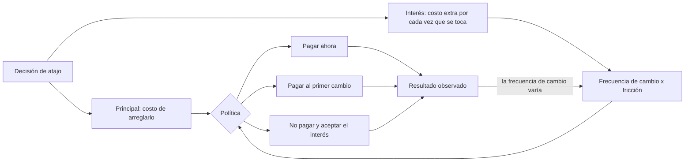
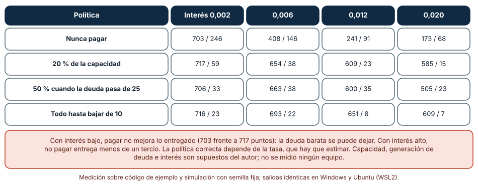
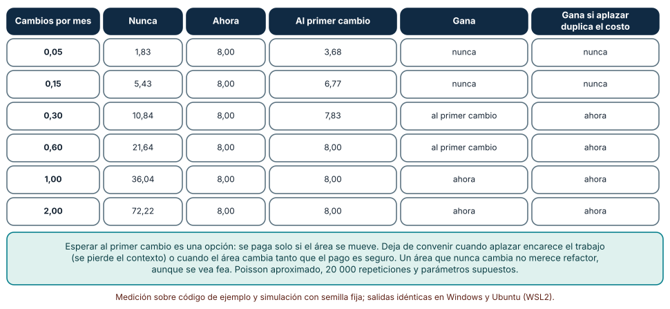
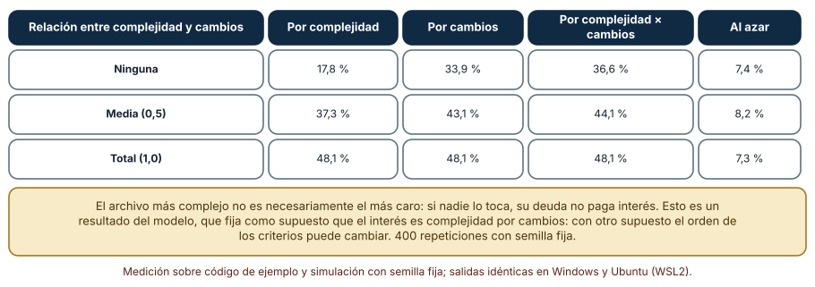

# SE-298 — Deuda técnica, interés y opciones

[← SE-297 — Complejidad accidental y esencial](../../classes/part-24-diseno-patrones-y-refactorizacion/se-297-complejidad-accidental-y-esencial/README.md) · [↑ Parte 24](../../classes/part-24-diseno-patrones-y-refactorizacion/README.md) · [📚 Índice completo](../../classes/README.md) · [🌐 Portal](../../site/classes/SE-298.html) · [SE-299 — Taller: refactorizar sin alterar comportamiento →](../../classes/part-24-diseno-patrones-y-refactorizacion/se-299-taller-refactorizar-sin-alterar-comportamiento/README.md)

## Punto profesional y fundamento pedagógico

**Punto profesional.** La clase existe para que hables de la deuda técnica con el vocabulario del dinero que la metáfora pide (principal, interés, plazo, opción) y para que decidas qué pagar, cuándo y qué dejar, usando una estimación explícita de lo que cuesta no pagar y no la incomodidad de ver un código feo.

**Por qué aparece aquí.** Sigue a **Complejidad accidental y esencial** (`SE-297`): allí se distinguió la complejidad que se puede reducir de la que no; aquí se pone precio a la que queda. Es la clase que convierte los olores (`SE-294`), la red de pruebas (`SE-295`) y las decisiones de diseño (`SE-296`) en una decisión de inversión.

**Error conceptual que debe corregir.** Creer que toda deuda técnica debe pagarse o que «deuda» es cualquier código que no nos gusta: la deuda solo cobra interés cuando se trabaja en ella, y lo que importa es la tasa, no el tamaño; una deuda grande en código que nadie toca puede ser barata y una pequeña en el centro del cambio, carísima.

**Secuencia de aprendizaje.** Antes de mirar los resultados, predices qué política de pago (nunca, un porcentaje fijo, por umbral, todo primero) entrega más funcionalidad en 24 sprints con un interés bajo y con uno alto, desde qué frecuencia de cambios conviene refactorizar ahora o al primer cambio y cuánto mejora el interés pagado elegir los archivos a refactorizar por complejidad, por cambios o por ambos. Después lo simulas con parámetros declarados. La secuencia usa predicción, explicación propia, contraste y recuperación. [ICAP](https://icap.education.asu.edu/research) distingue participación de construcción de conocimiento; [How People Learn II](https://nap.nationalacademies.org/catalog/24783/how-people-learn-ii-learners-contexts-and-cultures) exige conectar conocimiento previo, contexto y transferencia; la [práctica de recuperación](https://pubmed.ncbi.nlm.nih.gov/16507066/) respalda producir de nuevo la explicación tras una demora; y [Education for Life and Work](https://nap.nationalacademies.org/resource/13398/dbasse_084153.pdf) exige devolución que explique la causa del error.

**Evidencia de aprendizaje.** `debt-log.md` con la predicción, la tabla de políticas frente al interés, la de refactorizar ahora o después, la de selección de archivos y una nota que diga qué deuda de `tarifas` se paga, cuál se aplaza y con qué estimación de interés.

**Límite de la conclusión.** Las tres simulaciones son modelos con parámetros supuestos por el autor (capacidad de 40 puntos, interés por unidad de deuda, fricción de 3 puntos por cambio, 40 archivos). Ninguna mide un equipo ni un proyecto: muestran cómo cambian las decisiones con la tasa y con la frecuencia de cambio, no cuánto vale esa tasa.

### Trazabilidad fuente → afirmación

| Fuente primaria u oficial | Afirmación que respalda | Lo que no prueba |
|---|---|---|
| [Cunningham, «The WyCash Portfolio Management System» (OOPSLA, 1992)](http://c2.com/doc/oopsla92.html) | Introduce la metáfora de la deuda: lanzar código con una comprensión incompleta es como pedir un préstamo, y los intereses se pagan cada vez que se trabaja sobre ese código. | No cuantifica ninguna tasa ni dice cuándo conviene pedir prestado. |
| [Kruchten, Nord y Ozkaya, «Technical Debt: From Metaphor to Theory and Practice» (IEEE Software, 2012)](https://doi.org/10.1109/MS.2012.167) | Discute dónde la metáfora ayuda y dónde se queda corta, y distingue la deuda visible en el código de otras formas de deuda. | No fija un método único de estimación. |
| [Tornhill y Borg, «Code red: the business impact of code quality» (TechDebt, 2022)](https://doi.org/10.1145/3524843.3528091) | Es un estudio cuantitativo de 39 bases de código propietarias sobre el impacto de la calidad del código en el negocio. | No traslada sus cifras a `tarifas` ni a un equipo concreto. |

## Antes de empezar

Recupera lo aprendido en `SE-297`: parte de la complejidad es esencial y no se paga. La pregunta activa es: **¿cuánto interés paga este código cada vez que lo toco, cuántas veces lo toco y cuánto costaría pagar el principal?**

## Prerrequisitos

- Haber completado `SE-297` o poder explicar la diferencia entre complejidad esencial y accidental.
- Python 3.11 o posterior y un terminal; todo el código usa solo la biblioteca estándar.
- Haber visto el diagnóstico de olores de `SE-294` y los pasos de refactor de `SE-295`.

## Problema auténtico

El equipo de la plataforma de entregas tiene un tablero con 140 elementos de «deuda técnica» acumulados en cuatro años. La dirección pregunta cuánto cuesta y propone dedicar 20 % de cada sprint a pagarla. Dos integrantes discrepan: una dice que la deuda frena cada sprint y que hay que pagarla ya; otro que la mayoría de los elementos están en módulos que nadie toca y que pagar 20 % es tirar el dinero. Los dos tienen razón en algo y ninguno tiene una estimación. Hay un módulo, el de reglas de descuento, que cada trimestre se modifica tres veces y donde un código enredado añade, según la gente, medio día a cada cambio. Hay otro, el de exportación, que no se toca desde hace dos años.

## Objetivos observables

Al terminar podrás:

1. simular cómo cambian los puntos entregados en 24 sprints con cuatro políticas de pago según el interés de la deuda;
2. comparar tres decisiones (nunca refactorizar, refactorizar ahora, refactorizar al primer cambio) según la frecuencia de cambio y según si aplazar encarece el trabajo;
3. medir cuánto del interés total se paga en los archivos elegidos según se elijan por complejidad, por cambios o por ambos, y cómo depende de si ambas se relacionan;
4. estimar el interés de una deuda de `tarifas` con una fórmula declarada y sus supuestos;
5. declarar qué deuda se paga, cuál se aplaza y la evidencia que haría cambiar la decisión.

## Mapa conceptual



El mapa tiene dos parámetros que se estiman: el principal y el interés, que a su vez depende de cuántas veces se toca el código. El retorno marca que la decisión se revisa cuando cambia la frecuencia.

## Temas y por qué importan

| Tema | Por qué cambia una decisión profesional | Evidencia mínima |
|---|---|---|
| La metáfora de la deuda | Da vocabulario para hablar de costo diferido con quien decide. | Predicción, traza causal y contraejemplo de **La metáfora de la deuda** en `debt-log.md` |
| Interés y principal | Distinguen lo que cuesta arreglar de lo que cuesta no arreglar. | Predicción, traza causal y contraejemplo de **Interés y principal** en `debt-log.md` |
| Cuándo pagar | La frecuencia de cambio y el costo de aplazar mueven la decisión. | Predicción, traza causal y contraejemplo de **Cuándo pagar** en `debt-log.md` |
| Dónde pagar | Conviene pagar donde se toca, no donde molesta. | Predicción, traza causal y contraejemplo de **Dónde pagar** en `debt-log.md` |
| Límites de la metáfora | No toda la deuda tiene dueño ni vencimiento. | Predicción, traza causal y contraejemplo de **Límites de la metáfora** en `debt-log.md` |

## Conceptos y decisiones

### 1. La metáfora de la deuda

Cunningham comparó entregar código con una comprensión incompleta con pedir un préstamo: sirve para llegar antes, y cada vez que se trabaja sobre ese código se paga un interés en forma de esfuerzo extra. La metáfora es útil porque permite discutir con negocio una decisión de plazo (llegar antes a cambio de un costo futuro) en lugar de un juicio de gusto sobre el código. Su riesgo es la analogía literal: la deuda de código no tiene un acreedor, ni un calendario de pagos, ni siempre un principal claro.

### 2. Interés y principal

El **principal** es lo que costaría arreglar el atajo (reescribir el módulo, añadir la prueba que falta). El **interés** es el costo extra por cada vez que se trabaja sobre ese código: medio día más por cada cambio a las reglas de descuento. La deuda total es una cifra poco informativa; lo que decide es el interés esperado, que es la fricción por cambio multiplicada por la frecuencia de cambio. Una deuda enorme en un módulo que no se toca tiene interés casi nulo.

### 3. Cuándo pagar

Hay tres decisiones básicas. No pagar acepta el interés. Pagar ahora paga el principal por adelantado. Pagar **al primer cambio** (refactorizar cuando alguien tiene que tocar el código de todos modos) paga el principal solo si el módulo se mueve. La tercera es una opción: se ejerce solo si el área cambia. Deja de convenir cuando aplazar encarece el principal (el contexto se pierde, quien lo sabía se fue) o cuando el área cambia tanto que el pago es seguro.

### 4. Dónde pagar

Con presupuesto limitado, se pagan los archivos donde el interés es mayor: los que son difíciles de cambiar **y** se cambian a menudo. Elegir solo por complejidad apunta a los archivos más feos, que pueden ser los menos tocados. Elegir solo por cambios apunta a los más activos, que pueden ser simples. El producto de ambos aproxima el interés. Es una heurística: la complejidad de un archivo no siempre refleja la fricción de cambiarlo.

### 5. Límites de la metáfora

No toda la deuda es de código: también hay deuda de documentación, de pruebas, de infraestructura y de conocimiento (una sola persona entiende un módulo). No toda tiene un momento en que se «vence»: algunas se acumulan sin un hito. Y la decisión de contraerla fue razonable muchas veces; tratarla como culpa lleva a esconderla. Otra distinción útil es la de la deuda **deliberada** (se decidió con conocimiento) frente a la **inadvertida** (se descubrió después).

### Cuatro políticas de pago frente al interés

Un modelo de 24 sprints con capacidad de 40 puntos. La deuda inicial es de 10 unidades. En cada sprint se aplica la política (pagar nada, el 20 % de la capacidad, el 50 % si la deuda pasa de 25 unidades, o todo lo posible hasta bajar de 10), la velocidad de entrega es lo que queda de la capacidad multiplicado por (1 − interés × deuda) y la deuda crece en 0,35 por punto entregado con una variación uniforme de ±30 %. Se prueban cuatro intereses por unidad de deuda: 0,002; 0,006; 0,012 y 0,020.

```python
velocidad = util * (1.0 - min(0.9, interes * deuda))
deuda = deuda - pago + nueva * velocidad * rng.uniform(0.7, 1.3)
```

| Política | Interés 0,002 | 0,006 | 0,012 | 0,020 |
|---|---:|---:|---:|---:|
| Nunca pagar | 703 / 246 | 408 / 146 | 241 / 91 | 173 / 68 |
| 20 % de la capacidad | 717 / 59 | 654 / 38 | 609 / 23 | 585 / 15 |
| 50 % cuando la deuda pasa de 25 | 706 / 33 | 663 / 38 | 600 / 35 | 505 / 23 |
| Todo hasta bajar de 10 | 716 / 23 | 693 / 22 | 651 / 8 | 609 / 7 |

Cada celda es puntos entregados / deuda final. Resultado, idéntico en Windows (CPython 3.12.9) y en Ubuntu bajo WSL2 (3.12.3).



**Cómo leer la figura.** Cada fila es una política; cada columna, un interés. **Dónde deja de valer:** todos los parámetros (la capacidad, la generación de deuda, el interés lineal) son supuestos del autor; el efecto real del interés no es lineal ni se conoce, y no se midió ningún equipo. Con interés bajo, pagar apenas mejora lo entregado (703 frente a 717 puntos): la deuda barata se puede dejar. Con interés alto, no pagar entrega menos de un tercio de lo que entrega pagar todo. La figura no dice cuál es el interés de ningún equipo: dice que la política correcta depende de él.

### Refactorizar ahora, al primer cambio o nunca

Un área de código con una fricción de 3 puntos por cambio sin refactor y un refactor que cuesta 8. En 12 meses (pasos mensuales de cuatro semanas, aproximación de Poisson) hay una tasa de cambios por mes. Tres decisiones: nunca refactorizar (se paga 3 por cada cambio), refactorizar ahora (se paga 8) y refactorizar al primer cambio (se paga 8 solo si hay al menos un cambio). Como variante, se duplica el costo del refactor si se aplaza. Se simulan 20 000 repeticiones por fila con semilla fija.

```python
nunca += friccion * k
ahora += costo_refactor
jit += (costo_refactor if k else 0.0)
jit2 += (costo_refactor * 2.0 if k else 0.0)      # aplazar encarece el refactor
```

| Cambios por mes | Nunca | Ahora | Al primer cambio | Gana | Gana si aplazar duplica el costo |
|---:|---:|---:|---:|---|---|
| 0,05 | 1,83 | 8,00 | 3,68 | nunca | nunca |
| 0,15 | 5,43 | 8,00 | 6,77 | nunca | nunca |
| 0,30 | 10,84 | 8,00 | 7,83 | al primer cambio | ahora |
| 0,60 | 21,64 | 8,00 | 8,00 | al primer cambio | ahora |
| 1,00 | 36,04 | 8,00 | 8,00 | ahora | ahora |
| 2,00 | 72,22 | 8,00 | 8,00 | ahora | ahora |



**Cómo leer la figura.** Cada fila es una frecuencia de cambio; las columnas son el costo esperado de cada decisión. **Dónde deja de valer:** el costo del refactor (8), la fricción (3) y la duplicación al aplazar son supuestos; la tasa de cambios del futuro se desconoce y una aproximación de Poisson ignora las rachas. La figura muestra la estructura: esperar es una opción que vale cuando el área rara vez cambia y aplazar no encarece el trabajo. Un área que nunca cambia no merece un refactor, aunque se vea fea.

### Elegir los archivos que se refactorizan

Cuarenta archivos con complejidad lognormal y una distribución de cambios de tipo Zipf (el más cambiado recibe mucho más que el último). Se sortean 400 cambios y el interés pagado es la suma de la complejidad del archivo tocado. Con presupuesto para 5 archivos, cuya complejidad baja un 60 %, se compara elegir por complejidad, por cambios, por su producto o al azar, y cómo depende de si la complejidad y los cambios se relacionan entre sí (ninguna, media, total). Son 400 repeticiones con semilla fija.

```python
puntajes = {"complejidad": cx, "cambios": peso_cambios, "producto": [c * w for c, w in zip(cx, peso_cambios)]}
elegidos = sorted(range(n_arch), key=lambda a: -sc[a])[:k]
```

| Relación entre complejidad y cambios | Por complejidad | Por cambios | Por complejidad × cambios | Al azar |
|---|---:|---:|---:|---:|
| Ninguna | 17,8 % | 33,9 % | 36,6 % | 7,4 % |
| Media (0,5) | 37,3 % | 43,1 % | 44,1 % | 8,2 % |
| Total (1,0) | 48,1 % | 48,1 % | 48,1 % | 7,3 % |

Cada celda es el porcentaje del interés total que se evita.



**Cómo leer la figura.** Cada fila fija cuánto se parecen los archivos más complejos a los más cambiados; cada columna es un criterio de elección. **Dónde deja de valer:** el modelo fija como supuesto que el interés es complejidad por cambios, que es lo que se está probando; con otro supuesto, el orden de los criterios podría cambiar. La relación entre complejidad y cambios se impuso, no se midió en ningún repositorio. La figura enseña la estructura: elegir solo por complejidad rinde la mitad si la complejidad no guarda relación con los cambios.

## Definiciones de trabajo

- **deuda técnica:** costo futuro adicional que se acepta al elegir una solución más rápida o más incompleta hoy.
- **principal:** costo de eliminar el atajo que originó la deuda.
- **interés:** costo extra, por cada vez que se trabaja sobre el código afectado, de convivir con la deuda.
- **deuda deliberada:** deuda contraída con conocimiento de que lo es y de su costo.
- **opción de refactorizar:** derecho, sin obligación, de pagar el principal cuando el código se vuelva a tocar.

Las definiciones son operativas para `tarifas`. No convierten términos con una historia más amplia en sinónimos y deben contrastarse con la bibliografía enlazada al final.

## Ejemplo mínimo

El fragmento calcula el interés anual esperado de una deuda. Antes de ejecutarlo, predice el valor.

```python
friccion_por_cambio = 3.0      # puntos extra por cada cambio
cambios_por_anio = 3 * 4       # tres cambios por trimestre
interes_anual = friccion_por_cambio * cambios_por_anio
principal = 20.0
assert interes_anual == 36.0 and interes_anual > principal
```

El interés de un año supera el principal: pagar compensa en menos de un año. Registra versión, comando y salida; cambia a un cambio por año y predice la decisión.

## Ejemplo profesional

El equipo de `tarifas` no paga el tablero de 140 elementos. Estima, para los diez candidatos con más actividad en `git log`, tres cosas: la fricción por cambio (medida en una encuesta de tres preguntas al equipo y contrastada con el tiempo de los últimos cambios), la frecuencia de cambio (de la historia del repositorio) y el principal (una estimación en puntos, con rango). Calcula el interés anual y el plazo de recuperación. El módulo de descuentos, con tres cambios por trimestre y medio día de fricción, se paga ya; el de exportación, sin cambios en dos años, se deja con una nota; los demás se pagan al primer cambio con la regla de que quien lo toque lo deja mejor.

Compara con el estado anterior: la decisión es adecuada si cada elemento tiene un interés estimado con su fuente y un plazo de revisión; es frágil si la fricción se estima por opinión de una sola persona, o si la regla de pagar al primer cambio se aplica sin comprobar que el cambio no vuelve a empeorar el código.

## Práctica guiada

1. Lista diez elementos de deuda de `tarifas` y estima para cada uno el principal, la fricción por cambio y la frecuencia.
2. Calcula el interés anual y el plazo de recuperación de cada uno.
3. Simula las cuatro políticas con intereses de 0,002 y 0,020 y anota cuándo cambia la mejor.
4. Simula las tres decisiones con 0,15 y 0,60 cambios por mes y con aplazar a costo doble.
5. Genera cuarenta archivos con complejidad y cambios y compara los cuatro criterios de elección.
6. Decide qué se paga ya, qué al primer cambio y qué se deja, con su razón.
7. Entrega `debt-log.md` y pide a otra persona que identifique la decisión menos respaldada por una estimación.

## Ejercicios

1. **Interés:** estima el interés de una deuda de tu código con la historia de cambios y compara con tu intuición.
2. **Opción:** calcula el costo de aplazar que haría indiferentes «ahora» y «al primer cambio» con 0,30 cambios por mes.
3. **Dónde:** modifica el modelo para que el interés dependa del cuadrado de la complejidad y observa si cambia el mejor criterio.
4. **Límite:** describe una deuda de `tarifas` que la metáfora financiera no describe bien y propón otro vocabulario.

## Reto verificable

Entrega `debt-log.md` con la predicción, las tres tablas, la estimación de interés y principal de diez elementos de `tarifas` con sus fuentes y la decisión por elemento. Se aprueba si otra persona ejecuta el código desde un checkout limpio, obtiene los mismos números y puede decir qué parámetro cambiaría la decisión de cada elemento. No se aprueba por afirmar que la deuda «es alta» ni por proponer un porcentaje fijo sin una estimación.

## Caso conductor

El componente `tarifas` conserva lo construido en `SE-289` a `SE-297` y gana un registro de deuda con interés estimado, principal, decisión y plazo de revisión. `SE-299` aplica la refactorización segura a una función heredada. Cambia después una sola decisión, la frecuencia estimada de cambios de las reglas de descuento, y observa cuándo cambia el orden de prioridades.

## Preguntas frecuentes

### ¿Toda la deuda técnica debe pagarse?

No: se paga la que tiene un interés mayor que el costo de pagarla. La deuda en código estable puede dejarse, y se anota para que no se vuelva a discutir.

### ¿Cómo estimo la fricción por cambio?

Combinando el tiempo observado de los últimos cambios en ese código con la opinión de quienes los hicieron, y declarando el rango. Una sola persona opinando da una cifra con más sesgo que varias personas con datos.

### ¿Por qué «al primer cambio» no es siempre lo mejor?

Porque aplazar puede encarecer el trabajo (se pierde el contexto, se va quien lo entendía) y porque con cambios frecuentes pagar al principio es seguro. La opción vale cuando el área cambia poco.

### ¿La deuda técnica es culpa de quien programó?

No necesariamente: muchas veces fue una decisión razonable con la información de entonces. Tratarla como culpa lleva a esconderla; tratarla como una decisión de inversión permite revisarla.

## Fallo controlado y diagnóstico

Reproduce el fallo clásico de la clase: **pagar la deuda más fea y no la más cara**. Con cuarenta archivos sin relación entre complejidad y cambios, refactoriza los cinco más complejos.

Registra síntoma, entrada mínima, hipótesis, observación que descarta cada hipótesis, causa, corrección y prueba de regresión. **Síntoma:** tras invertir un sprint en los cinco archivos más complejos, el tiempo de los cambios del trimestre siguiente casi no baja. **Hipótesis rivales:** (a) el refactor no mejoró la complejidad; (b) los cambios del trimestre fueron más difíciles por otra razón; (c) esos archivos casi no se tocaron en el trimestre. **Prueba:** cuenta los cambios por archivo en el trimestre; si los cinco archivos suman pocos cambios, la causa es (c). **Conclusión:** se pagó la deuda con menos interés. **Regresión:** elige por complejidad por cambios (evita 36,6 % del interés frente a 17,8 %) y registra la frecuencia de cambio de cada elemento del tablero. No cambies a la vez el criterio y la medida.

## Errores comunes y cómo corregirlos

| Síntoma | Causa probable | Corrección |
|---|---|---|
| Se dedica un porcentaje fijo a «pagar deuda» sin resultados visibles | No se estimó el interés de cada elemento | Estimar interés y principal y ordenar por plazo de recuperación |
| Se refactoriza el módulo más feo y el cambio sigue costando lo mismo | Se eligió por complejidad y no por cambios | Priorizar por complejidad por frecuencia de cambio |
| Una deuda se aplaza y su pago se encarece | Se perdió el contexto | Anotar por qué se aplaza y la fecha de revisión |
| El tablero crece sin decisiones | Todo se registra y nada se decide | Cada elemento tiene decisión: pagar ya, al primer cambio o dejar |
| La dirección entiende la deuda como culpa | Se usa la metáfora como reproche | Hablar de decisiones de plazo y de costo esperado |

## Entorno y archivos clave

```text
work/SE-298/
├── README.md
├── modelos/
│   ├── politicas.py
│   ├── opcion.py
│   └── puntos_calientes.py
├── registro/
│   └── deuda.md
└── evidence/debt-log.md
```

El `README` declara plataforma, versión de Python, semillas y comandos. Los experimentos usan solo la biblioteca estándar (`random`, `statistics`) y se ejecutaron con CPython 3.12.9 en Windows 11 y 3.12.3 en Ubuntu bajo WSL2: las salidas fueron idénticas. Si añades una dependencia, fija procedencia y versión.

## Seguridad, ética y accesibilidad

- una deuda de seguridad (una dependencia vulnerable, una validación ausente) no se evalúa solo por su interés de desarrollo: el costo incluye el daño posible a las personas, y debe tratarse aparte de la deuda de mantenimiento;
- una estimación de fricción pedida al equipo no debe usarse para evaluar a las personas ni exponer a quien menciona un módulo difícil;
- el registro de deuda debe ser legible para negocio y para personas con distintas herramientas, con cifras y razones y sin jerga;
- no incluyas datos de clientes en las notas del registro;
- respeta las licencias de los textos citados y atribuye lo adaptado.

## Puente hacia el trabajo con agentes

Un agente al que se le pide «paga la deuda técnica de tarifas» refactorizará los archivos que la herramienta marque como peores y presentará la reducción de métricas como logro. Pídele en cambio que calcule para cada candidato la frecuencia de cambio desde `git log`, que estime la fricción con datos o la declare como supuesto y que proponga qué pagar ya, al primer cambio o dejar, con el cálculo. Revisa especialmente si eligió por complejidad sin mirar los cambios, si tocó código sin la red de `SE-295` o si presentó una cifra de interés sin su fuente.

## Transferencia

Traslada el análisis a otro módulo (por ejemplo, el de notificaciones): cambia los candidatos y las frecuencias, y conserva el procedimiento de estimar principal e interés, comparar las opciones y elegir dónde pagar. La transferencia está lograda cuando puedes explicar por qué dejaste una deuda sin pagar, no cuando el tablero queda más corto.

## Evaluación y evidencia

| Criterio | Evidencia para aprobar |
|---|---|
| comprensión | explicación de principal, interés y opción con ejemplos de `tarifas` |
| corrección | políticas, decisiones y selección de archivos reproducibles con las mismas semillas |
| diseño | registro de deuda con interés estimado, decisión y plazo de revisión |
| diagnóstico | reproducción del fallo «pagar la deuda más fea y no la más cara» con regresión |
| incertidumbre | declaración de que los modelos son supuestos y no miden ningún equipo |
| reproducibilidad | versiones, comandos, salida y límites declarados |

## Fuentes

- [Cunningham, «The WyCash Portfolio Management System» (OOPSLA, 1992)](http://c2.com/doc/oopsla92.html) — origen de la metáfora de la deuda; autoridad: su autor.
- [Kruchten, Nord y Ozkaya (IEEE Software, 2012)](https://doi.org/10.1109/MS.2012.167) — la metáfora y sus límites; autoridad: IEEE Software.
- [Tornhill y Borg (TechDebt, 2022)](https://doi.org/10.1145/3524843.3528091) — estudio cuantitativo de calidad del código y negocio; autoridad: Proceedings of the International Conference on Technical Debt.
- [Fowler, «Technical Debt»](https://martinfowler.com/bliki/TechnicalDebt.html) — la metáfora y el interés; autoridad: Martin Fowler.
- [Fowler, «Technical Debt Quadrant»](https://martinfowler.com/bliki/TechnicalDebtQuadrant.html) — deuda deliberada e inadvertida; autoridad: Martin Fowler.
- [Fowler, «Yagni»](https://martinfowler.com/bliki/Yagni.html) — el costo de construir flexibilidad por adelantado; autoridad: Martin Fowler.
- [Python: `random`](https://docs.python.org/3/library/random.html) — generador con semilla para las simulaciones; autoridad: documentación de Python.

Cada fuente respalda el mecanismo indicado; ninguna demuestra que el interés de 0,012, el punto de cruce de 0,30 cambios por mes o el 36,6 % de interés evitado se observen en `tarifas`. Esa afirmación depende de su historia de cambios y de la fricción que mida su equipo.

## Límites y siguiente paso

Se ejecutaron tres modelos con parámetros supuestos y datos sintéticos en Windows y Ubuntu (WSL2) con resultados idénticos. No se midió ningún equipo ni ningún repositorio; la capacidad, el interés, la fricción, la distribución de los cambios y la relación entre complejidad y cambios son construcciones del autor. La siguiente clase es un taller: refactorizar una función heredada sin alterar su comportamiento.

## Glosario

- **deuda técnica:** costo futuro adicional que se acepta al elegir una solución más rápida o más incompleta hoy.
- **principal:** costo de eliminar el atajo que originó la deuda.
- **interés:** costo extra, por cada vez que se trabaja sobre el código afectado, de convivir con la deuda.
- **deuda deliberada:** deuda contraída con conocimiento de que lo es y de su costo.
- **opción de refactorizar:** derecho, sin obligación, de pagar el principal cuando el código se vuelva a tocar.

---

[← SE-297 — Complejidad accidental y esencial](../../classes/part-24-diseno-patrones-y-refactorizacion/se-297-complejidad-accidental-y-esencial/README.md) · [↑ Parte 24](../../classes/part-24-diseno-patrones-y-refactorizacion/README.md) · [📚 Índice completo](../../classes/README.md) · [🌐 Portal](../../site/classes/SE-298.html) · [SE-299 — Taller: refactorizar sin alterar comportamiento →](../../classes/part-24-diseno-patrones-y-refactorizacion/se-299-taller-refactorizar-sin-alterar-comportamiento/README.md)
