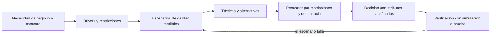
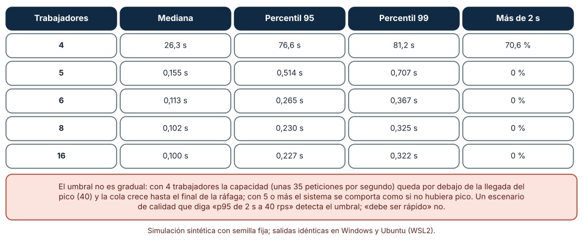
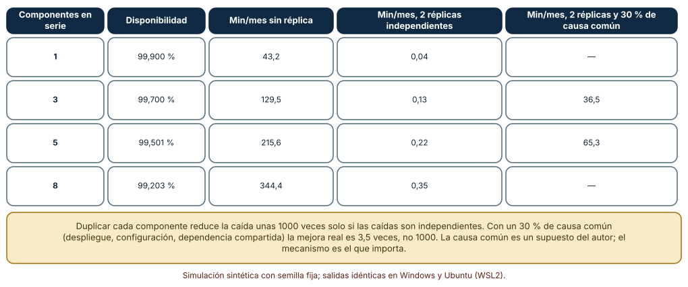
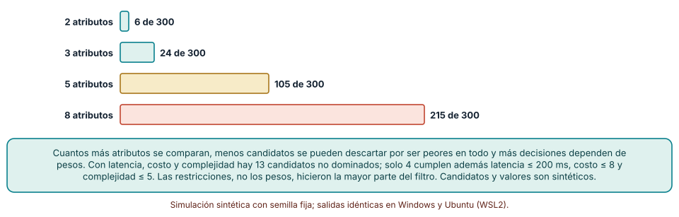

# SE-301 — Drivers, restricciones y atributos de arquitectura

[← SE-300 — Proyecto: evolución compatible de un componente](../../classes/part-24-diseno-patrones-y-refactorizacion/se-300-proyecto-evolucion-compatible-de-un-componente/README.md) · [↑ Parte 25](../../classes/part-25-arquitectura-de-software-y-dominio/README.md) · [📚 Índice completo](../../classes/README.md) · [🌐 Portal](../../site/classes/SE-301.html) · [SE-302 — Vistas lógica, runtime, datos y despliegue →](../../classes/part-25-arquitectura-de-software-y-dominio/se-302-vistas-logica-runtime-datos-y-despliegue/README.md)

## Punto profesional y fundamento pedagógico

**Punto profesional.** La clase existe para que conviertas «necesitamos una buena arquitectura» en drivers, restricciones y escenarios de calidad que se puedan medir, y para que sepas qué decisiones fuerzan y cuáles solo reflejan una preferencia.

**Por qué aparece aquí.** Abre la **Parte 25** después de **Proyecto: evolución compatible de un componente**: la Parte 24 enseñó a diseñar y refactorizar dentro de un componente; ahora la pregunta sube de nivel y pasa a ser qué fuerzas obligan a dividir, agrupar o replicar componentes. La clase fija el vocabulario y el caso conductor de la parte: la plataforma de entregas y corrección de tareas de un curso, que recibe una ráfaga de archivos cada vez que vence un plazo.

**Error conceptual que debe corregir.** Creer que una arquitectura se elige por estilo (monolito, microservicios, hexagonal) antes de saber qué atributo de calidad la fuerza: los estilos son respuestas, y sin la pregunta cualquiera parece buena.

**Secuencia de aprendizaje.** Antes de leer los resultados, predices cuántos trabajadores necesita el sistema para atender la entrega del pico, qué disponibilidad da una cadena de componentes y cuántas de trescientas arquitecturas candidatas sobreviven a tres restricciones; después simulas cada cosa y comparas con la predicción. La secuencia usa predicción, explicación propia, contraste y recuperación. [ICAP](https://icap.education.asu.edu/research) distingue participación de construcción de conocimiento; [How People Learn II](https://nap.nationalacademies.org/catalog/24783/how-people-learn-ii-learners-contexts-and-cultures) exige conectar conocimiento previo, contexto y transferencia; la [práctica de recuperación](https://pubmed.ncbi.nlm.nih.gov/16507066/) respalda producir de nuevo la explicación tras una demora; y [Education for Life and Work](https://nap.nationalacademies.org/resource/13398/dbasse_084153.pdf) exige devolución que explique la causa del error.

**Evidencia de aprendizaje.** `drivers.md` con la tabla de drivers y restricciones, cinco escenarios de calidad con estímulo, respuesta y medida, la simulación del pico con su capacidad mínima, la cuenta de disponibilidad de la ruta crítica y la lista de candidatos no dominados con lo que cada restricción descartó.

**Límite de la conclusión.** Los tiempos de servicio, las tasas de llegada, las disponibilidades de cada componente, el 30 % de causa común y los valores de los 300 candidatos son supuestos del autor. Nada se midió en una plataforma real: las simulaciones muestran mecanismos (umbral de saturación, producto de disponibilidades, dominancia), no cifras de un producto.

### Trazabilidad fuente → afirmación

| Fuente primaria u oficial | Afirmación que respalda | Lo que no prueba |
|---|---|---|
| [ISO/IEC 25010:2023](https://www.iso.org/standard/78176.html) | Define un modelo de características de calidad del producto (rendimiento, fiabilidad, seguridad, mantenibilidad, entre otras) que sirve de vocabulario común para nombrar atributos. | No dice qué atributo debe mandar en un sistema concreto ni qué umbral es suficiente. |
| [SEI, «The Architecture Tradeoff Analysis Method»](https://www.sei.cmu.edu/library/the-architecture-tradeoff-analysis-method/) | Propone escenarios de calidad con estímulo y respuesta medible, y un árbol de utilidad para priorizarlos. | No garantiza que los escenarios elegidos sean los que importan a quienes usarán el sistema. |
| [Google SRE, «Embracing Risk»](https://sre.google/sre-book/embracing-risk/) | Trata la disponibilidad como un objetivo con coste y la compara con el riesgo aceptable, no con cien por ciento. | No fija el objetivo de disponibilidad de la plataforma de esta clase. |
| [Python: `heapq`](https://docs.python.org/3/library/heapq.html) | Documenta la cola de prioridad con la que se simula la cola FIFO de trabajadores. | No valida el modelo de colas como descripción de un servidor real. |

## Antes de empezar

Recupera lo que la Parte 24 dejó sobre cambio: un componente se refactoriza para que el siguiente cambio cueste menos. La pregunta activa es: **¿qué escenario concreto de calidad obliga a que este sistema esté partido o replicado de esta manera, y qué alternativa descartamos al aceptarlo?**

## Prerrequisitos

- Haber completado `SE-300` o poder explicar qué contrato de compatibilidad mantenía el componente.
- Python 3.11 o posterior y un terminal; todo el código usa solo la biblioteca estándar.
- Manejar percentiles, probabilidades de eventos independientes y archivos Markdown con tablas.

## Problema auténtico

La plataforma de entregas y corrección de un curso funciona bien los martes por la mañana. El jueves a las 23:50, diez minutos antes del plazo, cuarenta estudiantes por segundo suben archivos. Algunos reciben «error al subir», otros la entrega aparece dos veces y el equipo de seis personas discute si debe «pasar a microservicios». Nadie ha escrito qué significa «aguantar el plazo». Sin esa frase, la discusión es de gustos: el estilo arquitectónico no puede evaluarse contra algo que no se ha dicho.

## Objetivos observables

Al terminar podrás:

1. distinguir un driver (lo que empuja), una restricción (lo que limita) y un atributo de calidad (lo que se mide) con un ejemplo y un contraejemplo de la plataforma;
2. escribir un escenario de calidad con fuente, estímulo, entorno, artefacto, respuesta y medida, y reconocer cuándo una frase como «debe ser rápido» no es un escenario;
3. calcular con una simulación la capacidad mínima que cumple un escenario de latencia en el pico y localizar el umbral en el que el sistema deja de comportarse bien;
4. calcular la disponibilidad de una ruta crítica en serie, con y sin redundancia, y explicar por qué la causa común limita la mejora;
5. reducir un conjunto de alternativas con restricciones y dominancia antes de ponderar nada, y declarar qué decisión quedó abierta.

## Mapa conceptual



El mapa muestra que el estilo arquitectónico aparece tarde, después de la medida: primero se dice qué debe cumplirse, luego se descartan alternativas y solo entonces se decide. El retorno indica que un escenario que falla en la verificación obliga a revisar el escenario o la alternativa, no a ocultar el resultado.

## Temas y por qué importan

| Tema | Por qué cambia una decisión profesional | Evidencia mínima |
|---|---|---|
| Drivers de negocio y de contexto | Dicen qué empuja la arquitectura: un plazo, una norma, un equipo pequeño. | Predicción, traza causal y contraejemplo de **Drivers de negocio y de contexto** en `drivers.md` |
| Restricciones | Reducen el espacio de alternativas antes de comparar. | Predicción, traza causal y contraejemplo de **Restricciones** en `drivers.md` |
| Atributos y escenarios de calidad | Convierten un adjetivo en una prueba. | Predicción, traza causal y contraejemplo de **Atributos y escenarios de calidad** en `drivers.md` |
| Conflictos entre atributos | Mejorar uno cuesta otro; hay que elegir cuál sacrificar. | Predicción, traza causal y contraejemplo de **Conflictos entre atributos** en `drivers.md` |
| Arquitectura frente a diseño | Decide qué es costoso de cambiar y merece una decisión explícita. | Predicción, traza causal y contraejemplo de **Arquitectura frente a diseño** en `drivers.md` |

## Conceptos y decisiones

### 1. Drivers de negocio y de contexto

Un **driver** es una fuerza que empuja la estructura del sistema: «los plazos concentran la carga en diez minutos», «el servicio debe operar con seis personas», «las notas no pueden perderse». Los drivers vienen del negocio (qué valor se protege), del contexto (equipo, presupuesto, calendario) y de la tecnología disponible. Se escriben como frases verificables y con un responsable que pueda cambiarlos. Un driver sin dueño se convierte en una creencia: nadie lo revisará cuando el contexto cambie. La diferencia con un requisito es que un driver no describe una función, describe una presión sobre cualquier función.

### 2. Restricciones

Una **restricción** es una decisión que ya no está en discusión: «se despliega en la infraestructura de la universidad», «los datos de estudiantes no salen del país», «el equipo domina Python». Reduce el espacio de alternativas, y por eso es lo primero que se aplica. Dos errores típicos: tratar una preferencia como restricción («tiene que ser serverless») y tratar una restricción real como preferencia («ya veremos lo de los datos»). La regla práctica es anotar quién impuso la restricción, desde cuándo y qué costaría levantarla; una restricción sin esa información es una opinión.

### 3. Atributos y escenarios de calidad

Un **atributo de calidad** (rendimiento, disponibilidad, modificabilidad, seguridad) solo guía una decisión cuando se escribe como **escenario**: una fuente produce un estímulo en un entorno sobre un artefacto, y el sistema debe dar una respuesta con una medida. «El 95 % de las entregas confirma en menos de 2 s cuando 40 estudiantes por segundo suben archivos durante 10 minutos» es un escenario; «debe ser escalable» no lo es. El SEI organiza los escenarios en un árbol de utilidad que ordena por importancia para el negocio y dificultad técnica. La norma ISO/IEC 25010 aporta los nombres de las características para no inventar vocabulario.

### 4. Conflictos entre atributos

Casi toda táctica mejora un atributo y empeora otro: replicar mejora la disponibilidad y complica la consistencia; guardar en caché mejora la latencia y complica la frescura; separar en servicios mejora la autonomía y añade latencia de red y operación. Por eso un conjunto de requisitos casi siempre no tiene una solución que gane en todo: tiene una frontera de alternativas que no se dominan entre sí. La decisión consiste en elegir un punto de esa frontera y escribir lo que se sacrificó. Si la decisión no nombra lo sacrificado, aún no se ha tomado.

### 5. Arquitectura frente a diseño

La arquitectura reúne las decisiones **costosas de cambiar** que determinan los atributos de calidad: cómo se parte el sistema, qué comunica con qué, dónde viven los datos, qué se replica. El diseño de una clase o de una función se corrige con una refactorización; la partición de un sistema en tres servicios con tres bases de datos se corrige con una migración de meses. Una pregunta útil para decidir si algo es arquitectura es cuánto cuesta revertirlo. Cuanto más caro, más justifica un escenario medido que lo respalde y un registro escrito de por qué se eligió.

### Cuántos trabajadores exige un pico de entrega

El sistema recibe 4 entregas por segundo durante 20 minutos, 40 por segundo durante 10 minutos (el cierre del plazo) y de nuevo 4 durante 20 minutos: 33 803 peticiones con semilla fija. Cada petición tarda un tiempo lognormal de mediana 100 ms (σ = 0,5) y las atiende una cola FIFO con `c` trabajadores. Se mide la latencia hasta la confirmación.

```python
free = [0.0] * c; heapq.heapify(free)
for a in llegadas:
    s = rng.lognormvariate(math.log(0.1), 0.5)
    f = heapq.heappop(free); inicio = max(a, f); heapq.heappush(free, inicio + s)
    latencia.append(inicio + s - a)
```

| Trabajadores | Mediana | Percentil 95 | Percentil 99 | Más de 2 s |
|---|---:|---:|---:|---:|
| 4 | 26,3 s | 76,6 s | 81,2 s | 70,6 % |
| 5 | 0,155 s | 0,514 s | 0,707 s | 0 % |
| 6 | 0,113 s | 0,265 s | 0,367 s | 0 % |
| 8 | 0,102 s | 0,230 s | 0,325 s | 0 % |
| 16 | 0,100 s | 0,227 s | 0,322 s | 0 % |

Resultado, idéntico en Windows (CPython 3.12.9) y en Ubuntu bajo WSL2 (3.12.3). El tiempo medio de servicio es de unos 113 ms, así que cuatro trabajadores atienden unas 35 peticiones por segundo, por debajo de las 40 del pico: la cola crece durante los diez minutos y no se vacía hasta mucho después.



**Cómo leer la figura.** Cada fila es un número de trabajadores; las columnas son estadísticos de latencia en el pico. Con 4 el sistema no sobrevive al pico; con 5 ya lo cumple con margen (p95 de 0,514 s frente a un escenario de 2 s). **Dónde deja de valer:** el modelo supone llegadas de Poisson, servicio independiente y un único recurso; un sistema real tiene contención de base de datos, red y dependencias que cambian la capacidad efectiva. Lo que enseña es la forma: cerca de la saturación el comportamiento no es gradual, y un escenario con número deja ver ese umbral.

### Disponibilidad de una cadena: producto y causa común

La entrega atraviesa web, identidad, entregas, archivos, base de datos y cola. Si cada componente tiene 99,9 % de disponibilidad y todos son necesarios, la disponibilidad del conjunto es el producto: 0,999ⁿ. Se compara con dos réplicas independientes por componente y con una simulación en la que el 30 % de las caídas es de causa común (un despliegue erróneo, una dependencia compartida).

```python
def serie(ps):
    r = 1
    for p in ps: r *= p
    return r
# con réplica: componente cae solo si caen las dos; con causa común, si cae la causa compartida
```

| Componentes en serie | Disponibilidad | Min/mes sin réplica | Min/mes, 2 réplicas independientes | Min/mes, 2 réplicas y 30 % de causa común |
|---:|---:|---:|---:|---:|
| 1 | 99,900 % | 43,2 | 0,04 | — |
| 3 | 99,700 % | 129,5 | 0,13 | 36,5 |
| 5 | 99,501 % | 215,6 | 0,22 | 65,3 |
| 8 | 99,203 % | 344,4 | 0,35 | — |

Cada componente que se añade a una ruta necesaria resta disponibilidad: con ocho, un servicio «tres nueves» cae más de cinco horas al mes. La réplica independiente promete 300 o 1000 veces menos caída, pero con un tercio de causa común la mejora real es de 3,5 veces.



**Cómo leer la figura.** Las filas son longitudes de cadena; las tres últimas columnas comparan minutos de caída al mes. **Dónde deja de valer:** las disponibilidades son supuestos y la causa común del 30 % también; una caída real tiene duración, correlación temporal y degradación parcial que un número por mes no captura. Sirve para saber en qué parte de la cuenta mirar: no en duplicar, sino en lo que comparten los duplicados.

### Frontera de Pareto y restricciones antes que pesos

Se generan 300 arquitecturas candidatas con tres atributos al azar: latencia (50 a 500 ms), costo (1 a 20) y complejidad operativa (1 a 10). Una candidata **domina** a otra si es igual o mejor en todo y mejor en algo. Se cuentan las no dominadas y las que cumplen las restricciones (latencia ≤ 200 ms, costo ≤ 8, complejidad ≤ 5), y se repite el recuento con 2, 3, 5 y 8 atributos para ver cómo crece la frontera.

```python
def domina(a, b):
    return all(x <= y for x, y in zip(a, b)) and a != b
pareto = [c for c in cand if not any(domina(o, c) for o in cand)]
```

De las 300 candidatas, 13 no están dominadas con tres atributos; 13 cumplen las tres restricciones y solo 4 de ellas están además en la frontera. Con 2 atributos quedan 6 sin dominar, con 3 son 24, con 5 son 105 y con 8 son 215; las cuatro cifras vienen de conjuntos de puntos independientes, mientras que el conjunto de latencia, costo y complejidad usa una complejidad entera de 1 a 10 que genera empates y por eso da menos (13).



**Cómo leer la figura.** Cada barra cuenta los candidatos que ningún otro supera en todo; cuantos más atributos, menos candidatos se pueden descartar por ser peores en todo. **Dónde deja de valer:** los candidatos son números al azar, independientes entre sí; los reales se correlacionan (lo barato suele ser más simple) y la frontera es más estrecha. La figura no recomienda «comparar pocos atributos»: dice que las restricciones, que son baratas, hacen la mayor parte del filtrado antes de ponderar.

## Definiciones de trabajo

- **driver arquitectónico:** fuerza de negocio, de contexto o técnica que condiciona la estructura del sistema y que debe poder escribirse como una frase verificable.
- **restricción:** decisión ya tomada o condición externa que descarta alternativas sin discutirlas, con una fuente y un coste de levantarla.
- **escenario de calidad:** descripción de una fuente que produce un estímulo en un entorno sobre un artefacto y de la respuesta medible que se espera.
- **dominancia:** relación entre alternativas en la que una es igual o mejor que otra en todos los atributos y mejor en alguno.
- **causa común:** fallo que afecta a varios componentes a la vez porque comparten algo (despliegue, configuración, dependencia).

Las definiciones son operativas para la plataforma de entregas. No convierten términos con una historia más amplia en sinónimos y deben contrastarse con la documentación primaria enlazada al final.

## Ejemplo mínimo

El fragmento calcula la disponibilidad de una ruta y los minutos de caída. Antes de ejecutarlo, predice cuántos minutos al mes cae una ruta con cinco componentes de 99,9 %.

```python
n, d = 5, 0.999
disponibilidad = d ** n
minutos = (1 - disponibilidad) * 43200
assert abs(disponibilidad - 0.995010) < 1e-6 and round(minutos, 1) == 215.6
```

Son unos 216 minutos, casi cuatro horas. Registra versión, comando y salida; cambia a seis componentes de 99,95 % y predice si la ruta cumple 99,9 %.

## Ejemplo profesional

El equipo de la plataforma abre `drivers.md` con cuatro drivers (el pico de entrega no debe perder archivos; el servicio se apoya en seis personas; las notas deben ser consistentes; el servicio debe estar disponible en periodo de entregas), tres restricciones (infraestructura de la universidad, datos en el país, Python como lenguaje) y cinco escenarios medibles. Para el del pico simula cuatro a dieciséis trabajadores y registra que cinco bastan con margen; para el de disponibilidad calcula que la ruta de entrega, con seis componentes, da 99,4 % sin redundancia, y escribe que con réplicas y un tercio de causa común queda cerca de 99,8 %, no en los 99,9999 % que promete la cuenta de réplicas independientes. Antes de comparar estilos arquitectónicos descarta con las restricciones 287 de las 300 alternativas de un generador de candidatos y se queda con las que no se dominan.

Compara con el planteamiento inicial («pasar a microservicios»): el equipo ahora puede decir qué escenario fuerza cada decisión, qué alternativa se descartó y qué se sacrificó. Un dossier es adecuado cuando otra persona puede refutar un escenario con una medida; es frágil cuando solo contiene adjetivos.

## Práctica guiada

1. Lista cinco drivers de la plataforma y marca cuáles tienen dueño que pueda cambiarlos.
2. Separa tres restricciones de tres preferencias y anota fuente y coste de levantarlas.
3. Reescribe «debe ser rápido» como un escenario con las seis partes.
4. Predice cuántos trabajadores necesita el pico y simula de 4 a 16 con semilla fija.
5. Calcula la disponibilidad de la ruta de entrega con tus supuestos y con una causa común del 30 %.
6. Genera 300 candidatos, aplica las restricciones y cuenta las no dominadas.
7. Entrega `drivers.md` y pide a otra persona que encuentre un escenario sin medida.

## Ejercicios

1. **Escenario:** convierte «el servicio debe ser seguro» en un escenario con un atacante, un estímulo, una respuesta y una medida; explica qué parte tuviste que inventar.
2. **Umbral:** con tiempo de servicio medio de 113 ms, calcula la llegada máxima que atienden 6 trabajadores al 80 % de uso y compárala con la simulación.
3. **Cadena:** quita un componente de la ruta de entrega y calcula cuánto mejora la disponibilidad; compáralo con duplicar otro.
4. **Dominancia:** construye cinco candidatos con tres atributos en los que dos estén dominados y uno cumpla una restricción que descarta a los demás.

## Reto verificable

Entrega `drivers.md` con drivers, restricciones, cinco escenarios medibles, la simulación del pico, la cuenta de disponibilidad y la reducción de candidatos. Se aprueba si otra persona ejecuta el código desde un checkout limpio, obtiene las mismas cifras y puede decir qué escenario cambiaría si el pico fuera de 60 peticiones por segundo. No se aprueba por listar atributos sin medida ni por afirmar que un estilo «escala mejor».

## Caso conductor

La plataforma de entregas y corrección de tareas de un curso es el caso conductor de la Parte 25. Esta clase deja el primer artefacto: los drivers, las restricciones y los escenarios que las siguientes clases usarán para evaluar vistas, estilos y decisiones. `SE-302` mostrará el sistema desde varias vistas coherentes con estos escenarios. Cambia después un solo escenario, el pico de 40 a 60 peticiones por segundo, y observa qué decisiones dejan de sostenerse.

## Preguntas frecuentes

### ¿Un requisito no funcional y un atributo de calidad son lo mismo?

En la práctica se usan como sinónimos, pero un atributo de calidad solo orienta una decisión cuando se convierte en escenario con medida. Un requisito no funcional escrito como adjetivo («seguro», «rápido») no es verificable y no puede descartar ninguna alternativa.

### ¿Cuántos escenarios hacen falta?

Pocos y buenos: cinco a diez que cubran los atributos que más condicionan la estructura. Más escenarios aumentan el coste de verificarlos y diluyen la prioridad. Un árbol de utilidad ayuda a ordenarlos por importancia y dificultad.

### ¿Se puede diseñar sin conocer la carga real?

Sí, con rangos declarados como supuestos y un plan para medirla. Lo que no conviene es esconder el supuesto: el escenario debe decir «con 40 peticiones por segundo (supuesto)» y la clase de arquitectura debe poder cambiar si el número resulta otro.

### ¿Qué hago si dos stakeholders piden atributos incompatibles?

Escribe los dos escenarios, cuantifica el coste de cada uno y devuelve la decisión a quien pueda priorizar. Una arquitectura no resuelve un conflicto de prioridades: lo hace visible.

## Fallo controlado y diagnóstico

Reproduce el fallo clásico de la clase: **elegir un estilo arquitectónico antes de saber qué escenario lo fuerza**. El equipo decide pasar el sistema a servicios y el pico sigue sin atenderse. Simula la cola con 4 trabajadores en servicios (mismo servicio, más 8 ms de red) y compara con 5 trabajadores en el diseño anterior.

Registra síntoma, entrada mínima, hipótesis, observación que descarta cada hipótesis, causa, corrección y prueba de regresión. **Síntoma:** tras la migración, el 70 % de las entregas del cierre tarda más de 2 s. **Hipótesis rivales:** (a) el nuevo estilo añade latencia; (b) la capacidad no cubre el pico; (c) un componente es el cuello de botella. **Prueba:** mide la capacidad (trabajadores ÷ tiempo de servicio) y compárala con la llegada del pico; si es menor, la causa es la capacidad, no el estilo. **Conclusión:** 4 trabajadores atienden unas 35 peticiones por segundo y llegan 40. **Regresión:** incluye en el dossier el escenario del pico con su capacidad mínima y una prueba de carga que lo verifique. No cambies a la vez el estilo y la capacidad.

## Errores comunes y cómo corregirlos

| Síntoma | Causa probable | Corrección |
|---|---|---|
| La discusión de arquitectura no termina | No hay escenarios con medida que comparar | Escribir escenarios con las seis partes y priorizarlos |
| Se elige «microservicios» y el rendimiento no mejora | La causa del rendimiento era la capacidad o un cuello de botella, no la partición | Medir la capacidad contra el pico antes de cambiar la estructura |
| La disponibilidad prometida no se cumple con réplicas | La causa común domina y las réplicas no son independientes | Identificar lo que comparten las réplicas y aislarlo |
| Una restricción desaparece a mitad del proyecto | Era una preferencia sin dueño | Registrar fuente, fecha y coste de levantarla |
| Se pondera sin descartar | Se comparan alternativas que una restricción ya excluía | Aplicar primero restricciones y dominancia y ponderar solo lo que queda |

## Entorno y archivos clave

```text
work/SE-301/
├── README.md
├── drivers.md
├── sim/
│   ├── pico.py
│   ├── disponibilidad.py
│   └── pareto.py
└── evidence/drivers-log.md
```

El `README` declara plataforma, versión de Python, semillas y comandos. Los experimentos usan solo la biblioteca estándar (`random`, `heapq`, `math`) y se ejecutaron con CPython 3.12.9 en Windows 11 y 3.12.3 en Ubuntu bajo WSL2: las salidas fueron idénticas. Si añades una dependencia, fija procedencia y versión.

## Seguridad, ética y accesibilidad

- los escenarios de seguridad y de privacidad deben escribirse con la misma disciplina que los de rendimiento, no relegarse a «buenas prácticas»;
- un objetivo de disponibilidad para el periodo de entregas afecta a personas con plazos académicos: declara quién asume el coste de una caída;
- un escenario que ignore a estudiantes con conexiones lentas o tecnologías de apoyo omite usuarios reales: incluye al menos uno de accesibilidad;
- los datos de las simulaciones son sintéticos; no uses entregas reales de estudiantes para calibrar nada;
- respeta las licencias de las normas citadas y atribuye lo adaptado.

## Puente hacia el trabajo con agentes

Un agente al que se le pide «propón una arquitectura para la plataforma» producirá un diagrama con un estilo de moda y justificaciones genéricas. Pídele en cambio que escriba primero los drivers y las restricciones, que convierta cada atributo en un escenario con medida y que liste las alternativas descartadas por una restricción. Revisa especialmente si da por supuesta una carga que no declaró y si usa un porcentaje de disponibilidad sin mostrar la cuenta: son los dos defectos que esta clase mostró con números.

## Transferencia

Traslada el análisis a otro sistema (por ejemplo, una tienda con ofertas relámpago): cambia el driver (el pico viene del marketing) y conserva el procedimiento de escribir el escenario, simular la capacidad, calcular la disponibilidad de la ruta crítica y descartar por restricciones. La transferencia está lograda cuando puedes explicar qué escenario forzó cada decisión, no cuando el diagrama se parece.

## Evaluación y evidencia

| Criterio | Evidencia para aprobar |
|---|---|
| comprensión | explicación de driver, restricción y escenario con ejemplos de la plataforma |
| corrección | simulaciones reproducibles con las mismas semillas y cuenta de disponibilidad con su causa común |
| diseño | cinco escenarios medibles con fuente, estímulo, respuesta y medida |
| diagnóstico | reproducción del fallo «estilo antes del escenario» con regresión |
| incertidumbre | declaración de que las cargas, tiempos y disponibilidades son supuestos |
| reproducibilidad | versiones, comandos, salida y límites declarados |

## Fuentes

- [ISO/IEC 25010:2023](https://www.iso.org/standard/78176.html) — modelo de calidad del producto de software; autoridad: ISO.
- [SEI, «The Architecture Tradeoff Analysis Method»](https://www.sei.cmu.edu/library/the-architecture-tradeoff-analysis-method/) — escenarios de calidad y árbol de utilidad; autoridad: Software Engineering Institute (Carnegie Mellon).
- [Google SRE, «Embracing Risk»](https://sre.google/sre-book/embracing-risk/) — disponibilidad como objetivo con coste; autoridad: Google SRE.
- [Python: `heapq`](https://docs.python.org/3/library/heapq.html) — cola de prioridad usada en la simulación; autoridad: documentación de Python.
- [Python: `random`](https://docs.python.org/3/library/random.html) — generador con semilla; autoridad: documentación de Python.
- [SWEBOK Guide v4.0a](https://www.computer.org/education/bodies-of-knowledge/software-engineering) — áreas de conocimiento de ingeniería de software; autoridad: IEEE Computer Society.

Las páginas de ISO bloquean peticiones automáticas, así que el enlace a la norma no pudo verificarse con `curl` desde esta sesión y se conserva tal como figura ya en las fuentes del programa; el resto respondió con éxito a una petición de solo lectura. Cada fuente respalda el mecanismo indicado; ninguna demuestra que cinco trabajadores basten, que la ruta dé 99,4 % o que 4 de 300 candidatos sobrevivan en la plataforma real. Esa afirmación depende de la carga, de los componentes y de los candidatos reales.

## Límites y siguiente paso

Se ejecutaron tres simulaciones con datos sintéticos en Windows y Ubuntu (WSL2) con resultados idénticos. No se midió ninguna plataforma, base de datos ni red: los tiempos de servicio, las llegadas, las disponibilidades, la causa común y los candidatos son construcciones del autor. La siguiente clase mira el mismo sistema desde varias vistas y comprueba que no se contradigan.

## Glosario

- **driver arquitectónico:** fuerza de negocio, de contexto o técnica que condiciona la estructura del sistema y que debe poder escribirse como una frase verificable.
- **restricción:** decisión ya tomada o condición externa que descarta alternativas sin discutirlas, con una fuente y un coste de levantarla.
- **escenario de calidad:** descripción de una fuente que produce un estímulo en un entorno sobre un artefacto y de la respuesta medible que se espera.
- **dominancia:** relación entre alternativas en la que una es igual o mejor que otra en todos los atributos y mejor en alguno.
- **causa común:** fallo que afecta a varios componentes a la vez porque comparten algo (despliegue, configuración, dependencia).

---

[← SE-300 — Proyecto: evolución compatible de un componente](../../classes/part-24-diseno-patrones-y-refactorizacion/se-300-proyecto-evolucion-compatible-de-un-componente/README.md) · [↑ Parte 25](../../classes/part-25-arquitectura-de-software-y-dominio/README.md) · [📚 Índice completo](../../classes/README.md) · [🌐 Portal](../../site/classes/SE-301.html) · [SE-302 — Vistas lógica, runtime, datos y despliegue →](../../classes/part-25-arquitectura-de-software-y-dominio/se-302-vistas-logica-runtime-datos-y-despliegue/README.md)
