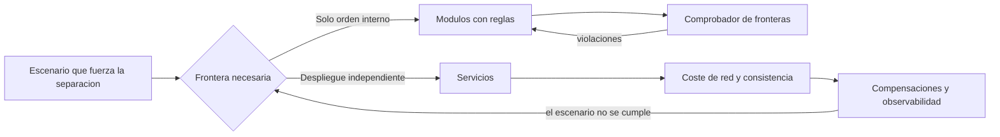
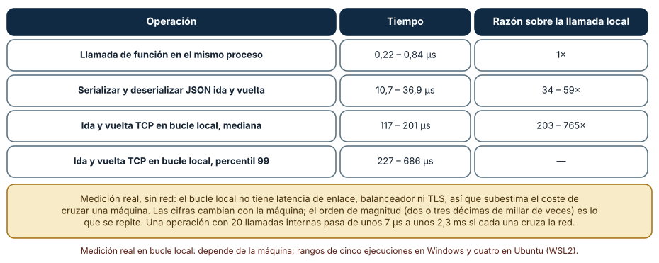
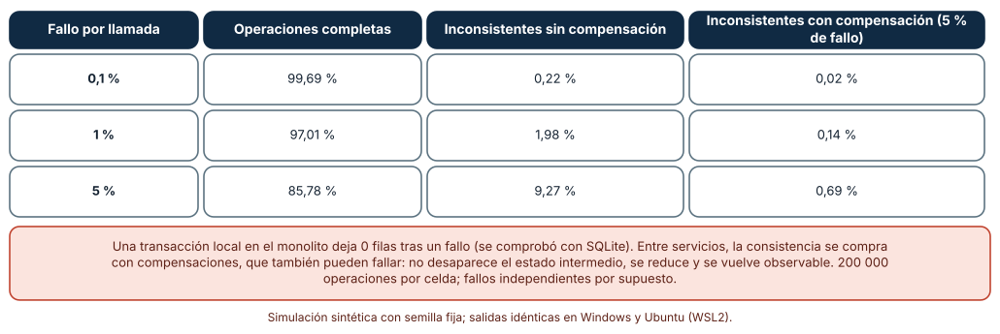
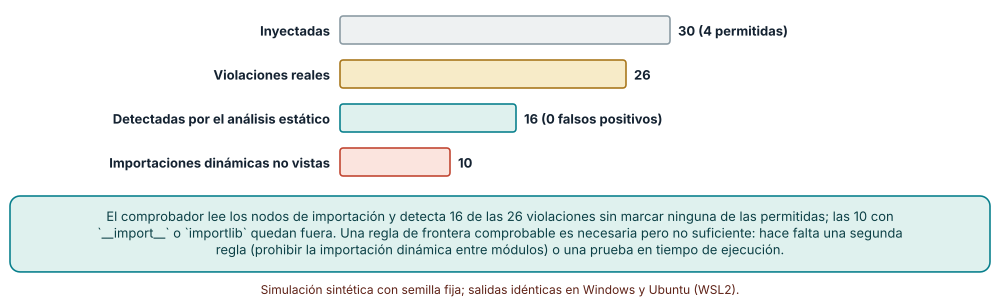

# SE-303 — Monolito, modular monolith y servicios

[← SE-302 — Vistas lógica, runtime, datos y despliegue](../../classes/part-25-arquitectura-de-software-y-dominio/se-302-vistas-logica-runtime-datos-y-despliegue/README.md) · [↑ Parte 25](../../classes/part-25-arquitectura-de-software-y-dominio/README.md) · [📚 Índice completo](../../classes/README.md) · [🌐 Portal](../../site/classes/SE-303.html) · [SE-304 — Capas, hexagonal, clean y ports and adapters →](../../classes/part-25-arquitectura-de-software-y-dominio/se-304-capas-hexagonal-clean-y-ports-and-adapters/README.md)

## Punto profesional y fundamento pedagógico

**Punto profesional.** La clase existe para que compares tres formas de agrupar los mismos componentes (un monolito, un monolito modular y servicios) por lo que cuesta cruzar cada frontera y por lo que garantiza cada una sobre la consistencia, y no por la moda de cada época.

**Por qué aparece aquí.** Continúa la **Parte 25** después de **Vistas lógica, runtime, datos y despliegue**: las vistas mostraron qué componentes existen y cómo se llaman; ahora se decide cuántas unidades de despliegue forman y qué fronteras se imponen. La decisión se toma contra los escenarios de `SE-301`, no contra una preferencia.

**Error conceptual que debe corregir.** Creer que «monolito» y «microservicios» son dos bandos: son extremos de un continuo de fronteras, y la mayor parte del beneficio de una frontera (límites claros entre módulos) puede obtenerse sin pagar el coste de la red.

**Secuencia de aprendizaje.** Antes de leer los resultados, predices cuánto más cuesta una llamada por red que una local, cuántas operaciones quedan inconsistentes cuando una transacción cruza tres servicios y qué fracción de las violaciones de frontera detecta un comprobador estático; después lo mides. La secuencia usa predicción, explicación propia, contraste y recuperación. [ICAP](https://icap.education.asu.edu/research) distingue participación de construcción de conocimiento; [How People Learn II](https://nap.nationalacademies.org/catalog/24783/how-people-learn-ii-learners-contexts-and-cultures) exige conectar conocimiento previo, contexto y transferencia; la [práctica de recuperación](https://pubmed.ncbi.nlm.nih.gov/16507066/) respalda producir de nuevo la explicación tras una demora; y [Education for Life and Work](https://nap.nationalacademies.org/resource/13398/dbasse_084153.pdf) exige devolución que explique la causa del error.

**Evidencia de aprendizaje.** `boundaries.md` con la medición del coste de una llamada en tres niveles, la tabla de inconsistencias de una operación entre tres servicios con y sin compensación, el resultado del comprobador de fronteras con lo que no ve y la decisión justificada entre las tres formas de agrupar.

**Límite de la conclusión.** El coste de una llamada se midió con un bucle local de CPython en una máquina concreta y varía con ella; las probabilidades de fallo son supuestos; el proyecto sintético del comprobador lo escribió el autor. No se midió ninguna red, balanceador, TLS ni base de datos de producción.

### Trazabilidad fuente → afirmación

| Fuente primaria u oficial | Afirmación que respalda | Lo que no prueba |
|---|---|---|
| [Fowler y Lewis, «Microservices»](https://martinfowler.com/articles/microservices.html) | Describe servicios que se despliegan de forma independiente y sus costes: operación distribuida, consistencia eventual y latencia de red. | No prueba que sean mejores o peores que un monolito en un caso concreto. |
| [Fowler, «MonolithFirst»](https://martinfowler.com/bliki/MonolithFirst.html) | Argumenta empezar con un monolito bien modularizado cuando no se conocen aún las fronteras correctas. | Es una heurística, no una ley; hay casos con fronteras claras desde el inicio. |
| [Parnas, «On the criteria to be used in decomposing systems into modules» (CACM, 1972)](https://doi.org/10.1145/361598.361623) | Propone descomponer ocultando decisiones de diseño que pueden cambiar, no siguiendo el diagrama de flujo. | No cubre despliegue ni distribución. |
| [García-Molina y Salem, «Sagas» (SIGMOD, 1987)](https://doi.org/10.1145/38713.38742) | Define transacciones largas como secuencias de pasos con acciones compensatorias, sin atomicidad global. | No garantiza que una compensación nunca falle ni que sea semánticamente posible. |

## Antes de empezar

Recupera lo que `SE-302` dejó: un modelo único con componentes, dependencias y recorridos. La pregunta activa es: **¿qué fronteras de este modelo deben ser de red y cuáles bastan como fronteras de módulo?**

## Prerrequisitos

- Haber completado `SE-302` o poder explicar qué muestra la vista de despliegue.
- Python 3.11 o posterior y un terminal; todo el código usa solo la biblioteca estándar.
- Conocer transacciones de base de datos a nivel básico y la sintaxis de importaciones de Python.

## Problema auténtico

La plataforma tiene seis módulos que viven en un solo proceso. Tras el último periodo, un equipo propone separar «notas» y «archivos» en servicios propios porque «el monolito no escala». Otra persona replica que el problema real es que el módulo de notas importa clases internas del de entregas. Si se separan sin ordenar las fronteras, el acoplamiento sobrevive y ahora cruza la red; si se ordenan primero, quizá la separación ya no haga falta. Nadie ha medido qué cuesta cada llamada que pasaría a ser remota.

## Objetivos observables

Al terminar podrás:

1. distinguir un monolito, un monolito modular y servicios por unidad de despliegue y por tipo de frontera, con un ejemplo y un contraejemplo;
2. medir cuánto más cuesta una llamada serializada y una por red que una local, y calcular cuánto pesa en una operación con k llamadas;
3. calcular la fracción de operaciones que quedan inconsistentes cuando una operación cruza tres servicios, con y sin compensación;
4. escribir un comprobador de fronteras entre módulos y declarar qué violaciones no ve;
5. elegir una forma de agrupar con un escenario que la fuerce y declarar qué se sacrifica.

## Mapa conceptual



El mapa muestra que la separación en servicios es una respuesta a un escenario concreto (despliegue o escalado independiente), no el paso natural después de un monolito. El comprobador mantiene las fronteras internas; las compensaciones y la observabilidad pagan las externas.

## Temas y por qué importan

| Tema | Por qué cambia una decisión profesional | Evidencia mínima |
|---|---|---|
| Monolito | Una unidad de despliegue y transacciones locales: simple de operar y de probar. | Predicción, traza causal y contraejemplo de **Monolito** en `boundaries.md` |
| Monolito modular | Fronteras internas verificadas dan el orden sin el coste de la red. | Predicción, traza causal y contraejemplo de **Monolito modular** en `boundaries.md` |
| Servicios | Despliegue y escalado independientes a cambio de red, consistencia y operación. | Predicción, traza causal y contraejemplo de **Servicios** en `boundaries.md` |
| Coste de cruzar una frontera | Decide cuántas llamadas se pueden permitir. | Predicción, traza causal y contraejemplo de **Coste de cruzar una frontera** en `boundaries.md` |
| Cuándo y cómo separar | Evita separar por moda y obliga a nombrar el escenario. | Predicción, traza causal y contraejemplo de **Cuándo y cómo separar** en `boundaries.md` |

## Conceptos y decisiones

### 1. Monolito

Un **monolito** se despliega como una sola unidad. Sus ventajas son prácticas: las llamadas entre módulos son llamadas de función, una transacción de base de datos cubre varias entidades, una prueba de extremo a extremo corre en un proceso y el equipo opera una cosa. Su defecto característico no es el tamaño sino la falta de fronteras internas: cuando cualquier módulo puede importar cualquier otro, el cambio en uno afecta a todos y el despliegue de una corrección pequeña exige probar el sistema entero. Un monolito sin fronteras no es una decisión: es la ausencia de una.

### 2. Monolito modular

Un **monolito modular** mantiene una única unidad de despliegue pero impone fronteras entre módulos: cada uno expone una API pública y oculta sus detalles, y una regla comprobable prohíbe importar lo demás. Sigue el criterio de Parnas: ocultar la decisión que puede cambiar. Conserva las transacciones locales y las pruebas rápidas y deja abierta la puerta a separar un módulo más adelante, porque la frontera ya existe y se comprueba. Su riesgo es que la regla se erosione si nadie la verifica; por eso el comprobador es parte de la arquitectura y no un añadido.

### 3. Servicios

Los **servicios** se despliegan y escalan por separado y se comunican por red. Lo que se gana es autonomía: un equipo puede publicar su servicio sin coordinar con otros, y un componente pesado se escala sin escalar el resto. Lo que se paga es operación (varios despliegues, versiones, monitoreo), latencia de red, fallos parciales y consistencia: una transacción que cruza servicios deja de ser atómica y se convierte en una saga con compensaciones. Fowler y Lewis describen esos costes junto a las ventajas; la decisión honesta los pone en la misma tabla.

### 4. Coste de cruzar una frontera

Cruzar una frontera cuesta tres cosas distintas: serializar y deserializar el mensaje, esperar la red y asumir que el otro lado puede fallar o tardar. Una llamada de función cuesta decenas o cientos de nanosegundos; serializar con JSON, decenas de microsegundos; una ida y vuelta por red, cientos de microsegundos como mínimo y milisegundos en una red real. Una operación de negocio con 20 llamadas internas es invisible en un monolito y puede dominar la latencia como servicios. Por eso el número de llamadas entre dos módulos es el mejor indicador de que una frontera está mal puesta: si dos módulos se hablan todo el tiempo, quizá son uno.

### 5. Cuándo y cómo separar

Separar un módulo en servicio se justifica por un escenario: despliegue independiente porque un equipo publica diez veces más que el resto, escalado distinto porque un componente consume cien veces más recursos, aislamiento de fallos o de seguridad porque maneja datos de otra sensibilidad, o ciclos de vida diferentes. No se justifica por «orden» (eso lo da un monolito modular) ni por «modernidad». El camino prudente es ordenar primero (fronteras verificadas), medir y separar solo lo que un escenario fuerce, empezando por la frontera con menos llamadas y con datos propios.

### Cuánto cuesta una llamada: en proceso, serializada y por red

Se mide una función que recibe un diccionario de entrega y devuelve la nota, de tres formas: llamada directa, ida y vuelta con `json.dumps` y `json.loads` en cada sentido, y un intercambio real por un socket TCP en el bucle local (servidor en un hilo, petición y respuesta JSON). Son 20 000 repeticiones para las dos primeras y 5000 para el socket, con la mediana y el percentil 99.

```python
t = time.perf_counter_ns()
for _ in range(N): f(payload)
t_local = (time.perf_counter_ns() - t) / N
# JSON: json.loads(json.dumps(f(json.loads(json.dumps(payload)))))
# TCP: cl.sendall(json.dumps(payload).encode()); json.loads(cl.recv(4096))
```

| Operación | Tiempo | Razón sobre la llamada local |
|---|---:|---:|
| Llamada de función en el mismo proceso | 0,22 – 0,84 µs | 1× |
| Serializar y deserializar JSON ida y vuelta | 10,7 – 36,9 µs | 34 – 59× |
| Ida y vuelta TCP en bucle local, mediana | 117 – 201 µs | 203 – 765× |
| Ida y vuelta TCP en bucle local, percentil 99 | 227 – 686 µs | — |

Rangos de cinco ejecuciones en Windows (CPython 3.12.9) y cuatro en Ubuntu bajo WSL2 (3.12.3); los valores absolutos cambian con la máquina y con la carga y por eso se dan como rango. Una operación con 20 llamadas internas pasa de unos 7 µs a unos 2,3 ms si cada llamada cruza el bucle local por TCP, sin contar la red real.



**Cómo leer la figura.** Cada fila es un nivel de frontera; las columnas dan el tiempo y cuántas veces supera a la llamada local. **Dónde deja de valer:** el bucle local no tiene enlace físico, balanceador, TLS ni fallos de red, así que subestima el coste real de cruzar una máquina; los valores dependen del procesador y del sistema. Lo que se repite entre máquinas es el orden de magnitud de las razones (dos o tres centenares de veces), no los microsegundos.

### Una operación que cruza tres servicios: consistencia con y sin compensación

La operación «entregar» escribe en tres servicios (entregas, archivos, notificaciones) en secuencia. Cada llamada falla con probabilidad p. Sin compensación, si falla la segunda o la tercera queda un estado intermedio. Con compensación, cada paso hecho se deshace al fallar uno posterior, y cada deshacer puede fallar con 5 %. Se simulan 200 000 operaciones por celda; como contraste, una transacción SQLite local con rollback.

```python
for k in range(3):
    if rng.random() < p: break
    hechos += 1
# sin compensación: hechos en 1 ó 2 -> inconsistente
# con compensación: inconsistente si algún deshacer falla (5 %)
```

| Fallo por llamada | Operaciones completas | Inconsistentes sin compensación | Inconsistentes con compensación (5 % de fallo) |
|---:|---:|---:|---:|
| 0,1 % | 99,69 % | 0,22 % | 0,02 % |
| 1 % | 97,01 % | 1,98 % | 0,14 % |
| 5 % | 85,78 % | 9,27 % | 0,69 % |

Con 1 % de fallo por llamada, casi 2 de cada 100 operaciones dejan un estado a medias sin compensación y 14 de cada 10 000 con ella. En el monolito, una transacción local que falla deja 0 filas en las dos tablas (se comprobó con `sqlite3`): el estado intermedio no es observable.



**Cómo leer la figura.** Cada fila es una tasa de fallo por llamada; las dos últimas columnas comparan el estado inconsistente con y sin compensación. **Dónde deja de valer:** los fallos son independientes y la compensación siempre es posible; en la práctica hay pasos que no se pueden deshacer (un correo enviado) y fallos correlacionados. No dice que las sagas sean malas: dice que la consistencia entre servicios se reduce y se vuelve observable, pero no desaparece, y que requiere diseñar y probar las compensaciones.

### Un comprobador de fronteras con análisis estático

Se genera un proyecto sintético con seis módulos (`entregas`, `notas`, `cursos`, `identidad`, `notif`, `archivos`), cada uno con una `api.py` pública y diez archivos internos que importan la API de otros dos módulos. Se inyectan 30 importaciones: 4 permitidas (`from x.api import ...`) y 26 que violan la frontera, de las cuales 16 son estáticas (`from x.repo import ...`, `import x.modelo`, `from x import modelo`) y 10 dinámicas (`__import__` e `importlib.import_module`). El comprobador recorre el árbol sintáctico con `ast` y marca toda importación de otro módulo que no sea su `api`.

```python
for n in ast.walk(tree):
    if isinstance(n, ast.ImportFrom) and n.module:
        top = n.module.split(".")[0]
        if top in mods and top != m and n.module != f"{top}.api": hallazgos.append(...)
    elif isinstance(n, ast.Import):
        ...
```

El comprobador detecta 16 de las 26 violaciones y ninguna de las 4 permitidas (0 falsos positivos). Las 10 que usan `__import__` o `importlib` quedan fuera porque el nombre del módulo es una cadena, no un nodo de importación. La salida es idéntica en Windows y Ubuntu.



**Cómo leer la figura.** Cada barra cuenta importaciones inyectadas: del total, las violaciones reales, las detectadas y las no vistas. **Dónde deja de valer:** el proyecto es sintético y la proporción de importaciones dinámicas la fijó el autor; en un código real casi todas son estáticas, pero justo las dinámicas son las que eluden una regla. La figura no dice que el análisis estático baste: dice que una regla de frontera comprobable es necesaria pero no suficiente, y que hace falta una segunda regla (prohibir la importación dinámica entre módulos) o una prueba en ejecución.

## Definiciones de trabajo

- **monolito:** sistema que se despliega como una sola unidad.
- **monolito modular:** monolito con fronteras entre módulos que se verifican, de modo que cada módulo expone una API y oculta sus detalles.
- **servicio:** componente que se despliega y escala de forma independiente y se comunica por red.
- **saga:** secuencia de pasos locales con acciones compensatorias que sustituye a una transacción atómica global.
- **frontera de módulo:** límite que una regla comprobable impide cruzar salvo por la API pública.

Las definiciones son operativas para la plataforma de entregas. No convierten términos con una historia más amplia en sinónimos y deben contrastarse con la documentación primaria enlazada al final.

## Ejemplo mínimo

El fragmento muestra que una transacción local no deja un estado intermedio. Antes de ejecutarlo, predice cuántas filas quedan en las dos tablas.

```python
import sqlite3
con = sqlite3.connect(":memory:")
con.execute("create table a(x)"); con.execute("create table b(x)")
try:
    with con:
        con.execute("insert into a values(1)"); con.execute("insert into b values(1)")
        raise RuntimeError("fallo")
except RuntimeError:
    pass
assert con.execute("select count(*) from a").fetchone()[0] == 0
assert con.execute("select count(*) from b").fetchone()[0] == 0
```

Ninguna: el rollback deshizo ambas. Registra versión, comando y salida; separa cada tabla en una base distinta y observa qué cambia.

## Ejemplo profesional

El equipo de la plataforma mantiene el sistema como monolito modular y añade al CI un comprobador de fronteras que falla si un módulo importa algo que no sea la `api` de otro, y otro que prohíbe `importlib` y `__import__` con nombres de módulos internos. Mide que la operación «calificar» hace 14 llamadas entre `notas` y `entregas` y decide que, si algún día se separan, esas dos son una sola frontera mal puesta: primero deberían fusionarse o reducir las llamadas. Registra como candidata a servicio solo la revisión de archivos, porque un escenario (picos de CPU de la revisión antivirus) fuerza un escalado distinto, y escribe en el ADR que se sacrifica la transacción local con la entrega: usará una cola y una compensación.

Compara con la propuesta inicial («separar notas y archivos»): ahora hay una regla verificable, un coste medido y un escenario que justifica separar uno de los dos. Una decisión de agrupación es adecuada cuando nombra el escenario y lo sacrificado; es frágil cuando se apoya en que «así lo hacen los demás».

## Práctica guiada

1. Dibuja la plataforma como monolito, como monolito modular y como servicios y marca qué fronteras cruzan la red en cada caso.
2. Mide el tiempo de una llamada local, de una ida y vuelta JSON y de un intercambio TCP en bucle local, y anota máquina y versión.
3. Cuenta cuántas llamadas hace la operación más frecuente entre módulos y calcula su coste si cada una cruzara la red.
4. Simula la operación entre tres servicios con tu tasa de fallo y con una compensación que también falla.
5. Escribe el comprobador de fronteras, inyecta 30 violaciones y mide cuántas detecta.
6. Escribe el escenario que justificaría separar un módulo y el atributo que sacrificarías.
7. Entrega `boundaries.md` y pide a otra persona que encuentre una violación que tu comprobador no vea.

## Ejercicios

1. **Llamadas:** calcula cuántas llamadas internas por operación tolera un presupuesto de 50 ms si cada una cruza la red con 2 ms; compáralo con 2 µs locales.
2. **Compensación:** calcula la probabilidad de estado inconsistente de una operación con cuatro servicios, p = 1 % y compensación que falla 5 %, y compárala con la simulación.
3. **Regla:** amplía el comprobador para que también detecte `from x import *` y explica qué falsos positivos introduce.
4. **Frontera:** identifica en un código tuyo dos módulos que se llaman más de diez veces por operación y propón si fusionarlos o definir una API más gruesa.

## Reto verificable

Entrega `boundaries.md` con la medición del coste de una llamada, la simulación de tres servicios, el comprobador de fronteras con sus 30 violaciones y la decisión justificada. Se aprueba si otra persona ejecuta el código desde un checkout limpio, obtiene las mismas cifras (salvo los tiempos, que cambian con la máquina pero conservan el orden de magnitud) y puede decir qué módulo separaría primero y por qué. No se aprueba por afirmar que los servicios «escalan mejor» sin un escenario.

## Caso conductor

La plataforma de entregas y corrección de tareas sigue siendo el caso conductor. Esta clase deja el tercer artefacto: la decisión de agrupación con su coste de frontera medido, su comprobador y su escenario. `SE-304` mirará el interior de cada módulo: cómo se ordenan las dependencias dentro de una frontera. Cambia después una sola decisión, la tasa de fallo por llamada, y observa cuánto cambia el estado inconsistente.

## Preguntas frecuentes

### ¿Un monolito modular es un paso previo a microservicios?

Puede serlo, pero no está obligado a serlo. Para muchos sistemas es el destino: da orden y pruebas rápidas sin el coste de operar muchos servicios. Se separa un módulo cuando un escenario lo fuerza.

### ¿Cuántos servicios son demasiados?

No hay un número; hay un coste de coordinación y operación por servicio. Un equipo de seis personas que opera diez servicios dedica más tiempo a operarlos que a construirlos. El tamaño correcto lo marca el escenario y la capacidad del equipo.

### ¿Se pueden tener transacciones entre servicios?

Hay protocolos (dos fases) con costes de disponibilidad y de acoplamiento, y hay sagas con compensaciones. Cada una cambia lo que se garantiza; elegir una es una decisión de arquitectura que debe constar por escrito.

### ¿Medir en el bucle local sirve de algo?

Sirve para el orden de magnitud y para comparar niveles de frontera entre sí, no para estimar la latencia de una red real. Para eso hay que medir en el entorno de despliegue.

## Fallo controlado y diagnóstico

Reproduce el fallo clásico de la clase: **separar un módulo sin ordenar su frontera y descubrir que cada operación hace veinte llamadas remotas**. Simula una operación con 20 llamadas internas, primero locales y luego con 120 µs cada una.

Registra síntoma, entrada mínima, hipótesis, observación que descarta cada hipótesis, causa, corrección y prueba de regresión. **Síntoma:** tras separar «notas», calificar tarda 2,4 ms más y a veces falla. **Hipótesis rivales:** (a) la red está lenta; (b) la operación hace demasiadas llamadas entre los dos módulos; (c) la serialización es lenta. **Prueba:** cuenta las llamadas por operación y multiplícalas por el coste medido; si 20 × 120 µs ≈ 2,4 ms, la causa es (b). **Conclusión:** la frontera estaba en un lugar con alta cohesión. **Regresión:** añade una prueba que falle si una operación supera cinco llamadas entre dos módulos, y fusiona o engrosa la API. No cambies a la vez la frontera y la red.

## Errores comunes y cómo corregirlos

| Síntoma | Causa probable | Corrección |
|---|---|---|
| Un cambio pequeño exige probar todo el sistema | Monolito sin fronteras internas | Imponer API públicas y un comprobador de importaciones |
| La latencia sube al separar un módulo | La frontera cruza muchas llamadas por operación | Medir llamadas por operación y fusionar o engrosar la API |
| Quedan datos a medias entre servicios | Transacción entre servicios sin compensación | Diseñar y probar compensaciones o evitar la operación cruzada |
| El comprobador pasa y aun así hay acoplamiento | Importaciones dinámicas o acoplamiento por datos | Prohibir la importación dinámica y revisar el esquema de datos compartido |
| Se separa por moda | Falta un escenario que fuerce la separación | Escribir el escenario y el atributo sacrificado en un ADR |

## Entorno y archivos clave

```text
work/SE-303/
├── README.md
├── boundaries.md
├── sim/
│   ├── llamada.py
│   ├── saga.py
│   └── fronteras.py
└── evidence/boundaries-log.md
```

El `README` declara plataforma, versión de Python, semillas y comandos. Los experimentos usan solo la biblioteca estándar (`ast`, `json`, `socket`, `sqlite3`, `random`) y se ejecutaron con CPython 3.12.9 en Windows 11 y 3.12.3 en Ubuntu bajo WSL2: las salidas fueron idénticas salvo los tiempos de la primera medición, que cambian con la máquina. El servidor TCP escucha solo en `127.0.0.1` y en un puerto elegido por el sistema.

## Seguridad, ética y accesibilidad

- una frontera de red introduce superficie de ataque y exige autenticación entre servicios: no la trates como una llamada interna;
- los datos personales que cruzan una frontera deben minimizarse; no serialices el objeto entero si basta un identificador;
- el comprobador de fronteras debe ejecutarse sobre código propio y no cargar ni ejecutar módulos del proyecto, solo leer su árbol sintáctico;
- los mensajes de error entre servicios no deben filtrar detalles internos a quien no los necesita;
- respeta las licencias de las fuentes y atribuye lo adaptado.

## Puente hacia el trabajo con agentes

Un agente al que se le pide «migra el monolito a microservicios» producirá varios repositorios, un archivo de composición y llamadas HTTP donde antes había funciones, sin medir ni comprobar nada. Pídele en cambio que cuente las llamadas entre módulos por operación, que escriba un comprobador de fronteras y que proponga como máximo un módulo a separar, con el escenario que lo justifica. Revisa especialmente si convierte llamadas de función en llamadas remotas sin una política de fallos y si deja una operación a medias entre dos servicios: son los dos defectos que esta clase mostró con números.

## Transferencia

Traslada el análisis a otro sistema (por ejemplo, una aplicación de turnos): cambia los módulos y conserva el procedimiento de medir el coste de la frontera, simular la consistencia con tu tasa de fallo y comprobar las fronteras con análisis estático. La transferencia está lograda cuando puedes decir qué frontera separarías y qué sacrificarías, no cuando el diagrama se parece.

## Evaluación y evidencia

| Criterio | Evidencia para aprobar |
|---|---|
| comprensión | explicación de monolito, monolito modular y servicios por unidad de despliegue y tipo de frontera |
| corrección | medición del coste de llamada, saga simulada y comprobador reproducibles |
| diseño | decisión de agrupación con escenario y atributo sacrificado |
| diagnóstico | reproducción del fallo «separar sin ordenar la frontera» con regresión |
| incertidumbre | declaración de que los tiempos dependen de la máquina y las tasas de fallo son supuestos |
| reproducibilidad | versiones, comandos, salida y límites declarados |

## Fuentes

- [Fowler y Lewis, «Microservices»](https://martinfowler.com/articles/microservices.html) — características, ventajas y costes de los servicios; autoridad: Martin Fowler y James Lewis.
- [Fowler, «MonolithFirst»](https://martinfowler.com/bliki/MonolithFirst.html) — empezar por un monolito modular; autoridad: Martin Fowler.
- [Parnas, «On the criteria to be used in decomposing systems into modules» (CACM, 1972)](https://doi.org/10.1145/361598.361623) — ocultación de información como criterio de descomposición; autoridad: Communications of the ACM.
- [García-Molina y Salem, «Sagas» (SIGMOD, 1987)](https://doi.org/10.1145/38713.38742) — transacciones largas con compensación; autoridad: ACM SIGMOD.
- [Microsoft Learn, patrón Saga](https://learn.microsoft.com/en-us/azure/architecture/patterns/saga) — coordinación de transacciones distribuidas con compensaciones; autoridad: Microsoft.
- [SQLite: transacciones](https://www.sqlite.org/lang_transaction.html) — semántica de la transacción local usada en el ejemplo; autoridad: proyecto SQLite.
- [Python: `ast`](https://docs.python.org/3/library/ast.html) — árbol sintáctico usado por el comprobador; autoridad: documentación de Python.
- [Python: `socket`](https://docs.python.org/3/library/socket.html) — intercambio por TCP en bucle local; autoridad: documentación de Python.
- [SWEBOK Guide v4.0a](https://www.computer.org/education/bodies-of-knowledge/software-engineering) — áreas de conocimiento de ingeniería de software; autoridad: IEEE Computer Society.

Los DOI se comprobaron con la API de Crossref porque el editor bloquea peticiones automáticas; el resto respondió con éxito a una petición de solo lectura. Cada fuente respalda el mecanismo indicado; ninguna demuestra que una llamada por red cueste 300 veces una local en tu entorno ni que 14 llamadas por operación sean demasiadas en la plataforma real. Esa afirmación depende de la máquina, de la red y de las operaciones reales.

## Límites y siguiente paso

Se ejecutaron tres experimentos con Windows y Ubuntu (WSL2): dos simulaciones con datos sintéticos, idénticas en ambos sistemas, y una medición real de tiempos en bucle local cuyos valores difieren entre ejecuciones y sistemas y se dan como rangos. No se midió ninguna red, TLS, balanceador ni servicio real; las tasas de fallo y el proyecto sintético del comprobador son construcciones del autor. La siguiente clase mira el interior de un módulo: cómo se ordenan sus dependencias.

## Glosario

- **monolito:** sistema que se despliega como una sola unidad.
- **monolito modular:** monolito con fronteras entre módulos que se verifican, de modo que cada módulo expone una API y oculta sus detalles.
- **servicio:** componente que se despliega y escala de forma independiente y se comunica por red.
- **saga:** secuencia de pasos locales con acciones compensatorias que sustituye a una transacción atómica global.
- **frontera de módulo:** límite que una regla comprobable impide cruzar salvo por la API pública.

---

[← SE-302 — Vistas lógica, runtime, datos y despliegue](../../classes/part-25-arquitectura-de-software-y-dominio/se-302-vistas-logica-runtime-datos-y-despliegue/README.md) · [↑ Parte 25](../../classes/part-25-arquitectura-de-software-y-dominio/README.md) · [📚 Índice completo](../../classes/README.md) · [🌐 Portal](../../site/classes/SE-303.html) · [SE-304 — Capas, hexagonal, clean y ports and adapters →](../../classes/part-25-arquitectura-de-software-y-dominio/se-304-capas-hexagonal-clean-y-ports-and-adapters/README.md)
