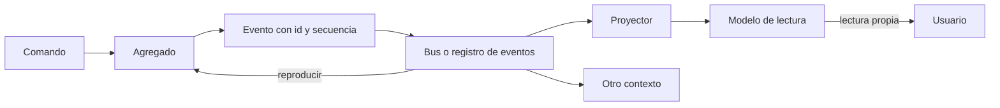
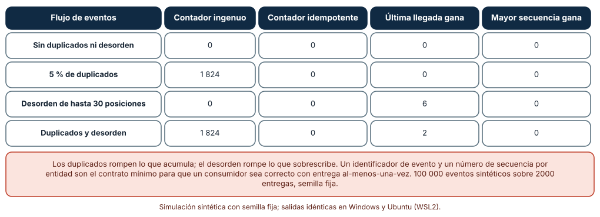
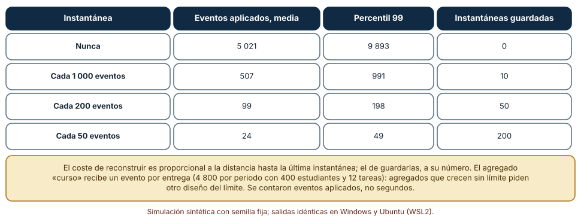
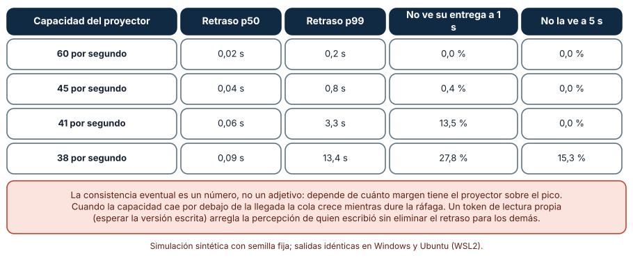

# SE-306 — Event-driven, CQRS y event sourcing

[← SE-305 — Domain-Driven Design estratégico y táctico](../../classes/part-25-arquitectura-de-software-y-dominio/se-305-domain-driven-design-estrategico-y-tactico/README.md) · [↑ Parte 25](../../classes/part-25-arquitectura-de-software-y-dominio/README.md) · [📚 Índice completo](../../classes/README.md) · [🌐 Portal](../../site/classes/SE-306.html) · [SE-307 — Arquitecturas serverless, edge y peer-to-peer →](../../classes/part-25-arquitectura-de-software-y-dominio/se-307-arquitecturas-serverless-edge-y-peer-to-peer/README.md)

## Punto profesional y fundamento pedagógico

**Punto profesional.** La clase existe para que decidas cuándo comunicar contextos por eventos, cuándo separar la escritura de la lectura y cuándo guardar la historia en lugar del estado, y para que midas las garantías que esa decisión exige a quien consume eventos.

**Por qué aparece aquí.** Continúa la **Parte 25** después de **Domain-Driven Design estratégico y táctico**: `SE-305` dibujó contextos con contratos pequeños; los eventos son una forma de que esos contratos viajen sin que un contexto llame al otro. A cambio de desacoplar en el tiempo, el sistema hereda duplicados, desorden y retrasos que una llamada directa no tenía.

**Error conceptual que debe corregir.** Creer que «event-driven», CQRS y event sourcing son una sola cosa o que vienen juntos: son tres decisiones independientes con costes distintos, y adoptar las tres sin un escenario que las fuerce multiplica la complejidad.

**Secuencia de aprendizaje.** Antes de leer los resultados, predices cuántas entregas quedan mal contadas si el consumidor recibe 5 % de duplicados, cuántos eventos hay que aplicar para reconstruir un agregado de 10 000 eventos y cuántas personas no ven su entrega al recargar cuando el proyector va justo; después lo simulas. La secuencia usa predicción, explicación propia, contraste y recuperación. [ICAP](https://icap.education.asu.edu/research) distingue participación de construcción de conocimiento; [How People Learn II](https://nap.nationalacademies.org/catalog/24783/how-people-learn-ii-learners-contexts-and-cultures) exige conectar conocimiento previo, contexto y transferencia; la [práctica de recuperación](https://pubmed.ncbi.nlm.nih.gov/16507066/) respalda producir de nuevo la explicación tras una demora; y [Education for Life and Work](https://nap.nationalacademies.org/resource/13398/dbasse_084153.pdf) exige devolución que explique la causa del error.

**Evidencia de aprendizaje.** `events.md` con la tabla de consumidores bajo duplicados y desorden, el coste de reconstrucción con y sin instantáneas, el retraso del modelo de lectura según la capacidad del proyector y la decisión de qué contrato de evento (identificador, secuencia, versión) exige la plataforma.

**Límite de la conclusión.** Los 100 000 eventos, la tasa de duplicados, el desorden de hasta 30 posiciones, el ritmo del pico y los tiempos de servicio exponenciales son construcciones del autor. No se usó ningún agente de mensajería, almacén de eventos ni base de datos: la simulación muestra mecanismos, no el comportamiento de un producto.

### Trazabilidad fuente → afirmación

| Fuente primaria u oficial | Afirmación que respalda | Lo que no prueba |
|---|---|---|
| [Fowler, «What do you mean by Event-Driven?»](https://martinfowler.com/articles/201701-event-driven.html) | Distingue notificación de eventos, transferencia de estado, event sourcing y CQRS como patrones diferentes que suelen confundirse. | No dice cuál usar en un caso concreto. |
| [Fowler, «CQRS»](https://martinfowler.com/bliki/CQRS.html) | Describe separar el modelo de escritura del de lectura y advierte de que añade complejidad y solo conviene en algunos contextos. | No cuantifica el retraso de un modelo de lectura. |
| [Fowler, «Event Sourcing»](https://martinfowler.com/eaaDev/EventSourcing.html) | Explica guardar los cambios de estado como una secuencia de eventos y reconstruir el estado reaplicándolos. | No fija la frecuencia de instantáneas ni demuestra que convenga siempre. |
| [Hohpe y Woolf, «Idempotent Receiver»](https://www.enterpriseintegrationpatterns.com/patterns/messaging/IdempotentReceiver.html) | Define al receptor que tolera mensajes duplicados sin efecto adicional. | No indica cómo almacenar los identificadores vistos ni durante cuánto tiempo. |
| [Vogels, «Eventually consistent» (CACM, 2009)](https://doi.org/10.1145/1435417.1435432) | Describe la consistencia eventual y la de lectura propia como garantías con significados distintos. | No mide el retraso de un sistema concreto. |

## Antes de empezar

Recupera lo que `SE-305` dejó: contextos con un contrato pequeño y un agregado con un invariante. La pregunta activa es: **¿qué debe saber un consumidor de eventos para ser correcto cuando el mensaje llega dos veces, fuera de orden o tarde?**

## Prerrequisitos

- Haber completado `SE-305` o poder explicar qué es un contexto delimitado y un agregado.
- Python 3.11 o posterior y un terminal; todo el código usa solo la biblioteca estándar.
- Conocer colas FIFO, percentiles y la idea de idempotencia.

## Problema auténtico

La plataforma avisa a Evaluación cuando llega una entrega mediante un evento. El contador de entregas por estudiante se desajusta: algunas aparecen contadas dos veces tras un reintento del agente de mensajería. Un lunes, al reprocesar una cola, el estado de una entrega vuelve atrás porque llegó un evento antiguo después de uno nuevo. Y durante el cierre del plazo, estudiantes que acaban de subir su archivo recargan la página y no ven nada; algunos lo vuelven a subir. Cada síntoma es una propiedad de la entrega de eventos que la llamada directa no tenía.

## Objetivos observables

Al terminar podrás:

1. distinguir notificación de eventos, transferencia de estado, CQRS y event sourcing y decir cuáles necesita un caso dado;
2. escribir un consumidor correcto frente a duplicados y desorden con identificador de evento y número de secuencia, y medir qué falla sin ellos;
3. calcular cuántos eventos hay que aplicar para reconstruir un agregado según la frecuencia de instantáneas;
4. medir cuánto se retrasa un modelo de lectura frente a la capacidad del proyector y qué fracción de personas no ve su propia escritura;
5. declarar el contrato mínimo de un evento y qué se sacrifica al elegir cada patrón.

## Mapa conceptual



El mapa muestra que el evento es el punto de encuentro: quien lo emite, quien proyecta una vista y quien reacciona desde otro contexto lo consumen en momentos distintos. La reproducción desde el registro reconstruye el estado, a un coste que crece con la historia.

## Temas y por qué importan

| Tema | Por qué cambia una decisión profesional | Evidencia mínima |
|---|---|---|
| Eventos de dominio y notificaciones | Desacoplan contextos en el tiempo a costa de garantías de entrega. | Predicción, traza causal y contraejemplo de **Eventos de dominio y notificaciones** en `events.md` |
| Idempotencia y orden | Hacen correcto al consumidor con entrega al-menos-una-vez. | Predicción, traza causal y contraejemplo de **Idempotencia y orden** en `events.md` |
| CQRS y consistencia eventual | Separa lectura y escritura y crea una ventana de retraso. | Predicción, traza causal y contraejemplo de **CQRS y consistencia eventual** en `events.md` |
| Event sourcing | Guarda la historia y permite reconstruir cualquier estado, a un coste de reproducción. | Predicción, traza causal y contraejemplo de **Event sourcing** en `events.md` |
| Cuándo no usar estos patrones | Evita pagar complejidad sin un escenario que la exija. | Predicción, traza causal y contraejemplo de **Cuándo no usar estos patrones** en `events.md` |

## Conceptos y decisiones

### 1. Eventos de dominio y notificaciones

Un **evento** es un hecho del pasado con nombre del negocio («EntregaRecibida»). Fowler distingue cuatro usos que suelen mezclarse: notificar que algo ocurrió (el receptor consulta lo que necesite), transferir el estado en el propio mensaje, guardar los eventos como fuente de la verdad (event sourcing) y separar los modelos de lectura y escritura (CQRS). Cada uno tiene costes y garantías distintos. Un evento de notificación con el mínimo de datos acopla poco; uno que arrastra todo el estado se parece a una llamada con la dependencia escondida. El evento debe llevar al menos un identificador único, el de la entidad, una secuencia o versión y una marca de tiempo.

### 2. Idempotencia y orden

La mayoría de los agentes de mensajería garantizan entrega *al menos una vez*: ante la duda, reenvían. Un consumidor correcto debe tolerar duplicados (ser idempotente) y desorden. Para los duplicados, guarda los identificadores de evento ya procesados o hace que el efecto sea idempotente por naturaleza (poner un valor en vez de sumar uno). Para el desorden, usa una secuencia por entidad y aplica solo un evento más nuevo que el último visto. Lo que acumula (contadores) se rompe con duplicados; lo que sobrescribe (estados) se rompe con desorden. El receptor idempotente es un patrón clásico precisamente porque ambos problemas son normales, no excepcionales.

### 3. CQRS y consistencia eventual

**CQRS** separa el modelo que acepta comandos (escritura) del que responde consultas (lectura), a menudo con un proyector que actualiza una vista desde los eventos. Permite optimizar cada lado por separado (consultas rápidas con vistas desnormalizadas) a cambio de una ventana de retraso: la vista no refleja la escritura al instante. Vogels distingue la *consistencia eventual* de garantías más finas como la *lectura de la propia escritura*, que es la que la persona percibe: si acabo de subir mi entrega y no la veo, la tomo por perdida. Fowler advierte que CQRS añade complejidad y solo debe usarse en partes del sistema donde compense.

### 4. Event sourcing

En **event sourcing** el estado no se guarda: se guarda la secuencia de eventos que lo produjeron y el estado se obtiene reaplicándolos. Da auditoría completa, la posibilidad de reconstruir el estado en cualquier momento y de reprocesar la historia con una regla corregida. Cuesta que la reconstrucción crece con la historia (de ahí las **instantáneas**), que los eventos antiguos deben seguir siendo legibles cuando el esquema evoluciona y que borrar un dato personal de un registro inmutable exige técnicas específicas. No es la forma por defecto de guardar datos: es una decisión que se justifica con un escenario de auditoría o de reproceso.

### 5. Cuándo no usar estos patrones

Un CRUD con una consulta simple, un solo equipo y pocas escrituras concurrentes no necesita CQRS ni event sourcing, y un evento entre dos módulos del mismo proceso puede ser una llamada de función. La pregunta es qué escenario falla sin el patrón: si no hay uno, el patrón solo añade piezas que operar y razones por las que fallar. Un criterio útil: introduce los eventos primero como notificaciones entre contextos, mide los retrasos y duplicados reales, y añade CQRS o event sourcing solo donde la lectura o la auditoría lo pidan.

### Un consumidor frente a duplicados y desorden

Se generan 100 000 eventos sintéticos sobre 2000 entregas, cada uno con identificador, entrega, tipo y número de secuencia global. El flujo que llega al consumidor puede tener 5 % de duplicados y un desorden en que el 10 % de los eventos se adelanta hasta 30 posiciones. Se comparan cuatro consumidores: un contador ingenuo (suma por cada mensaje), un contador idempotente (ignora identificadores vistos), un estado «la última llegada gana» y uno «la mayor secuencia gana».

```python
# idempotente
if seq in vistos: continue
vistos.add(seq); cnt[ent] += 1
# mayor secuencia
if ent not in st or seq > st[ent][0]: st[ent] = (seq, tipo)
```

| Flujo de eventos | Contador ingenuo | Contador idempotente | Última llegada gana | Mayor secuencia gana |
|---|---:|---:|---:|---:|
| Sin duplicados ni desorden | 0 | 0 | 0 | 0 |
| 5 % de duplicados | 1 824 | 0 | 0 | 0 |
| Desorden de hasta 30 posiciones | 0 | 0 | 6 | 0 |
| Duplicados y desorden | 1 824 | 0 | 2 | 0 |

Con 5 % de duplicados, el contador ingenuo se equivoca en 1824 de 2000 entregas (cada una recibe en promedio 50 eventos y casi todas tienen algún duplicado); el idempotente en ninguna. Con desorden, quedarse con la última llegada deja 6 entregas en un estado antiguo; quedarse con la mayor secuencia, ninguna. Las cifras son idénticas en Windows (CPython 3.12.9) y en Ubuntu bajo WSL2 (3.12.3).



**Cómo leer la figura.** Cada fila es un tipo de flujo y cada columna una estrategia del consumidor; las celdas cuentan entregas erróneas de 2000. **Dónde deja de valer:** el desorden es un modelo simple (un 10 % se adelanta hasta 30 posiciones) y los eventos de una entrega nunca se pierden; un sistema real también pierde mensajes o los reordena en ráfagas. La figura dice qué dato extra necesita cada garantía: un identificador para los duplicados y una secuencia por entidad para el desorden.

### Reconstruir un agregado: instantáneas

Un agregado tiene 10 000 eventos. Se pide el estado tras el evento t, con t al azar entre 1 y 10 000 (5000 consultas), y se cuenta cuántos eventos hay que aplicar a partir de la última instantánea (o desde el inicio, si no hay). Se compara sin instantáneas y con una cada 1000, 200 y 50 eventos.

```python
costo = t if snap == 0 else t % snap      # eventos que se reaplican desde la última instantánea
```

| Instantánea | Eventos aplicados, media | Percentil 99 | Instantáneas guardadas |
|---|---:|---:|---:|
| Nunca | 5 021 | 9 893 | 0 |
| Cada 1 000 eventos | 507 | 991 | 10 |
| Cada 200 eventos | 99 | 198 | 50 |
| Cada 50 eventos | 24 | 49 | 200 |

Sin instantáneas, reconstruir cuesta en media la mitad de la historia; con una cada 200 eventos, la media baja a 99 y el peor caso a 198, a cambio de guardar 50 estados. El agregado «curso» recibe un evento por entrega: 400 estudiantes por 12 tareas dan 4800 eventos por periodo y 24 000 en cinco: un agregado que crece sin límite pide revisar su frontera, no solo sus instantáneas.



**Cómo leer la figura.** Cada fila es una política de instantáneas; las columnas cuentan eventos reaplicados y estados guardados. **Dónde deja de valer:** se contaron eventos aplicados, no segundos; el coste de aplicar un evento depende de su tamaño y de la lectura del almacén, y las instantáneas deben versionarse junto con el esquema de los eventos. Lo que enseña es la forma de la compensación: el coste de leer es proporcional a la distancia a la última instantánea y el de guardar, a su número.

### El retraso del modelo de lectura en el pico

Un proyector actualiza el modelo de lectura a partir de los eventos. Llegan 20 eventos por segundo durante 10 minutos, 40 por segundo durante 5 minutos (el cierre) y 20 por segundo otros 10 minutos; el proyector procesa cada evento en un tiempo exponencial de media 1/μ. Se mide el retraso entre la escritura y su visibilidad en la vista y qué fracción de estudiantes que recargan a 1 o 5 segundos aún no ve su entrega.

```python
inicio = max(llegada, libre)
libre = inicio + rng.expovariate(mu)
retraso = libre - llegada
```

| Capacidad del proyector | Retraso p50 | Retraso p99 | No ve su entrega a 1 s | No la ve a 5 s |
|---|---:|---:|---:|---:|
| 60 por segundo | 0,02 s | 0,2 s | 0,0 % | 0,0 % |
| 45 por segundo | 0,04 s | 0,8 s | 0,4 % | 0,0 % |
| 41 por segundo | 0,06 s | 3,3 s | 13,5 % | 0,0 % |
| 38 por segundo | 0,09 s | 13,4 s | 27,8 % | 15,3 % |

Con capacidad 60 el retraso del percentil 99 es de 0,2 s; con 41, justo sobre la llegada del pico, el 13,5 % no ve su entrega tras un segundo; con 38, por debajo de la llegada, el retraso crece mientras dure la ráfaga y el 15,3 % sigue sin verla a los cinco segundos.



**Cómo leer la figura.** Cada fila es una capacidad del proyector; las columnas dan el retraso y la fracción de personas que no ve su propia escritura. **Dónde deja de valer:** los tiempos de servicio exponenciales y un único proyector son una simplificación; los sistemas reales particionan, reintentan y tienen picos de otra forma. La figura dice que la consistencia eventual es un número que depende del margen del proyector sobre el pico; y que un token de lectura propia (esperar a que la vista alcance la versión escrita) arregla la percepción de quien escribió sin eliminar el retraso para los demás.

## Definiciones de trabajo

- **evento de dominio:** hecho pasado, con nombre del negocio, que otros contextos pueden consumir.
- **consumidor idempotente:** consumidor cuyo efecto no cambia si recibe el mismo mensaje más de una vez.
- **proyector:** componente que construye un modelo de lectura a partir de los eventos.
- **instantánea:** copia del estado en un punto de la historia que evita reaplicar todos los eventos anteriores.
- **lectura de la propia escritura:** garantía de que quien escribe verá su cambio en las lecturas siguientes.

Las definiciones son operativas para la plataforma de entregas. No convierten términos con una historia más amplia en sinónimos y deben contrastarse con la documentación primaria enlazada al final.

## Ejemplo mínimo

El fragmento muestra un consumidor idempotente y con orden. Antes de ejecutarlo, predice el estado final.

```python
vistos, estado = set(), {}
def aplicar(ev):
    if ev["id"] in vistos: return
    vistos.add(ev["id"])
    if ev["ent"] not in estado or ev["seq"] > estado[ev["ent"]]["seq"]:
        estado[ev["ent"]] = ev

for ev in [{"id": 1, "ent": "a", "seq": 1, "tipo": "recibida"},
           {"id": 3, "ent": "a", "seq": 3, "tipo": "calificada"},
           {"id": 2, "ent": "a", "seq": 2, "tipo": "revisada"},
           {"id": 3, "ent": "a", "seq": 3, "tipo": "calificada"}]:
    aplicar(ev)
assert estado["a"]["tipo"] == "calificada"
```

El estado final es «calificada» aunque el evento 2 llegó tarde y el 3 llegó dos veces. Registra versión, comando y salida; quita la secuencia y observa qué ocurre.

## Ejemplo profesional

El equipo de la plataforma publica tres eventos entre contextos (`EntregaRecibida`, `EntregaRevisada`, `EntregaCalificada`) con identificador, identificador de la entrega, secuencia por entrega y marca de tiempo. Los consumidores guardan los identificadores vistos con caducidad de 7 días y aplican solo secuencias mayores. La vista «mis entregas» se alimenta con un proyector cuya capacidad se dimensiona con 1,5 veces el pico previsto (60 por segundo); el cliente guarda la versión que escribió y muestra la entrega de forma optimista hasta que la vista la alcanza. No adopta event sourcing: guarda el estado y un historial de auditoría de solo añadir para Evaluación, porque el escenario de auditoría lo pide y el de reproceso no.

Compara con el primer diseño: ya no hay contadores desajustados ni estados antiguos que sobrescriban a los nuevos, y la persona que sube su archivo ve su entrega. Un sistema de eventos es adecuado cuando sus consumidores son correctos con duplicados y desorden; es frágil cuando funciona «porque el agente casi nunca reenvía».

## Práctica guiada

1. Lista los eventos de la plataforma y qué campos lleva cada uno como mínimo.
2. Escribe un consumidor ingenuo y mide cuántas entregas queda mal con 5 % de duplicados.
3. Hazlo idempotente y añade el control de secuencia; vuelve a medir con duplicados y desorden.
4. Simula la reconstrucción de un agregado con y sin instantáneas.
5. Simula un proyector con capacidad de 1,0, 1,1 y 1,5 veces el pico y mide el retraso.
6. Decide qué patrón (notificación, CQRS, event sourcing) exige cada escenario de `SE-301`.
7. Entrega `events.md` y pide a otra persona que construya un flujo con un caso que rompa tu consumidor.

## Ejercicios

1. **Duplicados:** calcula la probabilidad de que una entrega con 50 eventos tenga al menos un duplicado con 5 % y compárala con 1824 de 2000.
2. **Orden:** propón un flujo de cinco eventos en el que «la última llegada gana» deje el estado equivocado y «la mayor secuencia gana» no.
3. **Instantánea:** para un agregado con 100 000 eventos y 100 consultas por segundo, elige la frecuencia de instantáneas y justifica el coste de almacenamiento.
4. **Proyector:** calcula el margen mínimo de capacidad sobre el pico para que el 99 % de las lecturas esté al día en menos de un segundo.

## Reto verificable

Entrega `events.md` con el contrato de los eventos, la tabla de consumidores bajo duplicados y desorden, la simulación de instantáneas, la del proyector y la decisión sobre qué patrones se adoptan. Se aprueba si otra persona ejecuta el código desde un checkout limpio, obtiene las mismas cifras y puede decir qué campo del evento permitiría detectar un reenvío. No se aprueba por afirmar que el sistema es «eventualmente consistente» sin una medida del retraso.

## Caso conductor

La plataforma de entregas y corrección de tareas sigue siendo el caso conductor. Esta clase deja el sexto artefacto: el contrato de eventos entre contextos, los consumidores idempotentes y el dimensionamiento del proyector de la vista «mis entregas». `SE-307` mostrará otros estilos de ejecución (serverless, edge, peer-to-peer) que cambian dónde corren estos consumidores. Cambia después una sola decisión, la capacidad del proyector, y observa cuántas personas dejan de ver su entrega.

## Preguntas frecuentes

### ¿Se puede garantizar «exactamente una vez»?

Como entrega, no de forma general: se aproxima con entrega al-menos-una-vez más consumidores idempotentes. Lo que se logra es un efecto único, no una entrega única. Algunos productos ofrecen modos transaccionales con límites que hay que leer en su documentación.

### ¿Los eventos son mejores que llamar al otro servicio?

Desacoplan en el tiempo y permiten añadir consumidores sin tocar al emisor. Cuestan visibilidad (¿quién reaccionó?), garantías de orden y un modelo de errores. Cuando el emisor necesita la respuesta inmediata, una llamada es más simple.

### ¿Event sourcing es lo mismo que guardar un historial de auditoría?

No. Un historial de auditoría es un registro adicional del cambio; en event sourcing, los eventos son la fuente de la verdad y el estado se deriva de ellos. La primera opción es mucho más barata y suele bastar.

### ¿Cómo borro datos personales de un registro de eventos?

Es un problema real: se evita guardar datos personales en los eventos (se guarda una referencia) o se cifran con una clave por persona que se destruye. Decídelo antes de empezar, no después.

## Fallo controlado y diagnóstico

Reproduce el fallo clásico de la clase: **un contador que suma por cada mensaje y se desajusta cuando el agente reenvía**. Usa el flujo con 5 % de duplicados y compara el contador ingenuo con uno que ignora identificadores vistos.

Registra síntoma, entrada mínima, hipótesis, observación que descarta cada hipótesis, causa, corrección y prueba de regresión. **Síntoma:** estudiantes con más entregas contadas de las que subieron. **Hipótesis rivales:** (a) hubo entregas reales duplicadas; (b) el productor emitió dos veces; (c) el consumidor sumó mensajes duplicados. **Prueba:** compara el conteo por identificador de evento distinto con el conteo por mensaje; si difieren, la causa es (c) o (b); con el identificador original del productor ausente de los duplicados, el reenvío fue del agente. **Conclusión:** 1824 de 2000 entregas tenían algún duplicado y el contador sumaba mensajes, no hechos. **Regresión:** guarda identificadores vistos con caducidad y añade una prueba que reenvíe cada evento dos veces. No cambies a la vez el productor y el consumidor.

## Errores comunes y cómo corregirlos

| Síntoma | Causa probable | Corrección |
|---|---|---|
| Contadores mayores que la realidad | Consumidor que suma cada mensaje con entrega al-menos-una-vez | Idempotencia con identificador de evento |
| Un estado antiguo sobrescribe a uno nuevo | Desorden sin secuencia por entidad | Aplicar solo eventos con secuencia mayor a la vista |
| Personas que no ven su cambio al recargar | Retraso del modelo de lectura sin lectura propia | Dimensionar el proyector y mostrar la escritura de forma optimista |
| Reconstruir un agregado tarda cada vez más | Historia creciente sin instantáneas | Instantáneas periódicas o un agregado más pequeño |
| Event sourcing para un CRUD | Patrón sin escenario que lo exija | Guardar el estado y un historial de auditoría |

## Entorno y archivos clave

```text
work/SE-306/
├── README.md
├── events.md
├── consumidor/
│   ├── ingenuo.py
│   └── idempotente.py
├── sim/
│   ├── duplicados.py
│   ├── instantaneas.py
│   └── proyector.py
└── evidence/events-log.md
```

El `README` declara plataforma, versión de Python, semillas y comandos. Los experimentos usan solo la biblioteca estándar (`random`, `heapq`, `math`) y se ejecutaron con CPython 3.12.9 en Windows 11 y 3.12.3 en Ubuntu bajo WSL2: las salidas fueron idénticas. Si añades una dependencia, fija procedencia y versión.

## Seguridad, ética y accesibilidad

- un evento que viaja entre contextos no debe llevar más datos personales de los necesarios: prefiere referencias a copias;
- la caducidad de los identificadores vistos es una decisión de seguridad y de coste: una ventana demasiado corta permite reprocesos, una demasiado larga acumula datos;
- el aviso de «entrega recibida» debe ser comprensible y accesible, y no depender del color o de un sonido;
- los eventos de ejemplo son sintéticos; no uses entregas reales para probar consumidores;
- respeta las licencias de las fuentes y atribuye lo adaptado.

## Puente hacia el trabajo con agentes

Un agente al que se le pide «hazlo event-driven con CQRS y event sourcing» creará un bus, un almacén de eventos y dos modelos, y es probable que los consumidores sumen mensajes sin identificador y que la vista de lectura no considere el retraso. Pídele en cambio que defina el contrato mínimo del evento (id, entidad, secuencia, marca de tiempo), que escriba un consumidor idempotente con control de secuencia y una prueba que duplique y reordene los eventos. Revisa especialmente si acumula contadores sin identificadores y si lee de la vista justo después de escribir: son los dos defectos que esta clase mostró.

## Transferencia

Traslada el análisis a otro flujo (por ejemplo, el aviso de pago confirmado en una tienda): cambia el evento y conserva el procedimiento de definir el contrato, medir el consumidor bajo duplicados y desorden, y dimensionar el proyector contra el pico. La transferencia está lograda cuando puedes decir qué garantía exige tu consumidor y qué campo la hace posible, no cuando los nombres de los eventos se parecen.

## Evaluación y evidencia

| Criterio | Evidencia para aprobar |
|---|---|
| comprensión | explicación de notificación, CQRS y event sourcing con sus costes |
| corrección | consumidores, instantáneas y proyector reproducibles con las mismas semillas |
| diseño | contrato mínimo de eventos y decisión sobre qué patrones adoptar |
| diagnóstico | reproducción del fallo «contador que suma mensajes» con regresión |
| incertidumbre | declaración de que duplicados, desorden y tiempos de servicio son supuestos |
| reproducibilidad | versiones, comandos, salida y límites declarados |

## Fuentes

- [Fowler, «What do you mean by Event-Driven?»](https://martinfowler.com/articles/201701-event-driven.html) — cuatro patrones que suelen confundirse; autoridad: Martin Fowler.
- [Fowler, «CQRS»](https://martinfowler.com/bliki/CQRS.html) — separación de modelos de lectura y escritura; autoridad: Martin Fowler.
- [Fowler, «Event Sourcing»](https://martinfowler.com/eaaDev/EventSourcing.html) — estado como secuencia de eventos; autoridad: Martin Fowler.
- [Hohpe y Woolf, «Idempotent Receiver»](https://www.enterpriseintegrationpatterns.com/patterns/messaging/IdempotentReceiver.html) — receptor que tolera duplicados; autoridad: Enterprise Integration Patterns.
- [Vogels, «Eventually consistent» (CACM, 2009)](https://doi.org/10.1145/1435417.1435432) — consistencia eventual y lectura de la propia escritura; autoridad: Communications of the ACM.
- [CloudEvents](https://cloudevents.io/) — formato común para describir eventos; autoridad: Cloud Native Computing Foundation.
- [Python: `heapq`](https://docs.python.org/3/library/heapq.html) — cola de prioridad; autoridad: documentación de Python.
- [SWEBOK Guide v4.0a](https://www.computer.org/education/bodies-of-knowledge/software-engineering) — áreas de conocimiento de ingeniería de software; autoridad: IEEE Computer Society.

El DOI se comprobó con la API de Crossref porque el editor bloquea peticiones automáticas; el resto respondió con éxito a una petición de solo lectura. Cada fuente respalda el mecanismo indicado; ninguna demuestra que el 5 % de duplicados, el 13,5 % de personas sin ver su entrega o los 24 eventos medios de reconstrucción ocurran en la plataforma real. Esa afirmación depende del agente de mensajería, de la carga y de los consumidores.

## Límites y siguiente paso

Se ejecutaron tres simulaciones con datos sintéticos en Windows y Ubuntu (WSL2) con resultados idénticos. No se usó ningún agente de mensajería, almacén de eventos ni base de datos; los duplicados, el desorden, el pico y los tiempos de servicio son construcciones del autor. La siguiente clase mira dónde corren los consumidores: serverless, el borde y redes entre pares.

## Glosario

- **evento de dominio:** hecho pasado, con nombre del negocio, que otros contextos pueden consumir.
- **consumidor idempotente:** consumidor cuyo efecto no cambia si recibe el mismo mensaje más de una vez.
- **proyector:** componente que construye un modelo de lectura a partir de los eventos.
- **instantánea:** copia del estado en un punto de la historia que evita reaplicar todos los eventos anteriores.
- **lectura de la propia escritura:** garantía de que quien escribe verá su cambio en las lecturas siguientes.

---

[← SE-305 — Domain-Driven Design estratégico y táctico](../../classes/part-25-arquitectura-de-software-y-dominio/se-305-domain-driven-design-estrategico-y-tactico/README.md) · [↑ Parte 25](../../classes/part-25-arquitectura-de-software-y-dominio/README.md) · [📚 Índice completo](../../classes/README.md) · [🌐 Portal](../../site/classes/SE-306.html) · [SE-307 — Arquitecturas serverless, edge y peer-to-peer →](../../classes/part-25-arquitectura-de-software-y-dominio/se-307-arquitecturas-serverless-edge-y-peer-to-peer/README.md)
