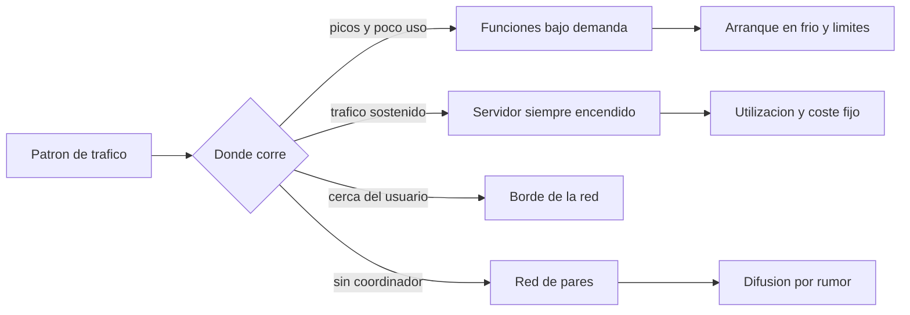
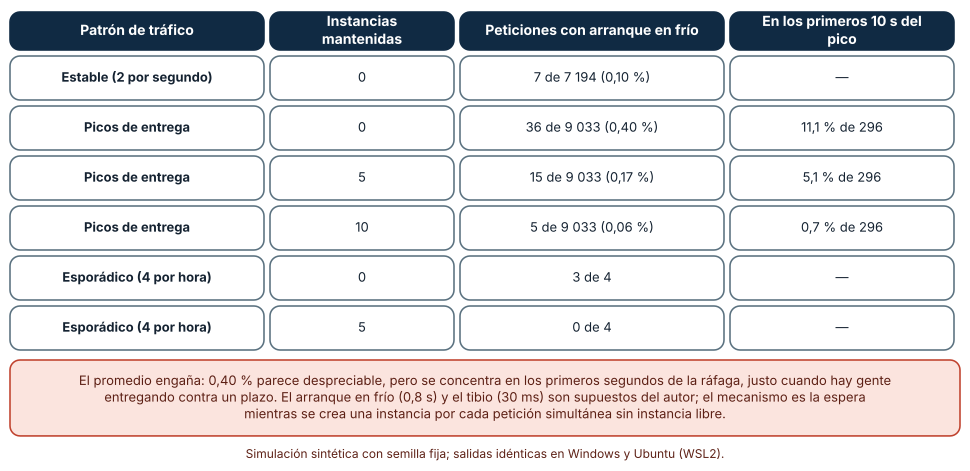
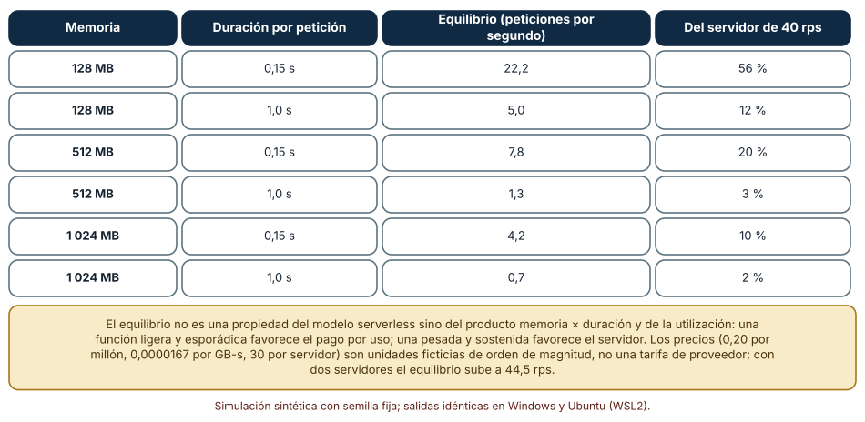
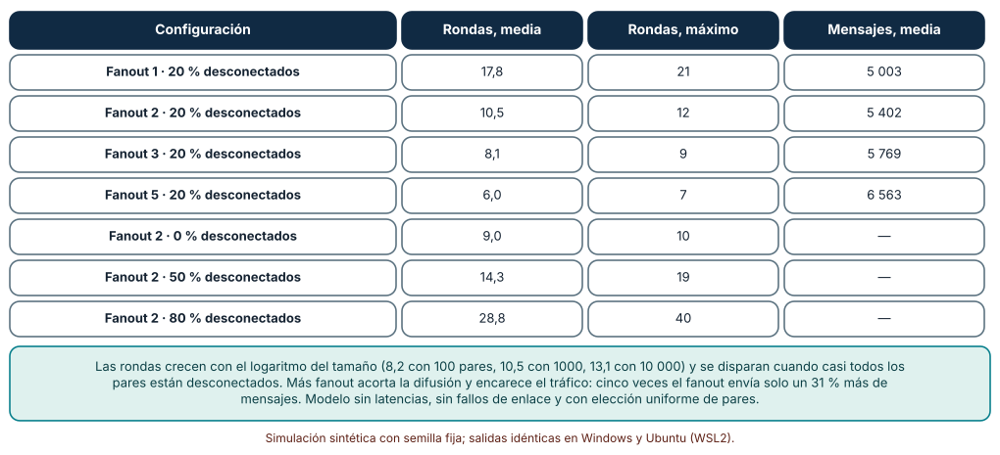

# SE-307 — Arquitecturas serverless, edge y peer-to-peer

[← SE-306 — Event-driven, CQRS y event sourcing](../../classes/part-25-arquitectura-de-software-y-dominio/se-306-event-driven-cqrs-y-event-sourcing/README.md) · [↑ Parte 25](../../classes/part-25-arquitectura-de-software-y-dominio/README.md) · [📚 Índice completo](../../classes/README.md) · [🌐 Portal](../../site/classes/SE-307.html) · [SE-308 — Fitness functions y arquitectura evolutiva →](../../classes/part-25-arquitectura-de-software-y-dominio/se-308-fitness-functions-y-arquitectura-evolutiva/README.md)

## Punto profesional y fundamento pedagógico

**Punto profesional.** La clase existe para que decidas dónde ejecutar cada parte del sistema (funciones bajo demanda, un servidor siempre encendido, el borde de la red o una malla de pares) con una cuenta de latencia, de costo y de disponibilidad, y no con el nombre de la tecnología.

**Por qué aparece aquí.** Continúa la **Parte 25** después de **Event-driven, CQRS y event sourcing**: `SE-306` dejó consumidores que reaccionan a eventos; esta clase decide dónde corren, cuánto cuestan y qué pasa cuando no hay instancia lista. Cada estilo desplaza responsabilidades: serverless traslada la operación al proveedor, el borde acerca el cómputo al usuario y peer-to-peer distribuye la coordinación entre los participantes.

**Error conceptual que debe corregir.** Creer que «serverless» es «más barato» o «sin servidores»: es un modelo de pago por uso con límites de tiempo y de estado, y su coste y su latencia dependen del patrón de tráfico, no del nombre.

**Secuencia de aprendizaje.** Antes de leer los resultados, predices qué fracción de peticiones sufre un arranque en frío según el patrón de tráfico, a partir de qué tráfico es más barato un servidor fijo y cuántas rondas necesita un rumor para llegar a casi toda una red; después lo simulas. La secuencia usa predicción, explicación propia, contraste y recuperación. [ICAP](https://icap.education.asu.edu/research) distingue participación de construcción de conocimiento; [How People Learn II](https://nap.nationalacademies.org/catalog/24783/how-people-learn-ii-learners-contexts-and-cultures) exige conectar conocimiento previo, contexto y transferencia; la [práctica de recuperación](https://pubmed.ncbi.nlm.nih.gov/16507066/) respalda producir de nuevo la explicación tras una demora; y [Education for Life and Work](https://nap.nationalacademies.org/resource/13398/dbasse_084153.pdf) exige devolución que explique la causa del error.

**Evidencia de aprendizaje.** `runtime-styles.md` con la simulación de arranques en frío por patrón de tráfico y por instancias mantenidas, la curva de equilibrio de costo según memoria y duración, la difusión por rumor con distintos fanouts y desconexiones y la decisión de qué estilo usa cada pieza de la plataforma.

**Límite de la conclusión.** El arranque en frío de 0,8 s, el tibio de 30 ms, el apagado a los 300 s, los precios ficticios y las redes de pares simuladas son supuestos del autor. No se midió ningún proveedor, ninguna función real ni ninguna red: los precios son unidades de orden de magnitud, no una tarifa.

### Trazabilidad fuente → afirmación

| Fuente primaria u oficial | Afirmación que respalda | Lo que no prueba |
|---|---|---|
| [Jonas et al., «Cloud Programming Simplified: A Berkeley View on Serverless Computing»](https://arxiv.org/abs/1902.03383) | Caracteriza serverless como cómputo elástico con pago por uso, discute sus límites (estado, latencia, comunicación) y su atractivo económico. | No da cifras de la plataforma de esta clase ni de un proveedor actual. |
| [Fowler, «Serverless Architectures»](https://martinfowler.com/articles/serverless.html) | Distingue backend como servicio y funciones como servicio y lista beneficios y costes, entre ellos el arranque en frío y el acoplamiento con el proveedor. | No cuantifica el arranque en frío de un runtime concreto. |
| [AWS Lambda: entorno de ejecución](https://docs.aws.amazon.com/lambda/latest/dg/lambda-runtime-environment.html) | Documenta que una función se ejecuta en entornos que se crean (fase de inicialización) y se reutilizan mientras estén calientes, y que esos entornos pueden detenerse. | No fija el tiempo de inicialización ni la política exacta de reutilización, que cambian. |
| [Demers et al., «Epidemic algorithms for replicated database maintenance» (PODC, 1987)](https://doi.org/10.1145/41840.41841) | Introduce la difusión por rumor (epidémica) y analiza su convergencia y coste de mensajes. | No cubre redes con fallos arbitrarios ni adversarios. |

## Antes de empezar

Recupera lo que `SE-306` dejó: consumidores de eventos con un contrato idempotente. La pregunta activa es: **¿dónde debe correr cada uno de ellos y qué patrón de tráfico hace que esa elección sea buena o mala?**

## Prerrequisitos

- Haber completado `SE-306` o poder explicar por qué un consumidor debe ser idempotente.
- Python 3.11 o posterior y un terminal; todo el código usa solo la biblioteca estándar.
- Manejar tasas de llegada, percentiles y costo por unidad de uso.

## Problema auténtico

La plataforma procesa la revisión antivirus de los archivos con una máquina siempre encendida que pasa casi todo el mes al 2 % de uso y se satura cada jueves a las 23:50. El equipo evalúa pasar la revisión a funciones bajo demanda, mover la descarga de archivos a un nodo del borde cercano a los estudiantes y, para las notas de última hora, hacer que los dispositivos de un laboratorio se sincronicen entre sí cuando falla la red de la sala. Una persona dice «serverless es más barato»; otra, «el borde siempre es más rápido»; una tercera, «entre pares no hay quien se caiga». Ninguna lo ha calculado.

## Objetivos observables

Al terminar podrás:

1. describir serverless, el borde y peer-to-peer por quién opera cada pieza, dónde vive el estado y qué límites impone, con un ejemplo y un contraejemplo;
2. simular los arranques en frío de un patrón de tráfico y medir cuánto afectan a los primeros segundos de un pico;
3. calcular el tráfico a partir del cual un servidor fijo cuesta menos que pagar por uso y cómo cambia con la memoria y la duración;
4. simular la difusión por rumor en una red con pares desconectados y calcular rondas y mensajes;
5. asignar cada pieza de la plataforma a un estilo con un escenario que lo justifique y una condición que lo invalide.

## Mapa conceptual



El mapa muestra que el patrón de tráfico, no la moda, decide el estilo. Cada rama trae su propio coste oculto: arranque en frío, utilización o convergencia.

## Temas y por qué importan

| Tema | Por qué cambia una decisión profesional | Evidencia mínima |
|---|---|---|
| Serverless y su modelo de pago | Cambia coste fijo por coste por uso y traslada la operación al proveedor. | Predicción, traza causal y contraejemplo de **Serverless y su modelo de pago** en `runtime-styles.md` |
| Arranque en frío y límites | Añade latencia en los primeros segundos de un pico y limita tiempo y estado. | Predicción, traza causal y contraejemplo de **Arranque en frío y límites** en `runtime-styles.md` |
| Punto de equilibrio de costo | Decide qué estilo conviene según utilización, memoria y duración. | Predicción, traza causal y contraejemplo de **Punto de equilibrio de costo** en `runtime-styles.md` |
| Borde de la red | Acerca el cómputo y los datos al usuario a cambio de consistencia y de otra operación. | Predicción, traza causal y contraejemplo de **Borde de la red** en `runtime-styles.md` |
| Peer-to-peer | Elimina el coordinador a cambio de convergencia probabilística y de nuevas superficies de fallo. | Predicción, traza causal y contraejemplo de **Peer-to-peer** en `runtime-styles.md` |

## Conceptos y decisiones

### 1. Serverless y su modelo de pago

En el modelo **serverless** el proveedor ejecuta el código bajo demanda, escala hacia arriba y hacia cero y cobra por invocaciones y por recursos consumidos en el tiempo (memoria × duración). Jonas y colaboradores lo presentan como una abstracción de la nube que oculta el servidor y facilita el pago por uso. Beneficia a las cargas con picos y poco uso medio, porque no se paga la capacidad ociosa. Impone límites: duración máxima por invocación, estado que debe vivir fuera de la función, comunicación entre funciones por servicios externos y dependencia de las características del proveedor. No es «sin servidores», sino «servidores que otro opera».

### 2. Arranque en frío y límites de ejecución

Cuando llega una petición y no hay un entorno de ejecución listo, el proveedor debe crear uno: descargar código, iniciar el runtime y ejecutar la inicialización. Ese **arranque en frío** añade una latencia que una petición sobre un entorno caliente no paga. Los entornos se reutilizan un tiempo y luego se descartan; un pico que llega tras un periodo tranquilo encuentra pocos entornos calientes y crea muchos a la vez. Por eso el promedio de arranques en frío puede ser pequeño y aun así concentrarse en los primeros segundos del pico. Las mitigaciones (mantener instancias calientes o provisionadas, reducir el tiempo de inicialización) tienen costo.

### 3. Punto de equilibrio de costo

El pago por uso se escribe como costo por invocación más costo por GB-segundo; un servidor fijo, como un precio mensual con una capacidad. El **punto de equilibrio** es el tráfico en el que ambos cuestan lo mismo: por debajo conviene pagar por uso, por encima conviene el servidor, siempre que ese servidor se mantenga razonablemente lleno. Depende del producto memoria × duración (una función pesada y larga se encarece mucho antes) y del número de servidores que se necesite por disponibilidad (dos o tres reparten el costo fijo en menos tráfico por servidor). Una cuenta con precios supuestos sirve para ver la forma; los precios reales hay que pedirlos y cambian.

### 4. Borde de la red

El **borde** acerca parte del cómputo y de los datos al usuario (cachés, funciones en puntos de presencia, procesamiento local). Reduce la latencia de ida y vuelta y descarga el origen, y es natural para contenido que cambia poco o para decisiones que se pueden tomar con datos locales. Cuesta consistencia (copias que pueden estar desactualizadas), operación (muchos puntos que desplegar y observar) y limitaciones del entorno de ejecución. Una pieza se lleva al borde si su escenario es de latencia o de disponibilidad local y si puede tolerar datos algo viejos; el estado autoritativo sigue en el origen.

### 5. Peer-to-peer

En una red **entre pares** no hay un coordinador central: cada nodo habla con otros y la información se propaga de par en par. Las técnicas de difusión por rumor (gossip) escogen pares al azar en cada ronda y convergen en un número de rondas del orden del logaritmo del tamaño de la red, con un coste de mensajes controlado. Dan resiliencia (no hay un punto único de fallo) y escalan bien, y a cambio ofrecen consistencia eventual y probabilística, dependen de que la red de pares siga conectada y abren nuevos problemas (confianza entre pares, descubrimiento, privacidad). Sirve para difusión de estado entre pares cooperativos, no para decidir quién tiene la razón sobre una nota.

### Arranques en frío según el patrón de tráfico

Una función se atiende en 120 ms sobre una instancia caliente (30 ms de despacho) y añade 800 ms si hay que crear una instancia; una instancia se apaga tras 300 s ociosa. Se simula una hora de tráfico con tres patrones: estable (2 peticiones por segundo, 7194 en la hora), picos de entrega (0,02 por segundo durante 55 minutos y 30 por segundo durante 5 minutos, 9033 peticiones) y esporádico (4 peticiones por hora). También se comparan 0, 5 y 10 instancias mantenidas.

```python
libres = [i for i in inst if i[0] <= a]
if libres: ...             # instancia caliente: despacho + servicio
else: inst.append([a + frio + serv, ...]); frias += 1
```

| Patrón de tráfico | Instancias mantenidas | Peticiones con arranque en frío | En los primeros 10 s del pico |
|---|---:|---:|---:|
| Estable (2 por segundo) | 0 | 7 de 7 194 (0,10 %) | — |
| Picos de entrega | 0 | 36 de 9 033 (0,40 %) | 11,1 % de 296 |
| Picos de entrega | 5 | 15 de 9 033 (0,17 %) | 5,1 % de 296 |
| Picos de entrega | 10 | 5 de 9 033 (0,06 %) | 0,7 % de 296 |
| Esporádico (4 por hora) | 0 | 3 de 4 | — |
| Esporádico (4 por hora) | 5 | 0 de 4 | — |

El 0,40 % global de los picos de entrega parece pequeño, pero se concentra: el 11,1 % de las 296 peticiones de los primeros diez segundos del pico arranca en frío, justo cuando hay estudiantes entregando contra un plazo. Mantener 10 instancias lo reduce al 0,7 %. Con tráfico esporádico casi todo es arranque en frío, porque nada permanece caliente. Las cifras son idénticas en Windows (CPython 3.12.9) y en Ubuntu bajo WSL2 (3.12.3).



**Cómo leer la figura.** Cada fila es un patrón y una política de instancias mantenidas; la última columna aísla los primeros diez segundos del pico. **Dónde deja de valer:** los tiempos de arranque, el apagado a los 300 s y la capacidad de una instancia por petición son supuestos; los proveedores reales reutilizan entornos para varias peticiones y cambian sus políticas. Lo que enseña es que un promedio puede ocultar una concentración de lentitud justo en el momento que importa.

### Cuándo conviene un servidor fijo

Una petición dura 0,15 s con 128 MB. Los precios son unidades ficticias de orden de magnitud: 0,20 por millón de invocaciones, 0,0000167 por GB-segundo y 30 por servidor al mes con capacidad de 40 peticiones por segundo. Se calcula el tráfico en el que el servidor cuesta lo mismo que el pago por uso, y cómo cambia con la memoria, la duración y el número de servidores.

```python
c_req = P_MILLON / 1e6 + duracion * memoria_gb * P_GBS
equilibrio_rps = FIJO / c_req / (30 * 86400)
```

| Memoria | Duración por petición | Equilibrio (peticiones por segundo) | Del servidor de 40 rps |
|---|---:|---:|---:|
| 128 MB | 0,15 s | 22,2 | 56 % |
| 128 MB | 1,0 s | 5,0 | 12 % |
| 512 MB | 0,15 s | 7,8 | 20 % |
| 512 MB | 1,0 s | 1,3 | 3 % |
| 1 024 MB | 0,15 s | 4,2 | 10 % |
| 1 024 MB | 1,0 s | 0,7 | 2 % |

Para la función ligera, el servidor fijo gana a partir de 22,2 peticiones por segundo (el 56 % de su capacidad); para una función de 1 GB que dura un segundo, a partir de 0,7. Con dos servidores por disponibilidad, el equilibrio de la función ligera sube a 44,5 peticiones por segundo y con tres a 66,7: la redundancia desplaza la frontera hacia el pago por uso.



**Cómo leer la figura.** Cada fila es una combinación de memoria y duración; la tercera columna es el tráfico de equilibrio y la cuarta, su proporción de la capacidad del servidor. **Dónde deja de valer:** los precios son ficticios y no incluyen transferencia de datos, almacenamiento, registros ni el costo de operar el servidor (parches, personas); un proveedor real puede tener niveles gratuitos y descuentos. Lo que enseña es la estructura: el equilibrio depende de memoria × duración y de la utilización, no del nombre del estilo.

### Difusión por rumor en una red de pares

En una red de 1000 pares, en cada ronda cada par que conoce el rumor lo envía a `f` pares elegidos al azar (fanout). Una fracción de los pares está desconectada y no recibe nada. Se mide en cuántas rondas el rumor llega al 99 % de los pares conectados y cuántos mensajes se envían, con 200 repeticiones.

```python
for i in infectados:
    for _ in range(fan):
        j = rng.randrange(n); mensajes += 1
        if conectado[j]: nuevos.add(j)
```

| Configuración | Rondas, media | Rondas, máximo | Mensajes, media |
|---|---:|---:|---:|
| Fanout 1 · 20 % desconectados | 17,8 | 21 | 5 003 |
| Fanout 2 · 20 % desconectados | 10,5 | 12 | 5 402 |
| Fanout 3 · 20 % desconectados | 8,1 | 9 | 5 769 |
| Fanout 5 · 20 % desconectados | 6,0 | 7 | 6 563 |
| Fanout 2 · 0 % desconectados | 9,0 | 10 | — |
| Fanout 2 · 50 % desconectados | 14,3 | 19 | — |
| Fanout 2 · 80 % desconectados | 28,8 | 40 | — |

Con fanout 2, el rumor llega al 99 % de los conectados en unas 10 rondas; cinco veces el fanout de 1 envía solo un 31 % más de mensajes y acorta la difusión a un tercio. Las rondas crecen con el logaritmo del tamaño (8,2 con 100 pares, 10,5 con 1000, 13,1 con 10 000) y se disparan cuando casi todos los pares están desconectados.



**Cómo leer la figura.** Cada fila es una configuración de la red; las columnas dan rondas y mensajes. **Dónde deja de valer:** la elección de pares es uniforme, no hay latencia ni pérdida de mensajes y todos los pares son honestos; en una red real el descubrimiento y los pares maliciosos cambian el resultado. La figura dice que la difusión por rumor converge rápido y barato en una red conectada, y nada acerca de quién tiene la razón: la convergencia de la información no decide conflictos entre versiones.

## Definiciones de trabajo

- **serverless:** modelo en el que el proveedor ejecuta código bajo demanda, escala a cero y cobra por uso.
- **arranque en frío:** latencia añadida cuando una petición exige crear un entorno de ejecución que no existía.
- **punto de equilibrio de costo:** tráfico en el que dos modelos de precio cuestan lo mismo.
- **borde de la red:** conjunto de puntos de ejecución cercanos al usuario que ejecutan cómputo o sirven datos sin pasar por el origen.
- **difusión por rumor:** propagación de información por la elección aleatoria de pares en cada ronda.

Las definiciones son operativas para la plataforma de entregas. No convierten términos con una historia más amplia en sinónimos y deben contrastarse con la documentación primaria enlazada al final.

## Ejemplo mínimo

El fragmento calcula el punto de equilibrio. Antes de ejecutarlo, predice si 10 peticiones por segundo convienen más como pago por uso o como servidor.

```python
P_MILLON, P_GBS, FIJO = 0.20, 0.0000167, 30.0
c_req = P_MILLON / 1e6 + 0.15 * 0.128 * P_GBS
equilibrio_rps = FIJO / c_req / (30 * 86400)
assert round(equilibrio_rps, 1) == 22.2
assert 10 < equilibrio_rps          # por debajo del equilibrio: pago por uso
```

A 10 peticiones por segundo conviene pagar por uso (unos 13,5 unidades al mes frente a 30). Registra versión, comando y salida; cambia la función a 1 GB y 1 segundo y predice el nuevo equilibrio.

## Ejemplo profesional

El equipo asigna cada pieza de la plataforma a un estilo con su escenario. La revisión antivirus pasa a funciones bajo demanda con 10 instancias provisionadas durante la ventana de cierre, porque el tráfico es de picos con poco uso medio y el 11,1 % de arranques en frío del inicio del pico era inaceptable; con una función de 512 MB y 0,15 s el equilibrio es de 7,8 peticiones por segundo y el tráfico medio de la revisión es de unas 2,5 por segundo (9 033 por hora en el patrón simulado), así que gana el pago por uso. La web y la API, con tráfico sostenido de unas 25 peticiones por segundo, se quedan en servidores (el equilibrio de su función es de 22). La descarga de archivos estáticos va al borde con caché de 10 minutos, y el estado de las notas sigue solo en el origen. No adopta peer-to-peer para las notas: la sincronización entre dispositivos del laboratorio es una mejora opcional, y el conflicto entre versiones lo decide el servidor.

Compara con las tres frases iniciales: ahora cada elección lleva su cuenta y su condición de invalidez («si el tráfico medio supera 22 peticiones por segundo, la revisión vuelve a un servidor»). Una asignación es adecuada cuando cada estilo tiene un escenario y un umbral; es frágil cuando se apoya en el nombre de la tecnología.

## Práctica guiada

1. Lista las piezas de la plataforma y marca su patrón de tráfico (estable, picos, esporádico).
2. Simula los arranques en frío de cada patrón con tus supuestos y mide los primeros 10 s del pico.
3. Calcula el equilibrio de costo de cada pieza con precios ficticios que declares.
4. Decide qué piezas pueden tolerar datos algo viejos y llevarse al borde.
5. Simula una difusión por rumor con tu red de pares y fanouts de 1, 2 y 5.
6. Asigna cada pieza a un estilo con escenario y condición de invalidez.
7. Entrega `runtime-styles.md` y pide a otra persona que encuentre una pieza cuyo tráfico cambie la decisión.

## Ejercicios

1. **Frío:** calcula cuántas instancias provisionadas harían falta para que menos del 1 % de las peticiones de los primeros diez segundos arranque en frío y compara con la simulación.
2. **Equilibrio:** calcula el equilibrio de una función de 256 MB y 0,4 s y explica en qué lado cae el tráfico de la plataforma.
3. **Rumor:** estima cuántas rondas necesita un rumor con fanout 2 en 100 000 pares y compáralo con log₂ de n.
4. **Borde:** elige una pieza de la plataforma que no deba ir al borde y explica qué dato autoritativo la mantiene en el origen.

## Reto verificable

Entrega `runtime-styles.md` con las tres simulaciones, la asignación de piezas a estilos y las condiciones de invalidez. Se aprueba si otra persona ejecuta el código desde un checkout limpio, obtiene las mismas cifras y puede decir cuántas instancias provisionadas reducirían el arranque en frío del pico a menos de 1 %. No se aprueba por declarar que «el borde es más rápido» ni por usar precios reales sin fuente y fecha.

## Caso conductor

La plataforma de entregas y corrección de tareas sigue siendo el caso conductor. Esta clase deja el séptimo artefacto: una asignación de piezas a estilos de ejecución con su cuenta de costo, su concentración de arranques en frío y sus umbrales de revisión. `SE-308` convertirá esos umbrales en pruebas que corran de forma continua. Cambia después una sola decisión, el tráfico medio de la revisión, y observa en qué punto la asignación deja de convenir.

## Preguntas frecuentes

### ¿Serverless es siempre más barato para cargas pequeñas?

Suele serlo cuando el uso medio es bajo, pero depende de memoria × duración y de los costos que no se ven en la cuenta (transferencia, registros, orquestación). Una función pesada y larga puede costar más que un servidor pequeño con poco tráfico.

### ¿Cómo evito el arranque en frío?

Reduciendo el tiempo de inicialización, manteniendo instancias calientes o provisionadas (con costo) o aceptándolo en rutas no críticas. La decisión depende de si los primeros segundos de un pico son críticos.

### ¿El borde sirve para datos que cambian mucho?

Poco: las copias en el borde pueden quedar viejas. Sirve para contenido que cambia poco o para decisiones que toleran un dato algo antiguo; el estado autoritativo se mantiene en el origen.

### ¿Peer-to-peer es más seguro por no tener un servidor central?

No necesariamente: elimina un punto único de fallo pero crea otros problemas (confianza entre pares, suplantación, privacidad). La seguridad de una red entre pares se diseña, no se hereda de la topología.

## Fallo controlado y diagnóstico

Reproduce el fallo clásico de la clase: **mover una carga con picos a funciones bajo demanda y sufrir una lentitud solo en los primeros segundos del cierre**. Usa el patrón de picos de entrega sin instancias mantenidas.

Registra síntoma, entrada mínima, hipótesis, observación que descarta cada hipótesis, causa, corrección y prueba de regresión. **Síntoma:** en los primeros segundos del cierre, algunas entregas tardan casi un segundo más que el resto, y luego desaparece. **Hipótesis rivales:** (a) la red está lenta; (b) la función tiene un defecto de rendimiento; (c) se crean entornos nuevos al llegar el pico. **Prueba:** cuenta las peticiones lentas en los primeros 10 s del pico; si coinciden con las que crean una instancia (11,1 % de 296) y el resto es normal, la causa es (c). **Conclusión:** el pico llegó tras 55 minutos casi sin tráfico y las instancias se habían apagado. **Regresión:** aprovisiona 10 instancias en la ventana de cierre y añade una prueba que simule el pico y exija menos de 1 % de peticiones en frío. No cambies a la vez la función y el aprovisionamiento.

## Errores comunes y cómo corregirlos

| Síntoma | Causa probable | Corrección |
|---|---|---|
| Lentitud solo en los primeros segundos de un pico | Arranque en frío concentrado | Aprovisionar instancias en la ventana crítica o reducir la inicialización |
| La factura de funciones supera a un servidor | Tráfico sostenido y alto con función pesada | Calcular el equilibrio y volver a un servidor |
| Datos viejos en el borde | Copias sin política de caducidad | Fijar caducidad y mantener el estado autoritativo en el origen |
| Una función necesita estado entre invocaciones | Estado guardado en el entorno de ejecución | Moverlo a un almacén externo |
| El rumor no llega a toda la red | Pares desconectados o fanout demasiado bajo | Subir el fanout o añadir un mecanismo de recuperación |

## Entorno y archivos clave

```text
work/SE-307/
├── README.md
├── runtime-styles.md
├── sim/
│   ├── frio.py
│   ├── costo.py
│   └── rumor.py
└── evidence/runtime-log.md
```

El `README` declara plataforma, versión de Python, semillas y comandos. Los experimentos usan solo la biblioteca estándar (`random`, `math`, `heapq`) y se ejecutaron con CPython 3.12.9 en Windows 11 y 3.12.3 en Ubuntu bajo WSL2: las salidas fueron idénticas. Si añades una dependencia, fija procedencia y versión.

## Seguridad, ética y accesibilidad

- una función bajo demanda hereda permisos: aplica el mínimo privilegio y no uses credenciales de larga duración dentro del código;
- los datos en el borde pueden salir de la jurisdicción donde deben residir: decide qué datos se replican antes de hacerlo;
- una red de pares expone a cada nodo a otros: cifra, autentica y no distribuyas datos personales entre pares sin consentimiento;
- un arranque en frío que retrasa una entrega contra un plazo es un asunto de equidad: no perjudica por igual a quien entrega en el último minuto;
- respeta las licencias de las fuentes y atribuye lo adaptado.

## Puente hacia el trabajo con agentes

Un agente al que se le pide «hazlo serverless» generará una función por endpoint y un archivo de infraestructura, probablemente sin considerar los arranques en frío ni el costo con tráfico sostenido. Pídele en cambio que describa el patrón de tráfico de cada pieza, que calcule el equilibrio de costo con precios que tú proporciones y que simule los arranques en frío de los primeros segundos del pico. Revisa especialmente si guarda estado en el entorno de ejecución y si aplica el mismo estilo a todo: son los dos defectos que esta clase mostró.

## Transferencia

Traslada el análisis a otro sistema (por ejemplo, un servicio de cupones con picos por campañas): cambia el patrón de tráfico y conserva el procedimiento de simular arranques en frío, calcular el equilibrio y escribir la condición de invalidez. La transferencia está lograda cuando puedes decir en qué tráfico cambia tu decisión, no cuando el estilo se llama igual.

## Evaluación y evidencia

| Criterio | Evidencia para aprobar |
|---|---|
| comprensión | explicación de serverless, borde y peer-to-peer con sus costes y límites |
| corrección | simulaciones de frío, costo y rumor reproducibles con las mismas semillas |
| diseño | asignación de piezas a estilos con escenarios y condiciones de invalidez |
| diagnóstico | reproducción del fallo «lentitud solo al inicio del pico» con regresión |
| incertidumbre | declaración de que tiempos, precios y redes son supuestos |
| reproducibilidad | versiones, comandos, salida y límites declarados |

## Fuentes

- [Jonas et al., «Cloud Programming Simplified: A Berkeley View on Serverless Computing»](https://arxiv.org/abs/1902.03383) — caracterización y límites de serverless; autoridad: UC Berkeley (preimpresión).
- [Fowler, «Serverless Architectures»](https://martinfowler.com/articles/serverless.html) — beneficios y costes; autoridad: Martin Fowler y Mike Roberts.
- [AWS Lambda: entorno de ejecución](https://docs.aws.amazon.com/lambda/latest/dg/lambda-runtime-environment.html) — ciclo de vida de los entornos de ejecución; autoridad: Amazon Web Services.
- [Demers et al., «Epidemic algorithms for replicated database maintenance» (PODC, 1987)](https://doi.org/10.1145/41840.41841) — difusión por rumor; autoridad: ACM PODC.
- [Python: `random`](https://docs.python.org/3/library/random.html) — generador con semilla; autoridad: documentación de Python.
- [SWEBOK Guide v4.0a](https://www.computer.org/education/bodies-of-knowledge/software-engineering) — áreas de conocimiento de ingeniería de software; autoridad: IEEE Computer Society.

El DOI se comprobó con la API de Crossref porque el editor bloquea peticiones automáticas; el resto respondió con éxito a una petición de solo lectura. Cada fuente respalda el mecanismo indicado; ninguna demuestra que un arranque en frío dure 0,8 s, que 22 peticiones por segundo sea el equilibrio de tu función ni que un rumor llegue en 10 rondas en tu red. Esa afirmación depende del proveedor, de los precios vigentes y de la red.

## Límites y siguiente paso

Se ejecutaron tres simulaciones con datos sintéticos en Windows y Ubuntu (WSL2) con resultados idénticos. No se midió ningún proveedor, función, red ni precio real: los tiempos de arranque, los precios y las redes de pares son construcciones del autor. La siguiente clase convierte los umbrales de estas decisiones en pruebas continuas de la arquitectura.

## Glosario

- **serverless:** modelo en el que el proveedor ejecuta código bajo demanda, escala a cero y cobra por uso.
- **arranque en frío:** latencia añadida cuando una petición exige crear un entorno de ejecución que no existía.
- **punto de equilibrio de costo:** tráfico en el que dos modelos de precio cuestan lo mismo.
- **borde de la red:** conjunto de puntos de ejecución cercanos al usuario que ejecutan cómputo o sirven datos sin pasar por el origen.
- **difusión por rumor:** propagación de información por la elección aleatoria de pares en cada ronda.

---

[← SE-306 — Event-driven, CQRS y event sourcing](../../classes/part-25-arquitectura-de-software-y-dominio/se-306-event-driven-cqrs-y-event-sourcing/README.md) · [↑ Parte 25](../../classes/part-25-arquitectura-de-software-y-dominio/README.md) · [📚 Índice completo](../../classes/README.md) · [🌐 Portal](../../site/classes/SE-307.html) · [SE-308 — Fitness functions y arquitectura evolutiva →](../../classes/part-25-arquitectura-de-software-y-dominio/se-308-fitness-functions-y-arquitectura-evolutiva/README.md)
