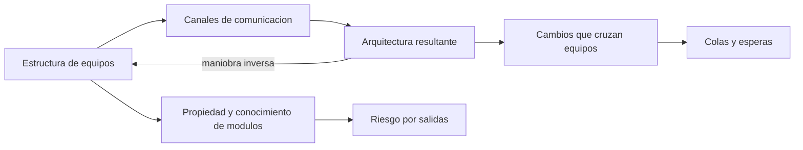
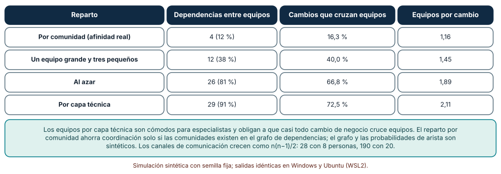
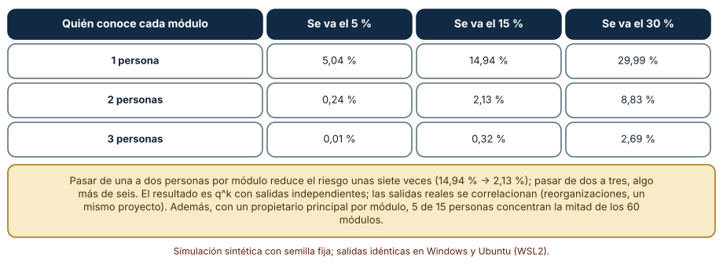
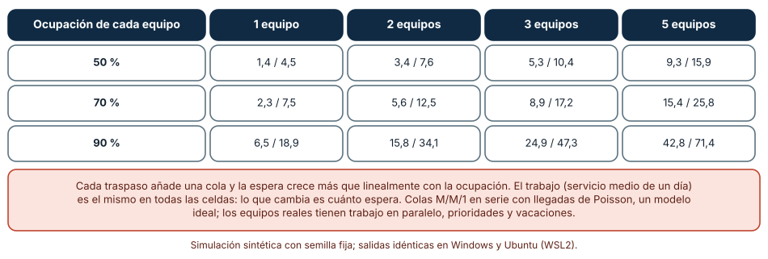

# SE-310 — Arquitectura socio-técnica y límites de equipo

[← SE-309 — Trade-offs, ADR y evaluación de alternativas](../../classes/part-25-arquitectura-de-software-y-dominio/se-309-trade-offs-adr-y-evaluacion-de-alternativas/README.md) · [↑ Parte 25](../../classes/part-25-arquitectura-de-software-y-dominio/README.md) · [📚 Índice completo](../../classes/README.md) · [🌐 Portal](../../site/classes/SE-310.html) · [SE-311 — Taller: revisar una arquitectura contra escenarios →](../../classes/part-25-arquitectura-de-software-y-dominio/se-311-taller-revisar-una-arquitectura-contra-escenarios/README.md)

## Punto profesional y fundamento pedagógico

**Punto profesional.** La clase existe para que trates la estructura de los equipos como parte de la arquitectura: para que midas cuánta coordinación exige un reparto de módulos, cuánto conocimiento se pierde cuando alguien se va y cuánto se alarga un cambio que pasa por varios equipos.

**Por qué aparece aquí.** Continúa la **Parte 25** después de **Trade-offs, ADR y evaluación de alternativas**: `SE-309` registró decisiones técnicas; esas decisiones las ejecutan personas organizadas de cierta forma, y esa forma las condiciona. Una arquitectura que ignora la organización que la construye termina reproduciendo el organigrama, quiera o no.

**Error conceptual que debe corregir.** Creer que la arquitectura es un asunto puramente técnico y la organización un asunto aparte: los límites de los equipos fijan quién puede cambiar qué sin pedir permiso, y por tanto qué fronteras técnicas se sostienen.

**Secuencia de aprendizaje.** Antes de leer los resultados, predices cuántos cambios cruzan equipos según cómo se reparten los módulos, qué fracción de módulos queda sin nadie que los conozca cuando se va una parte del equipo y cuánto se alarga un cambio que pasa por varios equipos ocupados; después lo simulas. La secuencia usa predicción, explicación propia, contraste y recuperación. [ICAP](https://icap.education.asu.edu/research) distingue participación de construcción de conocimiento; [How People Learn II](https://nap.nationalacademies.org/catalog/24783/how-people-learn-ii-learners-contexts-and-cultures) exige conectar conocimiento previo, contexto y transferencia; la [práctica de recuperación](https://pubmed.ncbi.nlm.nih.gov/16507066/) respalda producir de nuevo la explicación tras una demora; y [Education for Life and Work](https://nap.nationalacademies.org/resource/13398/dbasse_084153.pdf) exige devolución que explique la causa del error.

**Evidencia de aprendizaje.** `teams.md` con el mapa de módulos y propietarios de la plataforma, la tabla de cambios que cruzan equipos para cuatro repartos, la tabla de módulos huérfanos según propietarios y salidas, la tabla de tiempos de entrega con colas y una recomendación de reparto con lo que se sacrifica.

**Límite de la conclusión.** Los grafos de 24 módulos con cuatro comunidades, las probabilidades de arista, las salidas independientes de personas y las colas M/M/1 en serie son modelos del autor. No se observó ningún equipo, repositorio ni organización, y no se midió ninguna persona: las simulaciones muestran mecanismos de coordinación y de pérdida de conocimiento, no el comportamiento de un equipo.

### Trazabilidad fuente → afirmación

| Fuente primaria u oficial | Afirmación que respalda | Lo que no prueba |
|---|---|---|
| [Conway, «How Do Committees Invent?» (1968)](https://www.melconway.com/Home/Committees_Paper.html) | Enuncia que las organizaciones que diseñan sistemas producen diseños que copian su estructura de comunicación. | No prueba que reorganizar equipos produzca por sí solo la arquitectura deseada. |
| [Fowler, «Conway's Law»](https://martinfowler.com/bliki/ConwaysLaw.html) | Resume la ley y la «maniobra inversa»: diseñar los equipos para obtener la arquitectura buscada. | No mide el efecto de esa maniobra en un caso concreto. |
| [Skelton y Pais, «Team Topologies»: conceptos clave](https://teamtopologies.com/key-concepts) | Propone cuatro tipos de equipo y tres modos de interacción, y la carga cognitiva como criterio para fijar límites. | No demuestra que sea la mejor estructura en todo contexto. |
| [DORA, programa de investigación](https://dora.dev/research/) | Reúne investigación sobre capacidades técnicas y organizativas asociadas con el rendimiento de la entrega de software. | No aísla el efecto de un reparto de módulos concreto. |

## Antes de empezar

Recupera lo que `SE-309` dejó: decisiones registradas con sus sacrificios. La pregunta activa es: **¿qué equipo es responsable de ejecutar cada decisión y qué coordinación necesita para hacerlo?**

## Prerrequisitos

- Haber completado `SE-309` o poder explicar el sacrificio de una decisión de arquitectura.
- Python 3.11 o posterior y un terminal; todo el código usa solo la biblioteca estándar.
- Manejar grafos como pares de nodos, probabilidades independientes y colas simples.

## Problema auténtico

La plataforma tiene 24 módulos y 4 equipos. Los equipos se organizaron por capa técnica: uno de interfaz, uno de lógica, uno de datos, uno de operaciones. Para añadir una regla de reenvío de entregas, hay que cambiar la interfaz, la lógica y el esquema, y pedir un despliegue a operaciones: cuatro equipos, cuatro colas, cuatro reuniones. Cada cambio de negocio tarda semanas, aunque el trabajo en sí sea de un día. Además, cuando se va una persona de datos, nadie más sabe cómo funciona la importación de notas. El equipo no ha medido ninguna de las dos cosas.

## Objetivos observables

Al terminar podrás:

1. describir cómo la estructura de comunicación de los equipos se refleja en la arquitectura y cómo diseñar los límites de equipo para obtener los límites técnicos buscados;
2. calcular qué fracción de los cambios cruza equipos con distintos repartos de módulos y comparar un reparto por capa con uno por afinidad;
3. calcular el riesgo de módulos sin conocimiento según cuántas personas conocen cada módulo y cuántas se van;
4. calcular cuánto se alarga un cambio que pasa por k equipos con colas, según su ocupación;
5. escribir una recomendación de reparto de equipos con lo que sacrifica y la evidencia que la cambiaría.

## Mapa conceptual



El mapa muestra el doble sentido de la ley de Conway: la organización fija la arquitectura y, si se quiere otra arquitectura, hay que cambiar primero cómo se comunican los equipos. Las colas y el conocimiento son los dos costes que se miden.

## Temas y por qué importan

| Tema | Por qué cambia una decisión profesional | Evidencia mínima |
|---|---|---|
| Ley de Conway | Explica por qué la arquitectura copia la organización. | Predicción, traza causal y contraejemplo de **Ley de Conway** en `teams.md` |
| Límites de equipo y carga cognitiva | Un equipo debe poder poseer lo que cambia junto. | Predicción, traza causal y contraejemplo de **Límites de equipo y carga cognitiva** en `teams.md` |
| Propiedad del código y conocimiento | La falta de dueños convierte salidas en pérdida de conocimiento. | Predicción, traza causal y contraejemplo de **Propiedad del código y conocimiento** en `teams.md` |
| Colas y traspasos | Cada traspaso añade espera, y la espera no es trabajo. | Predicción, traza causal y contraejemplo de **Colas y traspasos** en `teams.md` |
| Maniobra inversa | Diseñar los equipos para obtener la arquitectura deseada. | Predicción, traza causal y contraejemplo de **Maniobra inversa** en `teams.md` |

## Conceptos y decisiones

### 1. Ley de Conway

Conway observó en 1968 que las organizaciones que diseñan sistemas producen diseños que son copias de su estructura de comunicación. Si cuatro equipos trabajan en un compilador, saldrá un compilador de cuatro pasadas. La razón es práctica: las fronteras técnicas que son fáciles de mantener coinciden con las fronteras entre grupos que se hablan poco, y las que cruzan equipos exigen coordinación continua que, con el tiempo, el trabajo evita. Entender la ley sirve para dos cosas: explicar por qué la arquitectura actual se parece al organigrama y anticipar qué fronteras se erosionarán.

### 2. Límites de equipo y carga cognitiva

Un equipo debe poder **poseer** lo que cambia junto: si una regla de negocio exige tocar cuatro equipos, la frontera está mal puesta. Skelton y Pais usan la **carga cognitiva** como criterio: un equipo debe poder entender y operar su parte sin superar su capacidad de atención, lo que limita el tamaño del dominio que posee. Los límites naturales siguen flujos de valor (un equipo de «evaluación» posee la regla, su interfaz y sus datos) más que capas técnicas (un equipo de «todas las bases de datos»). Los equipos de plataforma existen para reducir la carga de los demás, no para ser una cola obligatoria.

### 3. Propiedad del código y conocimiento

La **propiedad** define quién decide sobre un módulo, y el **conocimiento** quién lo entiende: pueden no coincidir. Cuando un único integrante concentra el conocimiento de un módulo, una salida lo deja huérfano. El riesgo se estima con el «factor de autobús» (cuántas personas pueden irse antes de que el proyecto se detenga) y se reduce con rotación, revisión por pares, pares de programación y documentación que sirva de hecho. Dos personas por módulo bajan el riesgo de forma muy marcada; la tercera aporta menos. Las salidas no son independientes (reorganizaciones, cierres de proyecto), así que conviene un margen.

### 4. Colas y traspasos

Cada vez que un cambio pasa a otro equipo se añade una cola. Si cada equipo está ocupado al 90 %, el tiempo de espera de un traspaso es muy superior al trabajo que se hace, y los esperas se suman. La teoría de colas lo expresa con una relación no lineal: la espera crece mucho cuando la utilización se acerca a 1. Reducir traspasos tiene más efecto que acelerar a cada equipo. La métrica práctica es el tiempo de entrega del cambio completo (de la idea a producción) y su distribución, no el tiempo de trabajo de cada equipo. La investigación DORA usa el plazo de entrega de cambios como una de sus medidas centrales.

### 5. Maniobra inversa

La **maniobra inversa de Conway** consiste en diseñar la estructura de los equipos para producir la arquitectura deseada: si quieres que «notas» y «entregas» sean módulos independientes, organiza dos equipos con propiedad separada y una interfaz acordada. Funciona solo si el reparto sigue la afinidad real del sistema; reorganizar equipos sin mirar las dependencias reales no produce los límites buscados. Y tiene un coste: reorganizar es caro, desorienta y puede romper redes de confianza existentes. La decisión es otra más que se registra con su sacrificio y una señal de revisión.

### Cuántos cambios cruzan equipos según el reparto

Se genera un grafo de 24 módulos con cuatro comunidades naturales de 6 módulos; la probabilidad de arista es 0,5 dentro de la comunidad y 0,04 fuera (32 dependencias, 28 dentro de comunidades). Se comparan cuatro repartos de módulos en 4 equipos: por comunidad, un equipo grande y tres pequeños, al azar y por capa técnica. Se simulan 600 cambios: cada uno parte de un módulo al azar y toca además a cada vecino con probabilidad 0,5; se cuenta cuántos equipos involucra.

```python
tocados = {m} | {v for v in adj[m] if rng.random() < 0.5}
equipos = {propietario[x] for x in tocados}
cruza = len(equipos) > 1
```

| Reparto | Dependencias entre equipos | Cambios que cruzan equipos | Equipos por cambio |
|---|---:|---:|---:|
| Por comunidad (afinidad real) | 4 (12 %) | 16,3 % | 1,16 |
| Un equipo grande y tres pequeños | 12 (38 %) | 40,0 % | 1,45 |
| Al azar | 26 (81 %) | 66,8 % | 1,89 |
| Por capa técnica | 29 (91 %) | 72,5 % | 2,11 |

Con el reparto por comunidad, 4 de las 32 dependencias cruzan equipos y el 16,3 % de los cambios involucra a más de un equipo; con el reparto por capa técnica, cruzan 29 y el 72,5 % de los cambios. Cada cambio por capa toca en promedio a 2,11 equipos. Los canales de comunicación entre n personas crecen como n(n−1)/2: 28 con 8, 66 con 12 y 190 con 20. Las cifras son idénticas en Windows (CPython 3.12.9) y en Ubuntu bajo WSL2 (3.12.3).



**Cómo leer la figura.** Cada fila es un reparto de módulos; las columnas cuentan dependencias entre equipos, cambios que cruzan y equipos por cambio. **Dónde deja de valer:** el grafo tiene comunidades por construcción y las probabilidades de arista son del autor; en un sistema real las comunidades hay que descubrirlas (por historial de cambios, por dependencias) y no siempre existen. La figura dice que el reparto por capa es cómodo para especialistas y maximiza los cruces; no dice que el reparto por comunidad sea gratis.

### Módulos sin nadie que los conozca

Se simulan 60 módulos y 15 personas. Cada módulo lo conocen `k` personas elegidas al azar; cada persona se va con probabilidad `q` de forma independiente. Un módulo queda huérfano si se van todos los que lo conocen. Con 4000 repeticiones por celda se mide la fracción de módulos huérfanos para k = 1, 2, 3 y q = 5 %, 15 % y 30 %.

```python
sale = {p for p in range(personas) if rng.random() < q}
duenos = rng.sample(range(personas), owners)
huerfano = all(d in sale for d in duenos)
```

| Quién conoce cada módulo | Se va el 5 % | Se va el 15 % | Se va el 30 % |
|---|---:|---:|---:|
| 1 persona | 5,04 % | 14,94 % | 29,99 % |
| 2 personas | 0,24 % | 2,13 % | 8,83 % |
| 3 personas | 0,01 % | 0,32 % | 2,69 % |

Con una sola persona por módulo, el 14,94 % de los módulos queda sin conocimiento cuando se va el 15 % del equipo; con dos, el 2,13 %, y con tres, el 0,32 %. El resultado sigue q^k con salidas independientes. Además, cuando cada módulo tiene una persona principal, 5 de las 15 personas concentran la mitad de los 60 módulos (media de 5,3; mínimo 4; máximo 7 en 2000 repeticiones).



**Cómo leer la figura.** Cada fila es el número de personas que conocen cada módulo; las columnas son la proporción de personas que se van. **Dónde deja de valer:** las salidas son independientes y el conocimiento es binario (se conoce o no); en la práctica las salidas se correlacionan (reorganizaciones, cierres) y el conocimiento es parcial. La figura dice que pasar de una a dos personas por módulo reduce el riesgo unas siete veces y que la tercera aporta mucho menos.

### Cuánto se alarga un cambio que pasa por varios equipos

Un cambio llega a un equipo, se trabaja con un tiempo de servicio exponencial de media un día y pasa al siguiente, hasta k equipos. Las llegadas son de Poisson con tasa igual a la ocupación (ρ) por equipo, con 20 000 cambios. Se mide la mediana y el percentil 90 del tiempo total (espera más trabajo) para k = 1, 2, 3 y 5 y ρ = 50 %, 70 % y 90 %.

```python
inicio = max(llegada, libre); fin = inicio + rng.expovariate(mu); libre = fin
```

| Ocupación de cada equipo | 1 equipo | 2 equipos | 3 equipos | 5 equipos |
|---|---:|---:|---:|---:|
| 50 % | 1,4 / 4,5 | 3,4 / 7,6 | 5,3 / 10,4 | 9,3 / 15,9 |
| 70 % | 2,3 / 7,5 | 5,6 / 12,5 | 8,9 / 17,2 | 15,4 / 25,8 |
| 90 % | 6,5 / 18,9 | 15,8 / 34,1 | 24,9 / 47,3 | 42,8 / 71,4 |

(Cada celda es mediana / percentil 90 en días.) Con equipos ocupados al 50 %, un cambio que pasa por cinco equipos tarda 9,3 días de mediana y 15,9 en el percentil 90; al 90 %, 42,8 y 71,4, frente a 6,5 y 18,9 para un solo equipo. El trabajo es el mismo (un día por equipo); lo que crece es la espera.



**Cómo leer la figura.** Cada fila es la ocupación de cada equipo; cada columna, el número de equipos por los que pasa un cambio. **Dónde deja de valer:** son colas M/M/1 en serie con llegadas de Poisson, un modelo ideal; los equipos reales tienen trabajo en paralelo, prioridades, interrupciones y vacaciones, y no todo cambio pasa por todos. La figura dice que la espera crece más que linealmente con la ocupación y con los traspasos, y que acelerar a un equipo no ayuda si el cuello de botella es la cola.

## Definiciones de trabajo

- **ley de Conway:** observación de que la estructura de un sistema copia la estructura de comunicación de la organización que lo diseña.
- **carga cognitiva de un equipo:** cantidad de contexto que un equipo debe mantener para operar y cambiar lo que posee.
- **factor de autobús:** número de personas que pueden irse antes de que un proyecto se detenga por falta de conocimiento.
- **traspaso:** paso de un cambio de un equipo a otro, con su cola.
- **maniobra inversa de Conway:** diseño deliberado de la estructura de equipos para producir la arquitectura deseada.

Las definiciones son operativas para la plataforma de entregas. No convierten términos con una historia más amplia en sinónimos y deben contrastarse con la documentación primaria enlazada al final.

## Ejemplo mínimo

El fragmento cuenta las dependencias entre equipos de un reparto. Antes de ejecutarlo, predice cuántas cruzan.

```python
dependencias = [("web", "notas"), ("notas", "bd"), ("web", "entregas"), ("entregas", "bd"), ("notas", "entregas")]
propietario = {"web": "A", "notas": "B", "entregas": "B", "bd": "C"}
cruzan = [d for d in dependencias if propietario[d[0]] != propietario[d[1]]]
assert len(cruzan) == 4
```

Cruzan cuatro de cinco; solo `notas → entregas` queda dentro del equipo B. Registra versión, comando y salida; mueve `bd` al equipo B y predice cuántas cruzarán ahora.

## Ejemplo profesional

El equipo de la plataforma calcula el grafo de dependencias y el historial de cambios conjuntos de los 24 módulos y encuentra cuatro comunidades (entregas, evaluación, identidad, notificaciones). Propone reorganizar los cuatro equipos por comunidad y registra en un ADR el sacrificio (se pierde el equipo de datos común y habrá cuatro formas de modelar datos) y la señal de revisión (si más del 25 % de los cambios cruza equipos tras dos trimestres). Calcula que, con una persona por módulo, el 15 % de salidas deja huérfano el 14,94 % de los módulos y fija como meta dos personas por módulo en los diez críticos. Mide el tiempo de entrega de los cambios completos: la mediana era de unos 15 días con cinco equipos ocupados al 70 % y su meta es de 6 días con uno o dos.

Compara con la organización por capa técnica: el 72,5 % de los cambios cruzaba equipos; ahora el objetivo es un 16 %. Un reparto es adecuado cuando la mayor parte de los cambios de negocio queda dentro de un equipo; es frágil cuando cada cambio exige reunir cuatro colas.

## Práctica guiada

1. Dibuja el grafo de dependencias de los módulos de la plataforma y marca las comunidades que veas.
2. Cuenta cuántas dependencias cruzan equipos con el reparto actual y con uno por comunidad.
3. Estima la fracción de cambios que cruza equipos con 600 cambios simulados.
4. Cuenta cuántas personas conocen cada módulo y calcula el riesgo de salida con q = 15 %.
5. Simula el tiempo de entrega de un cambio que pasa por 1, 3 y 5 equipos con tu ocupación.
6. Escribe una recomendación de reparto con su sacrificio y su señal de revisión.
7. Entrega `teams.md` y pide a otra persona que encuentre un módulo que tu reparto deja sin dueño real.

## Ejercicios

1. **Cruces:** diseña un reparto de 12 módulos en 3 equipos con el menor número de dependencias cruzadas posible y explica el método.
2. **Huérfanos:** calcula con q^k la fracción de módulos huérfanos con k = 2 y q = 20 % y compárala con la simulación.
3. **Colas:** calcula la ocupación máxima que mantiene el p90 de un cambio por 3 equipos bajo 15 días.
4. **Revisión:** propón una señal medible que indique que el reparto por comunidad dejó de ser adecuado.

## Reto verificable

Entrega `teams.md` con el mapa de módulos y propietarios, las tres simulaciones y la recomendación de reparto con su sacrificio y su señal de revisión. Se aprueba si otra persona ejecuta el código desde un checkout limpio, obtiene las mismas cifras y puede decir qué cambio de negocio dejaría de cruzar equipos con tu reparto. No se aprueba por proponer un organigrama sin medir dependencias ni por afirmar que «los equipos pequeños son más rápidos».

## Caso conductor

La plataforma de entregas y corrección de tareas sigue siendo el caso conductor. Esta clase deja el décimo artefacto: un reparto de equipos con sus cruces, su riesgo de conocimiento y sus colas medidos. `SE-311` es un taller que revisa la arquitectura completa contra escenarios usando todo lo anterior. Cambia después una sola decisión, la ocupación de los equipos, y observa cuánto se alarga el tiempo de entrega.

## Preguntas frecuentes

### ¿La ley de Conway es un destino?

No: es una tendencia fuerte. Se puede ir contra ella con coordinación deliberada y costosa, o se puede usar a favor (maniobra inversa). Lo que no conviene es ignorarla.

### ¿Todos los equipos deben ser de flujo de valor?

No: hay equipos de plataforma, de habilitación y de subsistemas complicados cuya función es reducir la carga de los demás. Lo que se evita es que un equipo sea un paso obligatorio de cada cambio de negocio.

### ¿Cómo encuentro las comunidades de un sistema?

Con el historial de cambios conjuntos (qué módulos cambian juntos), con el grafo de dependencias y con conversaciones con los equipos. Un algoritmo de comunidades ayuda, pero la última palabra la tiene quien conoce el negocio.

### ¿Qué hago si no puedo cambiar los equipos?

Ajusta la arquitectura a la organización (fronteras que coincidan con los equipos existentes), reduce los traspasos con interfaces estables y documenta la coordinación que inevitablemente hace falta.

## Fallo controlado y diagnóstico

Reproduce el fallo clásico de la clase: **reorganizar los equipos por capa técnica y descubrir que cada cambio cruza cuatro colas**. Simula 600 cambios con el reparto por capa y con el reparto por comunidad.

Registra síntoma, entrada mínima, hipótesis, observación que descarta cada hipótesis, causa, corrección y prueba de regresión. **Síntoma:** un cambio pequeño tarda semanas y cada equipo dice haber terminado en un día. **Hipótesis rivales:** (a) los equipos trabajan lento; (b) hay demasiado trabajo en curso; (c) cada cambio pasa por varias colas. **Prueba:** mide equipos por cambio (2,11 con el reparto por capa) y el tiempo de espera con ocupación del 70 %; si el tiempo de entrega es varias veces el tiempo de trabajo, la causa es (c). **Conclusión:** el 72,5 % de los cambios cruza equipos y cada traspaso añade espera. **Regresión:** adopta el reparto por comunidad en un piloto y mide el porcentaje de cambios que cruzan y el tiempo de entrega mediano. No cambies a la vez el reparto y la ocupación.

## Errores comunes y cómo corregirlos

| Síntoma | Causa probable | Corrección |
|---|---|---|
| Cada cambio de negocio involucra varios equipos | Equipos organizados por capa técnica | Reorganizar por flujo de valor o comunidad de dependencias |
| La arquitectura se «erosiona» entre dos equipos | La frontera técnica cruza un límite que exige coordinación constante | Mover la frontera o ponerla donde los equipos coinciden |
| Al irse una persona nadie entiende un módulo | Un solo propietario del conocimiento | Segunda persona por módulo, revisión por pares y rotación |
| El tiempo de entrega es varias veces el tiempo de trabajo | Colas por traspasos con equipos muy ocupados | Reducir traspasos y la ocupación de los equipos |
| Se reorganiza sin medir | La estructura de equipos se decide por intuición | Medir dependencias y cambios conjuntos antes de reorganizar |

## Entorno y archivos clave

```text
work/SE-310/
├── README.md
├── teams.md
├── sim/
│   ├── reparto.py
│   ├── huerfanos.py
│   └── colas.py
├── datos/dependencias.csv
└── evidence/teams-log.md
```

El `README` declara plataforma, versión de Python, semillas y comandos. Los experimentos usan solo la biblioteca estándar (`random`, `math`) y se ejecutaron con CPython 3.12.9 en Windows 11 y 3.12.3 en Ubuntu bajo WSL2: las salidas fueron idénticas. Si añades una dependencia, fija procedencia y versión.

## Seguridad, ética y accesibilidad

- medir a personas (quién conoce qué, quién cambia qué) es un asunto sensible: usa módulos, no individuos, en los informes y evita rankings personales;
- una reorganización afecta a personas y a sus relaciones de trabajo: comunícala con antelación y con el criterio que la motivó;
- la dependencia de una persona clave es un riesgo para ella también: documentar y rotar reduce la presión sobre quien es el único que sabe;
- las colas de coordinación recaen más en quienes están en la intersección de equipos: no las trates como trabajo invisible;
- respeta las licencias de las fuentes y atribuye lo adaptado.

## Puente hacia el trabajo con agentes

Un agente al que se le pide «propón una estructura de equipos» dibujará los equipos de moda sin mirar dependencias, y un agente que ayuda a asignar propietarios podría producir un ranking de personas. Pídele en cambio que calcule el grafo de dependencias y de cambios conjuntos, que proponga repartos de módulos y que mida cuántos cambios cruzan equipos con cada uno, sin identificar a personas. Revisa especialmente si recomienda un reparto sin medida y si usa nombres individuales en informes: son los dos defectos que esta clase muestra con números.

## Transferencia

Traslada el análisis a otra organización (por ejemplo, un equipo de producto con una plataforma interna): cambia los módulos y conserva el procedimiento de medir dependencias, comparar repartos, estimar el riesgo de conocimiento y modelar las colas. La transferencia está lograda cuando puedes decir qué reparto reduce los cruces y qué sacrificas, no cuando el organigrama se parece.

## Evaluación y evidencia

| Criterio | Evidencia para aprobar |
|---|---|
| comprensión | explicación de la ley de Conway, la carga cognitiva y la maniobra inversa con ejemplos |
| corrección | repartos, huérfanos y colas reproducibles con las mismas semillas |
| diseño | recomendación de reparto con sacrificio y señal de revisión |
| diagnóstico | reproducción del fallo «reparto por capa técnica» con regresión |
| incertidumbre | declaración de que grafos, salidas y colas son modelos del autor |
| reproducibilidad | versiones, comandos, salida y límites declarados |

## Fuentes

- [Conway, «How Do Committees Invent?» (1968)](https://www.melconway.com/Home/Committees_Paper.html) — enunciado original de la ley; autoridad: Melvin Conway.
- [Fowler, «Conway's Law»](https://martinfowler.com/bliki/ConwaysLaw.html) — la ley y la maniobra inversa; autoridad: Martin Fowler.
- [Skelton y Pais, «Team Topologies»: conceptos clave](https://teamtopologies.com/key-concepts) — tipos de equipo, modos de interacción y carga cognitiva; autoridad: Team Topologies.
- [DORA, programa de investigación](https://dora.dev/research/) — capacidades técnicas y organizativas y rendimiento de la entrega; autoridad: DORA (Google Cloud).
- [Python: `random`](https://docs.python.org/3/library/random.html) — generador con semilla; autoridad: documentación de Python.
- [SWEBOK Guide v4.0a](https://www.computer.org/education/bodies-of-knowledge/software-engineering) — áreas de conocimiento de ingeniería de software; autoridad: IEEE Computer Society.

Todas las páginas respondieron con éxito a una petición de solo lectura. Cada fuente respalda el mecanismo indicado; ninguna demuestra que el 72,5 % de los cambios cruce equipos con un reparto por capa o que 5 de 15 personas concentren la mitad de los módulos en tu equipo. Esa afirmación depende de tu sistema, de tu historial de cambios y de tu organización.

## Límites y siguiente paso

Se ejecutaron tres simulaciones con datos sintéticos en Windows y Ubuntu (WSL2) con resultados idénticos. No se observó ningún equipo, repositorio ni persona: el grafo con cuatro comunidades, las probabilidades de arista, las salidas independientes y las colas M/M/1 son modelos del autor. La siguiente clase es un taller que revisa una arquitectura completa contra escenarios.

## Glosario

- **ley de Conway:** observación de que la estructura de un sistema copia la estructura de comunicación de la organización que lo diseña.
- **carga cognitiva de un equipo:** cantidad de contexto que un equipo debe mantener para operar y cambiar lo que posee.
- **factor de autobús:** número de personas que pueden irse antes de que un proyecto se detenga por falta de conocimiento.
- **traspaso:** paso de un cambio de un equipo a otro, con su cola.
- **maniobra inversa de Conway:** diseño deliberado de la estructura de equipos para producir la arquitectura deseada.

---

[← SE-309 — Trade-offs, ADR y evaluación de alternativas](../../classes/part-25-arquitectura-de-software-y-dominio/se-309-trade-offs-adr-y-evaluacion-de-alternativas/README.md) · [↑ Parte 25](../../classes/part-25-arquitectura-de-software-y-dominio/README.md) · [📚 Índice completo](../../classes/README.md) · [🌐 Portal](../../site/classes/SE-310.html) · [SE-311 — Taller: revisar una arquitectura contra escenarios →](../../classes/part-25-arquitectura-de-software-y-dominio/se-311-taller-revisar-una-arquitectura-contra-escenarios/README.md)
