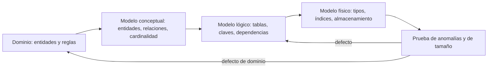
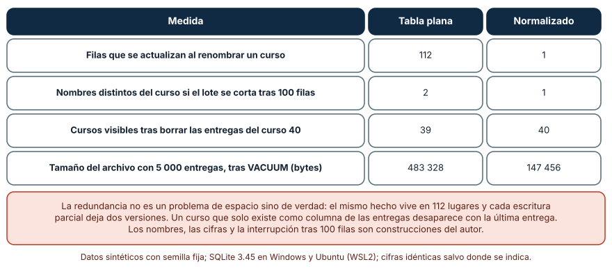
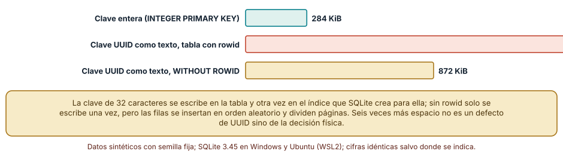
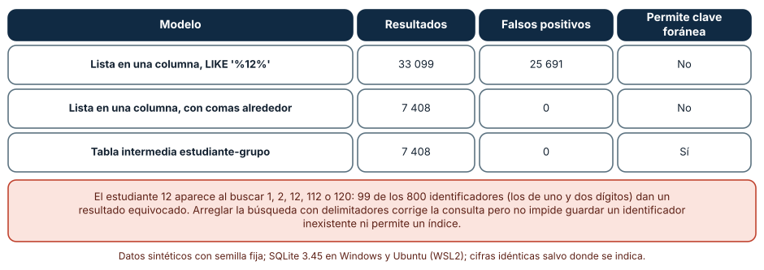

# SE-313 — Modelado conceptual, lógico y físico

[← SE-312 — Proyecto: arquitectura defendible y verificable](../../classes/part-25-arquitectura-de-software-y-dominio/se-312-proyecto-arquitectura-defendible-y-verificable/README.md) · [↑ Parte 26](../../classes/part-26-datos-persistencia-y-recuperacion/README.md) · [📚 Índice completo](../../classes/README.md) · [🌐 Portal](../../site/classes/SE-313.html) · [SE-314 — Relacional, documental, clave-valor, grafos y series →](../../classes/part-26-datos-persistencia-y-recuperacion/se-314-relacional-documental-clave-valor-grafos-y-series/README.md)

## Punto profesional y fundamento pedagógico

**Punto profesional.** La clase existe para que distingas tres decisiones que suelen mezclarse en una sola: qué hechos existen en el dominio (modelo conceptual), cómo se organizan sin contradecirse (modelo lógico) y cómo se almacenan en un motor concreto (modelo físico), y para que midas qué cuesta equivocarse en cada nivel antes de que haya datos que migrar.

**Por qué aparece aquí.** Abre la **Parte 26** después de **Proyecto: arquitectura defendible y verificable**: la Parte 25 dejó fronteras, agregados y decisiones registradas; ahora esas fronteras tienen que guardarse en algún sitio que sobreviva al proceso, al despliegue y al error de una persona. El caso conductor de la parte es la capa de datos de la plataforma de entregas de tareas: estudiantes, cursos, entregas y calificaciones.

**Error conceptual que debe corregir.** Creer que «modelar datos» es dibujar tablas: una tabla es una decisión física y lógica a la vez, y mezclarlas hace que un detalle del motor (el tipo de una clave, una columna con lista) se convierta en una propiedad del negocio que nadie decidió.

**Secuencia de aprendizaje.** Antes de leer los resultados, predices cuántas filas hay que cambiar para renombrar un curso en una tabla plana y qué pasa si el trabajo se interrumpe; después mides el tamaño de la misma información con tres claves primarias distintas y cuentas los falsos positivos de buscar identificadores en una lista separada por comas. La secuencia usa predicción, explicación propia, contraste y recuperación. [ICAP](https://icap.education.asu.edu/research) distingue participación de construcción de conocimiento; [How People Learn II](https://nap.nationalacademies.org/catalog/24783/how-people-learn-ii-learners-contexts-and-cultures) exige conectar conocimiento previo, contexto y transferencia; la [práctica de recuperación](https://pubmed.ncbi.nlm.nih.gov/16507066/) respalda producir de nuevo la explicación tras una demora; y [Education for Life and Work](https://nap.nationalacademies.org/resource/13398/dbasse_084153.pdf) exige devolución que explique la causa del error.

**Evidencia de aprendizaje.** `modelo-log.md` con la predicción, las tres figuras reproducidas, un diagrama conceptual de la plataforma con sus cardinalidades, el `schema.sql` lógico y físico y una nota que separe qué decisión es del negocio y cuál es del motor.

**Límite de la conclusión.** Los datos son sintéticos (5 000 entregas, 800 estudiantes, 40 cursos), las cifras de tamaño son de SQLite 3.45 y el corte del lote tras 100 filas es una construcción del autor. No se midió ningún servidor de bases de datos ni se usó una carga real: los experimentos muestran mecanismos, no tamaños de producción.

### Trazabilidad fuente → afirmación

| Fuente primaria u oficial | Afirmación que respalda | Lo que no prueba |
|---|---|---|
| [Codd, «A relational model of data for large shared data banks» (1970)](https://dl.acm.org/doi/10.1145/362384.362685) | Propone representar los datos como relaciones y separar su organización lógica del almacenamiento, para reducir la redundancia y la inconsistencia. | No prescribe un esquema para una plataforma educativa ni dice cuándo conviene desnormalizar. |
| [SQLite: tipos de datos y afinidad](https://www.sqlite.org/datatype3.html) | Explica que SQLite asigna una afinidad a cada columna y guarda los valores con su tipo dinámico, lo que condiciona el modelo físico. | No describe el comportamiento de otros motores, que tienen tipos estrictos. |
| [SQLite: tablas WITHOUT ROWID](https://www.sqlite.org/withoutrowid.html) | Documenta cómo cambia el almacenamiento y el tamaño cuando la clave primaria es de texto y la tabla no tiene rowid. | No mide el efecto sobre ninguna carga concreta. |
| [PostgreSQL: restricciones](https://www.postgresql.org/docs/current/ddl-constraints.html) | Presenta claves primarias, foráneas, únicas y de comprobación como mecanismo del modelo lógico. | No decide qué invariantes del negocio deben ser restricciones. |

## Antes de empezar

Recupera lo aprendido en la Parte 25 sobre agregados y fronteras: un agregado es la unidad que cambia junta. La pregunta activa es: **¿qué hechos de la plataforma deben vivir en un solo lugar, cuáles pueden repetirse y cuál es el costo de equivocarme?**

## Prerrequisitos

- Haber completado `SE-312` o poder explicar qué fronteras y agregados fijó la arquitectura de la plataforma.
- Python 3.11 o posterior con el módulo `sqlite3` de la biblioteca estándar; no hace falta instalar un servidor.
- Leer sentencias `CREATE TABLE`, `INSERT`, `UPDATE` y `SELECT` básicas.

## Problema auténtico

La plataforma de entregas guardaba al principio una hoja única: una fila por entrega con el nombre del estudiante, su correo, el nombre del curso y del docente y la nota. Funcionaba con cien filas. Cuando una coordinadora renombró un curso, la actualización se lanzó por lotes y se interrumpió: el informe del día mostró dos nombres para el mismo curso. Cuando se borraron las entregas de un curso cancelado, el curso desapareció de los listados aunque seguía existiendo. Y un campo «integrantes» con los identificadores separados por comas devolvió entregas de otros estudiantes. Cada síntoma tiene una causa en un nivel distinto del modelo.

## Objetivos observables

Al terminar podrás:

1. distinguir un modelo conceptual, uno lógico y uno físico con un ejemplo y un contraejemplo de la plataforma;
2. predecir y medir las anomalías de actualización, inserción y borrado de una tabla plana frente a un modelo normalizado;
3. medir cuánto cambia el tamaño físico de los mismos datos con la elección de la clave primaria;
4. explicar por qué una lista dentro de una columna no es un modelo y qué la sustituye;
5. escribir un `schema.sql` cuyas decisiones físicas queden justificadas y separadas de las del negocio.

## Mapa conceptual



El mapa separa el **dominio** (lo que el negocio afirma que es verdad), el **modelo lógico** (cómo se evita que esas afirmaciones se contradigan) y el **modelo físico** (cómo se guardan en un motor). Un defecto puede venir de cualquiera de los tres y el síntoma casi nunca lo dice.

## Temas y por qué importan

| Tema | Por qué cambia una decisión profesional | Evidencia mínima |
|---|---|---|
| Niveles de modelo | Decide quién es dueño de cada decisión y qué puede cambiarse sin migrar el negocio. | Predicción, traza causal y contraejemplo de **Niveles de modelo** en `modelo-log.md` |
| Identidad y claves | Una clave natural cambia; una sustituta no debe significar nada. | Predicción, traza causal y contraejemplo de **Identidad y claves** en `modelo-log.md` |
| Dependencias y normalización | Cada hecho en un solo lugar evita contradecirse. | Predicción, traza causal y contraejemplo de **Dependencias y normalización** en `modelo-log.md` |
| Cardinalidad y relaciones | Una relación muchos-a-muchos necesita una entidad propia. | Predicción, traza causal y contraejemplo de **Cardinalidad y relaciones** en `modelo-log.md` |
| Decisiones físicas | El tipo de la clave y la ubicación de los datos cuestan espacio y velocidad. | Predicción, traza causal y contraejemplo de **Decisiones físicas** en `modelo-log.md` |

## Conceptos y decisiones

### 1. Niveles de modelo

El **modelo conceptual** dice qué cosas existen y cómo se relacionan en lenguaje del dominio: un estudiante entrega una tarea de un curso, un docente la califica. No habla de tablas ni de tipos. El **modelo lógico** traduce esas afirmaciones a relaciones con claves y dependencias, sin decidir aún el motor. El **modelo físico** elige tipos, índices, particiones y el formato de las claves para un motor concreto. Codd defendió en 1970 que el programa no debía depender de la representación almacenada; esa separación sigue siendo la razón de tener tres niveles: cambiar el nivel físico (un índice, un tipo) no debería exigir reescribir el negocio, y cambiar el negocio no debería exigir rehacer el almacenamiento.

### 2. Identidad y claves

Toda fila necesita algo que la identifique y no cambie. El correo de un estudiante parece una buena clave hasta que alguien cambia de dirección: una clave **natural** que cambia obliga a actualizar cada fila que la referencia. Una clave **sustituta** (un entero secuencial o un identificador aleatorio) no significa nada y por eso no cambia, pero oculta duplicados si no se añade además una restricción de unicidad sobre el dato natural. La elección entre entero y UUID parece estética y tiene costos medibles de espacio, de orden de inserción y de exposición (un entero secuencial revela cuántas entregas hay).

### 3. Dependencias y normalización

Una **dependencia funcional** dice que un dato determina otro: el identificador de un curso determina su nombre. Cuando esa dependencia se guarda en la misma tabla que las entregas, el nombre del curso se repite en cada entrega y hay que mantenerlo igual en todas. La normalización no es un ritual de formas normales sino la regla práctica de que cada hecho se guarda en un solo lugar. Produce tres **anomalías** observables: de actualización (cambiar un hecho repetido en un lugar y no en otro), de inserción (no poder registrar un curso sin una entrega) y de borrado (perder un curso al borrar su última entrega). Desnormalizar es legítimo cuando se mide una lectura que lo exige, y entonces la repetición se vuelve una decisión con dueño y con un mecanismo que la mantenga.

### 4. Cardinalidad y relaciones

La cardinalidad dice cuántas instancias se relacionan: un curso tiene muchas entregas; una entrega grupal tiene varios estudiantes y un estudiante participa en varias entregas. Esta última es **muchos-a-muchos** y no cabe en una columna: se resuelve con una entidad intermedia (`integrante`) cuya clave es el par. Guardar los identificadores en una lista dentro de una columna parece compacto y rompe tres garantías a la vez: la búsqueda deja de ser exacta, el motor no puede imponer que los identificadores existan y no se puede indexar por estudiante. Es un error de modelo lógico presentado como una comodidad física.

### 5. Decisiones físicas

El motor guarda las filas en páginas y las claves en índices; cada decisión física tiene un costo que no se ve en el diagrama. Una clave de texto de 32 caracteres se escribe en la tabla y en el índice de la clave; una clave entera ocupa unos pocos bytes y se inserta siempre al final. Un orden de inserción aleatorio divide páginas y deja huecos. Las decisiones físicas se pueden cambiar con una migración (`SE-318`), pero cuestan datos y tiempo: conviene medir con un volumen realista antes de comprometerlas y declarar el volumen en el `schema.sql`.

### Una tabla plana y sus tres anomalías

Se genera con semilla fija una hoja de 5 000 entregas de 800 estudiantes en 40 cursos, y el mismo contenido en tres tablas (`curso`, `estudiante`, `entrega`). Se renombra el curso 7 (112 entregas) con un trabajo por lotes de 100 filas que se interrumpe tras el primero, y se borran las entregas del curso 40.

```python
ids = [r[0] for r in c.execute("select id from e where curso_id=7")]
for r in ids[:100]:                       # el lote se corta aquí
    c.execute("update e set curso_nombre='Curso 07 (v2)' where id=?", (r,))
dist = c.execute("select count(distinct curso_nombre) from e where curso_id=7").fetchone()[0]
```

| Medida | Tabla plana | Normalizado |
|---|---:|---:|
| Filas que se actualizan al renombrar el curso | 112 | 1 |
| Nombres distintos tras el corte a 100 filas | 2 | 1 |
| Cursos visibles tras borrar sus entregas (curso 40) | 39 | 40 |
| Tamaño del archivo tras `VACUUM` (bytes) | 483 328 | 147 456 |

Resultado, idéntico en Windows (CPython 3.12.9, SQLite 3.45.3) y en Ubuntu bajo WSL2 (3.12.3, SQLite 3.45.1). La tabla plana ocupa 3,3 veces más y, sobre todo, admite una escritura parcial que deja dos verdades.



**Cómo leer la figura.** Cada fila es una medida; las dos columnas comparan el mismo contenido en dos modelos. **Dónde deja de valer:** el corte tras 100 filas es una construcción del autor y una transacción lo evitaría (`SE-315`); lo que no evita ninguna transacción es que el curso desaparezca al borrar su última entrega en la tabla plana, ni que el hecho viva en 112 lugares. Con diez cursos y cien filas las anomalías existirían igual, pero costarían menos de ver.

### Una clave que triplica el archivo

Se insertan 20 000 filas con tres claves primarias: entero secuencial, UUID aleatorio de 128 bits guardado como texto en una tabla con rowid, y el mismo UUID en una tabla `WITHOUT ROWID`. Se mide el tamaño del archivo tras `VACUUM`.

```python
c.execute("create table t(id text primary key, est int, curso int, nota real) without rowid")
rows = [(f"{r.getrandbits(128):032x}", r.randint(1, 800), r.randint(1, 40), 5.0) for _ in range(20000)]
```

| Clave primaria | Tamaño (bytes) | Bytes por fila |
|---|---:|---:|
| Entero secuencial | 290 816 | 14,5 |
| UUID de texto, tabla con rowid | 1 748 992 | 87,4 |
| UUID de texto, `WITHOUT ROWID` | 892 928 | 44,6 |

La misma información cuesta 6 veces más con un UUID como texto en una tabla con rowid: SQLite crea un índice aparte para la clave de texto y escribe los 32 caracteres dos veces. Quitar el rowid reduce el costo a la mitad y no a cero, porque las inserciones en orden aleatorio dividen páginas.



**Cómo leer la figura.** Cada barra es el tamaño del archivo con una clave distinta. **Dónde deja de valer:** el UUID aquí es texto; guardado como 16 bytes binarios o con un tipo nativo de otro motor, la diferencia sería menor. El experimento muestra la forma del costo, no una recomendación de usar siempre enteros: un UUID tiene ventajas (generar identificadores sin coordinar, no revelar el volumen) que esta medida no recoge.

### La lista separada por comas

Se generan 3 000 grupos de entre uno y cuatro estudiantes sobre 800 estudiantes. Una columna `miembros` guarda los identificadores como «12,457,611». Para cada estudiante se cuenta los grupos con `LIKE`, con comas alrededor del patrón y con una tabla intermedia.

```python
like = c.execute("select count(*) from g where miembros like ?", (f"%{s}%",)).fetchone()[0]
fix = c.execute("select count(*) from g where ',' || miembros || ',' like ?", (f"%,{s},%",)).fetchone()[0]
```

| Modelo | Resultados (800 búsquedas) | Falsos positivos | Permite clave foránea |
|---|---:|---:|---|
| Lista y `LIKE '%12%'` | 33 099 | 25 691 | No |
| Lista con comas alrededor | 7 408 | 0 | No |
| Tabla intermedia estudiante-grupo | 7 408 | 0 | Sí |

El patrón ingenuo devuelve 4,5 veces los resultados correctos y falla para los 99 estudiantes con identificador de uno o dos dígitos (buscar el 12 encuentra también el 112 y el 120). Corregir la consulta con delimitadores arregla el síntoma y deja intacto el defecto de modelo: nada impide guardar «999», un estudiante que no existe.



**Cómo leer la figura.** Las filas son tres modelos para la misma relación; las columnas dan el resultado de las 800 búsquedas. **Dónde deja de valer:** los grupos son sintéticos y de tamaño uno a cuatro; con listas más largas el error crece. Y una tabla intermedia tiene un costo propio (una unión más) que la medida no incluye y que `SE-317` mide.

## Definiciones de trabajo

- **modelo conceptual:** descripción de las entidades del dominio y sus relaciones, sin referencia a un motor.
- **dependencia funcional:** relación en la que el valor de un conjunto de columnas determina el de otra.
- **anomalía de actualización:** inconsistencia que aparece cuando un hecho repetido se cambia solo en parte de sus copias.
- **clave sustituta:** identificador sin significado de negocio que identifica una fila de forma estable.
- **cardinalidad:** número de instancias de una entidad que pueden relacionarse con una instancia de otra.

Las definiciones son operativas para la plataforma de entregas. No convierten términos con una historia más amplia en sinónimos y deben contrastarse con la documentación primaria enlazada al final.

## Ejemplo mínimo

El fragmento prueba una anomalía en una tabla plana. Antes de ejecutarlo, predice cuántos nombres distintos tendrá el curso 1 tras actualizar solo una de sus dos filas.

```python
import sqlite3
c = sqlite3.connect(":memory:")
c.execute("create table e(id integer primary key, curso_id int, curso_nombre text)")
c.executemany("insert into e values(?,?,?)", [(1, 1, "Datos"), (2, 1, "Datos")])
c.execute("update e set curso_nombre='Datos II' where id=1")
assert c.execute("select count(distinct curso_nombre) from e where curso_id=1").fetchone()[0] == 2
```

Hay dos nombres para un curso. Registra versión de Python, comando y salida; después separa `curso` en su tabla y comprueba que la misma actualización deja un solo nombre.

## Ejemplo profesional

El equipo de la plataforma dibuja primero el modelo conceptual en una página: estudiante, curso, entrega, integrante de entrega, calificación y docente, con sus cardinalidades. De ahí deriva el modelo lógico: claves sustitutas enteras, una restricción de unicidad sobre el correo y una tabla `integrante(entrega_id, estudiante_id)`. Solo entonces decide lo físico: enteros como clave, sin índices adicionales hasta que `SE-317` muestre una consulta que los pida, y un volumen declarado de 100 000 entregas por año. Cada decisión queda en `schema.sql` con un comentario que dice a qué nivel pertenece y qué medida la respalda. Se desnormaliza una sola cosa, el nombre del curso en el informe mensual, con una tarea que lo regenera y una prueba que compara el informe con las tablas. Compara con la hoja única: el renombrado de un curso es una fila; el borrado de entregas no borra cursos.

## Práctica guiada

1. Dibuja el modelo conceptual de la plataforma con cinco entidades y sus cardinalidades, sin escribir una sola palabra de SQL.
2. Predice cuántas filas hay que cambiar para renombrar un curso en la hoja plana y escribe el número antes de medirlo.
3. Genera la hoja plana y las tablas normalizadas con semilla fija y reproduce las tres anomalías.
4. Cambia la clave primaria entre entero, UUID de texto y UUID sin rowid y mide el tamaño tras `VACUUM`.
5. Sustituye la columna de lista por una tabla intermedia y comprueba que la consulta devuelve 7 408 resultados en total.
6. Escribe el `schema.sql` con claves, unicidad y claves foráneas, marcando cada decisión como de negocio, lógica o física.
7. Entrega `modelo-log.md` y pide a otra persona que identifique qué decisiones del esquema no tienen justificación.

## Ejercicios

1. **Tamaño:** calcula el tamaño de 1 000 000 de entregas con la clave entera y con el UUID de texto, extrapolando los bytes por fila medidos, y explica qué parte de la extrapolación no se sostiene.
2. **Normalización:** la tabla `entrega` guarda también `docente_nombre`; indica de qué columna depende y qué anomalía produciría.
3. **Muchos a muchos:** diseña la tabla intermedia para que un estudiante no pueda figurar dos veces en la misma entrega, y escribe la restricción.
4. **Frontera:** elige una columna del esquema y justifica si su tipo es una decisión de negocio (por ejemplo, la nota va de 1,0 a 7,0) o del motor.

## Reto verificable

Entrega `modelo-log.md` con la predicción, las tres tablas de resultados, el modelo conceptual, el `schema.sql` y la clasificación de decisiones. Se aprueba si otra persona ejecuta el código desde un checkout limpio, obtiene los mismos números con las mismas semillas y puede decir qué restricción impediría guardar un identificador de estudiante inexistente. No se aprueba por dibujar un diagrama sin ejecutar nada ni por afirmar que el esquema está normalizado sin medir una anomalía.

## Caso conductor

La capa de datos de la plataforma de entregas es el caso conductor de la Parte 26. Esta clase deja el primer artefacto: el modelo conceptual y un `schema.sql` con sus decisiones clasificadas. `SE-314` comparará qué ocurre cuando los mismos datos se guardan como filas, documentos, claves y grafos. Cambia después una sola decisión, la clave primaria, y observa qué otras decisiones se ven afectadas.

## Preguntas frecuentes

### ¿Hay que normalizar siempre hasta la tercera forma normal?

No como norma, sí como punto de partida. La regla útil es que cada hecho viva en un solo lugar salvo una repetición medida y con dueño. Desnormalizar sin medir produce las anomalías de esta clase; normalizar sin medir una lectura lenta produce uniones que quizá nadie necesita.

### ¿Un UUID es mejor o peor que un entero?

Tiene costos y ventajas distintos: ocupa más y se inserta en orden aleatorio, pero se genera sin coordinar y no revela el volumen de datos. La clase mide el costo en SQLite con texto; la decisión depende de quién genera los identificadores y de qué se expone.

### ¿Por qué no guardar una lista en una columna si el motor tiene tipo JSON o arreglo?

Algunos motores indexan y validan colecciones, y entonces el costo es otro. Lo que la clase muestra es el caso de una lista de texto sin estructura: no impide valores inexistentes ni busca de forma exacta. Con un tipo estructurado hay que verificar qué garantías de integridad conserva.

### ¿El modelo conceptual y el diagrama de tablas son lo mismo?

No. El conceptual habla de cosas y reglas del dominio y lo revisa una persona del negocio; el de tablas habla de claves y tipos y lo revisa quien opera la base. Si un diagrama contiene tipos de datos, ya es lógico o físico.

## Fallo controlado y diagnóstico

Reproduce el fallo clásico de la clase: **actualizar un hecho repetido por lotes y quedarse a medias**. Renombra el curso 7 en la tabla plana con lotes de 100 filas e interrumpe tras el primero.

Registra síntoma, entrada mínima, hipótesis, observación que descarta cada hipótesis, causa, corrección y prueba de regresión. **Síntoma:** el informe del día muestra dos nombres para el mismo curso. **Hipótesis rivales:** (a) un error de codificación del nombre; (b) un dato cargado dos veces; (c) una actualización parcial de un hecho repetido. **Prueba:** cuenta los valores distintos de `curso_nombre` para ese `curso_id` y los identificadores de las filas con cada valor; si las filas con el valor viejo son las del final del lote, la causa es la actualización parcial. **Conclusión:** el nombre del curso se guarda 112 veces. **Regresión:** mueve el nombre a la tabla `curso`, añade una prueba que renombre y compruebe que existe un solo nombre y que lanzar el cambio dos veces da el mismo resultado. No arregles a la vez el modelo y el proceso de carga.

## Errores comunes y cómo corregirlos

| Síntoma | Causa probable | Corrección |
|---|---|---|
| El mismo curso aparece con dos nombres | Hecho repetido actualizado a medias | Guardar el hecho en un solo lugar y referenciarlo |
| Un curso desaparece al borrar sus entregas | El curso solo existe como columna de las entregas | Darle su propia tabla con clave |
| Una búsqueda por un identificador devuelve filas ajenas | Lista separada por comas con `LIKE` | Tabla intermedia con clave compuesta |
| La base crece mucho más de lo previsto | Clave de texto en tabla con rowid y en un índice aparte | Medir el tamaño con el volumen y elegir el tipo |
| El diagrama «normalizado» no se corresponde con las tablas | Se mezclaron niveles de modelo | Mantener el conceptual separado del físico |

## Entorno y archivos clave

```text
work/SE-313/
├── README.md
├── modelo/
│   ├── conceptual.md
│   ├── schema.sql
│   └── anomalias.py
├── tests/test_modelo.py
└── evidence/modelo-log.md
```

El `README` declara plataforma, versión de Python y de SQLite, semillas y comandos. Los experimentos usan solo la biblioteca estándar (`sqlite3`, `random`, `os`, `tempfile`) y se ejecutaron con CPython 3.12.9 en Windows 11 (SQLite 3.45.3) y 3.12.3 en Ubuntu bajo WSL2 (SQLite 3.45.1): las salidas fueron idénticas. Si añades una dependencia, fija procedencia y versión.

## Seguridad, ética y accesibilidad

- los datos de la plataforma son datos de personas menores y adultas: el modelo debe decidir desde el inicio qué columnas son personales (`SE-322`);
- un identificador secuencial en una dirección pública revela el volumen y permite enumerar; decide si la clave se expone o si hay otra referencia pública;
- los nombres y correos de prueba son sintéticos: nunca copies datos reales a un entorno de ensayo;
- documenta el modelo en un formato que un lector de pantalla pueda recorrer (lista de entidades con sus relaciones en texto, además del diagrama);
- respeta las licencias de los diagramas y plantillas y atribuye lo adaptado.

## Puente hacia el trabajo con agentes

Un agente al que se le pide «diseña el esquema de la plataforma» producirá tablas plausibles, a menudo con el nombre del curso repetido en la tabla de entregas, con listas en columnas o con claves de texto sin justificar. Pídele en cambio que entregue primero el modelo conceptual con cardinalidades, que clasifique cada decisión como de negocio, lógica o física y que incluya una prueba que renombre un curso y compruebe que hay un solo valor. Revisa especialmente si guarda un hecho en más de un lugar y si cada identificador tiene una restricción: son los dos defectos que esta clase mostró sin aviso.

## Transferencia

Traslada el análisis a otro dominio (por ejemplo, un taller de reparaciones con clientes, equipos y órdenes): cambia las entidades y conserva el procedimiento de separar niveles, buscar hechos repetidos, resolver los muchos-a-muchos con una entidad y medir una decisión física. La transferencia está lograda cuando puedes explicar qué decisión era del dominio y cuál del motor, no cuando las tablas se parecen.

## Evaluación y evidencia

| Criterio | Evidencia para aprobar |
|---|---|
| comprensión | explicación de la diferencia entre los tres niveles con ejemplos de la plataforma |
| corrección | anomalías, tamaños y falsos positivos reproducibles con las mismas semillas |
| diseño | modelo conceptual y `schema.sql` con decisiones clasificadas y restricciones |
| diagnóstico | reproducción del fallo «actualización parcial» con regresión |
| incertidumbre | declaración de que no se midió ningún servidor ni carga real |
| reproducibilidad | versiones, comandos, salida y límites declarados |

## Fuentes

- [Codd, «A relational model of data for large shared data banks»](https://dl.acm.org/doi/10.1145/362384.362685) — modelo relacional e independencia de la representación; autoridad: artículo original (Communications of the ACM, 1970).
- [SQLite: tipos de datos](https://www.sqlite.org/datatype3.html) — afinidad y almacenamiento de valores; autoridad: documentación oficial de SQLite.
- [SQLite: WITHOUT ROWID](https://www.sqlite.org/withoutrowid.html) — tablas con la clave primaria como almacenamiento; autoridad: documentación oficial de SQLite.
- [PostgreSQL: restricciones](https://www.postgresql.org/docs/current/ddl-constraints.html) — claves y comprobaciones como parte del modelo lógico; autoridad: documentación oficial de PostgreSQL.
- [Python: sqlite3](https://docs.python.org/3/library/sqlite3.html) — interfaz usada en los experimentos; autoridad: documentación de Python.

Cada fuente respalda el mecanismo indicado; ninguna demuestra que los 483 328 bytes, el factor 6 de la clave o los 25 691 falsos positivos se observen en una base real de una plataforma educativa. Esa afirmación depende del motor, del tipo de clave y de los datos.

## Límites y siguiente paso

Se ejecutaron tres experimentos con datos sintéticos en Windows y Ubuntu (WSL2) con resultados idénticos. No se usó ningún servidor de bases de datos ni datos reales: los tamaños, el corte del lote y la forma de los grupos son construcciones del autor, y los resultados no se extrapolan a otros motores ni a volúmenes de producción. La siguiente clase compara cómo cambian estas decisiones cuando el modelo es documental, de clave-valor, de grafo o de series.

## Glosario

- **modelo conceptual:** descripción de las entidades del dominio y sus relaciones, sin referencia a un motor.
- **dependencia funcional:** relación en la que el valor de un conjunto de columnas determina el de otra.
- **anomalía de actualización:** inconsistencia que aparece cuando un hecho repetido se cambia solo en parte de sus copias.
- **clave sustituta:** identificador sin significado de negocio que identifica una fila de forma estable.
- **cardinalidad:** número de instancias de una entidad que pueden relacionarse con una instancia de otra.

---

[← SE-312 — Proyecto: arquitectura defendible y verificable](../../classes/part-25-arquitectura-de-software-y-dominio/se-312-proyecto-arquitectura-defendible-y-verificable/README.md) · [↑ Parte 26](../../classes/part-26-datos-persistencia-y-recuperacion/README.md) · [📚 Índice completo](../../classes/README.md) · [🌐 Portal](../../site/classes/SE-313.html) · [SE-314 — Relacional, documental, clave-valor, grafos y series →](../../classes/part-26-datos-persistencia-y-recuperacion/se-314-relacional-documental-clave-valor-grafos-y-series/README.md)
