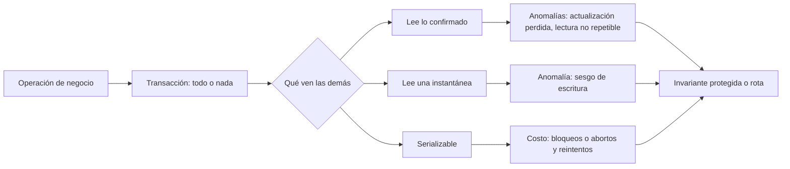
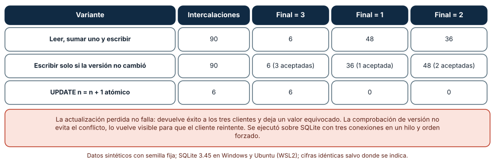
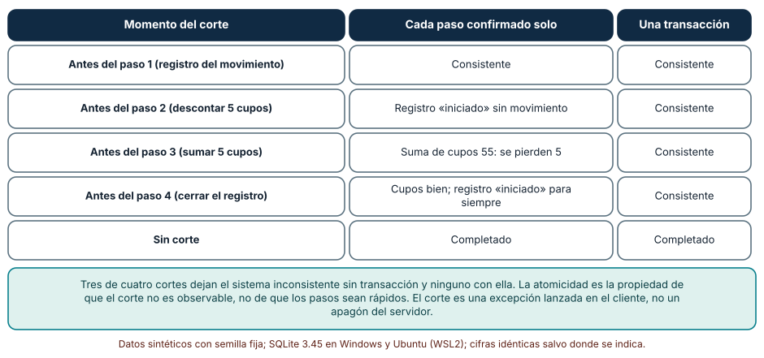
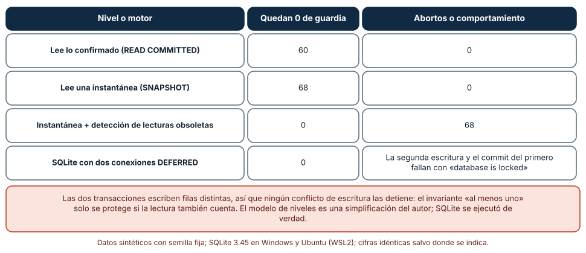

# SE-315 — Transacciones, aislamiento y concurrencia

[← SE-314 — Relacional, documental, clave-valor, grafos y series](../../classes/part-26-datos-persistencia-y-recuperacion/se-314-relacional-documental-clave-valor-grafos-y-series/README.md) · [↑ Parte 26](../../classes/part-26-datos-persistencia-y-recuperacion/README.md) · [📚 Índice completo](../../classes/README.md) · [🌐 Portal](../../site/classes/SE-315.html) · [SE-316 — Restricciones, invariantes y consistencia →](../../classes/part-26-datos-persistencia-y-recuperacion/se-316-restricciones-invariantes-y-consistencia/README.md)

## Punto profesional y fundamento pedagógico

**Punto profesional.** La clase existe para que razones sobre qué puede observar una operación mientras otras escriben, y para que elijas el nivel de aislamiento y el patrón de escritura por la invariante que hay que proteger, no por el valor por defecto del motor.

**Por qué aparece aquí.** Sigue a **Relacional, documental, clave-valor, grafos y series**: ya sabes dónde viven los hechos; ahora varias personas, procesos y tareas los cambian a la vez. La pregunta rectora de la parte, qué invariantes sobreviven a la concurrencia, empieza a contestarse aquí.

**Error conceptual que debe corregir.** Creer que «con transacciones ya es seguro»: una transacción garantiza que un conjunto de cambios se aplica entero o no se aplica, pero lo que otras transacciones ven mientras tanto depende del nivel de aislamiento, y muchas anomalías ocurren sin ningún error visible.

**Secuencia de aprendizaje.** Antes de leer los resultados, predices cuántas de las 90 intercalaciones de tres clientes que suben un contador terminan en el valor correcto; después mides qué deja una transferencia cortada en cada paso con y sin transacción, y enumeras las 70 intercalaciones de dos transacciones que retiran a dos docentes de guardia. La secuencia usa predicción, explicación propia, contraste y recuperación. [ICAP](https://icap.education.asu.edu/research) distingue participación de construcción de conocimiento; [How People Learn II](https://nap.nationalacademies.org/catalog/24783/how-people-learn-ii-learners-contexts-and-cultures) exige conectar conocimiento previo, contexto y transferencia; la [práctica de recuperación](https://pubmed.ncbi.nlm.nih.gov/16507066/) respalda producir de nuevo la explicación tras una demora; y [Education for Life and Work](https://nap.nationalacademies.org/resource/13398/dbasse_084153.pdf) exige devolución que explique la causa del error.

**Evidencia de aprendizaje.** `concurrencia-log.md` con la predicción, el recuento de intercalaciones por variante, la tabla de cortes, la tabla de niveles y una nota que diga qué invariante de la plataforma protege cada mecanismo.

**Límite de la conclusión.** Las intercalaciones se ejecutaron sobre SQLite con tres conexiones en un hilo y orden forzado; los niveles de aislamiento son un modelo del autor, no PostgreSQL ni otro motor. No se midió rendimiento ni carga: es un análisis de orden de operaciones y de resultados.

### Trazabilidad fuente → afirmación

| Fuente primaria u oficial | Afirmación que respalda | Lo que no prueba |
|---|---|---|
| [PostgreSQL: aislamiento de transacciones](https://www.postgresql.org/docs/current/transaction-iso.html) | Define los niveles de aislamiento, las anomalías que cada uno permite (lectura no repetible, fantasma, anomalía de serialización) y que el nivel por defecto no es el serializable. | No describe el comportamiento de otros motores ni sus valores por defecto. |
| [SQLite: aislamiento](https://www.sqlite.org/isolation.html) | Explica que SQLite aísla las transacciones entre conexiones de forma serializable mediante bloqueos y qué lecturas ve cada conexión. | No generaliza a motores con control de concurrencia multiversión. |
| [Berenson et al., «A Critique of ANSI SQL Isolation Levels»](https://arxiv.org/abs/cs/0701157) | Muestra que las definiciones del estándar son ambiguas y que existen anomalías (como el sesgo de escritura) que no nombra. | No dice qué nivel usar en una plataforma concreta. |
| [Cahill, Röhm y Fekete, «Serializable isolation for snapshot databases»](https://dl.acm.org/doi/10.1145/1376616.1376690) | Describe cómo detectar conflictos de lectura-escritura sobre instantáneas para lograr serializabilidad. | No mide el costo en abortos de la plataforma. |
| [Härder y Reuter, «Principles of transaction-oriented database recovery»](https://dl.acm.org/doi/10.1145/289.291) | Introduce el acrónimo ACID y la relación entre atomicidad, consistencia, aislamiento y durabilidad. | No fija un nivel de aislamiento. |

## Antes de empezar

Recupera lo aprendido en `SE-314`: un dato embebido en 16 documentos se actualizaba a medias. La pregunta activa es: **¿qué ve una operación mientras otra cambia el mismo dato y qué invariante se rompe si ve lo que no debía?**

## Prerrequisitos

- Haber completado `SE-314` o poder explicar por qué una actualización por lotes puede quedar a medias.
- Python 3.11 o posterior con `sqlite3`, `itertools` y `collections`.
- Leer `BEGIN`, `COMMIT` y `ROLLBACK`.

## Problema auténtico

La plataforma de entregas limita los cupos de revisión por docente. Una tarea nocturna mueve cupos entre cursos, y a la vez varios estudiantes solicitan cupo. Un viernes aparecen tres síntomas: un contador de cupos queda en 1 cuando se confirmaron tres reservas; una transferencia de cupos que falló a mitad deja 55 cupos en lugar de 60; y dos docentes que estaban de guardia se retiran a la vez y la plataforma se queda sin nadie, aunque cada retiro comprobó antes que quedaba otro. Ninguna de las tres operaciones dio un error. Cada síntoma corresponde a una propiedad distinta: atomicidad, aislamiento y la diferencia entre ambos.

## Objetivos observables

Al terminar podrás:

1. definir atomicidad, aislamiento y durabilidad con un ejemplo y un contraejemplo de la plataforma;
2. enumerar las intercalaciones de dos o tres operaciones y contar cuáles producen un resultado incorrecto;
3. comparar leer-modificar-escribir, comprobación de versión y actualización atómica para un contador;
4. explicar el sesgo de escritura y qué nivel o mecanismo lo evita;
5. elegir un mecanismo para una invariante y declarar el costo en reintentos o abortos.

## Mapa conceptual



El mapa separa dos preguntas que se confunden: si los cambios de una operación se aplican enteros (atomicidad) y qué ven las demás mientras tanto (aislamiento). La segunda se responde por niveles, y cada nivel protege unas invariantes y no otras.

## Temas y por qué importan

| Tema | Por qué cambia una decisión profesional | Evidencia mínima |
|---|---|---|
| Atomicidad | Un corte a mitad no debe ser observable. | Predicción, traza causal y contraejemplo de **Atomicidad** en `concurrencia-log.md` |
| Actualización perdida | Dos escrituras sobre la misma lectura dejan una sola en silencio. | Predicción, traza causal y contraejemplo de **Actualización perdida** en `concurrencia-log.md` |
| Niveles de aislamiento | Cada nivel permite unas anomalías y evita otras. | Predicción, traza causal y contraejemplo de **Niveles de aislamiento** en `concurrencia-log.md` |
| Sesgo de escritura | Dos transacciones sanas pueden romper una invariante conjunta. | Predicción, traza causal y contraejemplo de **Sesgo de escritura** en `concurrencia-log.md` |
| Reintento y abortos | Evitar la anomalía cuesta trabajo que hay que presupuestar. | Predicción, traza causal y contraejemplo de **Reintento y abortos** en `concurrencia-log.md` |

## Conceptos y decisiones

### 1. Atomicidad

Una transacción agrupa varias sentencias de modo que, si falla cualquiera, ninguna deja huella. Sin ella, una transferencia de cupos de cuatro pasos (registrar, descontar, sumar, cerrar) cortada en el tercero deja el sistema con 55 cupos en lugar de 60, y nadie lo avisa. La atomicidad no depende de que los pasos sean rápidos: un corte puede llegar en cualquier punto. En SQLite y PostgreSQL esto incluye sentencias de definición de esquema (`SE-318`); en otros motores no.

### 2. Actualización perdida

Leer un valor, calcular el nuevo y escribirlo es tres pasos; si dos clientes los intercalan, el segundo escribe sobre una lectura vieja y la primera escritura se pierde. Ninguno recibe un error. Hay tres remedios con costos distintos: hacer que la base calcule (`UPDATE ... SET n = n + 1`), comprobar la versión al escribir y reintentar si cambió, o bloquear la fila mientras se calcula. La primera es la más barata cuando el cálculo cabe en una expresión; la segunda, cuando hay un cálculo del lado de la aplicación y los conflictos son raros; la tercera, cuando son frecuentes.

### 3. Niveles de aislamiento

El aislamiento define qué ve una transacción de lo que otras hacen en paralelo. **Leer lo confirmado** deja que una segunda lectura de la misma fila vea otro valor. **Instantánea** fija lo que se ve al comenzar, de modo que las lecturas repetidas coinciden, y a cambio permite anomalías que implican a varias filas. **Serializable** garantiza un resultado equivalente a alguna ejecución en serie y lo logra con bloqueos o con abortos. El estándar SQL definió los niveles con una lista de anomalías que, como mostraron Berenson y colaboradores, es ambigua y deja fuera varias; por eso el nivel por defecto de cada motor importa y se consulta en su documentación.

### 4. Sesgo de escritura

Dos transacciones leen lo mismo, deciden por separado y escriben filas distintas. Ningún conflicto de escritura las detiene, pero la combinación rompe una invariante que implica a ambas filas: «siempre queda un docente de guardia». Es la anomalía característica de las instantáneas. Se evita con un nivel serializable, con un bloqueo explícito sobre lo que se lee o convirtiendo la invariante en algo que una sola fila resume (un contador que se actualiza en ambas transacciones y por eso las serializa).

### 5. Reintento y abortos

Evitar una anomalía no sale gratis: un nivel serializable con detección de conflictos aborta transacciones que luego hay que reintentar, y un bloqueo hace esperar. Por eso el código que usa transacciones debe contemplar el reintento (con límite y con jitter) y las operaciones deben ser idempotentes o estar cubiertas por una clave de idempotencia. Un aborto es una señal correcta, no un error del motor; ignorarlo o tragarlo es lo que convierte la protección en un fallo silencioso.

### Tres clientes suben un contador

Un contador de cupos vale 0 y tres clientes lo suben una vez. Con leer-modificar-escribir cada cliente tiene dos pasos (leer, escribir): hay 90 intercalaciones posibles. Se ejecutan todas sobre SQLite con tres conexiones y un orden forzado, en tres variantes: leer-sumar-escribir, escribir solo si la versión no cambió y `UPDATE n = n + 1`.

```python
cur = c.execute("update cupo set n=?, v=v+1 where id=1 and v=?", (s["val"] + 1, s["ver"]))
if cur.rowcount == 0:
    s["ok"] = False           # conflicto detectado: el cliente debe reintentar
```

| Variante | Intercalaciones | Final = 3 | Final = 1 | Final = 2 |
|---|---:|---:|---:|---:|
| Leer, sumar uno y escribir | 90 | 6 | 48 | 36 |
| Escribir si la versión no cambió | 90 | 6 (3 aceptadas) | 36 (1 aceptada) | 48 (2 aceptadas) |
| `UPDATE n = n + 1` atómico | 6 | 6 | 0 | 0 |

Solo 6 de 90 intercalaciones (las que ejecutan los tres clientes en serie) dan 3 con leer-sumar-escribir. Con la comprobación de versión, el valor final siempre coincide con las escrituras aceptadas: ninguna se pierde en silencio, pero algunas se rechazan y hay que reintentarlas. La actualización atómica termina siempre en 3.



**Cómo leer la figura.** Cada fila es una forma de subir el contador; las columnas cuentan intercalaciones por valor final. **Dónde deja de valer:** el orden se fuerza en un solo hilo con tres conexiones, lo que enumera todos los órdenes posibles pero no la temporización de un servidor real; y un cliente que reintenta tras el rechazo cambia el recuento. La figura no dice que el 6 de 90 sea la probabilidad en producción, sino que la corrección depende del orden y que solo un mecanismo explícito la asegura.

### Una transferencia cortada en cada paso

Una transferencia de 5 cupos entre dos cursos tiene cuatro pasos: insertar un registro «iniciado», descontar del curso 1, sumar al curso 2 y marcar el registro «completado». Se simula un corte (una excepción) antes de cada paso, con cada sentencia confirmada por separado y con todas en una transacción.

```python
if not autocommit: c.execute("begin")
for k, sql in enumerate(steps):
    if k == crash_at: raise RuntimeError("corte")
    c.execute(sql)
```

| Momento del corte | Cada paso confirmado solo | Una transacción |
|---|---|---|
| Antes del paso 1 | Consistente | Consistente |
| Antes del paso 2 | Registro «iniciado» sin movimiento | Consistente |
| Antes del paso 3 | Suma de cupos 55 (se pierden 5) | Consistente |
| Antes del paso 4 | Cupos bien; registro «iniciado» para siempre | Consistente |
| Sin corte | Completado | Completado |

Tres de los cuatro cortes dejan la base inconsistente sin transacción, y ninguno con ella. El segundo caso es el más dañino: la suma baja de 60 a 55 y no hay un solo error en ningún registro.



**Cómo leer la figura.** Cada fila es un punto de corte; las dos columnas comparan qué queda. **Dónde deja de valer:** el corte es una excepción lanzada en el cliente y no un apagón del servidor; la durabilidad de lo confirmado ante un corte de energía depende del motor y del disco y no se probó. Una transacción también puede fallar al confirmar, y el cliente debe tratar ese caso.

### Dos docentes se retiran a la vez

Hay dos docentes de guardia. Cada transacción empieza, lee cuántos hay de guardia, y si quedan dos, se retira a sí misma y confirma. Se enumeran las 70 intercalaciones de dos transacciones de cuatro pasos (empezar, leer, decidir y escribir, confirmar) con un modelo de tres niveles: lectura de lo confirmado, instantánea y una instantánea con detección de lecturas obsoletas. Además se ejecuta el caso real en SQLite con dos conexiones `DEFERRED`.

```python
t["read"] = sum((t["snap"] if level in ("snapshot", "ssi") else state).values())
t["write"] = own[i] if t["read"] >= 2 else None
```

| Nivel o motor | Intercalaciones que dejan 0 de guardia (de 70) | Abortos o comportamiento |
|---|---:|---|
| Lee lo confirmado | 60 | 0 |
| Instantánea | 68 | 0 |
| Instantánea con detección de conflictos de lectura | 0 | 68 |
| SQLite, dos conexiones `DEFERRED` | 0 | La segunda escritura y el commit del primero fallan con «database is locked» |

Bajo lectura de lo confirmado y bajo instantánea la plataforma se queda sin docentes en casi todos los órdenes. Con detección de conflictos de lectura, ninguno, a costa de abortar una transacción en 68 de 70. SQLite evita la anomalía bloqueando: con las dos conexiones leyendo, la segunda no puede escribir y la primera no puede confirmar hasta que la otra termine.



**Cómo leer la figura.** Cada fila es un nivel o motor; las columnas dan cuántos de los 70 órdenes rompen la invariante y qué costo tiene evitarlo. **Dónde deja de valer:** el modelo de niveles es una simplificación del autor y no reproduce un motor concreto; las cifras 60, 68 y 0 describen la enumeración, no la frecuencia en producción. El caso de SQLite sí es real, pero muestra el comportamiento de un motor de un solo escritor: otros motores con instantáneas lo permitirían.

## Definiciones de trabajo

- **transacción:** conjunto de operaciones que se aplican enteras o no se aplican, y que se observan según el nivel de aislamiento.
- **intercalación:** orden concreto en que se alternan los pasos de operaciones concurrentes.
- **actualización perdida:** escritura que se pisa con otra basada en una lectura anterior sin que ninguna falle.
- **sesgo de escritura:** anomalía en la que dos transacciones leen lo mismo, escriben filas distintas y juntas rompen una invariante.
- **serializable:** nivel que garantiza un resultado equivalente a alguna ejecución una tras otra.

Las definiciones son operativas para la plataforma de entregas. No convierten términos con una historia más amplia en sinónimos y deben contrastarse con la documentación primaria enlazada al final.

## Ejemplo mínimo

El fragmento muestra una actualización perdida con dos clientes. Antes de ejecutarlo, predice el valor final.

```python
import sqlite3
c = sqlite3.connect(":memory:")
c.execute("create table cupo(id int primary key, n int)"); c.execute("insert into cupo values(1,0)")
a = c.execute("select n from cupo").fetchone()[0]     # cliente A lee 0
b = c.execute("select n from cupo").fetchone()[0]     # cliente B lee 0
c.execute("update cupo set n=?", (a + 1,)); c.execute("update cupo set n=?", (b + 1,))
assert c.execute("select n from cupo").fetchone()[0] == 1      # dos reservas, un cupo
```

Hay dos reservas y el contador vale 1. Registra versión, comando y salida; cambia a `update cupo set n = n + 1` y comprueba que vale 2.

## Ejemplo profesional

El equipo de la plataforma clasifica sus operaciones por la invariante que protegen. Para el contador de cupos usa `UPDATE n = n + 1 WHERE n < limite` y comprueba las filas afectadas: si es cero, no hay cupo. Para la transferencia entre cursos envuelve los cuatro pasos en una transacción y la hace idempotente con una clave de operación única. Para el relevo de guardia, que implica a varias filas, escribe en la misma fila de un resumen (`guardia_activos`) que ambas transacciones actualizan, de modo que se serialicen; documenta que el mismo patrón en PostgreSQL con nivel por defecto necesitaría `SERIALIZABLE` o un bloqueo explícito. Cada cliente maneja el rechazo con un reintento acotado y con jitter. Las pruebas enumeran las intercalaciones de las tres operaciones, igual que esta clase, y comprueban las invariantes al final.

## Práctica guiada

1. Escribe las tres operaciones de la plataforma que cambian un valor compartido y la invariante de cada una.
2. Predice cuántas intercalaciones de tres clientes dan el valor correcto con leer-sumar-escribir y escribe el número.
3. Enumera las 90 intercalaciones y cuenta los valores finales con las tres variantes.
4. Corta la transferencia antes de cada paso con y sin transacción y anota el estado.
5. Enumera las 70 intercalaciones del relevo de guardia en tres niveles y ejecuta el caso real con dos conexiones.
6. Escribe una prueba que, para cada intercalación, compruebe la invariante y muestre la intercalación que la rompe.
7. Entrega `concurrencia-log.md` y pide a otra persona que diga qué intercalación pasaría desapercibida en una prueba de un solo hilo.

## Ejercicios

1. **Intercalaciones:** calcula cuántas intercalaciones hay con cuatro clientes de dos pasos y explica por qué enumerarlas deja de ser práctico.
2. **Versión:** añade un reintento al cliente rechazado y comprueba que el valor final llega a 3 en todas las intercalaciones.
3. **Guardia:** rediseña el relevo para que una sola fila resuma a los docentes de guardia y compruébalo.
4. **Idempotencia:** diseña una clave de operación para la transferencia de modo que repetirla no mueva los cupos dos veces.

## Reto verificable

Entrega `concurrencia-log.md` con la predicción, las tres tablas, la invariante de cada operación y el mecanismo elegido. Se aprueba si otra persona ejecuta el código, obtiene los mismos recuentos y puede decir qué invariante rompería cambiar la actualización atómica por leer-sumar-escribir. No se aprueba por afirmar que «las transacciones lo resuelven» ni por probar solo con un cliente.

## Caso conductor

La capa de datos de la plataforma de entregas sigue siendo el caso conductor. Esta clase deja el tercer artefacto: la lista de operaciones concurrentes con su invariante, su mecanismo y su prueba de intercalaciones. `SE-316` pregunta qué invariantes puede imponer el propio motor para que no dependan de que cada cliente las recuerde. Cambia después una sola decisión, el mecanismo de una operación, y observa qué cambia en reintentos y en abortos.

## Preguntas frecuentes

### ¿Basta con poner todo en una transacción?

No: la atomicidad evita el corte a mitad, no que otra operación lea un valor viejo. Hace falta además un mecanismo para la invariante concreta: una actualización atómica, una comprobación de versión, un bloqueo o un nivel serializable.

### ¿Por qué no usar siempre serializable?

Porque cuesta bloqueos o abortos y reintentos, y no todas las invariantes lo necesitan. La regla es proteger cada invariante con el mecanismo más barato que la garantice y medir el costo de los reintentos.

### ¿Qué diferencia hay entre una actualización perdida y un sesgo de escritura?

En la perdida, dos escrituras compiten por la misma fila y una desaparece. En el sesgo, escriben filas distintas y ningún conflicto las detiene, pero juntas rompen una regla que implica a ambas.

### ¿Una prueba con un solo hilo sirve para esto?

No: estas anomalías solo ocurren con una intercalación concreta. Hay que enumerar o generar intercalaciones, o ejecutar clientes reales concurrentes, y comprobar la invariante al final.

## Fallo controlado y diagnóstico

Reproduce el fallo clásico de la clase: **dos reservas confirmadas y un contador que sube una sola vez**. Ejecuta dos clientes con leer-sumar-escribir en el orden «leer, leer, escribir, escribir».

Registra síntoma, entrada mínima, hipótesis, observación que descarta cada hipótesis, causa, corrección y prueba de regresión. **Síntoma:** hay dos reservas confirmadas y el contador de cupos vale 1. **Hipótesis rivales:** (a) una de las reservas falló y se registró mal; (b) el contador se reinició; (c) las dos escrituras se basaron en la misma lectura. **Prueba:** registra el valor leído y el escrito por cada cliente y su orden; si ambos leyeron 0 y escribieron 1, la causa es la actualización perdida. **Conclusión:** la operación lee, calcula y escribe en tres pasos que se intercalan. **Regresión:** cambia a `UPDATE n = n + 1`, añade una prueba que enumere las intercalaciones y compruebe que todas terminan en 2, y otra que ejecute la transferencia cortada en cada paso. No cambies a la vez el mecanismo y el nivel de aislamiento.

## Errores comunes y cómo corregirlos

| Síntoma | Causa probable | Corrección |
|---|---|---|
| Un contador queda por debajo de las operaciones confirmadas | Leer-modificar-escribir sin control | Actualización atómica o comprobación de versión con reintento |
| Una transferencia cortada deja cupos perdidos | Sentencias confirmadas por separado | Envolver los pasos en una transacción e idempotencia |
| Dos operaciones sanas rompen una regla conjunta | Sesgo de escritura bajo instantánea | Serializable, bloqueo explícito o resumen en una fila |
| La aplicación falla con «locked» o «serialization failure» | Se tratan los abortos como errores | Reintento acotado con jitter |
| Las pruebas pasan y producción falla a veces | Pruebas de un solo hilo | Enumerar intercalaciones y comprobar invariantes |

## Entorno y archivos clave

```text
work/SE-315/
├── README.md
├── concurrencia/
│   ├── intercalaciones.py
│   ├── transferencia.py
│   └── guardia.py
├── tests/test_concurrencia.py
└── evidence/concurrencia-log.md
```

El `README` declara plataforma, versiones de Python y de SQLite, semillas y comandos. Los experimentos usan solo la biblioteca estándar (`sqlite3`, `itertools`, `collections`) y se ejecutaron con CPython 3.12.9 en Windows 11 (SQLite 3.45.3) y 3.12.3 en Ubuntu bajo WSL2 (SQLite 3.45.1): las salidas fueron idénticas. Si añades una dependencia, fija procedencia y versión.

## Seguridad, ética y accesibilidad

- una actualización perdida en notas o en cupos afecta a personas: decide qué invariantes son críticas y cuáles toleran reconciliación posterior;
- los reintentos automáticos de operaciones no idempotentes pueden duplicar efectos (cobros, envíos); exige una clave de idempotencia;
- registra los abortos y los reintentos: son una señal de contención y no deben tragarse;
- documenta los niveles de aislamiento usados para que una persona sin experiencia en bases de datos pueda revisarlos;
- los mensajes de error al usuario por conflictos deben ser claros y accesibles, sin culpar a la persona.

## Puente hacia el trabajo con agentes

Un agente al que se le pide «haz que reservar un cupo sea seguro» tenderá a envolver el código en una transacción y declarar el problema resuelto. Pídele en cambio la invariante en una frase, el mecanismo elegido, una prueba que enumere las intercalaciones y la política de reintentos. Revisa especialmente si lee un valor, lo calcula en la aplicación y lo escribe de vuelta, y si ignora el rechazo de una escritura: son los dos defectos que esta clase mostró sin aviso.

## Transferencia

Traslada el análisis a otro dominio (por ejemplo, el stock de un taller o los asientos de una sala): identifica la invariante, enumera las intercalaciones de dos operaciones y compara tres mecanismos. La transferencia está lograda cuando puedes explicar qué invariante protege cada mecanismo y cuál no, no cuando el código se parece.

## Evaluación y evidencia

| Criterio | Evidencia para aprobar |
|---|---|
| comprensión | explicación de la diferencia entre atomicidad y aislamiento con ejemplos de la plataforma |
| corrección | recuentos de intercalaciones y estados tras cortes reproducibles |
| diseño | operaciones con invariante, mecanismo, reintento y prueba de intercalaciones |
| diagnóstico | reproducción del fallo «actualización perdida» con regresión |
| incertidumbre | declaración de que los niveles son un modelo y no un motor concreto |
| reproducibilidad | versiones, comandos, salida y límites declarados |

## Fuentes

- [PostgreSQL: aislamiento de transacciones](https://www.postgresql.org/docs/current/transaction-iso.html) — niveles y anomalías; autoridad: documentación oficial de PostgreSQL.
- [SQLite: aislamiento](https://www.sqlite.org/isolation.html) — comportamiento entre conexiones; autoridad: documentación oficial de SQLite.
- [SQLite: transacciones](https://www.sqlite.org/lang_transaction.html) — `BEGIN` diferido e inmediato; autoridad: documentación oficial de SQLite.
- [Berenson et al., «A Critique of ANSI SQL Isolation Levels»](https://arxiv.org/abs/cs/0701157) — anomalías no cubiertas por el estándar; autoridad: artículo de los autores.
- [Cahill, Röhm y Fekete (2008)](https://dl.acm.org/doi/10.1145/1376616.1376690) — serializabilidad sobre instantáneas; autoridad: artículo original.
- [Härder y Reuter (1983)](https://dl.acm.org/doi/10.1145/289.291) — origen del acrónimo ACID; autoridad: artículo original.

Cada fuente respalda el mecanismo indicado; ninguna demuestra que los 6 de 90, los 55 cupos o los 60 de 70 órdenes se observen en el motor y la carga de la plataforma. Esa afirmación depende del motor, de su nivel por defecto y del patrón de acceso.

## Límites y siguiente paso

Se ejecutaron tres experimentos en Windows y Ubuntu (WSL2) con resultados idénticos. Las intercalaciones se forzaron en un solo hilo con SQLite; los niveles de aislamiento son un modelo del autor y no se ejecutó PostgreSQL ni otro motor con instantáneas; no se midió rendimiento, contención ni durabilidad ante apagones. Las cifras describen enumeraciones, no frecuencias. La siguiente clase pregunta qué invariantes puede imponer el propio motor para que no dependan de cada cliente.

## Glosario

- **transacción:** conjunto de operaciones que se aplican enteras o no se aplican, y que se observan según el nivel de aislamiento.
- **intercalación:** orden concreto en que se alternan los pasos de operaciones concurrentes.
- **actualización perdida:** escritura que se pisa con otra basada en una lectura anterior sin que ninguna falle.
- **sesgo de escritura:** anomalía en la que dos transacciones leen lo mismo, escriben filas distintas y juntas rompen una invariante.
- **serializable:** nivel que garantiza un resultado equivalente a alguna ejecución una tras otra.

---

[← SE-314 — Relacional, documental, clave-valor, grafos y series](../../classes/part-26-datos-persistencia-y-recuperacion/se-314-relacional-documental-clave-valor-grafos-y-series/README.md) · [↑ Parte 26](../../classes/part-26-datos-persistencia-y-recuperacion/README.md) · [📚 Índice completo](../../classes/README.md) · [🌐 Portal](../../site/classes/SE-315.html) · [SE-316 — Restricciones, invariantes y consistencia →](../../classes/part-26-datos-persistencia-y-recuperacion/se-316-restricciones-invariantes-y-consistencia/README.md)
