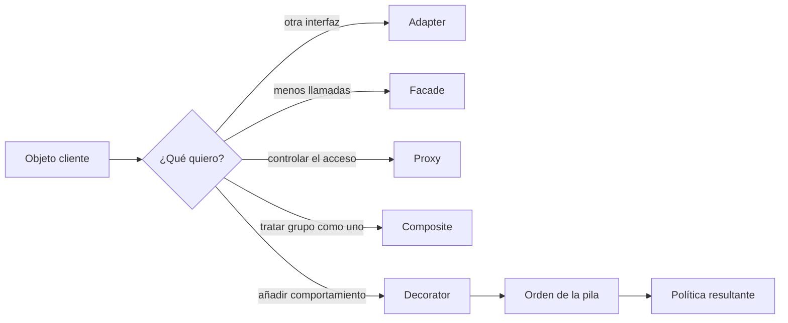

# SE-315 — GoF estructurales: Adapter, Decorator, Facade, Proxy y Composite

[← SE-314 — GoF creacionales: Factory, Builder, Singleton y Prototype](../../classes/part-26-patrones-de-diseno-empresariales-y-de-resiliencia/se-314-gof-creacionales-factory-builder-singleton-y-prototype/README.md) · [↑ Parte 26](../../classes/part-26-patrones-de-diseno-empresariales-y-de-resiliencia/README.md) · [📚 Índice completo](../../classes/README.md) · [🌐 Portal](../../site/classes/SE-315.html) · [SE-316 — GoF conductuales: Strategy, Observer, Command, State y Template Method →](../../classes/part-26-patrones-de-diseno-empresariales-y-de-resiliencia/se-316-gof-conductuales-strategy-observer-command-state-y-template-method/README.md)

## Punto profesional y fundamento pedagógico

**Punto profesional.** La clase existe para que uses los patrones que **envuelven y componen objetos** sabiendo que comparten una forma (un objeto que contiene a otro y ofrece una interfaz) y se distinguen por la intención. Esa semejanza de forma es la fuente de dos errores frecuentes: llamar a todo «Decorator» y no ver que apilar envolturas es **diseñar una política**. El orden en que se apilan un reintento y un plazo no es un detalle de implementación; cambia qué promete el sistema.

**Por qué aparece aquí.** Sigue a los creacionales (`SE-314`) porque trabaja con objetos ya creados y precede a los conductuales (`SE-316`). También prepara `SE-320` y `SE-321`, donde timeout, retry, circuit breaker y bulkhead son envolturas apiladas alrededor de una llamada.

**Error conceptual que debe corregir.** Creer que dos decoradores que se apilan «hacen lo mismo» en cualquier orden. Un decorador añade comportamiento antes o después de delegar, y el comportamiento de afuera ve el resultado de todo lo que envuelve. Un plazo por fuera de un reintento limita el tiempo total; un plazo por dentro limita cada intento y permite que el total sea mayor. El patrón no dice cuál elegir; la medida sí muestra la diferencia.

**Secuencia de aprendizaje.** Antes de ejecutar, predices cómo cambian el éxito y la latencia p99 de 3000 peticiones cuando se invierte el orden de un plazo de 80 ms y tres reintentos. Después ejecutas una simulación con semilla fija, mides los dos órdenes y verificas cuatro propiedades de los otros patrones: un adaptador con una prueba de contrato común, una fachada que reduce llamadas, un proxy perezoso que construye solo lo que se usa y un compuesto con una guarda contra ciclos.

**Evidencia de aprendizaje.** Un `estructurales-log.md` con la tabla de los cinco patrones (intención, fuerza, costo), el resultado de los dos órdenes de la pila y la decisión de política para una pila propia.

**Límite de la conclusión.** Las latencias son una distribución lognormal elegida por el autor, la política de plazo total es una variante simple y los demás patrones se ejercitan con objetos mínimos. La clase **mide** el efecto del orden en un modelo; **no mide** una pila real de producción ni el costo de mantenimiento de las envolturas. No se invocó ningún modelo de lenguaje.

### Trazabilidad fuente → afirmación

| Fuente primaria u oficial | Afirmación que respalda | Lo que no prueba |
|---|---|---|
| [Gamma, Helm, Johnson y Vlissides, «Design Patterns»](https://www.informit.com/store/design-patterns-elements-of-reusable-object-oriented-9780201633610) | Define Adapter, Bridge, Composite, Decorator, Facade, Flyweight y Proxy y sus intenciones. | No dice cuál es el orden correcto de una pila de decoradores. |
| [Microsoft, «Retry pattern»](https://learn.microsoft.com/azure/architecture/patterns/retry) | Describe el reintento de operaciones fallidas transitorias y la necesidad de limitarlo. | No dice cómo combinarlo con un plazo. |
| [Amazon Web Services, «Timeouts, retries and backoff with jitter»](https://aws.amazon.com/builders-library/timeouts-retries-and-backoff-with-jitter/) | Trata plazos y reintentos como decisiones que interactúan. | No mide ninguna pila concreta. |
| [Python, módulo `random`](https://docs.python.org/3/library/random.html) | Documenta los generadores con semilla que hacen reproducible la simulación. | No dice que la distribución modele un servicio real. |

## Antes de empezar

Recupera lo aprendido en `SE-314`: cada patrón creacional tiene un modo de estropearse que se mide. La pregunta activa es: **si envuelves tu cliente HTTP con reintentos, plazos, caché y registro, ¿puedes decir en qué orden están apilados y qué promete cada orden?**

## Prerrequisitos

- Haber completado `SE-313` y `SE-314`.
- Conocer la idea de interfaz y de delegación y los dobles de prueba de la Parte 35.
- Python 3.11 o posterior con `random`, `abc` y `timeit`.

## Problema auténtico

*Avisos* envía mensajes con un proveedor externo que a veces tarda. El equipo ha añadido, en tres semanas, un reintento, un plazo, un registro de cada envío y una caché de deduplicación. Cada pieza se escribió como una clase que envuelve a la anterior y todas parecían correctas por separado. En una semana de incidentes se descubre que, cuando el proveedor se enlentece, los envíos duran cuatro veces lo esperado: el plazo está **dentro** del reintento, así que cada intento espera su plazo completo y el total se multiplica. Nadie escribió la política «un envío no debe durar más de 80 ms»: salió del orden en que se apilaron las clases.

La clase mide ese efecto con una simulación y recorre los otros cuatro patrones con una medida cada uno.

## Objetivos observables

Al terminar podrás:

1. distinguir la intención de Adapter, Facade, Proxy, Composite y Decorator aunque compartan la forma de envoltura;
2. predecir y medir cómo el orden de una pila de decoradores cambia éxito, latencia y carga;
3. escribir una prueba de contrato común a dos adaptadores de proveedores con formas distintas;
4. decidir si una fachada simplifica o solo oculta el acoplamiento;
5. proteger un compuesto contra ciclos y un proxy perezoso contra construcciones innecesarias.

## Mapa conceptual



La rama del Decorator termina en una consecuencia que las otras no tienen: el orden de la pila es una decisión, y esa decisión es la política del sistema.

## Temas y por qué importan

| Tema | Por qué cambia una decisión profesional | Evidencia mínima |
|---|---|---|
| Intención frente a forma | Las cinco envolturas se parecen; se distinguen por lo que buscan | Una frase de intención por cada una |
| Adapter y prueba de contrato | Dos proveedores deben cumplir lo mismo detrás de la misma interfaz | Prueba común a ambos adaptadores |
| Facade | Reduce llamadas del cliente; puede ocultar acoplamiento | Llamadas antes y después |
| Proxy | Controla el acceso o difiere el costo | Objetos construidos frente a usados |
| Composite | Trata grupos y elementos igual; los ciclos rompen la recursión | Prueba con un ciclo |
| Decorator y orden | El orden de la pila es la política | Éxito y latencia en dos órdenes |

## Conceptos y decisiones

### 1. La forma común y las cinco intenciones

Los cinco patrones comparten una estructura: un objeto que **contiene o envuelve** a otro. Lo que los separa es la intención. Un **Adapter** cambia la interfaz de un objeto a la que el cliente espera. Una **Facade** ofrece una interfaz simple a un subsistema. Un **Proxy** controla el acceso a un objeto con su misma interfaz (perezoso, remoto, con permisos). Un **Composite** trata un grupo de objetos como uno solo. Un **Decorator** añade comportamiento conservando la interfaz. Distinguirlos importa porque cada intención tiene su propio modo de estropearse y su propia prueba.

### 2. Adapter y la prueba de contrato

*Avisos* integra dos proveedores de mensajería: uno expone `enviar(to, body)` y devuelve un diccionario con `id` y `status`; el otro, `push(destinatario, texto, prioridad)` y devuelve una tupla `(id, código HTTP)`. Dos adaptadores presentan a ambos una interfaz única `send(to, body)` que devuelve `(id, aceptado)`. El experimento comprueba que, con una misma llamada, ambos devuelven la misma forma `('a1', True)` y `('b1', True)`. La **prueba de contrato** es la pieza que mantiene honesto al patrón: una batería única que cualquier adaptador nuevo debe pasar. Sin ella, cada adaptador es una promesa privada y el primer cambio de un proveedor la rompe en producción.

### 3. Facade: menos llamadas, no menos acoplamiento

Una fachada convierte siete llamadas del cliente a subsistemas en una sola. La ganancia es de **uso**: el cliente deja de conocer el orden y los detalles. El riesgo es que la fachada crezca hasta ser el nuevo punto de acoplamiento: si cada necesidad nueva exige un método más, se convierte en una clase de dios (`SE-322`). La pregunta de diseño es si la fachada ofrece un **vocabulario del dominio** («enviar recordatorio») o solo reenvía métodos de los subsistemas.

### 4. Proxy perezoso: construir solo lo que se usa

Un proxy puede diferir la construcción de un objeto costoso. En el experimento se crean 1000 proxies y se usan 37; solo se construyen 37 objetos pesados. El costo es una comprobación en cada acceso y un estado interno (¿ya se construyó?) que, si se comparte entre hilos, exige sincronización. El proxy es adecuado cuando la construcción es cara y el uso es raro; si casi todos los objetos se usan, el proxy solo suma una indirección.

### 5. Composite: grupos que contienen grupos

Un compuesto trata a un grupo y a un usuario con la misma interfaz, de modo que `usuarios()` funciona igual en ambos. El defecto es el **ciclo**: el grupo `a` contiene a `b` y `b` contiene a `a`. En el experimento, con la guarda de grupos visitados, el recorrido devuelve `['u1', 'u2', 'u3']`; sin la guarda, el mismo ciclo produce `RecursionError`. La estructura compuesta debe validarse al **construirse** (rechazar el ciclo) o recorrerse con una guarda; confiar en que «nadie lo hará» es esperar al incidente.

### 6. Decorator: el orden es la política

Un decorador envuelve un objeto con su misma interfaz y añade comportamiento. El experimento apila dos decoradores sobre un backend con latencias lognormales (mediana de unos 49 ms), con semilla fija y 3000 peticiones: un **plazo** de 80 ms y un **reintento** de hasta tres intentos. Con el reintento por fuera y el plazo por dentro (cada intento tiene su propio plazo), el éxito es de **97,5 %**, el p99 es de **240 ms** y hay **1,37** llamadas al backend por petición. Con el plazo por fuera (un solo plazo de 80 ms para todo el envío), el éxito es de **71,2 %**, el p99 es de **80 ms** y hay **1,00** llamadas por petición. Son las mismas dos piezas con dos políticas: una compra éxito con latencia y carga; la otra acota la latencia y pierde peticiones.


**Cómo leer la figura.** El eje horizontal es la latencia p99 y el vertical el éxito; cada punto es un orden de los mismos decoradores, con las llamadas por petición en la etiqueta. Mira el compromiso: con el reintento por fuera el éxito sube a 97,5 % a costa de 240 ms y de 1,37 llamadas; con el plazo total por fuera la latencia queda en 80 ms y el éxito en 71,2 %. **Dónde deja de valer:** las latencias son una distribución elegida, el backend nunca falla de otra forma que lenta y los reintentos no esperan entre intentos; un sistema real tiene correlación entre fallos y reintentos que este modelo no tiene. La figura demuestra que el orden importa, no cuánto.


**Cómo leer la figura.** Cada fila es una pila: lo que está más a la izquierda envuelve a lo que está más a la derecha y ve el costo de todo lo que envuelve. **Dónde deja de valer:** el diagrama muestra dos órdenes de dos piezas; con cinco decoradores (caché, registro, métricas, plazo, reintento) hay 120 órdenes y el razonamiento no se reduce a mirar la figura. La regla útil es documentar el orden elegido y probarlo.

### 7. Cinco patrones, cinco hechos

La tabla resume lo medido en la clase. La lectura útil no es «cuál es mejor» sino que cada patrón tiene una intención con una medida asociada: contrato común para el adaptador, número de llamadas para la fachada, objetos construidos para el proxy, recursión protegida para el compuesto y política resultante para el decorador.


**Cómo leer la figura.** A la izquierda están los cinco patrones y a la derecha el hecho medido de cada uno. Las turquesa son efectos medidos (unificar, reducir llamadas, construir solo lo usado) y las doradas condiciones que hay que respetar: la guarda ante un ciclo y el orden de apilado. **Dónde deja de valer:** los objetos son mínimos y los recuentos son de ejemplos del autor, no frecuencias en proyectos. Que un patrón «funcione» en el ejemplo no dice que convenga en tu sistema; para eso está el criterio de `SE-313`.

## Definiciones de trabajo

- **Adapter:** objeto que traduce una interfaz a otra que el cliente espera.
- **Facade:** interfaz simplificada a un subsistema.
- **Proxy:** sustituto con la misma interfaz que controla el acceso al objeto real.
- **Composite:** estructura en árbol donde grupos y elementos comparten interfaz.
- **Decorator:** envoltura con la misma interfaz que añade comportamiento.
- **Prueba de contrato:** batería común que debe pasar toda implementación de una interfaz.

## Ejemplo mínimo

```python
class Sender:
    def send(self, x): return x

class Retry(Sender):
    def __init__(self, inner: Sender, attempts: int): self.inner, self.attempts = inner, attempts
    def send(self, x):
        for i in range(self.attempts):
            try: return self.inner.send(x)
            except TimeoutError:
                if i == self.attempts - 1: raise
```

`Retry` tiene la misma interfaz que `Sender` y delega. Su comportamiento depende de lo que envuelve: si lo que envuelve ya aplica un plazo por llamada, cada intento tiene el suyo.

## Ejemplo profesional

*Escenario ilustrativo: las cifras de este ejemplo son supuestos de la narración, no mediciones.*

Tras el incidente, el equipo de *Avisos* escribe una **política** antes que el código: «un envío no debe durar más de 200 ms en el percentil 99 y no debe tocar al proveedor más de dos veces». Con esa política elige el orden de la pila (plazo total por fuera, un reintento por dentro con plazo por intento de 90 ms), la documenta en un comentario de la composición raíz y añade una prueba que simula un proveedor lento y comprueba la duración máxima y el número de llamadas. Cuando alguien reordene las clases, la prueba fallará antes de que lo haga el proveedor.

## Práctica guiada

1. Escribe tu predicción: con el plazo por fuera, ¿sube o baja el éxito frente al plazo por dentro? ¿Y la carga?
2. Ejecuta `python scripts/experiments_part26_a.py 519` y compara.
3. Cambia el plazo a 120 ms y vuelve a medir los dos órdenes.
4. Escribe una prueba de contrato para dos adaptadores y añade un tercer proveedor con otra forma.
5. Añade un tercer decorador (caché) y documenta en qué posiciones tiene sentido.

## Ejercicios

1. **Básico.** Explica en una frase la intención de cada uno de los cinco patrones y cómo se distinguen sus estructuras.
2. **Intermedio.** Cambia la simulación para que el reintento espere 20 ms entre intentos y mide el efecto en el p99.
3. **Avanzado.** Diseña una prueba que falle si alguien reordena la pila de decoradores de modo que la política prometida deje de cumplirse.

## Reto verificable

Entrega `estructurales-log.md` con la tabla de intención y medida de los cinco patrones, la comparación de los dos órdenes con los cuatro números y una prueba de política para una pila propia. Es válido si otra persona repite la simulación con la misma semilla y obtiene los mismos recuentos, y si la prueba falla al invertir el orden.

## Caso conductor

*Avisos* envía a través de dos proveedores adaptados, con una fachada para el caso de uso «enviar recordatorio» y una pila de decoradores. `SE-320` toma esa misma pila y le añade jitter y circuit breaker; `SE-321` la aísla con compartimentos.

## Preguntas frecuentes

### ¿Cuál es la diferencia entre Decorator y Proxy si ambos tienen la misma interfaz?

La intención. El Decorator añade comportamiento (registro, reintento); el Proxy controla el acceso (perezoso, permisos, remoto). Estructuralmente pueden ser idénticos, y un mismo objeto puede ser ambos.

### ¿Los decoradores de Python (`@decorador`) son el patrón Decorator?

Comparten la idea de envolver un objeto (aquí una función) con el mismo contrato, pero la sintaxis no garantiza la estructura del patrón. Un `@lru_cache` es una envoltura con comportamiento añadido; el orden de `@` apilados importa por la misma razón.

### ¿Cuántos decoradores son demasiados?

Cuando no se puede decir en una frase qué promete la pila, o cuando probar la política exige conocer el orden de todas las piezas. Más de tres o cuatro suele pedir una política explícita.

### ¿Puede un agente apilar los decoradores?

Puede escribirlos y componerlos, pero el orden depende de una política que debe venir de quien conoce el servicio. La petición correcta incluye la política y una prueba que la compruebe.

## Fallo controlado y diagnóstico

**Fallo.** Tras una refactorización «de limpieza», las pruebas pasan y en producción los envíos tardan el triple cuando el proveedor se degrada.

**Diagnóstico paso a paso.** (1) Se compara la composición raíz antes y después: se invirtió el orden de dos envolturas. (2) Se mide con la simulación: la latencia p99 pasó de 80 a 240 ms. (3) Las pruebas no cubrían la política, solo el comportamiento de cada pieza.

**Corrección.** Se restaura el orden, se añade la prueba de política con un proveedor lento simulado y se documenta la pila en la composición raíz.

## Errores comunes y cómo corregirlos

- **Síntoma: latencia que se multiplica con el proveedor lento.** Causa: plazo por intento dentro de un reintento. Solución: elegir plazo total o plazo por intento a propósito y probarlo.
- **Síntoma: un adaptador nuevo rompe a un consumidor.** Causa: no hay prueba de contrato. Solución: batería común para toda implementación.
- **Síntoma: la fachada tiene 40 métodos.** Causa: reenvía los subsistemas. Solución: ofrecer el vocabulario del dominio y partirla.
- **Síntoma: recorrido infinito de un grupo.** Causa: ciclo en un compuesto. Solución: validar al construir o recorrer con visitados.
- **Síntoma: el proxy construye todo al arrancar.** Causa: acceso al objeto real en la creación del proxy. Solución: construir en el primer uso.

## Entorno y archivos clave

- `scripts/experiments_part26_a.py`: pila de decoradores con reloj virtual y semilla 519, adaptadores, fachada, proxy y compuesto con y sin guarda; `python scripts/experiments_part26_a.py 519`.
- `content/part-26/figures/`: figuras.
- Sin dependencias fuera de la biblioteca estándar.

## Seguridad, ética y accesibilidad

Un proxy que aplica permisos es una frontera de seguridad: si hay una ruta que evita el proxy, el permiso no existe; la prueba debe intentar saltarlo. Los reintentos de operaciones no idempotentes duplican efectos (un cobro, un aviso): el decorador de reintentos no debe envolver una operación sin clave de idempotencia (`SE-319`). Un registro envuelto puede filtrar datos personales de los mensajes; define qué se registra. Accesibilidad: las figuras tienen texto alternativo completo y las tablas son legibles sin color.

## Puente hacia el trabajo con agentes

Un agente compone decoradores con facilidad y rara vez pregunta la política. La petición útil la incluye: «el envío no debe superar 200 ms en p99 ni llamar más de dos veces al proveedor; escribe la pila y la prueba que lo comprueba con un proveedor simulado lento». Se revisa que la prueba falle al invertir el orden. Los adaptadores se piden junto con la prueba de contrato para que el agente no invente una interfaz distinta por proveedor.

## Transferencia

Escribe la política de una pila de decoradores de un proyecto propio (qué promete en latencia, intentos y datos registrados) y comprueba que una prueba la defiende. La idea se transfiere a middleware de servidores web, interceptores de clientes y cadenas de validación, donde el orden también es una decisión.

## Evaluación y evidencia

- Cada patrón se describe por su intención, no solo por su forma.
- El efecto del orden se mide con dos órdenes y cuatro números.
- La prueba de contrato corre contra todos los adaptadores.
- La prueba de política falla si se invierte la pila.
- La afirmación final distingue lo simulado de lo medido en producción.

## Fuentes

- Gamma, E., Helm, R., Johnson, R. y Vlissides, J. [«Design Patterns: Elements of Reusable Object-Oriented Software»](https://www.informit.com/store/design-patterns-elements-of-reusable-object-oriented-9780201633610).
- Microsoft. [«Retry pattern»](https://learn.microsoft.com/azure/architecture/patterns/retry).
- Amazon Web Services. [«Timeouts, retries and backoff with jitter»](https://aws.amazon.com/builders-library/timeouts-retries-and-backoff-with-jitter/).
- Python Software Foundation. [«random — Generate pseudo-random numbers»](https://docs.python.org/3/library/random.html).

## Límites y siguiente paso

La simulación usa una distribución elegida por el autor y no incluye fallos correlacionados ni espera entre reintentos; los demás patrones se ejercitan con objetos mínimos. El siguiente paso, `SE-316`, trata los patrones que deciden comportamiento en tiempo de ejecución, donde el fallo típico es un estado representado con banderas que admite combinaciones imposibles.

## Glosario

| Término | Definición breve |
|---|---|
| Adapter | Traductor de una interfaz a otra |
| Facade | Interfaz simplificada a un subsistema |
| Proxy | Sustituto que controla el acceso |
| Composite | Grupo tratado como un elemento |
| Decorator | Envoltura que añade comportamiento |
| Política de pila | Promesa que resulta del orden de las envolturas |
