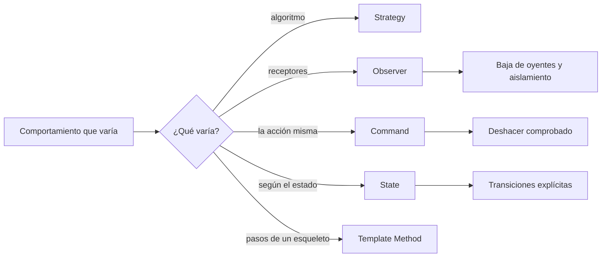

# SE-316 — GoF conductuales: Strategy, Observer, Command, State y Template Method

[← SE-315 — GoF estructurales: Adapter, Decorator, Facade, Proxy y Composite](../../classes/part-26-patrones-de-diseno-empresariales-y-de-resiliencia/se-315-gof-estructurales-adapter-decorator-facade-proxy-y-composite/README.md) · [↑ Parte 26](../../classes/part-26-patrones-de-diseno-empresariales-y-de-resiliencia/README.md) · [📚 Índice completo](../../classes/README.md) · [🌐 Portal](../../site/classes/SE-316.html) · [SE-317 — GRASP y asignación de responsabilidades →](../../classes/part-26-patrones-de-diseno-empresariales-y-de-resiliencia/se-317-grasp-y-asignacion-de-responsabilidades/README.md)

## Punto profesional y fundamento pedagógico

**Punto profesional.** La clase existe para que muevas decisiones de comportamiento de condicionales a objetos **sabiendo qué fallo nuevo introduces con cada movimiento**. Strategy, Observer, Command, State y Template Method comparten una idea: separar *qué* se hace de *cuándo* y *quién* lo decide. Cada uno añade una responsabilidad que antes no existía: el Observer deja a su cargo el ciclo de vida de sus oyentes, el Command exige que lo deshecho sea de verdad lo contrario, el State exige que las transiciones sean explícitas. Un patrón conductual adoptado sin esa responsabilidad produce fugas, estados imposibles y errores que nadie ve.

**Por qué aparece aquí.** Sigue a los estructurales (`SE-315`) porque combina objetos envueltos con reglas de comportamiento y cierra el recorrido por los patrones de la Gang of Four antes de pasar a los criterios de asignación de responsabilidades (`SE-317`).

**Error conceptual que debe corregir.** Creer que el patrón State «simplifica» un objeto con banderas booleanas. Lo que hace es **hacer imposibles** las combinaciones que no son estados: con cuatro banderas hay 16 combinaciones y la mayoría no corresponde a ningún estado válido; con una variable de estado y una tabla de transiciones, solo existen los estados declarados. La simplificación es secundaria; la ganancia es la corrección.

**Secuencia de aprendizaje.** Antes de ejecutar, predices qué porcentaje de 10.000 secuencias de seis eventos aleatorios termina en una combinación imposible con cuatro banderas booleanas y cuántas con una tabla de transiciones, cuántos oyentes descartados siguen vivos con referencias fuertes y cuántos con débiles. Después ejecutas el experimento y escribes la máquina de estados del aviso con sus transiciones legales.

**Evidencia de aprendizaje.** Un `conductuales-log.md` con la tabla de transiciones del ciclo de vida de un aviso, el resultado del fuzzing, la prueba de fuga y de aislamiento del Observer y la prueba de deshacer de un Command.

**Límite de la conclusión.** Los eventos, las transiciones y los porcentajes dependen de una definición de «imposible» elegida por el autor y de secuencias aleatorias con semilla fija. La clase **mide** un mecanismo (banderas frente a estados explícitos, referencias fuertes frente a débiles, aislamiento de fallos) sobre un caso pequeño; **no mide** la frecuencia de estos defectos en proyectos reales. No se invocó ningún modelo de lenguaje.

### Trazabilidad fuente → afirmación

| Fuente primaria u oficial | Afirmación que respalda | Lo que no prueba |
|---|---|---|
| [Gamma, Helm, Johnson y Vlissides, «Design Patterns»](https://www.informit.com/store/design-patterns-elements-of-reusable-object-oriented-9780201633610) | Define los once patrones de comportamiento, entre ellos Strategy, Observer, Command, State y Template Method. | No mide el costo de sus fallos. |
| [Python, módulo `weakref`](https://docs.python.org/3/library/weakref.html) | Documenta referencias débiles y `WeakSet`, que no impiden que un objeto sea recolectado. | No dice que sean la solución adecuada en todo diseño de oyentes. |
| [ReactiveX, «Observable Contract»](https://reactivex.io/documentation/contract.html) | Describe un contrato explícito de notificación, finalización y error para un flujo observable. | No es el patrón Observer de la Gang of Four. |
| [Norvig, «Design Patterns in Dynamic Languages»](https://norvig.com/design-patterns/) | Sostiene que Strategy, Command y Template Method se simplifican con funciones de primera clase. | No dice que las clases sean siempre innecesarias. |

## Antes de empezar

Recupera lo aprendido en `SE-315`: el orden de las envolturas es una política. La pregunta activa es: **¿cuántos estados distintos tiene el ciclo de vida de un objeto de tu sistema, y cuántas combinaciones de banderas lo representan?**

## Prerrequisitos

- Haber completado `SE-313`, `SE-314` y `SE-315`.
- Conocer funciones de primera clase y clases abstractas de Python.
- Python 3.11 o posterior con `weakref`, `gc`, `abc` y `random`.

## Problema auténtico

El aviso de *Avisos* tiene hoy cuatro banderas booleanas: `programado`, `enviado`, `cancelado` y `fallido`. Un ticket reporta un aviso que figura como enviado y cancelado a la vez, y otro como cancelado sin haber sido programado. Nadie lo diseñó así: cada bandera la añadió una persona distinta para una necesidad distinta y nunca se escribió qué combinaciones son válidas. Mientras tanto, un módulo de métricas se suscribió a los eventos de aviso hace dos años y sigue en memoria aunque el módulo ya no existe, y una notificación a cuatro oyentes se detiene en el segundo porque falla.

La clase mide los tres problemas, los corrige con el patrón apropiado y comprueba que la corrección se sostiene.

## Objetivos observables

Al terminar podrás:

1. reemplazar un conjunto de banderas por una máquina de estados con tabla de transiciones y demostrarlo con fuzzing;
2. dar de baja a los oyentes de un Observer y aislar sus fallos para que uno no impida a los demás;
3. implementar un Command con deshacer y comprobarlo con una propiedad sobre secuencias aleatorias;
4. elegir entre Strategy, Template Method y una función según la variación;
5. nombrar la fuerza y el costo de cada uno de los cinco patrones con las medidas de la clase.

## Mapa conceptual



Las tres ramas con consecuencias (Observer, Command, State) son las que traen una responsabilidad nueva: baja, deshacer, transiciones. Esas responsabilidades son las que se miden.

## Temas y por qué importan

| Tema | Por qué cambia una decisión profesional | Evidencia mínima |
|---|---|---|
| State frente a banderas | Hace imposible lo que no es un estado | Secuencias aleatorias que terminan en estados imposibles |
| Tabla de transiciones | Convierte las reglas en datos revisables | Pares estado-evento legales frente a posibles |
| Observer y ciclo de vida | Un oyente olvidado es una fuga | Oyentes vivos tras descartarlos |
| Aislamiento de fallos | Un oyente roto no debe silenciar a los demás | Oyentes que reciben la notificación |
| Command y deshacer | Deshacer es una promesa que se comprueba | Secuencias que recuperan el estado inicial |
| Strategy y Template Method | Eligen cómo se reparte la variación | Un esqueleto con pasos y una función alternativa |

## Conceptos y decisiones

### 1. State: de banderas a estados

El aviso con cuatro banderas booleanas tiene 16 combinaciones representables. Con las reglas del autor (un aviso enviado no puede estar cancelado ni fallido; uno cancelado debe haber estado programado; uno enviado debe haber estado programado), **9 de las 16 combinaciones violan las reglas del negocio**. Un código que activa banderas según eventos puede llegar a cualquiera de ellas. El experimento genera 10.000 secuencias de seis eventos al azar (`programar`, `enviar`, `cancelar`, `fallar`, `reintentar`) con semilla fija y las aplica a banderas: **6973 (69,7 %) terminan en una combinación imposible**. Con una variable de estado y una tabla de transiciones, el estado siempre es uno de los cinco declarados (`nuevo`, `programado`, `enviado`, `cancelado`, `fallido`) y hay 6 transiciones legales de 25 pares posibles estado-evento; los 45.013 eventos ilegales de las 60.000 aplicaciones se **rechazan por nombre** en lugar de dejar el objeto en un estado sin significado.


**Cómo leer la figura.** La barra larga es la fracción de secuencias aleatorias que dejan el objeto en una combinación que el negocio no admite; la corta, la misma medida con transiciones explícitas. **Dónde deja de valer:** el 69,7 % depende de la definición de «imposible», de qué eventos activan qué banderas y de que los eventos sean uniformes; con secuencias reales, mucho más ordenadas, la frecuencia sería menor. Lo que no depende de los parámetros es que con banderas la combinación imposible es **alcanzable**, y con la tabla no.

La tabla de transiciones tiene una ventaja que las banderas no tienen: es un **dato** que se revisa con negocio. Alguien puede preguntar «¿un aviso fallido puede cancelarse?», leer la fila y decir que sí, y el cambio es una línea.

### 2. Observer: desacoplar al emisor, hacerse cargo de los oyentes

El Observer permite que un emisor notifique a receptores que no conoce. La ganancia es el desacoplamiento; la **obligación nueva** es el ciclo de vida de los oyentes. En el experimento se suscriben 1000 oyentes y se descartan sin darse de baja: con una lista de referencias fuertes, **los 1000 siguen vivos** (la lista los retiene); con un `WeakSet`, **0** (se recolectan). El primer diseño es una fuga que crece con cada suscripción olvidada, y además sigue llamando a oyentes cuyo módulo ya no existe. La solución no es siempre una referencia débil (un oyente que es una función anónima se recolecta de inmediato), sino definir una **política de baja**: quien se suscribe devuelve una forma de cancelar, y el emisor la ofrece.

El segundo problema es el **aislamiento**: cuatro oyentes, el segundo lanza una excepción. Con una notificación ingenua (un bucle sin protección) la excepción detiene el bucle y **solo el primer oyente** recibe el evento; con un `try/except` por oyente reciben el evento **tres** y se registra **un** error. La decisión de qué hacer con el error (registrar, reintentar, propagar al final) es de diseño, y debe tomarse a propósito.


**Cómo leer la figura.** A la izquierda están Observer y Command y a la derecha cinco medidas. Las cajas coral son los defectos (oyentes vivos, notificaciones que se pierden) y las turquesa la variante que los corrige, con su recuento. **Dónde deja de valer:** los 1000 oyentes son objetos sin estado y la recolección de basura de CPython es por conteo de referencias; en otros entornos (JVM, JavaScript) el momento de la recolección difiere. Que 3 de 4 oyentes reciban el evento es una política (no propagar) y otras políticas son válidas.

### 3. Command: la acción como objeto, y deshacer como promesa

Un Command convierte una acción en un objeto que se puede **encolar, registrar, repetir o deshacer**. La fuerza más común es deshacer. Una promesa de deshacer es fácil de escribir mal: cada comando debe devolver su inversa y la inversa debe ser exacta. El experimento ejecuta 200 secuencias aleatorias de comandos (agregar, quitar el primero) sobre una lista y luego deshace todo en orden inverso: el estado inicial se recupera en **200 de 200**. Es una **propiedad**: «para toda secuencia, hacer y deshacer en orden inverso devuelve el estado inicial». Una prueba de un solo ejemplo no la protege; una prueba de propiedades con semilla sí.

### 4. Strategy y Template Method: dos formas de repartir la variación

Con **Strategy**, la variación vive en un objeto que se entrega al que lo usa (la tarifa de un canal, por ejemplo); con **Template Method**, el esqueleto vive en una clase base y los pasos variables en las subclases. En el experimento, un esqueleto `validar → transformar → formatear` escribe validar y formatear una vez, y `Doble` y `Cuadrado` solo redefinen `transformar`. La decisión depende de qué cambia y de cuántos ejes: Template Method acopla a la herencia y sirve para una sola dimensión de variación; Strategy compone y sirve cuando se varían dos cosas por separado. En lenguajes con funciones de primera clase, ambos pueden reducirse a pasar una función.

### 5. Cinco patrones, una pregunta: qué se hace intercambiable

La clase termina con una vista de conjunto: cada patrón conductual mueve una decisión de un condicional a un objeto y la pregunta práctica es siempre si el condicional que se elimina **crecía de verdad**. Un `if` de dos ramas estables es más claro que un patrón; una cadena que crece con cada requisito es la señal.


**Cómo leer la figura.** Cada caja nombra un patrón y lo que se vuelve intercambiable. **Dónde deja de valer:** la clasificación es una simplificación; un mismo diseño mezcla varios (un State cuyas acciones son Commands) y el diagrama no dice cuál elegir ante un problema, solo qué hace cada uno.

## Definiciones de trabajo

- **Strategy:** algoritmo intercambiable detrás de una interfaz.
- **Observer:** emisor que notifica a receptores que no conoce.
- **Command:** acción representada como objeto, con posibilidad de encolar y deshacer.
- **State:** comportamiento que depende de un estado nombrado y de transiciones explícitas.
- **Template Method:** esqueleto de un algoritmo con pasos que las subclases redefinen.
- **Referencia débil:** referencia que no impide que el objeto sea recolectado.
- **Propiedad:** afirmación que debe cumplirse para toda entrada de una clase, comprobada con muchas entradas generadas.

## Ejemplo mínimo

```python
TRANSICIONES = {
    ("nuevo", "programar"): "programado",
    ("programado", "enviar"): "enviado",
    ("programado", "cancelar"): "cancelado",
    ("programado", "fallar"): "fallido",
    ("fallido", "reintentar"): "programado",
    ("fallido", "cancelar"): "cancelado",
}

def aplicar(estado, evento):
    try:
        return TRANSICIONES[(estado, evento)]
    except KeyError:
        raise ValueError(f"{evento} no es válido en {estado}")
```

Seis líneas de datos reemplazan las condiciones sobre cuatro banderas y rechazan todo lo demás por nombre.

## Ejemplo profesional

*Escenario ilustrativo: las cifras de este ejemplo son supuestos de la narración, no mediciones.*

El equipo de *Avisos* convierte el ciclo de vida del aviso en una tabla de transiciones y se la muestra a una docente: ella corrige una fila (un aviso fallido que se cancela vuelve a mostrarse al estudiante como «cancelado», no como «fallido»). Para el módulo de métricas, que se suscribía a los eventos, el equipo reemplaza la lista de oyentes por una que devuelve un objeto de baja y escribe una prueba que suscribe, descarta y comprueba que no queda ninguna referencia. Para el envío en lote añade un Command con deshacer y una prueba de propiedades con semilla registrada. Cada decisión lleva su condición de salida.

## Práctica guiada

1. Escribe tu predicción del porcentaje de secuencias con estados imposibles y de los oyentes vivos.
2. Ejecuta `python scripts/experiments_part26_a.py 520` y compara.
3. Añade el evento `reprogramar` a la tabla y comprueba cuántos pares legales hay.
4. Cambia el Observer para que la política ante un fallo sea propagar al final y mide qué oyentes reciben el evento.
5. Escribe un Command nuevo (cambiar prioridad) con su inversa y añádelo a la prueba de propiedades.

## Ejercicios

1. **Básico.** Dibuja la máquina de estados del aviso y marca qué banderas del diseño original la representaban.
2. **Intermedio.** Escribe una prueba que verifique que ninguna secuencia de eventos produce un estado fuera de los cinco declarados.
3. **Avanzado.** Diseña un Observer que ofrezca baja explícita, referencias débiles opcionales y aislamiento, y mide la fuga con 10.000 suscripciones.

## Reto verificable

Entrega `conductuales-log.md` con la tabla de transiciones, el resultado del fuzzing con semilla, la prueba de fuga y aislamiento del Observer y la prueba de propiedades del Command. Es válido si otra persona reproduce los recuentos y si la tabla rechaza por nombre cada transición ilegal.

## Caso conductor

*Avisos* conserva sus cuatro banderas hasta esta clase y las sustituye por una máquina de estados; el Observer del módulo de métricas queda con baja explícita. `SE-319` reutiliza la tabla de transiciones al hablar de mensajes en cola y `SE-323` usa Strategy en el refactor de las tarifas.

## Preguntas frecuentes

### ¿State es lo mismo que una máquina de estados?

El patrón State es una forma orientada a objetos de implementarla (una clase por estado). Una tabla de transiciones es otra forma y suele ser más barata y más fácil de revisar; el patrón se justifica cuando cada estado tiene comportamiento rico.

### ¿Cuándo usar referencias débiles en un Observer?

Cuando los oyentes tienen un ciclo de vida propio que el emisor no controla. Cuando el emisor controla la suscripción, una baja explícita es más clara. Las referencias débiles ocultan cuándo un oyente deja de recibir, lo que puede sorprender.

### ¿Un Command con deshacer es lo mismo que un registro de eventos?

No. El deshacer exige una inversa exacta y estado reversible; un registro de eventos guarda lo ocurrido y puede reconstruir el estado repitiéndolo. Son soluciones distintas a problemas parecidos.

### ¿Puede un agente escribir la máquina de estados?

Puede proponerla, pero las reglas del negocio (qué transiciones son legales) deben validarse con quien las conoce. La prueba de fuzzing que rechaza estados imposibles es lo que se le puede pedir junto con la tabla.

## Fallo controlado y diagnóstico

**Fallo.** Un aviso aparece como «enviado» y «cancelado» en el panel de la docente. Los registros muestran que un reintento y una cancelación llegaron casi juntos.

**Diagnóstico paso a paso.** (1) Se reproduce con una secuencia `programar, enviar, cancelar` aplicada a banderas: el código activa ambas. (2) Se mide con fuzzing: 69,7 % de las secuencias terminan en una combinación imposible. (3) La causa no es la carrera sino que el modelo **permite** la combinación.

**Corrección.** Se sustituyen las banderas por una variable de estado con tabla de transiciones, se rechaza `cancelar` en `enviado` por nombre y se añade la prueba de fuzzing con una semilla registrada.

## Errores comunes y cómo corregirlos

- **Síntoma: combinaciones imposibles de banderas.** Causa: estado representado con booleanos independientes. Solución: variable de estado y tabla de transiciones.
- **Síntoma: memoria que crece con suscripciones.** Causa: oyentes retenidos por referencia fuerte. Solución: baja explícita o referencias débiles según el caso.
- **Síntoma: un oyente roto silencia a los demás.** Causa: bucle de notificación sin aislamiento. Solución: `try/except` por oyente y política de errores.
- **Síntoma: deshacer deja el sistema distinto.** Causa: inversa inexacta. Solución: prueba de propiedades sobre secuencias.
- **Síntoma: jerarquía de subclases por cada variación.** Causa: Template Method con dos ejes de variación. Solución: Strategy.

## Entorno y archivos clave

- `scripts/experiments_part26_a.py`: banderas frente a tabla de transiciones con 10.000 secuencias y semilla 520, fuga con referencias fuertes y débiles, aislamiento de oyentes, Command con deshacer y Template Method; `python scripts/experiments_part26_a.py 520`.
- `content/part-26/figures/`: figuras.
- Sin dependencias fuera de la biblioteca estándar.

## Seguridad, ética y accesibilidad

Un Observer que notifica con datos personales a oyentes arbitrarios es una fuga de información: define qué campos entrega el evento y quién puede suscribirse. Un Command registrado puede contener datos sensibles que luego se guardan en un historial: decide qué se registra. Una máquina de estados con transiciones por evento externo debe validar quién puede enviar el evento. Ética: un estado imposible en un sistema que avisa de entregas a estudiantes puede causar una falta de aviso real; la tabla revisable con negocio es una forma de rendir cuentas. Accesibilidad: las figuras tienen texto alternativo completo y las tablas se leen sin color.

## Puente hacia el trabajo con agentes

Un agente de código convierte banderas en una máquina de estados con rapidez si se le dan las reglas; sin ellas, inventa transiciones plausibles. La petición útil adjunta la tabla de transiciones validada con negocio y pide la prueba de fuzzing con semilla. Para un Observer, pide baja explícita y aislamiento de fallos como requisitos, con la prueba de fuga. Para un Command, pide la propiedad de deshacer y no solo un ejemplo.

## Transferencia

Busca en un proyecto propio un objeto con tres o más banderas booleanas y escribe su tabla de transiciones. Revisa una suscripción de oyentes y comprueba su baja. La idea se transfiere a flujos de trabajo, ciclos de vida de pedidos y protocolos, donde los estados imposibles cuestan dinero.

## Evaluación y evidencia

- La máquina de estados rechaza por nombre cada transición ilegal y se comprueba con fuzzing con semilla.
- El Observer se prueba contra fuga y contra el fallo de un oyente.
- El Command con deshacer se comprueba con una propiedad, no con un ejemplo.
- La afirmación final separa lo medido (secuencias, referencias, aislamiento) de lo no medido (frecuencia real).

## Fuentes

- Gamma, E., Helm, R., Johnson, R. y Vlissides, J. [«Design Patterns: Elements of Reusable Object-Oriented Software»](https://www.informit.com/store/design-patterns-elements-of-reusable-object-oriented-9780201633610).
- Python Software Foundation. [«weakref — Weak references»](https://docs.python.org/3/library/weakref.html).
- ReactiveX. [«Observable Contract»](https://reactivex.io/documentation/contract.html).
- Norvig, P. [«Design Patterns in Dynamic Languages»](https://norvig.com/design-patterns/).

## Límites y siguiente paso

La definición de «imposible», las secuencias y los oyentes son del autor; no se midió la frecuencia de estos defectos en proyectos reales. El siguiente paso, `SE-317`, sube un nivel: en lugar de preguntar qué patrón usar, pregunta **a quién le corresponde** una responsabilidad, con los criterios de GRASP.

## Glosario

| Término | Definición breve |
|---|---|
| State | Comportamiento según un estado nombrado |
| Tabla de transiciones | Datos que listan los pares estado-evento legales |
| Observer | Emisor que notifica a receptores desconocidos |
| Referencia débil | Referencia que no retiene al objeto |
| Command | Acción como objeto que se puede encolar y deshacer |
| Propiedad | Afirmación sobre toda una clase de entradas |
