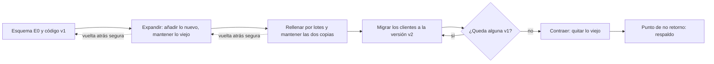
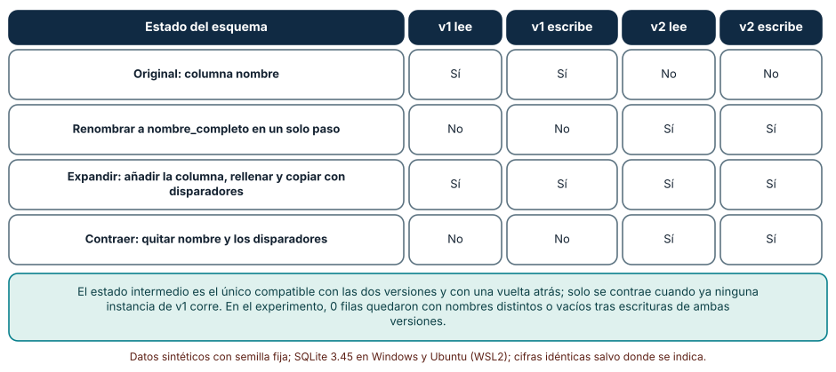
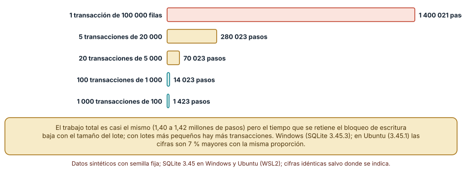
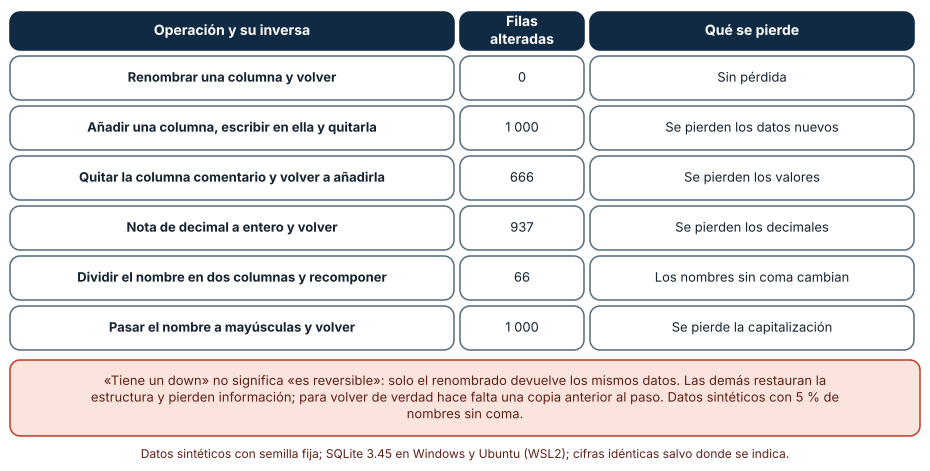

# SE-318 — Migraciones compatibles y evolución de esquema

[← SE-317 — Consultas, índices y patrones de acceso](../../classes/part-26-datos-persistencia-y-recuperacion/se-317-consultas-indices-y-patrones-de-acceso/README.md) · [↑ Parte 26](../../classes/part-26-datos-persistencia-y-recuperacion/README.md) · [📚 Índice completo](../../classes/README.md) · [🌐 Portal](../../site/classes/SE-318.html) · [SE-319 — Replicación, partición y distribución →](../../classes/part-26-datos-persistencia-y-recuperacion/se-319-replicacion-particion-y-distribucion/README.md)

## Punto profesional y fundamento pedagógico

**Punto profesional.** La clase existe para que cambies un esquema con datos y con clientes de varias versiones en funcionamiento, sin detener a nadie y con una vuelta atrás que de verdad devuelva lo que había, y para que distingas una migración que «tiene un down» de una que es reversible.

**Por qué aparece aquí.** Sigue a **Consultas, índices y patrones de acceso**: los índices y las columnas que se justificaron hace una clase cambiarán cuando cambien las preguntas. Un esquema vivo se modifica con la aplicación en marcha, y esa es la parte más frágil de la capa de datos.

**Error conceptual que debe corregir.** Creer que una migración es un script que se ejecuta una vez: es una transición entre dos estados con un periodo en el que conviven dos versiones del código, y los fallos más graves ocurren en ese periodo, no en el script.

**Secuencia de aprendizaje.** Antes de leer los resultados, predices qué versión de la aplicación deja de funcionar si renombras una columna en un solo paso y cuántos valores se pierden al aplicar una migración y su inversa; después mides el tamaño del bloqueo al rellenar una columna por lotes de distinto tamaño. La secuencia usa predicción, explicación propia, contraste y recuperación. [ICAP](https://icap.education.asu.edu/research) distingue participación de construcción de conocimiento; [How People Learn II](https://nap.nationalacademies.org/catalog/24783/how-people-learn-ii-learners-contexts-and-cultures) exige conectar conocimiento previo, contexto y transferencia; la [práctica de recuperación](https://pubmed.ncbi.nlm.nih.gov/16507066/) respalda producir de nuevo la explicación tras una demora; y [Education for Life and Work](https://nap.nationalacademies.org/resource/13398/dbasse_084153.pdf) exige devolución que explique la causa del error.

**Evidencia de aprendizaje.** `migracion-log.md` con la predicción, la matriz de compatibilidad entre versiones y estados, la tabla de lotes, la tabla de reversibilidad y el plan expandir-migrar-contraer de un cambio de la plataforma con su punto de no retorno.

**Límite de la conclusión.** Los experimentos usan SQLite (admite DDL transaccional y tiene una sola conexión escritora); el bloqueo se mide como pasos de la máquina virtual en una transacción y no como espera de otras conexiones. Las cifras de pasos difieren entre SQLite 3.45.3 (Windows) y 3.45.1 (Ubuntu) en torno a un 7 %, con la misma proporción; los datos son sintéticos.

### Trazabilidad fuente → afirmación

| Fuente primaria u oficial | Afirmación que respalda | Lo que no prueba |
|---|---|---|
| [Fowler y Sadalage, «Evolutionary Database Design»](https://martinfowler.com/articles/evodb.html) | Propone cambios de esquema pequeños, versionados y automatizados, y el patrón de transición con la estructura vieja y la nueva conviviendo. | No dice cuántos pasos necesita un cambio concreto. |
| [Fowler, «Parallel Change» (expandir y contraer)](https://martinfowler.com/bliki/ParallelChange.html) | Describe el patrón de tres fases: expandir con la interfaz nueva, migrar a los clientes y contraer quitando la vieja. | No fija el tiempo entre fases. |
| [SQLite: ALTER TABLE](https://www.sqlite.org/lang_altertable.html) | Documenta qué cambios admite (añadir, renombrar y quitar columna) y sus limitaciones, y el procedimiento de reconstrucción para el resto. | No describe motores con otras reglas de bloqueo. |
| [PostgreSQL: ALTER TABLE](https://www.postgresql.org/docs/current/sql-altertable.html) | Indica qué operaciones reescriben la tabla y qué bloqueos toman, y que añadir una columna con valor por defecto constante no reescribe. | No mide el tiempo de bloqueo en la plataforma. |
| [PostgreSQL: CREATE INDEX](https://www.postgresql.org/docs/current/sql-createindex.html) | Explica `CONCURRENTLY` y que un índice normal bloquea las escrituras durante su creación. | No cubre otros motores. |

## Antes de empezar

Recupera lo aprendido en `SE-317`: un índice se justifica con una consulta y se retira cuando esa consulta desaparece. La pregunta activa es: **¿qué versión del código puede leer y escribir en cada estado intermedio del esquema, y cuánto tiempo retiene cada paso un bloqueo?**

## Prerrequisitos

- Haber completado `SE-317` o poder explicar por qué un cambio de un índice cuesta escrituras.
- Python 3.11 o posterior con `sqlite3`; SQLite 3.35 o posterior para `DROP COLUMN`.
- Leer `ALTER TABLE`, `UPDATE` y `CREATE TRIGGER` básicos.

## Problema auténtico

El equipo de la plataforma quiere renombrar la columna `nombre` de `estudiante` a `nombre_completo` porque ahora guarda nombres con apellidos. La aplicación se despliega por instancias: durante veinte minutos conviven la versión vieja, que lee `nombre`, y la nueva, que lee `nombre_completo`. Además hay que rellenar una columna derivada en 100 000 entregas sin que el panel de los docentes se congele, y la dirección pide una garantía: «si algo sale mal, volvemos atrás». El equipo quiere saber qué se rompe en el renombrado directo, qué tamaño de lote evita bloqueos largos y qué significa realmente «volver atrás».

## Objetivos observables

Al terminar podrás:

1. descomponer un cambio de esquema en expandir, migrar y contraer y justificar el orden;
2. comprobar con una matriz qué versión de la aplicación funciona en cada estado del esquema;
3. medir el efecto del tamaño de un lote en la duración de la transacción más larga de un relleno;
4. distinguir una migración con un `down` de una reversible, midiendo qué datos se pierden;
5. declarar el punto de no retorno de una migración y el respaldo que lo cubre.

## Mapa conceptual



El mapa muestra que las tres fases se pueden revertir salvo la última: hasta contraer, volver atrás es quitar lo nuevo; después de contraer, volver exige un respaldo.

## Temas y por qué importan

| Tema | Por qué cambia una decisión profesional | Evidencia mínima |
|---|---|---|
| Compatibilidad entre versiones | Durante el despliegue conviven dos versiones del código. | Predicción, traza causal y contraejemplo de **Compatibilidad entre versiones** en `migracion-log.md` |
| Expandir y contraer | Divide un cambio incompatible en pasos compatibles. | Predicción, traza causal y contraejemplo de **Expandir y contraer** en `migracion-log.md` |
| Relleno por lotes | El tamaño del lote decide cuánto tiempo se retiene un bloqueo. | Predicción, traza causal y contraejemplo de **Relleno por lotes** en `migracion-log.md` |
| Reversibilidad | Un `down` no devuelve lo que la migración destruyó. | Predicción, traza causal y contraejemplo de **Reversibilidad** en `migracion-log.md` |
| Punto de no retorno | Hay un paso desde el que solo un respaldo permite volver. | Predicción, traza causal y contraejemplo de **Punto de no retorno** en `migracion-log.md` |

## Conceptos y decisiones

### 1. Compatibilidad entre versiones

Un despliegue no es instantáneo: mientras las instancias se actualizan, hay clientes de las dos versiones usando la misma base. Una migración es **compatible hacia atrás** si el código viejo sigue funcionando con el esquema nuevo, y **hacia delante** si el código nuevo funciona con el esquema viejo. Los cambios de esquema que rompen la compatibilidad (renombrar, quitar, cambiar un tipo, añadir una restricción más estricta) no se pueden hacer en un solo paso con la aplicación viva. La pregunta de diseño no es «qué script ejecuto» sino «qué versión funciona en cada estado».

### 2. Expandir y contraer

El patrón de cambio en paralelo divide un cambio incompatible en tres fases compatibles. **Expandir:** se añade la columna nueva, se rellena y se mantiene sincronizada con la vieja con una escritura doble (por la aplicación o por un disparador); ambas versiones funcionan. **Migrar:** se despliegan las instancias nuevas, que leen y escriben lo nuevo. **Contraer:** cuando ya no corre ninguna versión vieja, se quita la columna vieja y los disparadores. Cada fase se puede desplegar y revertir por separado, y el tiempo entre ellas lo fija la última instancia vieja, no el calendario.

### 3. Relleno por lotes

Rellenar una columna en 100 000 filas con una sola sentencia mantiene una transacción larga: en un motor con bloqueo de escritura, los demás escritores esperan todo ese tiempo; en un motor con versiones, la transacción retiene espacio y retrasa la limpieza. El remedio es dividir en lotes: cada uno es una transacción corta que confirma y libera. El tamaño es un equilibrio: lotes pequeños reducen el bloqueo y aumentan el número de transacciones y la sobrecarga; lotes grandes lo contrario. El relleno debe ser idempotente (cada lote se puede repetir) y reanudable, para sobrevivir a un corte a mitad.

### 4. Reversibilidad

Una migración tiene un `up` y, por convención, un `down`. Pero el `down` restaura la **estructura**, no necesariamente los **datos**: si el `up` quitó una columna, el `down` puede volver a crearla vacía. Hay operaciones totalmente reversibles (renombrar), parcialmente (convertir un decimal a entero pierde la parte decimal) y no reversibles (quitar datos). Declarar cuál es cada una, con una prueba de ida y vuelta sobre datos de ejemplo, es más honesto que escribir un `down` por rutina y presentarlo como una garantía.

### 5. Punto de no retorno

Toda migración que pierde información tiene un paso a partir del cual volver exige un respaldo anterior a él (`SE-321`). Identificarlo y nombrarlo es parte del plan: «el paso 4 (quitar `nombre`) es el punto de no retorno; antes de él se toma un respaldo verificado y se espera una semana sin instancias viejas». Las migraciones que mezclan pasos reversibles e irreversibles en un solo despliegue esconden ese punto y obligan a decidir bajo presión.

### Qué versión funciona con cada estado

Se construye una tabla `est(id, nombre)` con 100 filas. Se prepara en cuatro estados: el original, el renombrado en un solo paso, el estado expandido (columna nueva rellenada y dos disparadores que copian entre `nombre` y `nombre_completo`) y el contraído (se quitan disparadores y la columna vieja). Para cada estado se ejecutan las cuatro operaciones: leer y escribir con la versión 1 (columna `nombre`) y con la versión 2 (columna `nombre_completo`).

```python
c.execute("alter table est add column nombre_completo text"); c.execute("update est set nombre_completo=nombre")
c.execute("create trigger a after insert on est when new.nombre_completo is null begin update est set nombre_completo=new.nombre where id=new.id; end")
c.execute("create trigger b after insert on est when new.nombre is null begin update est set nombre=new.nombre_completo where id=new.id; end")
```

| Estado del esquema | v1 lee | v1 escribe | v2 lee | v2 escribe |
|---|---|---|---|---|
| Original: columna `nombre` | Sí | Sí | No | No |
| Renombrar a `nombre_completo` en un solo paso | No | No | Sí | Sí |
| Expandir: columna nueva, relleno y disparadores | Sí | Sí | Sí | Sí |
| Contraer: quitar `nombre` y los disparadores | No | No | Sí | Sí |

El renombrado directo rompe las dos operaciones de la versión vieja en cuanto se ejecuta, es decir, durante todo el despliegue. El estado expandido es el único en el que conviven las dos versiones; tras escribir con ambas, ninguna fila quedó con los dos nombres distintos o vacíos.



**Cómo leer la figura.** Cada fila es un estado del esquema; cada columna, una operación de una versión. **Dónde deja de valer:** los disparadores resuelven la escritura doble para este caso simple; con restricciones, con valores calculados o con varias columnas, la sincronización se complica, y en muchos equipos la hace la aplicación y no la base. La matriz es una prueba de compatibilidad a ejecutar en cada migración, no una afirmación general.

### El tamaño del lote y la transacción más larga

Se crea una tabla de 100 000 entregas con una columna `nota` y se rellena `nota_milesimas = cast(nota*1000 as int)` en transacciones de 100 000, 20 000, 5 000, 1 000 y 100 filas. Se cuentan los pasos de la máquina virtual de cada transacción (una medida del tiempo que retiene el bloqueo de escritura).

```python
c.execute("begin")
c.execute("update e set nota_milesimas = cast(nota*1000 as int) where id>=? and id<?", (ini, ini + tam))
c.execute("commit")
```

| Lote | Transacciones | Pasos de la más larga | Pasos totales |
|---|---:|---:|---:|
| 100 000 filas | 1 | 1 400 021 | 1 400 021 |
| 20 000 | 5 | 280 023 | 1 400 097 |
| 5 000 | 20 | 70 023 | 1 400 382 |
| 1 000 | 100 | 14 023 | 1 401 902 |
| 100 | 1 000 | 1 423 | 1 419 002 |

El trabajo total apenas cambia (de 1,40 a 1,42 millones de pasos), pero la transacción más larga baja de 1,4 millones a 1 423 pasos: el bloqueo se acorta 984 veces. Con lotes de 100, la sobrecarga ya se nota (un 1,4 % más de trabajo total en 1 000 transacciones). En Ubuntu (SQLite 3.45.1) las cifras absolutas son un 7 % mayores con la misma proporción, por ejemplo 1 500 021 pasos en la transacción única.



**Cómo leer la figura.** Cada barra es el tamaño de la transacción más larga con un lote distinto. **Dónde deja de valer:** los pasos son una proxy del tiempo de bloqueo, no su medida: no incluyen la espera de otras conexiones, el efecto del registro de escritura anticipada ni el disco. No dice «usa lotes de 1 000», sino que el bloqueo es proporcional al lote y que el costo total casi no depende de él; el tamaño se elige con el plazo máximo de bloqueo que acepte la plataforma.

### Subir y bajar una migración

Se parte de una tabla de 1 000 filas con nombre («Apellido, Nombre», con un 5 % de nombres sin coma), comentario (nulo en un tercio) y nota con decimales. Se aplican seis migraciones y su inversa y se cuenta cuántas filas quedan distintas de las originales.

```python
c.execute("alter table e drop column comentario"); c.execute("alter table e add column comentario text")
c.execute("update e set nota=cast(round(nota) as int)")          # up; el down no recupera los decimales
```

| Operación y su inversa | Filas alteradas | Qué se pierde |
|---|---:|---|
| Renombrar una columna y volver | 0 | Sin pérdida |
| Añadir una columna, escribir en ella y quitarla | 1 000 | Los datos nuevos |
| Quitar `comentario` y volver a añadirla | 666 | Los valores |
| Nota de decimal a entero y volver | 937 | Los decimales |
| Dividir el nombre en dos columnas y recomponer | 66 | Los nombres sin coma cambian |
| Pasar el nombre a mayúsculas y volver | 1 000 | La capitalización original |

Solo el renombrado devuelve exactamente lo que había. Las demás «tienen down» y restauran la estructura, pero cambian o destruyen datos. En el caso de la división del nombre, los 66 nombres sin coma (los mononímicos) quedan transformados de un modo que el `down` no revierte: una migración que parecía simétrica no lo es para un caso minoritario pero real.



**Cómo leer la figura.** Cada fila es una migración con su inversa; la segunda columna cuenta cuántas de las 1 000 filas no vuelven a su valor original. **Dónde deja de valer:** el 5 % de nombres sin coma y la distribución de las notas son construcciones del autor; con otros datos las cifras serían otras, y la conclusión permanece. Y un `down` que restaura los datos desde una tabla de copia sí sería reversible, a costa de espacio y de un paso más.

## Definiciones de trabajo

- **migración:** cambio versionado del esquema o de los datos que se aplica en orden y deja registro de que se aplicó.
- **compatibilidad hacia atrás:** propiedad de un esquema con el que el código anterior sigue funcionando.
- **expandir y contraer:** patrón que divide un cambio incompatible en fases compatibles: añadir lo nuevo, migrar a los clientes y quitar lo viejo.
- **relleno por lotes:** actualización de una columna en muchas filas dividida en transacciones cortas e idempotentes.
- **punto de no retorno:** paso desde el cual volver atrás exige un respaldo anterior.

Las definiciones son operativas para la plataforma de entregas. No convierten términos con una historia más amplia en sinónimos y deben contrastarse con la documentación primaria enlazada al final.

## Ejemplo mínimo

El fragmento muestra que renombrar rompe a la versión vieja. Antes de ejecutarlo, predice qué consulta falla.

```python
import sqlite3
c = sqlite3.connect(":memory:")
c.execute("create table est(id integer primary key, nombre text)")
c.execute("alter table est rename column nombre to nombre_completo")
try: c.execute("select nombre from est"); v1_funciona = True
except sqlite3.OperationalError: v1_funciona = False
assert not v1_funciona
```

La versión 1 falla. Registra versión, comando y salida; después reemplaza el renombrado por «añadir columna y copiar» y comprueba que la consulta antigua sigue funcionando.

## Ejemplo profesional

El equipo de la plataforma documenta el renombrado como cuatro migraciones numeradas, cada una desplegable por separado. La 0042 añade `nombre_completo` y los disparadores de copia; la 0043 rellena por lotes de 1 000 filas con un script idempotente y reanudable que registra el último identificador procesado; la 0044 se aplica cuando el monitor no muestra instancias de la versión 1 desde hace siete días y despliega el código que solo usa la columna nueva; la 0045 quita la columna vieja y los disparadores, y está marcada como punto de no retorno: exige un respaldo verificado reciente (`SE-321`) y la aprobación de la persona responsable. Cada migración tiene una prueba de compatibilidad que ejecuta las operaciones de las dos versiones y una prueba de ida y vuelta con datos de ejemplo. El registro de migraciones guarda quién, cuándo y qué versión, y el despliegue rechaza continuar si la 0042 no está aplicada.

## Práctica guiada

1. Escribe un cambio de esquema de la plataforma que rompa la compatibilidad si se hace en un paso.
2. Predice qué versión falla en cada estado y escribe la matriz esperada.
3. Implementa las cuatro fases con disparadores de copia y ejecuta las cuatro operaciones en cada estado.
4. Rellena una columna en 100 000 filas con cinco tamaños de lote y registra la transacción más larga.
5. Aplica y revierte seis migraciones sobre datos de ejemplo y cuenta las filas alteradas.
6. Marca el punto de no retorno de tu plan y escribe el respaldo que lo cubre.
7. Entrega `migracion-log.md` y pide a otra persona que identifique qué estado de la matriz dejaría fuera a una instancia vieja.

## Ejercicios

1. **Fases:** descompón en expandir-migrar-contraer el cambio «la nota pasa de decimal a un entero en milésimas» y lista las pruebas de cada fase.
2. **Lote:** si el plazo máximo de bloqueo aceptable equivale a 20 000 pasos, calcula el lote máximo y el número de transacciones para 1 000 000 de filas.
3. **Reanudación:** diseña el relleno para que, si se corta en el lote 37, al reanudar no repita trabajo ni deje filas sin procesar.
4. **Reversibilidad:** propón un `down` que restaure los decimales de la nota usando una columna de respaldo y evalúa su costo.

## Reto verificable

Entrega `migracion-log.md` con la predicción, la matriz de compatibilidad, la tabla de lotes, la tabla de reversibilidad y el plan con el punto de no retorno. Se aprueba si otra persona ejecuta el código, obtiene la misma matriz y las mismas filas alteradas con las mismas semillas y puede decir qué fase de tu plan podría revertirse sin respaldo. No se aprueba por entregar un script único ni por afirmar que el `down` hace la migración reversible.

## Caso conductor

La capa de datos de la plataforma de entregas sigue siendo el caso conductor. Esta clase deja el sexto artefacto: el plan expandir-migrar-contraer del cambio de `nombre`, con su matriz de compatibilidad y su punto de no retorno. `SE-319` pregunta qué ocurre cuando los datos viven en más de una máquina. Cambia después una sola decisión, el tamaño del lote, y observa qué cambia en el tiempo de bloqueo y en el número de transacciones.

## Preguntas frecuentes

### ¿Hay que usar siempre expandir y contraer?

Cuando hay clientes de dos versiones a la vez o cuando no se puede detener la aplicación, sí. Si se puede parar el servicio un rato y no hay otros clientes, un cambio directo puede ser aceptable; lo que no es aceptable es no haberlo decidido.

### ¿Qué hago si un down pierde datos?

Dilo en la migración, no lo escondas: marca el paso como irreversible, toma un respaldo verificado antes de aplicarlo y define quién decide ejecutarlo. Un `down` que no devuelve los datos no es una garantía.

### ¿Los disparadores son la única forma de mantener dos columnas sincronizadas?

No: puede hacerlo la aplicación (escritura doble) o un proceso aparte. Los disparadores garantizan la copia para todos los clientes, incluidos scripts, a costa de lógica dentro de la base que hay que versionar y probar.

### ¿Cómo sé que ya no queda ninguna instancia vieja?

Midiéndolo: la versión del cliente en los registros o en una columna de auditoría, y un periodo de espera sin ninguna instancia vieja. Contraer por «ya pasó una semana» sin medir es la causa de muchos incidentes.

## Fallo controlado y diagnóstico

Reproduce el fallo clásico de la clase: **renombrar una columna en un solo paso con instancias viejas en marcha**. Ejecuta el renombrado y lanza la consulta de la versión 1.

Registra síntoma, entrada mínima, hipótesis, observación que descarta cada hipótesis, causa, corrección y prueba de regresión. **Síntoma:** tras el despliegue, algunas instancias devuelven errores 500 al leer estudiantes. **Hipótesis rivales:** (a) un error de red con la base; (b) un permiso que cambió; (c) las instancias viejas consultan una columna que ya no existe. **Prueba:** mira el mensaje de error de las instancias que fallan (columna inexistente) y la versión de cada una; si fallan solo las viejas, la causa es la incompatibilidad. **Conclusión:** el renombrado directo rompió a la versión vieja durante el despliegue. **Regresión:** reemplaza el cambio por expandir-migrar-contraer, añade la matriz de compatibilidad como prueba de cada migración y un criterio de contracción basado en la ausencia medida de instancias viejas. No cambies a la vez el esquema y el despliegue.

## Errores comunes y cómo corregirlos

| Síntoma | Causa probable | Corrección |
|---|---|---|
| Errores en las instancias viejas durante un despliegue | Cambio incompatible hecho en un solo paso | Expandir, migrar y contraer en despliegues separados |
| El panel se congela al ejecutar una migración | Actualización de muchas filas en una transacción | Relleno por lotes idempotente y reanudable |
| El `down` no devuelve los datos originales | Se restauró la estructura y no los datos | Respaldo previo y declaración de irreversibilidad |
| Dos columnas empiezan a diferir | Escritura doble sin comprobación | Disparador o comprobación periódica de igualdad |
| Se contrae demasiado pronto | No se midió la ausencia de la versión vieja | Criterio medible y plazo de espera |

## Entorno y archivos clave

```text
work/SE-318/
├── README.md
├── migraciones/
│   ├── 0042_expandir_nombre.sql
│   ├── 0043_rellenar_por_lotes.py
│   ├── 0044_migrar_clientes.md
│   └── 0045_contraer_nombre.sql
├── tests/test_compatibilidad.py
└── evidence/migracion-log.md
```

El `README` declara plataforma, versiones de Python y de SQLite, semillas y comandos. Los experimentos usan solo la biblioteca estándar (`sqlite3`, `random`) y se ejecutaron con CPython 3.12.9 en Windows 11 (SQLite 3.45.3) y 3.12.3 en Ubuntu bajo WSL2 (SQLite 3.45.1): la matriz y las filas alteradas fueron idénticas; los pasos de la máquina virtual de los lotes difirieron un 7 % entre versiones de SQLite con la misma proporción. Si añades una dependencia, fija procedencia y versión.

## Seguridad, ética y accesibilidad

- una migración puede exponer o perder datos personales: revisa qué columnas toca y quién tiene acceso a las tablas de respaldo temporales;
- una migración mal hecha puede dejar a estudiantes sin acceso a sus entregas: anuncia ventanas y define un canal de comunicación accesible;
- no ejecutes migraciones destructivas fuera de una ventana con respaldo verificado y una persona responsable;
- registra quién aplicó cada migración y cuándo: es evidencia en un incidente;
- evita copiar datos reales a un entorno de ensayo: usa datos sintéticos que conserven la forma.

## Puente hacia el trabajo con agentes

Un agente al que se le pide «renombra la columna nombre a nombre_completo» producirá un `ALTER TABLE ... RENAME COLUMN` y un `down` simétrico, y los presentará como una migración segura. Pídele en cambio el plan en fases, la matriz de compatibilidad entre versiones, el relleno por lotes idempotente y la declaración del punto de no retorno con su respaldo. Revisa especialmente si el cambio rompe a la versión vieja y si el `down` devuelve los datos: son los dos defectos que esta clase mostró sin aviso.

## Transferencia

Traslada el análisis a otro cambio (por ejemplo, partir una columna `direccion` en varias): descompónlo en fases compatibles, construye la matriz de versiones contra estados, mide un relleno por lotes y marca el punto de no retorno. La transferencia está lograda cuando puedes explicar por qué cada fase es compatible y qué la revertiría, no cuando los scripts se parecen.

## Evaluación y evidencia

| Criterio | Evidencia para aprobar |
|---|---|
| comprensión | explicación de por qué un cambio incompatible exige fases |
| corrección | matriz de compatibilidad, lotes y reversibilidad reproducibles con las mismas semillas |
| diseño | plan expandir-migrar-contraer con punto de no retorno y respaldo |
| diagnóstico | reproducción del fallo «renombrar en un paso» con regresión |
| incertidumbre | declaración de que los pasos no son tiempo de bloqueo y de que el motor es SQLite |
| reproducibilidad | versiones, comandos, salida y límites declarados |

## Fuentes

- [Fowler y Sadalage, «Evolutionary Database Design»](https://martinfowler.com/articles/evodb.html) — diseño evolutivo del esquema; autoridad: autores del artículo.
- [Fowler, «Parallel Change»](https://martinfowler.com/bliki/ParallelChange.html) — expandir, migrar y contraer; autoridad: autor del texto.
- [SQLite: ALTER TABLE](https://www.sqlite.org/lang_altertable.html) — cambios admitidos y reconstrucción; autoridad: documentación oficial de SQLite.
- [PostgreSQL: ALTER TABLE](https://www.postgresql.org/docs/current/sql-altertable.html) — bloqueos y reescrituras; autoridad: documentación oficial de PostgreSQL.
- [PostgreSQL: CREATE INDEX](https://www.postgresql.org/docs/current/sql-createindex.html) — creación concurrente de índices; autoridad: documentación oficial de PostgreSQL.

Cada fuente respalda el mecanismo indicado; ninguna demuestra que el factor 984 del bloqueo, las 937 filas alteradas o la matriz de compatibilidad se observen en la plataforma real. Esa afirmación depende del motor, de sus bloqueos y de las versiones del código que convivan.

## Límites y siguiente paso

Se ejecutaron tres experimentos con datos sintéticos en Windows y Ubuntu (WSL2); la matriz y las filas alteradas fueron idénticas y los pasos de los lotes difirieron un 7 % entre SQLite 3.45.3 y 3.45.1 con la misma proporción. Se usó SQLite, que admite DDL transaccional y un solo escritor, y se midieron pasos y no tiempo de bloqueo; no se probó PostgreSQL ni otro motor con sus reglas de reescritura, y el 5 % de nombres sin coma es una construcción del autor. La siguiente clase pregunta qué ocurre cuando los datos viven en más de una máquina.

## Glosario

- **migración:** cambio versionado del esquema o de los datos que se aplica en orden y deja registro de que se aplicó.
- **compatibilidad hacia atrás:** propiedad de un esquema con el que el código anterior sigue funcionando.
- **expandir y contraer:** patrón que divide un cambio incompatible en fases compatibles: añadir lo nuevo, migrar a los clientes y quitar lo viejo.
- **relleno por lotes:** actualización de una columna en muchas filas dividida en transacciones cortas e idempotentes.
- **punto de no retorno:** paso desde el cual volver atrás exige un respaldo anterior.

---

[← SE-317 — Consultas, índices y patrones de acceso](../../classes/part-26-datos-persistencia-y-recuperacion/se-317-consultas-indices-y-patrones-de-acceso/README.md) · [↑ Parte 26](../../classes/part-26-datos-persistencia-y-recuperacion/README.md) · [📚 Índice completo](../../classes/README.md) · [🌐 Portal](../../site/classes/SE-318.html) · [SE-319 — Replicación, partición y distribución →](../../classes/part-26-datos-persistencia-y-recuperacion/se-319-replicacion-particion-y-distribucion/README.md)
