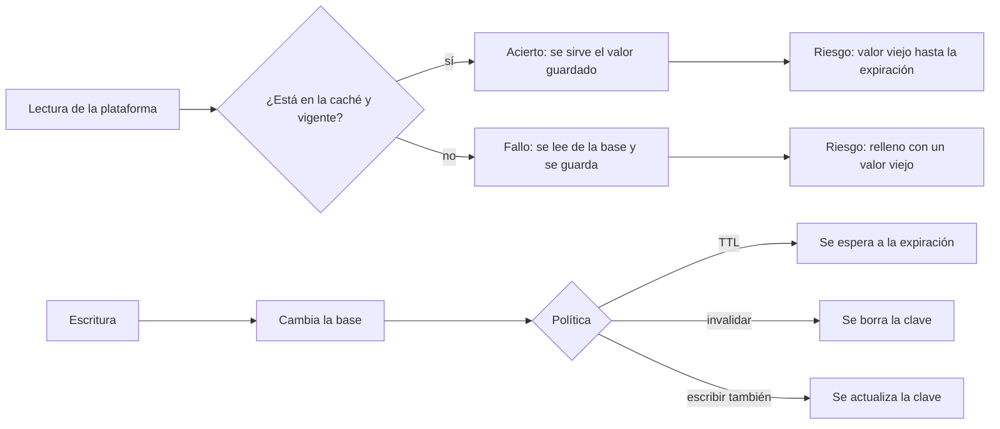
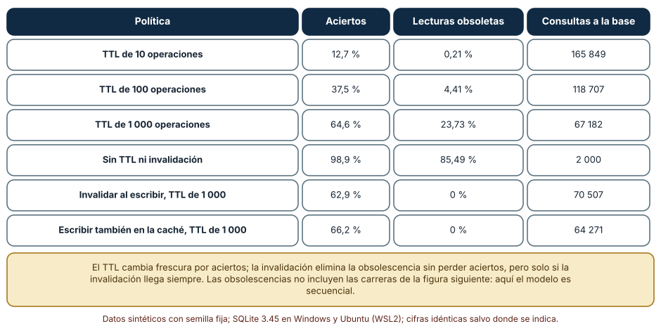
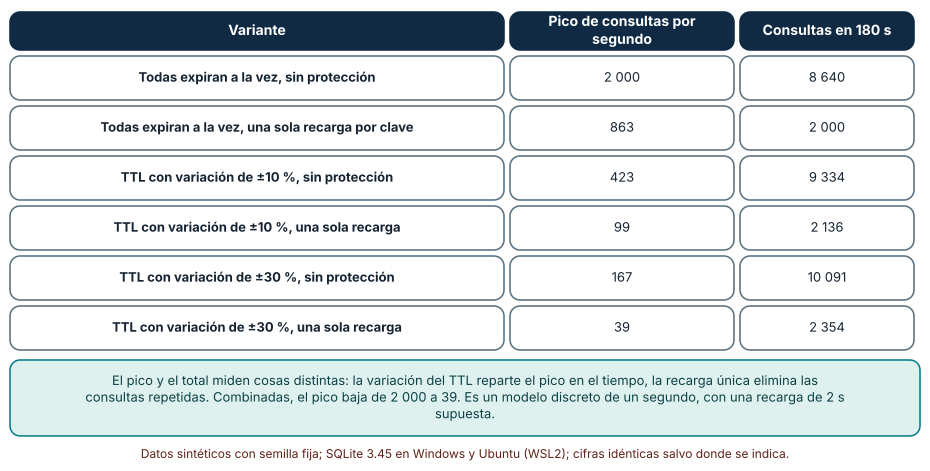
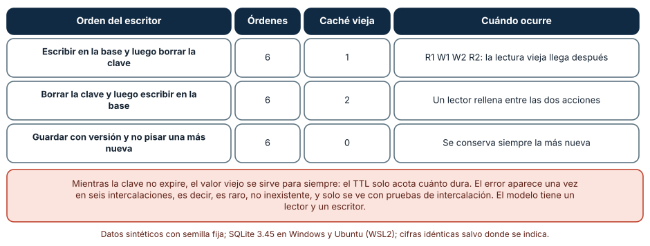

# SE-320 — Cachés y consistencia entre capas

[← SE-319 — Replicación, partición y distribución](../../classes/part-26-datos-persistencia-y-recuperacion/se-319-replicacion-particion-y-distribucion/README.md) · [↑ Parte 26](../../classes/part-26-datos-persistencia-y-recuperacion/README.md) · [📚 Índice completo](../../classes/README.md) · [🌐 Portal](../../site/classes/SE-320.html) · [SE-321 — Backups, restauración y pruebas de recuperación →](../../classes/part-26-datos-persistencia-y-recuperacion/se-321-backups-restauracion-y-pruebas-de-recuperacion/README.md)

## Punto profesional y fundamento pedagógico

**Punto profesional.** La clase existe para que decidas qué se guarda en una caché, cuánto tiempo y quién la invalida, midiendo cuántas lecturas viejas permite cada política, y para que reconozcas los dos fallos típicos de una caché que funciona: la estampida tras una expiración y la carrera entre una lectura y una escritura.

**Por qué aparece aquí.** Sigue a **Replicación, partición y distribución**: una caché es otra copia del dato, más cercana y menos fiable que una réplica, porque suele no tener registro de cambios ni orden. Las copias que ya existían entre máquinas se multiplican entre capas (navegador, borde, aplicación, base).

**Error conceptual que debe corregir.** Creer que una caché «solo mejora la velocidad»: introduce una segunda fuente de verdad, y la pregunta que importa no es cuánto acelera sino qué ve una persona cuando la caché y la base discrepan y cuánto dura esa discrepancia.

**Secuencia de aprendizaje.** Antes de leer los resultados, predices qué fracción de lecturas devuelve un valor viejo si solo el TTL protege la frescura, cuántas consultas llegan a la base al mismo tiempo cuando mil claves expiran a la vez y en cuántos de los seis órdenes de un lector y un escritor queda la caché con el valor viejo. La secuencia usa predicción, explicación propia, contraste y recuperación. [ICAP](https://icap.education.asu.edu/research) distingue participación de construcción de conocimiento; [How People Learn II](https://nap.nationalacademies.org/catalog/24783/how-people-learn-ii-learners-contexts-and-cultures) exige conectar conocimiento previo, contexto y transferencia; la [práctica de recuperación](https://pubmed.ncbi.nlm.nih.gov/16507066/) respalda producir de nuevo la explicación tras una demora; y [Education for Life and Work](https://nap.nationalacademies.org/resource/13398/dbasse_084153.pdf) exige devolución que explique la causa del error.

**Evidencia de aprendizaje.** `cache-log.md` con la predicción, la tabla de políticas, la tabla de picos, la enumeración de órdenes del lector y el escritor, y la política elegida para cada dato de la plataforma con su frescura máxima aceptable.

**Límite de la conclusión.** Todo es una simulación con semilla fija y un reloj discreto: la popularidad Zipf, el 5 % de escrituras, la recarga de 2 s y el TTL son supuestos del autor. No se usó ninguna caché real (ni un almacén en memoria, ni una red de entrega de contenido, ni un navegador) y no se midió latencia.

### Trazabilidad fuente → afirmación

| Fuente primaria u oficial | Afirmación que respalda | Lo que no prueba |
|---|---|---|
| [Microsoft Azure Architecture Center: patrón Cache-Aside](https://learn.microsoft.com/en-us/azure/architecture/patterns/cache-aside) | Describe el patrón (leer de la caché, si falla ir a la base y guardar) y los riesgos de datos obsoletos y de invalidación. | No mide la tasa de aciertos de una aplicación concreta. |
| [AWS Builders' Library: caching challenges and strategies](https://aws.amazon.com/builders-library/caching-challenges-and-strategies/) | Analiza la consistencia, la estampida, la carga adicional que una caché fría produce y la necesidad de probarla. | No es una prueba de que las cifras de la clase se repitan. |
| [MDN: Cache-Control](https://developer.mozilla.org/en-US/docs/Web/HTTP/Reference/Headers/Cache-Control) | Documenta las directivas `max-age`, `no-store` y `stale-while-revalidate` de la caché HTTP. | No cubre la caché de aplicación. |
| [Python: functools.lru_cache](https://docs.python.org/3/library/functools.html#functools.lru_cache) | Documenta una caché en memoria con política LRU y sus límites, y que no invalida por cambios en los datos. | No describe una caché distribuida. |

## Antes de empezar

Recupera lo aprendido en `SE-319`: leer de una réplica justo después de escribir devolvía un valor viejo en una de cada cuatro lecturas. La pregunta activa es: **¿qué lectura de la plataforma tolera un valor viejo, cuánto tiempo, y quién se entera cuando la caché y la base discrepan?**

## Prerrequisitos

- Haber completado `SE-319` o poder explicar qué es el retardo de replicación y la lectura de la propia escritura.
- Python 3.11 o posterior con `random`, `itertools` y `collections`.
- Leer un diccionario con tiempos de expiración.

## Problema auténtico

Para aliviar la base, la plataforma guarda en una caché el resumen de cada estudiante (entregas pendientes, última nota) con un TTL de 1 000 operaciones. Tres cosas ocurren en la misma semana: un docente corrige una nota y durante casi un cuarto de las lecturas el estudiante sigue viendo la anterior; un lunes a las 9:00, la base se satura porque mil claves, creadas a la vez durante un despliegue, expiran juntas; y a veces, sin ningún error, un estudiante ve un valor viejo durante horas aunque el TTL es de minutos. Son tres fallos distintos de la misma caché, y ninguno aparece en una prueba de un solo cliente.

## Objetivos observables

Al terminar podrás:

1. describir las políticas de TTL, invalidación al escribir y escritura directa en la caché con lo que garantiza cada una;
2. medir aciertos, lecturas obsoletas y consultas a la base de cada política con una carga reproducible;
3. calcular el pico de consultas tras una expiración simultánea y comparar la variación del TTL con una sola recarga por clave;
4. enumerar las intercalaciones de una lectura con relleno y una escritura con invalidación, y encontrar la que deja la caché vieja;
5. decidir para cada dato de la plataforma la política, la frescura máxima aceptada y quién la invalida.

## Mapa conceptual



El mapa muestra que la caché tiene dos caminos de entrada (lectura que rellena y escritura que invalida o actualiza) y que sus defectos están en el cruce entre ambos.

## Temas y por qué importan

| Tema | Por qué cambia una decisión profesional | Evidencia mínima |
|---|---|---|
| Políticas de caché | Cada política cambia frescura por aciertos y por consultas a la base. | Predicción, traza causal y contraejemplo de **Políticas de caché** en `cache-log.md` |
| TTL y frescura | El TTL acota cuánto dura un valor viejo, no lo evita. | Predicción, traza causal y contraejemplo de **TTL y frescura** en `cache-log.md` |
| Invalidación | Borrar la clave elimina el valor viejo solo si la orden llega siempre. | Predicción, traza causal y contraejemplo de **Invalidación** en `cache-log.md` |
| Estampida | Muchas expiraciones o fallos simultáneos recaen en la base. | Predicción, traza causal y contraejemplo de **Estampida** en `cache-log.md` |
| Carreras de relleno | Una lectura lenta puede guardar un valor que una escritura acaba de dejar viejo. | Predicción, traza causal y contraejemplo de **Carreras de relleno** en `cache-log.md` |

## Conceptos y decisiones

### 1. Políticas de caché

En **cache-aside**, la aplicación lee de la caché y, si falla, lee de la base y guarda el resultado. Es la política más común porque la caché es opcional y su caída no rompe el servicio. La escritura puede **no tocar la caché** (se espera a que el TTL venza), **invalidarla** (borrar la clave para que la siguiente lectura la rellene) o **escribirla** también (escritura directa). Cada una cambia lo que una lectura ve justo después de escribir y lo que cuesta, y ninguna es gratis: invalidar exige que la orden llegue siempre, escribir también exige que ambas escrituras sean coherentes.

### 2. TTL y frescura

El **TTL** (tiempo de vida) acota cuánto tiempo puede vivir un valor sin comprobarse. Es la defensa mínima porque no depende de que nadie avise del cambio: cualquier valor se renueva solo. Pero el compromiso es inmediato: un TTL corto da frescura y pocos aciertos, uno largo da aciertos y valores viejos. Un TTL no es una garantía de frescura sino una cota de obsolescencia, y debe ser coherente con la tolerancia del dato: un saldo de cupos tolera segundos, un catálogo de cursos tolera horas.

### 3. Invalidación

Invalidar al escribir mantiene la caché fresca sin renunciar a los aciertos, y por eso se prefiere donde el costo de un valor viejo es alto. Es difícil por tres razones: la escritura puede cambiar datos que alimentan muchas claves (un cambio en un curso afecta a las listas de todos sus estudiantes), la orden de invalidación puede perderse o llegar tarde en un sistema distribuido, y la propia invalidación compite con las lecturas que rellenan. Por eso se combina con un TTL de respaldo: la invalidación da frescura en el caso normal y el TTL acota el daño cuando falla.

### 4. Estampida

Cuando una clave popular expira, muchas peticiones simultáneas encuentran la caché vacía y todas van a la base a calcular lo mismo. Si mil claves se crearon al mismo tiempo (un despliegue, un arranque en frío), expiran juntas y el pico es mil veces peor. Hay tres remedios que se combinan: **variar el TTL** con un componente aleatorio para repartir las expiraciones, **recarga única** (solo una petición recalcula y las demás esperan o sirven el valor viejo), y **precalentar** o renovar antes de que expire. Una caché fría tras un reinicio es el mismo problema a escala de todo el sistema.

### 5. Carreras de relleno

Un lector que lee un valor de la base y tarda en guardarlo puede escribir un valor viejo en la caché después de que un escritor haya cambiado la base y borrado la clave. El resultado es una caché vieja que ninguna invalidación corrige, hasta que expire. Es raro y silencioso, y solo se ve enumerando intercalaciones. Los remedios son guardar con una **versión** y no sobrescribir una más nueva, hacer que la escritura invalide también después de un breve retraso, o aceptar la ventana y acotarla con un TTL corto en los datos críticos.

### Cuatro políticas bajo la misma carga

Se simulan 200 000 operaciones sobre 2 000 claves con popularidad Zipf (exponente 1,0), de las cuales el 5 % son escrituras. Una lectura devuelve un valor viejo si la caché guarda una versión anterior a la de la base. Se comparan políticas con la misma secuencia de operaciones.

```python
if wr[t]:
    db[k] += 1
    if politica == "invalidar": cache.pop(k, None)
    elif politica == "write-through": cache[k] = (db[k], t)
```

| Política | Aciertos | Lecturas obsoletas | Consultas a la base |
|---|---:|---:|---:|
| TTL de 10 operaciones | 12,7 % | 0,21 % | 165 849 |
| TTL de 100 operaciones | 37,5 % | 4,41 % | 118 707 |
| TTL de 1 000 operaciones | 64,6 % | 23,73 % | 67 182 |
| Sin TTL ni invalidación | 98,9 % | 85,49 % | 2 000 |
| Invalidar al escribir, TTL de 1 000 | 62,9 % | 0 % | 70 507 |
| Escribir también en la caché, TTL de 1 000 | 66,2 % | 0 % | 64 271 |

Subir el TTL de 10 a 1 000 multiplica los aciertos por cinco y multiplica por más de cien las lecturas viejas. Invalidar o escribir en la caché da la misma frescura que no tener caché (0 %) con aciertos de 63 a 66 %. Sin ninguna defensa, el 85 % de las lecturas es viejo, un resultado inaceptable en cualquier dato que cambie.



**Cómo leer la figura.** Cada fila es una política; las columnas cuentan aciertos, lecturas obsoletas y consultas a la base. **Dónde deja de valer:** el modelo es secuencial, sin las carreras de la tercera figura, de modo que invalidar parece perfecto; la popularidad y el 5 % de escrituras son supuestos. El TTL se mide en operaciones, no en segundos: el tiempo real depende de la tasa de peticiones. La figura no dice qué política usar, sino que cada una compra frescura con aciertos o con una promesa sobre la invalidación.

### Mil claves que expiran juntas

Mil claves se crearon al mismo tiempo con TTL de 60 s. Llegan 2 000 lecturas por segundo repartidas entre las claves y la recarga de cada una tarda 2 s. Se cuenta el pico de consultas por segundo a la base durante 180 s, sin protección y con una sola recarga por clave, con y sin variación aleatoria del TTL.

```python
cu = [ttl * (1 + r.uniform(-jit, jit)) for _ in range(keys)]     # vencimientos repartidos
if ready[k] is None: ready[k] = s + 2; carga[s] += 1             # solo una petición recalcula
```

| Variante | Pico por segundo | Consultas en 180 s |
|---|---:|---:|
| Todas expiran a la vez, sin protección | 2 000 | 8 640 |
| Todas expiran a la vez, una recarga por clave | 863 | 2 000 |
| TTL ±10 %, sin protección | 423 | 9 334 |
| TTL ±10 %, una recarga por clave | 99 | 2 136 |
| TTL ±30 %, sin protección | 167 | 10 091 |
| TTL ±30 %, una recarga por clave | 39 | 2 354 |

La variación del TTL reparte las expiraciones (el pico baja de 2 000 a 423 con ±10 % y a 167 con ±30 %) pero no reduce el número de consultas, que sube ligeramente. La recarga única elimina las repetidas (de 8 640 a 2 000 consultas en total) pero con expiraciones simultáneas deja un pico de 863. Combinadas, el pico baja a 39: 50 veces menos que el peor caso.



**Cómo leer la figura.** Cada fila es una combinación de protecciones; la columna central es el pico de consultas por segundo. **Dónde deja de valer:** el modelo asigna una recarga de 2 s fija y lecturas uniformes sobre las claves; con claves con popularidades muy distintas, el pico se concentra en las populares. Esta figura no mide tiempo de espera de los clientes que esperan a la recarga única, que es parte del costo real.

### La lectura lenta y la escritura rápida

Un lector lee la base (R1) y guarda en la caché (R2). Un escritor cambia la base (W1) y borra la clave (W2). Hay seis órdenes posibles que conservan el orden de cada uno. Se enumeran y se cuenta en cuántos la caché termina con el valor viejo, con tres variantes: borrar tras escribir en la base, borrar antes de escribir y guardar con versión sin sobrescribir una más nueva.

```python
if variante == "version":
    if cache["v"] is None or leido > cache["v"]: cache["v"] = leido      # R2 no pisa una versión mayor
```

| Orden del escritor | Órdenes | Caché vieja | Cuándo ocurre |
|---|---:|---:|---|
| Escribir en la base y luego borrar la clave | 6 | 1 | R1 W1 W2 R2: la lectura vieja llega después de borrar |
| Borrar la clave y luego escribir en la base | 6 | 2 | Un lector rellena entre las dos acciones |
| Guardar con versión y no pisar una más nueva | 6 | 0 | Siempre se conserva la más nueva |

En uno de seis órdenes, el lector lee antes del cambio y guarda después del borrado: la caché queda vieja y ninguna invalidación posterior la corrige. Borrar antes de escribir empeora (dos de seis), porque deja una ventana en la que cualquier lectura rellena con el valor viejo. La versión elimina el caso porque el relleno viejo pierde frente al nuevo.



**Cómo leer la figura.** Cada fila es una política de escritura; las columnas cuentan órdenes totales y órdenes que dejan la caché vieja. **Dónde deja de valer:** el modelo tiene un lector y un escritor sobre una clave y escribe el valor 2; con varios lectores y escritores hay más órdenes malas. Que sea uno de seis no es la probabilidad en producción, sino la prueba de que existe. Mientras la clave no expire, el valor viejo se sirve: el TTL de respaldo acota cuánto.

## Definiciones de trabajo

- **cache-aside:** patrón en el que la aplicación consulta la caché y, si falla, lee de la base y guarda el resultado.
- **TTL:** tiempo máximo que un valor puede servirse desde la caché sin comprobarse.
- **invalidación:** eliminación o actualización de una entrada de la caché cuando cambia el dato de origen.
- **estampida:** pico de consultas a la base cuando muchas entradas faltan o expiran a la vez.
- **recarga única (single-flight):** técnica en la que solo una petición recalcula un valor y las demás esperan su resultado.

Las definiciones son operativas para la plataforma de entregas. No convierten términos con una historia más amplia en sinónimos y deben contrastarse con la documentación primaria enlazada al final.

## Ejemplo mínimo

El fragmento muestra la carrera de relleno con las cuatro acciones en el orden malo. Antes de ejecutarlo, predice qué valor queda en la caché.

```python
db, cache = {"v": 1}, {}
leido = db["v"]            # R1: el lector lee 1
db["v"] = 2                # W1: el escritor cambia la base
cache.pop("v", None)       # W2: el escritor borra la clave
cache["v"] = leido         # R2: el lector guarda lo que leyó
assert cache["v"] == 1 and db["v"] == 2
```

La caché guarda 1 y la base tiene 2. Registra versión, comando y salida; después guarda `(versión, valor)` y no sobrescribas una versión mayor, y comprueba que el resultado es 2.

## Ejemplo profesional

El equipo de la plataforma asigna una política por dato. El resumen del estudiante usa cache-aside con invalidación al escribir, TTL de respaldo de 60 s con variación de ±20 % y recarga única; cada entrada guarda la versión de la fila de origen para que un relleno tardío no pise una versión nueva. El catálogo de cursos, que cambia unas pocas veces al día, usa un TTL de 6 horas sin invalidación, con una acción administrativa que lo vacía. El saldo de cupos no se cachea: el costo de un valor viejo es una reserva de más. Al desplegar, un script precalienta las 1 000 claves más pedidas escalonadamente para evitar una estampida fría. Las pruebas enumeran las intercalaciones de lectura y escritura de cada clave cacheada, miden el porcentaje de lecturas obsoletas con una carga sintética y comprueban que el pico tras un reinicio queda por debajo de la capacidad de la base.

## Práctica guiada

1. Lista cinco datos de la plataforma que se cachean o se cachearán y su tolerancia a un valor viejo.
2. Predice la fracción de lecturas obsoletas con TTL de 100 y de 1 000 operaciones y escribe el número.
3. Simula 200 000 operaciones con las seis políticas de la tabla y reproduce aciertos, obsoletas y consultas.
4. Simula la expiración de 1 000 claves con y sin variación del TTL y con y sin recarga única.
5. Enumera los seis órdenes del lector y el escritor con las tres variantes de escritura.
6. Añade una versión a las entradas de la caché y comprueba que el caso malo desaparece.
7. Entrega `cache-log.md` y pide a otra persona que diga qué dato no debería cachearse.

## Ejercicios

1. **TTL:** si la tolerancia de un dato es de 30 s y llegan 100 lecturas por segundo, calcula cuántas consultas a la base por minuto produce un TTL de 30 s para una sola clave.
2. **Variación:** calcula cuántos segundos de variación hacen falta para que mil claves con TTL de 60 s no expiren todas en el mismo segundo.
3. **Versión:** diseña el formato de la entrada para que un relleno con una versión menor no sobrescriba una mayor, y escribe la prueba.
4. **Capas:** una nota viaja por el navegador, la red de entrega y la caché de aplicación; calcula la obsolescencia máxima si cada una tiene su TTL.

## Reto verificable

Entrega `cache-log.md` con la predicción, las tres tablas, la política por dato y la frescura máxima aceptada. Se aprueba si otra persona ejecuta el código, obtiene los mismos números con las mismas semillas y puede decir qué política cambiaría si el dato pasara a ser crítico. No se aprueba por afirmar que la caché «mejora el rendimiento» sin medir las lecturas obsoletas ni por usar un TTL sin una tolerancia declarada.

## Caso conductor

La capa de datos de la plataforma de entregas sigue siendo el caso conductor. Esta clase deja el octavo artefacto: la política de caché por dato con su frescura máxima y su protección contra la estampida. `SE-321` pregunta qué ocurre cuando todo esto falla y hay que recuperar los datos. Cambia después una sola decisión, la variación del TTL, y observa qué cambia en el pico de consultas.

## Preguntas frecuentes

### ¿Siempre hay que invalidar al escribir?

No: si el dato tolera un valor viejo unos minutos, un TTL basta y evita el acoplamiento entre quien escribe y la caché. Se invalida cuando el costo de un valor viejo es mayor que el de mantener la invalidación.

### ¿Qué diferencia hay entre una caché y una réplica?

Una réplica recibe todos los cambios en orden y se puede promover; una caché guarda lo que se le pidió, sin orden y sin garantías. Tratar una caché como una copia fiable es el origen de muchas pérdidas.

### ¿Cómo sé qué TTL usar?

Se parte de la tolerancia del dato (cuánto puede estar viejo sin dañar a nadie) y se comprueba con una medida de la tasa de aciertos y de las consultas a la base. No hay un valor general.

### ¿Una caché fría es un fallo?

Es un estado normal tras un despliegue o una caída y puede ser grave si toda la carga recae en la base. Por eso se diseña la capacidad de la base para soportarla o se precalienta de forma escalonada.

## Fallo controlado y diagnóstico

Reproduce el fallo clásico de la clase: **un valor viejo que persiste tras una invalidación**. Ejecuta el orden «el lector lee, el escritor escribe y borra, el lector guarda».

Registra síntoma, entrada mínima, hipótesis, observación que descarta cada hipótesis, causa, corrección y prueba de regresión. **Síntoma:** un estudiante ve la nota vieja durante horas aunque el docente la corrigió y la invalidación se ejecutó. **Hipótesis rivales:** (a) la invalidación no se ejecutó; (b) el navegador guardó la respuesta; (c) un relleno tardío escribió el valor viejo después de la invalidación. **Prueba:** compara la versión de la fila de origen con la de la entrada de la caché y revisa el orden de los eventos en el registro; si la invalidación ocurrió y la entrada es posterior pero con versión anterior, la causa es el relleno tardío. **Conclusión:** la carrera entre lectura y escritura dejó la caché con un valor viejo. **Regresión:** guarda la versión con cada entrada y no sobrescribas una mayor, añade una prueba que enumere los órdenes y un TTL de respaldo. No cambies a la vez la invalidación y el TTL.

## Errores comunes y cómo corregirlos

| Síntoma | Causa probable | Corrección |
|---|---|---|
| Un valor sigue viejo tras una invalidación | Relleno tardío de un lector lento | Guardar con versión y no pisar una mayor |
| La base se satura tras un despliegue | Caché fría y expiraciones simultáneas | Variar el TTL, precalentar escalonadamente y recarga única |
| La tasa de aciertos es alta y los usuarios se quejan | TTL largo sin invalidación | Acotar el TTL por tolerancia e invalidar donde importe |
| La caché devuelve datos de otra persona | Clave sin el identificador de quien consulta | Incluir la identidad en la clave o no cachear datos personales compartidos |
| Una prueba con un cliente pasa y producción falla | Carreras de lectura y escritura no probadas | Enumerar intercalaciones y comprobar el valor final |

## Entorno y archivos clave

```text
work/SE-320/
├── README.md
├── cache/
│   ├── politicas.py
│   ├── estampida.py
│   └── carrera.py
├── tests/test_cache.py
└── evidence/cache-log.md
```

El `README` declara plataforma, versión de Python, semillas y comandos. Los experimentos usan solo la biblioteca estándar (`random`, `itertools`, `collections`) y se ejecutaron con CPython 3.12.9 en Windows 11 y 3.12.3 en Ubuntu bajo WSL2: las salidas fueron idénticas. Si añades una dependencia, fija procedencia y versión.

## Seguridad, ética y accesibilidad

- una caché compartida puede mezclar datos de personas distintas si la clave no incluye la identidad: es una fuga de información;
- las cachés guardan datos personales fuera de la base y sin su control de acceso: inclúyelas en el inventario y en la política de retención (`SE-322`);
- una nota vieja puede perjudicar a un estudiante: define qué lecturas exigen frescura y comunícalo;
- una caché que deja de funcionar y lleva la base a la saturación es un riesgo de disponibilidad para todos;
- documenta la política de caché de forma que una persona sin experiencia pueda saber cuánto puede estar viejo cada dato.

## Puente hacia el trabajo con agentes

Un agente al que se le pide «añade una caché a esta consulta» escribirá `cache.get` y `cache.set` con un TTL arbitrario y lo presentará como una mejora. Pídele en cambio la tolerancia del dato, la política de invalidación, la protección contra la estampida y una prueba que enumere las órdenes de lectura y escritura. Revisa especialmente si guarda sin versión tras una lectura lenta y si deja un TTL único para todas las claves: son los dos defectos que esta clase mostró sin aviso.

## Transferencia

Traslada el análisis a otro dato (por ejemplo, el estado de disponibilidad de salas de un museo): declara su tolerancia, elige una política, simula la estampida de un reinicio y enumera las intercalaciones de lectura y escritura. La transferencia está lograda cuando puedes explicar qué frescura compraste y a qué costo, no cuando el código se parece.

## Evaluación y evidencia

| Criterio | Evidencia para aprobar |
|---|---|
| comprensión | explicación de qué garantiza el TTL, la invalidación y la escritura directa |
| corrección | aciertos, obsolescencia, picos y órdenes reproducibles con las mismas semillas |
| diseño | política por dato con frescura máxima, protección contra la estampida y versión |
| diagnóstico | reproducción del fallo «valor viejo tras una invalidación» con regresión |
| incertidumbre | declaración de que todo es una simulación con parámetros del autor |
| reproducibilidad | versiones, comandos, salida y límites declarados |

## Fuentes

- [Azure Architecture Center: Cache-Aside](https://learn.microsoft.com/en-us/azure/architecture/patterns/cache-aside) — patrón y sus riesgos; autoridad: documentación de Microsoft.
- [AWS Builders' Library: caching challenges and strategies](https://aws.amazon.com/builders-library/caching-challenges-and-strategies/) — retos de consistencia y de carga; autoridad: Amazon Web Services.
- [MDN: Cache-Control](https://developer.mozilla.org/en-US/docs/Web/HTTP/Reference/Headers/Cache-Control) — directivas de la caché HTTP; autoridad: MDN Web Docs.
- [Python: functools.lru_cache](https://docs.python.org/3/library/functools.html#functools.lru_cache) — caché en memoria con LRU; autoridad: documentación de Python.
- [Python: itertools.permutations](https://docs.python.org/3/library/itertools.html#itertools.permutations) — enumeración de órdenes usada en el experimento; autoridad: documentación de Python.

Cada fuente respalda el mecanismo indicado; ninguna demuestra que el 23,73 % de lecturas obsoletas, el pico de 2 000 consultas o el caso de uno de seis órdenes se observen en una caché real. Esa afirmación depende de la carga, de la política y de las latencias.

## Límites y siguiente paso

Se ejecutaron tres simulaciones con semilla fija en Windows y Ubuntu (WSL2) con resultados idénticos. No se usó ninguna caché real ni red de entrega; el reloj es discreto, la popularidad Zipf, el 5 % de escrituras, la recarga de 2 s y los TTL son supuestos del autor, y no se midió la espera de los clientes ni la latencia. La siguiente clase pregunta qué pasa cuando todo esto falla y hay que recuperar los datos.

## Glosario

- **cache-aside:** patrón en el que la aplicación consulta la caché y, si falla, lee de la base y guarda el resultado.
- **TTL:** tiempo máximo que un valor puede servirse desde la caché sin comprobarse.
- **invalidación:** eliminación o actualización de una entrada de la caché cuando cambia el dato de origen.
- **estampida:** pico de consultas a la base cuando muchas entradas faltan o expiran a la vez.
- **recarga única (single-flight):** técnica en la que solo una petición recalcula un valor y las demás esperan su resultado.

---

[← SE-319 — Replicación, partición y distribución](../../classes/part-26-datos-persistencia-y-recuperacion/se-319-replicacion-particion-y-distribucion/README.md) · [↑ Parte 26](../../classes/part-26-datos-persistencia-y-recuperacion/README.md) · [📚 Índice completo](../../classes/README.md) · [🌐 Portal](../../site/classes/SE-320.html) · [SE-321 — Backups, restauración y pruebas de recuperación →](../../classes/part-26-datos-persistencia-y-recuperacion/se-321-backups-restauracion-y-pruebas-de-recuperacion/README.md)
