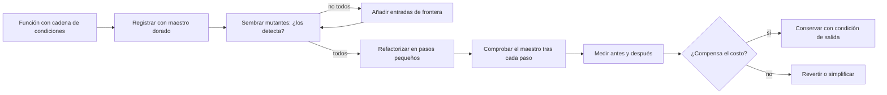
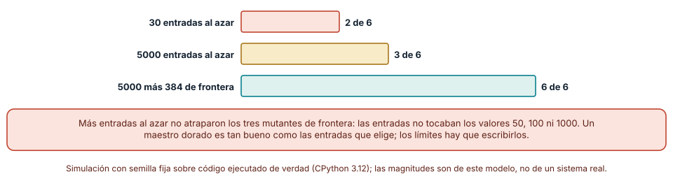

# SE-323 — Taller: refactorizar con patrones y medir su costo

[← SE-322 — Antipatrones y deuda de diseño](../../classes/part-26-patrones-de-diseno-empresariales-y-de-resiliencia/se-322-antipatrones-y-deuda-de-diseno/README.md) · [↑ Parte 26](../../classes/part-26-patrones-de-diseno-empresariales-y-de-resiliencia/README.md) · [📚 Índice completo](../../classes/README.md) · [🌐 Portal](../../site/classes/SE-323.html) · [SE-324 — Proyecto: catálogo de patrones de un sistema real →](../../classes/part-26-patrones-de-diseno-empresariales-y-de-resiliencia/se-324-proyecto-catalogo-de-patrones-de-un-sistema-real/README.md)

## Punto profesional y fundamento pedagógico

**Punto profesional.** El taller reúne las tres ideas de la parte en una sola tarea: **refactorizar una función real a un patrón, con una red de seguridad que se verifica, y decidir con medidas si el patrón se queda**. La habilidad es ejecutar el ciclo completo con disciplina: registrar el comportamiento actual, comprobar que el registro es capaz de detectar un cambio, transformar el código en pasos pequeños, medir el costo y escribir la condición de salida. Un refactor sin red es una reescritura; un refactor con una red que no detecta nada es una reescritura con falsa confianza.

**Por qué aparece aquí.** Es el taller de la parte: aplica el criterio de `SE-313`, el patrón Strategy de `SE-316`, la asignación de responsabilidades de `SE-317` y las medidas de `SE-322` a una función con una cadena de condiciones. Precede al proyecto (`SE-324`), que lleva el mismo ciclo a un sistema completo.

**Error conceptual que debe corregir.** Creer que, si un maestro dorado de miles de entradas pasa, el refactor es seguro. Un maestro dorado (comparar la salida del código nuevo con la del antiguo en muchas entradas) solo detecta cambios que las entradas **ejercitan**. En el experimento, un maestro con 5000 entradas aleatorias de semilla fija detecta **3 de 6** cambios sembrados porque las entradas al azar nunca tocan los valores exactos de los límites. La seguridad de una red se mide, como la de una suite de pruebas, con mutantes.

**Secuencia de aprendizaje.** Antes de ejecutar, predices cuántos de seis cambios sembrados en el código refactorizado detecta un maestro dorado de 5000 entradas aleatorias, y qué le falta. Después ejecutas el taller completo: registras el comportamiento, refactorizas a Strategy con registro, mides complejidad, nodos y tiempo antes y después, siembras los seis mutantes, amplías el maestro con las entradas de frontera y decides.

**Evidencia de aprendizaje.** Un `taller-refactor.md` con el maestro dorado (semilla y número de entradas), la tabla de seis mutantes con su detección antes y después de añadir las fronteras, las medidas antes y después y la decisión de conservar, simplificar o retirar el patrón con su condición de salida.

**Límite de la conclusión.** La función de tarifas, los cuatro canales, los seis mutantes y la distribución de las entradas son del autor, y los tiempos son de un equipo y varían entre ejecuciones. La clase **mide** el efecto de un refactor concreto sobre complejidad, tamaño y tiempo, y la capacidad de una red de detectar seis cambios; **no mide** el efecto en la mantenibilidad percibida ni la calidad de un refactor en general. No se invocó ningún modelo de lenguaje.

### Trazabilidad fuente → afirmación

| Fuente primaria u oficial | Afirmación que respalda | Lo que no prueba |
|---|---|---|
| [Fowler, «Replace Conditional with Polymorphism»](https://refactoring.com/catalog/replaceConditionalWithPolymorphism.html) | Describe el refactor que sustituye un condicional por objetos polimórficos. | No dice cuándo conviene. |
| [Fowler, «Refactoring»](https://refactoring.com/) | Define el refactor como cambio de estructura sin cambio de comportamiento observable. | No da la medida de «sin cambio». |
| [Fowler, «Self-Testing Code»](https://martinfowler.com/bliki/SelfTestingCode.html) | Sostiene que un refactor seguro se apoya en pruebas automatizadas que dan confianza. | No mide la sensibilidad de una suite concreta. |
| [DeMillo, Lipton y Sayward, «Hints on Test Data Selection»](https://doi.org/10.1109/C-M.1978.218136) | Fundamenta medir la sensibilidad de unas pruebas con variantes del programa. | No dice que las variantes representen defectos reales. |
| [Python, módulo `timeit`](https://docs.python.org/3/library/timeit.html) | Documenta cómo medir el tiempo de pequeños fragmentos repitiendo y tomando el mínimo. | No generaliza el tiempo a otro equipo. |
| [Python, módulo `ast`](https://docs.python.org/3/library/ast.html) | Documenta el árbol de sintaxis con el que se miden nodos y complejidad. | No define cuánta complejidad es aceptable. |

## Antes de empezar

Recupera lo aprendido en `SE-313`, `SE-316` y `SE-322`: un patrón necesita fuerza, costo medido y salida; una métrica sola no basta. La pregunta activa es: **¿cómo sabrías, antes de tocar una función de tu proyecto, que tus pruebas detectarían un cambio de comportamiento en cada una de sus ramas?**

## Prerrequisitos

- Haber completado `SE-313` a `SE-322`.
- Conocer la idea de mutación de la Parte 35 y la de maestro dorado como prueba de caracterización.
- Python 3.11 o posterior con `ast`, `random` y `timeit`.

## Problema auténtico

La función `precio_aviso` de *Avisos* calcula el precio de cada envío según el canal (correo, SMS, push, voz), la urgencia, las horas hasta el vencimiento, los adjuntos y el tamaño del grupo. Tiene una cadena de condiciones anidadas con complejidad ciclomática 15, y el próximo trimestre se añade un quinto canal. Nadie tiene miedo a la función (está probada), pero cada cambio exige leerla entera. Se decide refactorizarla a un Strategy con un registro de canales.

El taller sigue el ciclo de una refactorización responsable: registrar el comportamiento, comprobar la red, transformar, medir y decidir. El hallazgo que da valor al taller es el de la red: con 5000 entradas aleatorias, tres de los seis cambios sembrados pasan desapercibidos, y dos de ellos cambian el precio de grupos grandes.

## Objetivos observables

Al terminar podrás:

1. registrar el comportamiento de una función en un maestro dorado reproducible (semilla y número de entradas);
2. medir la sensibilidad del maestro con mutantes y encontrar qué entradas le faltan;
3. refactorizar una cadena de condiciones a Strategy con registro en pasos pequeños, comprobando el maestro tras cada paso;
4. medir complejidad, nodos y tiempo antes y después y leer el resultado con su límite;
5. decidir si el patrón se conserva y escribir la condición de salida.

## Mapa conceptual



El bucle entre sembrar mutantes y añadir fronteras es el corazón del taller: la red se endurece hasta que detecta todos los cambios sembrados antes de tocar el código.

## Temas y por qué importan

| Tema | Por qué cambia una decisión profesional | Evidencia mínima |
|---|---|---|
| Maestro dorado | Es la red de seguridad de un refactor sin pruebas finas | Entradas, semilla y diferencias con el nuevo código |
| Sensibilidad de la red | Una red que no detecta cambios da falsa confianza | Mutantes detectados de los sembrados |
| Entradas de frontera | Las entradas al azar no tocan los límites | Mutantes de frontera detectados antes y después |
| Refactor a Strategy | Baja la complejidad por función y sube el tamaño | Complejidad y nodos antes y después |
| Costo en tiempo | La indirección puede costar | Tiempo por llamada antes y después |
| Condición de salida | Evita que el patrón se quede por costumbre | Una señal medible de retirada |

## Conceptos y decisiones

### 1. El maestro dorado: registrar antes de cambiar

Un **maestro dorado** (también llamado prueba de caracterización o de aprobación) registra la salida del código **actual** para un conjunto de entradas y exige que el código nuevo produzca exactamente lo mismo. No dice que el comportamiento sea correcto; dice que **no cambió**. En el experimento se generan 5000 entradas con semilla fija (canal, urgencia, horas, adjuntos y tamaño del grupo) y se guarda la salida de la función antigua. El refactor produce **la misma salida en las 5000** (0 diferencias). La semilla es parte de la evidencia: sin ella, otra persona no puede repetir la comprobación.

### 2. Medir la red con mutantes

Una red que nunca falla no demuestra que funciona. Se siembran seis cambios pequeños en el código refactorizado: cambiar el umbral de adjuntos de `> 2` a `> 3` (correo), la ventana de horas de `20 < horas < 24` a `20 <= horas < 24` (SMS), el umbral de grupo de `> 100` a `> 101` (push), de `> 50` a `> 51` (voz), el del descuento de `> 1000` a `>= 1000` y el precio de voz urgente de 30 a 31. El maestro de 5000 entradas aleatorias detecta **3 de 6**: los de correo, SMS y precio de voz. **Sobreviven** los tres que cambian un límite de **grupo** en un valor exacto (101, 51 y 1000), porque las entradas de grupo solo tomaban los valores 1, 10, 60, 150 y 1200. Con solo 30 de las 5000 entradas se detectan 2 de 6.



**Cómo leer la figura.** Cada barra es el número de mutantes, de los seis sembrados, que el maestro detecta con cada conjunto de entradas. **Dónde deja de valer:** los seis mutantes los eligió el autor y no representan todos los cambios posibles; los valores del grupo (1, 10, 60, 150, 1200) son una elección que ya contiene el defecto que se mide. El resultado enseña que una red se mide, no cuántos mutantes detecta una red en general.

### 3. Las fronteras hay que escribirlas

Para que el maestro detecte los tres mutantes que sobreviven, se añaden **384 entradas de frontera**: todas las combinaciones de canal (4), urgencia (2), horas en {20, 21, 23, 24} (4), adjuntos en {2, 3} (2) y grupo en {50, 51, 100, 101, 1000, 1001} (6). Con las 5000 más las 384, el maestro detecta **6 de 6** y el refactor sigue sin diferir de la función antigua (0 diferencias). La lección es la del análisis de valores límite (Parte 35): los defectos viven en los bordes y las entradas al azar casi nunca los tocan. Más entradas al azar no resuelven el problema; las fronteras se **escriben**.

### 4. Refactorizar a Strategy con registro, en pasos pequeños

El refactor transforma la cadena de condiciones en una clase abstracta `Tarifa`, una subclase por canal (`Email`, `Sms`, `Push`, `Voz`) y un registro `TARIFAS` de nombre a instancia; la función `precio_aviso` busca la tarifa, calcula la base y aplica el descuento común de grupo. Se hace en cinco pasos: extraer la base de cada canal a una función, mover cada función a una clase, introducir el registro, retirar la cadena y comprobar el maestro **después de cada paso**. Si el maestro falla, el último paso es el culpable y se revierte sin buscar. Una refactorización de un solo paso grande pierde esa propiedad.

### 5. Medir antes y después

El experimento mide la función antigua y la refactorizada. La **complejidad ciclomática máxima** pasa de **15 a 3**; los **nodos de sintaxis**, de **149 a 215** (un 44 % más); el **tiempo por llamada**, de unos 260 ns a unos 380 ns (entre 1,2 y 1,5 veces en las ejecuciones, por la indirección del registro y de la llamada al método). Añadir un canal sube la complejidad de la función antigua de 15 a **16**; en la nueva añade una clase y una línea de registro sin tocar ninguna función existente. El resultado es el mismo balance de `SE-313`: el patrón compra complejidad por función y aislamiento de lo ya probado, a cambio de tamaño y de una indirección.


**Cómo leer la figura.** Cada fila es una medida con sus unidades en la etiqueta; el círculo hueco es el valor antes del refactor, el relleno el valor después y el porcentaje de la derecha es el cambio. Mira que la complejidad baja un 80 % mientras los nodos y el tiempo suben, y que la escala es logarítmica porque las medidas son de órdenes distintos. **Dónde deja de valer:** los tiempos son de un equipo, pequeños (cientos de nanosegundos) y varían entre ejecuciones; no importan en un envío que tarda milisegundos y sí podrían importar dentro de un bucle de millones de llamadas. La complejidad y los nodos son estructurales; no dicen nada de la facilidad para entender cada versión.

### 6. Decidir con la condición de salida

La decisión se escribe: **se conserva** el Strategy porque el quinto canal está planificado y la complejidad de 15 era un obstáculo para el cambio; la condición de salida es «si en doce meses no se añade ningún canal y quedan dos o menos, volver a una función simple». El costo (44 % más de nodos, 1,2 a 1,5 veces el tiempo) se acepta con conocimiento. Lo que **no** se decide es que el patrón sea mejor en general: es mejor para este cambio previsto.


**Cómo leer la figura.** Los cinco pasos son el orden del taller; el segundo es el que el experimento enseña a no omitir. **Dónde deja de valer:** el orden es una simplificación; en la práctica se vuelve del paso 5 al 2 si una medida revela una frontera nueva. El diagrama no dice cuánto esfuerzo requiere cada paso.

## Definiciones de trabajo

- **Maestro dorado:** registro de la salida del código actual para un conjunto fijo de entradas, contra el cual se compara el código nuevo.
- **Prueba de caracterización:** prueba que documenta el comportamiento actual, correcto o no.
- **Mutante:** variante del programa con un cambio pequeño que debería ser detectado.
- **Entradas de frontera:** valores en y alrededor de los límites de una regla.
- **Strategy con registro:** una clase por variante y un diccionario que las asocia a su nombre.
- **Condición de salida:** señal medible para retirar el patrón.

## Ejemplo mínimo

```python
import random

def maestro(funcion, semilla=527, n=5000):
    rng = random.Random(semilla)
    entradas = [(rng.choice(["email", "sms", "push", "voz"]), rng.random() < 0.5,
                 rng.randint(0, 48), rng.randint(0, 5), rng.choice([1, 10, 60, 150, 1200]))
                for _ in range(n)]
    return entradas, [funcion(*e) for e in entradas]
```

Se llama una vez con la función antigua para obtener las entradas y las salidas esperadas, y el código nuevo se compara contra ellas. La semilla y `n` son parte de la evidencia.

## Ejemplo profesional

*Escenario ilustrativo: las cifras de este ejemplo son supuestos de la narración, no mediciones.*

El equipo de *Avisos* hace el taller sobre `precio_aviso` antes de añadir WhatsApp. Registra el maestro (5000 entradas, semilla registrada) y descubre que su red detecta tres de seis mutantes; añade entradas de frontera hasta detectar los seis. Refactoriza en cinco pasos con el maestro en verde después de cada uno, mide complejidad 15 → 3 y nodos +44 %, añade el canal nuevo como una clase y una línea de registro sin tocar el resto y registra en el catálogo de patrones (`SE-324`) la condición de salida. En la revisión, una persona pregunta si no bastaba un diccionario de funciones; la respuesta queda anotada: la tarifa de voz necesita estado (el contrato del grupo), así que se justifica una clase.

## Práctica guiada

1. Escribe tu predicción: ¿cuántos de los seis mutantes detecta el maestro de 5000 entradas?
2. Ejecuta `python scripts/experiments_part26_b.py 527` y compara.
3. Añade las entradas de frontera y comprueba que se detectan los seis.
4. Cambia la elección de valores de grupo a `rng.randint(1, 2000)` y observa cuántos mutantes se detectan con 5000 entradas.
5. Aplica el ciclo a una función propia: maestro, mutantes, fronteras, refactor, medición y decisión.

## Ejercicios

1. **Básico.** Explica por qué un maestro dorado no demuestra que el código sea correcto.
2. **Intermedio.** Siembra tres mutantes más (uno por canal) y comprueba si el maestro ampliado los detecta.
3. **Avanzado.** Reescribe la función como un diccionario de funciones en lugar de clases y compara nodos, complejidad y tiempo con las otras dos versiones.

## Reto verificable

Entrega `taller-refactor.md` con la semilla y el número de entradas, la tabla de seis mutantes con su detección antes y después de añadir las fronteras, las medidas antes y después y la decisión con su condición de salida. Es válido si otra persona repite el taller con la misma semilla y obtiene 3 de 6 antes y 6 de 6 después, y si la condición de salida es medible.

## Caso conductor

*Avisos* tiene en `precio_aviso` la función que se refactoriza, y esta tarifa ya apareció como ejemplo de Strategy en `SE-313`. El registro de canales reaparece en `SE-324`, donde cada patrón del sistema se documenta con su fuerza, su costo y su salida.

## Preguntas frecuentes

### ¿Por qué no usar solo pruebas unitarias en lugar de un maestro dorado?

Se usan ambas cuando es posible. El maestro dorado es útil cuando la función **no tiene** pruebas finas y se quiere refactorizar sin definir primero qué es correcto; las pruebas unitarias documentan la intención. Un maestro dorado no reemplaza las pruebas: da un punto de partida para escribirlas.

### ¿Cuántas entradas de frontera hacen falta?

Las que cubran cada umbral de cada regla en sus dos lados. Se obtienen leyendo las condiciones de la función antigua: cada comparación aporta los valores de su límite y sus vecinos.

### ¿Y si el maestro registra un defecto del código antiguo?

El refactor lo conserva por diseño. Se corrige después, en un cambio de comportamiento separado con su propia prueba. Mezclar corrección y refactor impide saber qué causó una diferencia.

### ¿Puede un agente hacer este refactor?

Puede, y lo hace con rapidez; el riesgo es que declare terminado el refactor con un maestro débil. La petición útil exige que siembre mutantes, que añada las fronteras que los detecten, que compruebe el maestro tras cada paso y que adjunte las medidas antes y después.

## Fallo controlado y diagnóstico

**Fallo.** Tras el refactor, las pruebas pasan y un grupo de exactamente 51 personas se factura al precio del tramo anterior.

**Diagnóstico paso a paso.** (1) Se reproduce con una entrada de grupo 51 y canal voz: la función antigua devuelve el doble y la nueva no. (2) Se revisa el maestro: las entradas de grupo eran {1, 10, 60, 150, 1200}, ninguna de 51. (3) Se siembra el mutante `grupo > 51` y se confirma que el maestro lo deja pasar.

**Corrección.** Se añaden las entradas de frontera al maestro, se vuelve a ejecutar y se corrige el umbral; se anota la regla en el taller: ningún refactor se acepta sin que la red detecte los mutantes de cada umbral.

## Errores comunes y cómo corregirlos

- **Síntoma: el refactor «pasa» y un caso límite falla en producción.** Causa: entradas que no tocan las fronteras. Solución: añadir las fronteras y medir con mutantes.
- **Síntoma: no se sabe qué paso rompió el comportamiento.** Causa: refactor en un solo paso. Solución: pasos pequeños con el maestro tras cada uno.
- **Síntoma: el maestro no se puede repetir.** Causa: entradas sin semilla o dependientes del reloj. Solución: semilla fija y entradas explícitas.
- **Síntoma: la corrección de un defecto aparece mezclada con el refactor.** Causa: dos cambios en uno. Solución: separarlos y registrar el defecto.
- **Síntoma: el patrón se queda aunque ya no compensa.** Causa: falta la condición de salida. Solución: escribirla y revisarla en una fecha.

## Entorno y archivos clave

- `scripts/experiments_part26_b.py`: función antigua y refactorizada como texto, maestro dorado con semilla 527, seis mutantes, entradas de frontera y mediciones; `python scripts/experiments_part26_b.py 527`.
- `content/part-26/figures/`: figuras.
- Sin dependencias fuera de la biblioteca estándar.

## Seguridad, ética y accesibilidad

Un maestro dorado construido con datos reales de producción puede contener datos personales: usa entradas sintéticas o anonimizadas. Un refactor de precios que cambia un valor por error afecta a personas reales; la red debe cubrir cada umbral. Cuando el registro de tarifas se carga desde configuración externa, valida los nombres contra una lista cerrada. Ética: documentar la decisión y su salida permite que quien herede el código sepa por qué existe. Accesibilidad: las figuras tienen texto alternativo completo y las tablas se leen sin color.

## Puente hacia el trabajo con agentes

Un agente de código refactoriza una cadena de condiciones a Strategy con soltura y suele declarar éxito cuando las pruebas existentes pasan. La petición útil la acota: «registra un maestro dorado con semilla, siembra seis mutantes de umbral, añade las fronteras que los detecten, refactoriza en cinco pasos con el maestro tras cada uno y adjunta complejidad, nodos y tiempo antes y después». Se revisa la tabla de mutantes: si alguno sobrevive, el refactor no está terminado.

## Transferencia

Aplica el ciclo a una función de tu proyecto con una cadena de condiciones. La habilidad se transfiere a cualquier refactor de código sin pruebas finas: migraciones, reescrituras de módulos legados y cambios de biblioteca.

## Evaluación y evidencia

- El maestro dorado es reproducible: semilla, número de entradas y comando.
- La red se mide con mutantes y se endurece hasta detectarlos todos.
- El refactor se hace en pasos con el maestro comprobado tras cada uno.
- Las medidas antes y después incluyen complejidad, nodos y tiempo con su límite.
- La decisión se registra con una condición de salida medible.

## Fuentes

- Fowler, M. [«Replace Conditional with Polymorphism»](https://refactoring.com/catalog/replaceConditionalWithPolymorphism.html).
- Fowler, M. [«Refactoring»](https://refactoring.com/).
- Fowler, M. [«Self-Testing Code»](https://martinfowler.com/bliki/SelfTestingCode.html).
- DeMillo, R., Lipton, R. y Sayward, F. [«Hints on Test Data Selection»](https://doi.org/10.1109/C-M.1978.218136).
- Python Software Foundation. [«timeit — Measure execution time of small code snippets»](https://docs.python.org/3/library/timeit.html).
- Python Software Foundation. [«ast — Abstract Syntax Trees»](https://docs.python.org/3/library/ast.html).

## Límites y siguiente paso

La función, los mutantes y las entradas son del autor, los tiempos varían entre ejecuciones y equipos, y no se midió la comprensión de ninguna persona. El siguiente paso, `SE-324`, lleva el mismo método a un sistema completo: inventariar los patrones, verificar cada candidato y escribir un catálogo con evidencia, costo y condición de salida por entrada.

## Glosario

| Término | Definición breve |
|---|---|
| Maestro dorado | Registro de la salida actual contra el que se compara el código nuevo |
| Mutante | Variante con un cambio pequeño que debería detectarse |
| Frontera | Valor en o junto al límite de una regla |
| Strategy con registro | Una clase por variante y un diccionario de nombres |
| Refactor | Cambio de estructura sin cambio de comportamiento |
| Condición de salida | Señal medible para retirar el patrón |
