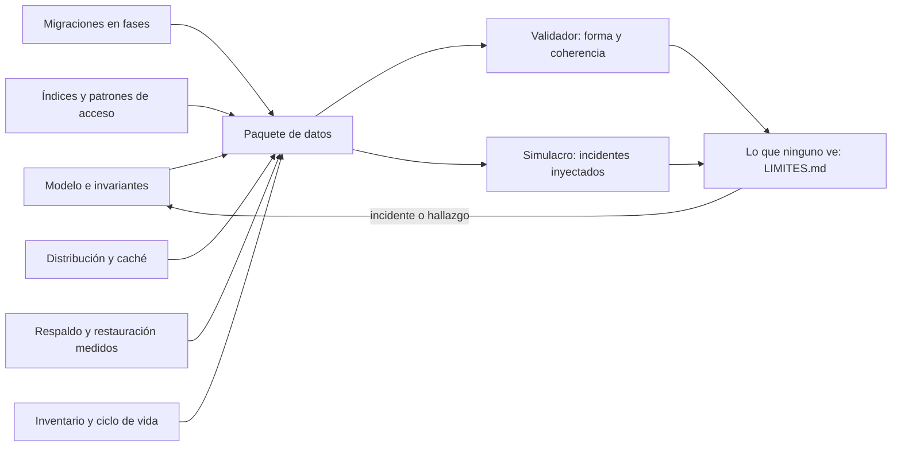
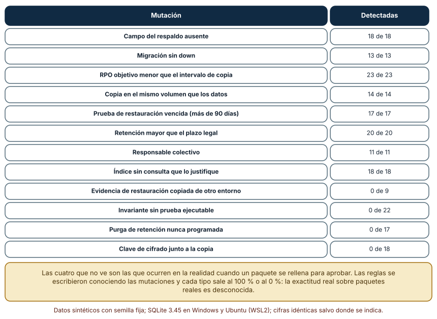
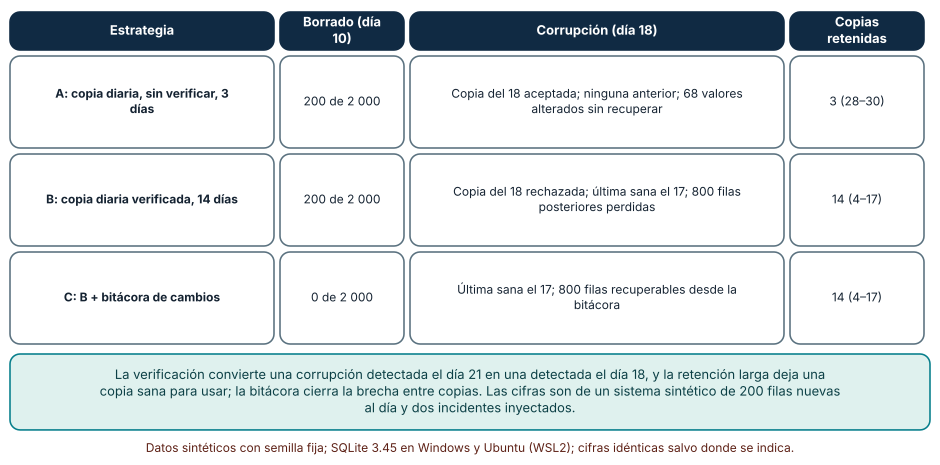
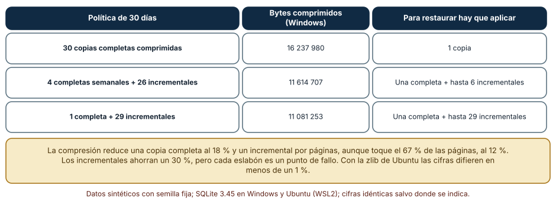

# SE-324 — Proyecto: capa de datos recuperable

[← SE-323 — Taller: corregir una migración peligrosa](../../classes/part-26-datos-persistencia-y-recuperacion/se-323-taller-corregir-una-migracion-peligrosa/README.md) · [↑ Parte 26](../../classes/part-26-datos-persistencia-y-recuperacion/README.md) · [📚 Índice completo](../../classes/README.md) · [🌐 Portal](../../site/classes/SE-324.html) · [SE-325 — Integración síncrona y asíncrona →](../../classes/part-27-integracion-eventos-y-mensajeria/se-325-integracion-sincrona-y-asincrona/README.md)

## Punto profesional y fundamento pedagógico

**Punto profesional.** El proyecto existe para que entregues la capa de datos de la plataforma como un paquete que otra persona pueda operar, cambiar y recuperar, con sus invariantes, su plan de migraciones, sus objetivos de recuperación medidos y una lista honesta de lo que ninguna prueba ni validador ve.

**Por qué aparece aquí.** Cierra la **Parte 26**: reúne el modelo (`SE-313`), los modelos de almacenamiento (`SE-314`), las transacciones (`SE-315`), las restricciones (`SE-316`), los índices (`SE-317`), las migraciones (`SE-318` y `SE-323`), la distribución (`SE-319`), las cachés (`SE-320`), la recuperación (`SE-321`) y el ciclo de vida del dato (`SE-322`) en un solo artefacto defendible.

**Error conceptual que debe corregir.** Creer que un paquete completo es un paquete correcto: un manifiesto con todos los campos rellenos puede describir una restauración que nunca se hizo, un invariante sin prueba o una clave guardada junto a la copia, y ningún validador de forma lo ve.

**Secuencia de aprendizaje.** Antes de ejecutar nada, predices cuántas de 200 mutaciones de un paquete detectará un validador y qué pierde cada estrategia de respaldo en un mes con un borrado y una corrupción silenciosa; después ejecutas el validador, simulas el mes con tres estrategias sobre SQLite real y calculas el costo de retener copias. La secuencia usa predicción, explicación propia, contraste y recuperación. [ICAP](https://icap.education.asu.edu/research) distingue participación de construcción de conocimiento; [How People Learn II](https://nap.nationalacademies.org/catalog/24783/how-people-learn-ii-learners-contexts-and-cultures) exige conectar conocimiento previo, contexto y transferencia; la [práctica de recuperación](https://pubmed.ncbi.nlm.nih.gov/16507066/) respalda producir de nuevo la explicación tras una demora; y [Education for Life and Work](https://nap.nationalacademies.org/resource/13398/dbasse_084153.pdf) exige devolución que explique la causa del error.

**Evidencia de aprendizaje.** `paquete-datos/` con el esquema y su catálogo de invariantes, las migraciones en fases con sus invariantes, el catálogo de índices con su consulta, la política de caché, el manifiesto de respaldo con los objetivos medidos, el inventario de datos personales, el procedimiento de restauración probado y `LIMITES.md`, más una nota que diga qué parte de lo entregado es observación, cuál es inferencia y cuál es supuesto.

**Límite de la conclusión.** El mes simulado, las 200 mutaciones y el sistema de 200 filas por día son construcciones del autor; el validador se escribió conociendo las mutaciones y su exactitud real es desconocida. Se ejecutó en SQLite con datos sintéticos: no se midieron tiempos de restauración, ningún motor distribuido, caché real ni respaldo en la nube, y los tamaños comprimidos dependen de la implementación de zlib.

### Trazabilidad fuente → afirmación

| Fuente primaria u oficial | Afirmación que respalda | Lo que no prueba |
|---|---|---|
| [NIST SP 800-34 Rev. 1](https://csrc.nist.gov/pubs/sp/800/34/r1/upd1/final) | Define el plan de contingencia, los objetivos de recuperación y la necesidad de probar y mantener el plan. | No fija los valores de un paquete concreto. |
| [SQLite: API de copia en línea](https://www.sqlite.org/backup.html) | Respalda la elección de una copia consistente de una base en uso. | No cubre la copia remota ni cifrada. |
| [Python: zlib](https://docs.python.org/3/library/zlib.html) | Documenta la compresión usada para medir el costo de las copias y que su resultado depende de la biblioteca. | No predice la compresión de datos reales. |
| [Kleppmann, «Designing Data-Intensive Applications»](https://dataintensive.net/) | Integra modelo de datos, transacciones, replicación, particionado y recuperación como compromisos de diseño. | No prescribe un paquete para la plataforma. |
| [Reglamento (UE) 2016/679](https://eur-lex.europa.eu/eli/reg/2016/679/oj) | Establece la minimización y la limitación del plazo de conservación que debe reflejar el inventario. | No es asesoría legal ni fija plazos de la plataforma. |

## Antes de empezar

Recupera lo aprendido en las once clases anteriores. La pregunta activa es: **¿qué debe contener un paquete para que otra persona pueda operar esta capa de datos, cambiarla y recuperarla sin hablar conmigo, y qué no podrá saber sobre él?**

## Prerrequisitos

- Haber completado `SE-313` a `SE-323` o poder explicar el modelo, las invariantes, los índices, las migraciones, la distribución, las cachés, la recuperación y el ciclo de vida de la plataforma.
- Python 3.11 o posterior con `sqlite3`, `zlib`, `random`, `copy` y `datetime`.
- Leer un manifiesto en forma de diccionario y un procedimiento de restauración.

## Problema auténtico

La plataforma de entregas se entrega a un equipo nuevo que la operará durante años. En la reunión de traspaso, la pregunta de la directora es sencilla: «¿qué pasa si mañana se borra por error el 40 % de las entregas, o si descubrimos en tres días que alguien alteró notas?». El equipo saliente tiene documentos sueltos: un diagrama, un script de copia, una lista de índices, un plan de migraciones, una nota sobre retención. Nadie ha reunido las piezas ni comprobado que cuenten la misma historia: la copia es diaria y el objetivo de recuperación dice 15 minutos, el último ensayo de restauración fue hace seis meses y la retención de eventos es de 36 meses sin purga.

## Objetivos observables

Al terminar podrás:

1. reunir el modelo, las invariantes, las migraciones, los índices, la distribución, la caché, la recuperación y el ciclo de vida en un paquete con un manifiesto;
2. validar el paquete con un verificador de forma y de coherencia y declarar qué mutaciones no ve;
3. simular un mes con incidentes sobre SQLite real y comparar estrategias de respaldo por datos perdidos y recuperables;
4. calcular el costo de retener copias y lo que hay que encadenar al restaurar;
5. entregar `LIMITES.md` con lo que el paquete no demuestra y el procedimiento para ejecutar la restauración sin ayuda.

## Mapa conceptual



El mapa muestra que el paquete tiene seis fuentes y dos instrumentos de comprobación, y que su salida más importante es la lista de lo que esos instrumentos no ven.

## Temas y por qué importan

| Tema | Por qué cambia una decisión profesional | Evidencia mínima |
|---|---|---|
| Paquete de capa de datos | Reúne decisiones dispersas en algo operable. | Predicción, traza causal y contraejemplo de **Paquete de capa de datos** en `paquete-log.md` |
| Validación de forma y de sentido | Un paquete completo puede ser falso. | Predicción, traza causal y contraejemplo de **Validación de forma y de sentido** en `paquete-log.md` |
| Simulacro de incidentes | Muestra qué se pierde con cada estrategia antes de que ocurra. | Predicción, traza causal y contraejemplo de **Simulacro de incidentes** en `paquete-log.md` |
| Costo de la retención | Cada copia cuesta espacio y complica la restauración. | Predicción, traza causal y contraejemplo de **Costo de la retención** en `paquete-log.md` |
| Límites declarados | Una lista honesta de lo que no se sabe permite decidir con ella. | Predicción, traza causal y contraejemplo de **Límites declarados** en `paquete-log.md` |

## Conceptos y decisiones

### 1. Paquete de capa de datos

El paquete es el conjunto de artefactos que permiten operar la capa de datos: el esquema con su catálogo de invariantes (restricciones y pruebas), las migraciones en fases con sus invariantes de datos, el catálogo de índices con la consulta que justifica cada uno, la política de distribución y de caché (qué se replica, qué se cachea, con qué frescura), el manifiesto de respaldo (método, intervalo, retención, destino, verificación, objetivos medidos) y el inventario de datos personales con su ciclo de vida. Lo que lo distingue de una carpeta de documentos es que cada afirmación tiene una prueba que se puede ejecutar y que las piezas son coherentes entre sí.

### 2. Validación de forma y de sentido

Un validador de **forma** comprueba que cada campo existe y que los números son coherentes entre sí: que el objetivo de recuperación no sea menor que el intervalo de copia, que la copia no esté en el mismo volumen que los datos, que la última prueba de restauración tenga menos de 90 días, que la retención no supere el plazo declarado, que cada migración tenga su vuelta atrás y que haya un responsable individual. No puede comprobar el **sentido**: que la evidencia de restauración sea de este entorno y no copiada de otro, que la prueba de un invariante exista y se ejecute, que el trabajo de purga esté programado y que la clave de cifrado no esté junto a la copia. Para esas hay que ejecutar, no leer.

### 3. Simulacro de incidentes

Un simulacro inyecta incidentes conocidos en un sistema de pruebas y mide qué se pierde y qué se recupera con cada estrategia. Convierte opiniones («con copia diaria estamos bien») en cifras («un borrado a media jornada pierde 200 filas; una corrupción detectada tarde puede dejar todas las copias contaminadas»). Es un modelo del autor, no una predicción, y por eso sirve para comparar estrategias, no para prometer una pérdida. Debe incluir incidentes de naturaleza distinta: uno inmediato y visible (un borrado) y uno silencioso y tardío (una alteración de valores).

### 4. Costo de la retención

Retener más copias da más puntos a los que volver y cuesta espacio, tiempo de copia y complejidad de restauración. Una copia completa comprimida de una base de 40 000 filas ocupa un 18 % de su tamaño; un incremental por páginas puede tocar la mayoría de las páginas si las actualizaciones están dispersas, y aun así comprimirse a un 12 %. Los incrementales ahorran espacio y alargan la cadena de restauración: cada eslabón que falla invalida a los siguientes. La decisión es un equilibrio entre espacio, tiempo de restauración y riesgo de cadena, y se mide con los datos propios.

### 5. Límites declarados

`LIMITES.md` es la parte más importante del paquete: dice qué no se probó (un motor distinto, el tiempo de restauración con el volumen real, el cifrado, el proveedor), qué se supuso (los plazos de retención, los volúmenes, la popularidad de las claves) y qué ningún validador ve (las cuatro familias de mutación de sentido). Una lista así permite a quien opera el paquete decidir qué comprobar antes de confiar y a quien lo revisa saber qué exigir. Un paquete sin límites declarados no es más seguro, solo más opaco.

### Un validador frente a 200 mutaciones de un paquete

El paquete de referencia, en forma de diccionario, contiene el esquema con sus migraciones (cada una con `up` y `down`), el manifiesto de respaldo (intervalo de 60 minutos, retención de 30 días, destino y volumen de datos distintos, clave en una bóveda), la restauración (fecha de la última prueba, evidencia y entorno), los objetivos (RPO de 60 minutos, RTO de 120), la retención por tabla, los responsables, los índices con su consulta y las invariantes con su prueba. Se generan 200 mutaciones de doce tipos, ocho de forma o coherencia y cuatro de sentido.

```python
if m["objetivos"]["rpo_min"] < b["intervalo_min"]: h.append("RPO menor que el intervalo")
if b["destino"] == b["volumen_datos"]: h.append("backup en el mismo volumen")
if (HOY - datetime.date.fromisoformat(m["restauracion"]["ultima_prueba"])).days > 90: h.append("prueba de restauración vencida")
```

| Mutación | Detectadas |
|---|---:|
| Campo del respaldo ausente | 18 de 18 |
| Migración sin `down` | 13 de 13 |
| RPO objetivo menor que el intervalo de copia | 23 de 23 |
| Copia en el mismo volumen que los datos | 14 de 14 |
| Prueba de restauración vencida (más de 90 días) | 17 de 17 |
| Retención mayor que el plazo legal | 20 de 20 |
| Responsable colectivo | 11 de 11 |
| Índice sin consulta que lo justifique | 18 de 18 |
| Evidencia de restauración copiada de otro entorno | 0 de 9 |
| Invariante sin prueba ejecutable | 0 de 22 |
| Purga de retención nunca programada | 0 de 17 |
| Clave de cifrado junto a la copia | 0 de 18 |

El validador detecta 134 de 200 mutaciones y ninguna de las 66 que dejan los campos plausibles. Esas cuatro familias son exactamente las que ocurren cuando un paquete se rellena para aprobar: la evidencia existe y es de otro entorno, el invariante se nombra y su prueba no existe, la purga se declara y nadie la programa, la clave está «en una bóveda» que es la misma que guarda las copias.



**Cómo leer la figura.** Cada fila es un tipo de mutación; la columna da cuántas de las mutaciones de ese tipo detectó el validador. **Dónde deja de valer:** las reglas se escribieron conociendo las mutaciones y cada tipo sale al 100 % o al 0 %; sobre paquetes reales la exactitud es desconocida. El 0 de las últimas filas no es un defecto del validador sino un límite de lo que se puede comprobar leyendo: para verlas hay que ejecutar la restauración, listar las pruebas y comprobar el planificador.

### Un mes con un borrado y una corrupción silenciosa

Una base de SQLite recibe 200 entregas por día durante 30 días y mantiene un control con la suma esperada de notas. Se inyectan dos incidentes: el día 10, un `DELETE` accidental que borra el 40 % de las filas existentes (y se descubre al instante), y el día 18, una alteración silenciosa de las notas de 68 filas que se descubre el día 21. Tres estrategias: **A**, copia diaria sin verificar con retención de 3 días; **B**, copia diaria con verificación (la suma de las notas debe coincidir con el control antes de aceptar la copia) y retención de 14 días; **C**, como B más una bitácora de cambios que permite recuperar lo insertado desde la última copia.

```python
def verifica():
    s, = c.execute("select sum(nota) from e").fetchone()
    v, = c.execute("select v from ctl").fetchone()
    return abs((s or 0) - v) < 1e-6
```

| Estrategia | Borrado (día 10) | Corrupción (día 18) | Copias retenidas |
|---|---|---|---|
| A: diaria, sin verificar, 3 días | 200 de 2 000 sin recuperar | Copia del 18 aceptada; ninguna copia anterior al 18; 68 valores alterados sin recuperar | 3 (días 28–30) |
| B: diaria verificada, 14 días | 200 de 2 000 sin recuperar | Copia del 18 rechazada; última sana el 17; 800 filas posteriores perdidas | 14 (días 4–17) |
| C: B más bitácora | 0 de 2 000 | Última sana el 17; 800 filas recuperables desde la bitácora | 14 (días 4–17) |

En A, el borrado pierde las 200 filas del día (insertadas tras la última copia) y la corrupción no tiene remedio: al descubrirla el día 21, las tres copias retenidas son posteriores al 18 y todas están contaminadas. En B, la verificación rechaza la copia del día 18 el mismo día (se detecta tres días antes) y la retención de 14 días conserva una copia sana, pero se pierden las 800 filas posteriores. En C, la bitácora recupera esas filas y las del borrado. La verificación convierte un daño silencioso en uno visible; la retención larga lo hace recuperable; la bitácora reduce la pérdida.



**Cómo leer la figura.** Cada fila es una estrategia; las columnas dicen qué pasó con cada incidente y cuántas copias quedan. **Dónde deja de valer:** son 200 filas nuevas por día y dos incidentes inyectados por el autor; no hay concurrencia, ni tiempo de restauración, ni una bitácora real: la de la estrategia C se simula como una lista de las filas insertadas. La figura sirve para comparar el efecto de tres decisiones, no para predecir una pérdida real. Y la verificación solo sirve si el control (la suma esperada) se mantiene por una vía independiente de la que sufrió la alteración.

### Cuánto cuesta retener 30 días

Se genera una base de 40 000 filas con comentarios de texto y se simulan siete días de cambios (800 actualizaciones dispersas y 400 inserciones al día). Se comprime con zlib (nivel 6) una copia completa y las páginas que cambian entre dos días consecutivos, y se calcula el costo de tres políticas para 30 días.

```python
idx = [i for i in range(len(b) // 4096) if pagina(a, i) != pagina(b, i)]
dif = b"".join(pagina(b, i) for i in idx)
incz.append(len(zlib.compress(dif, 6)))
```

| Política de 30 días | Bytes comprimidos (Windows) | Para restaurar hay que aplicar |
|---|---:|---|
| 30 copias completas comprimidas | 16 237 980 | Una copia |
| 4 completas semanales + 26 incrementales | 11 614 707 | Una completa y hasta 6 incrementales |
| 1 completa + 29 incrementales | 11 081 253 | Una completa y hasta 29 incrementales |

Una copia completa comprimida ocupa el 18 % de la base y un incremental por páginas, aunque toque en torno al 67 % de las páginas (unas 500 de 742 cada día, porque las actualizaciones están dispersas), comprimido, el 12 % del tamaño de una completa. Los incrementales ahorran un 30 % frente a 30 completas y alargan la cadena. Con la zlib de Ubuntu (WSL2) los tamaños difieren en menos de un 1 %, por ejemplo 16 103 130 bytes para 30 completas.



**Cómo leer la figura.** Cada fila es una política de retención; la columna central es el tamaño comprimido y la última, la cadena de restauración. **Dónde deja de valer:** los textos de los comentarios se repiten mucho (500 variantes) y comprimen mejor que datos reales; el incremental por páginas es una simplificación de un respaldo incremental de motor. Las cifras de bytes son de la zlib de Windows y difieren de la de Ubuntu en menos de un 1 %. No se midió el tiempo de copia ni de restauración, que podría hacer preferible una política más cara en espacio.

## Definiciones de trabajo

- **paquete de capa de datos:** conjunto de artefactos y pruebas que permiten operar, cambiar y recuperar la capa de datos de un sistema.
- **manifiesto de respaldo:** descripción estructurada del método, el intervalo, la retención, el destino, la verificación y los objetivos medidos de las copias.
- **simulacro:** ejercicio que inyecta incidentes conocidos en un sistema de prueba para medir qué se pierde y qué se recupera.
- **bitácora de cambios:** registro ordenado de las escrituras que permite recuperar lo ocurrido desde la última copia.
- **límite declarado:** afirmación explícita de lo que un artefacto no demuestra.

Las definiciones son operativas para el proyecto. No convierten términos con una historia más amplia en sinónimos y deben contrastarse con la documentación primaria enlazada al final.

## Ejemplo mínimo

El fragmento valida la coherencia de dos campos de un manifiesto. Antes de ejecutarlo, predice si el manifiesto es coherente.

```python
manifiesto = {"intervalo_min": 60, "rpo_objetivo_min": 15, "destino": "almacen-b", "volumen_datos": "volumen-a"}
hallazgos = []
if manifiesto["rpo_objetivo_min"] < manifiesto["intervalo_min"]: hallazgos.append("el RPO objetivo es menor que el intervalo")
if manifiesto["destino"] == manifiesto["volumen_datos"]: hallazgos.append("la copia está en el volumen de los datos")
assert hallazgos == ["el RPO objetivo es menor que el intervalo"]
```

Un objetivo de 15 minutos con copias cada 60 es incoherente. Registra versión, comando y salida; después corrige el intervalo y añade una regla que detecte una prueba de restauración de más de 90 días.

## Ejemplo profesional

El equipo entrega `paquete-datos/` con una estructura fija. `esquema/` contiene `schema.sql` con cada restricción comentada con su invariante y la prueba que intenta violarla. `migraciones/` contiene las fases numeradas, con sus invariantes de datos y la marca del punto de no retorno. `acceso/` contiene el catálogo de consultas con su plan y el índice que cada una justifica. `distribucion/` fija que se usa una réplica de lectura con la garantía de leer lo propio y define la política de caché por dato con su frescura máxima. `recuperacion/` contiene el manifiesto de respaldo (copia con la API del motor, bitácora cada 5 minutos, retención de 14 días, destino en otra región, clave custodiada aparte), el procedimiento de restauración paso a paso y el informe del último ensayo con el tiempo medido. `ciclo-vida/` contiene el inventario con finalidad, plazo y copias y el trabajo de purga. `LIMITES.md` lista lo que el paquete no demuestra. Una tarea ejecuta el validador de forma, el ensayo de restauración con la verificación completa y las pruebas de invariantes, y publica el resultado; una persona ajena al equipo ejecuta el procedimiento una vez por trimestre y anota lo que tuvo que adivinar.

## Práctica guiada

1. Reúne las piezas de las clases anteriores en `paquete-datos/` y escribe el manifiesto.
2. Predice cuántas de 200 mutaciones detectará tu validador y cuáles no, y escribe la predicción.
3. Ejecuta el validador sobre las mutaciones y reproduce la tabla.
4. Simula el mes con las tres estrategias, con un borrado y una corrupción silenciosa, y compara lo perdido.
5. Calcula el costo de retener 30 días con las tres políticas y la cadena de restauración de cada una.
6. Escribe `LIMITES.md` con lo que no se probó, lo que se supuso y lo que el validador no ve.
7. Pide a otra persona que restaure una copia siguiendo el procedimiento y que anote lo que tuvo que adivinar.

## Ejercicios

1. **Regla:** añade una regla de coherencia al validador (por ejemplo, retención de copias menor que el plazo de detección de una corrupción) y mide cuántas mutaciones nuevas detecta.
2. **Estrategia D:** diseña una cuarta estrategia que cubra la corrupción tardía sin retener 14 copias y simúlala.
3. **Cadena:** calcula el tiempo de restauración de la política con 29 incrementales si cada eslabón tarda 2 minutos y hay una probabilidad del 1 % de que cada uno falle.
4. **Límites:** redacta tres límites de tu paquete que un auditor debería exigir probar antes de confiar en él.

## Reto verificable

Entrega `paquete-datos/` con todas las piezas, `paquete-log.md` con la predicción, las tres tablas y `LIMITES.md`. Se aprueba si otra persona ejecuta el validador y el simulacro con las mismas semillas, obtiene las mismas cifras, restaura una copia con tu procedimiento sin ayuda y puede decir qué familias de defectos el validador no ve. No se aprueba por un paquete con todos los campos rellenos pero sin una restauración ensayada ni por omitir `LIMITES.md`.

## Caso conductor

La capa de datos de la plataforma de entregas es el caso conductor de la Parte 26, y esta clase deja el artefacto final: el paquete de capa de datos recuperable. Sirve de base a la Parte 27, donde los datos que esta parte protege empiezan a circular entre servicios por mensajes y eventos. Cambia después una sola decisión, la retención de las copias, y observa qué cambia en el costo, en la cadena de restauración y en lo que se puede recuperar.

## Preguntas frecuentes

### ¿Qué diferencia hay entre este paquete y una documentación de la base de datos?

El paquete tiene pruebas que se ejecutan: invariantes que se intentan violar, una restauración que se ensaya, un validador que corre en cada cambio. Una documentación describe; un paquete demuestra lo que puede demostrar y declara el resto.

### ¿Por qué incluir una corrupción silenciosa en el simulacro?

Porque es el incidente que más daño hace y que las estrategias ingenuas no cubren: no hay error visible, las copias se contaminan y cuando se descubre ya no queda una copia sana. Incluirla obliga a pensar en verificación y en retención.

### ¿Un validador de paquetes puede ser engañado?

Sí, y lo es en cuanto alguien rellena los campos para pasarlo. Por eso las comprobaciones de sentido se hacen ejecutando (restaurar, correr las pruebas, comprobar el planificador) y no leyendo, y por eso `LIMITES.md` dice qué ve y qué no.

### ¿Cuándo se considera terminado el paquete?

Nunca del todo: se fecha. Cada incidente, cada migración y cada cambio de proveedor lo reabren; el paquete aprobado dice a qué fecha y con qué evidencia lo estaba, y qué se revisará y cuándo.

## Fallo controlado y diagnóstico

Reproduce el fallo clásico del proyecto: **un paquete aprobado cuya restauración falla al ejecutarla**. Rellena el manifiesto con una prueba de restauración reciente y evidencia copiada de otro entorno, ejecuta el validador y después restaura de verdad.

Registra síntoma, entrada mínima, hipótesis, observación que descarta cada hipótesis, causa, corrección y prueba de regresión. **Síntoma:** el validador aprueba el paquete y, en un incidente real, la restauración falla porque la copia no se puede abrir. **Hipótesis rivales:** (a) un error puntual de la herramienta de restauración; (b) la copia se dañó después de la última prueba; (c) la evidencia de la prueba no era de este entorno y nunca se restauró esta copia. **Prueba:** compara el identificador de la copia en la evidencia con el de la copia actual y ejecuta la restauración ahora; si los identificadores no coinciden, la causa es la evidencia ajena. **Conclusión:** el validador de forma no ve la evidencia copiada. **Regresión:** la tarea nocturna restaura la copia real y escribe la evidencia con su identificador, y el validador exige que el identificador de la evidencia coincida con el de la última copia. No cambies a la vez el validador y el procedimiento de restauración.

## Errores comunes y cómo corregirlos

| Síntoma | Causa probable | Corrección |
|---|---|---|
| El paquete pasa el validador y la restauración falla | Evidencia que no es de este entorno | Restauración automática con evidencia identificada |
| Un invariante figura en el catálogo y no se ejecuta | Lista sin prueba asociada | Una prueba por invariante que intenta violarla |
| Los datos vencidos siguen en la base | Purga declarada y no programada | Trabajo de purga con una medida de lo vencido |
| Una corrupción contamina todas las copias | Copias sin verificar y retención corta | Verificación con control independiente y retención más larga |
| El equipo nuevo no puede restaurar sin ayuda | Procedimiento con pasos implícitos | Ensayo por una persona ajena y corrección de lo que tuvo que adivinar |

## Entorno y archivos clave

```text
paquete-datos/
├── README.md
├── LIMITES.md
├── esquema/
│   ├── schema.sql
│   └── invariantes.md
├── migraciones/
├── acceso/
│   └── catalogo-consultas.md
├── distribucion/
│   └── politica-cache.md
├── recuperacion/
│   ├── manifiesto.json
│   ├── restauracion.md
│   └── informe-ensayo.md
├── ciclo-vida/
│   └── inventario.md
├── tests/
│   ├── test_paquete.py
│   └── test_restauracion.py
└── evidence/paquete-log.md
```

El `README` declara plataforma, versiones de Python y de SQLite, semillas y comandos. Los experimentos usan solo la biblioteca estándar (`sqlite3`, `zlib`, `random`, `copy`, `datetime`, `collections`) y se ejecutaron con CPython 3.12.9 en Windows 11 (SQLite 3.45.3) y 3.12.3 en Ubuntu bajo WSL2 (SQLite 3.45.1): las salidas fueron idénticas salvo los bytes comprimidos, que difieren en menos de un 1 % por la versión de zlib. Si añades una dependencia, fija procedencia y versión.

## Seguridad, ética y accesibilidad

- el paquete no contiene ningún secreto: guarda procedimientos y referencias a dónde está cada secreto, no los secretos;
- el manifiesto de respaldo debe decir quién puede restaurar y quién aprueba restaurar datos personales, y registrar cada acceso;
- la restauración de un ensayo debe hacerse con datos sintéticos o en un entorno aislado con acceso mínimo;
- los avisos a personas afectadas por una pérdida o una corrupción deben ser claros, sin culpar y con un canal accesible;
- documenta el procedimiento con pasos numerados, sin supuestos implícitos y en un formato que se pueda seguir con tecnologías de apoyo y bajo presión.

## Puente hacia el trabajo con agentes

Un agente al que se le pide «prepara la documentación de la base de datos» producirá un documento extenso y plausible. Pídele en cambio el paquete con su estructura, las pruebas que ejecutan cada invariante, el validador con sus mutaciones, la restauración automática con evidencia identificada y `LIMITES.md`. Revisa especialmente si rellena campos que no pudo comprobar y si declara una prueba de restauración que no ejecutó: son los dos defectos que este proyecto mostró sin aviso. Entrega a la persona que revise la lista de lo que el agente no verificó.

## Transferencia

Traslada el proyecto a otro sistema (por ejemplo, una aplicación de turnos de un laboratorio): reúne sus piezas en un paquete, genera mutaciones del manifiesto, simula un mes con un borrado y una corrupción silenciosa y escribe sus límites. La transferencia está lograda cuando puedes decir qué incidente deja sin recuperar tu estrategia y qué comprobación lo detectaría, no cuando la estructura de carpetas se parece.

## Evaluación y evidencia

| Criterio | Evidencia para aprobar |
|---|---|
| comprensión | explicación de qué debe contener un paquete y por qué un paquete completo no es un paquete correcto |
| corrección | validador, simulacro y costo de retención reproducibles con las mismas semillas |
| diseño | paquete con invariantes, migraciones, índices, política de caché, respaldo, ciclo de vida y límites |
| diagnóstico | reproducción del fallo «paquete aprobado con restauración que falla» con regresión |
| incertidumbre | `LIMITES.md` con lo no probado, lo supuesto y lo que el validador no ve |
| reproducibilidad | versiones, comandos, salida y restauración ejecutada por una persona ajena |

## Fuentes

- [NIST SP 800-34 Rev. 1](https://csrc.nist.gov/pubs/sp/800/34/r1/upd1/final) — planes de contingencia, objetivos y pruebas; autoridad: NIST.
- [SQLite: API de copia en línea](https://www.sqlite.org/backup.html) — copia consistente; autoridad: documentación oficial de SQLite.
- [SQLite: PRAGMA](https://www.sqlite.org/pragma.html) — comprobaciones de integridad; autoridad: documentación oficial de SQLite.
- [Python: zlib](https://docs.python.org/3/library/zlib.html) — compresión usada para medir el costo de las copias; autoridad: documentación de Python.
- [Kleppmann, «Designing Data-Intensive Applications»](https://dataintensive.net/) — compromisos de diseño de sistemas de datos; autoridad: autor del libro.
- [Reglamento (UE) 2016/679](https://eur-lex.europa.eu/eli/reg/2016/679/oj) — minimización y plazo de conservación; autoridad: texto oficial de la Unión Europea.

Cada fuente respalda el mecanismo indicado; ninguna demuestra que los 134 de 200, los 68 valores sin recuperar o los 11,1 millones de bytes se observen en la plataforma real. Esa afirmación depende del motor, del volumen y de los incidentes reales.

## Límites y siguiente paso

Se ejecutaron tres experimentos con datos sintéticos y semillas fijas en Windows y Ubuntu (WSL2); las cifras fueron idénticas salvo los bytes comprimidos, que difirieron menos de un 1 % por la versión de zlib. El validador se ajustó con las mismas mutaciones que lo evalúan, de modo que su exactitud real es desconocida; el mes simulado es de 200 filas por día con dos incidentes inyectados y una bitácora simulada; el incremental por páginas es una simplificación. No se midieron tiempos de restauración, ni se usó otro motor, nube, cifrado o red. Esta parte no tiene laboratorio propio en `labs/`; el paquete que define esta clase es la evidencia. La siguiente parte lleva estos datos a la integración entre servicios con mensajes y eventos, donde reaparecen la consistencia, la idempotencia y la recuperación.

## Glosario

- **paquete de capa de datos:** conjunto de artefactos y pruebas que permiten operar, cambiar y recuperar la capa de datos de un sistema.
- **manifiesto de respaldo:** descripción estructurada del método, el intervalo, la retención, el destino, la verificación y los objetivos medidos de las copias.
- **simulacro:** ejercicio que inyecta incidentes conocidos en un sistema de prueba para medir qué se pierde y qué se recupera.
- **bitácora de cambios:** registro ordenado de las escrituras que permite recuperar lo ocurrido desde la última copia.
- **límite declarado:** afirmación explícita de lo que un artefacto no demuestra.

---

[← SE-323 — Taller: corregir una migración peligrosa](../../classes/part-26-datos-persistencia-y-recuperacion/se-323-taller-corregir-una-migracion-peligrosa/README.md) · [↑ Parte 26](../../classes/part-26-datos-persistencia-y-recuperacion/README.md) · [📚 Índice completo](../../classes/README.md) · [🌐 Portal](../../site/classes/SE-324.html) · [SE-325 — Integración síncrona y asíncrona →](../../classes/part-27-integracion-eventos-y-mensajeria/se-325-integracion-sincrona-y-asincrona/README.md)
