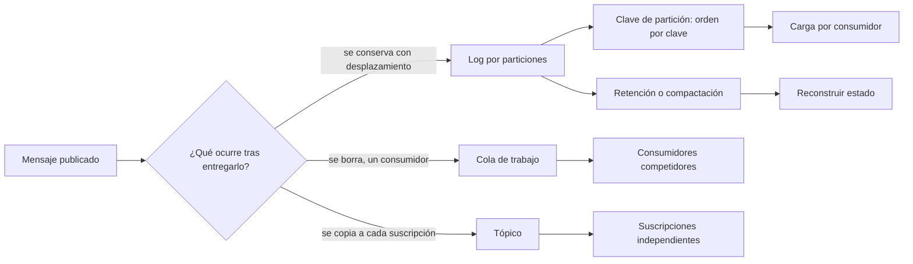

# SE-327 — Brokers, colas, topics y logs distribuidos

[← SE-326 — Mensajes, eventos, comandos y documentos](../../classes/part-27-integracion-eventos-y-mensajeria/se-326-mensajes-eventos-comandos-y-documentos/README.md) · [↑ Parte 27](../../classes/part-27-integracion-eventos-y-mensajeria/README.md) · [📚 Índice completo](../../classes/README.md) · [🌐 Portal](../../site/classes/SE-327.html) · [SE-328 — Entrega, orden, duplicación y semánticas →](../../classes/part-27-integracion-eventos-y-mensajeria/se-328-entrega-orden-duplicacion-y-semanticas/README.md)

## Punto profesional y fundamento pedagógico

**Punto profesional.** La clase existe para que elijas por dónde viajan los mensajes sabiendo qué hace cada estructura con un mensaje después de entregarlo: la cola lo borra, el tópico lo entrega a cada suscripción vigente y el log lo conserva para releerlo; y para que midas qué cuestan las particiones, la clave de reparto y la retención antes de comprometer una arquitectura.

**Por qué aparece aquí.** Sigue a **Mensajes, eventos, comandos y documentos**: ya se decidió qué dice cada mensaje; ahora hay que decidir qué infraestructura lo transporta, quién lo lee, cuántas veces y durante cuánto tiempo. En el flujo de la plataforma de entregas hay trabajo que debe hacerse una sola vez (calificar), hechos que varios quieren oír (avisos, analítica) y un historial que alguien querrá releer cuando se corrija un defecto.

**Error conceptual que debe corregir.** Creer que «poner Kafka» o «poner RabbitMQ» es una decisión de producto y que las tres estructuras son intercambiables. Cada una responde preguntas distintas: reparte trabajo, difunde hechos o conserva historia; confundirlas produce consumidores que roban trabajo ajeno, suscriptores que no ven lo anterior o historiales que se borraron al leerse.

**Secuencia de aprendizaje.** Antes de leer los resultados, predices cuántos mensajes recibe un suscriptor que llega tarde a una cola, a un tópico y a un log; cuánto se concentra la carga en una partición cuando una clave es muy popular; y cuántas claves vivas se pierden si el log solo guarda los últimos eventos. La secuencia usa predicción, explicación propia, contraste y recuperación. [ICAP](https://icap.education.asu.edu/research) distingue participación de construcción de conocimiento; [How People Learn II](https://nap.nationalacademies.org/catalog/24783/how-people-learn-ii-learners-contexts-and-cultures) exige conectar conocimiento previo, contexto y transferencia; la [práctica de recuperación](https://pubmed.ncbi.nlm.nih.gov/16507066/) respalda producir de nuevo la explicación tras una demora; y [Education for Life and Work](https://nap.nationalacademies.org/resource/13398/dbasse_084153.pdf) exige devolución que explique la causa del error.

**Evidencia de aprendizaje.** `corredor-log.md` con las predicciones, las tres figuras reproducidas, una tabla de decisión que asigne cada flujo de la plataforma a cola, tópico o log con su clave de partición y su retención, y una nota que diga qué pregunta deja sin respuesta la estructura elegida.

**Límite de la conclusión.** Las tres estructuras son implementaciones mínimas en memoria con unas decenas de líneas; el hash de partición, la popularidad Zipf (exponentes 1,0 y 1,1) y el tiempo de servicio exponencial son supuestos del autor. No se instaló ni se midió ningún corredor real: los experimentos muestran qué hace cada estructura, no el rendimiento ni la disponibilidad de ningún producto.

### Trazabilidad fuente → afirmación

| Fuente primaria u oficial | Afirmación que respalda | Lo que no prueba |
|---|---|---|
| [EIP: Point-to-Point Channel](https://www.enterpriseintegrationpatterns.com/patterns/messaging/PointToPointChannel.html) | Describe un canal en el que cada mensaje lo consume exactamente un receptor. | No indica cuántos consumidores necesita la plataforma. |
| [EIP: Publish-Subscribe Channel](https://www.enterpriseintegrationpatterns.com/patterns/messaging/PublishSubscribeChannel.html) | Describe un canal que entrega una copia del mensaje a cada suscriptor. | No fija si un suscriptor nuevo ve los mensajes anteriores: depende del producto. |
| [EIP: Competing Consumers](https://www.enterpriseintegrationpatterns.com/patterns/messaging/CompetingConsumers.html) | Describe varios consumidores que compiten por los mensajes de un mismo canal para repartir la carga. | No garantiza orden entre consumidores. |
| [Apache Kafka: documentación](https://kafka.apache.org/documentation/) | Documenta el log por particiones con desplazamientos, grupos de consumidores, retención y compactación. | No mide el rendimiento de un clúster ni se aplica a otros productos. |
| [Amazon SQS: colas estándar](https://docs.aws.amazon.com/AWSSimpleQueueService/latest/SQSDeveloperGuide/standard-queues.html) | Documenta una cola con entrega al menos una vez y orden de mejor esfuerzo. | No describe el comportamiento de un log ni de un tópico. |

## Antes de empezar

Recupera lo aprendido en `SE-325` sobre colas y capacidad de recuperación y en `SE-326` sobre comandos y eventos: un comando suele ir a una cola con un solo destino; un evento puede ir a un tópico con varios oyentes. Recupera de la Parte 7 la idea de tabla hash: la clave decide en qué cubo cae un elemento. La pregunta activa es: **¿qué debe pasar con el mensaje después de que alguien lo lee?**

## Prerrequisitos

- Haber completado `SE-326` o poder explicar la diferencia entre comando y evento.
- Python 3.11 o posterior; los experimentos usan solo la biblioteca estándar y generadores con semilla fija.
- Entender qué es un hash, una distribución de popularidad con cola larga y una lista indexada.

## Problema auténtico

La plataforma calificaba las entregas con una cola: tres trabajadores se repartían los mensajes y cada entrega se calificaba una vez. Cuando el equipo de analítica pidió «recibir también las entregas», le dieron acceso a la misma cola; empezó a competir con los calificadores y cada uno se quedó con la mitad de las entregas sin que nadie lo notara hasta que las notas no cuadraban. El equipo cambió a un tópico: ahora cada grupo recibía todo, pero un servicio nuevo que se suscribió el jueves no vio las entregas del lunes. Tras un defecto de calificación que afectó a 500 entregas, alguien pidió «volver a calificar las últimas 500» y descubrió que, en ambas estructuras, esos mensajes ya no existían. El tercer problema es el que justifica un log; el segundo, el de entender qué ve un suscriptor nuevo; el primero, el de separar el reparto de trabajo de la difusión.

## Objetivos observables

Al terminar podrás:

1. distinguir cola de trabajo, tópico con suscripciones y log con desplazamientos por lo que ocurre con un mensaje tras entregarse;
2. medir qué recibe un consumidor nuevo y qué se puede reprocesar en cada estructura;
3. calcular la carga por consumidor según el número de particiones, la clave y la popularidad de las claves;
4. comprobar qué garantía de orden ofrece repartir por clave frente a repartir en círculo;
5. decidir una retención o una compactación y medir qué estado se puede reconstruir con ella.

## Mapa conceptual



El mapa separa tres comportamientos que los productos mezclan con frecuencia. El log añade dos decisiones propias (la clave de partición y la retención) que no existen en la cola simple.

## Temas y por qué importan

| Tema | Por qué cambia una decisión profesional | Evidencia mínima |
|---|---|---|
| Cola de trabajo | Reparte trabajo: cada mensaje se procesa una vez y desaparece. | Predicción, traza causal y contraejemplo de **Cola de trabajo** en `corredor-log.md` |
| Tópico y suscripciones | Difunde hechos a oyentes independientes sin conocerlos. | Predicción, traza causal y contraejemplo de **Tópico y suscripciones** en `corredor-log.md` |
| Log y desplazamientos | Conserva la historia y permite releer y reprocesar. | Predicción, traza causal y contraejemplo de **Log y desplazamientos** en `corredor-log.md` |
| Particiones y clave | Decide el orden por entidad y el paralelismo máximo. | Predicción, traza causal y contraejemplo de **Particiones y clave** en `corredor-log.md` |
| Retención y compactación | Decide qué historia existe cuando alguien la necesita. | Predicción, traza causal y contraejemplo de **Retención y compactación** en `corredor-log.md` |

## Conceptos y decisiones

### 1. Cola de trabajo

En una **cola de trabajo** varios consumidores competidores toman mensajes de un mismo canal; cada mensaje lo recibe uno y, al confirmarse, se borra. Sirve para repartir carga: se agregan consumidores y la cola se vacía más rápido. Su limitación es estructural: el mensaje confirmado no existe, de modo que no se puede reprocesar ni mostrar a un segundo interesado. Un segundo consumidor que lee de la misma cola no ve una copia: toma una parte del trabajo.

### 2. Tópico y suscripciones

Un **tópico** difunde: cada suscripción recibe su propia copia de cada mensaje publicado, y dentro de una suscripción varios consumidores pueden competir. Es la estructura natural para eventos: se añade una suscripción nueva sin tocar al emisor ni a las demás. La pregunta que muchos equipos descubren tarde es qué ve una suscripción nueva: en la mayoría de los tópicos solo lo publicado **a partir de su creación**. Si el servicio nuevo necesita la historia, el tópico no la tiene.

### 3. Log y desplazamientos

Un **log** es una secuencia ordenada de mensajes que no se borra al leerse; cada consumidor (o grupo) recuerda un **desplazamiento** (offset), la posición hasta la que leyó. Eso cambia tres cosas: un suscriptor nuevo puede empezar en cero y ver toda la historia retenida; dos grupos leen lo mismo sin interferirse; y reprocesar es mover el desplazamiento hacia atrás. El precio es que la estructura retiene datos, con costo de almacenamiento y de privacidad, y que quien lee debe gestionar su posición.

### 4. Particiones y clave

Para repartir carga un log se divide en **particiones**; el productor elige la partición con un hash de una **clave** (el identificador del estudiante, por ejemplo) y todos los mensajes con la misma clave van a la misma partición. Eso da **orden por clave**: los eventos de un estudiante se procesan en el orden en que se publicaron. También impone dos límites: el paralelismo máximo de un grupo es el número de particiones (consumidores adicionales quedan ociosos), y una clave muy popular carga una sola partición sin que añadir más particiones la reparta. Si se reparte en círculo sin clave, se gana equilibrio y se pierde el orden por entidad.

### 5. Retención y compactación

Un log no puede crecer sin límite. La **retención** descarta mensajes por antigüedad o tamaño: sirve para eventos que pierden valor, pero no para reconstruir un estado, porque una clave que no cambió en la ventana desaparece. La **compactación** conserva el último valor de cada clave (y un marcador de borrado): permite reconstruir el estado completo con mucho menos espacio, pero pierde la historia intermedia. Elegir entre una y otra es decidir si el log es un registro de hechos o una tabla de estado: la decisión debe tomarse con el consumidor que lo necesitará.

### Qué hace cada estructura con un mensaje

Se implementan tres estructuras mínimas en memoria. Se publican 3 000 mensajes; dos consumidores del mismo grupo leen el trabajo; un segundo suscriptor se registra después del mensaje 1 000; y al final se pide reprocesar los últimos 500.

```python
class Cola:   # consume y borra
    def tomar(self): return self.items.pop(0)
class Topico: # copia a cada suscripción vigente
    def publicar(self, m):
        for s in self.subs.values(): s.append(m)
class Log:    # conserva y devuelve por desplazamiento
    def leer(self, desde): return self.items[desde:]
```

| Pregunta | Cola de trabajo | Tópico | Log |
|---|---|---|---|
| Dos consumidores del mismo trabajo (3 000) | 1 500 y 1 500 | cada suscripción recibe 3 000 | un grupo reparte 3 000; otro lee todos |
| Suscriptor nuevo tras 1 000 mensajes | compite por lo que quede | recibe 2 000 | lee 3 000 desde el desplazamiento 0 |
| Reprocesar los últimos 500 | 0 | 0 | 500 |

La cola reparte exactamente por mitades y deja a los dos consumidores sin forma de ver lo que el otro procesó. El tópico entrega 2 000 al nuevo y los 1 000 anteriores no existen para él. Solo el log permite que un consumidor nuevo vea toda la historia retenida y que un defecto corregido se arregle releyendo. Eso no convierte al log en la mejor opción: el trabajo que debe hacerse una vez y olvidarse se resuelve mejor con una cola.


**Cómo leer la figura.** Cada columna es una estructura y los recuadros descienden del flujo de entrada a la regla del mensaje, a los consumidores con lo que recibe cada uno, al suscriptor que llega tarde (borde punteado) y al reprocesado de los últimos 500; los recuadros coral marcan lo que no se puede hacer y los verdes azulados lo que sí. Mira primero la regla de cada estructura sobre qué pasa con el mensaje después de entregarse, porque de ella se derivan las dos filas de abajo. **Dónde deja de valer:** son implementaciones mínimas en memoria; los productos reales ofrecen mezclas (colas con reentrega, tópicos que retienen, logs con consumidores competidores) y su comportamiento exacto debe verificarse en su documentación. La figura describe los tipos, no un producto.

### Particiones, consumidores y una clave popular

Se generan 20 000 eventos con claves de 800 estudiantes con popularidad Zipf de exponente 1,1 (el estudiante más activo concentra 3 643 de los 20 000 eventos, el 18,2 %). La partición se elige con un hash multiplicativo de la clave; las particiones se asignan a los consumidores en círculo. Se mide el trabajo del consumidor más cargado, su razón con la media y los consumidores sin partición.

```python
counts = [0] * P
for k in keys: counts[hash_k(k) % P] += 1
owners = [[p for p in range(P) if p % C == c] for c in range(C)]
loads = [sum(counts[p] for p in o) for o in owners]
```

| Particiones | Consumidores | Eventos del más cargado | Máximo / media | Sin trabajo |
|---:|---:|---:|---:|---:|
| 4 | 4 | 7 129 | 1,43 | 0 |
| 4 | 8 | 7 129 | 2,85 | 4 |
| 8 | 8 | 5 174 | 2,07 | 0 |
| 16 | 8 | 5 174 | 2,07 | 0 |

Con 4 particiones y 8 consumidores, la mitad queda sin trabajo y el más cargado sigue procesando 7 129 eventos. Pasar a 8 o 16 particiones con 8 consumidores baja el máximo a 5 174 (cada consumidor posee dos particiones) y ningún reparto lo bajará de 3 643: son los eventos de la clave más popular y viven en una sola partición, de modo que añadir particiones o consumidores no los reparte. El orden se midió aparte con 8 000 eventos y cuatro particiones con tiempo de servicio exponencial: repartiendo por clave, 0 de 669 estudiantes vieron sus eventos procesados fuera de orden; repartiendo en círculo, lo vieron 106.


**Cómo leer la figura.** Cada grupo es un número de consumidores y cada color, un número de particiones; la altura es lo que recibe el consumidor más cargado; los 3 643 eventos de la clave más popular viven en una sola partición y ninguna barra puede quedar por debajo de ellos. Mira primero cómo añadir particiones no baja la altura con cuatro consumidores y cómo con ocho solo baja hasta 5 174. **Dónde deja de valer:** la popularidad Zipf de exponente 1,1 es un supuesto; con una distribución más uniforme el desequilibrio desaparece, y con una clave todavía más popular empeora. Tampoco se modelan la reasignación al caer un consumidor ni el costo de cambiar el número de particiones, que mueve claves entre ellas.

### Retención o compactación: qué estado se reconstruye

Se generan 100 000 eventos sobre 2 000 claves con popularidad Zipf de exponente 1,0 y un 5 % de borrados. Se reconstruye el estado desde tres variantes del log: completo, con retención de los últimos 20 000 eventos y compactado (último valor por clave).

```python
def estado(evs):
    s = {}
    for k, v in evs:
        s.pop(k, None) if v is None else s.__setitem__(k, v)
    return s
completo, ventana = estado(ev), estado(ev[-20_000:])
perdidas = sum(1 for k in completo if k not in ventana)
```

| Estrategia | Entradas | Claves vivas reconstruidas | Faltan | Incorrectas |
|---|---:|---:|---:|---:|
| Log completo | 100 000 | 1 891 | 0 | 0 |
| Retención de los últimos 20 000 | 20 000 | 1 692 | 199 | 0 |
| Compactación | 1 999 | 1 891 | 0 | 0 |

La retención guarda cinco veces menos y reconstruye el 89 % de las claves vivas; las 199 que faltan son las que no cambiaron en la ventana, y nada en el resultado avisa de que faltan. La compactación guarda 1 999 entradas, cincuenta veces menos que el log completo, y reconstruye exactamente el mismo estado; renuncia a la historia: no se sabe qué valor tenía una clave hace un mes. El consumidor que solo quiere ver el último estado debería usar el log compactado; el que audita cambios necesita el completo.


**Cómo leer la figura.** Cada grupo es una estrategia; la barra azul oscura es lo que guarda y la verde azulada, lo que logra reconstruir, en escala logarítmica, y las claves vivas reales son 1 891. Mira cuánto se acerca cada barra verde azulada a 1 891 y cuánto cuesta en barras azules: la compactación llega con dos órdenes de magnitud menos de almacenamiento y la ventana se queda corta. **Dónde deja de valer:** los eventos son sintéticos y la ventana de 20 000 es arbitraria; con una ventana de tiempo igual a la mayor inactividad esperada de una clave la retención funcionaría. Tampoco se midió la compactación real, que ocurre en segundo plano y deja una cola sin compactar.

## Definiciones de trabajo

- **cola de trabajo:** canal en el que varios consumidores compiten y cada mensaje se entrega a uno y se borra al confirmarse.
- **tópico:** canal que entrega una copia de cada mensaje publicado a cada suscripción vigente.
- **log:** secuencia ordenada de mensajes que se conserva tras leerse y se consume mediante desplazamientos.
- **partición:** subdivisión de un log que se lee en orden y se asigna a un solo consumidor de un grupo.
- **compactación:** conservar solo el último mensaje de cada clave, de modo que el log reconstruya un estado y no una historia.

Las definiciones son operativas para la plataforma de entregas. No convierten términos con una historia más amplia en sinónimos y deben contrastarse con la documentación primaria enlazada al final.

## Ejemplo mínimo

El fragmento muestra que un tópico no entrega lo anterior a un suscriptor nuevo y un log sí. Antes de ejecutarlo, predice cuántos mensajes recibe el suscriptor tardío en cada caso.

```python
log = list(range(10))                 # ya publicados
topico_tardio = []                    # se suscribe después
log_tardio = log[0:]                  # lee desde el desplazamiento 0
for m in range(10, 15):
    log.append(m); topico_tardio.append(m)
    log_tardio = log[0:]
print(len(topico_tardio), len(log_tardio))
```

El tópico entrega 5 y el log permite leer 15. Registra versión de Python y salida; después añade un borrado de los 5 primeros mensajes del log y comprueba qué cambia.

## Ejemplo profesional

El equipo asigna cada flujo de la plataforma a una estructura. **Calificar entregas:** cola de trabajo con tres consumidores, tiempo máximo de edad de 24 horas y una cola de mensajes fallidos. **Eventos de entrega** (`EntregaRecibida`, `CalificacionPublicada`): un log por particiones con clave `estudiante_id`, para que los eventos de cada estudiante lleguen en orden, con ocho particiones y retención de 14 días; las suscripciones de avisos y analítica son dos grupos. **Estado de cursos para el portal:** log compactado por `curso_id`, para reconstruir el portal desde cero. Antes de fijar ocho particiones miden cuánto concentra el estudiante más activo y descubren que una cuenta de pruebas genera un tercio del tráfico: la excluyen de la clave. Anotan además que cambiar el número de particiones más adelante mueve claves entre ellas y rompe el orden temporalmente. Compara con el diseño inicial: el equipo de analítica se suscribe sin tocar a los calificadores, y el defecto de las 500 entregas se corrige releyendo el log.

## Práctica guiada

1. Dibuja los tres flujos de la plataforma (calificar, avisar, reconstruir el portal) y marca qué ocurre con cada mensaje tras leerse.
2. Predice cuántos mensajes recibe un suscriptor que llega tras 1 000 de 3 000 en cola, tópico y log.
3. Implementa las tres estructuras y reproduce la tabla de tres preguntas.
4. Reproduce la tabla de particiones con 20 000 eventos y compara con tu predicción del máximo.
5. Reparte por clave y en círculo y cuenta los estudiantes con eventos desordenados.
6. Reconstruye el estado con log completo, retención y compactación y cuenta las claves que faltan.
7. Entrega `corredor-log.md` y pide a otra persona que encuentre un flujo asignado a la estructura equivocada.

## Ejercicios

1. **Estructura:** para «reenviar el correo de bienvenida a quien lo pida», «alimentar al informe semanal» y «recalcular promedios con una regla nueva», elige estructura y razona.
2. **Particiones:** con 12 particiones y un grupo de 5 consumidores, calcula cuántas particiones tiene el que más y el que menos, y cuántos consumidores útiles agregaría uno más.
3. **Clave:** compara `estudiante_id`, `curso_id` y un identificador aleatorio como clave de partición para los eventos de entrega y razona el orden y el equilibrio de cada una.
4. **Retención:** el log de eventos de entrega se usa para reconstruir el estado de cada entrega; decide entre 14 días de retención, compactación o ambas, y razona qué se pierde.

## Reto verificable

Entrega `corredor-log.md` con las predicciones, las tablas reproducidas con las mismas semillas, la asignación de flujos a estructuras con clave y retención, y la lista de preguntas que cada elección deja sin respuesta. Se aprueba si otra persona ejecuta el código desde un checkout limpio, obtiene 2 000 mensajes para el suscriptor tardío del tópico, 7 129 eventos en el consumidor más cargado con cuatro particiones y 199 claves perdidas con la retención de 20 000, y puede decir qué flujo se rompería si se pasara de log a cola. No se aprueba por nombrar un producto sin decir qué hace con el mensaje leído ni por elegir una clave sin medir su popularidad.

## Caso conductor

El flujo de entrega, calificación, aviso y registro de la plataforma es el caso conductor de la Parte 27. Esta clase deja el tercer artefacto: la asignación de cada flujo a una estructura con su clave y su retención. `SE-328` pregunta qué garantías de entrega, orden y duplicación ofrecen esas estructuras y qué debe hacer el consumidor. Cambia después una sola decisión, la clave de partición, y observa qué cambia en el orden y en el equilibrio.

## Preguntas frecuentes

### ¿Un log reemplaza a una cola?

No necesariamente. Un log con un grupo de consumidores reparte trabajo por particiones, pero el paralelismo máximo es el número de particiones y un mensaje lento retiene a los que le siguen en su partición. Una cola reparte mensaje a mensaje y gestiona reintentos individuales con más facilidad. Para repartir trabajo heterogéneo, la cola suele ser más simple.

### ¿Cuántas particiones necesito?

Al menos las que quieras como paralelismo máximo del consumidor más lento, y con margen para crecer, porque cambiarlas después reubica claves. Más no siempre es mejor: cada partición tiene costo de gestión y no ayuda con una clave popular. Se decide con la carga esperada y la distribución de las claves, no con una regla.

### ¿Se puede garantizar el orden global?

Un orden total exige una sola partición y, por tanto, un solo consumidor activo. Lo habitual es garantizar orden **por clave**, que alcanza cuando las operaciones sobre una misma entidad deben respetarse y las de entidades distintas son independientes.

### ¿Cuánto debo retener?

Lo que permita los usos legítimos: reprocesar tras un defecto, incorporar un consumidor nuevo o auditar. Cada día extra es almacenamiento y datos personales conservados. Si el consumidor necesita el último estado, la compactación es más barata y más segura que una retención larga.

## Fallo controlado y diagnóstico

Reproduce el fallo clásico de la clase: **un segundo consumidor que roba trabajo de una cola**. Registra a analítica como segundo consumidor de la cola de calificación.

Registra síntoma, entrada mínima, hipótesis, observación que descarta cada hipótesis, causa, corrección y prueba de regresión. **Síntoma:** la mitad de las entregas no tiene nota y analítica no recibe la mitad que esperaba. **Hipótesis rivales:** (a) un calificador cayó; (b) se perdieron mensajes; (c) un consumidor compite por los mismos mensajes. **Prueba:** cuenta los mensajes confirmados por cada consumidor; si suman el total y están repartidos casi por mitades, la causa es la competencia. **Conclusión:** una cola reparte, no difunde. **Regresión:** analítica pasa a una suscripción propia de un tópico y una prueba publica 100 mensajes y comprueba que ambos reciben los 100. No cambies a la vez la estructura y el número de consumidores.

## Errores comunes y cómo corregirlos

| Síntoma | Causa probable | Corrección |
|---|---|---|
| La mitad de los mensajes no llega a un consumidor | Dos consumidores comparten una cola | Suscripciones separadas para difundir |
| Un servicio nuevo no ve datos anteriores | Tópico sin retención | Un log, o cargar la historia desde otra fuente |
| Un consumidor está ocioso y otro saturado | Pocas particiones o clave popular | Más particiones solo si no es una clave caliente; revisar la clave |
| Los eventos de una entidad llegan desordenados | Reparto en círculo sin clave | Particionar por la clave de la entidad |
| Al reconstruir el estado faltan elementos | Retención por tiempo sobre datos que no cambian | Compactar por clave |

## Entorno y archivos clave

```text
work/SE-327/
├── README.md
├── corredor/
│   ├── estructuras.py
│   ├── particiones.py
│   └── retencion.py
├── tests/test_corredor.py
└── evidence/corredor-log.md
```

El `README` declara plataforma, versión de Python, semillas y comandos. El código de los tres experimentos está en `scripts/experiments_part27_a.py` (funciones `e327_estructuras`, `e327_particiones` y `e327_compactacion`) y se ejecuta con `python scripts/experiments_part27_a.py`. Solo usa la biblioteca estándar y se ejecutó con CPython 3.12.9 en Windows 11 y 3.12.3 en Ubuntu bajo WSL2: las salidas fueron idénticas. Si añades una dependencia, fija procedencia y versión.

## Seguridad, ética y accesibilidad

- un log retiene datos de personas: define la retención mínima, quién lee cada tópico y cómo se atiende un borrado (`SE-322`);
- la compactación conserva el último valor de una clave: un dato que debe desaparecer necesita un marcador de borrado y que la compactación lo procese;
- controla quién puede crear suscripciones: leer un tópico equivale a leer los datos de todos los estudiantes que pasan por él;
- documenta el diseño de canales como texto navegable y no solo como diagrama, y nombra los canales de forma comprensible;
- los datos de ensayo son sintéticos: no uses un log real para probar reprocesos.

## Puente hacia el trabajo con agentes

Un agente al que se le pide «integra estos servicios con una cola de mensajes» suele crear una única cola y conectarle todos los servicios, o un tópico sin retención, sin preguntar qué debe ver un consumidor nuevo ni qué orden importa. Pídele en cambio que asigne cada flujo a cola, tópico o log, que justifique la clave de partición con la distribución de las claves, que defina la retención o compactación y que incluya una prueba con dos consumidores y un suscriptor tardío. Revisa especialmente si dos consumidores comparten una cola que debería difundir y si la retención es compatible con la reconstrucción de estado: son los dos defectos que esta clase mostró sin aviso.

## Transferencia

Traslada el análisis a otro dominio (por ejemplo, una red de sensores con lecturas, alertas y calibraciones): cambia los flujos y conserva el procedimiento de preguntar qué debe pasar con un mensaje tras leerse, elegir la clave por el orden que importa y la retención por el uso que tendrá la historia. La transferencia está lograda cuando puedes justificar por qué un flujo no necesita log, no cuando todo termina en el mismo corredor.

## Evaluación y evidencia

| Criterio | Evidencia para aprobar |
|---|---|
| comprensión | explicación de qué hace cada estructura con un mensaje tras entregarlo |
| corrección | tablas de estructuras, particiones y retención reproducibles con las mismas semillas |
| diseño | asignación de flujos con clave, particiones y retención justificadas |
| diagnóstico | reproducción del consumidor que roba trabajo con regresión |
| incertidumbre | declaración de que son estructuras mínimas y de que la popularidad es un supuesto |
| reproducibilidad | versiones, comandos, salida y límites declarados |

## Fuentes

- [EIP: Point-to-Point Channel](https://www.enterpriseintegrationpatterns.com/patterns/messaging/PointToPointChannel.html) — canal con un único receptor por mensaje; autoridad: autores del libro.
- [EIP: Publish-Subscribe Channel](https://www.enterpriseintegrationpatterns.com/patterns/messaging/PublishSubscribeChannel.html) — canal que entrega una copia a cada suscriptor; autoridad: autores del libro.
- [EIP: Competing Consumers](https://www.enterpriseintegrationpatterns.com/patterns/messaging/CompetingConsumers.html) — varios consumidores que reparten los mensajes de un canal; autoridad: autores del libro.
- [Apache Kafka: documentación](https://kafka.apache.org/documentation/) — particiones, desplazamientos, retención y compactación; autoridad: proyecto Apache Kafka.
- [Amazon SQS: colas estándar](https://docs.aws.amazon.com/AWSSimpleQueueService/latest/SQSDeveloperGuide/standard-queues.html) — entrega al menos una vez y orden de mejor esfuerzo; autoridad: Amazon Web Services.

Cada fuente respalda el mecanismo indicado; ninguna demuestra que los 7 129 eventos, las 199 claves perdidas o los 106 estudiantes desordenados se observen en una plataforma real. Esa afirmación depende del producto, de la clave y de la distribución de la carga.

## Límites y siguiente paso

Se ejecutaron tres experimentos con datos sintéticos en Windows y Ubuntu (WSL2) con resultados idénticos. No se usó ningún corredor real, red ni medición de rendimiento: las estructuras, el hash, la popularidad Zipf y el tiempo de servicio son construcciones del autor, y los resultados no se extrapolan a ningún producto. La siguiente clase pregunta qué garantías de entrega, orden y duplicación ofrecen estas estructuras y qué debe hacer el consumidor.

## Glosario

- **cola de trabajo:** canal en el que varios consumidores compiten y cada mensaje se entrega a uno y se borra al confirmarse.
- **tópico:** canal que entrega una copia de cada mensaje publicado a cada suscripción vigente.
- **log:** secuencia ordenada de mensajes que se conserva tras leerse y se consume mediante desplazamientos.
- **partición:** subdivisión de un log que se lee en orden y se asigna a un solo consumidor de un grupo.
- **compactación:** conservar solo el último mensaje de cada clave, de modo que el log reconstruya un estado y no una historia.

---

[← SE-326 — Mensajes, eventos, comandos y documentos](../../classes/part-27-integracion-eventos-y-mensajeria/se-326-mensajes-eventos-comandos-y-documentos/README.md) · [↑ Parte 27](../../classes/part-27-integracion-eventos-y-mensajeria/README.md) · [📚 Índice completo](../../classes/README.md) · [🌐 Portal](../../site/classes/SE-327.html) · [SE-328 — Entrega, orden, duplicación y semánticas →](../../classes/part-27-integracion-eventos-y-mensajeria/se-328-entrega-orden-duplicacion-y-semanticas/README.md)
