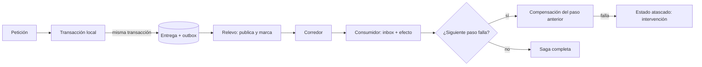
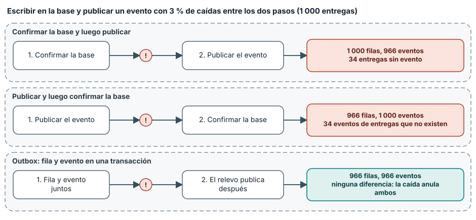
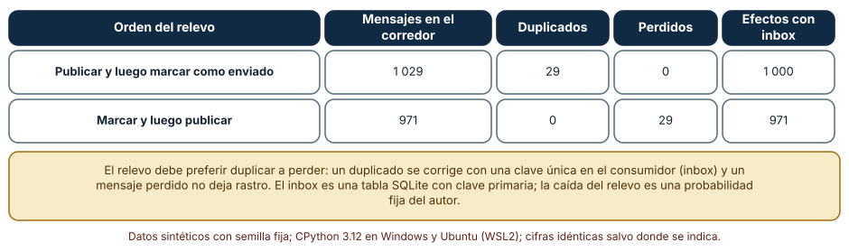
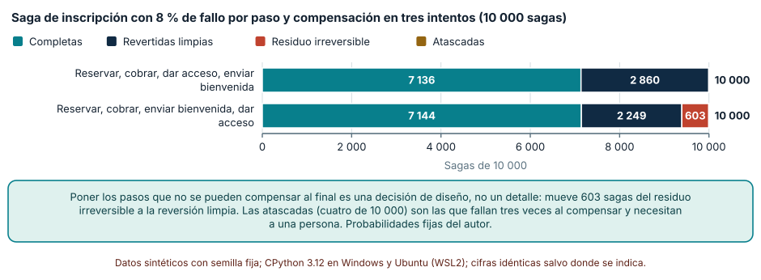

# SE-329 — Outbox, inbox, sagas y compensación

[← SE-328 — Entrega, orden, duplicación y semánticas](../../classes/part-27-integracion-eventos-y-mensajeria/se-328-entrega-orden-duplicacion-y-semanticas/README.md) · [↑ Parte 27](../../classes/part-27-integracion-eventos-y-mensajeria/README.md) · [📚 Índice completo](../../classes/README.md) · [🌐 Portal](../../site/classes/SE-329.html) · [SE-330 — CDC, ETL, ELT y sincronización →](../../classes/part-27-integracion-eventos-y-mensajeria/se-330-cdc-etl-elt-y-sincronizacion/README.md)

## Punto profesional y fundamento pedagógico

**Punto profesional.** La clase existe para que resuelvas el problema de cambiar una base de datos y avisar a otros servicios sin que uno de los dos pasos quede a medias: aprenderás a medir qué inconsistencias produce escribir y publicar por separado, qué garantiza un outbox y qué le falta, y qué diferencia hay entre compensar un paso y deshacerlo, con un orden de pasos que decide cuántas operaciones terminan con un residuo irreversible.

**Por qué aparece aquí.** Sigue a **Entrega, orden, duplicación y semánticas**: ya se sabe que el transporte entrega al menos una vez y que el receptor debe ser idempotente. Falta el otro extremo: cómo se asegura el emisor de que el mensaje existe si y solo si el cambio existe. En la plataforma de entregas, guardar una entrega y avisar al calificador son dos sistemas, y entre ellos no hay transacción.

**Error conceptual que debe corregir.** Creer que basta con ordenar bien dos escrituras (primero la base y luego el mensaje, o al revés) o que una saga «deshace» lo ocurrido. Cualquier orden de dos escrituras en sistemas distintos puede dejar una sin la otra, y una compensación es una acción nueva con efectos propios, no una marcha atrás.

**Secuencia de aprendizaje.** Antes de leer los resultados, predices cuántas entregas quedan sin evento si se publica después de confirmar con un 3 % de caídas en medio, qué ocurre si el relevo del outbox se cae entre publicar y marcar y cuántas sagas dejan un residuo irreversible cuando el paso que no se puede deshacer va en medio; después mides las tres cosas y comparas con tu predicción. La secuencia usa predicción, explicación propia, contraste y recuperación. [ICAP](https://icap.education.asu.edu/research) distingue participación de construcción de conocimiento; [How People Learn II](https://nap.nationalacademies.org/catalog/24783/how-people-learn-ii-learners-contexts-and-cultures) exige conectar conocimiento previo, contexto y transferencia; la [práctica de recuperación](https://pubmed.ncbi.nlm.nih.gov/16507066/) respalda producir de nuevo la explicación tras una demora; y [Education for Life and Work](https://nap.nationalacademies.org/resource/13398/dbasse_084153.pdf) exige devolución que explique la causa del error.

**Evidencia de aprendizaje.** `atomicidad-log.md` con las predicciones, las tres figuras reproducidas, el diseño de una tabla `outbox` y una `inbox` con su esquema SQL, el orden de pasos de la saga de inscripción con la compensación de cada uno y una nota que diga cuál es el punto sin retorno.

**Límite de la conclusión.** Las caídas (3 % entre pasos), los fallos de pasos de la saga (8 %) y de compensación (10 % por intento, tres intentos) son probabilidades del autor aplicadas con semilla fija; el corredor es una lista en memoria. El outbox y la inbox usan SQLite real, pero no se midió ningún relevo concurrente, latencia ni orden entre varios relevos. Los resultados muestran mecanismos, no la fiabilidad de un despliegue.

### Trazabilidad fuente → afirmación

| Fuente primaria u oficial | Afirmación que respalda | Lo que no prueba |
|---|---|---|
| [microservices.io: Transactional outbox](https://microservices.io/patterns/data/transactional-outbox.html) | Describe guardar el mensaje en una tabla de la misma base y la misma transacción que el cambio, y publicarlo después con un relevo. | No fija el esquema ni el tamaño del lote de la plataforma. |
| [Debezium: Outbox Event Router](https://debezium.io/documentation/reference/stable/transformations/outbox-event-router.html) | Documenta una implementación que lee la tabla outbox desde el registro de cambios de la base y publica los eventos. | No describe cómo se comporta un relevo propio ni sus fallos. |
| [Garcia-Molina y Salem, «Sagas» (1987)](https://dl.acm.org/doi/10.1145/38713.38742) | Propone dividir una transacción larga en subtransacciones con compensaciones en lugar de un bloqueo único. | No dice cómo ordenar los pasos de la inscripción ni mide residuos. |
| [Microsoft: patrón Saga](https://learn.microsoft.com/en-us/azure/architecture/patterns/saga) | Presenta sagas coreografiadas y orquestadas, y advierte que las compensaciones deben ser idempotentes y pueden fallar. | No cuantifica con qué frecuencia una compensación falla. |
| [Microsoft: transacción compensatoria](https://learn.microsoft.com/en-us/azure/architecture/patterns/compensating-transaction) | Explica que deshacer un paso de un flujo de trabajo no siempre devuelve el estado anterior. | No decide qué pasos de la plataforma son irreversibles. |

## Antes de empezar

Recupera lo aprendido en la Parte 26 sobre transacciones (la atomicidad vale dentro de una base) y en `SE-328` sobre el receptor idempotente. La pregunta activa es: **si el proceso se cae justo entre este paso y el siguiente, ¿qué queda hecho, qué queda sin hacer y quién se entera?**

## Prerrequisitos

- Haber completado `SE-328` o poder explicar por qué un consumidor al menos una vez necesita idempotencia.
- Python 3.11 o posterior con el módulo `sqlite3`; el resto usa solo la biblioteca estándar y generadores con semilla fija.
- Leer una transacción con `BEGIN`, `COMMIT` y `ROLLBACK` y entender una clave primaria como restricción de unicidad.

## Problema auténtico

Al recibir una entrega, el servicio la guarda en su base y publica `EntregaRecibida` para que el calificador la tome. Un viernes por la noche un despliegue reinicia el proceso entre las dos operaciones durante unos segundos: 34 entregas quedan guardadas y sin evento, y los estudiantes ven «recibida» durante días sin nota. El equipo invierte el orden: publica primero y guarda después. Ahora, cuando la base rechaza una escritura por una restricción, el calificador ya recibió un mensaje de una entrega que no existe. Alguien propone resolver el flujo completo de inscripción (reservar cupo, cobrar, dar acceso, enviar bienvenida) con una compensación por paso, y descubre que el correo de bienvenida ya salió cuando falla el último paso. Las tres situaciones comparten una raíz: no hay una transacción que cubra los dos lados.

## Objetivos observables

Al terminar podrás:

1. medir qué inconsistencias produce cada orden de dos escrituras ante una caída intermedia y mostrar que el outbox las elimina;
2. explicar y medir por qué el relevo del outbox debe preferir duplicar a perder, y qué hace la inbox con los duplicados;
3. diseñar una saga con sus pasos, sus compensaciones y su estado visible, y contar los finales posibles bajo fallos;
4. mostrar que el orden de los pasos decide cuántas sagas dejan un residuo irreversible;
5. escribir el esquema de `outbox` e `inbox` con las columnas, las restricciones y el procedimiento del relevo.

## Mapa conceptual



El mapa separa tres problemas: la **atomicidad local** (cambio y mensaje en la misma transacción), la **entrega fiable** (relevo e inbox) y la **coordinación entre pasos** (saga con compensaciones). Cada problema tiene su propio mecanismo y su propio modo de fallar.

## Temas y por qué importan

| Tema | Por qué cambia una decisión profesional | Evidencia mínima |
|---|---|---|
| Doble escritura | Sin transacción común, cualquier orden deja una escritura huérfana. | Predicción, traza causal y contraejemplo de **Doble escritura** en `atomicidad-log.md` |
| Outbox transaccional | Convierte «publicar» en una fila de la misma transacción. | Predicción, traza causal y contraejemplo de **Outbox transaccional** en `atomicidad-log.md` |
| Inbox y relevo | El relevo duplica; la inbox convierte duplicados en un solo efecto. | Predicción, traza causal y contraejemplo de **Inbox y relevo** en `atomicidad-log.md` |
| Sagas | Coordinan pasos entre servicios sin un bloqueo global. | Predicción, traza causal y contraejemplo de **Sagas** en `atomicidad-log.md` |
| Compensación | Un paso compensado no equivale a un paso no ocurrido. | Predicción, traza causal y contraejemplo de **Compensación** en `atomicidad-log.md` |

## Conceptos y decisiones

### 1. Doble escritura

Guardar en la base y publicar en el corredor son dos operaciones en dos sistemas que no comparten transacción. Si se confirma la base y luego se publica, una caída entre ambas deja un cambio sin aviso; si se publica y luego se confirma, deja un aviso de algo que no ocurrió. No existe un tercer orden: el problema es la falta de atomicidad entre los dos, no el orden. Un reintento tras el fallo tampoco ayuda por sí solo, porque el proceso reiniciado no sabe qué escribió antes de caer. La solución estructural es que **un solo sistema** guarde ambas cosas.

### 2. Outbox transaccional

El **outbox** es una tabla en la misma base de datos del servicio. La operación de negocio inserta la entrega **y** una fila en `outbox` con el mensaje en la **misma transacción**: o ambas existen o ninguna. Un proceso aparte, el **relevo**, lee las filas no publicadas, las envía al corredor y las marca. La publicación pasa de ser parte de la petición a ser una tarea que se reintenta hasta lograrlo. El costo es una tabla más, un proceso que operar, la latencia del relevo y la necesidad de limpiar lo ya enviado. La ganancia es que ya no existen entregas sin evento ni eventos sin entrega.

### 3. Inbox y relevo

El relevo puede caerse **entre publicar y marcar**, y entonces vuelve a publicar la misma fila: el outbox da entrega al menos una vez. La alternativa de marcar primero y publicar después convierte la caída en una pérdida silenciosa, y una pérdida no deja rastro que se pueda reparar. Por eso el relevo debe preferir **duplicar** a **perder**, y el receptor lleva una **inbox**: una tabla con el identificador del mensaje como clave primaria, insertada en la misma transacción que el efecto. El `INSERT OR IGNORE` sobre esa clave convierte el duplicado en una operación sin efecto. Es la misma defensa de `SE-328`, ahora con su pareja del lado emisor.

### 4. Sagas

Una **saga** divide un proceso largo entre servicios en pasos locales; cada uno confirma su transacción y publica el siguiente. No hay bloqueos entre servicios ni aislamiento: mientras corre, otros ven estados intermedios. Si un paso falla, la saga ejecuta las **compensaciones** de los pasos anteriores en orden inverso. Puede ser **coreografiada** (cada servicio reacciona a eventos de los demás, sin coordinador) o **orquestada** (un coordinador conoce el flujo y ordena cada paso). La coreografía reduce el acoplamiento y dificulta saber en qué estado va un proceso; la orquestación concentra ese conocimiento en un lugar que hay que operar y probar.

### 5. Compensación

Una compensación es una acción **nueva** que contrarresta el efecto de otra, no una reversión: reembolsar un cobro no «des-cobra», y cancelar un cupo no borra que alguien lo vio ocupado. Algunas acciones no tienen compensación (un correo enviado, un archivo publicado), y esos pasos se llaman **irreversibles**. La regla de diseño es ordenar los pasos de modo que los compensables vayan primero, el irreversible lo más tarde posible (un **pivote**: tras él la saga solo puede avanzar), y los pasos posteriores al pivote puedan reintentarse hasta lograrse. Las compensaciones también fallan: deben ser idempotentes, reintentables y dejar un estado «atascado» observable si no logran terminar.

### Escribir y publicar con una caída entre los dos pasos

Se procesan 1 000 entregas; en el 3 % de ellas (34 con la semilla 3291) hay una caída entre los dos pasos. Se comparan tres estrategias: confirmar la base y luego publicar, publicar y luego confirmar, y el outbox con la entrega y la fila del mensaje en una sola transacción de SQLite.

```python
con.execute("begin")
con.execute("insert into entrega values(?)", (i,))
if falla: raise RuntimeError("caída antes del commit")
con.execute("insert into outbox(id) values(?)", (i,))
con.execute("commit")
```

| Estrategia | Filas en la base | Eventos publicados | Inconsistencias |
|---|---:|---:|---|
| Confirmar la base y luego publicar | 1 000 | 966 | 34 entregas sin evento |
| Publicar y luego confirmar la base | 966 | 1 000 | 34 eventos de entregas que no existen |
| Outbox: fila y evento en una transacción | 966 | 966 | Ninguna |

Las dos primeras estrategias dejan 34 entregas inconsistentes cada una, en sentidos opuestos. Con el outbox la caída antes del commit anula la entrega y su mensaje, de modo que el cliente ve un error y puede reintentar. Una caída **después** del commit deja la fila en el outbox para el relevo; ese caso no se inyectó aquí y es el que muestra el siguiente experimento.



**Cómo leer la figura.** Cada fila es una estrategia; las columnas cuentan lo guardado, lo publicado y lo que no coincide. **Dónde deja de valer:** la caída se modela como una excepción en el cliente con probabilidad fija; un apagón real puede dejar la transacción en un estado que el motor repara al reiniciar, y un corredor real puede rechazar o retrasar la publicación. El corredor es una lista: no se midió ninguna publicación real.

### El relevo que se cae entre publicar y marcar

Se publican las 1 000 entradas del outbox con el 3 % de caídas del relevo entre los dos pasos. En la variante «publicar y luego marcar» una caída vuelve a publicar la fila; en «marcar y luego publicar» una caída la deja marcada sin publicar. Después, los mensajes llegan a un consumidor con una inbox de SQLite.

```python
broker.append(i)                  # publicar
if caida: broker.append(i)        # al reiniciar, la fila no estaba marcada
cur = con.execute("insert or ignore into inbox values(?)", (m,))
if cur.rowcount: con.execute("insert into efecto values(?)", (m,))
```

| Orden del relevo | Mensajes en el corredor | Duplicados | Perdidos | Efectos con inbox |
|---|---:|---:|---:|---:|
| Publicar y luego marcar | 1 029 | 29 | 0 | 1 000 |
| Marcar y luego publicar | 971 | 0 | 29 | 971 |

El primer orden produce 29 duplicados y la inbox los absorbe: 1 000 efectos para 1 000 entregas. El segundo parece más limpio, pero pierde 29 mensajes que ningún consumidor puede reparar porque no hay rastro de que existieron. La asimetría decide la regla: un duplicado se corrige con una clave, una pérdida solo se detecta comparando contra otra fuente.



**Cómo leer la figura.** Cada fila es un orden del relevo; las columnas finales miden lo que ve el corredor y lo que resulta tras la bandeja de entrada. **Dónde deja de valer:** el relevo es un bucle de un solo proceso; con varios relevos concurrentes hace falta reclamar filas sin que dos las tomen, y el orden entre ellas se pierde. Una inbox que limpia sus claves antiguas reintroduce el problema de la ventana de `SE-328`.

### El orden de los pasos de una saga

Se simula la inscripción de 10 000 estudiantes con cuatro pasos: reservar cupo, cobrar, dar acceso al aula y enviar la bienvenida, que no se puede deshacer. Cada paso falla con probabilidad 0,08. Si un paso falla, se compensan los anteriores en orden inverso; cada compensación se reintenta hasta tres veces y falla cada intento con probabilidad 0,1. Se comparan dos órdenes: la bienvenida al final y la bienvenida antes del último paso.

```python
for s, compensable in reversed(hechos):
    if not compensable: residuo = True; continue
    if all(r.random() < 0.1 for _ in range(3)): atascada = True
```

| Orden de los pasos | Completas | Revertidas limpias | Residuo irreversible | Atascadas |
|---|---:|---:|---:|---:|
| Reservar, cobrar, dar acceso, bienvenida | 7 136 | 2 860 | 0 | 4 |
| Reservar, cobrar, bienvenida, dar acceso | 7 144 | 2 249 | 603 | 4 |

Ambas completan cerca del 71 %, como esperaría 0,92 elevado a 4. La diferencia está en lo que ocurre al fallar: con la bienvenida al final, el correo solo sale cuando todo lo demás funcionó y ninguna saga deja residuo; con la bienvenida antes del acceso, 603 sagas envían un correo a alguien cuya inscripción acabó revertida. Las 4 atascadas de cada orden son las que no lograron compensar tres veces seguidas y necesitan intervención humana: no existe un diseño con cero.



**Cómo leer la figura.** Cada fila es un orden de pasos; la columna de residuo irreversible mide el efecto de ubicar el paso sin compensación. **Dónde deja de valer:** las tasas de fallo son iguales y constantes para todos los pasos, y en un sistema real el cobro falla más que el envío de un correo; además no se modelan sagas concurrentes ni lecturas de estados intermedios. La figura muestra la dirección del efecto, no su tamaño.

## Definiciones de trabajo

- **outbox transaccional:** tabla, en la misma base que el cambio de negocio, donde se guardan los mensajes a publicar dentro de la misma transacción.
- **relevo:** proceso que lee los mensajes pendientes del outbox, los publica y los marca como enviados.
- **inbox:** tabla del receptor que registra los identificadores de los mensajes aplicados, con clave única, junto con el efecto.
- **saga:** secuencia de transacciones locales en distintos servicios, cada una con una compensación que contrarresta su efecto.
- **pivote:** paso de una saga a partir del cual ya no hay vuelta atrás y solo se puede avanzar.

Las definiciones son operativas para la plataforma de entregas. No convierten términos con una historia más amplia en sinónimos y deben contrastarse con la documentación primaria enlazada al final.

## Ejemplo mínimo

El fragmento inserta una entrega y su mensaje en una sola transacción y provoca un fallo antes del commit. Antes de ejecutarlo, predice cuántas filas quedan en cada tabla.

```python
import sqlite3
con = sqlite3.connect(":memory:", isolation_level=None)
con.execute("create table entrega(id int primary key)")
con.execute("create table outbox(id int primary key)")
try:
    con.execute("begin")
    con.execute("insert into entrega values(1)")
    raise RuntimeError("caída")
    con.execute("insert into outbox values(1)")
except RuntimeError:
    con.execute("rollback")
print(con.execute("select count(*) from entrega").fetchone(), con.execute("select count(*) from outbox").fetchone())
```

Ambas tablas quedan en cero. Registra versión de Python y de SQLite y salida; después mueve el `raise` a después de los dos `insert` y antes de `commit` y comprueba que el resultado es el mismo.

## Ejemplo profesional

El equipo de la plataforma diseña tres piezas. **Outbox:** tabla `outbox(id, tipo, clave, cuerpo, creado, publicado_en)` en la misma base de las entregas; la operación que registra la entrega inserta la fila en la misma transacción. **Relevo:** un proceso que lee lotes de 100 filas sin `publicado_en`, publica, marca y limpia las publicadas con más de siete días; si se cae entre publicar y marcar, el mensaje se publica de nuevo. **Inbox:** el calificador tiene `inbox(mensaje_id primary key)` y hace `INSERT OR IGNORE` en la misma transacción del efecto. Para la inscripción, deciden una saga orquestada con el orden reservar cupo, cobrar, dar acceso y, solo al final, enviar la bienvenida; las compensaciones (liberar cupo, reembolsar, retirar acceso) son idempotentes y se reintentan hasta tres veces, y una saga que no compensa queda en el estado `atascada` con una alarma. Antes de lanzar miden cuántos mensajes quedan sin publicar durante un minuto (la edad de la fila más vieja) y lo vigilan. Compara con el diseño inicial: ninguna entrega queda sin evento, los duplicados del relevo no cambian ninguna nota y el correo de bienvenida solo sale cuando la inscripción está completa.

## Práctica guiada

1. Dibuja la secuencia «guardar entrega, publicar evento» e indica qué queda hecho si el proceso cae en cada punto.
2. Predice cuántas entregas quedan sin evento en cada orden con 3 % de caídas y escribe el número.
3. Implementa las tres estrategias con SQLite y reproduce la tabla de 1 000 entregas.
4. Implementa el relevo en los dos órdenes y una inbox, y comprueba los duplicados, las pérdidas y los efectos.
5. Escribe la saga de inscripción con compensaciones y mide los cuatro finales con los dos órdenes.
6. Marca en tu saga cuál es el pivote y qué pasos le siguen.
7. Entrega `atomicidad-log.md` y pide a otra persona que encuentre una compensación que no sea idempotente.

## Ejercicios

1. **Esquema:** escribe `CREATE TABLE` para `outbox` e `inbox` y justifica la clave primaria y los índices de cada una.
2. **Relevo:** con 50 filas por segundo y un relevo que procesa lotes de 100 cada segundo, calcula el retraso máximo y qué ocurre si el corredor deja de aceptar mensajes durante un minuto.
3. **Saga:** la inscripción añade «asignar tutor», que se puede deshacer, y «publicar el nombre en el listado», que no; propón el orden y justifica el pivote.
4. **Compensación:** describe por qué «reembolsar el cobro» no devuelve el estado anterior y qué información adicional debe registrar la saga.

## Reto verificable

Entrega `atomicidad-log.md` con las predicciones, las tres tablas reproducidas con las mismas semillas, el esquema de `outbox` e `inbox`, el procedimiento del relevo y la saga con su orden y sus compensaciones. Se aprueba si otra persona ejecuta el código desde un checkout limpio, obtiene 34 inconsistencias por estrategia, 29 duplicados absorbidos por la inbox y 603 residuos irreversibles con el orden desfavorable, y puede decir cuál es el pivote de la saga. No se aprueba por publicar el evento «después» sin outbox ni por una saga cuyas compensaciones no sean reintentables.

## Caso conductor

El flujo de entrega, calificación, aviso y registro de la plataforma es el caso conductor de la Parte 27. Esta clase deja el quinto artefacto: el outbox y la inbox de la plataforma y la saga de inscripción. `SE-330` pregunta cómo llevar los cambios de una base a otra para análisis y reportes. Cambia después una sola decisión, el orden del relevo, y observa si el defecto que aparece es recuperable.

## Preguntas frecuentes

### ¿El outbox no es lo mismo que una cola?

No: es una tabla que vive en la misma base que el cambio de negocio para obtener atomicidad local. El corredor es otra pieza. El outbox no sustituye al corredor; garantiza que el mensaje llegue a él.

### ¿Por qué no usar una transacción distribuida?

Porque exige que todos los participantes la soporten, bloquea recursos mientras dura y se degrada cuando alguno falla o se retrasa. En la práctica, los sistemas con colas, servicios externos o proveedores no la ofrecen. Outbox y saga son la alternativa práctica con consistencia eventual.

### ¿Orquestación o coreografía?

Con pocos pasos y equipos que ya reaccionan a eventos, la coreografía basta. Con muchos pasos, condiciones o necesidad de saber en qué estado va cada proceso, la orquestación concentra la lógica y facilita observarla. La elección se decide por la necesidad de observar y cambiar el flujo, no por moda.

### ¿Qué hago con una saga atascada?

Se detecta, se alerta y la resuelve una persona con la información del estado de cada paso. Por eso la saga guarda el avance y los intentos de compensación: sin ese registro, una saga atascada no se puede diagnosticar ni terminar.

## Fallo controlado y diagnóstico

Reproduce el fallo clásico de la clase: **marcar como enviado antes de publicar**. Haz que el relevo marque la fila y que una caída ocurra justo después.

Registra síntoma, entrada mínima, hipótesis, observación que descarta cada hipótesis, causa, corrección y prueba de regresión. **Síntoma:** algunas entregas nunca llegan al calificador y no hay error en ningún registro. **Hipótesis rivales:** (a) el calificador descartó el mensaje; (b) el corredor lo perdió; (c) el relevo marcó la fila sin haberla publicado. **Prueba:** compara las filas del outbox marcadas con los mensajes del corredor por identificador; si hay filas marcadas sin mensaje correspondiente, la causa es el orden del relevo. **Conclusión:** marcar antes de publicar convierte una caída en una pérdida. **Regresión:** publicar y luego marcar, inbox en el receptor y una prueba que inyecta la caída entre ambos pasos y comprueba que cada entrega tiene exactamente un efecto. No cambies a la vez el relevo y la inbox.

## Errores comunes y cómo corregirlos

| Síntoma | Causa probable | Corrección |
|---|---|---|
| Entregas guardadas sin evento | Se publicó después de confirmar, sin outbox | Outbox en la misma transacción y relevo |
| Eventos de entregas que no existen | Se publicó antes de confirmar la base | Publicar solo desde el outbox, tras el commit |
| Mensajes perdidos sin rastro | El relevo marca antes de publicar | Publicar y luego marcar; inbox en el receptor |
| Cada caída del relevo duplica efectos | Receptor sin inbox | Clave única por mensaje en la misma transacción del efecto |
| Correos enviados de inscripciones revertidas | Paso irreversible antes del pivote | Colocar los pasos irreversibles al final |

## Entorno y archivos clave

```text
work/SE-329/
├── README.md
├── atomicidad/
│   ├── schema.sql
│   ├── relevo.py
│   └── saga.py
├── tests/test_atomicidad.py
└── evidence/atomicidad-log.md
```

El `README` declara plataforma, versión de Python y de SQLite, semillas y comandos. El código de los tres experimentos está en `scripts/experiments_part27_a.py` (funciones `e329_doble_escritura`, `e329_relevo` y `e329_saga`) y se ejecuta con `python scripts/experiments_part27_a.py`. Solo usa la biblioteca estándar y se ejecutó con CPython 3.12.9 en Windows 11 (SQLite 3.45.3) y 3.12.3 en Ubuntu bajo WSL2 (SQLite 3.45.1): las salidas fueron idénticas. Si añades una dependencia, fija procedencia y versión.

## Seguridad, ética y accesibilidad

- el outbox y la inbox guardan copias de datos de estudiantes: fija su retención y su acceso y limpia lo publicado (`SE-322`);
- una compensación que reembolsa o retira un acceso afecta a personas: debe ser auditable y no depender de un solo operador;
- un paso irreversible (un correo, una publicación) debe pedir confirmación de que la saga está completa, no solo que el paso previo terminó;
- los estados intermedios de una saga son visibles para los usuarios: «inscripción en curso» debe ser comprensible y accesible, no un error;
- los datos de ensayo son sintéticos; no uses inscripciones reales para provocar fallos.

## Puente hacia el trabajo con agentes

Un agente al que se le pide «publica un evento al guardar la entrega» suele añadir una llamada al corredor justo después del `commit`, o dentro de la transacción antes de confirmar, sin outbox. Pídele en cambio que escriba la tabla del outbox, la inserción en la misma transacción, el relevo con el orden publicar-marcar, la inbox del consumidor y una prueba que inyecte la caída en cada punto. Revisa especialmente si publica fuera de la transacción de la base y si una saga pone un paso irreversible antes del último compensable: son los dos defectos que esta clase mostró sin aviso.

## Transferencia

Traslada el análisis a otro dominio (por ejemplo, un comercio con pedidos, pagos y envíos): cambia los pasos y conserva el procedimiento de buscar la escritura que queda fuera de la transacción, mover la publicación al outbox, preferir duplicar a perder en el relevo y poner el paso irreversible al final de la saga. La transferencia está lograda cuando puedes decir qué quedaría a medias si el proceso cae en cada punto, no cuando existe una tabla llamada `outbox`.

## Evaluación y evidencia

| Criterio | Evidencia para aprobar |
|---|---|
| comprensión | explicación de por qué no hay orden seguro de dos escrituras y qué resuelve el outbox |
| corrección | tablas de doble escritura, relevo y saga reproducibles con las mismas semillas |
| diseño | esquema de outbox e inbox, procedimiento del relevo y saga con pivote |
| diagnóstico | reproducción del relevo que marca antes de publicar con regresión |
| incertidumbre | declaración de que las tasas son supuestos y de que el corredor es una lista |
| reproducibilidad | versiones, comandos, salida y límites declarados |

## Fuentes

- [microservices.io: Transactional outbox](https://microservices.io/patterns/data/transactional-outbox.html) — patrón del outbox y su relevo; autoridad: Chris Richardson, autor del catálogo.
- [Debezium: Outbox Event Router](https://debezium.io/documentation/reference/stable/transformations/outbox-event-router.html) — implementación del outbox sobre el registro de cambios; autoridad: proyecto Debezium.
- [Garcia-Molina y Salem, «Sagas»](https://dl.acm.org/doi/10.1145/38713.38742) — subtransacciones con compensaciones; autoridad: artículo original (SIGMOD 1987; metadatos verificados con Crossref, el editor bloquea las peticiones automáticas).
- [Microsoft: patrón Saga](https://learn.microsoft.com/en-us/azure/architecture/patterns/saga) — sagas coreografiadas y orquestadas; autoridad: documentación de Microsoft.
- [Microsoft: transacción compensatoria](https://learn.microsoft.com/en-us/azure/architecture/patterns/compensating-transaction) — límites de deshacer un paso; autoridad: documentación de Microsoft.

Cada fuente respalda el mecanismo indicado; ninguna demuestra que las 34 inconsistencias, los 29 duplicados o los 603 residuos se observen en una plataforma real. Esa afirmación depende de las tasas de fallo, del corredor y del orden de los pasos de cada saga.

## Límites y siguiente paso

Se ejecutaron tres experimentos con datos sintéticos en Windows y Ubuntu (WSL2) con resultados idénticos. No se usó corredor, red ni concurrencia de relevos: las caídas, los fallos de pasos y las compensaciones son probabilidades del autor con semilla fija, y los resultados no se extrapolan a ningún sistema. Solo el outbox y la inbox usan un motor real. La siguiente clase pregunta cómo llevar los cambios de una base a otra, para análisis o sincronización, sin perder borrados ni orden.

## Glosario

- **outbox transaccional:** tabla, en la misma base que el cambio de negocio, donde se guardan los mensajes a publicar dentro de la misma transacción.
- **relevo:** proceso que lee los mensajes pendientes del outbox, los publica y los marca como enviados.
- **inbox:** tabla del receptor que registra los identificadores de los mensajes aplicados, con clave única, junto con el efecto.
- **saga:** secuencia de transacciones locales en distintos servicios, cada una con una compensación que contrarresta su efecto.
- **pivote:** paso de una saga a partir del cual ya no hay vuelta atrás y solo se puede avanzar.

---

[← SE-328 — Entrega, orden, duplicación y semánticas](../../classes/part-27-integracion-eventos-y-mensajeria/se-328-entrega-orden-duplicacion-y-semanticas/README.md) · [↑ Parte 27](../../classes/part-27-integracion-eventos-y-mensajeria/README.md) · [📚 Índice completo](../../classes/README.md) · [🌐 Portal](../../site/classes/SE-329.html) · [SE-330 — CDC, ETL, ELT y sincronización →](../../classes/part-27-integracion-eventos-y-mensajeria/se-330-cdc-etl-elt-y-sincronizacion/README.md)
