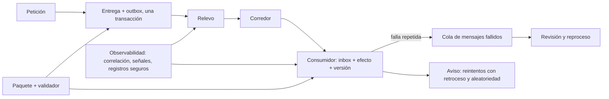
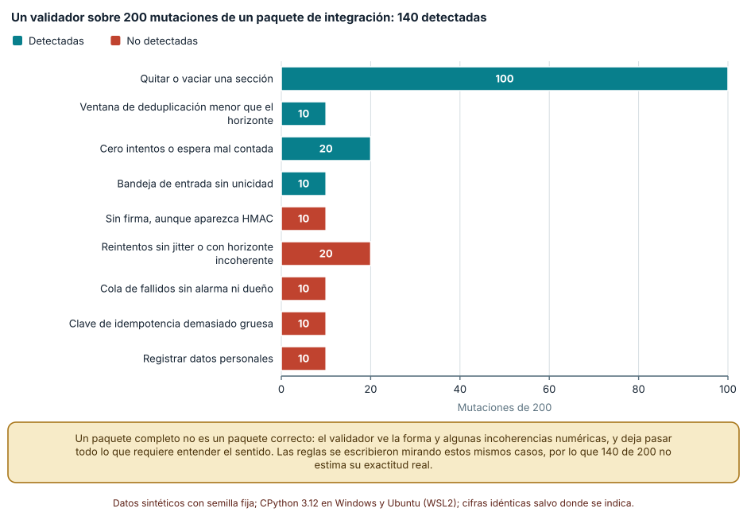
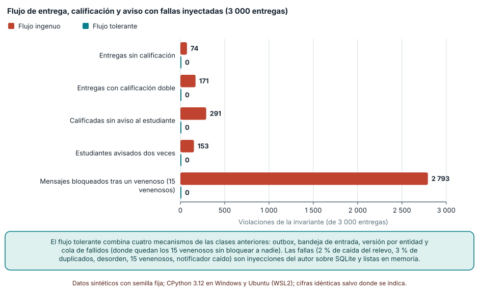
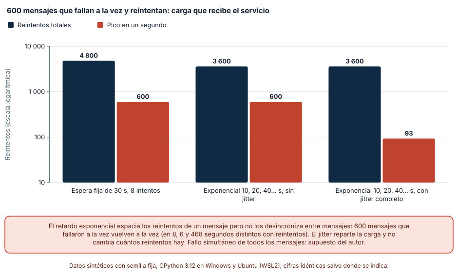

# SE-336 — Proyecto: flujo integrado tolerante a reintentos

[← SE-335 — Taller: provocar y contener mensajes duplicados](../../classes/part-27-integracion-eventos-y-mensajeria/se-335-taller-provocar-y-contener-mensajes-duplicados/README.md) · [↑ Parte 27](../../classes/part-27-integracion-eventos-y-mensajeria/README.md) · [📚 Índice completo](../../classes/README.md) · [🌐 Portal](../../site/classes/SE-336.html) · [SE-337 — Concurrencia, paralelismo y asincronía →](../../classes/part-28-concurrencia-y-sistemas-distribuidos/se-337-concurrencia-paralelismo-y-asincronia/README.md)

## Punto profesional y fundamento pedagógico

**Punto profesional.** El proyecto existe para que entregues un flujo de integración completo cuyas garantías puedas defender con medidas: el paquete reúne contratos de mensaje, clave de idempotencia, política de reintentos, cola de mensajes fallidos, compatibilidad de esquemas, outbox e inbox, observabilidad, seguridad y límites, y lo acompañas de un validador cuyos puntos ciegos conoces, una simulación con fallas inyectadas que compara el flujo ingenuo con el tolerante y un cálculo de qué carga recibe un servicio cuando todos los mensajes reintentan a la vez.

**Por qué aparece aquí.** Cierra la **Parte 27**: integra `SE-325` (síncrono y asíncrono), `SE-326` (qué viaja), `SE-327` (por dónde), `SE-328` (qué garantías), `SE-329` (atomicidad con outbox e inbox), `SE-330` (sincronización), `SE-331` (avisos externos), `SE-332` (compatibilidad), `SE-333` (traducción), `SE-334` (observabilidad y seguridad) y `SE-335` (duplicados) en un solo flujo de la plataforma de entregas: una entrega se guarda, se publica, se califica, se avisa al estudiante y se registra.

**Error conceptual que debe corregir.** Creer que un paquete con todas las secciones y un validador que pasa demuestra un flujo correcto. El validador del proyecto ve la forma y algunas incoherencias numéricas, y deja pasar justo lo que requiere entender el sentido: una firma que se nombra pero no se usa, una cola de fallidos sin dueño, una clave demasiado gruesa o un registro que copia datos personales. Un flujo tolerante se demuestra provocándole fallas, no leyendo su documento.

**Secuencia de aprendizaje.** Antes de medir, predices cuántas de 200 mutaciones del paquete detecta el validador, cuántas invariantes del flujo se rompen con fallas inyectadas en el flujo ingenuo y en el tolerante y qué pico de reintentos por segundo recibe un servicio con y sin aleatoriedad; después mides, corriges y declaras lo que queda sin cubrir. La secuencia usa predicción, explicación propia, contraste y recuperación. [ICAP](https://icap.education.asu.edu/research) distingue participación de construcción de conocimiento; [How People Learn II](https://nap.nationalacademies.org/catalog/24783/how-people-learn-ii-learners-contexts-and-cultures) exige conectar conocimiento previo, contexto y transferencia; la [práctica de recuperación](https://pubmed.ncbi.nlm.nih.gov/16507066/) respalda producir de nuevo la explicación tras una demora; y [Education for Life and Work](https://nap.nationalacademies.org/resource/13398/dbasse_084153.pdf) exige devolución que explique la causa del error.

**Evidencia de aprendizaje.** El paquete `PAQUETE-INTEGRACION.md` con las nueve secciones, el validador con sus pruebas, las tres figuras reproducidas, la simulación del flujo con sus invariantes, `LIMITES.md` con lo que ninguna prueba ni validador ve, y una nota que distinga qué parte de la conclusión es observación, cuál inferencia y cuál suposición.

**Límite de la conclusión.** El paquete es un texto sintético y el validador se escribió mirando los mismos casos que lo evalúan: sus 140 detecciones de 200 no estiman su exactitud real. La simulación usa SQLite para las tablas de estado y listas en memoria para el corredor; las fallas (2 % de caída del relevo, 3 % de duplicados del corredor, desorden de hasta 5 posiciones, 15 mensajes venenosos, un notificador caído durante el 10 % del flujo) son inyecciones del autor. No se usó ningún corredor, red ni concurrencia, y no se midió tiempo de reloj. Los resultados muestran que las defensas funcionan juntas bajo estas fallas, no que el flujo sea correcto bajo todas.

### Trazabilidad fuente → afirmación

| Fuente primaria u oficial | Afirmación que respalda | Lo que no prueba |
|---|---|---|
| [AWS Builders' Library: tiempos de espera, reintentos y retroceso con jitter](https://aws.amazon.com/builders-library/timeouts-retries-and-backoff-with-jitter/) | Explica que el retroceso exponencial sin aleatoriedad sincroniza a los clientes y que el jitter reparte los reintentos. | No fija los valores de la política de la plataforma. |
| [Amazon SQS: colas de mensajes fallidos](https://docs.aws.amazon.com/AWSSimpleQueueService/latest/SQSDeveloperGuide/sqs-dead-letter-queues.html) | Describe apartar los mensajes que no se pueden procesar tras un número de intentos a una cola aparte para investigarlos. | No dice quién debe revisarla ni cuándo reprocesar. |
| [microservices.io: Transactional outbox](https://microservices.io/patterns/data/transactional-outbox.html) | Describe guardar el mensaje junto al cambio en la misma transacción y publicarlo después. | No cubre la concurrencia entre varios relevos. |
| [EIP: Dead Letter Channel](https://www.enterpriseintegrationpatterns.com/patterns/messaging/DeadLetterChannel.html) | Describe el canal al que se desvían los mensajes que no se pueden entregar o procesar. | No define el calendario de reintentos ni el criterio de desvío. |
| [Google SRE: cómo evitar fallos en cascada](https://sre.google/sre-book/addressing-cascading-failures/) | Presenta los reintentos sin límite como causa de fallos en cascada y recomienda limitarlos y aleatorizarlos. | No evalúa la política de esta clase. |

## Antes de empezar

Recupera los once artefactos de la parte: la clasificación de interacciones (`SE-325`), el catálogo de mensajes (`SE-326`), la asignación de estructuras (`SE-327`), la tabla de garantías (`SE-328`), el outbox y la inbox (`SE-329`), el mecanismo de sincronización (`SE-330`), el contrato de recepción (`SE-331`), las reglas de evolución (`SE-332`), el mapa de traducción (`SE-333`), la política de observabilidad (`SE-334`) y la matriz de defensas (`SE-335`). La pregunta activa es: **si cada una de estas piezas falla de la manera que ya medimos, ¿qué invariante del flujo sobrevive y cuál no?**

## Prerrequisitos

- Haber completado `SE-335` o poder explicar las cinco causas de un duplicado y las defensas que las contienen.
- Python 3.11 o posterior con el módulo `sqlite3`; el resto usa solo la biblioteca estándar y generadores con semilla fija.
- Leer el esquema de las tablas de outbox, inbox y cola de fallidos y entender un presupuesto de reintentos.

## Problema auténtico

La plataforma de entregas debe operar el flujo completo durante el cierre de un semestre. Los ensayos individuales de cada pieza pasaron: el outbox publica, la inbox deduplica, la política de reintentos está escrita y los mensajes tienen sobre. En el ensayo conjunto con fallas inyectadas aparecen cosas que ninguna prueba individual mostró: un mensaje venenoso detiene al calificador y las entregas que le siguen esperan horas; una ventana de deduplicación de 60 segundos es menor que el horizonte de reintentos de 756 segundos, así que los reintentos tardíos duplican notas; y cuando el servicio de avisos vuelve de una caída, 600 mensajes reintentan en el mismo segundo y lo derriban otra vez. El paquete de integración estaba completo y la lista de comprobación en verde; los defectos estaban en cómo se combinaban sus partes.

## Objetivos observables

Al terminar podrás:

1. escribir un paquete de integración con nueve secciones y comprobar su coherencia numérica (ventana frente a horizonte, número de esperas frente a número de intentos);
2. medir qué mutaciones del paquete detecta y cuáles no un validador, y declarar sus puntos ciegos;
3. ejecutar una simulación con fallas inyectadas y comparar cinco invariantes del flujo ingenuo y del tolerante;
4. calcular el pico de carga de un servicio cuando todos los mensajes reintentan juntos y mostrar el efecto de la aleatoriedad;
5. entregar `LIMITES.md` con lo que el paquete no demuestra.

## Mapa conceptual



El mapa muestra el flujo con las defensas de la parte y, aparte, el **paquete** que las documenta y el **validador** que lo revisa. El paquete describe el flujo; la simulación lo ejercita; el validador solo lee el paquete.

## Temas y por qué importan

| Tema | Por qué cambia una decisión profesional | Evidencia mínima |
|---|---|---|
| Invariantes del flujo | Definen qué significa «correcto» antes de provocar fallas. | Predicción, traza causal y contraejemplo de **Invariantes del flujo** en `PAQUETE-INTEGRACION.md` |
| Coherencia de parámetros | Ventana, esperas, intentos y horizonte se deben cumplir entre sí. | Predicción, traza causal y contraejemplo de **Coherencia de parámetros** en `PAQUETE-INTEGRACION.md` |
| Paquete y validador | Un validador de forma deja pasar defectos de sentido. | Predicción, traza causal y contraejemplo de **Paquete y validador** en `PAQUETE-INTEGRACION.md` |
| Fallas inyectadas | Muestran qué defensa falta cuando varias fallas se combinan. | Predicción, traza causal y contraejemplo de **Fallas inyectadas** en `PAQUETE-INTEGRACION.md` |
| Recuperación y carga | Una recuperación sincronizada vuelve a derribar al servicio. | Predicción, traza causal y contraejemplo de **Recuperación y carga** en `PAQUETE-INTEGRACION.md` |

## Conceptos y decisiones

### 1. Invariantes del flujo

Antes de probar hay que decir qué se espera. Las invariantes del flujo de la plataforma son cinco: **cada entrega recibida tiene exactamente una calificación** (ni cero ni dos), **cada calificación publicada produce como mucho un aviso** y eventualmente uno, **un mensaje que no se puede procesar no detiene a los demás**, **el estado final de una entrega no depende del orden de llegada de sus mensajes** y **todo mensaje fallido es visible y recuperable**. Cada invariante conecta con una clase: la primera con el outbox, la segunda con la inbox y la política del notificador, la tercera con la cola de fallidos, la cuarta con la guarda de versión y la quinta con la observabilidad. Sin invariantes escritas, «el flujo funciona» no es una afirmación comprobable.

### 2. Coherencia de parámetros

Las defensas tienen parámetros que se condicionan entre sí. La **ventana de deduplicación** debe ser mayor que el **horizonte de reintentos** (la suma de las esperas): si el emisor puede reintentar durante 756 segundos y la inbox olvida los identificadores a los 60, los reintentos tardíos pasan. El **número de esperas** debe coincidir con el **número de intentos**: un calendario de tres esperas con cinco intentos deja dos sin definir. El **plazo de visibilidad** debe superar el percentil 99 del tiempo de proceso (`SE-335`). El **jitter** extiende el horizonte real por encima del nominal. Estas relaciones se comprueban con aritmética y por eso un validador puede verificarlas; lo que no puede verificar es si los valores son los correctos para la carga real.

### 3. Paquete y validador

El **paquete de integración** es un documento corto con nueve secciones fijas que responde, para el flujo de la plataforma, a las preguntas de la parte. El **validador** lee el paquete y comprueba lo que se puede comprobar de forma mecánica: que existan las secciones y no estén vacías, que los parámetros numéricos sean coherentes entre sí y que aparezcan los elementos mínimos (una cola de fallidos, una firma, una restricción única en la inbox, una declaración de límites). No puede comprobar si lo que el documento afirma es verdad ni si la palabra «HMAC» significa que se verifica una firma. Un validador que pasa dice que la forma es completa y las cifras coinciden; no dice que el flujo sea correcto. Saber qué no ve es parte de su diseño.

### 4. Fallas inyectadas

La prueba que sustituye a la fe en el documento es **inyectar fallas** al flujo completo y comprobar las invariantes: caídas del relevo entre publicar y marcar, duplicados y desorden del corredor, caídas del consumidor antes de acusar, mensajes venenosos y un servicio de avisos caído durante parte del flujo. Comparar un flujo **ingenuo** (publicación directa tras confirmar, consumidor sin deduplicación ni versión, sin cola de fallidos, avisos sin control) con el **tolerante** (outbox, inbox, versión, cola de fallidos, avisos reconciliados) muestra qué defensa evita qué daño. Cada falla inyectada es una hipótesis sobre el mundo; las que no se inyectaron quedan fuera de la conclusión y se anotan.

### 5. Recuperación y carga

Después de una caída, el sistema debe recuperarse sin derribarse otra vez. Si todos los mensajes fallaron en el mismo instante y todos reintentan con la misma espera, vuelven en el mismo instante: el servicio recién levantado recibe toda la carga acumulada de golpe. El retroceso exponencial **espacia** los reintentos de un mensaje pero no los **desincroniza** entre mensajes; la aleatoriedad (jitter) sí. La política de reintentos incluye entonces tres cosas: calendario, aleatoriedad y un límite (cola de fallidos tras N intentos), y su efecto se mide con el pico de reintentos por segundo, no con el total.

### Un validador sobre 200 mutaciones del paquete

Se parte de un paquete válido de nueve secciones con parámetros coherentes (cinco intentos, esperas de 1, 5, 30, 120 y 600 segundos, horizonte 756 s, ventana de deduplicación de 7 200 s). Se generan 200 mutaciones con semilla fija: 100 estructurales (quitar o vaciar una sección) y 100 semánticas, diez de cada uno de diez tipos, que dejan la forma intacta. El validador comprueba secciones, coherencia aritmética y presencia de elementos mínimos.

```python
if int(ventana) < sum(int(x) for x in esperas.split(",")):
    fallos.append("la ventana de deduplicación es menor que el horizonte de reintentos")
if "DLQ" not in pq["Cola de mensajes fallidos"]: fallos.append("sin DLQ")
if "HMAC" not in pq["Seguridad"]: fallos.append("sin firma")
```

| Tipo de mutación | Mutaciones | Detectadas |
|---|---:|---:|
| Quitar o vaciar una sección | 100 | 100 |
| Ventana de deduplicación menor que el horizonte | 10 | 10 |
| Cero intentos o espera mal contada | 20 | 20 |
| Bandeja de entrada sin restricción de unicidad | 10 | 10 |
| Sin firma, aunque aparezca la palabra HMAC | 10 | 0 |
| Reintentos sin jitter o con horizonte incoherente | 20 | 0 |
| Cola de fallidos sin alarma ni dueño | 10 | 0 |
| Clave de idempotencia demasiado gruesa | 10 | 0 |
| Registrar datos personales | 10 | 0 |

Detecta 140 de 200 (70 %): todas las estructurales y las semánticas que son aritmética o presencia de un término concreto. No detecta ninguna de las que requieren entender el sentido: un texto que dice «no usamos HMAC porque la red es interna» contiene la palabra y pasa; una clave por estudiante parece una clave; una cola de fallidos «sin alarma ni dueño» sigue diciendo DLQ. Las reglas se escribieron mirando estos mismos casos, de modo que la cifra no estima su exactitud ante mutaciones nuevas.



**Cómo leer la figura.** Cada fila es un tipo de mutación; la última columna cuenta las que el validador señala. **Dónde deja de valer:** las 100 mutaciones semánticas son diez familias elegidas por el autor, no una muestra de defectos reales, y las reglas se afinaron con ellas; un defecto distinto probablemente pase. El 70 % no se puede leer como cobertura: indica cuánto del espacio explorado se puede revisar con reglas léxicas y aritméticas.

### Fallas combinadas en el flujo completo

Se simulan 3 000 entregas por un flujo con dos variantes. **Ingenua:** la entrega se confirma y se publica directamente (el 2 % de las veces se cae entre ambos pasos), el consumidor no deduplica ni guarda versión, un mensaje venenoso lo detiene, y el aviso se envía una vez sin reconciliar cuando el notificador está caído. **Tolerante:** outbox, relevo que publica y luego marca (2 % de caídas), inbox con clave única, cola de fallidos para los venenosos y reconciliación de avisos pendientes. Las fallas son iguales: el corredor duplica el 3 % de los mensajes y los desordena hasta 5 posiciones, el consumidor se cae antes de acusar el 3 % de las veces, 15 entregas tienen un mensaje venenoso y el notificador está caído durante el 10 % de los mensajes.

```python
cur = con.execute("insert or ignore into inbox values(?)", (mid,))
if not cur.rowcount: continue                        # ya se aplicó
con.execute("insert into nota values(?,?)", (ent, v))
con.execute("insert into aviso select distinct entrega from nota where entrega not in (select entrega from aviso)")
```

| Invariante | Flujo ingenuo | Flujo tolerante |
|---|---:|---:|
| Entregas sin calificación | 74 | 0 |
| Entregas con calificación doble | 171 | 0 |
| Calificadas sin aviso al estudiante | 291 | 0 |
| Estudiantes avisados dos veces | 153 | 0 |
| 15 mensajes venenosos | bloquean 2 793 mensajes tras el primero | 15 en la cola de fallidos; nadie bloqueado |

El flujo ingenuo falla en cinco frentes a la vez y cada uno tiene su causa en una clase distinta: las 74 sin calificar son unas 59 publicaciones perdidas por la doble escritura (`SE-329`) más las 15 entregas venenosas, las 171 dobles las reentregas sin inbox (`SE-328`), las 291 sin aviso la caída del notificador sin reconciliación (`SE-331`), las 153 avisadas dos veces la falta de clave en el aviso. El mensaje venenoso, además, detendría a 2 793 mensajes si el consumidor lo reintentara sin fin (la simulación calcula esa cifra como los mensajes que quedan detrás del primero y sigue adelante para medir el resto), y la causa es la falta de cola de fallidos. El tolerante deja cero en las invariantes y aparta 15 mensajes que alguien debe revisar.



**Cómo leer la figura.** Cada fila es una invariante del flujo; las dos columnas comparan las variantes con las mismas fallas inyectadas. **Dónde deja de valer:** cero en el tolerante significa que las defensas funcionan **bajo estas fallas y estas semillas**, no que el flujo sea correcto. No hay concurrencia entre consumidores ni entre relevos, no se modeló un apagón que corrompa el outbox y el notificador es una condición, no un servicio. Que un caso salga bien con una semilla no es una prueba.

### Cuando todos reintentan a la vez

Se consideran 600 mensajes que fallaron en el mismo instante. Cada uno reintenta con una de tres políticas y se cuenta cuántos reintentos llegan al servicio en cada segundo: espera fija de 30 s con 8 intentos, exponencial (10, 20, 40, 80, 160 y 320 s) sin aleatoriedad, y la misma exponencial con aleatoriedad completa (cada espera es uniforme entre 0 y su valor).

```python
t += rr.uniform(0, d) if jitter else d          # jitter completo o espera determinista
carga[int(t)] = carga.get(int(t), 0) + 1        # reintentos por segundo
```

| Política de reintentos | Reintentos totales | Pico por segundo | Segundos con reintentos |
|---|---:|---:|---:|
| Espera fija de 30 s, 8 intentos | 4 800 | 600 | 8 |
| Exponencial 10, 20, 40... s, sin jitter | 3 600 | 600 | 6 |
| Exponencial 10, 20, 40... s, con jitter completo | 3 600 | 93 | 468 |

Las dos políticas sin aleatoriedad concentran los 600 reintentos en un solo segundo cada vez, ocho y seis veces: el servicio recién recuperado recibe 600 peticiones simultáneas. Con aleatoriedad el mismo número de reintentos (3 600) se reparte en 468 segundos distintos y el pico baja a 93, una reducción de 6,5 veces. El retroceso exponencial reduce el total respecto de la espera fija (3 600 frente a 4 800), pero solo la aleatoriedad reduce el pico, que es lo que derriba al servicio.



**Cómo leer la figura.** Cada fila es una política de reintentos; la columna del pico mide el riesgo para el servicio. **Dónde deja de valer:** todos los mensajes fallan en el mismo segundo y el servicio no tiene capacidad ni latencia, así que no se mide cuándo se vuelve a caer; los reintentos con éxito no se retiran del cómputo, de modo que los totales son un máximo. El jitter completo puede producir esperas muy cortas: otras variantes (jitter decorrelacionado, mínimo fijo) equilibran distinto.

## Definiciones de trabajo

- **paquete de integración:** documento con las nueve secciones que describen el contrato, las defensas y los límites de un flujo de mensajes.
- **invariante del flujo:** propiedad que debe cumplirse sin importar las fallas, como que cada entrega tenga exactamente una calificación.
- **horizonte de reintentos:** tiempo total durante el cual un emisor puede reenviar un mensaje, la suma de sus esperas.
- **cola de mensajes fallidos:** destino de los mensajes que no se pudieron procesar tras un número de intentos, para su revisión.
- **inyección de fallas:** provocar a propósito caídas, duplicados, retrasos y mensajes inválidos para comprobar las invariantes.

Las definiciones son operativas para la plataforma de entregas. No convierten términos con una historia más amplia en sinónimos y deben contrastarse con la documentación primaria enlazada al final.

## Ejemplo mínimo

El fragmento comprueba la coherencia entre la ventana de deduplicación y el horizonte de reintentos. Antes de ejecutarlo, predice qué ocurre si la ventana es de 600 s.

```python
esperas = [1, 5, 30, 120, 600]
horizonte = sum(esperas)                 # 756 s
for ventana in (7200, 600):
    print(ventana, "coherente" if ventana >= horizonte else "los reintentos tardíos pasan")
```

Con 7 200 es coherente y con 600 no. Registra versión de Python y salida; después añade jitter del 50 % y calcula el horizonte máximo.

## Ejemplo profesional

El equipo de la plataforma cierra el proyecto con cuatro entregables. **`PAQUETE-INTEGRACION.md`:** nueve secciones; los contratos de `EntregaRecibida` y `CalificacionPublicada` con su sobre; la clave de idempotencia `(entrega, intento)`; cinco intentos con esperas de 1, 5, 30, 120 y 600 s con aleatoriedad completa (horizonte máximo 756 s); la cola `entregas_fallidas` con alarma y dueño; reglas de evolución compatibles hacia atrás y hacia adelante; outbox e inbox con clave única; señales de profundidad, edad, procesados y errores; firma con marca de tiempo y registros con lista de permitidos. **Validador y pruebas:** el validador de forma y aritmética, con una prueba por regla, y una lista explícita de lo que no ve. **Simulación con fallas:** el ensayo de 3 000 entregas con las cinco invariantes y la semilla fija, además de una variante con otra semilla para ver que el resultado no depende de ella. **`LIMITES.md`:** sin corredor real, sin concurrencia, sin carga de producción, sin fallas de disco; las reglas del validador se ajustaron con sus propios casos; los parámetros son supuestos. Antes de cerrar, una persona ajena al equipo intenta romper el paquete con una mutación que el validador no vea, y la anotan como brecha conocida. Compara con el ensayo inicial: ya no hay entregas sin calificación, la ventana es mayor que el horizonte y los 600 reintentos de una recuperación se reparten.

## Práctica guiada

1. Escribe las cinco invariantes del flujo y asigna a cada una la clase de la parte que la sostiene.
2. Redacta el paquete de nueve secciones con parámetros coherentes entre sí.
3. Implementa el validador y reproduce la detección de 140 de 200 mutaciones con la semilla dada.
4. Escribe tres mutaciones nuevas que el validador no detecte y añade una regla para una de ellas; anota cuál no se puede detectar.
5. Reproduce la simulación de 3 000 entregas con el flujo ingenuo y el tolerante y compara las cinco invariantes.
6. Cambia la semilla de las fallas y comprueba que el flujo tolerante mantiene las invariantes.
7. Calcula el pico de reintentos con las tres políticas y elige una para la plataforma.
8. Entrega el paquete, el validador, la simulación y `LIMITES.md`, y pide una revisión independiente.

## Ejercicios

1. **Coherencia:** el calendario de reintentos pasa a siete intentos con esperas de 1 a 3 600 s; recalcula el horizonte y la ventana mínima de deduplicación y razona el costo de memoria a 5 mensajes por segundo.
2. **Mutación:** diseña una mutación del paquete que cambie su sentido sin cambiar su forma y que tu validador no detecte, y explica qué comprobación humana la encontraría.
3. **Falla:** añade a la simulación un notificador que responde con éxito pero no entrega; razona qué invariante se rompe y cuál sería la señal de observabilidad.
4. **Carga:** con 6 000 mensajes que fallan a la vez y un servicio que soporta 100 reintentos por segundo, calcula qué política evita saturarlo y qué ocurre con la que no.

## Reto verificable

Entrega el paquete, el validador con sus pruebas, la simulación con las cinco invariantes y `LIMITES.md`. Se aprueba si otra persona ejecuta el código desde un checkout limpio, obtiene 140 de 200 mutaciones detectadas, cero en las cuatro primeras invariantes del flujo tolerante frente a 74, 171, 291 y 153 en el ingenuo, y un pico de 93 reintentos por segundo con aleatoriedad frente a 600 sin ella, y puede decir tres defectos que el validador no ve. No se aprueba por un paquete completo con el validador en verde ni por declarar el flujo tolerante sin haberle inyectado fallas.

## Caso conductor

El flujo de entrega, calificación, aviso y registro de la plataforma es el caso conductor de la Parte 27 y este proyecto lo cierra. El paquete de integración conecta con la Parte 28, que lleva estos mensajes a la concurrencia y a los sistemas distribuidos: lo que aquí fueron simulaciones de un solo proceso será allí varias máquinas con relojes distintos y particiones de red. Cambia después una sola decisión, la política de reintentos, y observa qué parámetro del paquete deja de ser coherente con otro.

## Preguntas frecuentes

### ¿Por qué un validador que no detecta todo tiene valor?

Porque cierra la clase de errores que se pueden detectar mecánicamente (secciones ausentes, números incoherentes) y libera la revisión humana para lo que requiere juicio. Su valor depende de que declare lo que no ve: un validador que se presenta como garantía es más peligroso que ninguno.

### ¿Cuántas fallas debo inyectar?

Las que representen incidentes que ya ocurrieron o que el análisis de riesgo marca como plausibles, y siempre con una semilla fija para reproducirlas. Más fallas no mejoran la prueba si no se saben interpretar; es mejor una falla por defensa con un resultado entendido.

### ¿Un flujo que pasa la simulación está listo para producción?

No. La simulación demuestra que las defensas funcionan juntas bajo las fallas inyectadas en un proceso, sin concurrencia, red ni carga. Antes de producción hacen falta pruebas con el corredor real, con concurrencia y con volúmenes, y un ensayo de recuperación.

### ¿Quién revisa la cola de mensajes fallidos?

Una persona o equipo con nombre, con una alarma que le avise y un plazo de revisión. Una cola de fallidos sin dueño es un lugar donde los mensajes desaparecen con buena conciencia.

## Fallo controlado y diagnóstico

Reproduce el fallo clásico del proyecto: **una ventana de deduplicación menor que el horizonte de reintentos**. Configura la inbox para olvidar los identificadores a los 60 segundos con reintentos que se extienden hasta 756.

Registra síntoma, entrada mínima, hipótesis, observación que descarta cada hipótesis, causa, corrección y prueba de regresión. **Síntoma:** algunas calificaciones se registran dos veces, siempre minutos después de la primera. **Hipótesis rivales:** (a) el productor envía el mismo mensaje dos veces de inmediato; (b) la inbox no funciona; (c) la inbox olvida el identificador antes de que llegue la última reentrega. **Prueba:** mide el intervalo entre el primer y el segundo efecto de cada duplicado; si todos superan la ventana, la causa es la ventana. **Conclusión:** ventana de 60 s con un horizonte de reintentos de 756 s. **Regresión:** ventana de deduplicación mayor que el horizonte máximo con aleatoriedad, una regla del validador que la comprueba y una prueba que reentregue un mensaje al final del horizonte. No cambies a la vez la ventana y el calendario de reintentos.

## Errores comunes y cómo corregirlos

| Síntoma | Causa probable | Corrección |
|---|---|---|
| Duplicados minutos después del original | Ventana de deduplicación menor que el horizonte de reintentos | Ventana mayor que el horizonte máximo, con la aleatoriedad incluida |
| Un solo mensaje detiene el flujo | No hay cola de mensajes fallidos | Desviar tras N intentos con alarma y dueño |
| El servicio recién recuperado vuelve a caer | Reintentos sincronizados sin aleatoriedad | Retroceso exponencial con aleatoriedad completa |
| El validador pasa y el flujo falla | El validador solo revisa la forma | Inyectar fallas y declarar los puntos ciegos |
| El paquete dice «HMAC» y no se verifica | El texto menciona el control sin implementarlo | Prueba que envíe una entrega alterada y compruebe el rechazo |

## Entorno y archivos clave

```text
work/SE-336/
├── README.md
├── PAQUETE-INTEGRACION.md
├── LIMITES.md
├── integracion/
│   ├── validar_paquete.py
│   ├── flujo.py
│   └── reintentos.py
├── tests/test_flujo.py
└── evidence/proyecto-log.md
```

El `README` declara plataforma, versión de Python y de SQLite, semillas y comandos. El código de los tres experimentos está en `scripts/experiments_part27_b.py` (funciones `e336_validador`, `e336_flujo` y `e336_tormenta`) y se ejecuta con `python scripts/experiments_part27_b.py`. Solo usa la biblioteca estándar y se ejecutó con CPython 3.12.9 en Windows 11 (SQLite 3.45.3) y 3.12.3 en Ubuntu bajo WSL2 (SQLite 3.45.1): las salidas fueron idénticas. Si añades una dependencia, fija procedencia y versión.

## Seguridad, ética y accesibilidad

- la cola de mensajes fallidos concentra los mensajes que fallaron, a menudo los más sensibles: limita su acceso, su retención y su reproceso con aprobación (`SE-322`);
- el reproceso masivo de mensajes fallidos puede repetir efectos sobre personas: reprocesa con la misma clave de idempotencia y con una muestra primero;
- el paquete debe ser legible por quien opera el sistema de madrugada: texto navegable, con ejemplos y sin depender de un diagrama;
- no presentes la simulación como evidencia de seguridad o de cumplimiento: no se evaluó ninguna norma ni se probó un ataque real;
- los datos de ensayo son sintéticos y los secretos del paquete son valores de ejemplo, nunca credenciales reales.

## Puente hacia el trabajo con agentes

Un agente al que se le pide «completa el diseño de integración» suele producir un documento con todas las secciones y parámetros plausibles que no se cumplen entre sí (una ventana más corta que el horizonte, reintentos sin aleatoriedad, una cola de fallidos que nadie revisa) y un validador que solo comprueba que las secciones existan. Pídele en cambio que derive los parámetros con aritmética visible, que escriba el validador con sus puntos ciegos declarados, que ejecute una simulación con fallas inyectadas comparando un flujo ingenuo y uno tolerante y que redacte `LIMITES.md` con lo que no se probó. Revisa especialmente si los números del paquete son coherentes entre sí y si el documento afirma controles que ninguna prueba ejerce: son los dos defectos que este proyecto mostró sin aviso.

## Transferencia

Traslada el proyecto a otro dominio (por ejemplo, un flujo de reservas con pagos y confirmaciones): cambia las entidades y conserva el procedimiento de escribir invariantes, derivar parámetros coherentes, inyectar fallas combinadas con semilla fija, medir el pico de carga de una recuperación y declarar los puntos ciegos del validador. La transferencia está lograda cuando puedes decir qué invariante rompe cada falla que no defendiste, no cuando el paquete tiene todas las secciones.

## Evaluación y evidencia

| Criterio | Evidencia para aprobar |
|---|---|
| comprensión | explicación de cómo las defensas de la parte se combinan en un flujo y de qué invariante sostiene cada una |
| corrección | validador, simulación y pico de reintentos reproducibles con las mismas semillas |
| diseño | paquete de nueve secciones con parámetros coherentes entre sí |
| diagnóstico | reproducción de la ventana menor que el horizonte con regresión |
| incertidumbre | `LIMITES.md` con lo que no se probó y los puntos ciegos del validador |
| reproducibilidad | versiones, comandos, salida y límites declarados |

## Fuentes

- [AWS Builders' Library: timeouts, retries and backoff with jitter](https://aws.amazon.com/builders-library/timeouts-retries-and-backoff-with-jitter/) — retroceso exponencial y aleatoriedad; autoridad: Amazon Web Services.
- [Amazon SQS: colas de mensajes fallidos](https://docs.aws.amazon.com/AWSSimpleQueueService/latest/SQSDeveloperGuide/sqs-dead-letter-queues.html) — apartar mensajes que no se pueden procesar; autoridad: Amazon Web Services.
- [microservices.io: Transactional outbox](https://microservices.io/patterns/data/transactional-outbox.html) — outbox y relevo; autoridad: Chris Richardson, autor del catálogo.
- [EIP: Dead Letter Channel](https://www.enterpriseintegrationpatterns.com/patterns/messaging/DeadLetterChannel.html) — canal de mensajes no procesables; autoridad: autores del libro.
- [Google SRE: addressing cascading failures](https://sre.google/sre-book/addressing-cascading-failures/) — reintentos y fallos en cascada; autoridad: Google.

Cada fuente respalda el mecanismo indicado; ninguna demuestra que las 140 detecciones, los 2 793 mensajes bloqueados o el pico de 93 reintentos por segundo se observen en una plataforma real. Esa afirmación depende del corredor, de la carga y de las fallas de cada despliegue.

## Límites y siguiente paso

Se ejecutaron tres experimentos con datos sintéticos en Windows y Ubuntu (WSL2) con resultados idénticos. No se usó ningún corredor, red, concurrencia ni medición de tiempo de reloj: el paquete es un texto sintético, el validador se ajustó con los mismos casos que lo evalúan, las fallas inyectadas y sus tasas son del autor y todos los mensajes fallan a la vez en el cálculo de la tormenta. Los resultados no se extrapolan a ningún sistema. La Parte 28 pregunta qué ocurre cuando varias máquinas ejecutan estos flujos a la vez: concurrencia, paralelismo y sistemas distribuidos.

## Glosario

- **paquete de integración:** documento con las nueve secciones que describen el contrato, las defensas y los límites de un flujo de mensajes.
- **invariante del flujo:** propiedad que debe cumplirse sin importar las fallas, como que cada entrega tenga exactamente una calificación.
- **horizonte de reintentos:** tiempo total durante el cual un emisor puede reenviar un mensaje, la suma de sus esperas.
- **cola de mensajes fallidos:** destino de los mensajes que no se pudieron procesar tras un número de intentos, para su revisión.
- **inyección de fallas:** provocar a propósito caídas, duplicados, retrasos y mensajes inválidos para comprobar las invariantes.

---

[← SE-335 — Taller: provocar y contener mensajes duplicados](../../classes/part-27-integracion-eventos-y-mensajeria/se-335-taller-provocar-y-contener-mensajes-duplicados/README.md) · [↑ Parte 27](../../classes/part-27-integracion-eventos-y-mensajeria/README.md) · [📚 Índice completo](../../classes/README.md) · [🌐 Portal](../../site/classes/SE-336.html) · [SE-337 — Concurrencia, paralelismo y asincronía →](../../classes/part-28-concurrencia-y-sistemas-distribuidos/se-337-concurrencia-paralelismo-y-asincronia/README.md)
