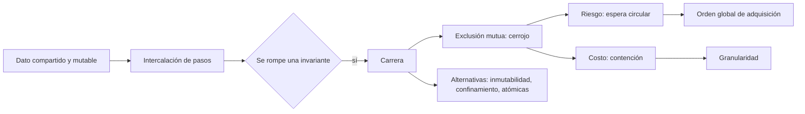
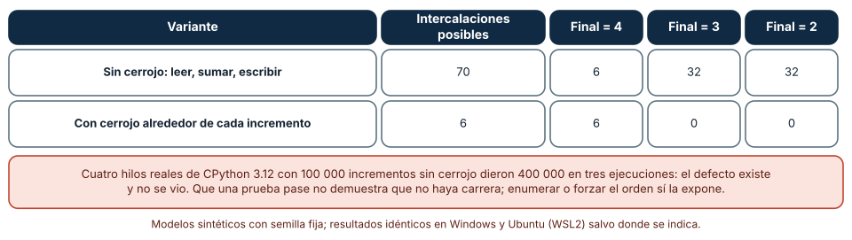
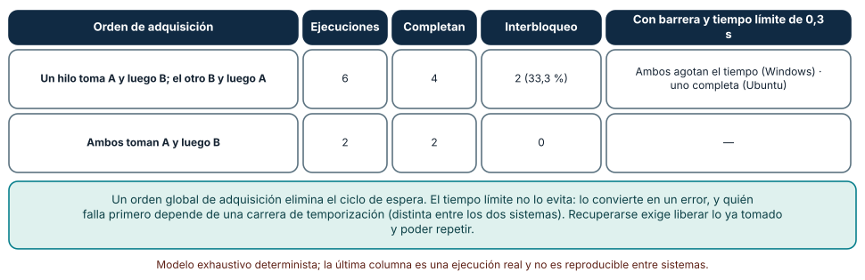
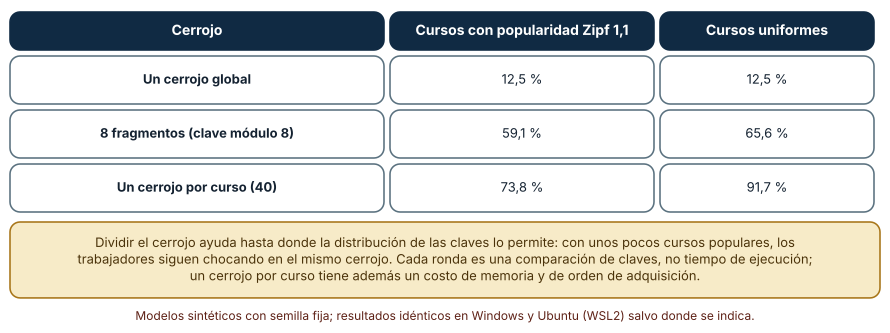

# SE-338 — Memoria compartida, locks y condiciones de carrera

[← SE-337 — Concurrencia, paralelismo y asincronía](../../classes/part-28-concurrencia-y-sistemas-distribuidos/se-337-concurrencia-paralelismo-y-asincronia/README.md) · [↑ Parte 28](../../classes/part-28-concurrencia-y-sistemas-distribuidos/README.md) · [📚 Índice completo](../../classes/README.md) · [🌐 Portal](../../site/classes/SE-338.html) · [SE-339 — Actores, canales y structured concurrency →](../../classes/part-28-concurrencia-y-sistemas-distribuidos/se-339-actores-canales-y-structured-concurrency/README.md)

## Punto profesional y fundamento pedagógico

**Punto profesional.** La clase existe para que veas una carrera de datos como lo que es, una propiedad del orden de ejecución y no del código, y para que elijas con evidencia entre un cerrojo, un cerrojo más fino o evitar el estado compartido, sabiendo qué defecto nuevo introduce cada elección: el interbloqueo y la contención.

**Por qué aparece aquí.** Sigue a **Concurrencia, paralelismo y asincronía**: allí quedó claro que varias tareas avanzan a la vez; aquí dos de ellas tocan el mismo dato. En el caso conductor, el contador de entregas recibidas de un curso y el cupo de una tarea se actualizan desde muchos procesos a la vez durante el cierre de plazo.

**Error conceptual que debe corregir.** Creer que «si la prueba pasa cien veces, no hay carrera»: una carrera depende de un orden poco probable, y que no aparezca en pruebas no prueba que no exista.

**Secuencia de aprendizaje.** Antes de leer los resultados, predices cuántos finales distintos puede tener un contador que dos hilos incrementan dos veces cada uno y cuántos de los 70 órdenes posibles lo dejan correcto; después enumeras las ejecuciones de dos hilos que toman dos cerrojos en orden opuesto y mides cuánto avanza el trabajo con un cerrojo global, por fragmentos y por curso. La secuencia usa predicción, explicación propia, contraste y recuperación. [ICAP](https://icap.education.asu.edu/research) distingue participación de construcción de conocimiento; [How People Learn II](https://nap.nationalacademies.org/catalog/24783/how-people-learn-ii-learners-contexts-and-cultures) exige conectar conocimiento previo, contexto y transferencia; la [práctica de recuperación](https://pubmed.ncbi.nlm.nih.gov/16507066/) respalda producir de nuevo la explicación tras una demora; y [Education for Life and Work](https://nap.nationalacademies.org/resource/13398/dbasse_084153.pdf) exige devolución que explique la causa del error.

**Evidencia de aprendizaje.** `carreras-log.md` con la predicción, las tres figuras reproducidas, la enumeración de un contador compartido, un orden global de adquisición de cerrojos para el servicio y una nota que distinga qué se resolvió con exclusión mutua y qué con confinamiento.

**Límite de la conclusión.** Las intercalaciones se enumeran sobre un modelo de instrucciones atómicas del autor, y la contención se mide como fracción de operaciones que no esperan en rondas sintéticas. Cuatro hilos reales de CPython 3.12 no mostraron la carrera en tres ejecuciones: lo que se enseña no depende de poder verla en vivo. No se midió ningún cerrojo del sistema operativo ni la memoria de ningún procesador.

### Trazabilidad fuente → afirmación

| Fuente primaria u oficial | Afirmación que respalda | Lo que no prueba |
|---|---|---|
| [Python: threading](https://docs.python.org/3/library/threading.html) | Documenta `Lock`, `RLock`, `Barrier` y el parámetro `timeout` de `acquire`, usados en los experimentos. | No garantiza qué hilo falla primero cuando hay un interbloqueo con tiempo límite. |
| [Coffman, Elphick y Shoshani, «System deadlocks» (1971)](https://doi.org/10.1145/356586.356588) | Enumera las condiciones necesarias del interbloqueo: exclusión mutua, retención y espera, no expropiación y espera circular. | No dice qué política de prevención conviene a un servicio concreto. |
| [Go: el detector de carreras](https://go.dev/doc/articles/race_detector) | Explica cómo se detecta una carrera de datos observando accesos sin sincronización y por qué solo ve las que ocurren en la ejecución. | Es de Go; no describe CPython ni mide su frecuencia. |
| [Python: glosario, GIL](https://docs.python.org/3/glossary.html) | Aclara que el GIL protege las estructuras internas del intérprete, no la lógica de tu programa. | No convierte en atómica una secuencia leer-sumar-escribir de tu código. |

## Antes de empezar

Recupera lo aprendido en `SE-337`: concurrencia es varias tareas en curso; aquí importa *dónde* se cruzan. La pregunta activa es: **¿qué dato comparten dos tareas, qué ocurre si sus pasos se intercalan y qué cuesta impedirlo?**

## Prerrequisitos

- Haber completado `SE-337` o poder explicar la diferencia entre concurrencia y paralelismo.
- Python 3.11 o posterior; los experimentos usan solo la biblioteca estándar (`threading`, `itertools`, `random`).
- Haber visto en la Parte 26 (`SE-315`) la enumeración de intercalaciones sobre una base de datos.

## Problema auténtico

Durante un cierre de plazo, el panel de la docente mostraba «212 entregas» cuando el listado tenía 219. Al día siguiente mostraba 219. Nadie encontró un error en el código del contador: la función leía el valor, le sumaba uno y lo escribía. Dos semanas después, al añadir un candado para arreglar el contador, el servicio empezó a congelarse a las 23:55 una vez por semana: una ruta tomaba el candado del curso y luego el del estudiante, y otra hacía lo contrario. El primer defecto desaparecía al ejecutarlo despacio; el segundo no dejaba trazas. La clase construye una forma de ver ambos sin depender de la suerte.

## Objetivos observables

Al terminar podrás:

1. enumerar las intercalaciones de dos hilos que modifican un contador y explicar por qué algunas pierden actualizaciones;
2. distinguir una carrera de datos de una condición de carrera de lógica y dar un ejemplo de cada una en la plataforma;
3. predecir cuándo dos cerrojos producen un interbloqueo y cómo un orden global de adquisición lo elimina;
4. medir cuánto trabajo avanza sin esperar con un cerrojo global, por fragmentos y por clave, y por qué la distribución de las claves lo limita;
5. proponer, para un dato compartido, si conviene un cerrojo, un dato inmutable, confinamiento a un hilo o una operación atómica.

## Mapa conceptual



El mapa muestra que un cerrojo no es «la solución»: resuelve la carrera a cambio de dos problemas nuevos. Cada uno tiene su mitigación (orden global y granularidad) y todas compiten con la opción de no compartir el dato.

## Temas y por qué importan

| Tema | Por qué cambia una decisión profesional | Evidencia mínima |
|---|---|---|
| Estado compartido y carreras | Define qué pasos deben ser indivisibles. | Predicción, traza causal y contraejemplo de **Estado compartido y carreras** en `carreras-log.md` |
| Exclusión mutua | Convierte una secuencia en un solo paso observable. | Predicción, traza causal y contraejemplo de **Exclusión mutua** en `carreras-log.md` |
| Interbloqueo | Un cerrojo mal ordenado detiene el servicio sin dejar error. | Predicción, traza causal y contraejemplo de **Interbloqueo** en `carreras-log.md` |
| Granularidad y contención | Un cerrojo demasiado grueso serializa el servicio. | Predicción, traza causal y contraejemplo de **Granularidad y contención** en `carreras-log.md` |
| Alternativas al cerrojo | A veces el mejor cerrojo es no necesitarlo. | Predicción, traza causal y contraejemplo de **Alternativas al cerrojo** en `carreras-log.md` |

## Conceptos y decisiones

### 1. Estado compartido y carreras

Una **carrera de datos** ocurre cuando dos tareas acceden a la misma posición de memoria, al menos una escribe y no hay sincronización que las ordene. Una **condición de carrera** es más general: el resultado depende del orden de pasos, aunque cada acceso esté protegido; por ejemplo, comprobar si queda cupo y luego descontarlo en dos pasos protegidos por separado. En `contador += 1` hay tres pasos: leer, sumar, escribir. Si dos hilos leen el mismo valor antes de que cualquiera escriba, uno de los incrementos desaparece. El GIL de CPython evita que se corrompa la estructura interna del intérprete, no que tu programa pierda un incremento: la secuencia sigue siendo de varios pasos y el intérprete puede cambiar de hilo entre ellos.

### 2. Exclusión mutua

Un **cerrojo** (*lock*) convierte una secuencia de pasos en una **sección crítica**: mientras un hilo la ejecuta, ningún otro entra. Con el cerrojo, las intercalaciones posibles se reducen a las que no parten la sección, y el resultado vuelve a ser el de ejecutarlas una tras otra. Eso exige que *todos* los accesos al dato usen el mismo cerrojo: un solo acceso sin proteger rehabilita la carrera. También exige que la sección sea corta: mientras un hilo la ocupa, los demás esperan, y una espera dentro de la sección (red, disco) la alarga justo cuando más hilos compiten.

### 3. Interbloqueo

Un **interbloqueo** (*deadlock*) detiene a un grupo de tareas que se esperan unas a otras. Coffman y colaboradores identificaron cuatro condiciones necesarias: exclusión mutua, retención y espera (se retiene un recurso mientras se pide otro), ausencia de expropiación y espera circular. Basta eliminar una para que no ocurra. La más práctica de eliminar es la espera circular imponiendo un **orden global de adquisición**: todos los cerrojos se toman siempre en el mismo orden (por ejemplo, por identificador creciente). Un tiempo límite al adquirir no previene el interbloqueo: lo convierte en un error que hay que manejar, liberando lo tomado y reintentando con otro orden.

### 4. Granularidad y contención

La **granularidad** de un cerrojo es cuánto dato protege. Uno global es fácil de razonar y serializa todo; uno por curso permite que cursos distintos avancen a la vez pero multiplica los cerrojos y el riesgo de interbloqueo cuando una operación toca varios. La **contención** es la fracción del tiempo que las tareas pasan esperando un cerrojo. Depende de cuántas tareas compiten y de cómo se reparten las claves: si unos pocos cursos concentran las entregas del cierre de plazo, dividir por curso ayuda menos de lo que sugiere el número de cerrojos.

### 5. Alternativas al cerrojo

Antes de añadir un cerrojo conviene preguntar si el dato necesita ser compartido. Un valor **inmutable** puede leerse sin sincronización. El **confinamiento** deja que un solo hilo posea el dato y reciba peticiones por una cola (`SE-339`). Una **operación atómica** del almacén (`UPDATE n = n + 1`, un contador atómico) hace indivisible el leer-sumar-escribir sin que el programa tome un cerrojo. Cada alternativa mueve el problema: la cola serializa, la operación atómica solo cubre operaciones que el almacén ofrece. Aun así, son preferibles a un cerrojo escrito a mano cuando cubren el caso.

### Todas las intercalaciones de un contador

Dos hilos incrementan un contador dos veces cada uno. Cada incremento son dos pasos observables (`load` y `store`); se enumeran las 70 formas de intercalar los 8 pasos y se ejecuta cada una. Después se descartan las que parten un incremento, como haría un cerrojo.

```python
def run(order):
    shared = 0; regs = [None, None]; pc = [0, 0]
    prog = [["load", "store"] * 2 for _ in range(2)]
    for t in order:
        if prog[t][pc[t]] == "load": regs[t] = shared
        else:                         shared = regs[t] + 1
        pc[t] += 1
    return shared
```

| Variante | Intercalaciones | Final = 4 | Final = 3 | Final = 2 |
|---|---:|---:|---:|---:|
| Sin cerrojo | 70 | 6 | 32 | 32 |
| Con cerrojo alrededor de cada incremento | 6 | 6 | 0 | 0 |

Solo 6 de 70 órdenes dejan el valor correcto: la carrera no es un caso raro del modelo, es el caso normal. En hilos reales de CPython 3.12 (4 hilos × 100 000 incrementos, `sys.setswitchinterval(1e-6)`), tres ejecuciones sin cerrojo dieron 400 000: el intérprete rara vez conmuta entre la lectura y la escritura de esa forma concreta de código. El defecto no desapareció, solo no se manifestó.



**Cómo leer la figura.** Cada fila es una variante; las columnas cuentan en cuántas intercalaciones el contador termina en cada valor. **Dónde deja de valer:** el modelo supone que `load` y `store` son atómicos y que cualquier orden es posible con igual peso; en un sistema real unos órdenes son mucho más probables que otros (`SE-346`), y un procesador con memoria relajada puede reordenar accesos que el modelo trata como ordenados. La medida con hilos reales es una observación, no una prueba de ausencia.

### Dos cerrojos en orden opuesto

Dos hilos toman cada uno los cerrojos A y B, con cuatro pasos (adquirir, adquirir, liberar, liberar). Se explora de forma exhaustiva el espacio de estados del modelo y se cuenta cuántas ejecuciones completas terminan y cuántas quedan atascadas, con el mismo orden y con orden opuesto. Aparte, se ejecuta una versión real con una barrera que fuerza que ambos hayan tomado su primer cerrojo y un tiempo límite de 0,3 s en el segundo.

```python
first.acquire(); bar.wait()                 # ambos ya tienen su primer cerrojo
got = second.acquire(timeout=0.3)           # el segundo no se puede conseguir
```

| Orden de adquisición | Ejecuciones | Completan | Interbloqueo | Versión real con tiempo límite |
|---|---:|---:|---:|---|
| Uno toma A,B y el otro B,A | 6 | 4 | 2 (33,3 %) | Windows: ambos agotan el tiempo · Ubuntu: uno completa |
| Ambos toman A,B | 2 | 2 | 0 | — |

Con orden opuesto, un tercio de las ejecuciones del modelo termina en interbloqueo; con orden común, ninguna. En la versión real los dos sistemas difieren: en Windows ambos hilos agotaron el tiempo, en Ubuntu el primero en agotarlo liberó su cerrojo y el otro consiguió el suyo. El mismo programa tiene dos resultados porque quién falla primero es una carrera de temporización.



**Cómo leer la figura.** Cada fila es un orden de adquisición; la última columna es una ejecución real distinta de la enumeración. **Dónde deja de valer:** el modelo tiene solo dos hilos y dos cerrojos; con más, el espacio de estados crece y la detección exhaustiva deja de ser viable. La columna real no es reproducible entre sistemas y se incluye precisamente por eso: un tiempo límite cambia un bloqueo por un resultado que depende de cuál expire antes.

### Cuánto trabajo avanza con cada granularidad

Ocho trabajadores piden cada ronda una clave de curso; el cerrojo de una clave se toma una vez por ronda. Se mide, en 20 000 rondas, la fracción de peticiones que obtienen su cerrojo sin esperar a otra de la misma ronda, con un cerrojo global, con 8 fragmentos y con uno por curso, para cursos pedidos con popularidad Zipf (exponente 1,1) y uniformes.

```python
def prog_rate(rounds, lockof):
    done = total = 0
    for ks in rounds:
        taken = set()
        for k in ks:
            l = lockof(k); total += 1
            if l not in taken: taken.add(l); done += 1
    return done / total
```

| Cerrojo | Cursos con popularidad Zipf 1,1 | Cursos uniformes |
|---|---:|---:|
| Global | 12,5 % | 12,5 % |
| 8 fragmentos | 59,1 % | 65,6 % |
| Uno por curso | 73,8 % | 91,7 % |

Un cerrojo global deja avanzar a 1 de cada 8 peticiones por ronda, por construcción. Partirlo ayuda mucho; partirlo en 40 ayuda menos con popularidad concentrada (73,8 %) que con reparto uniforme (91,7 %), porque los cursos populares siguen chocando. Un cerrojo por curso cuesta además memoria y un orden de adquisición cuando una operación toca dos cursos.



**Cómo leer la figura.** Las filas son granularidades y las columnas, distribuciones de claves; cada número es la fracción de peticiones que no esperan en una ronda. **Dónde deja de valer:** una ronda es una comparación de claves, no tiempo; no hay secciones críticas de duración distinta ni cerrojos justos o injustos. La conclusión transferible es cualitativa: la distribución de las claves limita lo que gana dividir.

## Definiciones de trabajo

- **carrera de datos:** acceso concurrente a una posición de memoria, con al menos una escritura y sin sincronización que ordene los accesos.
- **sección crítica:** tramo de código que debe ejecutarse sin que otro hilo acceda al mismo dato.
- **interbloqueo:** situación en que un grupo de tareas espera cada una un recurso que retiene otra del grupo.
- **orden global de adquisición:** regla que obliga a tomar los cerrojos siempre en el mismo orden para impedir la espera circular.
- **contención:** fracción del tiempo que las tareas pasan esperando un cerrojo.

Las definiciones son operativas para la plataforma de entregas. No convierten términos con una historia más amplia en sinónimos y deben contrastarse con la documentación primaria enlazada al final.

## Ejemplo mínimo

El fragmento prueba que un contador no es seguro sin sincronización cuando se fuerza el orden. Antes de ejecutarlo, predice el valor final.

```python
import threading
box = [0]
def inc(barrera):
    v = box[0]            # leer
    barrera.wait()        # ambos han leído antes de que alguien escriba
    box[0] = v + 1        # escribir
b = threading.Barrier(2)
ts = [threading.Thread(target=inc, args=(b,)) for _ in range(2)]
[t.start() for t in ts]; [t.join() for t in ts]
assert box[0] == 1        # dos incrementos, un efecto
```

Con la barrera, los dos hilos leen 0 y ambos escriben 1: se perdió un incremento de forma determinista. Registra versión de Python y salida; después envuelve las tres líneas en un `Lock` y comprueba que el resultado es 2.

## Ejemplo profesional

El equipo del panel de la docente no añade un cerrojo global. Primero separa dos casos: el contador de entregas recibidas pasa a una operación atómica de la base (`UPDATE curso SET entregas = entregas + 1`), que no necesita cerrojo en el programa; el cupo de la tarea, que implica leer, comprobar y descontar, se protege con una transacción que bloquea esa fila. Para las dos rutas que tocaban curso y estudiante define un orden: siempre curso antes que estudiante, documentado en una constante y verificado por una prueba que enumera las parejas de cerrojos tomadas. Para la contención mide cuántas peticiones del cierre de plazo caen en los tres cursos más populares y decide no partir más por curso. Cada decisión queda en `carreras-log.md` con la medida que la respalda y con la declaración de qué no se midió.

## Práctica guiada

1. Escribe el contador de dos hilos con `load` y `store` explícitos y enumera las 70 intercalaciones.
2. Predice cuántas terminan en 4, 3 y 2 antes de ejecutar.
3. Añade el cerrojo como restricción de la enumeración y comprueba que quedan 6.
4. Modela dos hilos con dos cerrojos y cuenta los interbloqueos con orden opuesto y con orden común.
5. Reproduce el interbloqueo real con una barrera y un tiempo límite y anota qué hilo falla primero en tu sistema.
6. Mide la fracción de trabajo que avanza con cerrojo global, por fragmentos y por curso con claves uniformes y con claves Zipf.
7. Entrega `carreras-log.md` y pide a otra persona que encuentre un acceso al dato compartido que olvidó proteger.

## Ejercicios

1. **Enumeración:** con tres hilos que incrementan una vez cada uno (dos pasos por incremento), ¿cuántas intercalaciones hay y cuántas dejan el valor 3?
2. **Contraejemplo:** escribe una condición de carrera donde cada acceso esté protegido por un cerrojo y aun así falle la invariante.
3. **Orden global:** una operación mueve una entrega de un curso a otro; define el orden de cerrojos para que no haya interbloqueo cuando dos operaciones mueven en sentidos opuestos.
4. **Diagnóstico:** el servicio se congela una vez por semana. Formula tres hipótesis y la observación que descarta cada una (por ejemplo, un volcado de pilas de los hilos).

## Reto verificable

Entrega `carreras-log.md` con la predicción, las tres tablas, el orden global de adquisición y la clasificación de cada dato compartido (cerrojo, atómica, inmutable o confinado). Se aprueba si otra persona ejecuta el código desde un checkout limpio, obtiene los mismos conteos y puede decir qué parte del resultado de interbloqueo depende del sistema. No se aprueba por mostrar una ejecución limpia con hilos reales como prueba de ausencia de carrera.

## Caso conductor

El contador y el cupo del cierre de plazo son el caso conductor de la Parte 28. Esta clase deja el segundo artefacto: el orden de adquisición y la clasificación de datos compartidos. `SE-339` propone evitar el problema pasando mensajes en vez de compartir memoria. Cambia después una sola decisión, la granularidad, y observa qué otra decisión (el orden de cerrojos) se ve afectada.

## Preguntas frecuentes

### ¿El GIL hace seguro mi contador?

No. Protege las estructuras internas del intérprete, pero `contador += 1` son varios pasos y el intérprete puede cambiar de hilo entre ellos. Que rara vez ocurra en una ejecución concreta no lo hace seguro.

### ¿Por qué mi prueba pasa mil veces y falla en producción?

Porque la prueba explora pocos órdenes y todos parecidos, mientras que producción ejecuta millones con cargas distintas. Forzar el orden con barreras o enumerarlo con un modelo expone lo que la repetición esconde.

### ¿Un tiempo límite en el cerrojo evita el interbloqueo?

Evita el bloqueo eterno, no el interbloqueo: ambos hilos fallan o uno falla y el otro sigue, según una carrera de temporización. Hay que decidir qué hacer al fallar: liberar lo tomado, registrar y reintentar con orden fijo.

### ¿Es mejor un cerrojo por clave o uno global?

Depende de la distribución de las claves y de cuántas operaciones tocan varias. Con pocas claves muy populares, partir más ayuda poco y añade riesgo de interbloqueo; mide la concentración antes de elegir.

## Fallo controlado y diagnóstico

Reproduce el fallo clásico de la clase: **dos rutas toman los mismos cerrojos en orden opuesto y el servicio se congela sin dejar error**. Ejecuta la versión real con barrera y tiempo límite, primero con orden opuesto y después con orden común.

Registra síntoma, entrada mínima, hipótesis, observación que descarta cada hipótesis, causa, corrección y prueba de regresión. **Síntoma:** a las 23:55 de algunos viernes el servicio deja de responder y se recupera al reiniciar. **Hipótesis rivales:** (a) agotamiento de memoria; (b) una base de datos lenta; (c) dos hilos esperando cerrojos que el otro retiene. **Prueba:** obtén un volcado de las pilas de todos los hilos; si dos hilos esperan en `acquire` por cerrojos que cada uno tiene el otro, la causa es la espera circular. **Conclusión:** dos rutas toman curso y estudiante en orden distinto. **Regresión:** fija el orden en una función única que toma ambos cerrojos, añade una prueba que enumere las parejas posibles y falle si alguna ruta toma el segundo antes del primero. No cambies a la vez el orden y la granularidad.

## Errores comunes y cómo corregirlos

| Síntoma | Causa probable | Corrección |
|---|---|---|
| Contadores que a veces están un poco bajos | Leer-sumar-escribir sin sincronizar | Operación atómica o sección crítica |
| El servicio se congela y no hay error | Espera circular entre cerrojos | Orden global de adquisición |
| La prueba pasa siempre y falla en producción | La prueba explora pocos órdenes | Enumerar o forzar el orden con barreras |
| Añadir cerrojos no mejora la velocidad | Un cerrojo muy grueso serializa | Partir el cerrojo según la distribución real de claves |
| Un cerrojo protege el dato en una ruta y no en otra | Acceso sin proteger | Encapsular el dato para que solo se acceda con el cerrojo |

## Entorno y archivos clave

```text
work/SE-338/
├── README.md
├── modelo/
│   ├── intercalaciones.py
│   ├── interbloqueo.py
│   └── granularidad.py
├── tests/test_carreras.py
└── evidence/carreras-log.md
```

El `README` declara plataforma, versión de Python, semillas y comandos. Los experimentos usan solo la biblioteca estándar (`threading`, `itertools`, `functools`, `random`) y se ejecutaron con CPython 3.12.9 en Windows 11 y 3.12.3 en Ubuntu bajo WSL2: las salidas fueron idénticas salvo la versión real con tiempo límite, que depende de la temporización. Si añades una dependencia, fija procedencia y versión.

## Seguridad, ética y accesibilidad

- una carrera entre una comprobación de permisos y el uso del recurso es una vulnerabilidad (comprobar y usar): trata las secciones críticas de seguridad con la misma disciplina;
- un interbloqueo es una vía de denegación de servicio si una persona externa puede provocar el orden opuesto; limita tiempos y reintentos;
- un contador equivocado en un panel docente puede afectar a una calificación o a un plazo: documenta la tolerancia aceptable;
- documenta el orden de cerrojos en una lista de texto que un lector de pantalla pueda recorrer, además del diagrama;
- respeta las licencias de los materiales citados y atribuye lo adaptado.

## Puente hacia el trabajo con agentes

Un agente al que se le pide «arregla el contador que a veces cuenta mal» añadirá a menudo un `Lock` global y declarará el problema resuelto, sin comprobar si otras rutas acceden al dato sin cerrojo y sin pensar en el orden si ya hay otro cerrojo. Pídele en cambio que enumere los accesos al dato, que proponga primero una operación atómica del almacén, que declare el orden de adquisición si necesita más de un cerrojo y que incluya una prueba con barrera que fuerce el orden del fallo. Revisa especialmente si aparece un segundo cerrojo y si el código lo toma siempre después del mismo primero: son los dos defectos que esta clase mostró sin aviso.

## Transferencia

Traslada el análisis a otro dominio (por ejemplo, el stock de un comercio con reservas simultáneas): cambia el dato y las rutas y conserva el procedimiento de enumerar pasos, aislar la sección crítica, fijar un orden de cerrojos y medir la contención con la distribución real de claves. La transferencia está lograda cuando puedes explicar qué orden de pasos rompe la invariante, no cuando el código tiene un `Lock`.

## Evaluación y evidencia

| Criterio | Evidencia para aprobar |
|---|---|
| comprensión | explicación de carrera de datos y condición de carrera con ejemplos de la plataforma |
| corrección | conteos de intercalaciones, interbloqueos y fracción de avance reproducibles |
| diseño | orden global de adquisición y clasificación de datos compartidos |
| diagnóstico | reproducción del interbloqueo con regresión que enumera las parejas de cerrojos |
| incertidumbre | declaración de que la versión real depende de la temporización y no demuestra ausencia |
| reproducibilidad | versiones, comandos, salida y límites declarados |

## Fuentes

- [Python: threading](https://docs.python.org/3/library/threading.html) — cerrojos, barreras y tiempos límite; autoridad: documentación de Python.
- [Python: glosario](https://docs.python.org/3/glossary.html) — alcance del GIL; autoridad: documentación de Python.
- [Coffman, Elphick y Shoshani, «System deadlocks»](https://doi.org/10.1145/356586.356588) — condiciones del interbloqueo; autoridad: artículo original (ACM Computing Surveys, 1971).
- [Go: el detector de carreras](https://go.dev/doc/articles/race_detector) — qué ve y qué no ve una detección dinámica; autoridad: documentación oficial de Go.
- [Hoare, «Communicating sequential processes»](https://doi.org/10.1145/359576.359585) — alternativa de paso de mensajes que se retoma en la clase siguiente; autoridad: artículo original (1978).

Cada fuente respalda el mecanismo indicado; ninguna demuestra que los 6 de 70 órdenes correctos, el 33,3 % de interbloqueos o el 73,8 % de avance se observen en un servicio real. Esa afirmación depende del programa, del planificador y de la distribución de las claves.

## Límites y siguiente paso

Se ejecutaron tres experimentos en Windows y Ubuntu (WSL2); los conteos fueron idénticos y la versión real con tiempo límite difirió, como se declara. No se midió ningún cerrojo del sistema operativo, ninguna memoria relajada ni una carga real: las instrucciones atómicas, la popularidad Zipf y las rondas son construcciones del autor. La siguiente clase evita el problema desde la raíz: tareas que no comparten memoria y se hablan por mensajes.

## Glosario

- **carrera de datos:** acceso concurrente a una posición de memoria, con al menos una escritura y sin sincronización que ordene los accesos.
- **sección crítica:** tramo de código que debe ejecutarse sin que otro hilo acceda al mismo dato.
- **interbloqueo:** situación en que un grupo de tareas espera cada una un recurso que retiene otra del grupo.
- **orden global de adquisición:** regla que obliga a tomar los cerrojos siempre en el mismo orden para impedir la espera circular.
- **contención:** fracción del tiempo que las tareas pasan esperando un cerrojo.

---

[← SE-337 — Concurrencia, paralelismo y asincronía](../../classes/part-28-concurrencia-y-sistemas-distribuidos/se-337-concurrencia-paralelismo-y-asincronia/README.md) · [↑ Parte 28](../../classes/part-28-concurrencia-y-sistemas-distribuidos/README.md) · [📚 Índice completo](../../classes/README.md) · [🌐 Portal](../../site/classes/SE-338.html) · [SE-339 — Actores, canales y structured concurrency →](../../classes/part-28-concurrencia-y-sistemas-distribuidos/se-339-actores-canales-y-structured-concurrency/README.md)
