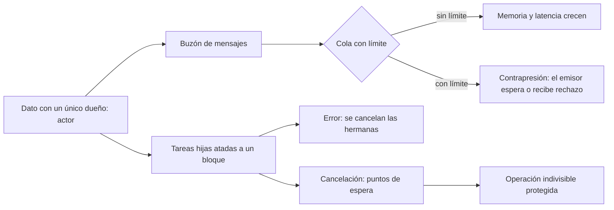
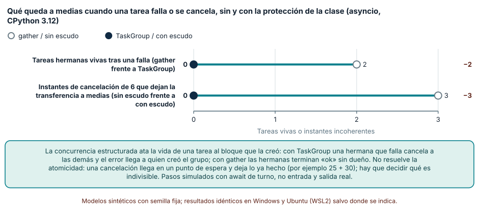

# SE-339 — Actores, canales y structured concurrency

[← SE-338 — Memoria compartida, locks y condiciones de carrera](../../classes/part-28-concurrencia-y-sistemas-distribuidos/se-338-memoria-compartida-locks-y-condiciones-de-carrera/README.md) · [↑ Parte 28](../../classes/part-28-concurrencia-y-sistemas-distribuidos/README.md) · [📚 Índice completo](../../classes/README.md) · [🌐 Portal](../../site/classes/SE-339.html) · [SE-340 — Tiempo, relojes y orden parcial →](../../classes/part-28-concurrencia-y-sistemas-distribuidos/se-340-tiempo-relojes-y-orden-parcial/README.md)

## Punto profesional y fundamento pedagógico

**Punto profesional.** La clase existe para que sepas diseñar tareas concurrentes que no comparten memoria sino que se envían mensajes, que declares qué orden garantiza un buzón y qué no, que pongas un límite a la cola antes de que la memoria lo ponga por ti y que ates la vida de cada tarea al bloque que la creó, para que un error o una cancelación no dejen trabajo huérfano ni datos a medias.

**Por qué aparece aquí.** Sigue a **Memoria compartida, locks y condiciones de carrera**: allí cada solución añadía un riesgo nuevo (interbloqueo, contención). Los actores y los canales cambian la pregunta: en lugar de proteger un dato compartido, un solo dueño lo posee y los demás le piden cosas. En el caso conductor, el servicio de entregas deja de tener un contador protegido por cerrojos y pasa a tener un actor «cupo» que atiende peticiones una a una.

**Error conceptual que debe corregir.** Creer que enviar mensajes elimina el razonamiento sobre el orden: el buzón ordena los mensajes de cada emisor, no los de emisores distintos, y una cola sin límite solo traslada el problema a la memoria.

**Secuencia de aprendizaje.** Antes de leer los resultados, predices cuántos órdenes globales distintos pueden producir tres emisores con dos mensajes cada uno y cuántos violan el orden de un emisor; después mides qué hace una cola con y sin límite ante un productor más rápido que el consumidor, y observas qué pasa con las tareas hermanas cuando una falla bajo `TaskGroup` frente a `gather`. La secuencia usa predicción, explicación propia, contraste y recuperación. [ICAP](https://icap.education.asu.edu/research) distingue participación de construcción de conocimiento; [How People Learn II](https://nap.nationalacademies.org/catalog/24783/how-people-learn-ii-learners-contexts-and-cultures) exige conectar conocimiento previo, contexto y transferencia; la [práctica de recuperación](https://pubmed.ncbi.nlm.nih.gov/16507066/) respalda producir de nuevo la explicación tras una demora; y [Education for Life and Work](https://nap.nationalacademies.org/resource/13398/dbasse_084153.pdf) exige devolución que explique la causa del error.

**Evidencia de aprendizaje.** `mensajes-log.md` con la predicción, las tres figuras reproducidas, el diseño de un actor «cupo» con su buzón acotado y una nota que distinga qué orden garantiza y cuál no, más la política ante un buzón lleno.

**Límite de la conclusión.** Todo corre en el bucle de eventos de `asyncio` con turnos cedidos por `await asyncio.sleep(0)`, con semillas fijas; no hay red, procesos ni un sistema de actores real. Las tasas de la cola (3 mensajes por turno y 1 por turno) y los pasos de la transferencia son construcciones del autor.

### Trazabilidad fuente → afirmación

| Fuente primaria u oficial | Afirmación que respalda | Lo que no prueba |
|---|---|---|
| [Hewitt, Bishop y Steiger, «A universal modular ACTOR formalism for artificial intelligence» (1973)](https://arxiv.org/abs/1008.1459) | Propone el actor como unidad de cómputo que reacciona a mensajes y crea otros actores. | No define el sistema de actores de ningún lenguaje actual ni su rendimiento. |
| [Hoare, «Communicating sequential processes» (1978)](https://doi.org/10.1145/359576.359585) | Formula procesos que se comunican por canales en lugar de compartir memoria. | No cubre las colas acotadas ni la cancelación de tareas de un lenguaje concreto. |
| [Python: asyncio, tareas y grupos de tareas](https://docs.python.org/3/library/asyncio-task.html) | Documenta `TaskGroup`, la cancelación de hermanas ante un fallo y `asyncio.shield`. | No garantiza que una cancelación llegue en un punto seguro de tu lógica. |
| [Python: asyncio, colas](https://docs.python.org/3/library/asyncio-queue.html) | Describe `Queue` con `maxsize`, que bloquea al productor cuando la cola está llena. | No dice qué tamaño de cola conviene a un servicio. |
| [Smith, «Notes on structured concurrency»](https://vorpus.org/blog/notes-on-structured-concurrency-or-go-statement-considered-harmful/) | Argumenta que lanzar tareas sin un bloque que las contenga rompe la propagación de errores y la cancelación. | Es un argumento de diseño de un autor, no una medición. |

## Antes de empezar

Recupera lo aprendido en `SE-338`: un dato compartido necesita un cerrojo, y los cerrojos traen interbloqueo y contención. La pregunta activa es: **¿qué pasaría si un único dueño poseyera el dato y los demás le enviaran mensajes, y qué ocurre con esos mensajes y con las tareas que los envían cuando algo falla?**

## Prerrequisitos

- Haber completado `SE-338` o poder explicar por qué un cerrojo puede producir interbloqueo.
- Python 3.11 o posterior (usa `asyncio.TaskGroup` y `except*`); solo biblioteca estándar.
- Leer corrutinas `async def` y la diferencia entre `await` y crear una tarea.

## Problema auténtico

El actor «cupo» de la plataforma recibía las solicitudes de reserva de plaza para una tutoría: cada mensaje decía «reserva la plaza del estudiante X». Funcionaba hasta el día en que abrieron la inscripción y llegaron tres mil mensajes por segundo a un consumidor que procesaba mil: la memoria del proceso creció durante cuatro minutos y el servicio murió sin haber rechazado ni una petición. En paralelo, una tarea que enviaba el comprobante de reserva falló, y las otras dos tareas que lanzó el mismo manejador siguieron escribiendo en la base una hora después, sin que nadie las esperara. Y una cancelación por tiempo límite dejó una transferencia de plazas a medias. Tres defectos con una raíz común: nadie era dueño de la vida de las tareas ni del tamaño del buzón.

## Objetivos observables

Al terminar podrás:

1. explicar qué orden garantiza un buzón (el de cada emisor) y cuál no (el global) con un experimento;
2. calcular cuántos órdenes globales son posibles para un conjunto de emisores y comprobar que ninguno viola el orden por emisor;
3. comparar una cola sin límite y una acotada ante un productor más rápido, e interpretar el rechazo como contrapresión;
4. explicar qué hace `TaskGroup` ante el fallo de una tarea y qué deja `gather` con tareas sueltas;
5. diseñar una operación cancelable que no deje estado a medias.

## Mapa conceptual



El mapa muestra dos decisiones que se confunden: el **diseño del buzón** (orden, límite, qué hacer al llenarse) y el **ciclo de vida de las tareas** (quién las espera, qué pasa al fallar o cancelarse). Ambos son contratos del servicio, no detalles de la biblioteca.

## Temas y por qué importan

| Tema | Por qué cambia una decisión profesional | Evidencia mínima |
|---|---|---|
| Actores y canales | Quitan el estado compartido a cambio de razonar sobre mensajes. | Predicción, traza causal y contraejemplo de **Actores y canales** en `mensajes-log.md` |
| Orden de mensajes | Se puede depender del orden por emisor y de nada más. | Predicción, traza causal y contraejemplo de **Orden de mensajes** en `mensajes-log.md` |
| Contrapresión y buzones acotados | Una cola sin límite convierte la sobrecarga en caída. | Predicción, traza causal y contraejemplo de **Contrapresión y buzones acotados** en `mensajes-log.md` |
| Concurrencia estructurada | Ata la vida y los errores de las tareas a un bloque. | Predicción, traza causal y contraejemplo de **Concurrencia estructurada** en `mensajes-log.md` |
| Cancelación y atomicidad | Una cancelación llega en un punto de espera y deja lo ya hecho. | Predicción, traza causal y contraejemplo de **Cancelación y atomicidad** en `mensajes-log.md` |

## Conceptos y decisiones

### 1. Actores y canales

Un **actor** posee un estado privado y un buzón; procesa un mensaje por vez, y por eso no necesita cerrojos para su propio estado. Los demás no lo tocan: le envían mensajes. Un **canal** es el conducto tipado entre tareas, con semántica de espera: enviar puede bloquear si el canal está lleno, recibir bloquea si está vacío. Hewitt formuló el actor y Hoare los procesos que se comunican por canales; ambas ideas sustituyen «proteger el dato» por «tener un dueño del dato». El costo es otro: la serialización del actor puede ser un cuello de botella, y el razonamiento sobre el estado pasa a ser un razonamiento sobre secuencias de mensajes, incluidas las respuestas que pueden llegar tarde.

### 2. Orden de mensajes

Un buzón conserva el orden en que cada emisor puso sus mensajes: si A envía 1 y luego 2, el actor ve 1 antes que 2. No dice nada sobre el orden entre emisores: si A y B envían a la vez, cualquier mezcla que respete el orden de cada uno es posible. Es la misma idea de orden parcial que desarrolla `SE-340`. Diseñar un actor significa decidir qué mensajes dependen de orden y asegurarse de que los une un mismo emisor, o incluir en el mensaje la información que permita ordenarlos (un número de secuencia). Suponer un orden global es una dependencia oculta de quién llega antes, y falla cuando cambia el reparto de turnos.

### 3. Contrapresión y buzones acotados

Si el productor es más rápido que el consumidor, el exceso tiene que ir a algún lado. En una cola sin límite va a memoria y a latencia: los mensajes nuevos esperan detrás de todos los anteriores. En una cola acotada (`Queue(maxsize=n)`) va al productor: o se bloquea al emitir (contrapresión), o recibe un rechazo que puede reintentar, degradar o registrar. La capacidad no se «calcula»; se elige a partir de la latencia máxima aceptable (con servicio de un mensaje por turno, una cola de 100 implica hasta 100 turnos de espera) y se complementa con la política ante el llenado. Una cola sin límite es una decisión: la de dejar que la memoria sea el límite.

### 4. Concurrencia estructurada

La **concurrencia estructurada** exige que toda tarea hija viva dentro de un bloque que la espera: el bloque no termina hasta que todas terminan, un error de una hija cancela a las hermanas y se propaga al padre. `asyncio.TaskGroup` (Python 3.11) lo ofrece. Frente a ello, lanzar tareas sueltas (`create_task` sin esperarlas, o `gather` que propaga el primer error sin cancelar al resto) deja trabajo huérfano: tareas que siguen escribiendo, con sus efectos, sin dueño que las vea o las espere. La propiedad que se gana es de razonamiento: cuando el bloque termina, no queda nada en vuelo que haya nacido dentro de él.

### 5. Cancelación y atomicidad

Cancelar una corrutina lanza `CancelledError` en su siguiente punto de espera. Ese punto puede estar entre dos pasos que debían ir juntos: un descuento y un abono, un registro y su cierre. La concurrencia estructurada garantiza que la cancelación se propague; no garantiza que el estado quede coherente. Para ello se acotan las secciones indivisibles: se protege la operación con `asyncio.shield`, se hace en una transacción o se diseña como compensable. La regla es que cada operación cancelable debe declarar cuál es su estado válido tras ser interrumpida en cualquiera de sus puntos de espera.

### Qué orden conserva un buzón

Tres emisores envían dos mensajes cada uno a un buzón, con esperas de 0 a 3 turnos antes de cada envío (semilla por ejecución). Se cuentan las mezclas posibles, las observadas en 2 000 ejecuciones y las ejecuciones en que algún emisor vio alterado su propio orden.

```python
async def sender(i):
    for k in range(2):
        for _ in range(r.randint(0, 3)):
            await asyncio.sleep(0)
        await q.put((i, k))
```

| Medida | Resultado |
|---|---:|
| Órdenes globales posibles (6! / (2!·2!·2!)) | 90 |
| Órdenes globales distintos en 2 000 ejecuciones | 89 |
| Ejecuciones con el orden de un emisor alterado | 0 |

El orden por emisor se conservó siempre; el orden global tomó 89 de las 90 formas posibles. Cualquier regla que dependa de que «el mensaje del estudiante A llegue antes que el del B» solo funciona por la distribución de los turnos, que ninguna parte del código controla.


**Cómo leer la figura.** Cada recuadro es un mensaje, su color indica el emisor y su número el orden en que lo envió; de izquierda a derecha es el orden en que el buzón los entrega. Compara las dos filas: cambian las posiciones de los colores entre sí, pero dentro de cada color el 1 va antes que el 2. **Dónde deja de valer:** los retardos aleatorios entre 0 y 3 turnos y la semilla por ejecución son del autor, y el buzón es una cola en memoria de un solo proceso; en una cola distribuida o con varios consumidores, ni siquiera el orden por emisor está garantizado y hay que leer la documentación de esa cola.

### Una cola sin límite frente a una acotada

Un productor intenta poner 3 mensajes por turno y un consumidor atiende 1 por turno durante 1 000 turnos. Se compara una cola sin límite con otras de 100 y de 10 plazas, contando mensajes aceptados, rechazados y los que quedan esperando al final.

```python
for _ in range(3):
    if cap is None or q < cap:
        q += 1; produced += 1
    else:
        shed += 1
if q: q -= 1          # el consumidor atiende uno por turno
```

| Buzón | Aceptados | Rechazados | En cola al final | Espera del último |
|---|---:|---:|---:|---:|
| Sin límite | 3 000 | 0 | 2 000 | 2 000 turnos |
| Cola de 100 | 1 099 | 1 901 | 99 | 99 turnos |
| Cola de 10 | 1 009 | 1 991 | 9 | 9 turnos |

Todas atienden lo mismo (1 000 mensajes); lo que cambia es dónde espera el resto. Sin límite, el último mensaje espera 2 000 turnos y la memoria guarda 2 000 mensajes; con una cola de 10, el emisor recibe el rechazo de inmediato y puede decidir qué hacer. Aceptar todo parece generoso y es lo contrario: promete una latencia que el sistema no puede cumplir.


**Cómo leer la figura.** Cada barra es un tamaño de buzón y se divide en lo que el consumidor procesa (verde), lo que queda esperando en la cola (dorado) y lo que se rechaza (coral). Mira que el verde no cambia: la cola no crea capacidad, solo mueve el exceso entre espera y rechazo; la espera del último mensaje es de 2 000, 99 y 9 turnos. **Dónde deja de valer:** el consumidor tiene un ritmo constante de un mensaje por turno y el productor de tres: con ráfagas, una cola acotada absorbe picos cortos que una tasa constante no muestra. El tamaño correcto sale del pico esperado y de la latencia que el negocio tolera, no de esta figura.

### Quién es dueño de una tarea

Cuatro casos sobre `asyncio`: tres tareas hermanas, una de las cuales falla, con `TaskGroup` y con tareas sueltas más `gather`; y una transferencia de cuatro pasos (registrar, restar, sumar, cerrar) que se cancela en seis instantes distintos, con y sin `asyncio.shield`.

```python
async with asyncio.TaskGroup() as tg:
    tg.create_task(child("a", 3, 1, log))     # falla en su paso 1
    tg.create_task(child("b", 10, None, log))
    tg.create_task(child("c", 10, None, log))
```

| Caso | Qué ocurrió | Resultado |
|---|---|---|
| `TaskGroup`: una hermana falla | `b` y `c` se cancelan; el error llega a quien creó el grupo | 0 tareas vivas |
| `gather` con tareas sueltas: una falla | El error llega, pero `b` y `c` siguen y terminan «ok» sin dueño | 2 tareas vivas |
| Cancelar la transferencia sin escudo | En 3 de 6 instantes queda a medias (por ejemplo, 25 y 30, «iniciado») | 3 de 6 incoherentes |
| Cancelar con escudo | La transferencia termina siempre: 25 y 35, «completado» | 0 de 6 incoherentes |

Con `TaskGroup` no queda nada en vuelo al salir del bloque; con tareas sueltas, dos tareas siguen produciendo efectos después del error. La cancelación de la transferencia sin escudo deja una suma de 55 en vez de 60 o un registro «iniciado» sin cerrar. El escudo la protege, a costa de que la cancelación no interrumpa ese tramo: el servicio tarda lo que dure.



**Cómo leer la figura.** Cada fila es un problema y cada extremo de la mancuerna una forma de resolverlo: el punto hueco es la forma sin protección (gather, cancelación sin escudo) y el relleno la forma protegida (TaskGroup, escudo); la longitud del segmento es cuánto estado incoherente se elimina. **Dónde deja de valer:** los pasos son turnos simulados con `await asyncio.sleep(0)`, no entrada y salida real; un escudo solo protege dentro del bucle de eventos y no sirve contra la caída del proceso. La atomicidad ante un corte real exige una transacción o una compensación (`SE-315`, `SE-344`).

## Definiciones de trabajo

- **actor:** unidad con estado privado y buzón que procesa un mensaje por vez.
- **contrapresión:** mecanismo por el que un consumidor lento hace esperar o rechazar a un productor en lugar de acumular mensajes sin límite.
- **concurrencia estructurada:** disciplina por la que toda tarea hija vive dentro de un bloque que la espera, propaga sus errores y la cancela al salir.
- **cancelación cooperativa:** interrupción que se entrega en el siguiente punto de espera de la tarea, no en cualquier instrucción.
- **escudo (`shield`):** envoltura que impide que una cancelación externa interrumpa una operación interna.

Las definiciones son operativas para la plataforma de entregas. No convierten términos con una historia más amplia en sinónimos y deben contrastarse con la documentación primaria enlazada al final.

## Ejemplo mínimo

El fragmento muestra la contrapresión de una cola acotada. Antes de ejecutarlo, predice si el segundo `put_nowait` falla.

```python
import asyncio
async def main():
    q = asyncio.Queue(maxsize=1)
    q.put_nowait("a")
    try:
        q.put_nowait("b")
    except asyncio.QueueFull:
        return "rechazado"
assert asyncio.run(main()) == "rechazado"
```

El segundo envío falla de inmediato en lugar de acumularse. Registra versión de Python y salida; después sustituye `put_nowait` por `await q.put("b")` y observa que el emisor queda esperando hasta que alguien consuma.

## Ejemplo profesional

El equipo rediseña el actor «cupo». El buzón se acota a 200 mensajes, el pico esperado de dos segundos de la apertura de inscripción; si se llena, el manejador responde con un error reintentable y una cabecera de espera, en lugar de aceptar. Los mensajes llevan un número de secuencia por estudiante para que el actor descarte reservas duplicadas sin depender del orden entre estudiantes. Los manejadores lanzan sus tareas dentro de un `TaskGroup`, de modo que un fallo del comprobante cancela las demás y el error llega a la solicitud. La transferencia de plazas entre tutorías se envuelve en una transacción de la base y se protege con `shield` solo el tramo de confirmación; las tareas de notificación quedan fuera, porque pueden repetirse. Todo se documenta en `mensajes-log.md` con lo que cada decisión garantiza y lo que no.

## Práctica guiada

1. Modela un actor «cupo» con un buzón y un bucle que procesa un mensaje por vez, sin cerrojos.
2. Predice cuántos órdenes globales pueden producir tres emisores con dos mensajes y ejecútalo 2 000 veces.
3. Comprueba que ningún emisor vio su orden alterado y cuenta los órdenes distintos observados.
4. Simula un productor de 3 mensajes por turno y un consumidor de 1 con una cola sin límite y con límites de 100 y 10.
5. Lanza tres tareas hermanas, una de las cuales falla, con `TaskGroup` y con `gather`, y cuenta las que siguen vivas.
6. Cancela una transferencia de cuatro pasos en cada instante posible y clasifica los estados con y sin escudo.
7. Entrega `mensajes-log.md` y pide a otra persona que encuentre un mensaje cuya corrección dependa del orden entre emisores.

## Ejercicios

1. **Cálculo:** ¿cuántos órdenes globales hay para cuatro emisores con un mensaje cada uno? ¿Y para dos emisores con tres mensajes?
2. **Dimensionamiento:** el pico de inscripción es de 600 mensajes por segundo durante 2 s y el actor procesa 400 por segundo; ¿qué tamaño de cola evita rechazos y qué espera máxima implica?
3. **Diseño:** el actor recibe «reservar» y «cancelar reserva» del mismo estudiante desde dos pestañas; ¿qué dato añadirías a los mensajes para que el resultado no dependa del orden de llegada?
4. **Diagnóstico:** tras un error, la base muestra escrituras de una tarea que «ya había fallado». Formula tres hipótesis y la observación que descarta cada una.

## Reto verificable

Entrega `mensajes-log.md` con la predicción, las tres tablas, el diseño del actor con su buzón acotado y la clasificación de cada operación cancelable (indivisible, compensable o repetible). Se aprueba si otra persona ejecuta el código desde un checkout limpio, obtiene los mismos conteos con las mismas semillas y puede decir qué garantía de orden se usó y cuál no. No se aprueba por afirmar que los actores «no tienen carreras» sin enumerar qué ocurre con mensajes de emisores distintos ni por una cola sin límite declarada «suficiente».

## Caso conductor

El actor «cupo» y su buzón son el artefacto de esta clase en el caso conductor de la Parte 28. `SE-340` pregunta cómo ordenar sucesos cuando ni siquiera hay un reloj común entre emisores. Cambia después una sola decisión, el tamaño del buzón, y observa qué otra (el rechazo ante el llenado) se ve afectada.

## Preguntas frecuentes

### ¿Los actores eliminan las condiciones de carrera?

Eliminan las carreras de datos sobre el estado del actor, no las de lógica entre mensajes: dos mensajes de emisores distintos pueden llegar en cualquier orden, y una respuesta puede llegar después de que la situación cambió. Hay que razonar sobre secuencias.

### ¿Cuál debe ser el tamaño del buzón?

El que acote la latencia aceptable: capacidad igual a la tasa de servicio por la espera máxima tolerada, más margen para ráfagas. No hay un valor universal; la tabla de esta clase solo muestra la relación entre tamaño y espera.

### ¿`gather` y `TaskGroup` no hacen lo mismo?

No ante un error. `gather` propaga la primera excepción pero deja las demás tareas corriendo; `TaskGroup` las cancela y espera su finalización. Con `gather(return_exceptions=True)` el comportamiento es otro y hay que tratar los errores a mano.

### ¿Un escudo hace atómica una operación?

No. Evita que una cancelación la interrumpa dentro del bucle de eventos, pero no protege contra una excepción propia, un fallo de otro proceso ni una caída. La atomicidad frente a fallos reales la da una transacción.

## Fallo controlado y diagnóstico

Reproduce el fallo clásico de la clase: **una tarea hermana sigue escribiendo después de que otra falló**. Lanza tres tareas con `gather` sobre tareas creadas con `ensure_future`, haz que la primera falle y espera 20 turnos.

Registra síntoma, entrada mínima, hipótesis, observación que descarta cada hipótesis, causa, corrección y prueba de regresión. **Síntoma:** tras un error en la notificación, la base aún recibe escrituras de la misma solicitud. **Hipótesis rivales:** (a) un reintento automático del cliente; (b) una réplica con retraso; (c) tareas hermanas que nadie canceló. **Prueba:** registra el identificador de la solicitud en cada escritura y su instante; si las escrituras posteriores al error llevan el mismo identificador y vienen de tareas lanzadas por el mismo manejador, la causa es la falta de dueño. **Conclusión:** `gather` propagó el error sin cancelar a las hermanas. **Regresión:** cambia a `TaskGroup`, añade una prueba que lance la tarea fallida y compruebe que al salir del bloque no hay tareas pendientes. No cambies a la vez la estructura y la política de reintentos.

## Errores comunes y cómo corregirlos

| Síntoma | Causa probable | Corrección |
|---|---|---|
| La memoria crece durante una ráfaga y el proceso muere | Buzón sin límite | Cola acotada con rechazo o espera |
| Tareas que escriben después de un error | Tareas sueltas sin dueño | `TaskGroup` o un bloque que las espere |
| Estado a medias tras un tiempo límite | Cancelación entre dos pasos inseparables | Transacción, compensación o `shield` en el tramo crítico |
| El resultado depende de quién llegó primero | Se asume orden global entre emisores | Números de secuencia por emisor o clave |
| El actor es lento y todo espera | Un solo dueño serializa el trabajo | Particionar por clave en varios actores |

## Entorno y archivos clave

```text
work/SE-339/
├── README.md
├── modelo/
│   ├── buzon.py
│   ├── cola_acotada.py
│   └── estructura.py
├── tests/test_mensajes.py
└── evidence/mensajes-log.md
```

El `README` declara plataforma, versión de Python (3.11 o posterior), semillas y comandos. Los experimentos usan solo la biblioteca estándar (`asyncio`, `itertools`, `random`) y se ejecutaron con CPython 3.12.9 en Windows 11 y 3.12.3 en Ubuntu bajo WSL2: las salidas fueron idénticas. Si añades una dependencia, fija procedencia y versión.

## Seguridad, ética y accesibilidad

- una cola sin límite alimentada por entradas externas es una vía de denegación de servicio; acota tamaño y decide a quién se rechaza primero;
- los mensajes pueden contener datos de estudiantes: no los registres completos en los rechazos;
- una cancelación que deja una reserva a medias puede afectar a una persona real (una plaza perdida): documenta el estado válido de cada operación interrumpida;
- documenta el contrato de orden del buzón en texto, no solo en el diagrama;
- respeta las licencias de los artículos y atribuye lo adaptado.

## Puente hacia el trabajo con agentes

Un agente al que se le pide «hazlo con colas para desacoplar» creará colas sin límite, lanzará tareas sueltas con `create_task` y dará por hecho que los mensajes llegan en orden. Pídele en cambio que declare el tamaño máximo de cada cola y qué ocurre al llenarse, que use un bloque que espere todas las tareas hijas y que indique qué orden asume entre emisores. Revisa especialmente si hay un `create_task` cuyo resultado nadie espera y si algún mensaje depende de llegar antes que otro de un emisor distinto: son los dos defectos que esta clase mostró sin aviso.

## Transferencia

Traslada el análisis a otro dominio (por ejemplo, un sistema de reservas de mesas): cambia los mensajes y conserva el procedimiento de dar un dueño al dato, declarar el orden que sí se garantiza, acotar el buzón y atar las tareas a un bloque. La transferencia está lograda cuando puedes explicar qué mensaje no depende del orden y por qué, no cuando el sistema usa colas.

## Evaluación y evidencia

| Criterio | Evidencia para aprobar |
|---|---|
| comprensión | explicación del orden por emisor frente al orden global con un ejemplo |
| corrección | conteos de órdenes, tabla de colas y de tareas vivas reproducibles |
| diseño | actor con buzón acotado, política de llenado y operaciones cancelables clasificadas |
| diagnóstico | reproducción de la tarea huérfana con regresión |
| incertidumbre | declaración de que no se probó una cola distribuida ni caídas de proceso |
| reproducibilidad | versiones, comandos, salida y límites declarados |

## Fuentes

- [Hewitt, Bishop y Steiger, «A universal modular ACTOR formalism»](https://arxiv.org/abs/1008.1459) — el modelo de actores; autoridad: artículo original (1973).
- [Hoare, «Communicating sequential processes»](https://doi.org/10.1145/359576.359585) — procesos y canales; autoridad: artículo original (1978).
- [Python: asyncio, tareas y grupos de tareas](https://docs.python.org/3/library/asyncio-task.html) — `TaskGroup`, cancelación y `shield`; autoridad: documentación de Python.
- [Python: asyncio, colas](https://docs.python.org/3/library/asyncio-queue.html) — colas acotadas; autoridad: documentación de Python.
- [Smith, «Notes on structured concurrency»](https://vorpus.org/blog/notes-on-structured-concurrency-or-go-statement-considered-harmful/) — razones del diseño estructurado; autoridad: autor del texto.

Cada fuente respalda el mecanismo indicado; ninguna demuestra que los 89 órdenes observados, los 1 901 rechazos o las dos tareas vivas se observen en un sistema real. Esa afirmación depende de la cola, del consumidor y de la carga.

## Límites y siguiente paso

Se ejecutaron tres experimentos deterministas sobre el bucle de eventos de `asyncio` en Windows y Ubuntu (WSL2) con resultados idénticos. No se probó una cola distribuida, un sistema de actores real, procesos múltiples ni caídas de proceso: las tasas de 3 y 1 mensajes por turno y los pasos de la transferencia son construcciones del autor. La siguiente clase aborda lo que aquí se dio por supuesto: cómo ordenar sucesos cuando no hay un reloj común.

## Glosario

- **actor:** unidad con estado privado y buzón que procesa un mensaje por vez.
- **contrapresión:** mecanismo por el que un consumidor lento hace esperar o rechazar a un productor en lugar de acumular mensajes sin límite.
- **concurrencia estructurada:** disciplina por la que toda tarea hija vive dentro de un bloque que la espera, propaga sus errores y la cancela al salir.
- **cancelación cooperativa:** interrupción que se entrega en el siguiente punto de espera de la tarea, no en cualquier instrucción.
- **escudo (`shield`):** envoltura que impide que una cancelación externa interrumpa una operación interna.

---

[← SE-338 — Memoria compartida, locks y condiciones de carrera](../../classes/part-28-concurrencia-y-sistemas-distribuidos/se-338-memoria-compartida-locks-y-condiciones-de-carrera/README.md) · [↑ Parte 28](../../classes/part-28-concurrencia-y-sistemas-distribuidos/README.md) · [📚 Índice completo](../../classes/README.md) · [🌐 Portal](../../site/classes/SE-339.html) · [SE-340 — Tiempo, relojes y orden parcial →](../../classes/part-28-concurrencia-y-sistemas-distribuidos/se-340-tiempo-relojes-y-orden-parcial/README.md)
