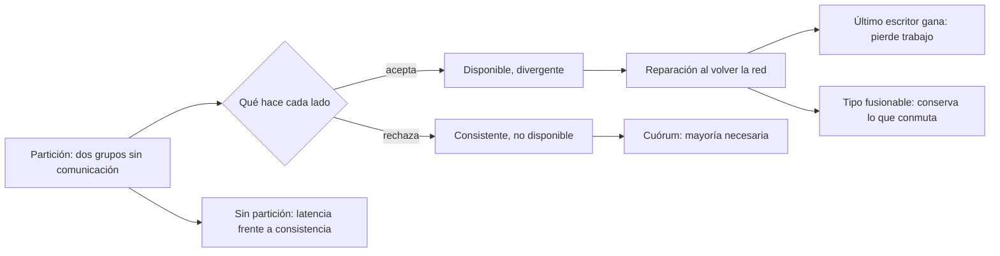
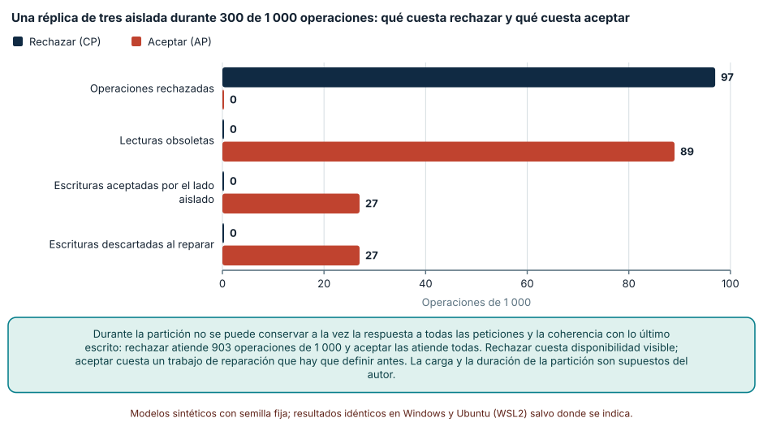
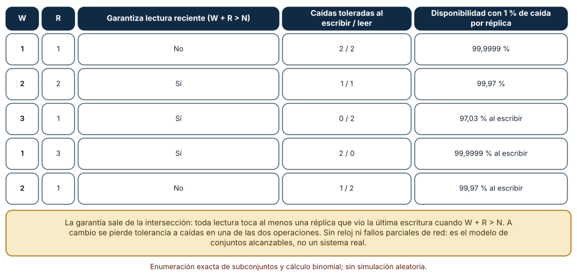
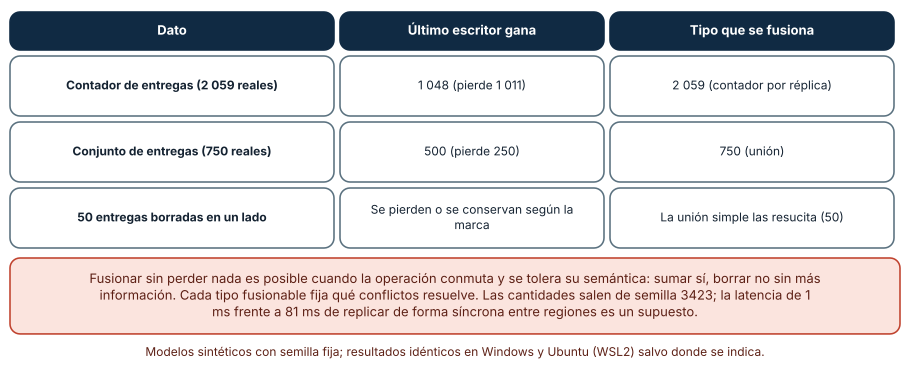

# SE-342 — Consistencia, disponibilidad y particiones

[← SE-341 — Fallos parciales y modelos de red](../../classes/part-28-concurrencia-y-sistemas-distribuidos/se-341-fallos-parciales-y-modelos-de-red/README.md) · [↑ Parte 28](../../classes/part-28-concurrencia-y-sistemas-distribuidos/README.md) · [📚 Índice completo](../../classes/README.md) · [🌐 Portal](../../site/classes/SE-342.html) · [SE-343 — Consenso, elección y coordinación →](../../classes/part-28-concurrencia-y-sistemas-distribuidos/se-343-consenso-eleccion-y-coordinacion/README.md)

## Punto profesional y fundamento pedagógico

**Punto profesional.** La clase existe para que conviertas «CAP» de una etiqueta en una decisión por operación: durante una partición de la red, qué peticiones se rechazan para no mostrar datos viejos, cuáles se aceptan y se reconcilian después, qué cuórum de lectura y escritura se exige y qué tipos de datos se pueden fusionar sin perder trabajo.

**Por qué aparece aquí.** Sigue a **Fallos parciales y modelos de red**: allí una respuesta que no llega era ambigua; aquí la red se parte durante un rato y cada lado sigue funcionando. En el caso conductor, una réplica de las entregas queda aislada del resto durante diez minutos del cierre de plazo: ¿debe seguir recibiendo entregas?

**Error conceptual que debe corregir.** Creer que se «elige dos de tres» entre consistencia, disponibilidad y tolerancia a particiones: las particiones no se eligen, ocurren, y lo que se decide es qué sacrificar mientras duran, operación por operación.

**Secuencia de aprendizaje.** Antes de leer los resultados, predices cuántas operaciones se rechazan y cuántas lecturas son obsoletas si una réplica aislada rechaza frente a si acepta; después enumeras qué cuórums garantizan leer lo último escrito y qué disponibilidad tienen, y comparas qué conservan una regla de último escritor y un tipo que se fusiona tras la reparación. La secuencia usa predicción, explicación propia, contraste y recuperación. [ICAP](https://icap.education.asu.edu/research) distingue participación de construcción de conocimiento; [How People Learn II](https://nap.nationalacademies.org/catalog/24783/how-people-learn-ii-learners-contexts-and-cultures) exige conectar conocimiento previo, contexto y transferencia; la [práctica de recuperación](https://pubmed.ncbi.nlm.nih.gov/16507066/) respalda producir de nuevo la explicación tras una demora; y [Education for Life and Work](https://nap.nationalacademies.org/resource/13398/dbasse_084153.pdf) exige devolución que explique la causa del error.

**Evidencia de aprendizaje.** `consistencia-log.md` con la predicción, las tres figuras reproducidas, una tabla de operaciones de la plataforma con la decisión «rechazar» o «aceptar y reconciliar» y el cuórum elegido, y una nota que declare qué se pierde en cada caso.

**Límite de la conclusión.** La partición, la carga y las proporciones de lectura y escritura son sintéticas con semilla fija; los cuórums se enumeran exactamente pero sobre un modelo sin retrasos ni fallos parciales de mensajes; la latencia de 1 ms frente a 81 ms es un supuesto del autor. No se midió ninguna base de datos distribuida ni se probó la linealizabilidad de ningún sistema.

### Trazabilidad fuente → afirmación

| Fuente primaria u oficial | Afirmación que respalda | Lo que no prueba |
|---|---|---|
| [Gilbert y Lynch, «Brewer's conjecture and the feasibility of consistent, available, partition-tolerant web services» (2002)](https://doi.org/10.1145/564585.564601) | Demuestra que un servicio no puede ser a la vez linealizable y disponible ante particiones en el modelo asíncrono. | No describe la elección que hace un producto concreto en la práctica. |
| [Brewer, «CAP twelve years later» (2012)](https://doi.org/10.1109/MC.2012.37) | Aclara que la elección se hace por operación y mientras dura la partición, y que se puede recuperar la consistencia después. | No cuantifica los costos de la reparación. |
| [Abadi, «Consistency tradeoffs in modern distributed database system design» (2012)](https://doi.org/10.1109/MC.2012.33) | Propone PACELC: además de la partición, hay un compromiso permanente entre latencia y consistencia. | No mide las latencias de ningún sistema. |
| [Jepsen: modelos de consistencia](https://jepsen.io/consistency) | Mapa de modelos (linealizable, secuencial, causal, de sesión, eventual) y de las anomalías que cada uno admite. | No dice cuál conviene a la plataforma. |
| [Shapiro et al., «Conflict-free replicated data types»](https://inria.hal.science/inria-00555588) | Define los tipos de datos replicados que convergen sin coordinación porque sus operaciones conmutan. | No cubre los tipos que no conmutan, como el borrado sin información adicional. |

## Antes de empezar

Recupera lo aprendido en `SE-341`: tras un silencio no se sabe qué ocurrió. La pregunta activa es: **si la red se parte y cada lado sigue vivo, ¿qué prometes a las personas de cada lado, y qué haces cuando la red vuelve?**

## Prerrequisitos

- Haber completado `SE-341` o poder explicar por qué un tiempo agotado es ambiguo.
- Python 3.11 o posterior; los experimentos usan solo la biblioteca estándar (`random`, `itertools`, `math`).
- Haber visto la replicación y las lecturas obsoletas en la Parte 26 (`SE-319`).

## Problema auténtico

La plataforma tenía tres réplicas del registro de entregas. Una noche de cierre de plazo, el enlace con una de ellas se cortó durante diez minutos, y los estudiantes que llegaban a esa réplica podían seguir entregando. Cuando el enlace volvió, el sistema reconcilió «ganando la versión más reciente» y 27 entregas hechas en el lado aislado desaparecieron: sus estudiantes tenían un acuse de recibo y la base no tenía la entrega. Otro día, tras cambiar la política a «rechazar si no hay mayoría», la misma partición dejó sin servicio a cien estudiantes durante diez minutos, con un mensaje de error que decía lo que pasaba. Nadie había decidido cuál de las dos pérdidas era aceptable; la había decidido el comportamiento por defecto de la base.

## Objetivos observables

Al terminar podrás:

1. enunciar qué prueba el resultado de Gilbert y Lynch y qué no prueba;
2. comparar «rechazar» y «aceptar y reconciliar» durante una partición contando operaciones rechazadas, lecturas obsoletas y escrituras perdidas;
3. calcular qué cuórums de lectura y escritura garantizan leer lo último y cuántas caídas toleran;
4. explicar por qué un tipo de dato fusionable conserva lo que el último escritor pierde, y dónde la fusión también falla;
5. clasificar las operaciones de la plataforma según la decisión que tomas durante una partición y el costo que aceptas.

## Mapa conceptual



El mapa tiene dos tiempos. **Durante** la partición se elige entre rechazar y aceptar. **Después**, si se aceptó, se paga con una reparación cuyo costo depende de si las operaciones se pueden fusionar. Y, aun sin partición, existe un compromiso permanente entre esperar a más réplicas (consistencia) y responder rápido (latencia).

## Temas y por qué importan

| Tema | Por qué cambia una decisión profesional | Evidencia mínima |
|---|---|---|
| Partición y el resultado CAP | Obliga a decidir qué se sacrifica y qué se promete. | Predicción, traza causal y contraejemplo de **Partición y el resultado CAP** en `consistencia-log.md` |
| Modelos de consistencia | Dicen qué anomalías puede ver una persona. | Predicción, traza causal y contraejemplo de **Modelos de consistencia** en `consistencia-log.md` |
| Cuórums de lectura y escritura | Convierten una promesa en una intersección de réplicas. | Predicción, traza causal y contraejemplo de **Cuórums de lectura y escritura** en `consistencia-log.md` |
| Reparación y tipos fusionables | Deciden cuánto trabajo se pierde al volver la red. | Predicción, traza causal y contraejemplo de **Reparación y tipos fusionables** en `consistencia-log.md` |
| Latencia frente a consistencia | El compromiso existe aunque la red esté sana. | Predicción, traza causal y contraejemplo de **Latencia frente a consistencia** en `consistencia-log.md` |

## Conceptos y decisiones

### 1. Partición y el resultado CAP

Gilbert y Lynch formalizaron la conjetura de Brewer: en un sistema asíncrono, ante una partición de la red, un servicio no puede ser a la vez **consistente** (en el sentido de linealizable: cada lectura ve la última escritura confirmada) y **disponible** (toda petición a un nodo vivo recibe respuesta). El resultado es estrecho: habla de una partición real, de linealizabilidad y de disponibilidad total, y no dice nada sobre sistemas sin particiones ni sobre garantías más débiles. Lo que enseña es el esqueleto de la decisión: durante la partición, un lado debe rechazar (pierde disponibilidad) o aceptar y divergir (pierde consistencia). No es una elección de producto sino una decisión por operación.

### 2. Modelos de consistencia

Entre «linealizable» y «eventual» hay un espectro. La **linealizabilidad** hace que el sistema parezca una sola copia que reacciona de inmediato. La **consistencia secuencial** conserva un orden único aceptado por todos, pero no necesariamente el del tiempo real. La **consistencia causal** conserva el orden entre sucesos relacionados (lo que se leyó antes de escribir) y deja libres los concurrentes. La **consistencia de sesión** garantiza que una persona vea sus propias escrituras. La **eventual** solo promete que, si cesan las escrituras, las réplicas convergen. Cada modelo permite anomalías que el anterior prohíbe, y cada operación de la plataforma tolera unas y no otras: una persona debe ver su propia entrega (sesión), la nota final de un curso no puede mostrar dos valores (más fuerte) y un contador de visitas puede ser eventual.

### 3. Cuórums de lectura y escritura

Con *N* réplicas, una escritura confirmada en *W* y una lectura de *R* réplicas garantizan leer la última escritura si `W + R > N`, porque cualquier conjunto de lectura se cruza con cualquier conjunto de escritura en al menos una réplica. Con *N* = 3: W = 2 y R = 2 lo garantizan y toleran una caída en cada operación; W = 3 y R = 1 lo garantizan, hacen baratas las lecturas y no toleran ninguna caída al escribir; W = 1 y R = 1 toleran dos caídas y no garantizan nada. El cuórum convierte una decisión de producto («¿puedo mostrar un dato viejo?») en una de configuración y de disponibilidad, que se puede calcular.

### 4. Reparación y tipos fusionables

Si ambos lados aceptaron escrituras, al volver la red hay que **reconciliar**. La regla más simple, «gana la versión más reciente», descarta el trabajo del otro lado. Los **tipos de datos replicados sin conflicto** (CRDT) evitan perder trabajo cuando las operaciones conmutan: un contador por réplica se suma, un conjunto de solo añadir se une. Pero la fusión no es mágica: si un lado borra un elemento y el otro lo conserva, la unión simple lo resucita; un contador que admite restas y límites (un cupo) no se puede fusionar sin coordinación. La reparación debe diseñarse con los datos, antes de que ocurra la partición.

### 5. Latencia frente a consistencia

Aun con la red sana, esperar la confirmación de más réplicas cuesta tiempo. Abadi lo formuló como PACELC: si hay partición, se elige disponibilidad o consistencia; si no, se elige latencia o consistencia. Una escritura que espera a una réplica de otra región paga el viaje de ida y vuelta en cada petición, no solo durante los fallos. Por eso muchos sistemas ofrecen consistencia configurable por operación y la decisión se toma dato por dato: lo que no debe perderse, con confirmación síncrona; lo que se puede reconstruir, con asíncrona.

### Rechazar o aceptar durante diez minutos

Una de tres réplicas queda aislada de la operación 300 a la 600 de 1 000. Cada operación llega a una réplica al azar (30 % escrituras). Con la política **CP**, la réplica aislada rechaza todo; con la **AP**, atiende lecturas con lo que tiene y acepta escrituras que no comparte. Al volver la red, se reconcilia por versión: el lado con la versión mayor gana.

```python
if policy == "CP" and isolated:
    rejected += 1; continue
if isolated:                        # AP: acepta localmente
    v = state["C"][0] + 1; state["C"] = (v, v); divergent += 1; cw += 1
```

| Medida | Rechazar (CP) | Aceptar (AP) |
|---|---:|---:|
| Operaciones rechazadas | 97 | 0 |
| Operaciones atendidas | 903 | 1 000 |
| Lecturas obsoletas | 0 | 89 |
| Escrituras aceptadas por el lado aislado | 0 | 27 |
| Escrituras descartadas al reparar | 0 | 27 |

Rechazar costó 97 operaciones visibles y no dejó ningún dato viejo. Aceptar atendió todo, sirvió 89 lecturas obsoletas y obligó a descartar 27 escrituras al reconciliar con «gana la versión mayor». Ninguna política es gratis: cada una elige qué se paga y a quién.



**Cómo leer la figura.** Cada grupo es un costo y cada color una política (azul, rechazar; coral, aceptar); la longitud es cuántas de las 1 000 operaciones sufren ese costo. Mira que los costos no se solapan: el azul solo aparece en las operaciones rechazadas y el coral solo en lo que se acepta y hay que reparar. **Dónde deja de valer:** la partición es de una réplica y de 300 operaciones, la carga es uniforme y la reconciliación es una regla de versión del autor; en un sistema real la duración de la partición, la carga y la regla cambian las cifras. El resultado transferible es la forma: lo que se rechaza es visible; lo que se acepta cuesta una reparación.

### Qué garantiza cada cuórum

Para tres réplicas se enumeran los ocho subconjuntos alcanzables y se cuenta en cuántos se puede escribir y leer con cada par (W, R). Se calcula también la disponibilidad si cada réplica está caída el 1 % del tiempo.

```python
reachable_sets = [s for k in range(N + 1) for s in itertools.combinations(range(N), k)]
can_w = sum(1 for s in reachable_sets if len(s) >= W)
sees_latest = W + R > N                     # toda lectura se cruza con toda escritura
```

| W | R | Garantiza leer lo último (W + R > N) | Caídas toleradas al escribir / leer | Disponibilidad con 1 % de caída |
|---:|---:|---|---:|---|
| 1 | 1 | No | 2 / 2 | 99,9999 % |
| 2 | 2 | Sí | 1 / 1 | 99,97 % |
| 3 | 1 | Sí | 0 / 2 | 97,03 % al escribir |
| 1 | 3 | Sí | 2 / 0 | 99,9999 % al escribir |
| 2 | 1 | No | 1 / 2 | 99,97 % al escribir |

El cuórum 2/2 es el equilibrio: lee lo último y tolera una caída en cada operación, con una disponibilidad de 99,97 %. El 3/1 hace la lectura barata y la escritura frágil: basta que una réplica falle para que no se pueda escribir (97,03 %). Garantizar leer lo último cuesta tolerancia a caídas en una de las dos operaciones.



**Cómo leer la figura.** El eje horizontal son las caídas que tolera la escritura (N − W) y el vertical las de la lectura (N − R); el color indica si el cuórum garantiza leer lo último (verde) o no (coral). Mira que los verdes caen sobre una diagonal: lo que se gana en tolerancia en una operación se paga en la otra. **Dónde deja de valer:** el modelo es de subconjuntos alcanzables: no hay retrasos, mensajes parciales ni escrituras en vuelo, que en un sistema real pueden hacer que una lectura con `W + R > N` vea un valor intermedio (la linealizabilidad pide más que el cuórum). La figura muestra la aritmética, no una garantía de un sistema.

### Qué conserva cada reparación

Dos lados de una partición registran entregas de forma independiente. Para el contador, cada lado hace 500 operaciones de entre 1 y 3 entregas y entre ambos suman 2 059. Para el conjunto, cada lado registra 500 entregas identificadas, 250 de ellas en común, de modo que en total hay 750 distintas. Se reconcilia con «gana el lado mayor» y con tipos fusionables (contador por réplica y unión de conjuntos). Aparte, se borran 50 entregas en un lado.

```python
gcounter = {"A": sum(a_ops), "B": sum(b_ops)}        # cada réplica suma lo suyo
total = sum(gcounter.values())                      # fusión: suma de los contadores
union = set_a | set_b                               # fusión de conjuntos
```

| Dato | Último escritor gana | Tipo que se fusiona |
|---|---|---|
| Contador de entregas (2 059 reales) | 1 048 (pierde 1 011) | 2 059 (contador por réplica) |
| Conjunto de entregas (750 reales) | 500 (pierde 250) | 750 (unión) |
| 50 entregas borradas en un lado | Se conservan o se pierden según la marca | La unión simple las resucita (50) |

Contar con un contador por réplica y unir conjuntos conserva todo; «gana el lado mayor», en el mejor caso, tira casi la mitad. Pero la unión simple trata el borrado como una ausencia, y una entrega borrada en un lado reaparece. La fusión es correcta solo para operaciones que conmutan; para el borrado hace falta información adicional (una marca de borrado), y para un cupo limitado, coordinación.



**Cómo leer la figura.** Cada fila es un tipo de dato; el punto hueco es lo que conserva «último escritor gana» y el relleno lo que conserva el tipo que se fusiona, en entregas. El segmento es lo que se pierde por reparar mal; la unión simple, además, resucita 50 entregas borradas, como indica la nota. **Dónde deja de valer:** las 500 operaciones por lado y su solapamiento de 250 elementos salen de la semilla 3423; la mejora de la fusión depende de que las operaciones sean realmente conmutativas. La latencia de 1 ms frente a 81 ms de una confirmación síncrona entre regiones es un supuesto del autor, no una medición.

### Ampliación: CRDT, del contador al conjunto que no resucita

Un **CRDT** (tipo de datos replicado sin conflicto, [crdt.tech](https://crdt.tech/)) es una estructura de datos cuyo estado se puede fusionar entre réplicas con una operación que no depende del orden ni de las repeticiones. Formalmente, en la variante basada en estado, la fusión es la unión de un semirretículo: **conmutativa** (A∪B = B∪A), **asociativa** e **idempotente** (A∪A = A). Esas tres propiedades son las que permiten que una réplica reciba mensajes desordenados y duplicados y aun así converja, algo que una red que pierde y repite mensajes no permite evitar. La sección anterior mostró dos: el contador por réplica y la unión de conjuntos de solo añadir. Falta el caso que hace útil a un conjunto: quitar elementos.

**Mecanismo: la baja solo quita lo que vio.** En un conjunto con altas y bajas, «aplicar cada operación al llegar» no converge porque alta y baja del mismo elemento no conmutan: con alta y luego baja el elemento no está, con baja y luego alta sí. El **OR-Set** (conjunto de observar y quitar) resuelve esto dando a cada alta una etiqueta única y haciendo que cada baja lleve consigo las etiquetas de ese elemento que su origen había visto. La baja quita solo esas etiquetas; un alta concurrente, con etiqueta distinta, sobrevive. Así, de las dos reglas posibles ante una alta y una baja concurrentes, el OR-Set elige **el alta gana**. El estado es el conjunto de etiquetas de altas menos el de etiquetas quitadas: ambas partes crecen solo por unión, y la fusión es una unión.

**Causa: converger no es lo mismo que ser correcto.** La alternativa habitual es el **último escritor gana**: cada operación lleva una marca de tiempo y manda la mayor. Converge si las marcas son únicas y totalmente ordenadas, pero descarta altas concurrentes que ninguna baja había visto y, con relojes desfasados (clase SE-340), decide con una hora equivocada. Además, dos operaciones con la misma marca solo se ordenan si se desempata, por ejemplo con el identificador de la réplica.

**Experimento reproducible.** `scripts/experiments_part28_ext.py` ejecuta 5 000 corridas por diseño (semilla 345) con tres réplicas y 12 operaciones sobre 3 elementos, 60 % altas y 40 % bajas. Antes de emitir su operación, cada réplica recibe al azar parte de las operaciones pendientes de las demás; cada baja lleva las altas que su origen había visto. Al final, cada réplica recibe todas las operaciones en orden aleatorio y 5 repetidas. Se mide si las tres réplicas terminan iguales y si el estado coincide con la especificación «un elemento está si alguna alta no fue observada por ninguna baja».

| Diseño | Réplicas con estados distintos | Estado que incumple «el alta gana» |
|---|---:|---:|
| Aplicar en orden de llegada | 87,6 % | 93,2 % |
| Último escritor, relojes con desfase de ±3 y empates sin desempate | 6,5 % | 41,3 % |
| OR-Set con etiquetas únicas | 0,0 % | 0,0 % |


**Cómo leer la figura.** Para cada diseño, la barra coral es la fracción de corridas en que las réplicas no convergen y la dorada la de corridas en que el estado final no es el que prescribe la regla del alta que gana. Mira que el último escritor casi no diverge y sin embargo incumple la regla en cuatro de cada diez corridas: convergencia y corrección son preguntas distintas. **Dónde deja de valer:** el modelo tiene tres réplicas, 12 operaciones y entrega aleatoria; no hay caídas de réplicas, fusión parcial ni compactación. El OR-Set de la figura guarda las etiquetas quitadas indefinidamente, y en un sistema real esa acumulación crece con el tiempo y obliga a compactar con un conocimiento causal que requiere coordinación.

**Límite y decisión.** Un CRDT no elimina la coordinación: la mueve al diseño. Sirve cuando las operaciones del dominio tienen una fusión natural (contadores de eventos, conjuntos de etiquetas, texto colaborativo). No sirve para invariantes globales como un cupo, un saldo no negativo o una clave única, que exigen coordinación (SE-343). La decisión es por dato: elegir el tipo que codifica la regla de negocio, probar la fusión con operaciones desordenadas y duplicadas, y declarar cuánta metadata crecerá.

## Definiciones de trabajo

- **partición de red:** situación en que dos grupos de nodos no pueden comunicarse entre sí.
- **linealizabilidad:** garantía de que cada operación parece ocurrir de forma instantánea entre su inicio y su fin, en un orden compatible con el tiempo real.
- **consistencia eventual:** garantía de que, si cesan las escrituras, todas las réplicas convergen al mismo valor.
- **cuórum:** número mínimo de réplicas que deben participar en una operación.
- **CRDT:** tipo de dato replicado cuyas copias convergen sin coordinación porque sus operaciones conmutan.

Las definiciones son operativas para la plataforma de entregas. No convierten términos con una historia más amplia en sinónimos y deben contrastarse con la documentación primaria enlazada al final.

## Ejemplo mínimo

El fragmento calcula si un cuórum garantiza leer lo último. Antes de ejecutarlo, predice el resultado para W = 2, R = 1 con tres réplicas.

```python
def garantiza(n, w, r):
    return w + r > n
assert garantiza(3, 2, 2) and not garantiza(3, 2, 1)
```

Con W = 2 y R = 1 un conjunto de lectura puede ser la única réplica que no vio la escritura. Registra versión de Python y salida; después busca a mano un par de conjuntos, uno de escritura y otro de lectura, que no se crucen.

## Ejemplo profesional

El equipo clasifica las operaciones de la plataforma. Registrar una entrega: durante una partición, la réplica sin mayoría **rechaza** con un mensaje que indica reintentar en minutos, porque un acuse de recibo falso es peor que una espera; la escritura exige un cuórum de 2 de 3. Mostrar el listado de entregas propias: se permite **aceptar** con datos de hasta cinco minutos de antigüedad y con una etiqueta de «última actualización». El contador de visitas del curso es un contador por réplica que se suma al volver la red. Las notas finales no se fusionan: se escriben con cuórum o no se escriben. Cada decisión queda en `consistencia-log.md` con la anomalía que acepta, el costo que paga y la medida que la respalda; el equipo declara además que nunca probó la partición real en un entorno de ensayo.

## Práctica guiada

1. Clasifica cinco operaciones de la plataforma por la anomalía que toleran (dato viejo, escritura perdida, rechazo).
2. Predice cuántas operaciones se rechazan y cuántas lecturas son obsoletas si una réplica aislada rechaza o acepta.
3. Simula la partición de 300 de 1 000 operaciones con ambas políticas y compara con tu predicción.
4. Enumera los cuórums posibles de tres réplicas y calcula su disponibilidad con un 1 % de caída.
5. Simula la reparación con «gana el lado mayor», un contador por réplica y una unión de conjuntos.
6. Añade el borrado de 50 elementos y comprueba qué pasa con la unión simple.
7. Entrega `consistencia-log.md` y pide a otra persona que encuentre una operación cuya anomalía tolerada sea inaceptable.

## Ejercicios

1. **Cuórum:** con cinco réplicas, ¿qué pares (W, R) garantizan leer lo último y cuáles toleran dos caídas en ambas operaciones?
2. **Contraejemplo:** describe una operación de la plataforma que no se puede fusionar con un contador y explica qué coordinación necesita.
3. **PACELC:** si una confirmación síncrona entre regiones cuesta 80 ms y el resto de la petición 20 ms, ¿qué fracción del tiempo es el precio de la consistencia?
4. **Diagnóstico:** tras una partición, 27 entregas con acuse no están en la base. Formula tres hipótesis y la observación que descarta cada una.

## Reto verificable

Entrega `consistencia-log.md` con la predicción, las tres tablas, la clasificación de operaciones (rechazar, aceptar y reconciliar, fusionar) y el cuórum elegido por dato. Se aprueba si otra persona ejecuta el código desde un checkout limpio, obtiene los mismos conteos con las mismas semillas y puede decir qué operación pierde disponibilidad y cuál puede perder trabajo. No se aprueba por declarar el sistema «CP» o «AP» sin decir por operación qué ocurre durante la partición.

## Caso conductor

La decisión por operación durante una partición es el artefacto de esta clase en el caso conductor de la Parte 28. `SE-343` pregunta cómo se ponen de acuerdo los nodos para que haya una sola respuesta cuando hace falta. Cambia después una sola decisión, el cuórum de escritura, y observa qué otra (la disponibilidad ante una caída) se ve afectada.

## Preguntas frecuentes

### ¿Mi base de datos es CP o AP?

La pregunta está mal planteada: depende de la configuración por operación y de la partición. Verifica qué ocurre en una lectura y en una escritura cuando una réplica no ve a las otras; Jepsen ofrece un vocabulario para describir lo que se observa.

### ¿Por qué `W + R > N` no es linealizabilidad?

Porque garantiza que una lectura toca una réplica que vio la última escritura *confirmada*, no que todas las lecturas concurrentes devuelvan el mismo valor ni que el orden respete el tiempo real. Los cuórums son una condición necesaria en muchas implementaciones, no suficiente.

### ¿Los CRDT resuelven todos los conflictos?

Resuelven los que provienen de operaciones que conmutan. El borrado, los límites (un cupo) y las reglas entre datos distintos necesitan información adicional o coordinación.

### ¿Tolerar particiones no significa evitarlas?

Significa que el sistema sigue siendo correcto cuando ocurren. Se pueden hacer raras con redundancia, pero no se eliminan; la decisión de qué hacer durante una debe estar tomada antes.

## Fallo controlado y diagnóstico

Reproduce el fallo clásico de la clase: **aceptar escrituras en ambos lados de una partición y reconciliar con «gana la versión más reciente»**. Simula la partición con la política AP y reconcilia por versión.

Registra síntoma, entrada mínima, hipótesis, observación que descarta cada hipótesis, causa, corrección y prueba de regresión. **Síntoma:** estudiantes con acuse de entrega que no aparecen en la base tras una partición. **Hipótesis rivales:** (a) la réplica aislada perdió los datos al reiniciarse; (b) la entrega nunca se guardó; (c) la reconciliación descartó las escrituras del lado perdedor. **Prueba:** busca las versiones de las escrituras del lado aislado en el registro de la réplica; si existen con una versión menor que la ganadora, la causa es la reconciliación. **Conclusión:** «gana la versión más reciente» descartó 27 escrituras con acuse. **Regresión:** conserva ambas versiones como conflicto o fusiona con un tipo adecuado, y añade una prueba que simule la partición y compruebe que no hay acuses sin registro. No cambies a la vez la política de aceptación y la de reconciliación.

## Errores comunes y cómo corregirlos

| Síntoma | Causa probable | Corrección |
|---|---|---|
| Acuses de entrega sin registro tras una partición | Reconciliación que descarta el lado perdedor | Conservar conflictos o fusionar con tipos adecuados |
| Servicio caído para un grupo de estudiantes | Rechazo por falta de mayoría sin aviso claro | Mensaje honesto y reintento guiado |
| Una persona no ve su propia escritura | Lectura de una réplica atrasada | Consistencia de sesión o lectura del cuórum |
| El cuórum es 1/1 por «rapidez» | No se calculó lo que se pierde | Elegir (W, R) con `W + R > N` si importa lo último |
| Entregas borradas que reaparecen | Unión simple de conjuntos | Marcas de borrado o coordinación |

## Entorno y archivos clave

```text
work/SE-342/
├── README.md
├── modelo/
│   ├── particion.py
│   ├── cuorum.py
│   └── reparacion.py
├── tests/test_consistencia.py
└── evidence/consistencia-log.md
```

El `README` declara plataforma, versión de Python, semillas (342 y 3423) y comandos. Los experimentos usan solo la biblioteca estándar (`random`, `itertools`, `math`) y se ejecutaron con CPython 3.12.9 en Windows 11 y 3.12.3 en Ubuntu bajo WSL2: las salidas fueron idénticas. Si añades una dependencia, fija procedencia y versión.

## Seguridad, ética y accesibilidad

- aceptar escrituras sin consenso durante una partición puede permitir un doble gasto de un cupo o un doble canje de un derecho: identifica los datos donde eso es inaceptable;
- un acuse de recibo es una promesa a una persona: no lo emitas antes de que se cumpla la garantía que declaras;
- los mensajes de rechazo deben ser comprensibles y accesibles, con una acción clara y sin culpar a la persona;
- documenta la tabla de decisiones por operación en texto, no solo en un diagrama;
- respeta las licencias de los artículos citados y atribuye lo adaptado.

## Puente hacia el trabajo con agentes

Un agente al que se le pide «hazlo altamente disponible» configurará lecturas y escrituras a una sola réplica y reconciliará por marca de tiempo, sin decir qué se pierde. Pídele en cambio que clasifique cada operación como «rechazar», «aceptar y reconciliar» o «fusionar», que calcule `W + R > N` para el cuórum que elija y que incluya una prueba que simule una partición y busque acuses sin registro. Revisa especialmente si la reconciliación descarta escrituras y si el borrado se trata como ausencia: son los dos defectos que esta clase mostró sin aviso.

## Transferencia

Traslada el análisis a otro dominio (por ejemplo, un carro de compras replicado entre regiones): cambia las operaciones y conserva el procedimiento de decidir por dato qué se rechaza y qué se reconcilia, calcular el cuórum y revisar si la reparación conmuta. La transferencia está lograda cuando puedes explicar qué anomalía aceptas y qué trabajo puedes perder, no cuando el sistema se llama «AP» o «CP».

## Evaluación y evidencia

| Criterio | Evidencia para aprobar |
|---|---|
| comprensión | explicación del alcance del resultado CAP y de los modelos de consistencia con ejemplos |
| corrección | conteos de rechazos, obsolescencia, cuórums y reparación reproducibles |
| diseño | clasificación de operaciones y cuórum por dato |
| diagnóstico | reproducción del acuse sin registro con regresión |
| incertidumbre | declaración de que no se probó ninguna base distribuida real |
| reproducibilidad | versiones, comandos, salida y límites declarados |

## Fuentes

- [Gilbert y Lynch, «Brewer's conjecture…»](https://doi.org/10.1145/564585.564601) — el resultado formal; autoridad: artículo original (2002).
- [Brewer, «CAP twelve years later»](https://doi.org/10.1109/MC.2012.37) — la elección por operación; autoridad: autor de la conjetura.
- [Abadi, «Consistency tradeoffs in modern distributed database system design»](https://doi.org/10.1109/MC.2012.33) — PACELC; autoridad: artículo original.
- [Jepsen: modelos de consistencia](https://jepsen.io/consistency) — mapa de modelos y anomalías; autoridad: Jepsen.
- [Shapiro et al., «Conflict-free replicated data types»](https://inria.hal.science/inria-00555588) — tipos que convergen sin coordinación; autoridad: artículo de los autores.
- [Vogels, «Eventually consistent»](https://doi.org/10.1145/1435417.1435432) — consistencia eventual en un sistema real; autoridad: autor del artículo.

Cada fuente respalda el mecanismo indicado; ninguna demuestra que las 97 operaciones rechazadas, las 27 escrituras descartadas o el 97,03 % de disponibilidad se observen en un sistema real. Esa afirmación depende de la duración de la partición, de la carga y de la configuración.

- [crdt.tech](https://crdt.tech/) — recopilación de recursos sobre tipos de datos replicados sin conflicto: contadores, conjuntos (incluido el de observar y quitar), registros y texto; autoridad: sitio de la comunidad de investigación sobre CRDT.

## Límites y siguiente paso

Se ejecutaron tres experimentos en Windows y Ubuntu (WSL2) con resultados idénticos. No se probó ninguna base de datos distribuida ni se verificó la linealizabilidad de ningún sistema: la partición de una réplica, la carga y la regla de reconciliación son construcciones del autor, y los cuórums se enumeraron sobre un modelo sin retrasos. La siguiente clase aborda el caso en que no se puede aceptar divergencia: cómo se ponen de acuerdo los nodos sobre un valor o un líder único. La ampliación sobre CRDT usa un modelo de tres réplicas y 12 operaciones con 5 000 corridas por diseño y semilla 345, ejecutado con CPython 3.12.9 en Windows; no se ejecutó una biblioteca de CRDT ni se midió el crecimiento de la metadata.

## Glosario

- **partición de red:** situación en que dos grupos de nodos no pueden comunicarse entre sí.
- **linealizabilidad:** garantía de que cada operación parece ocurrir de forma instantánea entre su inicio y su fin, en un orden compatible con el tiempo real.
- **consistencia eventual:** garantía de que, si cesan las escrituras, todas las réplicas convergen al mismo valor.
- **cuórum:** número mínimo de réplicas que deben participar en una operación.
- **CRDT:** tipo de dato replicado cuyas copias convergen sin coordinación porque sus operaciones conmutan.

---

[← SE-341 — Fallos parciales y modelos de red](../../classes/part-28-concurrencia-y-sistemas-distribuidos/se-341-fallos-parciales-y-modelos-de-red/README.md) · [↑ Parte 28](../../classes/part-28-concurrencia-y-sistemas-distribuidos/README.md) · [📚 Índice completo](../../classes/README.md) · [🌐 Portal](../../site/classes/SE-342.html) · [SE-343 — Consenso, elección y coordinación →](../../classes/part-28-concurrencia-y-sistemas-distribuidos/se-343-consenso-eleccion-y-coordinacion/README.md)
