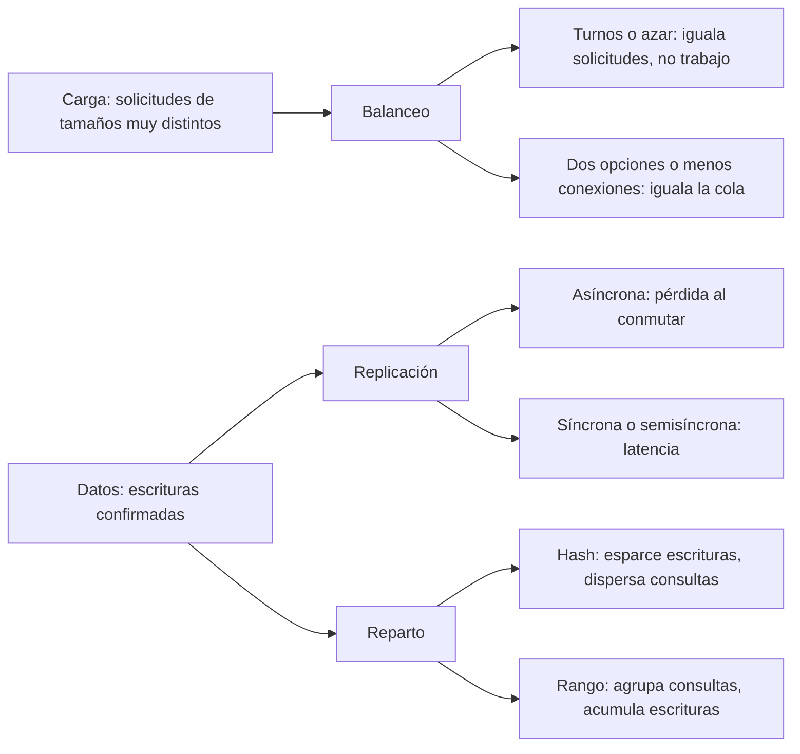
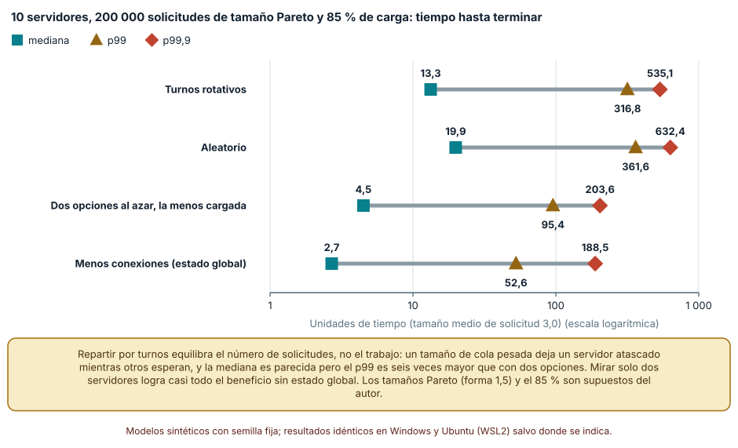
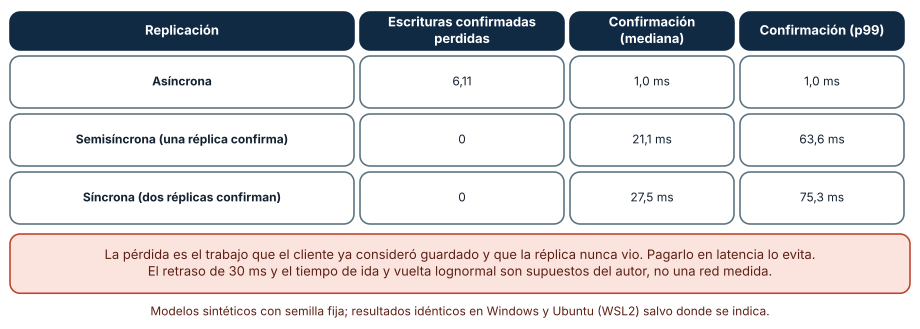
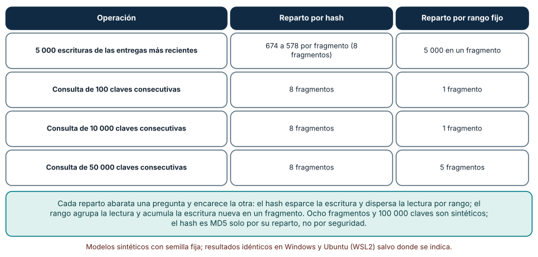

# SE-345 — Replicación, sharding y balanceo

[← SE-344 — Idempotencia y procesamiento distribuido](../../classes/part-28-concurrencia-y-sistemas-distribuidos/se-344-idempotencia-y-procesamiento-distribuido/README.md) · [↑ Parte 28](../../classes/part-28-concurrencia-y-sistemas-distribuidos/README.md) · [📚 Índice completo](../../classes/README.md) · [🌐 Portal](../../site/classes/SE-345.html) · [SE-346 — Caos controlado y pruebas de distribución →](../../classes/part-28-concurrencia-y-sistemas-distribuidos/se-346-caos-controlado-y-pruebas-de-distribucion/README.md)

## Punto profesional y fundamento pedagógico

**Punto profesional.** La clase existe para que decidas, con números, cómo repartir el trabajo y los datos de un servicio entre varias máquinas: qué política de balanceo mantiene bajo el percentil 99 cuando los trabajos son de tamaños muy distintos, cuántas escrituras confirmadas puedes perder al conmutar según cuántas réplicas esperes, y qué clave de reparto conviene a las consultas de la plataforma sin crear un fragmento caliente.

**Por qué aparece aquí.** Sigue a **Idempotencia y procesamiento distribuido**: con piezas repetibles, ahora se pueden repartir. En la Parte 26 (`SE-319`) se vio la replicación y el reparto de datos desde la base de datos; aquí se mira desde el servicio: los balanceadores, la conmutación por error y el reparto de la carga cuando crece. El caso conductor es el cierre de plazo: diez servidores reciben entregas de tamaños muy distintos.

**Error conceptual que debe corregir.** Creer que repartir las solicitudes por igual reparte el trabajo por igual, o que la replicación asíncrona «copia» sin pérdida: lo primero ignora la cola pesada de los tamaños, lo segundo ignora el retraso de la réplica.

**Secuencia de aprendizaje.** Antes de leer los resultados, predices qué política de balanceo da el menor percentil 99 con diez servidores y tamaños de cola pesada, y cuántas escrituras confirmadas se pierden al conmutar con replicación asíncrona; después comparas el reparto por hash y por rango de fecha en dónde caen las escrituras nuevas y cuántos fragmentos toca una consulta por tramo. La secuencia usa predicción, explicación propia, contraste y recuperación. [ICAP](https://icap.education.asu.edu/research) distingue participación de construcción de conocimiento; [How People Learn II](https://nap.nationalacademies.org/catalog/24783/how-people-learn-ii-learners-contexts-and-cultures) exige conectar conocimiento previo, contexto y transferencia; la [práctica de recuperación](https://pubmed.ncbi.nlm.nih.gov/16507066/) respalda producir de nuevo la explicación tras una demora; y [Education for Life and Work](https://nap.nationalacademies.org/resource/13398/dbasse_084153.pdf) exige devolución que explique la causa del error.

**Evidencia de aprendizaje.** `reparto-log.md` con la predicción, las tres figuras reproducidas, la política de balanceo elegida con su percentil 99, el modo de replicación por dato con la pérdida que acepta y la clave de reparto con las consultas que abarata y encarece.

**Límite de la conclusión.** Los tamaños (Pareto de forma 1,5), la carga del 85 %, el retraso de réplica (exponencial de media 30 ms) y el tiempo de ida y vuelta (lognormal) son supuestos del autor con semilla fija. No se midió ningún balanceador, ninguna base replicada ni ninguna red. El hash MD5 se usa solo por su reparto, no por seguridad.

### Trazabilidad fuente → afirmación

| Fuente primaria u oficial | Afirmación que respalda | Lo que no prueba |
|---|---|---|
| [Mitzenmacher, «The power of two choices in randomized load balancing» (2001)](https://doi.org/10.1109/71.963420) | Elegir dos servidores al azar y enviar al menos cargado reduce de forma exponencial la carga máxima frente a elegir uno al azar. | No cubre tamaños de solicitud de cola pesada ni el costo de consultar el estado. |
| [Karger et al., «Consistent hashing and random trees» (1997)](https://doi.org/10.1145/258533.258660) | Presenta el hash consistente: añadir o quitar un nodo mueve solo una fracción de las claves. | No resuelve el desequilibrio por claves calientes. |
| [PostgreSQL: servidores en espera y alta disponibilidad](https://www.postgresql.org/docs/current/warm-standby.html) | Documenta la replicación síncrona y asíncrona y qué datos se pueden perder al conmutar en cada modo. | No mide cuánto se pierde en una carga concreta. |
| [DeCandia et al., «Dynamo» (2007)](https://www.allthingsdistributed.com/files/amazon-dynamo-sosp2007.pdf) | Describe un almacén que reparte por hash consistente y replica con cuórums configurables. | Es el diseño de un sistema concreto; no prueba que convenga a la plataforma. |
| [Chang et al., «Bigtable» (2008)](https://doi.org/10.1145/1365815.1365816) | Reparte las filas por rango ordenado y muestra el efecto de las claves monótonas en un fragmento. | No compara con el reparto por hash ni mide la plataforma. |

## Antes de empezar

Recupera lo aprendido en `SE-344`: una operación repetible puede ejecutarse en cualquier nodo. La pregunta activa es: **¿cómo reparto el trabajo sin que unos servidores se atasquen mientras otros esperan, y cuánto cuesta no perder nada al conmutar?**

## Prerrequisitos

- Haber completado `SE-344` o poder explicar por qué la idempotencia permite reintentar en otro nodo.
- Python 3.11 o posterior; los experimentos usan solo la biblioteca estándar (`random`, `heapq`, `hashlib`, `statistics`).
- Haber visto en la Parte 26 (`SE-319`) el hash consistente y las lecturas obsoletas.

## Problema auténtico

Con diez servidores, el balanceador de la plataforma repartía las entregas por turnos: la solicitud número 11 al servidor 1, la 12 al 2. Las pruebas de carga con archivos del mismo tamaño daban un percentil 99 de 300 ms. En el cierre de plazo, con archivos de 20 KB y de 200 MB mezclados, algunos servidores acumulaban cola mientras otros estaban casi ociosos, y el percentil 99 pasó de segundos. Otro día, el servidor primario de la base cayó; el equipo conmutó a la réplica y 6 escrituras que el servicio había confirmado a estudiantes no estaban allí. Por último, para repartir los datos de entregas por fecha, un ingeniero eligió «un fragmento por rango de fechas»: el último fragmento recibía todas las escrituras nuevas, mientras los otros siete dormían. Cada decisión se tomó con la mejor intención y ninguna se midió con la forma real de la carga.

## Objetivos observables

Al terminar podrás:

1. comparar cuatro políticas de balanceo con tamaños de cola pesada por su percentil 99 y explicar el efecto de «dos opciones al azar»;
2. calcular cuántas escrituras confirmadas se pierden al conmutar con replicación asíncrona y qué latencia cuesta evitarlo;
3. comparar el reparto por hash y por rango en la distribución de las escrituras nuevas y en los fragmentos que toca una consulta;
4. decidir una política de balanceo, un modo de replicación y una clave de reparto para un dato de la plataforma, con su costo;
5. declarar qué métricas vigilarías (cola por servidor, retraso de réplica, desequilibrio por fragmento) para saber que la decisión sigue valiendo.

## Mapa conceptual



El mapa separa tres decisiones que se confunden en una palabra («escalar»): **balancear** la carga de cómputo, **replicar** los datos para sobrevivir a una caída y **repartir** los datos entre fragmentos para crecer. Cada una tiene su propia métrica de éxito y su propio defecto característico.

## Temas y por qué importan

| Tema | Por qué cambia una decisión profesional | Evidencia mínima |
|---|---|---|
| Balanceo y cola de espera | Igualar solicitudes no iguala trabajo. | Predicción, traza causal y contraejemplo de **Balanceo y cola de espera** en `reparto-log.md` |
| Replicación y conmutación | Define qué se pierde al fallar el primario. | Predicción, traza causal y contraejemplo de **Replicación y conmutación** en `reparto-log.md` |
| Reparto por hash o por rango | Decide qué consultas son baratas y qué fragmento se calienta. | Predicción, traza causal y contraejemplo de **Reparto por hash o por rango** en `reparto-log.md` |
| Rebalanceo | Mover datos cuesta tiempo y tráfico. | Predicción, traza causal y contraejemplo de **Rebalanceo** en `reparto-log.md` |
| Observabilidad del reparto | Sin métrica por fragmento no se ve el desequilibrio. | Predicción, traza causal y contraejemplo de **Observabilidad del reparto** en `reparto-log.md` |

## Conceptos y decisiones

### 1. Balanceo y cola de espera

Un **balanceador** decide a qué servidor va cada solicitud. La política de **turnos** (*round robin*) y la **aleatoria** reparten por igual el *número* de solicitudes; no reparten el *trabajo* cuando los tamaños son muy distintos, porque una solicitud enorme ocupa a un servidor mientras recibe más del reparto. La política de **menos conexiones** envía al servidor con menos trabajo en curso y exige conocer el estado de todos. La de **dos opciones al azar** (*power of two choices*) elige dos servidores al azar y envía al menos cargado de los dos: consigue casi todo el beneficio de la anterior consultando solo dos servidores. El percentil 99 es la métrica relevante, porque la experiencia de las personas la fijan las colas largas, no la media.

### 2. Replicación y conmutación

Una réplica asíncrona recibe los cambios después de que el primario confirma; si el primario cae antes de enviar los últimos, esos cambios, ya confirmados a las personas, se pierden al conmutar. El **objetivo de punto de recuperación** (RPO) es cuánto se acepta perder; con replicación asíncrona es el retraso de la réplica. La replicación **síncrona** espera la confirmación de la réplica antes de responder: RPO cero, a cambio de latencia (el tiempo de ida y vuelta) y de disponibilidad (si la réplica cae, el primario espera o degrada). La **semisíncrona** exige confirmar con al menos una réplica y mantiene las demás asíncronas. Elegir es dato por dato: lo que no puede perderse, síncrono; lo reconstruible, asíncrono.

### 3. Reparto por hash o por rango

Para repartir los datos entre fragmentos hay dos familias. El **hash** de la clave esparce las filas de forma uniforme: las escrituras se reparten bien, pero una consulta por tramo (las entregas del 10 al 15 de noviembre) debe preguntar a todos los fragmentos. El **rango** agrupa las claves cercanas en un fragmento: una consulta por tramo toca uno o pocos, pero si la clave crece con el tiempo (una fecha, un identificador secuencial), todas las escrituras nuevas caen en el último fragmento. La clave de reparto es una decisión sobre qué consulta se abarata y qué carga se concentra, y es difícil de cambiar después.

### 4. Rebalanceo

Cuando se añaden o quitan fragmentos hay que mover datos. Un reparto por módulo mueve casi todas las claves; el **hash consistente** (`SE-319`) mueve solo una fracción. Mover datos consume ancho de banda y puede degradar el servicio mientras se hace; se limita la velocidad, se mueve por partes pequeñas y se continúa atendiendo con la ubicación antigua hasta confirmar la nueva. Un fragmento demasiado grande o caliente se divide, y uno vacío se fusiona, pero cada operación tiene un costo y una ventana en la que hay que decidir dónde viven las claves.

### 5. Observabilidad del reparto

Un reparto sano no se ve en los promedios. Se vigilan la **cola por servidor** y el percentil 99 de cada uno, el **retraso de réplica** (el RPO real) y la **carga por fragmento** (escrituras, lecturas y tamaño). Una alerta sobre el promedio de CPU no detecta un fragmento caliente; una sobre el retraso medio no detecta una réplica rezagada. La métrica correcta es la de la cola larga y la del peor elemento, porque es ahí donde el reparto falla primero.

### Cuatro políticas con tamaños de cola pesada

Diez servidores reciben 200 000 solicitudes cuyos tamaños siguen una distribución de Pareto de forma 1,5 (truncada en 200) con carga del 85 %. Se simula un sistema de eventos discretos con cuatro políticas y se mide el tiempo hasta terminar cada solicitud (espera más servicio), en unidades de tiempo en las que el tamaño medio de una solicitud es 3,0.

```python
elif policy == "menos-conexiones":
    s = min(range(servers), key=lambda i: len(outstanding[i]))
else:                                    # dos opciones al azar
    a, b = r.sample(range(servers), 2)
    s = a if len(outstanding[a]) <= len(outstanding[b]) else b
```

| Política | Mediana | Percentil 99 | Percentil 99,9 |
|---|---:|---:|---:|
| Turnos rotativos | 13,3 | 316,8 | 535,1 |
| Aleatorio | 19,9 | 361,6 | 632,4 |
| Dos opciones al azar, la menos cargada | 4,5 | 95,4 | 203,6 |
| Menos conexiones (estado global) | 2,7 | 52,6 | 188,5 |

Los turnos y el azar dejan colas con percentil 99 de unas 100 veces el tamaño medio de una solicitud; mirar solo dos servidores lo baja a 95 y mirar los diez a 53. La ventaja de «dos opciones» es que no necesita el estado global: basta consultar dos servidores. En el percentil 99,9 las diferencias se reducen, porque una solicitud muy grande ocupa su servidor de todos modos.



**Cómo leer la figura.** Cada fila es una política y las columnas muestran la experiencia de la mediana y de las colas largas. **Dónde deja de valer:** la simulación supone servidores idénticos, llegadas aleatorias (exponenciales) y que el tamaño se conoce solo al servir; un balanceador real tiene conexiones persistentes, sesiones, servidores de capacidades distintas y retardos al consultar el estado, que cambian el ranking. La carga de 85 % y la forma 1,5 de Pareto son supuestos del autor.

### Lo que se pierde al conmutar

Un primario recibe 200 escrituras por segundo. La réplica asíncrona tiene un retraso exponencial de media 30 ms; la semisíncrona espera a una réplica y la síncrona a dos, con un tiempo de ida y vuelta lognormal. Se simulan 2 000 conmutaciones tras la caída del primario y se mide la pérdida de escrituras confirmadas y la latencia de confirmación.

```python
lag = r.expovariate(1 / 30.0)                 # ms de retraso de la réplica asíncrona
lost = writes_per_s * lag / 1000.0            # escrituras confirmadas que la réplica no vio
ack = 1.0 + rtt                               # semisíncrona: espera a una réplica
```

| Replicación | Escrituras confirmadas perdidas (media) | Confirmación (mediana) | Confirmación (p99) |
|---|---:|---:|---:|
| Asíncrona | 6,11 | 1,0 ms | 1,0 ms |
| Semisíncrona (una réplica confirma) | 0 | 21,1 ms | 63,6 ms |
| Síncrona (dos réplicas confirman) | 0 | 27,5 ms | 75,3 ms |

La asíncrona pierde en promedio 6,11 escrituras ya confirmadas por conmutación, que son entregas a las que se mostró un acuse. Esperar a una réplica elimina la pérdida y multiplica por 21 la latencia mediana de confirmación. Esperar a dos añade 6 ms de mediana y no mejora la pérdida (ya es cero), pero reduce la dependencia de una sola réplica.



**Cómo leer la figura.** Cada fila es un modo de replicación; las columnas dan lo que se pierde y lo que cuesta la confirmación. **Dónde deja de valer:** el retraso de 30 ms y el tiempo de ida y vuelta lognormal son supuestos del autor; no se modelan caídas simultáneas de réplica y primario ni la espera de las réplicas cuando están rezagadas. El resultado transferible es la relación: pérdida y latencia se intercambian.

### Hash o rango

Ocho fragmentos reparten 100 000 claves ordenadas por fecha. Se mide cómo se reparten las 5 000 escrituras más recientes con hash (MD5 módulo 8) y con rangos de 12 500 claves definidos al inicio, y cuántos fragmentos toca una consulta de un tramo de claves consecutivas.

```python
def shard_hash(k):          return int(hashlib.md5(str(k).encode()).hexdigest(), 16) % shards
def shard_range_fixed(k):   return min(k // 12_500, shards - 1)
```

| Operación | Reparto por hash | Reparto por rango fijo |
|---|---|---|
| 5 000 escrituras de las entregas más recientes | 674 a 578 por fragmento (8 fragmentos) | 5 000 en un fragmento |
| Consulta de 100 claves consecutivas | 8 fragmentos | 1 fragmento |
| Consulta de 10 000 claves consecutivas | 8 fragmentos | 1 fragmento |
| Consulta de 50 000 claves consecutivas | 8 fragmentos | 5 fragmentos |

Con hash, las escrituras recientes se reparten casi por igual (entre 578 y 674) y toda consulta por tramo debe preguntar a los 8 fragmentos. Con rango, la consulta toca 1 fragmento y las 5 000 escrituras se concentran en uno solo. Ningún reparto es mejor: cada uno abarata una pregunta y encarece la otra.



**Cómo leer la figura.** Cada fila es una operación y las columnas, el reparto. **Dónde deja de valer:** los ocho fragmentos y los rangos iguales definidos al inicio son una construcción del autor; sistemas reales con rangos que se dividen automáticamente atenúan la acumulación en el último fragmento, pero no eliminan el calor de una clave monótona. El hash MD5 se usa por su reparto uniforme, no por seguridad.

## Definiciones de trabajo

- **balanceo de carga:** reparto de las solicitudes entre servidores según una política.
- **objetivo de punto de recuperación (RPO):** cantidad máxima de datos que se acepta perder, medida como intervalo de tiempo o número de escrituras.
- **replicación semisíncrona:** replicación en que el primario espera la confirmación de al menos una réplica antes de responder.
- **fragmento (*shard*):** subconjunto de los datos alojado en un nodo o grupo de nodos.
- **fragmento caliente:** fragmento que recibe una fracción desproporcionada de la carga.

Las definiciones son operativas para la plataforma de entregas. No convierten términos con una historia más amplia en sinónimos y deben contrastarse con la documentación primaria enlazada al final.

## Ejemplo mínimo

El fragmento muestra que repartir por turnos no iguala el trabajo. Antes de ejecutarlo, predice cuánto trabajo recibe cada servidor.

```python
tamanos = [1, 100, 1, 100]          # dos servidores, solicitudes alternadas
turnos = [0, 0]
for i, t in enumerate(tamanos):
    turnos[i % 2] += t
assert turnos == [2, 200]
```

Cada servidor recibe dos solicitudes, pero uno recibe 2 unidades de trabajo y el otro 200. Registra versión de Python y salida; después envía cada solicitud al servidor con menos trabajo acumulado y compara el reparto.

## Ejemplo profesional

El equipo del servicio de entregas cambia el balanceador de turnos a «dos opciones al azar» con una métrica de conexiones activas, y fija la cola máxima por servidor para rechazar rápido antes de que la espera crezca (`SE-348`). La base de entregas usa replicación semisíncrona hacia una réplica en el mismo centro de datos, con RPO cero, y asíncrona hacia otra región, con un RPO declarado de 30 segundos; los acuses de recibo solo se emiten tras la confirmación semisíncrona. Para los archivos y metadatos de entregas elige reparto por hash del identificador de entrega, porque la consulta principal es por entrega; para los informes por fecha mantiene una tabla aparte con reparto por rango y un fragmento más pequeño al final. Cada decisión queda en `reparto-log.md` con la métrica que la respalda y la que vigilará: cola por servidor, retraso de réplica y escrituras por fragmento.

## Práctica guiada

1. Lista las solicitudes de la plataforma con su tamaño típico y el más grande observado.
2. Predice qué política de balanceo da el menor percentil 99 con tamaños de cola pesada.
3. Simula 200 000 solicitudes con cuatro políticas y compara medianas y percentiles.
4. Simula 2 000 conmutaciones con replicación asíncrona, semisíncrona y síncrona y registra pérdida y latencia.
5. Reparte 100 000 claves por hash y por rango en ocho fragmentos y cuenta dónde caen las 5 000 escrituras más recientes.
6. Cuenta cuántos fragmentos toca una consulta por tramo en cada reparto.
7. Entrega `reparto-log.md` y pide a otra persona que encuentre la consulta que tu clave de reparto encarece.

## Ejercicios

1. **Cálculo:** con RPO de 30 ms y 200 escrituras por segundo, ¿cuántas escrituras pierdes por conmutación de media? Compara con la tabla.
2. **Diseño:** el listado de entregas de un curso debe responder en una sola consulta; ¿qué clave de reparto eliges y qué escritura se vuelve difícil?
3. **Contraejemplo:** describe una carga en que «dos opciones al azar» sea peor que los turnos.
4. **Diagnóstico:** un fragmento tiene el 40 % de las escrituras. Formula tres hipótesis y la observación que descarta cada una.

## Reto verificable

Entrega `reparto-log.md` con la predicción, las tres tablas, la política de balanceo, el modo de replicación por dato y la clave de reparto con la consulta que abarata y la que encarece. Se aprueba si otra persona ejecuta el código desde un checkout limpio, obtiene los mismos percentiles con las mismas semillas y puede decir cuántas escrituras confirmadas se pueden perder en una conmutación. No se aprueba por declarar «balanceado» sin un percentil 99 ni por elegir una clave de reparto sin nombrar su consulta más cara.

## Caso conductor

La distribución del cierre de plazo es el artefacto de esta clase en el caso conductor de la Parte 28. `SE-346` pregunta cómo comprobar que el sistema aguanta fallos reales: caos controlado. Cambia después una sola decisión, la clave de reparto, y observa qué otra (la consulta por tramo) se ve afectada.

## Preguntas frecuentes

### ¿Por qué «dos opciones al azar» y no siempre el menos cargado?

Porque consultar el estado de todos los servidores cuesta, se desactualiza al instante y concentra el tráfico en el que parece más libre a todos los balanceadores a la vez. Dos opciones logran casi lo mismo con un costo mínimo.

### ¿Replicación síncrona significa cero pérdida?

Solo para lo que se confirmó con la réplica. Si el primario y la réplica fallan juntos, o si la réplica es del mismo disco, no hay protección. La garantía depende de dónde vive la réplica.

### ¿Puedo cambiar la clave de reparto después?

Es costoso: hay que reescribir todos los datos y migrar con doble escritura (`SE-318`). Conviene elegirla con las consultas reales y revisar el patrón de acceso antes de comprometerla.

### ¿Cómo sé que un fragmento está caliente?

Con la carga por fragmento (escrituras, lecturas y tamaño) y su razón respecto a la mediana. Un promedio de CPU del conjunto lo esconde.

## Fallo controlado y diagnóstico

Reproduce el fallo clásico de la clase: **una clave de reparto que crece con el tiempo concentra las escrituras en un fragmento**. Reparte 100 000 claves por fecha en rangos fijos y cuenta dónde caen las 5 000 escrituras más recientes.

Registra síntoma, entrada mínima, hipótesis, observación que descarta cada hipótesis, causa, corrección y prueba de regresión. **Síntoma:** un fragmento está al 100 % de CPU mientras los otros siete están por debajo del 10 %. **Hipótesis rivales:** (a) un fragmento con hardware más lento; (b) una consulta pesada concreta; (c) la clave de reparto envía todas las escrituras nuevas al mismo fragmento. **Prueba:** cuenta las escrituras por fragmento en la última hora; si un fragmento concentra casi todas y su rango incluye las claves más recientes, la causa es la clave monótona. **Conclusión:** el reparto por rango acumula las escrituras recientes. **Regresión:** cambia a hash o añade un prefijo de reparto, y añade una prueba que simule escrituras crecientes y compruebe que ningún fragmento supera el doble de la mediana. No cambies a la vez la clave y el tamaño de los fragmentos.

## Errores comunes y cómo corregirlos

| Síntoma | Causa probable | Corrección |
|---|---|---|
| Algunos servidores saturados y otros ociosos | Balanceo por turnos con tamaños de cola pesada | Dos opciones al azar o menos conexiones |
| Estudiantes con acuse y sin registro tras una conmutación | Replicación asíncrona con acuse previo | Confirmar con una réplica antes del acuse |
| Un fragmento recibe casi todas las escrituras | Clave de reparto monótona por rango | Hash o prefijo de reparto |
| Las consultas por tramo son lentas con hash | Toda consulta toca todos los fragmentos | Índice o tabla por rango para esas consultas |
| Mover fragmentos degrada el servicio | Rebalanceo sin límite de velocidad | Mover por partes con tope de tráfico |

## Entorno y archivos clave

```text
work/SE-345/
├── README.md
├── modelo/
│   ├── balanceo.py
│   ├── conmutacion.py
│   └── reparto.py
├── tests/test_reparto.py
└── evidence/reparto-log.md
```

El `README` declara plataforma, versión de Python, semillas (345, 3451) y comandos. Los experimentos usan solo la biblioteca estándar (`random`, `heapq`, `hashlib`, `statistics`, `collections`) y se ejecutaron con CPython 3.12.9 en Windows 11 y 3.12.3 en Ubuntu bajo WSL2: las salidas fueron idénticas. Si añades una dependencia, fija procedencia y versión.

## Seguridad, ética y accesibilidad

- una réplica en otra región puede estar sujeta a otra jurisdicción: decide dónde se replican los datos de estudiantes antes de copiarlos (`SE-322`);
- un acuse emitido antes de que el dato sea durable es una promesa falsa a una persona: documenta qué significa «recibido»;
- un balanceador que enruta por contenido puede discriminar sin querer; revisa las claves de enrutamiento;
- documenta la política de reparto y de replicación en texto accesible, además del diagrama;
- respeta las licencias de los artículos citados y atribuye lo adaptado.

## Puente hacia el trabajo con agentes

Un agente al que se le pide «escala el servicio a diez servidores» configurará un balanceador por turnos, una réplica asíncrona y un reparto por fecha, porque son los valores más simples. Pídele en cambio que declare el tamaño máximo y el percentil 99 de las solicitudes, que justifique la política de balanceo con una simulación de cola pesada, que indique el RPO por dato y que nombre la consulta que su clave de reparto encarece. Revisa especialmente si emite acuses antes de la confirmación de la réplica y si la clave de reparto crece con el tiempo: son los dos defectos que esta clase mostró sin aviso.

## Transferencia

Traslada el análisis a otro dominio (por ejemplo, una galería de fotos con subidas de tamaños muy distintos): cambia las solicitudes y conserva el procedimiento de medir con cola pesada, elegir la política con el percentil 99, declarar el RPO por dato y escoger la clave de reparto por la consulta. La transferencia está lograda cuando puedes decir qué consulta paga la clave elegida, no cuando el servicio tiene diez servidores.

## Evaluación y evidencia

| Criterio | Evidencia para aprobar |
|---|---|
| comprensión | explicación de por qué igualar solicitudes no iguala trabajo |
| corrección | percentiles, pérdidas por conmutación y reparto por fragmento reproducibles |
| diseño | política de balanceo, RPO por dato y clave de reparto con su consulta cara |
| diagnóstico | reproducción del fragmento caliente con regresión |
| incertidumbre | declaración de que la carga, los tamaños y los retrasos son supuestos |
| reproducibilidad | versiones, comandos, salida y límites declarados |

## Fuentes

- [Mitzenmacher, «The power of two choices…»](https://doi.org/10.1109/71.963420) — dos opciones al azar; autoridad: artículo original (2001).
- [Karger et al., «Consistent hashing and random trees»](https://doi.org/10.1145/258533.258660) — hash consistente; autoridad: artículo original (1997).
- [PostgreSQL: servidores en espera](https://www.postgresql.org/docs/current/warm-standby.html) — replicación síncrona y asíncrona; autoridad: documentación oficial de PostgreSQL.
- [DeCandia et al., «Dynamo»](https://www.allthingsdistributed.com/files/amazon-dynamo-sosp2007.pdf) — hash consistente y cuórums configurables; autoridad: artículo de los autores (2007).
- [Chang et al., «Bigtable»](https://doi.org/10.1145/1365815.1365816) — reparto por rango; autoridad: artículo de los autores (2008).

Cada fuente respalda el mecanismo indicado; ninguna demuestra que los 316,8 de percentil 99, las 6,11 escrituras perdidas o las 5 000 escrituras en un fragmento se observen en un sistema real. Esa afirmación depende de la carga, de la red y del motor.

## Límites y siguiente paso

Se ejecutaron tres experimentos en Windows y Ubuntu (WSL2) con resultados idénticos. No se midió ningún balanceador, ninguna base replicada ni ninguna red: los tamaños, la carga, los retrasos y los ocho fragmentos son construcciones del autor. La siguiente clase pregunta cómo comprobar que todo esto resiste fallos reales: caos controlado y pruebas de distribución.

## Glosario

- **balanceo de carga:** reparto de las solicitudes entre servidores según una política.
- **objetivo de punto de recuperación (RPO):** cantidad máxima de datos que se acepta perder, medida como intervalo de tiempo o número de escrituras.
- **replicación semisíncrona:** replicación en que el primario espera la confirmación de al menos una réplica antes de responder.
- **fragmento (*shard*):** subconjunto de los datos alojado en un nodo o grupo de nodos.
- **fragmento caliente:** fragmento que recibe una fracción desproporcionada de la carga.

---

[← SE-344 — Idempotencia y procesamiento distribuido](../../classes/part-28-concurrencia-y-sistemas-distribuidos/se-344-idempotencia-y-procesamiento-distribuido/README.md) · [↑ Parte 28](../../classes/part-28-concurrencia-y-sistemas-distribuidos/README.md) · [📚 Índice completo](../../classes/README.md) · [🌐 Portal](../../site/classes/SE-345.html) · [SE-346 — Caos controlado y pruebas de distribución →](../../classes/part-28-concurrencia-y-sistemas-distribuidos/se-346-caos-controlado-y-pruebas-de-distribucion/README.md)
