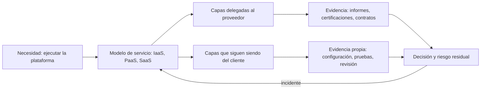
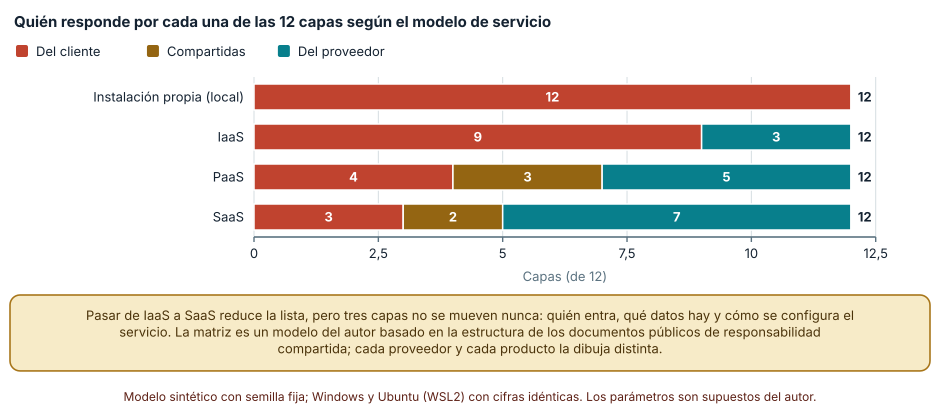
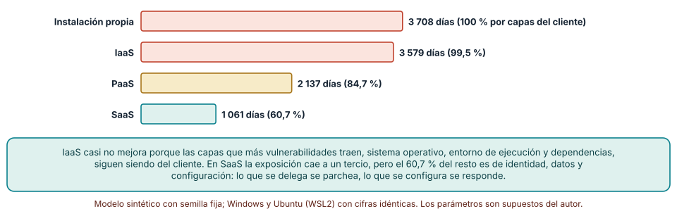
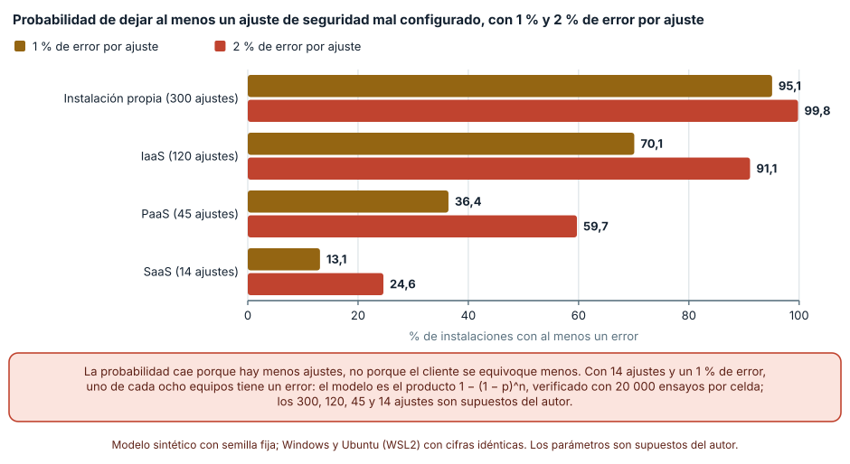

# SE-349 — IaaS, PaaS, SaaS y responsabilidad compartida

[← SE-348 — Proyecto: servicio distribuido con degradación](../../classes/part-28-concurrencia-y-sistemas-distribuidos/se-348-proyecto-servicio-distribuido-con-degradacion/README.md) · [↑ Parte 29](../../classes/part-29-cloud-plataforma-e-infraestructura/README.md) · [📚 Índice completo](../../classes/README.md) · [🌐 Portal](../../site/classes/SE-349.html) · [SE-350 — Máquinas virtuales, contenedores y aislamiento →](../../classes/part-29-cloud-plataforma-e-infraestructura/se-350-maquinas-virtuales-contenedores-y-aislamiento/README.md)

## Punto profesional y fundamento pedagógico

**Punto profesional.** La clase existe para que, antes de elegir un servicio en la nube, puedas decir qué capas pasan a manos del proveedor, cuáles siguen siendo tuyas y qué evidencia pedirías para confiar en las que delegas. «Está en la nube» no responde ninguna de esas preguntas; «IaaS», «PaaS» y «SaaS» solo las ordenan.

**Por qué aparece aquí.** Abre la **Parte 29** después de **Proyecto: servicio distribuido con degradación**: la Parte 28 dejó un servicio que sabe degradarse cuando falla una dependencia, pero esa dependencia era una máquina que alguien operaba. Ahora la máquina, el sistema operativo y a veces el entorno de ejecución pertenecen a otra organización. El caso conductor de la parte es la plataforma de entregas de tareas de las partes anteriores, llevada a una infraestructura gestionada por terceros.

**Error conceptual que debe corregir.** Creer que contratar más gestión es contratar menos responsabilidad. La delegación mueve el trabajo de parchear y operar, pero la identidad, los datos y la configuración del servicio siguen siendo de quien lo contrata, y por eso los incidentes en la nube suelen ser de configuración y no de la infraestructura del proveedor.

**Secuencia de aprendizaje.** Antes de leer los resultados, predices cuántas de doce capas operarías en IaaS y en SaaS, y si la exposición anual a vulnerabilidades cae a la mitad al pasar a un servicio gestionado; después compruebas tu predicción contra un modelo de responsabilidades, una simulación de ventanas de exposición y el cálculo de la probabilidad de equivocarte en al menos un ajuste. La secuencia usa predicción, explicación propia, contraste y recuperación. [ICAP](https://icap.education.asu.edu/research) distingue participación de construcción de conocimiento; [How People Learn II](https://nap.nationalacademies.org/catalog/24783/how-people-learn-ii-learners-contexts-and-cultures) exige conectar conocimiento previo, contexto y transferencia; la [práctica de recuperación](https://pubmed.ncbi.nlm.nih.gov/16507066/) respalda producir de nuevo la explicación tras una demora; y [Education for Life and Work](https://nap.nationalacademies.org/resource/13398/dbasse_084153.pdf) exige devolución que explique la causa del error.

**Evidencia de aprendizaje.** `responsabilidades.md` con tu predicción, la matriz de doce capas de la plataforma de entregas para el modelo que elijas, las tres figuras reproducidas y una lista de las tres capas que no puedes delegar con la persona de tu equipo que las posee.

**Límite de la conclusión.** La matriz de capas, las tasas de vulnerabilidades, los tiempos de remedio y la probabilidad de error por ajuste son supuestos del autor, y la matriz sigue la estructura de los documentos públicos de responsabilidad compartida sin ser la de ningún proveedor. No se contrató ni se midió ningún servicio en la nube.

### Trazabilidad fuente → afirmación

| Fuente primaria u oficial | Afirmación que respalda | Lo que no prueba |
|---|---|---|
| [NIST SP 800-145, «The NIST Definition of Cloud Computing»](https://csrc.nist.gov/pubs/sp/800/145/final) | Define IaaS, PaaS y SaaS por la capacidad que se entrega al consumidor y por lo que este controla: infraestructura, plataforma o aplicación. | No dice qué proveedor opera qué parche ni qué ajustes debe revisar cada cliente. |
| [AWS, «Shared Responsibility Model»](https://aws.amazon.com/compliance/shared-responsibility-model/) | Distingue la seguridad «de» la nube, a cargo del proveedor, de la seguridad «en» la nube, a cargo del cliente. | Describe los servicios de ese proveedor; no sirve como regla general de otro. |
| [Microsoft, «Shared responsibility in the cloud»](https://learn.microsoft.com/azure/security/fundamentals/shared-responsibility) | Muestra que la responsabilidad cambia por tipo de servicio y que datos, identidades y dispositivos siempre quedan del cliente. | No garantiza que el cliente haya configurado bien lo que le toca. |
| [Google Cloud, «Shared responsibility and shared fate»](https://cloud.google.com/architecture/framework/security/shared-responsibility-shared-fate) | Plantea que el proveedor debe además ofrecer plantillas y guías para que el cliente configure bien su parte. | No mide si esas guías reducen realmente los errores de configuración. |

## Antes de empezar

Recupera lo aprendido en la Parte 28 sobre fallos parciales: una dependencia puede fallar sin que lo sepas y el servicio debe degradarse. La pregunta activa es: **¿cuál de mis capas ya no controlo, qué hago si falla, y cuáles siguen dependiendo de que yo las configure bien?**

## Prerrequisitos

- Haber completado `SE-348` o poder explicar cómo se degrada un servicio distribuido cuando falla una dependencia.
- Python 3.11 o posterior; los experimentos usan solo la biblioteca estándar (`random`, `math`, `statistics`) y no necesitan una cuenta en ningún proveedor.
- Saber qué es un parche de seguridad y qué es un grupo de seguridad o un permiso de acceso a un recurso.

## Problema auténtico

El equipo de la plataforma de entregas ejecutaba la aplicación en dos servidores propios. Una vulnerabilidad en una biblioteca de imágenes se parcheó con diecinueve días de retraso, y el informe interno concluyó que «en la nube esto no pasaría». Se migró a un servicio gestionado de contenedores y, seis meses después, un depósito de archivos con las entregas de los estudiantes quedó legible desde internet por una regla de acceso que alguien dejó abierta «solo para probar». El proveedor había parcheado todo a tiempo; el depósito lo había configurado el equipo. Cada incidente tiene un dueño distinto, y la migración movió el primero al proveedor sin tocar el segundo.

## Objetivos observables

Al terminar podrás:

1. distinguir IaaS, PaaS y SaaS por las capas que cambian de manos y nombrar las que no cambian nunca;
2. construir una matriz de doce capas con su responsable en cada modelo y justificar cada celda con la documentación de un proveedor;
3. estimar con una simulación cómo cambia la exposición anual a vulnerabilidades al delegar parches y quién responde por lo que queda;
4. calcular la probabilidad de dejar al menos un ajuste mal configurado según el número de ajustes que posees;
5. decidir qué evidencia pedir a un proveedor y qué comprobar tú mismo.

## Mapa conceptual



El mapa separa lo que se **delega** (y se confía con evidencia ajena) de lo que **se conserva** (y se responde con evidencia propia). Ambas ramas terminan en una decisión de riesgo residual: nada se delega por completo, así que el riesgo que queda es la suma de lo que el proveedor falle y de lo que tú configures mal.

## Temas y por qué importan

| Tema | Por qué cambia una decisión profesional | Evidencia mínima |
|---|---|---|
| IaaS | Entrega cómputo, red y almacenamiento virtualizados; el sistema operativo y todo lo que está encima es tuyo. | Matriz de capas y lista de parches propios en `responsabilidades.md` |
| PaaS | Entrega además el entorno de ejecución; el código, los datos y la identidad siguen siendo tuyos. | Matriz de capas y contrato de versiones de tiempo de ejecución |
| SaaS | Entrega la aplicación completa; solo configuras, administras identidades y eres dueño de los datos. | Inventario de ajustes y de roles administrativos |
| Responsabilidad compartida | Fija quién responde por qué y qué evidencia sirve de prueba. | Tabla de responsables con su fuente |
| Lo que no se delega | Identidad, datos y configuración del servicio causan la mayoría de las exposiciones evitables. | Revisión periódica de ajustes con otra persona |

## Conceptos y decisiones

### 1. IaaS

NIST define IaaS como la capacidad de aprovisionar procesamiento, almacenamiento y redes en las que el consumidor puede ejecutar software arbitrario, incluidos sistemas operativos y aplicaciones. El consumidor no gestiona la infraestructura subyacente, pero sí el sistema operativo, el almacenamiento y las aplicaciones desplegadas, y, de forma limitada, algunos componentes de red como los cortafuegos. En la práctica, una máquina virtual de un proveedor es una máquina que otra organización alimenta, refrigera y virtualiza, pero cuyo sistema operativo parcheas tú. La consecuencia es que la lista de parches pendientes no se reduce al pasar a IaaS: se queda con el cliente.

### 2. PaaS

En PaaS el consumidor despliega su propio código en una plataforma que ofrece lenguajes, bibliotecas y servicios soportados por el proveedor, sin gestionar el sistema operativo ni los servidores. El entorno de ejecución, con sus versiones y parches, pasa a ser del proveedor. Lo que se gana es que desaparece una familia de vulnerabilidades del lado del cliente; lo que se pierde es el control de la versión: el proveedor retira un tiempo de ejecución en una fecha que no eliges. La dependencia no es solo técnica sino de calendario, y por eso el contrato de versiones es parte del diseño.

### 3. SaaS

En SaaS el consumidor usa una aplicación que corre en infraestructura del proveedor y solo controla configuraciones limitadas. Es el extremo en el que más cosas se delegan, y por eso es fácil olvidar lo que no: quién tiene acceso, qué datos se suben, cómo se exportan y qué pasa al terminar el contrato. Una plataforma educativa externa que guarda las entregas de los estudiantes sigue haciendo al equipo responsable de su tratamiento aunque no opere ni un servidor.

### 4. Responsabilidad compartida

El modelo de responsabilidad compartida no es un reparto 50-50 sino una frontera que cambia con cada servicio. Los documentos de los proveedores coinciden en lo esencial: el proveedor responde de la seguridad **de** la nube (instalaciones, hardware, virtualización) y el cliente de la seguridad **en** la nube (datos, identidades, configuración). Entre ambos hay capas compartidas, como las copias de seguridad o el registro de eventos, donde el proveedor ofrece el mecanismo y el cliente decide si lo activa, qué conserva y quién lo mira. La utilidad práctica de la matriz es nombrar a una persona o un equipo para cada celda; una celda sin nombre es la que se incendia.

### 5. Lo que no se delega

Identidad, datos y configuración del servicio permanecen del cliente en cualquier modelo. La identidad porque el proveedor puede autenticar, pero no sabe quién debería tener acceso a las entregas de un curso; los datos porque la clasificación, la retención y el borrado son decisiones del negocio; la configuración porque cada ajuste que permite una acción es una decisión que alguien tomó o dejó por defecto. Esta es la razón por la que reducir el número de ajustes que se poseen reduce, pero no elimina, la probabilidad de un error de configuración, como se mide más abajo.

### Qué pasa con las 12 capas

La matriz tiene doce capas: instalaciones físicas, hardware y red del centro de datos, virtualización, sistema operativo y parches, entorno de ejecución, código y dependencias, configuración de red y cortafuegos, identidad y accesos, datos, copias de seguridad, registro y monitoreo, y configuración del servicio. Para cada modelo se anota quién responde: el cliente (C), el proveedor (P) o ambos (S).

```python
own = {  # local, IaaS, PaaS, SaaS
    "so_parches": "CCPP", "runtime": "CCPP", "codigo_deps": "CCCP",
    "red_firewall": "CCSP", "identidad": "CCCC", "datos": "CCCC",
    "copias": "CCSS", "registro": "CCSS", "config_servicio": "CCCC",
    "fisico": "CPPP", "hardware_red_dc": "CPPP", "virtualizacion": "CPPP"}
counts = {m: {k: sum(1 for v in own.values() if v[i] == k) for k in "CSP"} for i, m in enumerate(["local", "IaaS", "PaaS", "SaaS"])}
```

| Modelo | Del cliente | Compartidas | Del proveedor |
|---|---:|---:|---:|
| Instalación propia | 12 | 0 | 0 |
| IaaS | 9 | 0 | 3 |
| PaaS | 4 | 3 | 5 |
| SaaS | 3 | 2 | 7 |

Las celdas son una decisión de modelado: otro autor pondría la red como compartida en IaaS, o las copias del lado del proveedor en un SaaS concreto. Lo que no cambia es que en SaaS siguen siendo del cliente tres capas, las mismas que en IaaS y en la instalación propia: identidad, datos y configuración del servicio.



**Cómo leer la figura.** Cada fila es un modelo y las tres columnas numéricas suman 12; la última dice qué capas siguen en manos del cliente. **Dónde deja de valer:** doce capas es una división gruesa; un servicio concreto parte la «configuración» en decenas de ajustes y la «red» en reglas de entrada, de salida y de enrutamiento. La matriz sirve para conversar, no para auditar.

### Una ventana de exposición por modelo

Se modelan 127 vulnerabilidades al año repartidas por capa (por ejemplo, 30 del sistema operativo, 20 del entorno de ejecución, 40 del código y dependencias, 10 de configuración del servicio) como llegadas de Poisson. El tiempo hasta remediar cada una depende de quién responde por la capa: una distribución lognormal con mediana de 21 días si es del cliente, 10 si es compartida y 3 si es del proveedor, con la misma secuencia de vulnerabilidades en los cuatro modelos. Se suman los días expuestos en 1 000 años simulados con semilla fija.

```python
for l in layers:
    t = 0.0
    while True:
        t += r.expovariate(lam[l] / 365.0)
        if t > 365: break
        o = own[l][i]            # C, S o P para este modelo
        dias += r.lognormvariate(math.log(med[o]), sig[o])
```

| Modelo | Días expuestos al año | De ellos, por capas del cliente |
|---|---:|---:|
| Instalación propia | 3 708 | 100 % |
| IaaS | 3 579 | 99,5 % |
| PaaS | 2 137 | 84,7 % |
| SaaS | 1 061 | 60,7 % |

IaaS casi no mejora el resultado: las capas con más vulnerabilidades, sistema operativo, entorno de ejecución y dependencias del código, siguen siendo del cliente. PaaS recorta el 42 % y SaaS el 71 %. Lo más instructivo es la última columna: en SaaS el 60,7 % de la exposición que queda sigue dependiendo del cliente, porque lo que se delega se parchea rápido y lo que se configura se responde lento.



**Cómo leer la figura.** Cada barra es la suma anual de días expuestos con las mismas vulnerabilidades; entre paréntesis, la parte atribuible al cliente. **Dónde deja de valer:** las medianas de 3, 10 y 21 días son supuestos del autor, no estadísticas de ningún proveedor; un proveedor lento o una organización con parcheo automático cambiarían la forma, aunque no el orden. Tampoco se modelan las vulnerabilidades de la propia plataforma del proveedor que este tarde en corregir.

### Cuántos ajustes poseo y cuántas veces me equivoco

Cada ajuste con efecto de seguridad (si un depósito es público, si el registro está activo, si el acceso exige un segundo factor) es una oportunidad de error. Con una probabilidad `p` de dejar mal un ajuste, independiente de los demás, la probabilidad de equivocarse en al menos uno es 1 − (1 − p)^n. Se supuso que el cliente posee 300 ajustes en una instalación propia, 120 en IaaS, 45 en PaaS y 14 en SaaS, y se verificó la fórmula con 20 000 ensayos por celda.

```python
for p in (0.01, 0.02):
    hit = sum(1 for _ in range(20000) if any(r.random() < p for _ in range(n)))
    # analítico: 1 - (1 - p) ** n
```

| Modelo | Ajustes | P(≥ 1 error), p = 1 % | P(≥ 1 error), p = 2 % |
|---|---:|---:|---:|
| Instalación propia | 300 | 95,1 % | 99,8 % |
| IaaS | 120 | 70,1 % | 91,1 % |
| PaaS | 45 | 36,4 % | 59,7 % |
| SaaS | 14 | 13,1 % | 24,6 % |

La simulación coincidió con la fórmula con diferencias de un punto porcentual o menos. El mensaje no es que SaaS sea «seguro»: con 14 ajustes y un 2 % de error, casi uno de cada cuatro equipos deja algo mal puesto, y alcanza con que sea el ajuste que expone los datos.



**Cómo leer la figura.** Las filas son modelos; el número de ajustes es el supuesto y las dos columnas de probabilidad son el resultado de la fórmula. **Dónde deja de valer:** los ajustes no son independientes (un error de plantilla se copia a muchos) ni igual de graves (uno expone datos y otro cambia un color); la fórmula da una cota de probabilidad, no una predicción de incidentes.

## Definiciones de trabajo

- **IaaS:** servicio que entrega cómputo, red y almacenamiento virtualizados sobre los que el cliente instala y opera su propio sistema operativo y software.
- **PaaS:** servicio que entrega un entorno de ejecución gestionado donde el cliente despliega código sin operar el sistema operativo.
- **SaaS:** aplicación completa operada por el proveedor, de la que el cliente solo configura, administra identidades y es dueño de sus datos.
- **responsabilidad compartida:** reparto de qué seguridad y operación corresponde al proveedor y al cliente, que cambia con el tipo de servicio.
- **ventana de exposición:** tiempo que transcurre entre que existe una vulnerabilidad y que se corrige o se mitiga.

Las definiciones son operativas para la plataforma de entregas. Cada proveedor llama a sus servicios con sus propias palabras, y el modelo de tres letras es una simplificación de NIST que conviene contrastar con la documentación de cada producto.

## Ejemplo mínimo

Dado un diccionario que asigna a cada capa su responsable, el fragmento cuenta cuántas capas son del cliente. Antes de ejecutarlo, predice cuántas de estas cinco capas siguen siendo del cliente en cada modelo.

```python
own = {"so_parches": "CCPP", "runtime": "CCPP", "codigo_deps": "CCCP", "identidad": "CCCC", "datos": "CCCC"}
for i, m in enumerate(["local", "IaaS", "PaaS", "SaaS"]):
    print(m, sum(v[i] == "C" for v in own.values()))
```

Con estas cinco capas, el número baja de 5 a 5, 3 y 2: en IaaS no cambia porque el sistema operativo y el entorno de ejecución siguen siendo del cliente. Registra versión de Python, comando y salida, y completa el diccionario con las otras siete capas.

## Ejemplo profesional

El equipo de la plataforma de entregas decide dónde alojar tres piezas: el servidor de la aplicación web, la base de datos y el servicio de correo de avisos a estudiantes. Para el servidor elige PaaS para no operar el sistema operativo; para la base de datos elige un servicio gestionado, y registra que las copias, el cifrado y los usuarios siguen siendo suyos aunque el motor y los parches no lo sean; para el correo elige SaaS y anota que debe configurar la autenticación del dominio remitente y decidir cuánto tiempo guardar los mensajes. Cada decisión se escribe en la matriz con el nombre de quien responde por cada celda, la fecha de revisión y el enlace a la página del proveedor que respalda la celda. Se agrega una revisión trimestral de los treinta ajustes que más pesan, hecha por una persona distinta de la que los configuró. Compara con el estado inicial: el parche de la biblioteca de imágenes ya no es del equipo, y el depósito abierto sí lo seguiría siendo.

## Práctica guiada

1. Escribe tu predicción: ¿en cuántas de las 12 capas serías responsable en IaaS y en SaaS, y cuánto bajaría la exposición anual?
2. Construye la matriz de 12 capas para uno de los servicios que usarías y cita la página del proveedor que respalda cada celda.
3. Ejecuta el modelo de exposición con semilla fija y reproduce la tabla de 3 708, 3 579, 2 137 y 1 061 días.
4. Cambia la mediana de remedio del cliente de 21 a 7 días y anota qué modelo se beneficia más.
5. Calcula con la fórmula y con 20 000 ensayos la probabilidad de error para tus propios números de ajustes.
6. Elige los tres ajustes de mayor impacto y asigna una persona responsable y una fecha de revisión a cada uno.
7. Entrega `responsabilidades.md` y pide a otra persona que encuentre una celda sin dueño.

## Ejercicios

1. **Matriz:** completa la matriz para un servicio de colas gestionado y justifica una celda compartida.
2. **Sensibilidad:** con medianas de remedio de 7 días del cliente y 3 del proveedor, calcula cuánto mejora IaaS y explica por qué sigue lejos de SaaS.
3. **Probabilidad:** con p = 0,5 % y 120 ajustes, calcula la probabilidad de al menos un error y compárala con la de 45 ajustes y p = 1,5 %.
4. **Evidencia:** indica qué documento pedirías a un proveedor de SaaS antes de subir entregas de estudiantes y qué parte no podría demostrar.

## Reto verificable

Entrega `responsabilidades.md` con la predicción, la matriz de 12 capas con fuente por celda, las tres tablas reproducidas con las mismas semillas y la lista de las tres capas que sigues poseyendo. Se aprueba si otra persona ejecuta el código desde un checkout limpio, obtiene las mismas cifras y puede decir quién responde si el depósito de entregas queda público. No se aprueba por copiar una matriz de un proveedor sin comprobar tus celdas ni por afirmar que «SaaS es más seguro» sin una medida.

## Caso conductor

La plataforma de entregas es el caso conductor de la Parte 29. Esta clase deja el primer artefacto: la matriz de responsabilidades de sus piezas. `SE-350` mira lo que hay bajo el servicio: cómo se aíslan una máquina virtual, un contenedor y un proceso. Cambia una celda de la matriz, por ejemplo mover el correo de SaaS a IaaS, y mira qué otras filas cambian de dueño.

## Preguntas frecuentes

### ¿Mover la plataforma a un servicio gestionado reduce el riesgo?

Reduce la parte del riesgo que dependía de capas que ahora opera otro, y deja intacta la que depende de lo que configuras. En el modelo, pasar de IaaS a SaaS recorta la exposición a un tercio y deja en pie casi el 61 % del resto; el efecto real depende de cuánto tarda cada proveedor y de cuántos ajustes mantienes.

### ¿Quién responde si el proveedor tiene un incidente?

Depende del contrato y de la ley aplicable, no de la matriz. La matriz dice quién operaba la capa; la responsabilidad legal, las indemnizaciones y la obligación de notificar se establecen en el acuerdo de servicio y en la regulación de datos. La clase no evalúa ningún contrato.

### ¿Es lo mismo «responsabilidad compartida» que «responsabilidad dividida a partes iguales»?

No. La frontera cambia con el servicio y con la capa; en algunas capas se comparte, como el registro, donde el proveedor ofrece el mecanismo y el cliente decide qué conserva. Una frontera mal entendida es la causa más frecuente de «pensé que lo cubría el proveedor».

### ¿Por qué no usar siempre SaaS?

Porque cada capa delegada es también una capa sobre la que no puedes cambiar el comportamiento, la versión, la ubicación de los datos ni el momento de una actualización. La decisión compara el costo de operar con el costo de depender; `SE-357` mide qué cuesta salir.

## Fallo controlado y diagnóstico

Reproduce el fallo clásico de la clase: **creer que el proveedor cubre algo que la matriz asigna al cliente**. Escribe la matriz de la plataforma, marca la celda «datos» y la celda «configuración del servicio» y simula una regla de acceso abierta en un depósito con entregas sintéticas.

Registra síntoma, entrada mínima, hipótesis, observación que descarta cada hipótesis, causa, corrección y prueba de regresión. **Síntoma:** un archivo con una entrega de prueba es legible sin credenciales. **Hipótesis rivales:** (a) el proveedor tuvo un fallo en su control de acceso; (b) un parche pendiente expuso el servicio; (c) la regla de acceso la dejó así el equipo. **Prueba:** compara la configuración actual con la anterior y busca quién y cuándo cambió la regla; consulta el estado de salud del servicio del proveedor. **Conclusión:** la celda «configuración del servicio» era del cliente y nadie la revisaba. **Regresión:** añade una comprobación que falle si algún depósito es público y asigna a la celda un responsable con revisión periódica. No arregles a la vez la regla y el proceso de revisión: sin lo segundo vuelve a ocurrir.

## Errores comunes y cómo corregirlos

| Síntoma | Causa probable | Corrección |
|---|---|---|
| Un depósito o un panel quedan abiertos tras migrar | Se asumió que el proveedor configura lo que solo el cliente puede decidir | Asignar dueño y revisión a la celda «configuración del servicio» |
| Un tiempo de ejecución deja de recibir parches y nadie se entera | PaaS: el proveedor retira la versión y el equipo no sigue el calendario | Suscribirse a los avisos del proveedor y planificar el cambio de versión |
| La matriz coincide con la de otro proveedor pero no con el servicio | Se copió una matriz genérica | Citar la página del servicio concreto en cada celda |
| «Pasamos a SaaS y ya no necesitamos seguridad» | Se confunde delegar la operación con delegar la responsabilidad por los datos | Mantener revisión de accesos, exportación y retención |
| Las copias existen y no se pueden restaurar | La capa «copias» era compartida y nadie probó la restauración | Probar una restauración con una frecuencia fija |

## Entorno y archivos clave

```text
work/SE-349/
├── README.md
├── responsabilidades/
│   ├── matriz.md
│   ├── exposicion.py
│   └── ajustes.py
├── tests/test_modelos.py
└── evidence/responsabilidades.md
```

El `README` declara plataforma, versión de Python, semillas y comandos. Los experimentos usan solo la biblioteca estándar (`random`, `math`, `statistics`) y se ejecutaron con CPython 3.12.9 en Windows 11 y 3.12.3 en Ubuntu bajo WSL2, con salidas idénticas. No se usó ningún proveedor de nube; si añades uno, declara cuenta de prueba, región, costo y limpieza.

## Seguridad, ética y accesibilidad

- el modelo no necesita datos reales; no copies datos de estudiantes a un entorno de prueba ni pegues credenciales en la matriz;
- una celda con «proveedor» no traslada la responsabilidad ante las personas cuyos datos se tratan: documenta quién responde ante ellas;
- los avisos de seguridad de un proveedor deben llegar a una persona con nombre y no a un buzón sin dueño;
- describe la matriz en texto además de la tabla, para que un lector de pantalla pueda recorrerla fila por fila;
- respeta los términos de uso al citar documentación de proveedores y no reproduzcas páginas enteras.

## Puente hacia el trabajo con agentes

Un agente al que se le pide «migra la plataforma a un servicio gestionado» producirá una configuración válida y reducida a lo necesario para que arranque, y dejará los ajustes por defecto en lo que no se le pidió. Pídele en cambio que entregue primero la matriz de responsabilidades de las piezas que toca, que marque las celdas que seguirán siendo tuyas y que incluya una comprobación automática que falle si un depósito es público o si un rol es más amplio de lo declarado. Revisa especialmente qué ajustes dejó en su valor por defecto y qué credenciales usó para desplegar: son los dos lugares donde la responsabilidad que no se delegó suele quedar sin dueño.

## Transferencia

Traslada el análisis a otro dominio (por ejemplo, un taller de reparaciones con inventario, citas y cobros): cambia las piezas y conserva el procedimiento de armar la matriz de 12 capas, asignar a cada celda una persona, estimar la exposición con sus propios tiempos de remedio y contar los ajustes que posees. La transferencia está lograda cuando puedes decir qué parte de la conclusión dependía del modelo y cuál del proveedor, no cuando las tablas se parecen.

## Evaluación y evidencia

| Criterio | Evidencia para aprobar |
|---|---|
| comprensión | explicación de IaaS, PaaS y SaaS con las tres capas que no cambian de dueño |
| corrección | matriz, exposición y probabilidad de error reproducibles con las mismas semillas |
| decisión | celdas con fuente, responsable y fecha de revisión |
| diagnóstico | reproducción del fallo «depósito abierto» con regresión |
| incertidumbre | declaración de que los parámetros son supuestos y no hay medición de un proveedor |
| reproducibilidad | versiones, comandos, salida y límites declarados |

## Fuentes

- [NIST SP 800-145, «The NIST Definition of Cloud Computing»](https://csrc.nist.gov/pubs/sp/800/145/final) — definición de IaaS, PaaS y SaaS y de los modelos de despliegue; autoridad: NIST.
- [AWS, «Shared Responsibility Model»](https://aws.amazon.com/compliance/shared-responsibility-model/) — seguridad «de» la nube y «en» la nube; autoridad: documentación del proveedor.
- [Microsoft, «Shared responsibility in the cloud»](https://learn.microsoft.com/azure/security/fundamentals/shared-responsibility) — cómo cambia la responsabilidad por tipo de servicio; autoridad: documentación del proveedor.
- [Google Cloud, «Shared responsibility and shared fate»](https://cloud.google.com/architecture/framework/security/shared-responsibility-shared-fate) — responsabilidad compartida y apoyo del proveedor a la configuración; autoridad: documentación del proveedor.
- [Python: random](https://docs.python.org/3/library/random.html) — generador y distribuciones usadas en los experimentos; autoridad: documentación de Python.

Cada fuente respalda el mecanismo indicado; ninguna demuestra que los 3 708 días, el 60,7 % ni el 13,1 % se observen en una organización real. Esa afirmación depende de los parches de cada proveedor, de los tiempos de respuesta de cada equipo y de los ajustes que cada servicio expone.

## Límites y siguiente paso

Se ejecutaron tres experimentos sintéticos en Windows y Ubuntu (WSL2) con resultados idénticos. No se usó ningún proveedor de nube ni se midió una vulnerabilidad real: la matriz, las tasas de vulnerabilidades, los tiempos de remedio y la probabilidad de error por ajuste son supuestos del autor, y las cifras no se extrapolan a una organización. La siguiente clase mira lo que hay bajo cada servicio: cómo se aíslan una máquina virtual, un contenedor y un proceso.

## Glosario

- **IaaS:** servicio que entrega cómputo, red y almacenamiento virtualizados sobre los que el cliente instala y opera su propio sistema operativo y software.
- **PaaS:** servicio que entrega un entorno de ejecución gestionado donde el cliente despliega código sin operar el sistema operativo.
- **SaaS:** aplicación completa operada por el proveedor, de la que el cliente solo configura, administra identidades y es dueño de sus datos.
- **responsabilidad compartida:** reparto de qué seguridad y operación corresponde al proveedor y al cliente, que cambia con el tipo de servicio.
- **ventana de exposición:** tiempo que transcurre entre que existe una vulnerabilidad y que se corrige o se mitiga.

---

[← SE-348 — Proyecto: servicio distribuido con degradación](../../classes/part-28-concurrencia-y-sistemas-distribuidos/se-348-proyecto-servicio-distribuido-con-degradacion/README.md) · [↑ Parte 29](../../classes/part-29-cloud-plataforma-e-infraestructura/README.md) · [📚 Índice completo](../../classes/README.md) · [🌐 Portal](../../site/classes/SE-349.html) · [SE-350 — Máquinas virtuales, contenedores y aislamiento →](../../classes/part-29-cloud-plataforma-e-infraestructura/se-350-maquinas-virtuales-contenedores-y-aislamiento/README.md)
