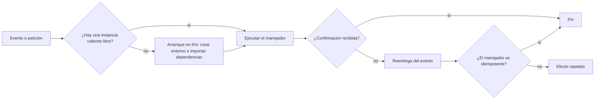
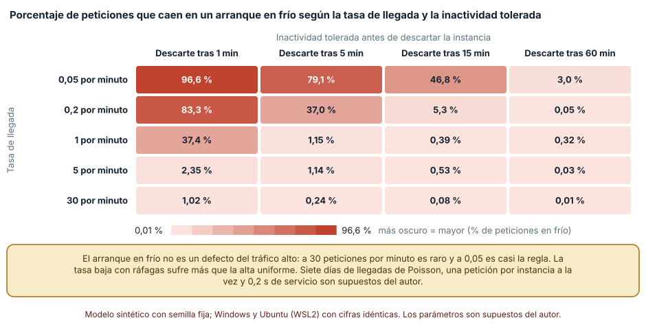
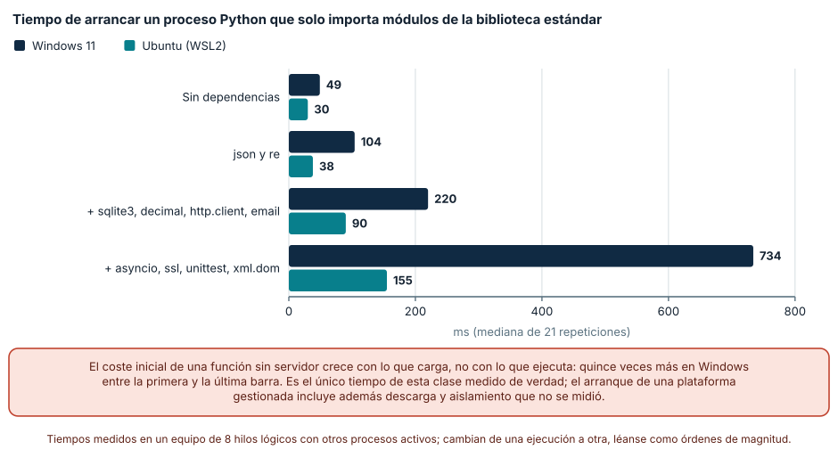
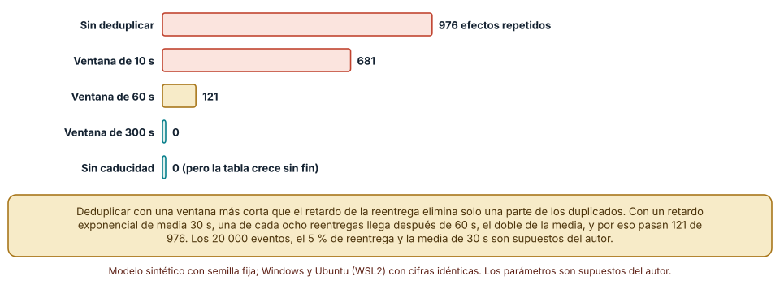

# SE-352 — Serverless y ejecución gestionada

[← SE-351 — Orquestación y scheduling](../../classes/part-29-cloud-plataforma-e-infraestructura/se-351-orquestacion-y-scheduling/README.md) · [↑ Parte 29](../../classes/part-29-cloud-plataforma-e-infraestructura/README.md) · [📚 Índice completo](../../classes/README.md) · [🌐 Portal](../../site/classes/SE-352.html) · [SE-353 — Redes, identidad y secretos en cloud →](../../classes/part-29-cloud-plataforma-e-infraestructura/se-353-redes-identidad-y-secretos-en-cloud/README.md)

## Punto profesional y fundamento pedagógico

**Punto profesional.** La clase existe para que, cuando alguien proponga «pasarlo a funciones» o «a un servicio gestionado sin servidores», puedas decir qué deja de hacer tu equipo, qué sigue haciendo con otra forma y qué consecuencias nuevas aparecen: arranques en frío, entregas repetidas y un costo que ya no es una cuota fija sino una función del tráfico.

**Por qué aparece aquí.** Sigue a **Orquestación y scheduling**: allí tú declarabas peticiones, réplicas y nodos; aquí la plataforma decide cuántas instancias hay y cuándo existen. El caso conductor de la parte es la plataforma de entregas llevada a una infraestructura gestionada, y esta clase decide qué piezas, como el aviso de «tu entrega fue recibida», pueden pasar a ejecución gestionada.

**Error conceptual que debe corregir.** Creer que «sin servidores» significa «sin operación». Desaparecen los nodos y los parches del sistema, pero siguen existiendo las dependencias que se cargan al iniciar, los límites de ejecución, los reintentos y los duplicados, y todos son responsabilidad del código que escribes.

**Secuencia de aprendizaje.** Antes de leer los resultados, predices qué porcentaje de peticiones arranca en frío con una por minuto y cinco minutos de inactividad, cuánto más tarda arrancar un proceso que importa siete módulos y cuántos efectos repetidos deja una ventana de deduplicación de un minuto; después simulas siete días de tráfico, mides arranques reales de un intérprete con dependencias y cuentas efectos duplicados con cinco ventanas. La secuencia usa predicción, explicación propia, contraste y recuperación. [ICAP](https://icap.education.asu.edu/research) distingue participación de construcción de conocimiento; [How People Learn II](https://nap.nationalacademies.org/catalog/24783/how-people-learn-ii-learners-contexts-and-cultures) exige conectar conocimiento previo, contexto y transferencia; la [práctica de recuperación](https://pubmed.ncbi.nlm.nih.gov/16507066/) respalda producir de nuevo la explicación tras una demora; y [Education for Life and Work](https://nap.nationalacademies.org/resource/13398/dbasse_084153.pdf) exige devolución que explique la causa del error.

**Evidencia de aprendizaje.** `ejecucion-gestionada.md` con la predicción, las tres figuras reproducidas, la clasificación de las piezas de la plataforma entre «adecuada», «con condiciones» e «inadecuada» para ejecución gestionada, y el diseño de idempotencia de una pieza.

**Límite de la conclusión.** Las llegadas y los reenvíos son sintéticos; el único tiempo real es el de arrancar un intérprete de Python con módulos de la biblioteca estándar. No se desplegó ninguna función en una plataforma, no se midió un arranque en frío gestionado ni se midió costo; los precios y la tasa de reentrega son supuestos del autor.

### Trazabilidad fuente → afirmación

| Fuente primaria u oficial | Afirmación que respalda | Lo que no prueba |
|---|---|---|
| [AWS Lambda: entorno de ejecución](https://docs.aws.amazon.com/lambda/latest/dg/lambda-runtime-environment.html) | Describe las fases de inicialización, invocación y cierre de un entorno de ejecución y que un entorno puede reutilizarse en invocaciones posteriores. | No fija cuánto dura un arranque en frío ni cuánto se conserva un entorno inactivo. |
| [Google Cloud Run: documentación](https://cloud.google.com/run/docs) | Documenta un servicio gestionado de contenedores con escalado automático a partir de las solicitudes. | No mide su latencia ni su costo para la plataforma de entregas. |
| [Hellerstein et al., «Serverless Computing: One Step Forward, Two Steps Back»](https://arxiv.org/abs/1812.03651) | Analiza límites de la computación sin servidores como el estado, la comunicación y la ausencia de coordinación. | Es un análisis de 2018; los servicios han cambiado. |
| [CloudEvents](https://cloudevents.io/) | Define un formato común de eventos con un identificador que, junto con la fuente, distingue un evento de otro y permite reconocer un reenvío. | No impone deduplicar ni define la ventana adecuada. |
| [Python: opciones de línea de comandos (-X importtime)](https://docs.python.org/3/using/cmdline.html) | Documenta cómo medir el tiempo de importación de cada módulo. | No dice qué módulos conviene evitar en una función concreta. |

## Antes de empezar

Recupera lo aprendido en `SE-351`: un orquestador repara el estado deseado con un retardo. La pregunta activa es: **¿qué pasa en la primera petición después de un silencio, y qué pasa cuando la misma petición llega dos veces?**

## Prerrequisitos

- Haber completado `SE-351` o poder explicar qué hace un bucle de reconciliación y por qué cuesta tiempo.
- Python 3.11 o posterior; los experimentos usan solo la biblioteca estándar (`random`, `subprocess`, `time`) y no necesitan cuenta en un proveedor.
- Saber qué es una función invocada por un evento y qué significa «al menos una vez».

## Problema auténtico

La plataforma de entregas envía un aviso por correo cuando recibe una entrega. El equipo lo movió a una función gestionada para no mantener un servidor. En la semana de cierre todo fue bien, pero a la medianoche de un domingo la primera entrega tardó nueve segundos en confirmarse porque la función llevaba horas sin usarse. Y tres estudiantes recibieron dos avisos de recibo y una entrega se contó dos veces en el resumen del docente, porque la cola reenvió un evento cuya confirmación se perdió. La plataforma no falló: se comportó como lo documenta, y el código no estaba preparado para ello.

## Objetivos observables

Al terminar podrás:

1. explicar qué gestiona la plataforma en un modelo sin servidores y qué sigue siendo del código;
2. estimar qué porcentaje de peticiones arranca en frío según la tasa de llegada y el tiempo de inactividad tolerado;
3. medir cómo crece el tiempo de arranque con las dependencias que se cargan al iniciar;
4. diseñar un manejador idempotente y calcular qué duplicados deja pasar una ventana de deduplicación;
5. comparar el costo por petición con el de una instancia permanente y encontrar el punto de equilibrio.

## Mapa conceptual



El mapa tiene dos caminos que el modelo sin servidores introduce y que un servidor permanente no tenía: la rama del **arranque en frío**, donde la primera petición paga la creación del entorno, y la de la **reentrega**, donde un evento puede llegar más de una vez. Ambas se resuelven en el código, no en la plataforma.

## Temas y por qué importan

| Tema | Por qué cambia una decisión profesional | Evidencia mínima |
|---|---|---|
| Qué gestiona la plataforma | Fija qué dejas de operar y qué límites aceptas. | Tabla de responsabilidades de la pieza |
| Arranque en frío | La primera petición tras un silencio paga la creación del entorno. | Porcentaje de arranques en frío según tasa y plazo |
| Peso de las dependencias | Lo que se importa al iniciar se paga en cada arranque. | Medición del tiempo con y sin dependencias |
| Entrega al menos una vez | Un evento puede llegar repetido; el efecto no debe. | Efectos duplicados según la ventana de deduplicación |
| Costo según el uso | El precio por petición cruza el de una instancia fija en un punto calculable. | Punto de equilibrio con supuestos declarados |

## Conceptos y decisiones

### 1. Qué gestiona la plataforma

En un servicio de ejecución gestionada entregas tu código y la plataforma se ocupa del sistema operativo, del escalado, de arrancar y apagar instancias y, según el producto, del balanceo y de la integración con colas o eventos. Tu parte son el código, las dependencias, la configuración, los permisos y todo lo que ocurre alrededor de una invocación: tiempo máximo, memoria, reintentos y estado. Las funciones suelen ser sin estado entre invocaciones y de duración limitada, lo que obliga a guardar el estado fuera y a dividir los trabajos largos. Hellerstein y colaboradores señalaron en 2019 que esas limitaciones, el estado, la comunicación y la ausencia de coordinación, restringen a qué cargas conviene este modelo.

### 2. Arranque en frío

Para atender una petición, la plataforma necesita un entorno con el código cargado. Si hay uno libre y vigente, lo reutiliza (arranque caliente); si no, crea uno: reserva recursos, descarga o monta el código, inicia el proceso y ejecuta el código de inicialización. La documentación de Lambda describe esas fases y que los entornos pueden reutilizarse, y no promete cuánto tiempo se conservan inactivos. La consecuencia es una latencia mayor en la primera petición después de un silencio y en cada pico que supera las instancias existentes. No es una falla: es el precio de pagar solo cuando hay uso.

### 3. Peso de las dependencias

El código de inicialización se ejecuta en cada arranque en frío y, dentro de él, la mayor parte suele ser importar bibliotecas. Un módulo que se usa en una ruta rara pero se importa al principio se paga siempre. Los intérpretes ofrecen formas de medir cuánto cuesta cada importación, como la opción `-X importtime` de Python, y la práctica habitual es cargar de forma diferida lo que no se usa en todas las invocaciones. Reducir dependencias es la forma más directa de acortar un arranque que está en manos del equipo.

### 4. Entrega al menos una vez

Las colas y los sistemas de eventos suelen garantizar que un mensaje se entrega al menos una vez: si el consumidor no confirma, se reenvía. No pueden saber si el consumidor procesó el mensaje y perdió la confirmación o no llegó a procesarlo. Por tanto el manejador puede ver el mismo evento dos o más veces. La defensa es la **idempotencia**: procesar un evento repetido produce el mismo estado que procesarlo una vez, por ejemplo guardando el identificador del evento y descartando los ya vistos. CloudEvents formaliza que el identificador, junto con la fuente, distingue un evento de otro y que un reenvío puede conservar su identificador, precisamente lo que permite reconocerlo.

### 5. Costo según el uso

Una instancia permanente cuesta lo mismo con tráfico que sin él; una ejecución gestionada cobra por petición y por recursos consumidos. Para poco tráfico la segunda es muy inferior y para tráfico alto y constante la primera lo es. Existe, por tanto, un punto de equilibrio que se calcula con el precio de cada una. La decisión no se reduce a ese cruce: añade el costo de los arranques en frío, de los límites de tiempo y de reescribir lo que no encaja, y la facilidad de operar o no una flota.

### Arranques en frío según la tasa y la inactividad

Se simulan siete días (10 080 min) de llegadas de Poisson con cinco tasas, entre 0,05 y 30 por minuto, y cuatro tiempos de inactividad tolerada, de 1 a 60 min. Cada petición dura 0,2 s y ocupa una instancia; si ninguna está libre y vigente, se crea una (arranque en frío).

```python
inst = [i for i in inst if t - i[1] <= idle_min]
chosen = next((i for i in inst if i[0] <= t), None)
if chosen is None:
    cold += 1; inst.append([t + service, t + service])
else:
    chosen[0] = chosen[1] = t + service
```

| Tasa de llegada | 1 min | 5 min | 15 min | 60 min |
|---|---:|---:|---:|---:|
| 0,05 por minuto | 96,6 % | 79,1 % | 46,8 % | 3,0 % |
| 0,2 por minuto | 83,3 % | 37,0 % | 5,3 % | 0,05 % |
| 1 por minuto | 37,4 % | 1,15 % | 0,39 % | 0,32 % |
| 5 por minuto | 2,35 % | 1,14 % | 0,53 % | 0,03 % |
| 30 por minuto | 1,02 % | 0,24 % | 0,08 % | 0,01 % |

El arranque en frío es lo normal con poco tráfico y raro con mucho: con 0,05 peticiones por minuto casi todas pagan el arranque si la instancia se descarta al minuto, y con 30 por minuto lo pagan una de cada cien. Una función que recibe un aviso por hora está siempre en el caso malo, y mantener una instancia viva o aceptar el arranque es una decisión de latencia contra costo.



**Cómo leer la figura.** Cada fila es una tasa de llegada y cada columna, el plazo tras el cual se descarta una instancia inactiva; la celda es el porcentaje de peticiones que arrancó en frío. **Dónde deja de valer:** las llegadas de Poisson son uniformes y el tráfico real llega en ráfagas, con picos de cierre de entregas que crean muchas instancias a la vez; los plazos de una plataforma real son decisión suya y pueden cambiar sin aviso.

### Lo que pesa importar

Se mide, con `subprocess`, el tiempo de arrancar un proceso de Python en modo aislado con cuatro conjuntos de importaciones, 21 repeticiones cada uno.

```python
sets = {"sin dependencias": "pass", "json y re": "import json,re",
        "sqlite3, decimal, http.client y email": "import json,re,sqlite3,decimal,http.client,email",
        "asyncio, ssl, unittest y xml.dom": "import json,re,sqlite3,decimal,http.client,email,asyncio,ssl,unittest,xml.dom.minidom"}
subprocess.run([sys.executable, "-I", "-c", code], check=True)
```

| Módulos importados al iniciar | Windows 11 (mediana, rango) | Ubuntu en WSL2 (mediana, rango) |
|---|---|---|
| Ninguno | ≈ 49 ms (45–66) | ≈ 30 ms (26–36) |
| json y re | ≈ 104 ms (92–119) | ≈ 38 ms (33–47) |
| + sqlite3, decimal, http.client, email | ≈ 220 ms (206–306) | ≈ 90 ms (78–141) |
| + asyncio, ssl, unittest, xml.dom | ≈ 734 ms (517–868) | ≈ 155 ms (137–450) |

Cargar diez módulos cuesta, en Windows, quince veces el arranque del intérprete vacío: casi todo el tiempo de la última fila es importar, no ejecutar. Esta es la única medición de tiempo real de la clase y es una cota inferior del arranque de una función, que además crea el entorno, descarga el código y ejecuta lo que sea que el manejador inicialice.



**Cómo leer la figura.** Cada fila añade módulos al conjunto anterior y las dos columnas son el mismo experimento en dos sistemas. **Dónde deja de valer:** los módulos son de la biblioteca estándar, no de las bibliotecas de terceros que una función real cargaría, y el equipo tenía otras tareas activas; las razones entre filas se repiten, los milisegundos no.

### Efectos repetidos y ventana de deduplicación

Se generan 20 000 eventos con instante uniforme en un día; el 5 % se reentrega con un retardo exponencial de media 30 s, lo que da 976 reentregas. El manejador cuenta como efecto repetido toda reentrega que procesa. Se comparan: sin deduplicar, y una tabla de identificados vistos que olvida cada evento tras 10 s, 60 s, 300 s o nunca.

```python
last = seen.get(i)
effect = last is None or (ttl is not None and t - last > ttl)
seen[i] = t if effect else last
if effect and is_re: efectos_repetidos += 1
```

| Estrategia | Efectos repetidos de 976 reentregas |
|---|---:|
| Sin deduplicar | 976 |
| Ventana de 10 s | 681 |
| Ventana de 60 s | 121 |
| Ventana de 300 s | 0 |
| Sin caducidad | 0 |

Una ventana más corta que el retardo de la reentrega deja pasar parte de los duplicados: con 60 s, el doble de la media, pasan 121, el 12 %. Una sin caducidad no deja pasar ninguno, pero la tabla crece con cada evento. La conclusión de diseño es dimensionar la ventana con el retardo máximo razonable de la reentrega y, cuando el efecto es crítico, guardar el identificador con el propio efecto (por ejemplo, con una restricción de unicidad en la base de datos) y no en una memoria que expira.



**Cómo leer la figura.** Cada barra es el número de reentregas que llegaron a producir un segundo efecto con una ventana de deduplicación distinta. **Dónde deja de valer:** el retardo exponencial de media 30 s y el 5 % de reentrega son supuestos del autor; una cola real con reintentos escalonados tiene colas más largas, y un fallo prolongado del consumidor las alarga aún más.

### El punto de equilibrio del costo

Con un precio inventado de 730 unidades monetarias por mes por una instancia permanente y de 2,5 unidades por millón de peticiones ejecutadas, el punto de equilibrio es 730 ÷ 0,0000025 = 292 millones de peticiones al mes, unas 113 por segundo repartidas todo el mes. Por debajo de ese tráfico gana la ejecución gestionada y por encima, la instancia fija, sin contar arranques en frío, límites ni el costo de operar. Los precios no son de ningún proveedor.

## Definiciones de trabajo

- **ejecución gestionada:** modelo en que la plataforma crea, escala y apaga las instancias que ejecutan el código a partir de eventos o peticiones.
- **arranque en frío:** creación de un entorno de ejecución para atender una petición cuando no hay uno disponible.
- **entrega al menos una vez:** garantía de que un mensaje llegará una o más veces, nunca cero, sin impedir los duplicados.
- **idempotencia:** propiedad de una operación cuyo efecto, al repetirse con la misma entrada, es el mismo que el de ejecutarla una vez.
- **ventana de deduplicación:** tiempo durante el que se recuerda un identificador para descartar sus repeticiones.

Las definiciones son operativas para la plataforma de entregas. Cada servicio usa estos términos con matices y debe contrastarse con la documentación primaria enlazada al final.

## Ejemplo mínimo

El fragmento procesa el mismo evento dos veces con y sin identificador visto. Antes de ejecutarlo, predice cuántas veces se incrementa el contador en cada caso.

```python
visto, n1, n2 = set(), 0, 0
for evento in ("e1", "e1"):
    n1 += 1                    # sin deduplicar
    if evento not in visto:
        visto.add(evento); n2 += 1   # idempotente
print(n1, n2)
```

La salida es `2 1`: el efecto sin deduplicar se repite. Registra versión de Python, comando y salida; después simula que el identificador se olvida antes de la segunda entrega y observa cuándo reaparece el duplicado.

## Ejemplo profesional

El equipo de la plataforma clasifica sus piezas. El aviso de recibo, con poco tráfico fuera del cierre, tolera un arranque de un segundo y pasa a ejecución gestionada con un identificador de entrega como clave de idempotencia guardada junto al registro de aviso, de modo que dos eventos iguales no envían dos correos. La conversión de archivos de entregas, con picos fuertes y trabajos de minutos, se queda en contenedores con una cola porque supera el tiempo máximo de una función. El servicio de calificación, con tráfico constante y estado en memoria, no se mueve. Para el aviso mide el arranque con y sin la biblioteca de plantillas de correo, la carga de forma diferida y deja un presupuesto de latencia explícito. Calcula el punto de equilibrio con los precios del proveedor elegido y lo revisa cuando cambia el tráfico del curso. Compara con el estado inicial: ahora un aviso repetido no genera un segundo correo.

## Práctica guiada

1. Predice el porcentaje de arranques en frío con 1 petición por minuto y 5 minutos de inactividad.
2. Simula siete días con semilla fija y reproduce la tabla de cinco tasas por cuatro plazos.
3. Mide el arranque de un proceso con 0, 2, 6 y 10 módulos y publica la mediana y el rango.
4. Genera 20 000 eventos con 5 % de reentregas y mide los efectos repetidos con las cinco ventanas.
5. Implementa una restricción de unicidad en SQLite para el identificador del evento y repite con una reentrega muy tardía.
6. Calcula el punto de equilibrio con tus propios precios supuestos.
7. Entrega `ejecucion-gestionada.md` y pide a otra persona que identifique un caso en que tu ventana no basta.

## Ejercicios

1. **Frío:** con 0,2 peticiones por minuto, ¿qué plazo de inactividad mantiene los arranques en frío por debajo del 1 %? Razona con la tabla.
2. **Dependencias:** explica por qué importar una biblioteca dentro de la función que la usa puede acortar el arranque y cuándo lo empeora.
3. **Idempotencia:** diseña el identificador de un aviso de recibo y di qué pasa si un estudiante envía dos entregas con el mismo archivo.
4. **Equilibrio:** si el precio de la instancia baja a 365 por mes, calcula el nuevo punto y qué tráfico por segundo representa.

## Reto verificable

Entrega `ejecucion-gestionada.md` con la predicción, las tres tablas reproducidas con las mismas semillas, la clasificación de las piezas de la plataforma, el diseño de idempotencia de una pieza y la lista de lo que no se midió. Se aprueba si otra persona ejecuta el código desde un checkout limpio, obtiene las mismas cifras de simulación y puede decir qué pieza no pasaría a ejecución gestionada y por qué. No se aprueba por afirmar que «no hay servidores que operar» sin enumerar lo que sigue siendo del código, ni por deduplicar sin definir el plazo.

## Caso conductor

La plataforma de entregas es el caso conductor de la Parte 29. Esta clase deja el cuarto artefacto: la clasificación de sus piezas para ejecución gestionada y el diseño de idempotencia del aviso de recibo. `SE-353` mira quién puede hablar con quién y con qué credenciales en todo esto. Cambia una pieza, por ejemplo mover el corrector a una función, y mira qué límite te impide hacerlo.

## Preguntas frecuentes

### ¿Se puede evitar el arranque en frío?

Se reduce manteniendo instancias calientes de forma programada o pagando por capacidad reservada, y se acorta quitando dependencias. Eliminarlo del todo contradice el modelo de pagar solo por uso; la decisión es cuánta latencia en la primera petición tolera la pieza.

### ¿Por qué no basta con confirmar rápido el mensaje?

Confirmar antes de procesar convierte «al menos una vez» en «como máximo una vez»: si el manejador falla después de confirmar, el evento se pierde. La mayoría de los sistemas prefieren duplicar a perder y dejan al manejador la idempotencia.

### ¿Es siempre más barato pagar por petición?

No: por debajo del punto de equilibrio sí, y por encima la instancia fija gana. Además cuenta el costo de lo que no se mide aquí, como la complejidad de depurar o el de reescribir lo que supera el límite de tiempo.

### ¿Una función es lo mismo que un microservicio?

No: el microservicio es una decisión de arquitectura sobre fronteras, y la función es un modelo de ejecución. Una función puede ser un servicio entero o una parte de uno, y un microservicio puede correr en una instancia permanente.

## Fallo controlado y diagnóstico

Reproduce el fallo clásico de la clase: **el mismo evento produce dos efectos**. Entrega 20 veces el mismo identificador a un manejador sin deduplicar que incrementa un contador.

Registra síntoma, entrada mínima, hipótesis, observación que descarta cada hipótesis, causa, corrección y prueba de regresión. **Síntoma:** el contador de entregas del docente excede el número de estudiantes. **Hipótesis rivales:** (a) los estudiantes enviaron dos veces; (b) un error de suma en el resumen; (c) el evento se entregó más de una vez. **Prueba:** cuenta eventos por identificador y compara con entregas únicas; si hay identificadores repetidos con el mismo contenido, la causa es la reentrega. **Conclusión:** el manejador no era idempotente y la cola entrega al menos una vez. **Regresión:** añade una restricción de unicidad sobre el identificador del evento y una prueba que lo entregue dos veces y compruebe un solo efecto. No arregles a la vez el manejador y la configuración de reintentos de la cola.

## Errores comunes y cómo corregirlos

| Síntoma | Causa probable | Corrección |
|---|---|---|
| La primera petición tras un silencio tarda segundos | Arranque en frío con inicialización pesada | Reducir dependencias de inicio y medir; reservar capacidad si la latencia importa |
| Un correo o un cobro se repite | Manejador no idempotente con entrega al menos una vez | Guardar el identificador del evento con el efecto |
| La deduplicación falla tras una caída larga | Ventana más corta que el retardo de la reentrega | Dimensionar con el retardo máximo o usar una restricción persistente |
| Una función falla por tiempo máximo | Trabajo largo en un modelo de duración limitada | Dividir el trabajo o usar contenedores con una cola |
| El costo sube más de lo previsto | Tráfico por encima del punto de equilibrio | Recalcular el punto con el tráfico real y reconsiderar la instancia fija |

## Entorno y archivos clave

```text
work/SE-352/
├── README.md
├── gestionada/
│   ├── frios.py
│   ├── importar.py
│   └── duplicados.py
├── tests/test_gestionada.py
└── evidence/ejecucion-gestionada.md
```

El `README` declara sistema, versión de Python, semillas y comandos. Los experimentos usan solo la biblioteca estándar y se ejecutaron con CPython 3.12.9 en Windows 11 y 3.12.3 en Ubuntu bajo WSL2: las simulaciones dieron salidas idénticas y las mediciones de arranque cambian entre ejecuciones. No se usó ninguna plataforma; si usas una cuenta de prueba, declara región, costo y limpieza.

## Seguridad, ética y accesibilidad

- una función con permisos amplios y disparada por eventos externos es una puerta: da a cada una solo los permisos que necesita y valida su entrada;
- el identificador de idempotencia no debe contener datos personales en claro, porque se guarda y se registra;
- los correos de aviso a estudiantes deben usar el mínimo de datos y ofrecer un texto claro y accesible;
- registra cada reentrega y cada descarte para poder explicar a una persona por qué recibió o no un aviso;
- respeta las condiciones de uso de la plataforma elegida y no uses cuentas personales para pruebas con datos reales.

## Puente hacia el trabajo con agentes

Un agente al que se le pide «convierte el aviso de recibo en una función» producirá un manejador que funciona con un evento y que, normalmente, importa todo al inicio, no distingue un evento repetido y no declara el tiempo máximo. Pídele en cambio que declare el modelo de entrega del origen, que diseñe la clave de idempotencia y su almacenamiento, y que incluya una prueba que entregue el mismo evento dos veces y compruebe un solo efecto. Revisa especialmente qué importa al iniciar y dónde guarda el identificador visto: son los dos puntos donde una función correcta se vuelve lenta o se duplica.

## Transferencia

Traslada el análisis a otro dominio (por ejemplo, un servicio que genera facturas al recibir un pago): cambia las piezas y conserva el procedimiento de clasificar cada pieza, simular el arranque en frío con su tráfico, medir el peso de sus dependencias y diseñar la idempotencia con su ventana. La transferencia está lograda cuando puedes decir qué piezas no pasarías a ejecución gestionada y por qué, no cuando el código se parece.

## Evaluación y evidencia

| Criterio | Evidencia para aprobar |
|---|---|
| comprensión | explicación de qué gestiona la plataforma y qué sigue siendo del código |
| corrección | simulaciones reproducibles y mediciones con rango |
| decisión | clasificación de piezas con su punto de equilibrio y su latencia tolerada |
| diagnóstico | reproducción del fallo «efecto duplicado» con regresión |
| incertidumbre | declaración de que no se desplegó ninguna función ni se midió un arranque gestionado |
| reproducibilidad | versiones, comandos, salida y límites declarados |

## Fuentes

- [AWS Lambda: entorno de ejecución](https://docs.aws.amazon.com/lambda/latest/dg/lambda-runtime-environment.html) — fases de un entorno y su reutilización; autoridad: documentación del proveedor.
- [Google Cloud Run: documentación](https://cloud.google.com/run/docs) — servicio gestionado con escalado automático; autoridad: documentación del proveedor.
- [Serverless Computing: One Step Forward, Two Steps Back](https://arxiv.org/abs/1812.03651) — límites del modelo; autoridad: artículo de investigación (CIDR 2019).
- [CloudEvents](https://cloudevents.io/) — identificación de eventos y reenvíos; autoridad: proyecto de la Cloud Native Computing Foundation.
- [Python: opciones de línea de comandos](https://docs.python.org/3/using/cmdline.html) — medición del tiempo de importación; autoridad: documentación de Python.

Cada fuente respalda el mecanismo indicado; ninguna demuestra que el 96,6 %, los 734 ms ni las 121 reentregas se observen en una plataforma real. Esa afirmación depende del proveedor, del tráfico y de la cola concreta.

## Límites y siguiente paso

Se ejecutaron tres experimentos en Windows y Ubuntu (WSL2): las simulaciones fueron idénticas y las mediciones de arranque cambiaron entre ejecuciones. No se desplegó ninguna función ni se midió un arranque en frío gestionado, un costo ni una cola real; las llegadas, la tasa de reentrega y los precios son supuestos del autor. La siguiente clase mira quién puede hablar con quién y con qué credenciales: redes, identidad y secretos.

## Glosario

- **ejecución gestionada:** modelo en que la plataforma crea, escala y apaga las instancias que ejecutan el código a partir de eventos o peticiones.
- **arranque en frío:** creación de un entorno de ejecución para atender una petición cuando no hay uno disponible.
- **entrega al menos una vez:** garantía de que un mensaje llegará una o más veces, nunca cero, sin impedir los duplicados.
- **idempotencia:** propiedad de una operación cuyo efecto, al repetirse con la misma entrada, es el mismo que el de ejecutarla una vez.
- **ventana de deduplicación:** tiempo durante el que se recuerda un identificador para descartar sus repeticiones.

---

[← SE-351 — Orquestación y scheduling](../../classes/part-29-cloud-plataforma-e-infraestructura/se-351-orquestacion-y-scheduling/README.md) · [↑ Parte 29](../../classes/part-29-cloud-plataforma-e-infraestructura/README.md) · [📚 Índice completo](../../classes/README.md) · [🌐 Portal](../../site/classes/SE-352.html) · [SE-353 — Redes, identidad y secretos en cloud →](../../classes/part-29-cloud-plataforma-e-infraestructura/se-353-redes-identidad-y-secretos-en-cloud/README.md)
