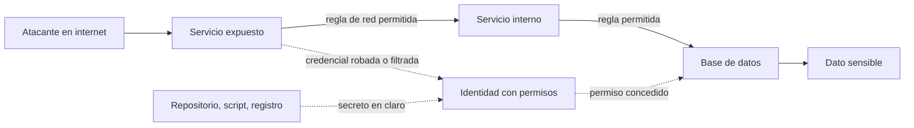
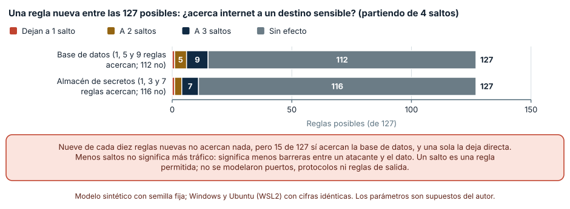
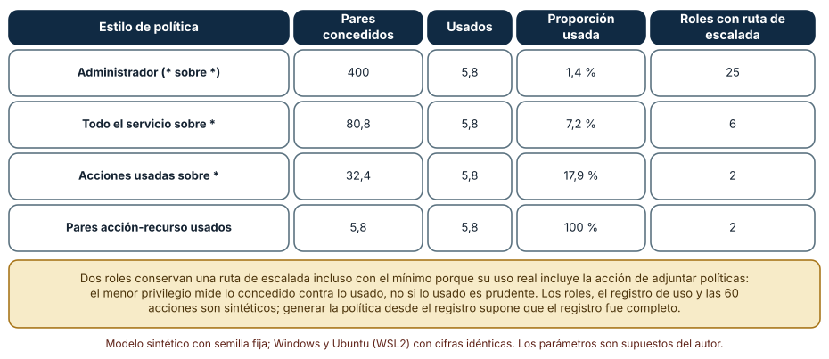
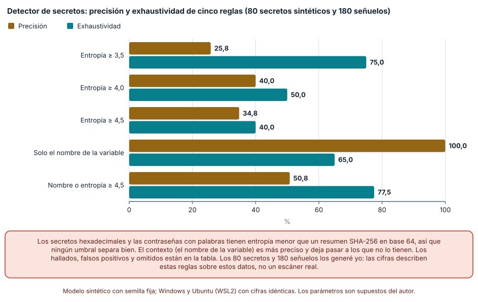

# SE-353 — Redes, identidad y secretos en cloud

[← SE-352 — Serverless y ejecución gestionada](../../classes/part-29-cloud-plataforma-e-infraestructura/se-352-serverless-y-ejecucion-gestionada/README.md) · [↑ Parte 29](../../classes/part-29-cloud-plataforma-e-infraestructura/README.md) · [📚 Índice completo](../../classes/README.md) · [🌐 Portal](../../site/classes/SE-353.html) · [SE-354 — Infraestructura como código y estado →](../../classes/part-29-cloud-plataforma-e-infraestructura/se-354-infraestructura-como-codigo-y-estado/README.md)

## Punto profesional y fundamento pedagógico

**Punto profesional.** La clase existe para que puedas responder, sobre cualquier despliegue en la nube, tres preguntas que suelen contestarse con una impresión: qué puede hablar con qué, quién puede hacer qué y dónde viven las credenciales que lo permiten. Cada una tiene un mecanismo medible, y la medida muestra que lo peligroso rara vez es una sola regla errónea sino la distancia que queda entre un atacante y un dato.

**Por qué aparece aquí.** Sigue a **Serverless y ejecución gestionada**: allí cada pieza podía disparar a otra con permisos propios. Ahora esas conexiones y permisos se hacen explícitos. El caso conductor de la parte es la plataforma de entregas llevada a una infraestructura gestionada, y esta clase decide qué puede alcanzar la base de datos con las entregas de los estudiantes.

**Error conceptual que debe corregir.** Creer que una red privada es una frontera de confianza. Que algo no tenga una dirección pública no lo protege si un servicio alcanzable puede llegar a él: la seguridad de una red se mide en saltos y en reglas, y la identidad que usa cada pieza importa más que su posición.

**Secuencia de aprendizaje.** Antes de leer los resultados, predices cuántos saltos separan internet de la base de datos, qué fracción de los permisos de un rol se usa de verdad y si un detector por entropía encontrará los secretos con pocos falsos positivos; después mides los saltos sobre un grafo de doce servicios tras cada regla posible, comparas cuatro estilos de política en 25 roles y evalúas cinco reglas de un detector sobre 260 cadenas sintéticas. La secuencia usa predicción, explicación propia, contraste y recuperación. [ICAP](https://icap.education.asu.edu/research) distingue participación de construcción de conocimiento; [How People Learn II](https://nap.nationalacademies.org/catalog/24783/how-people-learn-ii-learners-contexts-and-cultures) exige conectar conocimiento previo, contexto y transferencia; la [práctica de recuperación](https://pubmed.ncbi.nlm.nih.gov/16507066/) respalda producir de nuevo la explicación tras una demora; y [Education for Life and Work](https://nap.nationalacademies.org/resource/13398/dbasse_084153.pdf) exige devolución que explique la causa del error.

**Evidencia de aprendizaje.** `red-identidad-secretos.md` con la predicción, las tres figuras reproducidas, el grafo de flujos permitidos de la plataforma con los saltos a la base de datos, una política de permisos mínimos por servicio generada desde el uso y un inventario de secretos con su dueño y su rotación.

**Límite de la conclusión.** La red, los roles, el registro de uso y los secretos son sintéticos y fabricados por el autor; no se evaluó ningún proveedor, ninguna regla de un cortafuegos real ni ninguna política de identidad real. Los 80 secretos y los 180 señuelos del detector los generé yo, y sus reglas se escribieron conociendo esos datos, así que sus cifras no miden un escáner real.

### Trazabilidad fuente → afirmación

| Fuente primaria u oficial | Afirmación que respalda | Lo que no prueba |
|---|---|---|
| [NIST SP 800-207, «Zero Trust Architecture»](https://csrc.nist.gov/pubs/sp/800/207/final) | Describe una arquitectura en la que no se concede confianza implícita por la ubicación en la red y cada acceso se autentica y autoriza. | No prescribe una implementación ni mide cuánto reduce incidentes. |
| [AWS IAM: lógica de evaluación de políticas](https://docs.aws.amazon.com/IAM/latest/UserGuide/reference_policies_evaluation-logic.html) | Documenta que todo se deniega por defecto y que una denegación explícita prevalece sobre cualquier permiso. | Es la lógica de ese proveedor; otros difieren en detalles. |
| [OWASP: Secrets Management Cheat Sheet](https://cheatsheetseries.owasp.org/cheatsheets/Secrets_Management_Cheat_Sheet.html) | Recomienda centralizar, controlar el acceso, rotar y auditar los secretos, y no incluirlos en el código. | No dice cada cuánto rotar un secreto concreto. |
| [RFC 1918, «Address Allocation for Private Internets»](https://www.rfc-editor.org/rfc/rfc1918) | Reserva rangos de direcciones para uso privado que no se enrutan en la red pública. | Una dirección privada no es una barrera de seguridad. |
| [RFC 4632, «CIDR»](https://www.rfc-editor.org/rfc/rfc4632) | Define la notación y la agregación de prefijos con la que se delimitan subredes y reglas. | No dice cómo dividir una red para una plataforma concreta. |

## Antes de empezar

Recupera lo aprendido en `SE-352`: una función se dispara por eventos y tiene permisos propios. La pregunta activa es: **¿cuántas barreras hay entre internet y mi dato, qué permisos sobran en cada rol y dónde están las credenciales que abren todo esto?**

## Prerrequisitos

- Haber completado `SE-352` o poder explicar qué permisos necesita una función para leer un evento y escribir un resultado.
- Python 3.11 o posterior; los experimentos usan solo la biblioteca estándar (`random`, `fnmatch`, `math`, `collections`) y no necesitan cuenta en un proveedor.
- Saber qué es una dirección IP privada, una regla de entrada y una política de permisos.

## Problema auténtico

La plataforma de entregas pasó a una red privada con tres capas: balanceador, aplicación y base de datos. El informe de seguridad concluyó «la base de datos no es accesible desde internet». Tres meses después, un componente de monitoreo con credenciales amplias fue comprometido y, con ellas, alguien leyó la base de datos sin tocar una regla de red. En una revisión posterior se halló además una clave de acceso al almacén de archivos en un script del repositorio. Cada hallazgo es de una capa distinta: la red decía la verdad y la identidad la desmentía, y el secreto hacía innecesario atacar cualquiera de las dos.

## Objetivos observables

Al terminar podrás:

1. modelar los flujos permitidos de una plataforma como un grafo y calcular los saltos mínimos desde internet hasta un dato sensible;
2. medir qué reglas nuevas acortan esa distancia y distinguirlas de las que no cambian nada;
3. comparar estilos de política de permisos por lo concedido frente a lo usado y por las rutas de escalada que dejan;
4. evaluar un detector de secretos por precisión y exhaustividad y explicar qué reglas son ciegas a qué;
5. diseñar la rotación de un secreto con su ventana de exposición.

## Mapa conceptual



El mapa tiene dos vías hacia el dato: la de **red** (líneas continuas), que cuenta saltos entre reglas permitidas, y la de **identidad** (líneas punteadas), que salta las reglas de red con una credencial. Reforzar una no cierra la otra, y por eso se miden por separado.

## Temas y por qué importan

| Tema | Por qué cambia una decisión profesional | Evidencia mínima |
|---|---|---|
| Segmentación de red | Cada regla permitida es una arista; el atacante camina por el grafo. | Saltos mínimos antes y después de cada regla posible |
| Identidad y políticas | Los permisos concedidos y no usados son superficie sin beneficio. | Concedido frente a usado por rol |
| Menor privilegio y escalada | Un permiso para cambiar permisos equivale a todos los permisos. | Roles con ruta de escalada por estilo de política |
| Secretos | Una credencial en claro hace inútil cualquier otra barrera. | Detector evaluado por precisión y exhaustividad |
| Rotación | La ventana de exposición de un secreto filtrado depende del plazo y de la detección. | Días expuestos según plazo de rotación |

## Conceptos y decisiones

### 1. Segmentación de red

Una red de nube se divide en subredes y se controla con reglas que permiten orígenes, destinos y puertos. El direccionamiento privado de RFC 1918 evita que un servicio sea alcanzable directamente desde internet, pero no impide que otro servicio alcanzable llegue a él. Cada regla permitida es una arista de un grafo y la seguridad de la red es una propiedad de ese grafo: cuántos servicios alcanza un atacante que compromete uno, y cuántos saltos necesita para llegar a un dato. La delimitación con notación CIDR hace que una regla amplia permita más de lo que parece: un prefijo corto abarca miles de direcciones.

### 2. Identidad y evaluación de políticas

Una identidad, de una persona o de un servicio, recibe permisos mediante políticas que listan acciones sobre recursos. La lógica documentada por AWS ilustra el patrón general: todo se deniega por defecto, un permiso explícito lo permite y una denegación explícita prevalece sobre cualquier permiso. Que las denegaciones ganen es lo que permite escribir barreras que ningún permiso futuro derriba. Pero también obliga a leer todas las políticas que alcanzan a una identidad, no solo la última que se tocó: el permiso efectivo es la combinación de todas.

### 3. Menor privilegio y escalada

El menor privilegio concede solo lo necesario para la tarea. Su dificultad es práctica: lo necesario se descubre usando, y los permisos amplios ahorran el descubrimiento. Por eso es habitual conceder «todas las acciones de este servicio» y olvidarlo. El riesgo grave no es lo concedido sino la **escalada**: una identidad que puede modificar políticas, crear credenciales o asumir otros roles puede concederse el resto. Un rol con permiso para adjuntar políticas equivale, en la práctica, a un administrador aunque su lista de acciones parezca corta.

### 4. Secretos

Un secreto, como una clave o un token, se usa para demostrar identidad y se vuelve una vulnerabilidad cuando se copia al lugar equivocado: el repositorio, un registro, una imagen, un mensaje de chat. OWASP recomienda centralizarlos en un almacén con control de acceso y auditoría, rotarlos, no incluirlos en el código y preferir credenciales de vida corta emitidas a cada servicio. La razón es la contención: un secreto en un solo lugar y con caducidad corta limita cuánto tiempo y a quién sirve si se filtra.

### 5. Confianza cero

NIST SP 800-207 describe una arquitectura que no concede confianza por estar «dentro» de la red: cada solicitud se autentica y se autoriza según identidad, estado del dispositivo y contexto, con el menor acceso posible. El principio es el contrario de la red privada como frontera. No elimina la segmentación, la complementa: la red reduce los caminos y la identidad decide quién los recorre. Es una orientación de diseño y no un producto, y adoptarla es sobre todo un trabajo de inventario de flujos y de identidades.

### Saltos hasta la base de datos

Se modela la plataforma como 13 nodos (internet, balanceador, dos servidores web, dos de aplicación, un procesador de trabajos, base de datos, caché, cola, almacén de secretos, bastión y monitoreo) y 17 flujos permitidos. Se calculan los saltos mínimos desde internet con una búsqueda en anchura y después se añade, una a una, cada regla posible que no exista (127 en total, sin contar reglas hacia internet), recalculando la distancia.

```python
def hops(edges, src):
    d, q = {src: 0}, deque([src])
    while q:
        u = q.popleft()
        for v in adj.get(u, []):
            if v not in d: d[v] = d[u] + 1; q.append(v)
    return d
# para cada regla (a, c) ausente: hops(base + [(a, c)], "internet")["db"]
```

| Destino | Saltos al inicio | Reglas que lo dejan a 1 / 2 / 3 saltos | Reglas sin efecto |
|---|---:|---|---:|
| Base de datos | 4 | 1 / 5 / 9 | 112 |
| Almacén de secretos | 4 | 1 / 3 / 7 | 116 |

Nueve de cada diez reglas nuevas no acercan nada, pero 15 de 127 acercan la base de datos y una sola, la regla desde internet, la deja directa. La distancia de cuatro saltos no es una garantía: es la consecuencia de que cada servicio solo habla con el siguiente. Además, el grafo muestra que un componente de monitoreo con conexión a la aplicación y a un servidor web añade caminos que la vista «tres capas» no dibuja.



**Cómo leer la figura.** Cada barra es un destino y mide las 127 reglas que se podrían añadir; el color dice qué distancia deja la regla desde 4 saltos. Casi todo el ancho es gris (reglas sin efecto) y los tramos de color son las pocas reglas que acercan el dato: 15 en la base de datos y 11 en el almacén de secretos. **Dónde deja de valer:** un salto es una regla permitida, sin puertos, protocolos ni reglas de salida, y supone que el atacante puede usar cualquier servicio alcanzable; la red real de un proveedor tiene capas adicionales, como las reglas por instancia y por subred.

### Permisos concedidos y usados

Se generan 25 roles con semilla fija; cada uno usa entre 4 y 8 pares «acción, recurso» dentro de uno o dos servicios de seis (60 acciones, 40 recursos, 400 pares válidos), y una acción de «adjuntar políticas» en el servicio de identidad. Se comparan cuatro estilos de política y se cuentan los pares concedidos, los usados y los roles con ruta de escalada.

```python
if style == "administrador (* sobre *)":    return universe                         # 400
if style == "servicio:* sobre *":           return sum(10 * res[s] for s in svs)
if style == "acciones usadas sobre *":      return sum(res[s] for a, s in names)
else:                                       return len(used)                        # pares usados
```

| Estilo de política | Pares concedidos (media) | Usados | Proporción usada | Roles con ruta de escalada |
|---|---:|---:|---:|---:|
| Administrador (`*` sobre `*`) | 400 | 5,8 | 1,4 % | 25 |
| Todo el servicio sobre * | 80,8 | 5,8 | 7,2 % | 6 |
| Acciones usadas sobre * | 32,4 | 5,8 | 17,9 % | 2 |
| Pares acción-recurso usados | 5,8 | 5,8 | 100 % | 2 |

Bajar de administrador a «todo el servicio» elimina el 80 % de lo concedido y deja 19 de los 25 roles sin ruta de escalada. Limitarse a lo usado mantiene dos roles con la ruta porque su uso real incluye la acción de adjuntar políticas: el menor privilegio mide lo concedido contra lo usado, pero no juzga si lo usado es prudente. Hay además una condición: generar la política desde el registro de uso supone que el registro fue completo; una función que se ejecuta una vez al año no aparece en un registro de un mes.



**Cómo leer la figura.** Cada grupo es un estilo de política; la barra coral es lo concedido y la verde azulada lo usado, en escala logarítmica. Mira la distancia entre ambas: con el administrador es de casi dos órdenes de magnitud y desaparece solo cuando se concede lo usado. La tabla da la proporción usada y los roles con ruta de escalada. **Dónde deja de valer:** los roles y su uso los generé yo con una distribución uniforme; en una organización real el uso está agrupado y cambia con el tiempo, y una denegación explícita puede acotar la escalada que esta tabla cuenta.

### Un detector de secretos con límites

Se generan 80 secretos sintéticos (40 cadenas de 32 caracteres en base 64, 20 hexadecimales de 40 y 20 contraseñas hechas con una palabra, cuatro cifras y un símbolo) y 180 señuelos que se les parecen (60 identificadores de commit de 40 hexadecimales, 60 UUID y 60 resúmenes SHA-256 en base 64). El 70 % de los secretos aparece asignado a un nombre como `clave` o `token`. Se evalúan cinco reglas.

```python
def ent(s):
    c = Counter(s)
    return -sum(v / len(s) * math.log2(v / len(s)) for v in c.values())
# regla: len(v) >= 20 and ent(v) >= 4.5      (entropía de Shannon por carácter)
# regla: el nombre de la variable contiene clave, token o secreto
```

| Regla | Hallados | Falsos positivos | Omitidos | Precisión | Exhaustividad |
|---|---:|---:|---:|---:|---:|
| Entropía ≥ 3,5 | 60 | 173 | 20 | 25,8 % | 75,0 % |
| Entropía ≥ 4,0 | 40 | 60 | 40 | 40,0 % | 50,0 % |
| Entropía ≥ 4,5 | 32 | 60 | 48 | 34,8 % | 40,0 % |
| Solo nombre de variable | 52 | 0 | 28 | 100 % | 65,0 % |
| Nombre o entropía ≥ 4,5 | 62 | 60 | 18 | 50,8 % | 77,5 % |

La entropía media de una cadena en base 64 de 32 caracteres es 4,58 bits, la de un hexadecimal de 40, 3,72, igual que un UUID. Por eso ningún umbral separa bien: uno que atrape los hexadecimales atrapa los 120 señuelos hexadecimales, y uno alto deja pasar los secretos hexadecimales y las contraseñas con palabras, que tienen poca entropía. Los 60 resúmenes SHA-256 en base 64 son falsos positivos a cualquier umbral razonable, porque tienen la misma entropía que una clave. El nombre de la variable es mucho más preciso y es ciego a los secretos que no lo llevan: aquí, 28 de 80.



**Cómo leer la figura.** Cada grupo es una regla; la barra dorada es la precisión (qué parte de lo señalado era secreto) y la verde azulada la exhaustividad (qué parte de los 80 secretos se halló). Mira el compromiso: subir el umbral de entropía baja ambas, y solo el nombre de la variable da precisión total a costa de omitir secretos. La tabla da los hallados, los falsos positivos y los omitidos. **Dónde deja de valer:** los datos son sintéticos y las proporciones de cada familia las elegí yo, de modo que las cifras describen estas reglas sobre estos datos; un escáner real usa además patrones de formatos conocidos y verificación contra el servicio, y se evalúa sobre repositorios reales.

### Cuánto dura un secreto filtrado

Si un secreto se filtra en un instante al azar entre dos rotaciones, la exposición media hasta la siguiente rotación es la mitad del plazo. Con detección a los 14 días, que obliga a rotar de inmediato, la exposición se acota por el menor de los dos tiempos. Se calculó con 20 000 filtraciones simuladas por celda.

| Plazo de rotación | Exposición media sin detección | Con detección a los 14 días |
|---|---:|---:|
| 7 días | 3,5 días | 3,5 días |
| 30 días | 15,1 días | 10,7 días |
| 90 días | 45,2 días | 12,9 días |
| 365 días | 183,2 días | 13,7 días |

La detección aporta más que acortar el plazo cuando el plazo es largo: con 365 días, detectar a los 14 reduce la exposición de 183 a 14 días. Con credenciales de vida corta emitidas por solicitud el plazo baja a horas y la detección importa menos.

### Ampliación: confianza cero, identidad de servicio y movimiento lateral

La **confianza cero** (*zero trust*) es un modelo de seguridad que no concede acceso por estar «dentro» de una red: cada solicitud se autentica, se autoriza y se evalúa en el momento, con la identidad de quien la hace y el contexto en que ocurre. [NIST SP 800-207](https://csrc.nist.gov/pubs/sp/800/207/final) lo describe como una arquitectura con un punto que decide (¿se permite esta solicitud?) y puntos que aplican la decisión. No es un producto ni una red: es la sustitución de la regla «lo que está en la red interna es confiable» por «solo es confiable lo que se acaba de verificar». La sección 5 de esta clase la enuncia; aquí se muestra con un modelo qué evita y qué no.

**Mecanismo: tres piezas que se complementan.**

- **Identidad de carga de trabajo.** Cada servicio recibe una identidad verificable y de vida corta, no una dirección de red. Estándares como [SPIFFE](https://spiffe.io/docs/latest/spiffe-about/overview/) definen un identificador (`spiffe://dominio/servicio`) y un documento firmado que lo acredita, renovado de forma automática.
- **mTLS (TLS mutuo).** En TLS corriente solo el servidor presenta un certificado; en mTLS lo presentan ambos extremos, y cada uno comprueba que el del otro está firmado por una autoridad en la que confía y que su identidad es la esperada. Así el servidor sabe quién llama, con una clave que no viaja por la red, y el tráfico queda cifrado. Las mallas de servicios como [Istio](https://istio.io/latest/docs/concepts/security/) lo aplican en un proxy junto a cada servicio, sin cambiar el código.
- **Autorización por servicio y por operación.** Saber quién llama no basta: una política dice qué identidad puede llamar a qué operación de qué servicio. Sin esa política, mTLS solo prueba que el llamante pertenece a la organización.

La **microsegmentación** es la versión de red de lo mismo: en lugar de segmentos grandes («la red de producción»), reglas por carga de trabajo (por ejemplo, [políticas de red de Kubernetes](https://kubernetes.io/docs/concepts/services-networking/network-policies/) que fijan qué pods hablan con cuáles). Es una capa de red; no sustituye a la identidad porque una dirección o una etiqueta de pod puede cambiar de dueño.

**Causa: el atacante no entra por la puerta final, entra por una cualquiera y se mueve.** Casi ningún incidente comienza comprometiendo la base de datos; comienza en un servicio con una vulnerabilidad o un secreto filtrado y avanza por donde la red lo permite: el **movimiento lateral**. Que el servicio inicial sea de poco valor no importa si desde él se alcanza el crítico. Por eso la pregunta de diseño es qué alcanza cada servicio, no qué servicio es el más protegido.

**Experimento reproducible.** `scripts/experiments_part29_ext.py` construye, con semilla 353, 40 servicios en 5 equipos de 8; cada uno llama a 3 otros (dos de su equipo y uno del equipo siguiente). Un atacante compromete un servicio al azar y avanza por las conexiones que la regla de red permite; cada servicio al alcance cae con probabilidad 0,3. Se promedian 4 000 ensayos. En la regla con identidad se supone que cada llamada autorizada expone 2 de 8 operaciones, de modo que la probabilidad de caída por salto baja a 0,075.

| Regla de red e identidad | Servicios comprometidos (de 40) | El servicio crítico cae |
|---|---:|---:|
| Red plana, confianza por ubicación | 40,00 | 100 % |
| Segmentos por equipo | 39,61 | 99,0 % |
| Lista de permitidos por servicio (microsegmentación) | 4,32 | 6,6 % |
| Identidad, mTLS y autorización por operación | 1,28 | 0,6 % |


**Cómo leer la figura.** Cada barra es una regla de red y su longitud, cuántos de los 40 servicios caen de media cuando el atacante parte de uno al azar. Mira que pasar de red plana a segmentos por equipo no cambia casi nada: como un equipo llama al siguiente, el atacante recorre el anillo. La caída llega con la lista de permitidos por servicio y se profundiza al limitar qué operaciones expone cada conexión. **Dónde deja de valer:** el grafo es sintético (3 llamadas por servicio), las probabilidades de caída son supuestos y no hay ninguna vulnerabilidad real detrás; el modelo trata las listas de permitidos como si estuvieran bien mantenidas, y una regla «por si acaso» que añade conexiones que nadie usa devuelve el resultado hacia la red plana. No se ejecutó mTLS ni una malla de servicios.

**Límite y decisión.** El experimento no mide una malla de servicios ni el coste de operar certificados, que es real: autoridad certificadora, rotación, observabilidad y un nuevo punto de fallo si el proxy cae. Una regla práctica: empezar por el inventario real de llamadas (qué servicio llama a cuál, medido, no supuesto), generar la lista de permitidos desde ese inventario, registrar en modo de observación qué bloquearía antes de aplicarla y añadir identidad cuando el cambio de red no basta. La confianza cero no elimina la detección: la clase de identidad y sesiones de la Parte 32 (SE-386) muestra qué ocurre con una credencial robada cuando el equipo comprometido es el dueño de la identidad.

## Definiciones de trabajo

- **segmentación:** división de una red en zonas con reglas que fijan qué flujos se permiten entre ellas.
- **política de permisos:** conjunto de reglas que concede o deniega acciones sobre recursos a una identidad.
- **menor privilegio:** principio de conceder a cada identidad solo los permisos necesarios para su tarea.
- **escalada de privilegios:** obtención de más permisos de los concedidos, por ejemplo modificando las propias políticas.
- **entropía de Shannon:** medida, en bits por carácter, de la imprevisibilidad de una cadena según la frecuencia de sus caracteres.

Las definiciones son operativas para la plataforma de entregas. Cada proveedor usa estos términos con matices y debe contrastarse con la documentación primaria enlazada al final.

## Ejemplo mínimo

El fragmento calcula los saltos desde internet a la base de datos en una red de cuatro nodos y después añade una regla. Antes de ejecutarlo, predice la distancia antes y después de la regla `("web", "db")`.

```python
from collections import deque
def saltos(aristas, origen, destino):
    adj = {}
    for a, b in aristas: adj.setdefault(a, []).append(b)
    d, q = {origen: 0}, deque([origen])
    while q:
        u = q.popleft()
        for v in adj.get(u, []):
            if v not in d: d[v] = d[u] + 1; q.append(v)
    return d.get(destino)
base = [("internet", "lb"), ("lb", "web"), ("web", "app"), ("app", "db")]
print(saltos(base, "internet", "db"), saltos(base + [("web", "db")], "internet", "db"))
```

La salida es `4 3`: una regla acorta la distancia. Registra versión de Python, comando y salida; después añade `("internet", "db")` y observa el resultado.

## Ejemplo profesional

El equipo de la plataforma dibuja el grafo de flujos permitidos a partir de las reglas reales, no de su diagrama, calcula los saltos a la base de datos y al almacén de secretos y encuentra que el monitoreo abre dos caminos de tres saltos. Quita la regla del monitoreo hacia la aplicación y la sustituye por una lectura de métricas que la aplicación publica. Para los permisos, exporta el registro de acceso de tres meses, genera una política por servicio con los pares usados, la revisa con quien conoce el negocio, añade una denegación explícita sobre el borrado de entregas y elimina el permiso de adjuntar políticas de todos los roles salvo uno con aprobación de dos personas. Para los secretos, mueve las claves a un almacén con acceso por identidad del servicio, emite credenciales de vida corta, activa el análisis de secretos en cada confirmación y rota las claves que estuvieron en el repositorio. Compara con el estado inicial: el monitoreo comprometido ya no alcanza la base de datos y una clave filtrada vale horas.

## Práctica guiada

1. Predice la distancia de internet a la base de datos y cuántas de las reglas nuevas posibles la acortan.
2. Define 12 nodos y 17 flujos y reproduce los saltos y la tabla de 127 reglas.
3. Genera 25 roles con semilla fija y compara los cuatro estilos de política.
4. Genera 80 secretos y 180 señuelos y evalúa las cinco reglas.
5. Añade una regla que reconozca resúmenes SHA-256 en base 64 por su longitud y mide el efecto sobre los falsos positivos y las omisiones.
6. Calcula la exposición con plazos de 7 a 365 días y con detección a los 14.
7. Entrega `red-identidad-secretos.md` y pide a otra persona que encuentre un camino que tu grafo no dibuja.

## Ejercicios

1. **Saltos:** si la caché se vuelve alcanzable desde internet, ¿cambia la distancia a la base de datos? Razona con el grafo.
2. **Escalada:** explica por qué un rol que puede crear credenciales equivale a un administrador y qué denegación explícita lo acotaría.
3. **Detector:** propón una regla que reduzca los 60 falsos positivos de resúmenes en base 64 sin perder secretos y di qué costaría.
4. **Rotación:** con un plazo de 60 días y detección a los 10, calcula la exposición media aproximada y compárala con 30 sin detección.

## Reto verificable

Entrega `red-identidad-secretos.md` con la predicción, las tres tablas reproducidas con las mismas semillas, el grafo de flujos de la plataforma con los saltos calculados, la política mínima de un servicio con su justificación y el inventario de secretos. Se aprueba si otra persona ejecuta el código desde un checkout limpio, obtiene las mismas cifras y puede decir qué haría un atacante que comprometiera el monitoreo. No se aprueba por afirmar que la red es privada y por tanto segura, ni por generar una política desde un registro sin decir qué periodo cubre.

## Caso conductor

La plataforma de entregas es el caso conductor de la Parte 29. Esta clase deja el quinto artefacto: el grafo de flujos, la política mínima y el inventario de secretos. `SE-354` pregunta cómo se declara todo esto de forma repetible. Cambia una regla, por ejemplo abre el puerto de la base de datos al bastión, y observa qué otro camino aparece.

## Preguntas frecuentes

### ¿Una red privada es una defensa suficiente?

No: reduce los caminos pero no decide quién los recorre. El caso del monitoreo comprometido muestra que una identidad con permisos amplios evita las reglas de red. Se necesitan ambas capas.

### ¿Por qué no basta con rotar los secretos con frecuencia?

La rotación acota la ventana, pero no evita la filtración ni sustituye la detección: con un plazo de 90 días, una filtración dura 45 días de media si nadie la detecta. Rotar, detectar y emitir credenciales de vida corta se complementan.

### ¿Se puede automatizar el menor privilegio?

En parte: generar políticas desde el registro de uso reduce lo concedido, y una persona debe revisarlas, porque el registro puede omitir usos poco frecuentes y puede incluir usos que no deberían existir.

### ¿Un detector de entropía sirve entonces?

Sirve como una señal más, no como una regla única: tiene muchos falsos positivos con resúmenes y UUID y omite secretos de poca entropía. Combinado con el nombre de la variable, patrones de formatos conocidos y verificación, mejora; ninguna combinación es completa.

## Fallo controlado y diagnóstico

Reproduce el fallo clásico de la clase: **una regla de red nueva acorta el camino a un dato sin que nadie lo note**. Añade al grafo de la plataforma una regla del monitoreo hacia la base de datos y recalcula la distancia.

Registra síntoma, entrada mínima, hipótesis, observación que descarta cada hipótesis, causa, corrección y prueba de regresión. **Síntoma:** una revisión de seguridad dice que la base de datos «sigue a cuatro saltos» pero un análisis del grafo da dos. **Hipótesis rivales:** (a) el análisis usa una lista de reglas obsoleta; (b) el monitoreo no tiene credenciales para usar la regla; (c) la regla nueva creó un camino corto. **Prueba:** recalcula los saltos con y sin la regla y lista los caminos de longitud mínima. **Conclusión:** la regla abrió un camino de dos saltos a través del monitoreo. **Regresión:** añade una prueba que calcule los saltos al dato sensible desde la configuración real y falle si bajan de un mínimo acordado. No arregles a la vez la regla y el proceso de revisión.

## Errores comunes y cómo corregirlos

| Síntoma | Causa probable | Corrección |
|---|---|---|
| «La base de datos no es accesible desde internet» y alguien llega a ella | Se miró la exposición directa y no el grafo | Calcular saltos mínimos desde la configuración real |
| Un rol de servicio puede borrar o listar todo | Política de servicio completo sobre todos los recursos | Generar la política desde el uso y añadir denegaciones explícitas |
| Un rol «de solo lectura» se vuelve administrador | Conserva un permiso de modificar políticas | Quitar la escalada o exigir aprobación de dos personas |
| Una clave aparece en el repositorio | Secreto copiado a un script | Mover al almacén, rotar la clave y activar el análisis en cada confirmación |
| El detector avisa de cientos de cadenas inofensivas | Umbral de entropía sin contexto | Combinar con nombres, formatos y verificación |

## Entorno y archivos clave

```text
work/SE-353/
├── README.md
├── seguridad/
│   ├── grafo.py
│   ├── permisos.py
│   └── secretos.py
├── tests/test_seguridad.py
└── evidence/red-identidad-secretos.md
```

El `README` declara versión de Python, semillas y comandos. Los experimentos usan solo la biblioteca estándar y se ejecutaron con CPython 3.12.9 en Windows 11 y 3.12.3 en Ubuntu bajo WSL2 con salidas idénticas. Los «secretos» son cadenas aleatorias generadas para el experimento y no abren nada; si usas un proveedor, no pongas claves reales en ejemplos ni en el repositorio.

## Seguridad, ética y accesibilidad

- los secretos del experimento son sintéticos: nunca uses un secreto real, ni siquiera caducado, para probar un detector;
- si un detector halla un secreto real en un repositorio, trátalo como filtrado: rota y revoca antes de limpiar el historial;
- un registro de acceso contiene datos sobre personas: minimiza lo que conservas y quién lo lee;
- documenta el grafo en texto además del diagrama, para que un lector de pantalla pueda recorrerlo;
- respeta los términos de los servicios que analices y no pruebes reglas sobre redes que no sean tuyas.

## Puente hacia el trabajo con agentes

Un agente al que se le pide «configura la red y los permisos de la plataforma» producirá reglas que funcionan, a menudo con orígenes amplios y roles con acciones comodín porque eso evita errores de permiso. Pídele en cambio que declare el grafo de flujos permitidos, que calcule los saltos a los datos sensibles y que genere los permisos desde el uso, con una prueba que falle si un rol puede modificar sus políticas. Revisa especialmente los comodines, los orígenes abiertos y cualquier credencial que el agente haya pegado en un archivo: son los tres lugares donde un despliegue funcional se vuelve inseguro.

## Transferencia

Traslada el análisis a otro dominio (por ejemplo, una tienda con pagos y un panel de administración): cambia los nodos y conserva el procedimiento de dibujar el grafo desde la configuración, calcular saltos, generar permisos desde el uso, evaluar un detector y planificar la rotación. La transferencia está lograda cuando puedes decir qué camino cerraría primero y por qué, no cuando los diagramas se parecen.

## Evaluación y evidencia

| Criterio | Evidencia para aprobar |
|---|---|
| comprensión | explicación de red, identidad y secretos como tres vías distintas hacia el dato |
| corrección | grafo, permisos y detector reproducibles con las mismas semillas |
| decisión | política mínima, grafo con saltos e inventario de secretos con rotación |
| diagnóstico | reproducción del fallo «regla nueva que acorta el camino» con regresión |
| incertidumbre | declaración de que los datos son sintéticos y el detector se afinó con sus propios datos |
| reproducibilidad | versiones, comandos, salida y límites declarados |

## Fuentes

- [NIST SP 800-207, Zero Trust Architecture](https://csrc.nist.gov/pubs/sp/800/207/final) — principios de confianza cero; autoridad: NIST.
- [AWS IAM: lógica de evaluación de políticas](https://docs.aws.amazon.com/IAM/latest/UserGuide/reference_policies_evaluation-logic.html) — denegación por defecto y denegación explícita; autoridad: documentación del proveedor.
- [OWASP Secrets Management Cheat Sheet](https://cheatsheetseries.owasp.org/cheatsheets/Secrets_Management_Cheat_Sheet.html) — gestión, rotación y auditoría de secretos; autoridad: proyecto OWASP.
- [RFC 1918](https://www.rfc-editor.org/rfc/rfc1918) — direcciones privadas; autoridad: IETF.
- [RFC 4632](https://www.rfc-editor.org/rfc/rfc4632) — notación CIDR y agregación de prefijos; autoridad: IETF.

Cada fuente respalda el mecanismo indicado; ninguna demuestra que los cuatro saltos, el 1,4 % de uso ni el 25,8 % de precisión se observen en una plataforma real. Esa afirmación depende de las reglas, los roles y los repositorios de cada organización.

- [SPIFFE: visión general](https://spiffe.io/docs/latest/spiffe-about/overview/) — identidad de carga de trabajo con documentos firmados y de vida corta; autoridad: proyecto SPIFFE (CNCF).
- [Istio: seguridad](https://istio.io/latest/docs/concepts/security/) — mTLS entre servicios mediante proxies y políticas de autorización; autoridad: documentación oficial de Istio.
- [Kubernetes: políticas de red](https://kubernetes.io/docs/concepts/services-networking/network-policies/) — reglas por pod como forma de microsegmentación; autoridad: documentación oficial de Kubernetes.

## Límites y siguiente paso

Se ejecutaron tres experimentos sintéticos en Windows y Ubuntu (WSL2) con resultados idénticos. No se evaluó ningún proveedor, política real ni repositorio real: la red, los roles, el registro de uso y los secretos son fabricados por el autor, el detector se escribió conociendo sus datos y la rotación supone filtraciones uniformes. La siguiente clase mira cómo se declara y se mantiene todo esto de forma repetible: infraestructura como código y su estado. La ampliación sobre confianza cero usa un grafo sintético de 40 servicios con 4 000 ensayos y semilla 353, ejecutado con CPython 3.12.9 en Windows; no se ejecutó mTLS, SPIFFE, Istio ni políticas de red reales, y las probabilidades de caída son supuestos del autor.

## Glosario

- **segmentación:** división de una red en zonas con reglas que fijan qué flujos se permiten entre ellas.
- **política de permisos:** conjunto de reglas que concede o deniega acciones sobre recursos a una identidad.
- **menor privilegio:** principio de conceder a cada identidad solo los permisos necesarios para su tarea.
- **escalada de privilegios:** obtención de más permisos de los concedidos, por ejemplo modificando las propias políticas.
- **entropía de Shannon:** medida, en bits por carácter, de la imprevisibilidad de una cadena según la frecuencia de sus caracteres.

---

[← SE-352 — Serverless y ejecución gestionada](../../classes/part-29-cloud-plataforma-e-infraestructura/se-352-serverless-y-ejecucion-gestionada/README.md) · [↑ Parte 29](../../classes/part-29-cloud-plataforma-e-infraestructura/README.md) · [📚 Índice completo](../../classes/README.md) · [🌐 Portal](../../site/classes/SE-353.html) · [SE-354 — Infraestructura como código y estado →](../../classes/part-29-cloud-plataforma-e-infraestructura/se-354-infraestructura-como-codigo-y-estado/README.md)
